# ExamPro《生成式AI训练营｜Free GenAI Bootcamp》中英字幕（deepseek - P54：-54-Gemini Models with Rohit Ghumare.zh_en - GPT中英字幕课程资源 - BV1SFEWzLEab

Hey this is Andrew Brown and welcome to the free Jennyi boot camp as we are continuing on on towe I don't know near the end here。

 but you I wanted an opportunity for us to get a little bit more familiar with Google's offerings and specifically the Gemini models and so I brought in my friend here Rohi who not just knows like Google products but obviously a lot of other stuff but I'm going to hand it over to him so he can introduce himself to you and then we're gonna jump in and see what we can learn about Google's offerings hello hello everyone and thanks Andrew for that cool introduction about me so I'm Rohi and I run this company like startup known as service but other than that I'm also Judy Google Cloud developer expert for Google Cloud and also I do kind of AI Kubernetes and is service me and those and kind of things but yeah like currently I'm talking about Ze trust。

AI workload and all and I will be similarly talking this in Tcon So going ahead of this opportunity which represents to me I will be showcasing today thei power than also Google products which are really amazing and you don't to everything on local system you can just use AI and turn everything there I don't know why they name it as AI and AIgan is also living one thing I like though is I don't think Google renames their products very often like other providers like Microsoft A they just change the name on you but Google I think is a little bit more stable about their names which I like just a few other contact Rohi is a Docker captain I think CNC ambassadors as well right so probably good friends with James James was in our live stream。

Last week yeah last week， so that was that was really fun with him。

 but I guess my question like because you're really good on the cloud native side and the Google side does that mean that you like to deploy your clusters to GKE。

 is that where you'd like to normally put them or，Or。Yeah。

 so like I have worked in AWS Google Cloud as well as Oracle Cloud。

 not that much worked under Azure and all， but yeah like depending on the use case of the companies we use anything and when I was at solo I deal with a lot of clusters like that was a company for which we were deploy0 clusters using issues service machine and all So depending on the use case and what company prefers what kind of contact they have with these companies。

 they prefer to use that still don't know which is the better and all but I guess my question is is do you have a personal preference because I found GK really really really easy to use another one that was really easy with C did you have any if you do your own personal project is there one that you like to utilize or so thing is like GK provides me free graduateitates and all so that's why prefer GK as well as GK is lot simpler than other。

Clus Cuban dismanment platform AWSK is also nice like it is the first Cuba disman platform which I have used I brought a lot of blocks on it but now when I switch to GK I'm just using GK for anything for the dis management the reason I say that is like I started off on the AWS side using AWS EKS and I mean now that I know how to use it I can do it but like I think one of the hardest parts for me is always the Englishgress controller like getting stuff into the cluster and AWS even today like I was going back and trying to figure it out and it was just it was painful and I just like I'm going go over to G have a nicer time but but anyway I'm going to go ahead and bring up your screen here and I believe that we are right now in Google AI to now I believe that there's another studio that that Google has which is the vertex AI studio what's the difference between this one and this？

yeah so for vertex A I will just show you the vertex AI to like if we go to the vertex A by Google you will see you have to try it in console So Google Cloud has you have to create Google cloud account and inside that you have to use the vertex A and also you can use the API and you can enable all recommended APIs and that is view tutorials so they have their own cloud studio kind of thing where you can practice the labs cloud Labs and all and you try the vertex A but thing is like you have to do it on the cloud collab collab of Google collab and stuff and also you can use in the vertex AI studio so it is also the similar like you have to use in the open chat and all but one thing is like you have to prepare your Google cloud account ahead So if you don't have anything you don't have Google cloud or you don't know how to launch the platform you don't want to give the credit card the Google cloud and all。

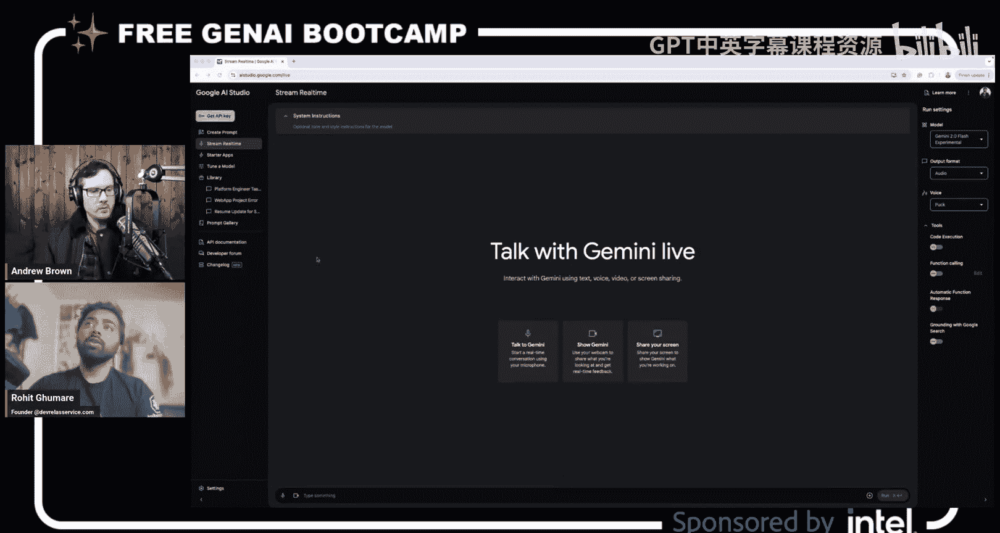

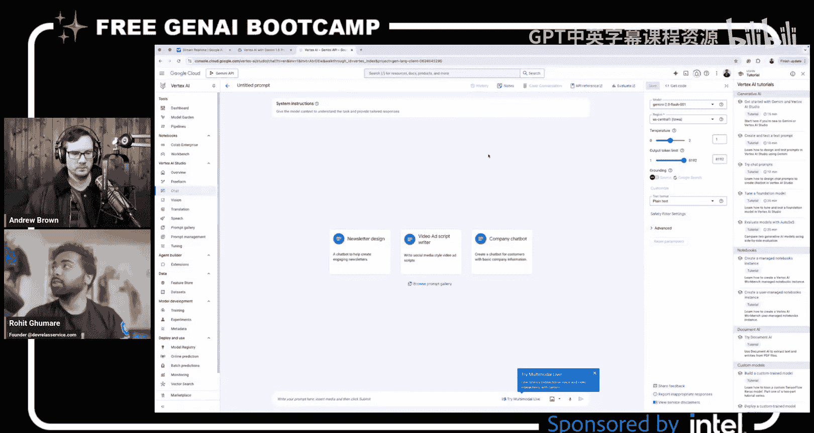

Simply go to AI studio and it is like you just have to go like co and feel free to use it So inside that theres like prompts real time and we will discuss everything letter but yeah you feels it feels a lot similar to like how like in Azure you have the Azure AI foundry they renamed it time will rename it usually be called Azure AI studio now it's Azure foundry but open AI like if you go to open AI playground。

 it looks almost identical to the Azure foundry and so I kind of feel like there's always like an easier entry point and there's one where it's like oh you're on the classroom provider with everything else there and so yeah I can see how Google AI studio we provide less friction if you don't want to buy into the entire ecosystem on day one sorry exactly exactly and one of the coolest thing is like you will see token。

So there are like  two million tokens for my chat and I don't have to pay anything to Google like it is for free Oh yeah who provides two million tokens for free I didn't even know like I didn't realize it was like so like upfront Senator Jenny and now I'm going here here I see Google do co best thing is like you like you chat it with a lot and all and all and you think like now I use my 2 million tokens now what to do just open new chat。

😊。

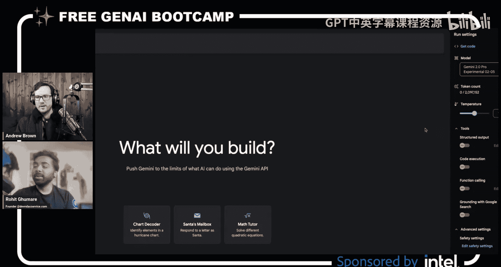

You have free to secondげ。That's that's really interesting the question ist very per I'm just going here because I see you have 2 million I have1 million maybe it's the Canadian conversion。

 maybe the pounds are worth more， but it depends on the model model  million yeah。

 I say I went to just Gemini 2。4 flash and now I have2 million or2 million2 million Yeah so if you use flash thinking then it will be1 million if you use pro which is experimental currently that is a2 million of Okay cool。

So moving ahead， so if we talk about Gemini， Gemini is like Google's AI。

 we can say similar to all of the competitors like XI Open AI than and everyone is doing the same thing right then AI Studio is the Google's product where you can use this Gemini for free and all there are different different models which we just talked about there is a flash depending on what is your use case so Gemini flash is also nice nice is one of the coolest model I would say in the Gemini which I use a lot and there is a flashlight they have recently launched。

 which is you will see like input dollars is cheaper compared to Gemini flash because it is the light version of it it is like 0。

1 but here it is 0。0 I want to show something just quickly the boot campers here I'm just going to share my screen for just two seconds because I want to emphasize how inexpensive this thing is。

And I keep going like wow， it's really expensive but I never I just I need someone to push push me a little bit farther here。

 but I'm gonna to try to make my interface larger and so I'm in Winsurf I like Windsurf and here they showed like credit usage right so 3。

5 is one times3。7s1 times thinking is 1。25 this has no G4。

5 is really expensive we had Trevor from8 from8 ofs and he was going to analysis and he just showed like G45 which's just like it's all the way up there but down here look at this it's 0。

25 it's like I think it's the cheapest credit on here and I don't know why I just don't go like this but we'll go back over to your screen here I'll get my screen here and we'll go back over to here that's when I want to find out because I hear it's really really capable right exactly exactly so if you know that that I played on this platform which that。

A assistant embedded from the start you will see like Gemini2 flash Gemini flash was like pre version of a rep system now they have moved to G40 mini but previously it was like Gemini flash similarly whoever wants the cheaper version of AI capabilities then they use the Gemini flash and all but yeah the flash thinking model which is like really amazing model for like if you want your model to think a lot you want to do like searching research and all then Gemini2 flash is really flash thinking is one of the coolest model the reason why that's really interesting is because first of all flashes really fast I think of it as a mini model but mini model with thinking because thinking can greatly increase the capabilities of a model right this is the first time I've actually seen a smaller model have thinking or reasoning built into it sorry。

So you will see like it is good for reasoning coding and multimodal understanding as provided by Google。

 but also we will use this model only in the few few minutes and also another model they recently experimenting a lot is like which helps for the digital trends streaming so good with the vision we will say and similarly if you have any integration tools and all you can use this model with that AI tools to make more use of your capabilities and all yeah So yeah。

 there are a lot of models other than that like learnlm and all you know these models this is open source versions of Geize model like Gema you will see like lot of postss around Gema open source and all So this is the open source version of these models where you have like limited power there will come on the like you can say 2927 So moving ahead that is another things which we will。

About like function calling and structured output and these are the tools AI studio provides from ahead so you don't have to worry about tuning and all right so yeah looks good till now lets let's deep dive into what why AI studio and nice right So one of the thing is like I like a lot you will see sample media here right so you can use the sample media as you can see we will choose any any of this like let's say there is this Sherlocks yeah let's choose the Sherlock tune which is like you will see 10 minute clip and we will add it to here Sherlock Sherlock J even in 1924 they were started to do Sherlock J Will Sherlock are yeah and if you see here it is like177 million 77000 tokens are using。

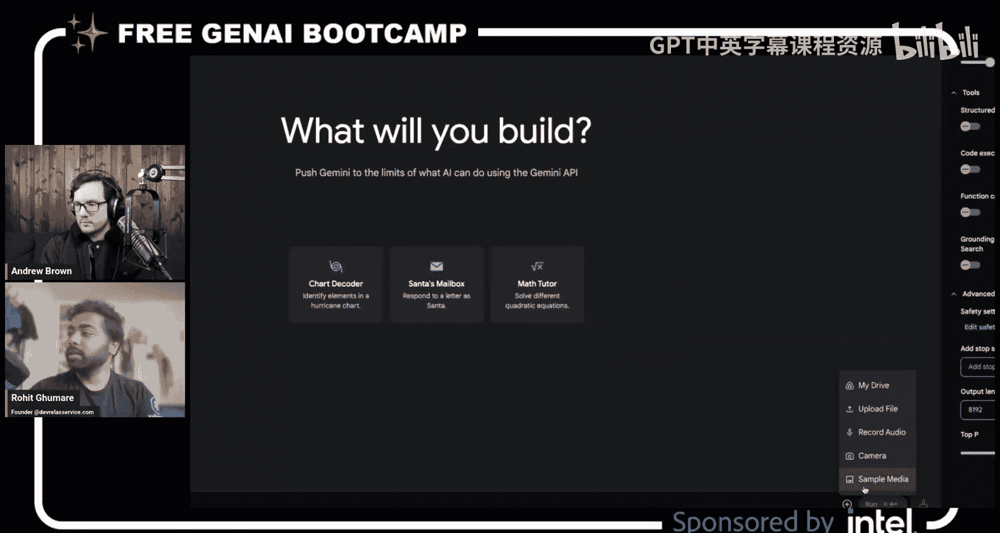

Yeah， so it scan really fast because it is sample media， but similarly， if you upload the video。

 I have tried it and it is still way faster than any studio platform I have used。

 So you can try once so let's let's let's ask anything like what are the what are the。

Best achievements。S log。Had in his。Video let's ask this because I have never tried this example。

 I'm just trying this raw example of the audience to make it really simple and raw kind of video So it will take little time so it doesn't take much time but yeah little time for that Meanwhile we can see what I was talking about tools and all So let's say you have some things your model to do like you want only structured output kind of thing you can say set that structured output and it will give you that kind of format and there is also edit safety settings because you will see like you don't want the head speech from the model right then there is other things you know and So if you want like safety settings to be not on you can choose here to be there like there is also you must be seeing like a lot of AI models that。

😊。

Coming with the NS the NSFW filters and all right。 So this is similar kind of a way。

 but not completely that part I would say So as we can see here。

 She had many detective achievements in this video Here are some So it also gives you timest So you can go click on the timest and see like what they did。

 So similarly51 he walked onto back of moving train then similarly。

 it also showed like from this time to this time he fell asleep and then he was a great detective and all So everything everything achievements in this video they provided all of this Similarlyly。

 we can we can try for a more examples like let's say you have the museum right So in this museum also what kind of。

What kind of let's say what kind of antics were there who are the museum lover。

 they can find this similarly if you have like any your original video let's say you have been going to lectures of the US students a lot of audience will be mostly the students I guess so you are doing the you are sitting the lecture you are shooting the video and all and then you can go to home and like Google can you check this out I'm learning so much with you on the but I just like so excited but like one of the videos here is the JLP5s this is a listening exam we did this a week ago where people had to make similar questions right I literally just provide the YouTube link and I said like tell me the breakdown of all the questions in there and boom I got all the breakdown。

😊。

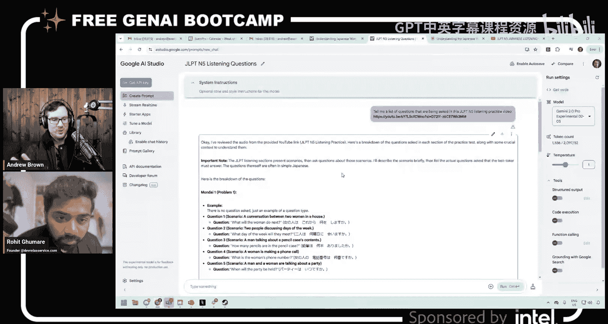

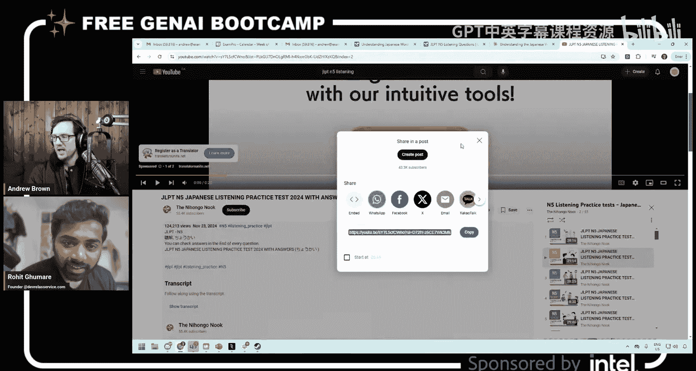

or another thing was like I'm trying to understand this morning I do Japanese language learning I'm trying to understand the wordri ari which is means like leftovers and so I said。

 okay you know break it down explain to me I got this stuff here and I said give me some challenges but I went over here I fed it over to the same prompt this better better than Clad's output for some like structurally right now reasoning is a different story I don't know but structurally I find this actually better than what clods producing than 3。

7 I'm going why why is that I don't understand but I'll get the screen back to you but I'm already starting to go wow you know。

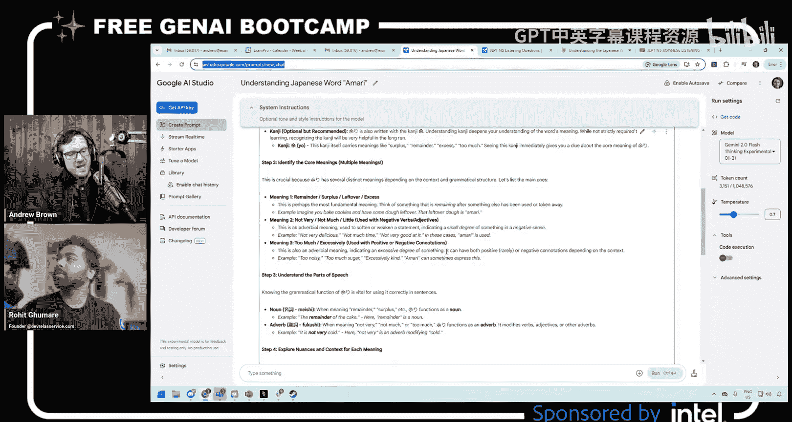

Exactly， exactly， so as can you go again to your can you go again to your screen So inside that can you scroll yeah。

 system instructions。 Yeah， Oh yeah， I didn't even touch that， yeah。😊。

Click on that yeah yeah also you can set the tone and style whatever you have in a mind and these models can just just answer that things。

 yeah。So I wonder if it'll let me do mean because this is something Claude won't let you do。

 So I'm gonna go ahead and enter this in as this thing。 And so， okay。

 I'm gonna say like another word in Japanese。 I'm trying to think of one here。 Let me go to G show。

 G show is oh yeah， how about the word vertical。 No， I don't want the word。

 Let's say to transfer to transfer， which is。😊，This word here。

So I'm going to bring it over to here and so now I've said be a mean and stern teacher， right？

It'll hit run and we'll see what we get I want to see if it actually does it or if it will refuse to do it。

Let me break it down。 My failing students included some。 It does it。 So like， okay。

 if you go to Claude， I don't know if this is still the case， but I'll show you this like， okay。

 so I'm gonna go and start a new conversation here and I'm gonna I need a little bit of this prompt。

 So I'm gonna go all the way to top。And。Yeah。Oh， you want me to do something here。 Let me see。

 Did I Oh， I was this one。 Oh， sorry， I mixed， I mixed them up， but it still worked in the right one。

 So I'll go， I'll go grab this prompt here。 And I'm gonna just go here。 And I think somewhere here。

 you should be able to specify。 It's probably in projects which is fine。

 You have to go into project suite， which is kind of silly。 I'm gonna say tone B stern。

 stern and mean。😊， let's see if it will do it because normally it would refuse to do it。

This is not being mean right so or it would it would outright refuse so 3。

5 would normally ever refuse this one here we go back over to it it did I think it was here。And so。

Here it is here it is so mean to move to answer to shift and I mean like obviously it doesn't follow the other one because I didn't say break it down the same way。

 but here it says you know， it wasn't it wasn't super mean but it still did it So now let me tell me what specifically would you like me to do this word give you a sentence explain the difference between it don't just stand there ask a proper question so that's perfect。

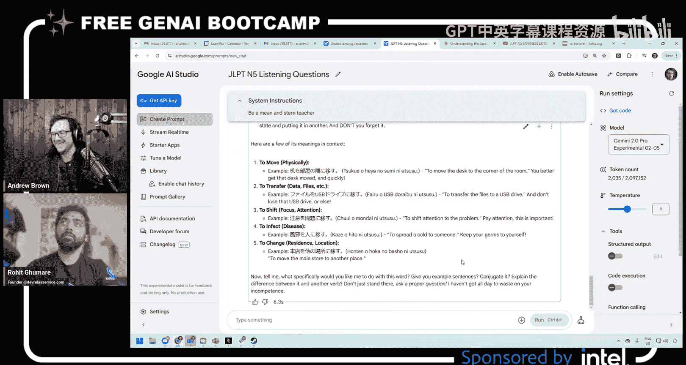

Yeah，So let's try a thinking thinking model right I talked about this Gei2 flash thinking experimental So what actually is different from what we talked about till now like tell me more about like quantum computing right let's let's talk about this right So now you will see there is a thinking right what it does So it actually shows entire listening to you you will not see this actually in your APIs if you use the Gei API to your local things at all but yeah you will see like it is actually going through everything and it things about it again and again and thinks like should I talk about this should I talk doesn't talk about it kind of thing you might have seen this in the dip R1 and all right this is a similar version of that I would say but yeah like you are free organ and all and you will also see like I would also use clear accessible language awarding over technical chagon。

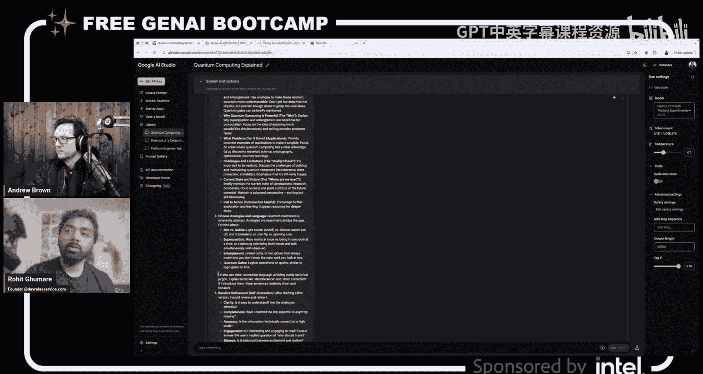

I did not have to ask about it， right， it is deciding from its own。😊。

So this is thinking model and you thinking model answered a really really research answer and this is really big research answer and it provided entire thing to you so here we were back in the word with Amari right and so I put it into the experimental model I'm on flash you're using 2。

 yeah're using 2。0 and so let's see what it did for reasoning so I said they say before I can learn I need to understand the word that that is a learning technique that you cannot memorize something if you don't understand it otherwise you just keep forgetting it so give me a step by step list of what we should understand about this word before we can learn it let's see what it thought about it here's the thinking process deconstruct the request the user wants to step bystep guided understanding the thing this implies a focus on foundational knowledge and structured approach okay brainstorm key aspects of understanding meaning what does it mean pronunciation writing grammatical function nuance and connotation usage examples related words common mistakes and points of confusion。

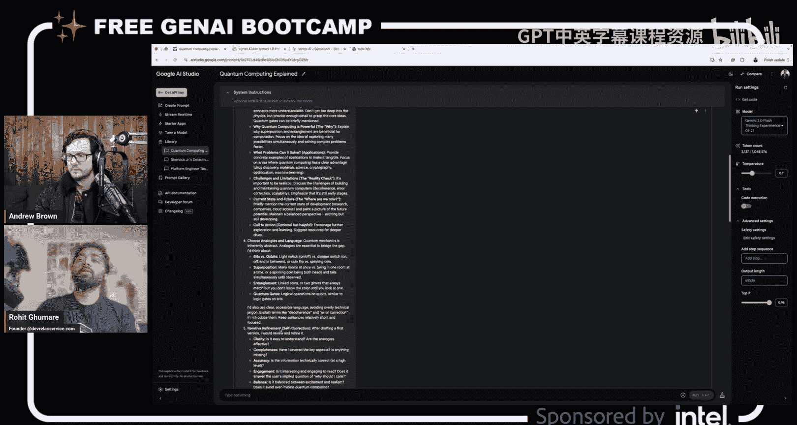

This is something similar。 I mean， this didn't show reasoning here and there's probably a reasoning model in here。

 I'm not sure how we get to it the extended one。 So here Sonic doesn't have much of this reasoning but yeah such can that has the Well well here it says we have basic meaning pronunciation。

 conji composition multiple usages。 and so we're getting something very similar。

 what is it pulling up that's a little bit different here。

 it was getting common mistakes and points of confusion， which to me is really good。

 but let's go on organize the brainstorm points by step by step list。

 So now it's creating the list of say it how to write it etc cetera like that flesh out each step So now apply the general framework in specific。

 What's really interesting is like I did tell it to think step by step。

 But my question is like if I didn't tell it to say step by step what would have done would have done the same thing like this because the whole point of chain of thought is like you say think step by。

Step but with these reasoning these experimental thinking models。

 I feel like you don't have to tell them that they just know to do that so what I would like to do as a test i'm going to just open this a new tab。

And we'll go over to here， I'm not sure how to manage tabs here， but I'm going go over to here。

 I'm gonna copy the same thing。 I'm just gonna to take the top one and leave this part out right and I'm going dump it in here and let's see what it does for experimental reasoning I like how you can really see what tokens are going on I love that Other ones don't make it as clear I guess they do in their interfaces。

 but right here on the right hand side makes it really really easy So let's expand and see what it's trying to ask So it says usually wants to understand the context here brainstorm possible means a nuance。

 explainplain the structure So it's getting really close to the same similar thing right flesh out component。

😊，Okay。Then understand the word and then we get here and so we have a different kind of example。

 so I guess the question is like did it do better with with step by step it actually appears that it did because at least in this in this one shot here it seems like chain of thought still can be a little bit useful for it。

What's your thoughts？Or it's all magic。Yeah， yeah。 chainin of thoughts help a lot So that's why that's why I actually deepC carbon created birds around the world。

 right So that's what was the reason。 So similarly， I guess yeah。

 that's why this thinking models and deep research and publicity deep research and Chinese de making the buzz。

 So yeah， chain of thoughts help a lot yeah。😊，Cool but I mean that's just that's just those couple models here have you used Gemini much to produce code for you Yes yes yes so that's what I want to show now if we go back to the screen so you can actually use the Gemini API here you just have to hit a create API key and then you can use it and also if you don't know like how to actually use this in your own system and know you can just past here and you can ask like make a Saas app using Gemini API which can use Google Vi let's say I just ask it and let's see what actually Google Google helps me if。

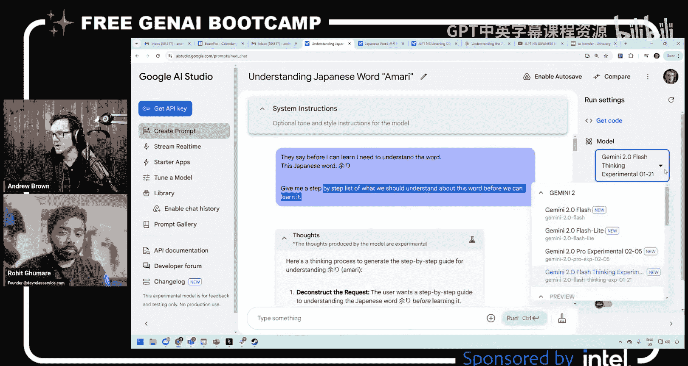

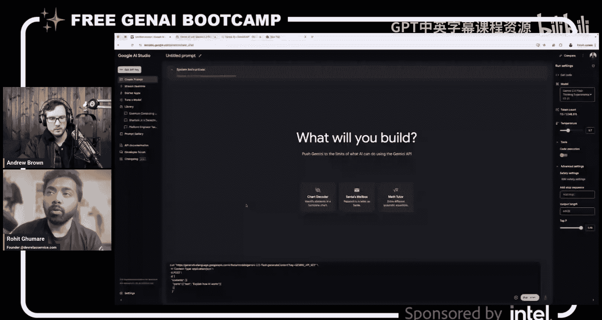

It should actually give me the code of how actually I will using this Gemini in my own local system at all So let's see it is providing code features like you will see here like image image upload ecommercecommer business can upload product images then Gemini Vi and analysis then tag generation So I I think it is providing on its own and it also provided simple Python flask backend code for me so focusing on Gemini vision because that was my gold from start right similarly it provided me enter code which I can just go on the VS code and let's say cursor or any events of whatever use use and all so you can use it you can try initially it will give you error for sure sometimes sometimes it is the best but yeah like try it and use the cursor to make it changes and all you have like AI and all so it also give you entire steps like how you can。

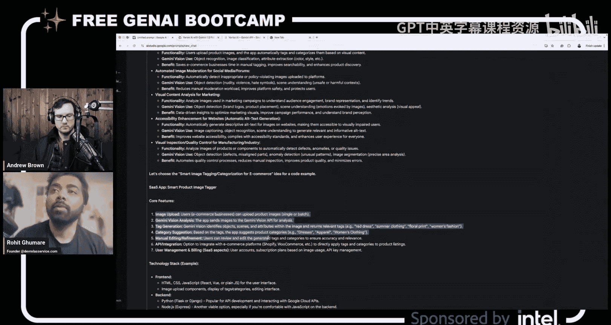

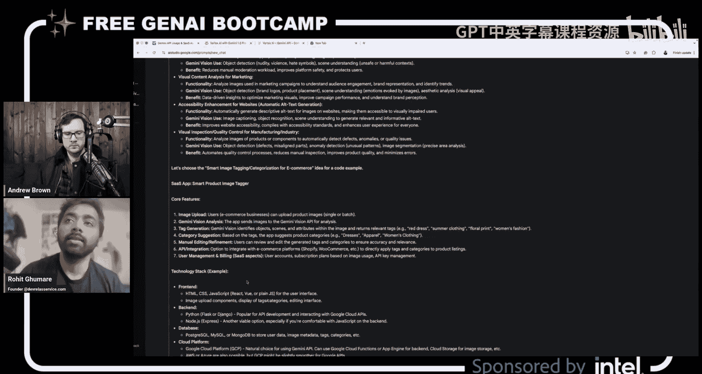

and so that's that's how I will use the Gemini API if I want to create fun star and as well as once you do this in the cursor or winds。

 whatever you have， you can set the instructions to your cursor like I'm using Gemini API and I want to build this platform can you create the Pi is at all and then you can simply create the entire code and all that's how I actually use the cursor and any any models I use。

 So yeah Gemini is the free one so I will say like use Gemini flash for whatever thinking and reasoning you want for your application at the free cost So I don't think anyone is providing that at a free cost So mega use of it Yeah how do the Gema do you know much about the Gema models how do they compare with Gemini or like have you seen anyone interested in the Gema models。

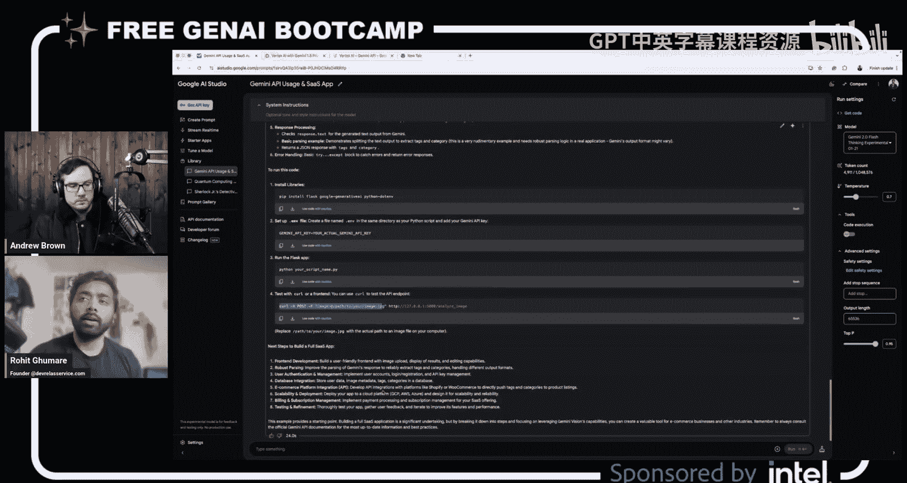

Yeah， so let's say you are building your own Sa platform and all which is highly using AI and all right so you can use the Gema。

 do the fine tu on it and then you can use it for your system Di using Gema will help you in the little like little chatboard and all but if you want like more capabilities of the Gema then of course you do the fine tu at all and you can do a lot of things around So do you do you think the key difference is that you're downloading the model weights and you're serving the model as opposed to like Gemin Gemini flashes I believe is only is only managed API right So the difference is that Gema the model weights are executing like you think that the cloud native perspective like if you use Gemini flash that model isn't running in your cloud native cluster right but Gema would be。

So that might be a key difference of people might have concerns about what's going on on the servers I'm not that concerned about Google but I'm just saying from an optic standpoint for the company that might be the key difference let's say you want to just open source source versiont you don't want to share anything to Gemini and you just want to do everything locally then of course go to Gema grab that model and use it on your local system Google also provides a lot of documentation for Gema and Kubernetes and all so I guess one of my friend is Google creates nice content around it so go check it out you can use Jma and Kubernetes and similarly you can build something on Ge and use it because you don't want to share anything to Google you want to keep it secret so that's how you can provide it more secure kind of platform I also never say that Ge。

I has Gemini live I didn't realize that it had that capabilities。 how much did you know about that。

 Like I'm just wondering like Cha BT， I use it， sometimes I use it to talk to it to like learn Japanese words and have a bit of back and forth。

 but I'm just wondering like what capabilities does it have。

 I'm sure we won't be able to hear it because the the stream won' won't send it along but have you used this much at all or So let's say you want to use the Gemini So you can directly go on this link or click on the stream real time once you do that。

😊。

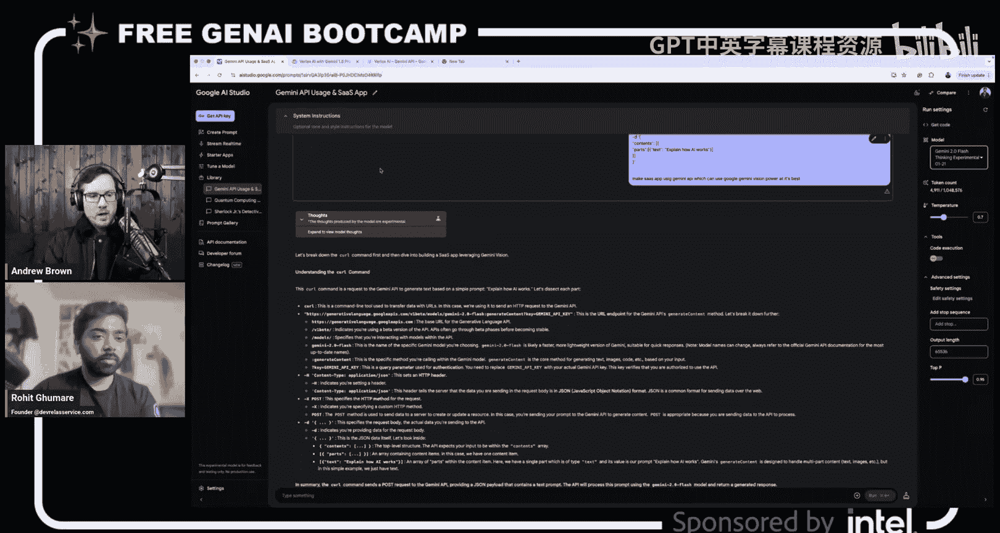

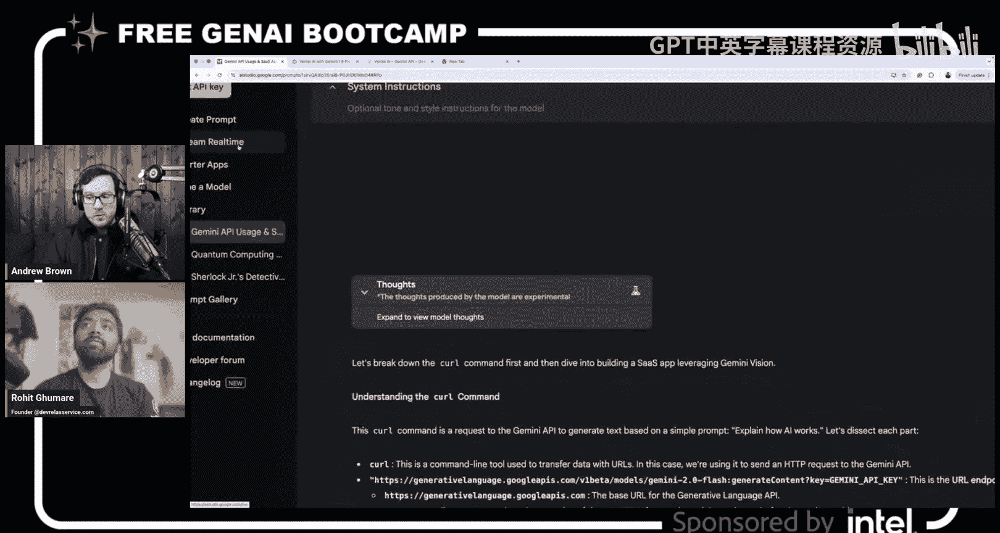

Then it is simple。 Like， let's say you want to show something， something to Gemini。 Let's。

 let's do the same thing。 Like I will share my screen。 Oh， you can share your screen， wow。😊。

So I'm showing my entire， entire background， everything， right， So let me ask， let me ask。

J permissions。 Oh， Im arguing the permissions， okay。Okay， so let me。

 let me refresh it and show Gemini with my webcam， like whatever around me。 So。

 and I can ask the Gemini like。See， like C out there。 Do you， do you recognize anything。

 I guess it is blur。 So first first let me do like unbl kind of thing。Yeah。Okay， so。Yeah。

 do you recognize the camera anywhere in my screen and what kind of camera is that？Oh okay。

 you you think you I can't hear it， but I mean， it's just， it seems like it works just like stuff。

 but I'm gonna， I don't no ones gonna hear it。 I'll make a separate video and I'll I'll show people a demo of of what the sound like。

 But I'm just curious I'm gonna just try quickly myself here。 I gonna say talk to Je and I。

 I say start recording。I got it allowed from the site。Hey， Jemini， can you tell me。

 how would I say in Japanese， I need to wake up this morning。

So I it did。 Oh， sorry。 We'll talk to you folks。 I just stop there but says， okay， Japanese。

 how would you say this and。Okay， in Japanese， you would say。Yeah。

 US US system is no I can't I know you can't hear it。 But what I'm saying is like。

 I just listening it back to see if it was right。 And it's funny because it's using。

 it's using a pronunciation that sounds like an English person saying it。 So， you know。

 like probably an example would be you know， like in in Spanish， there's the word jalao。

 like for a spicy， a spicy。😊，Pepper but like a person in English should ago gelappoos because that's how they would phonetically pronounce it。

 that's how this model is doing it。 So when you use ChatB and you ask it to speak Japanese it will switch from English to Japanese the same voice and the pronunciation is pretty close but here it's doing it's pronunciation as as if it was saying in English right so I mean it still was able to do it。

 which was cool but one deficit there of of that that live instruction but still impressive that it can analyze stuff so maybe not multimod multimodel voice depending on what voice we choose probably get is puck do you get anyone but puck yeah so whatever is short in that example I guess we short at the real time right so I asked for the whatever whatever is in the background and I ask about that camera So it actually noticed that camera。

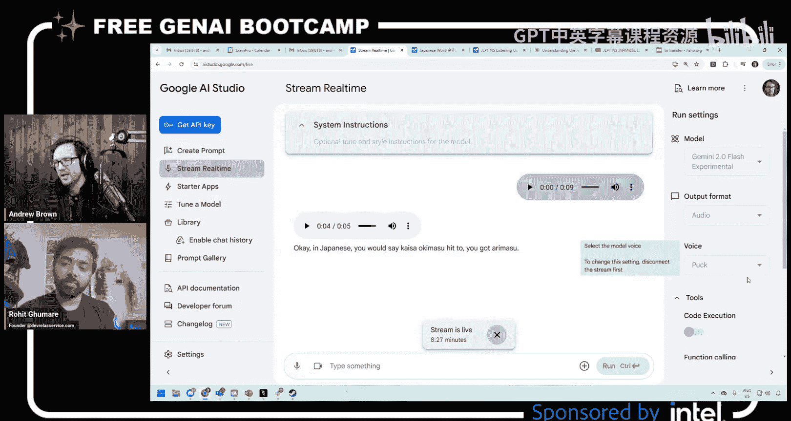

Told the colors in a manner。 it is like far away from me right still need to answer the colors exactly。

 And if I would continue to ask it about the brand I know it would have given me the answer in the correct question I have the entire demo kind of a video when the A video launched on the LinkedIn so anyone can go and check it Another cool thing is like you can also share your screen So let's say I want to share my screen and let's say now it is seeing my screen right So I will ask him Gei。

 can you check how I can run this code。😊。

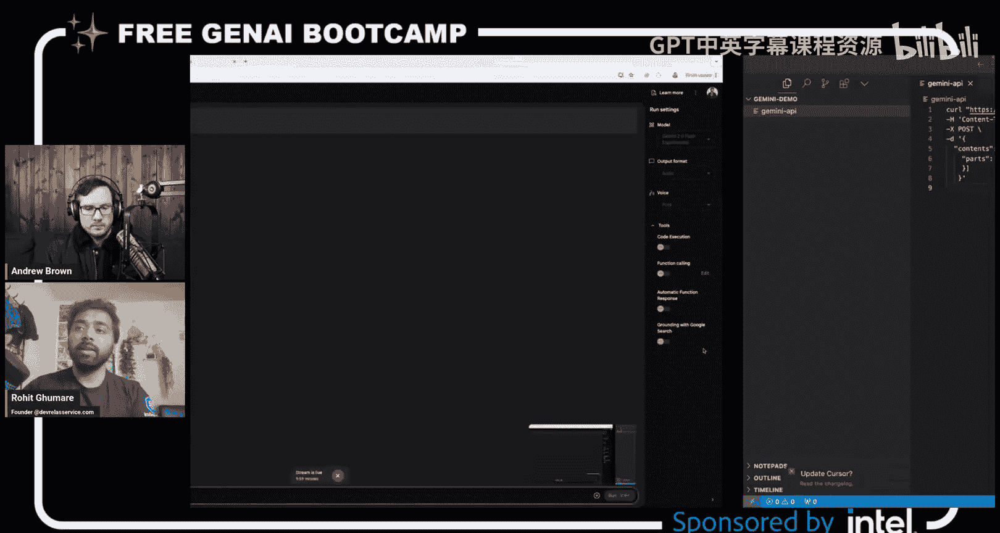

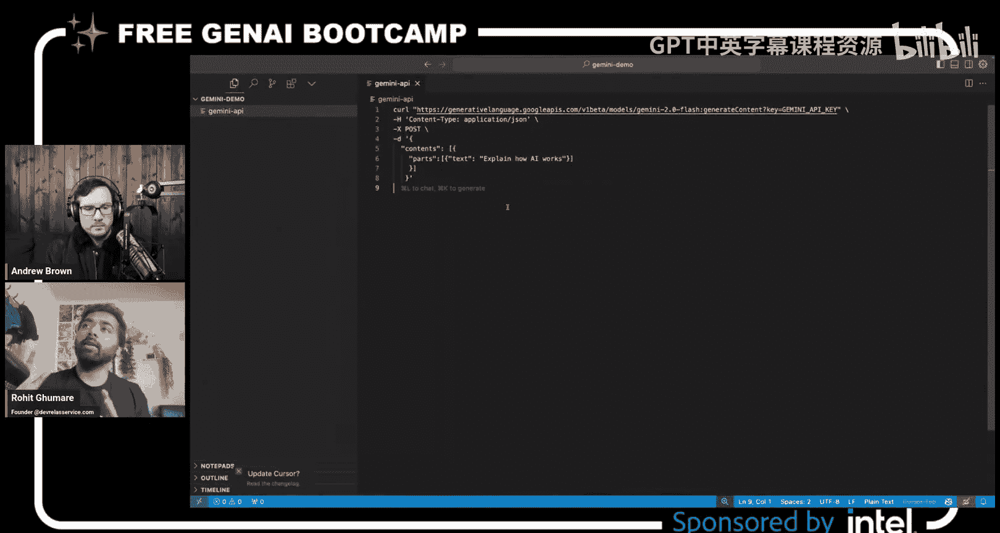

Yeah， exactly。Sorryで。I know the code and I know like what is going on。

 so I will just ask it like how actually I can run this code。

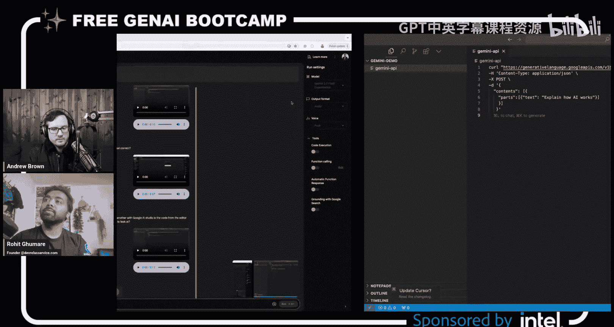

Yeah， so I will simply ask like how I can use how I can use the Gemina API key here。

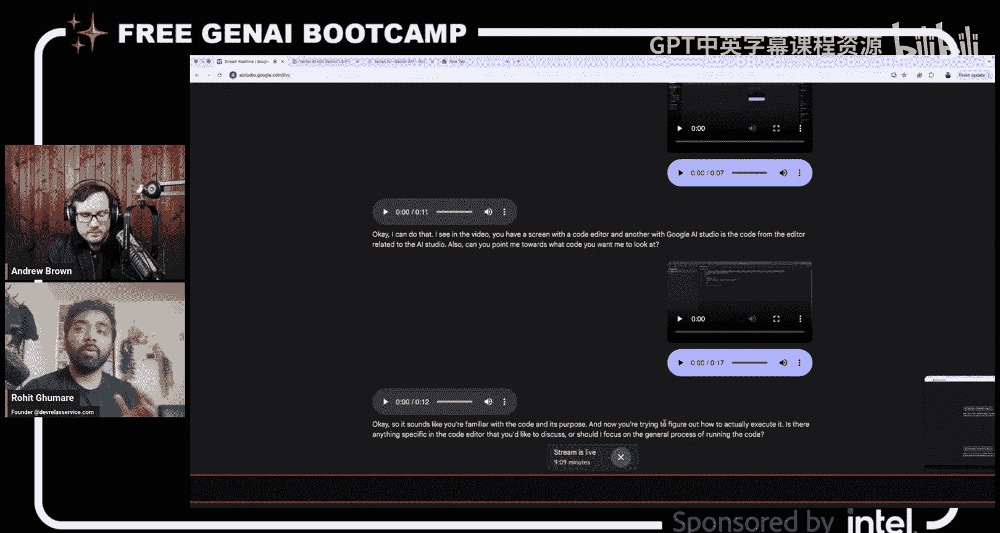

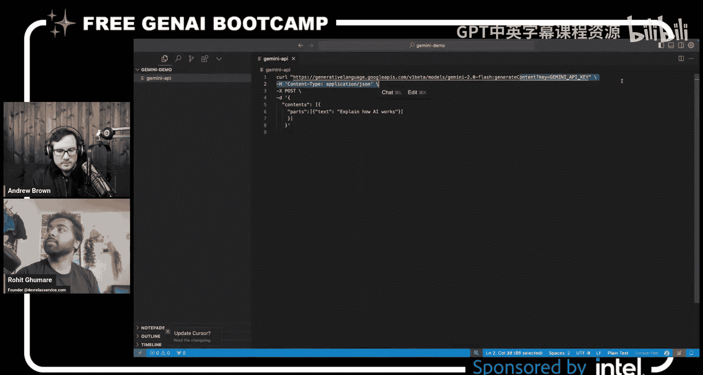

Exactly。

Exactly。Yeah， so it asked me again。

Yeah， so it continued to do the same and it actually it actually goes into the code。

 It says the code it will give me the Gemini API key link that I can go to the AI studio co and all and I can grab that key key and use in my local system so you to just go through like two three times again and again with it and it does the work but yeah like it is really cool like you can just share the screen on the web browser you don't have to do it any on you don't have to use your local system and anything it does automatically everything it it is really cool vision I would say Gemini Vi is really amazing in this capabilitymin I think the other thing is like this is code available right the or is realtime only in here so like in the top in the right corner we see that we have options to work with that I wonder if they actually had a I don't see a code for it but I don't thinkGBT has this but。

😊。

I always kind of wonder like do any of these provided as a service streaming。

 but I don't think so it might be too expensive so they probably want you to orchestrate the code yourself。

 right？Yeah that is capability available， but I guess that is in the enterprise version of mean it's some product I have seen that demo。

 but I don't know if we can use it， but yeah it is there but also you can change the languages and all whichever you want to hear about So they have like five kind of voice you can try that then also you want like function calling right so function calling is like new words declaration of your model right so you can declare whatever you want from start and it will act around it so and they also provide the API documentation for it go through this documentation if you want to do the function calling at all So this is really amazing right you can use the visual editor add the function declaration at all and similarly you can set the parameters to do whatever you want to ask in your model Similarlyly there is automatic function response then surrounding with Google search which is coolest thing right then yeah which。

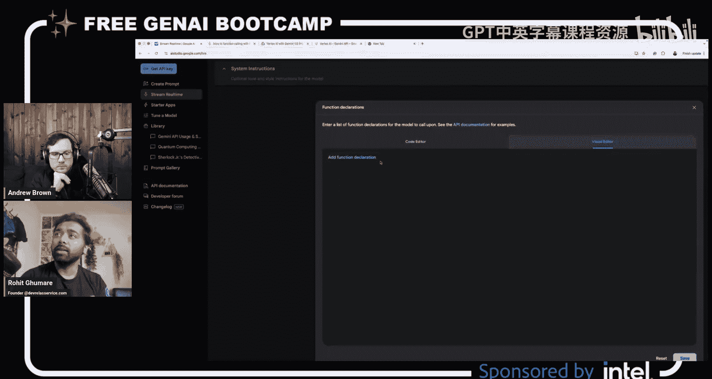

Kind of format you want like audio or text which you wanted you saw that audio right then you don't want the audio。

 you just want the text then you can do that stuff Similarlyly。

 one of the thing is like you can tune the model which is schoolest thing right which I talked about gem right you can you can bring any model now we're talking about flash thing tuning and all。

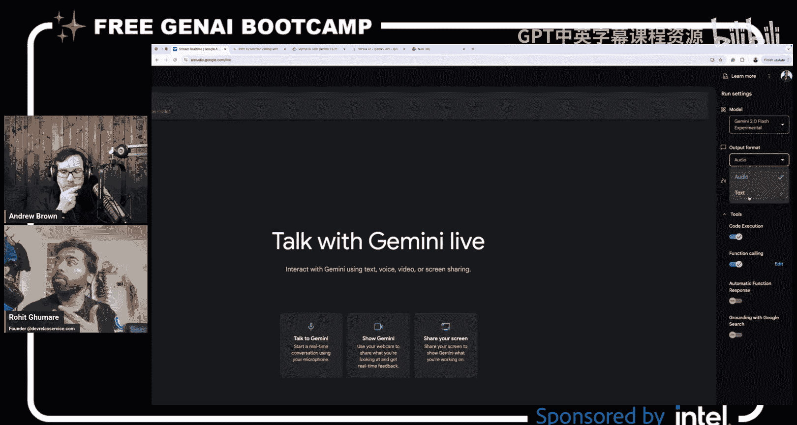

But you can actually use like news headlines then choose any existing prompt you have or you can this is summarizemarization one。

 so this will actually use your model to tuned model which only focus on the summarization of anything you want like past the lot of data and it will summarize simply summarize everything one of the thing is starter apps which I guess you know about if you know about media pipe and all So one kind of example will show like special understanding right So let's say that is this things right so previously without this models and all this AI studio and all you have to go through the go through this and you have to set the parameters bounding boxes and all if you have ever worked with computer vision and all so now you can just use this 2D bounding boxes and show the items and just ask it to label it。

Set the bounding boxes around it so as you can see it is setting the bounding boxes and it is set around it so you can also level each one of different different themes like it is level like cup then it is level it as a cup then it is level as a tomato or like mushrooms and whatever things are available there。

If you are using the computer vision， this is a really big thing because you are to set it manually previously by setting the metrics and all you to write the code。

 So this is one of the starter apps and really amazing。 I would say similarly。

 there is a video analyze map Exper up there So this map Expr in a way like you can try different different version of maps and you can see like which is the metropolitan was you this is just using the whole API for maps and doing the different things you can try different different things here。

 it is all available on Github。 you can try different things like you can go on the。😊。

You you can search whatever place you want to do then it' like which are the cold areas or like take me somewhere is there right So take me somewhere like cold one So it went to cold one even also go here and type something you want and you can try it So these are the starter apps you can also try different different things there are still we didn't show everything but yeah there is a prom gallery which you can choose to like like you can see map map tu is the code optimizer is the blog writer is there so just try yeah studio I guess you will like it a lot。

WhatWell， just just seeing to the Gemini 22。0 flash output。 it makes me want to go and try to。

 I have a baseline app that I continually build in different ones that I just haven't done in a flash。

 And so I'm really curious to see how performed， obviously as the flash implies， it's really。

 really fast as well。 Yeah at least I was liking it structured output。

 So because sometimes it's like these all these things kind of do the same thing whichs like what like how does it structured the output initially for free ability where I don't have to。

😊，Said give it so much structure is also nice like where it naturally will structure things。

 but yeah， I mean this is a great introduction into flash。

 appreciate your time I could have probably used your help with OPA I should have rope g for that but that's okay Any parting words for boot campers before we end end the video here。

😊。

Yeah， so yeah， one of the thing which I would like to share with Budha camp is like today it is like Jeni everywhere right。

 so try to use AI tools as much as possible to make your task simpler like as people say。

 like AI will not replace any anyone or any future developers at all。

The people who will replace anyone， everyone， as Noel said is like the people who are using AI。

So use AI， use AI tools to boost your productivity， use the tools like cursor。

 use the models like Gemini， GD and all build something around it and let's say you want to let's say you want to use the API of Google Maps and build something around it like let's say you want to build local local local food analysis design all you can just ask the cursor like give the project requirement document like I want these these things and it will follow that instruction and build the app for you and you can just debug it and design the things so yeah like I would say like software engineers are more becoming software designers using this AI tools but similarly I would say like try to use AI tools to boost your productivity will help you all and learn open source learn to the different tutorial you have in the YouTube and all there are a lot of things available currently now for free。

As well as the are structured courses available so try to learn， build in the open source。

 build the public， learn in public and contribute to open source because it will help you to get opportunities like you have never dreamt of yeah so all the best everyone and right now all models are are like they're being very generous about making things free right but when they're not free that if you can turn to open source and be able to run models locally or using cloud native solutions that's gonna be something that's that's why in this boot campamp we're trying to teach both the Man services and the cloud native services but yeah appreciate your time here and we'll see boot campers here in class soon Shaoo。

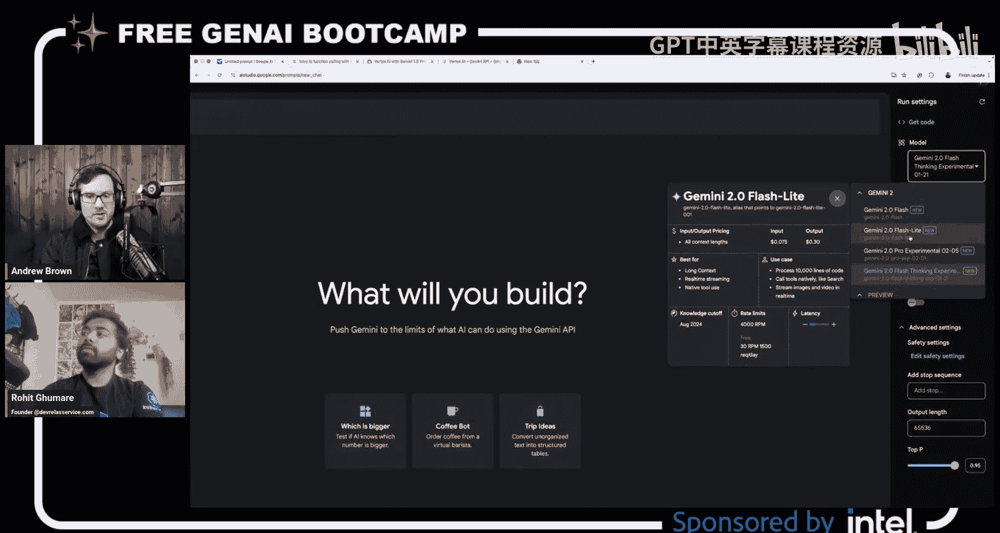