# ExamPro《生成式AI训练营｜Free GenAI Bootcamp》中英字幕（deepseek - P55：-55-AI Bootcamp Multimodal Visual   Language Experience Generator.zh_en - GPT中英字幕课程资源 - BV1SFEWzLEab

All right， and welcome to a brief introduction of the multimodal AI Imersive Experience generator。

 where we'll be looking at how to create a language learning project using an existing reference kit on an AIPC and figure out how to change it so that we can develop a really interesting immersive language learning application。

My name is Rio Chervo and I'm an AI evangelist and architect at Intel。

 and I'll be walking you through the process of how you can follow along with this workshop and generate the results that we'll be taking a look at today。

So just to get started with initially looking at how to get started with downloading and setting up for the solution。

 we're going to start off by navigating over to the OpenBno Bill deploy repository。

 which is an open source repository which contains a bunch of different implementations to get started and we'll navigate over to the AI RefF kits directory on the master branch and to the multimodal AI visual generator。

 which is what we'll be using for this particular workshop。

Now as part of this you'll see a number of different files and in addition to that a brief explanation of what the toolkit does and how it works。

 so for example you can see here a sample GIF where you're able to basically narrate out different types of words and the visual generator is working on the fly to be able to generate these images for you on an AIPC so we're going to take a look at how to do that what goes into the software and the hardware stack for implementing these types of solutions and what are some ways that we can tweak it in order to support different types of languages as well。

😊，Now， briefly， before we get into installing it and diving into the code base。

 I wanted to talk briefly about the different models or the technology stack for this as well。

Throughout this implementation we'll be leveraging first the OpenVeno toolkit。

 which is an open source AI toolkit that allows you to take models from different types of frameworks like Pytorch。

 Tensorflowlow， Carris and others and convert it to a intermediate representation format that can then run efficiently on different devices we also have the OpenVeno GenningI toolkit which allows us to run some gender to AI models as we'll see soon。

And then we have our direct models that we'll be using for this application。

So to go through briefly the pipeline， we're first looking at a。Spch detect model like Whi。

 we then looking at a large language model like the Lama 38 billion Instruct model。

And then we're looking at a couple of other models for image generation experience。

 we have latent consistency models and stable diffusion。

 which allows us to generate these images given some text。😊。

And we also have supervental to kind of upscale and make the image look really immersive and efficient and depth anything。

 which allows us to generate some additional depth effects Now the depth effects are out of the scope of this particular workshop。

 but you're welcome to dive into them further and explore it if you're interested using the source code。

😊，Again， the goal tying together this text stack is to eventually at the end。

 be able to narrate something in another language， let's say in Chinese。

 and have the application automatically transcribe it and convert it to text and then generate a really cool。

 immersive image around it to kind of help with being able to learn the language， how to speak it。

 and also get some really cool results as a result of immersing in the experience。😊，All right。

 so that being said， we've kind of talked about the source of the repository and where to find the different files。

 as you can see here there's a couple of different ways to go about with accessing the code。

 you can either clone the repository or you can download it as a zip file and then navigate over to that specific directory。

So since I already did that there， what I'm going to do now is go ahead and navigate over to my current clone of the directory and then talk a little bit about the code。

 what we're looking at in terms of the implementation， and the hardware specs。

 which is also another interesting part of the puzzle。So here I'm navigating over to my fork of the。

Application itself。Navigating over to the multimodal AI Vi generator folder。

 and we're ready to get started with a number of key files that we can leverage。

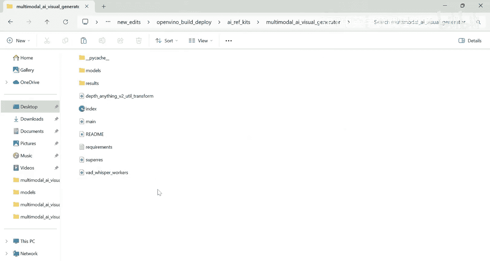

Now in order to be able to first download the models and leverage them for the application。

 we need to follow a few key steps I've opened up the Readme here in VS code and we're able to basically go ahead and start to analyze the different key steps of the implementation So one of the first things that you want to do is create a virtual environment here using the PythonhenM V andV run end environment depending on whether you're using Windows or Linux and then you'll be able to basically install the requirements and get ready for your system again in this case I'll be showing you the full walkthrough on a Windows system and I'll be going through the hardware requirements or at least the hardware recommendations that I'm using in just a moment but you're welcome to use your own system and adapt it for your purposes in your use case。

Let me pull up the requirementsquitxD file really quick so you can get an idea of some of the model download requirements here。

 again lots of key libraries that we're leveraging including Opimum Intel， NumpI， transformers。

 diffusers， etc， that will go into being able to install and convert our models。

So why are we going through the process of downloading and preparing models Well the whole purpose of this application is to be able to run it portably on a simple PC without needing any internet connection so during the download and preparation of the model stage we're basically taking these models off the shelf from different organizations like the Huging F hub and then converting it to an intermediate representation format where we're able to run it efficiently locally on our devices again the goal here is to improve the memory efficiency and the runtime and basically be able to leverage it without having to use the cloud。

 locally on our PCs。So that's a process that after kind of creating your environment and installing your requirements do Tt file。

 you would run for。The different types of models and we do actually have a neat Python script that shows you how to do this and basically if you run it。

 you're able to get all of the models downloaded into your folder automatically。

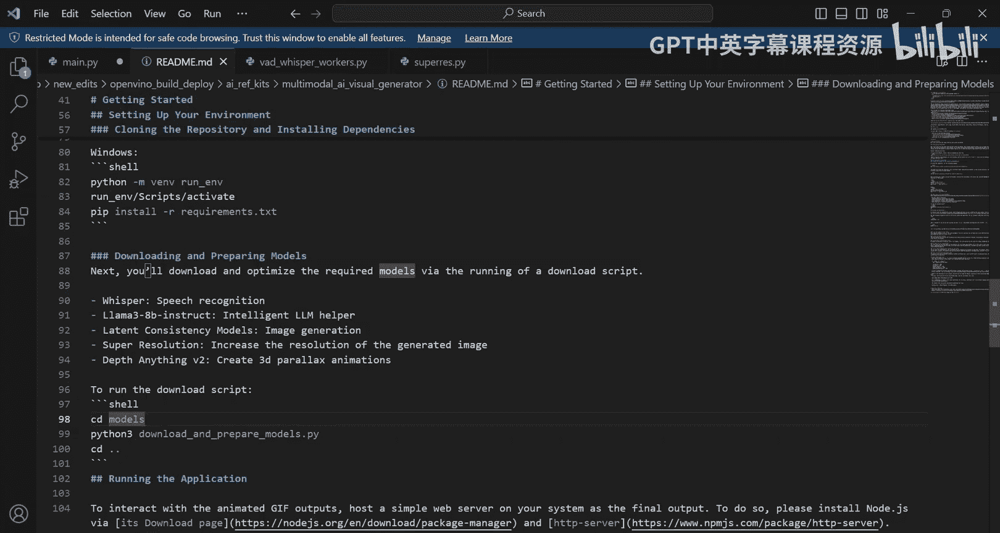

So if I pull up that Python script really quickly， which we can find in the models folder。

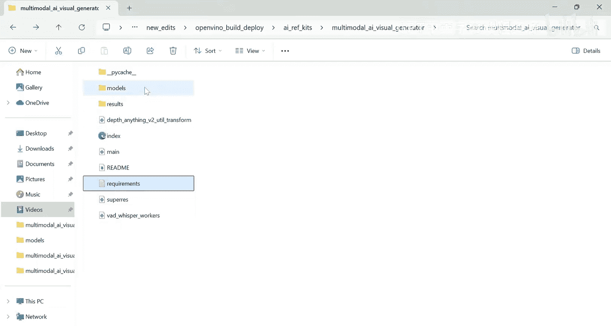

You'll see a number of key elements here where we're leveraging the Opimum CI library in order to take models from different organizations like Mealma's Mealma 38 billion instruct model。

 and then convert it to the OpenBeno format so that we can run it on AIPCs efficiently。

We do that for our large language model for our image generation model here。

 as you can see we're doing it for the latent consistency model generation model as well and for our other models。

 and again the core process here and the way that we're able to get these optimizations is we don't just convert them to the Open beeno format。

 but in that process we also perform some weight compression techniques。😊。

So if you take a look for example， at our LCM Dream Shaper model。

 which is a popular image generation model in the AI community。

 you can see here we're specifying our weight format is FP16。

This model from Sion Lu' Hugingface Hub typically comes in an FP32 precision。

 but by converting it to the FP16 precision with Open Vino。

 we are half the model footprint and reducing the size of the weights。

 making it way more memory efficient to run on a PC alone。

Here for the Lamma model we're doing something even more interesting。

 instead of just halfing the model weights we're actually reducing it even more significantly by using something called quantization。

 and here we're quantizing the weights from an FP32 precision to an ink4 precision instead。

 and that makes the model again even more efficient， smaller。

 more condensed and quicker when it comes to runtime in many cases。

These are kind of the general processes that we follow for different models including voice activity。

 super resolution etc， and you can kind of walk through the implementation of this particular file to learn more but at the end of the day the key elements are this optimum CI command that we're leveraging in order to be able to convert them to this format So again running this Python file will really take care of all of the models that you need to download and you can actually see here that I have a bunch of these models already downloaded and good to go let's open the Lama 3 a billion instruct directory is an example here I have the Info compressed weights here and you can see all of the files correspondinging to this model that I meet that are locally stored for this application to be able to pull from。

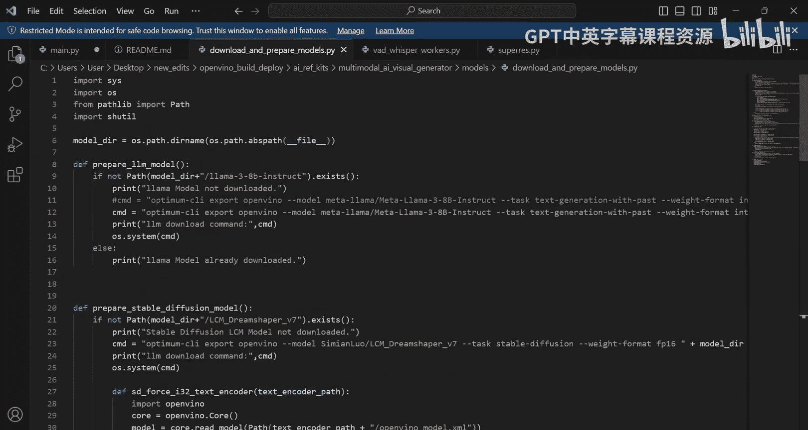

Here the binI files and the XML files are really the crucial ones。

 and if we open up the OpenBeA model here specifically。

 and let me see here if I can open it up in VS code to show you briefly what that looks like。

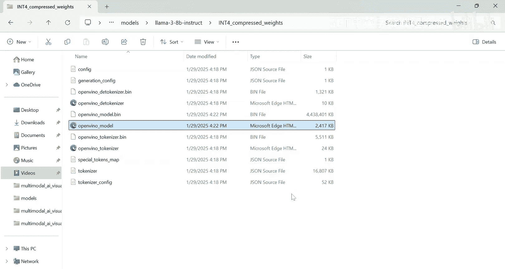

We'll be able to see the model composition and how Openvio has taken the original model and converted it to a more optimized version。

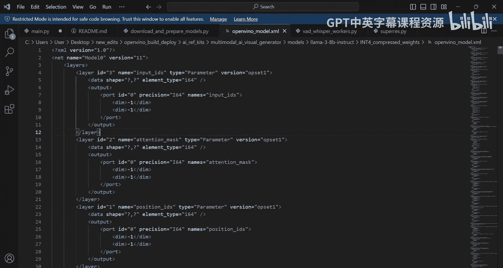

Again， we do this for all of the models that are required in the pipeline as part of the technology stack。

 depending on the different types of precision that we select。

 whether that's in for FP16 or even just the original version of FP32。

 although in most cases here we do leverage FP16 precision for that optimization on AIPCs。Okay。

 so we have our different model set up now let's go ahead and switch back to the code base to learn more in addition to our hardware setup and some of those other details。

So let's take a moment briefly before we get into the code to take a look at the hardware configuration。

Right now the system that I'm running this information in this application on is a Intel corere Ultra 7-258 V and as part of this application specifically。

 in addition to the number of models that we have running one after the other。

 like whisper latent consistency models and all of these super resolution and the LLM model。

 we also have the opportunity to leverage our hardware to efficiently run these different models in sequence。

 so for example， maybe certain models that are more lightweight we can offload on the CPU as you can see here。

With an AIPC we also have the flexibility to run things on the integrated GPU。

 which you can see here with the configuration I'll be showing you on is an Intel Arc 140v GPU or the integrated GPU built into the laptop and we can also have access to a neural processing unit which in this case is leveraging Intel AI boost again。

 lightweight models can allocated for the CPUU a little bit more heavier models like our image generator are typically offloaded to our GPU in most cases and for our NPU this is really that neural processing unit that's giving you the flexibility and the efficiency to run a variety of workloads so it's really up to us in terms of how we can choose to distribute our workloads across these three compute units。

Again， the interesting part here is that for this application in this multimodal language learning experience。

 we have so many different models that we can choose how to offload right so that's what makes it really interesting and a great opportunity for folks who are following along with this workshop to be able to implement。

😊，Okay， so by now you've again， cloned the code ideally or you've downloaded it as a zipI file and you have a system that you're able to run it on or you're able to follow along as I'm sharing this。

If you do not have an NPU available that's fine as well。

 you'll learn how to be able to tweak the application to run just on the CPUU and an integrated GPU in just a moment。

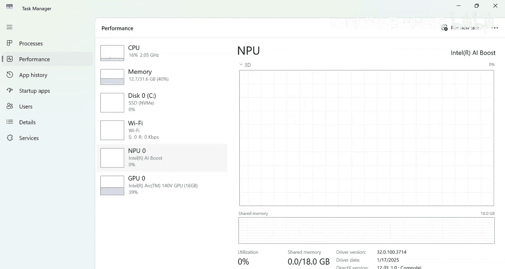

All right， now that we have that information， let me go ahead and navigate over to one of the first files that we'll be looking at here。

 which is our main dot Pi file。This file has a bunch of different types of implementation elements to it as well。

 and fundamentally we'll be focusing on a couple of key snippets for this workshop to take a deeper look into。

Firstly， as you know， we have a number of different models and therefore a lot of imports towards the beginning of the file that we're dealing with。

 but the fundamental functions here that we have are corresponding to each of our models， right？😊。

I'm going to skip over the depth map paraax function since I mentioned it's out of scope for this particular workshop。

 but what we're going to look at is a couple of these helper functions around being able to define。

 let's say pumps again， this is kind of the basic element of our large language model that we'll be using as part of the application。

 but it also gives us a bit more intention in terms of what we're able to use the application for。

So as you can see here， we have a couple of guidelines that we've provided for the model。

 things like focusing on our scenes for immersiveness in this case with a gaming type of theme。

 having contextual awareness， ensuring that there's no references to players or users in the prompts。

 and prioritizing clarity and enhancing our visuals。

 and we provide a number of different key examples of how the model should respond to certain prompts as well。

In addition we have some additional hints as well， and these are all what goes behind the scenes before we get to the actual model implementation light to make sure that the model is generating something accurately in real time。

 that's immersive。All right， now as part of this， we have some helper functions that allow us to instantiate our different models through a worker thread。

 and as you can see here we're starting to provide some specific parameters regarding our large language model。

 our stable diffusion model， and different types of other compiled models that we'll be using for the project。

Now what I'm going to go ahead and do is scroll down a little bit further over to some of our first kind of functions that we're going to be using for our models。

 So as you can see here， the run SR function is really the function dedicated to running。😊。

Our super resolution model， right being able to consume the input image that's generated from a image generation model and then be able to kind of perform additional interpolation and up samplingling in order to scale up the image。

 make it look beautiful and immersive， right？Over here we also have some again helper functions towards our image generator as you can see here we are using the self SD engine dotgene method in order to be able to consume a input text prompt。

 provide some key parameters and then be able to generate an image again to take a language learning example。

 let's say I say the word dragon in Chinese At this point in time after we transcribe the text using the whisper model which we'll see in a moment that would then just get past to the generate image function here via the prompt along with a bunch of these parameters in order to generate the image right。

Similarly， we did add in an optional large language model and hearing you might be wondering， okay。

 so whisper is taking on the speech tot。 the latent consistency models is taking on the image generation。

 super resolution makes it look good。 What is the large language model doing in here。

 So here the LLM has a couple of really unique capabilities One of the first things as you can see here as we're kind of passing the input images and things like that is that after whisper transcribes the initial text。

 The large language model is able to take it from there and start to analyze the string and say， hey。

 can I make this a bit more rich and a bit more visually enticing that was what was corresponding to a lot of the prompt definition that we defined earlier。

 and allows us to basically generate a much more rich description from the text。 For example。

 I could say a dragon in Chinese and my language model would basically take the translated version of that and then turn it into a dragon standing in front of a castle looking magnificent etca etc。

 So that's kind of the core element of the LLM and we have a lot of different catches。😊。

Hearing functions that allow you to basically identify if the large language model is giving a relevant response or not。

This is where we start to get into how the Genrative AI API specifically is useful right so we talked about the Openvino toolkit and the Openvino Genrative AI API briefly right but this is the general workflow that we're using for our large language model one of the first things that we do is retrieve our tokenizer。

😊，And we'll cover how to be able to load the model in just a moment。

We then go ahead and assemble our system message with some additional prompts or guidelines。

And then we instantiate the generation config from the OBGAI Library。

Here what we do is kind of interesting， we define a couple of key parameters to help us with basically making sure that the LLM is catching on to the right elements。

 like defining the temperature， the top P and the max length。

And this is where we take care of a lot of the key elements。

 so again as part of this in our worker thread instantiation we have a queue that's initialized where we're waiting for a particular sentence to be spoken and as you can see here we have our large language model that is then consuming the message pairs and is able to go through and process them allocating them to either a user message or an assistant response。

😊，After doing this， the key part of the code here is this self LLM pipeline dot generate method。

 which is taking as input the text， and the generation config that we provided along with the streaming input and is able to output。

 as I mentioned， that rich kind of description that we're looking for。

You may recall that this rich description is something that's then being provided to the image generation model。

 which is exactly what this piece of code is doing here。Alright。

 now we have a couple of additional helper functions here that you're welcome to dive into if you're interested。

 these are primarily based around the user interface and being able to kind of connect with different types of clicks and identifying the image portion of the application so I'm going to scroll down here and we're going to take a look at a couple of other key elements here。

As well。All right， now before we move on to our W definition。

 I also want to share one last element inva dot Pi that's worth looking at and worth tweaking as well as you're running this application on your system confiIg。

Here we've gone through some of the helper functions and the preparation for a lot of the different elements of our pipeline excluding W for now。

 right we looked at the large language model helper functions and how the streaming is taking place。

 our image generation here， which is what that SD note is kind of implicating our whisper model and then the super resolution model。

Now as you can see here， we have a couple of devices that we've set in stone for this particular application in this case what I've done is run it so that it's designed not to be run on the MPO but you're welcome to change that around if you'd like。

Here I'm running my large language model and my image generation model on the GPU of my AIPC and choosing to run my W transcription and translation model on the CPUU the rest of the models I'm all running on the GPU again。

 this is the opportunity that gets presented to kind of experiment with a different devices that you can assign for example you can see kind of later in the code here that we can assign our LLM device to an NPU and that will kind of modify our prompt length a little bit in order to be able to satisfy the requirements for running an openbe model on the NPU right？

😊，But again here it's pretty simple if you do want to kind of change the compute unit。

 this is where you would do it as part of the main dot P implementation and as you can see here。

 we started to kind of implement and instantiate our different pipelines in the code。

 so this is the part to really pay attention to。As you can see we're again using that OBNAI library and taking our LLM pipeline as input and this is where we're providing our model path and our device that we'd like to run it on so for example here for this application as I mentioned earlier。

 we're using the Lama 38 billion instruct model。😊，Now as part of this you might notice this parameter into four compressed weights。

 this is where we're leveraging the optimized models as part of the pipeline that we talked about previously。

 where we used Openvio to be able to generate optimized versions of these models and are now able to pass the model path of the locally generated weights over to the application。

Again， we're also passing in our input device as well。

You can see something similar where we're leveraging the text image pipeline instantiation from the OB GenI Library。

 giving us input our LCM Dream shaper path that is in the FP16 precision again you're welcome to experiment and for example try the in4 precision as well using the process that we talked about earlier。

Finally， you can see that we're also assigning our devices to our other models like Whis and Super resolutionsolution as well。

 and being able to load these appropriately。And that concludes our brief exploration of main dot Pi。

 so as you can see it's pretty compact， a lot of helper functions related to the user interface and being able to load in the models that we generated local file paths for。

There's one more file that we can kind of explore here and what I'm going to do is drag and drop it into visual code。

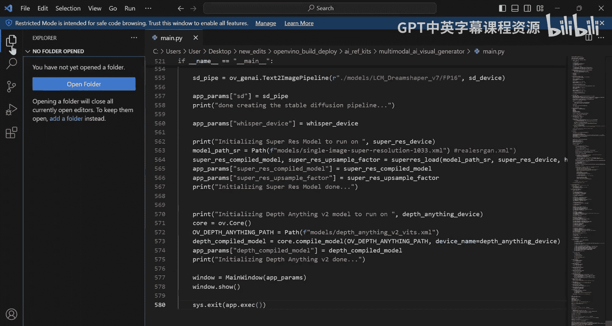

And that is our VAD Ws workersers file Now this is the file that's dedicated to the W implementation and there's a couple of cool things going on here so when you use the application。

 one of the new features that our team introduced to this particular application is to be able to identify when someone is speaking about something relevant to a game For example。

 if you're talking to a friend or somebody who just walked in the door while you're using this application。

 the application will intelligently realize that it's not relevant to the context and will not pick it up however if you're talking about game related scenery or something similar。

 then the model will start to pick up what you're saying translate it if you're speaking in another language and then transcribe it。

😊。

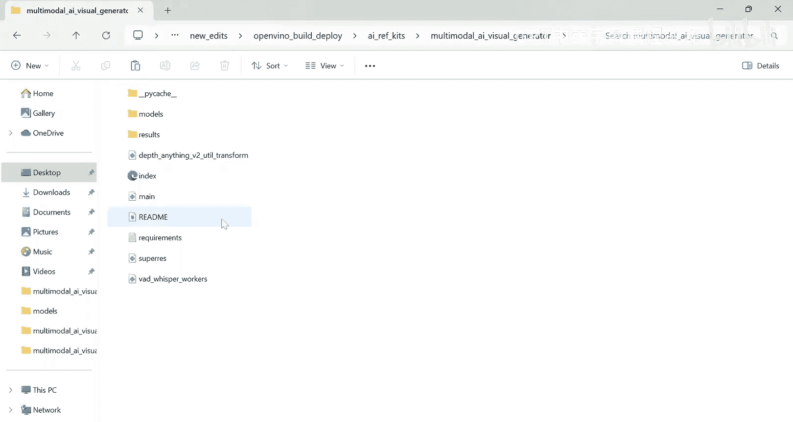

A lot of that implementation is located within this file and again a lot of helper functions to scroll through here。

Forgive me for that， but the general idea here is that we are defining a number of key parameters towards the sampling rate for our mic。

 defining our model here for being able to implement and identify the different kind of voice activity detection。

 as you can see here with the voice activity detector instantiation and identify the inactivity in the text so that again。

 the W algorithm is able to better understand when the person is speaking and what if they're speaking is relevant or not for the application。

A lot of this implementation is again focused on those technical details right and will take an entire hour dedicated to that alone to explain。

 but the key element here is that we are checking for a lot of the inactivity related details and being able to identify and track them over time。

Now as you can see here we get to our core of the W implementation similar to our large language model and stable diffusion model implementations。

 where here we are able to create our W pipeline to run on the device and again you've noticed the Openbineno GenI library throughout this。

 so here we're using it again to instantiate the Ws pipeline and here we're using our Whis base model as our base for implementation along with the Whis generation config that we predeefine。

Here we can specify the max number of tokens and this is where it gets to the interesting part so this application was originally oriented for the English language but because the Whi based model is very versatile。

 we can support different types of models as well right so for example we could switch this over to ZH instead of EN for the Chinese language and what I'm going to do is go ahead and do that here so that we can kind of experiment and see what that looks like。

😊，Again here I have the task as transcribed for the English language。

 but I can actually switch that over to translate if I want to translate over from the Chinese language to the English language for the multi kind of model language learning experience that we want to create with this application。

All right， now we have some additional elements here around being able to generate our transcription and translation here。

 given the activity that we've recorded along with the configuration of our whisper model。So again。

 here to summarize what we've just done as part of modifying these two lines of code is to switch the Wer model from being English only to multimodal and supporting the Chinese language and translating it to the English language for then our other models like our large language model and our language。

And our LCM or stable diffusion model to be able to leverage。And there we go。

 that's kind of the main implementation of our whisper algorithm。

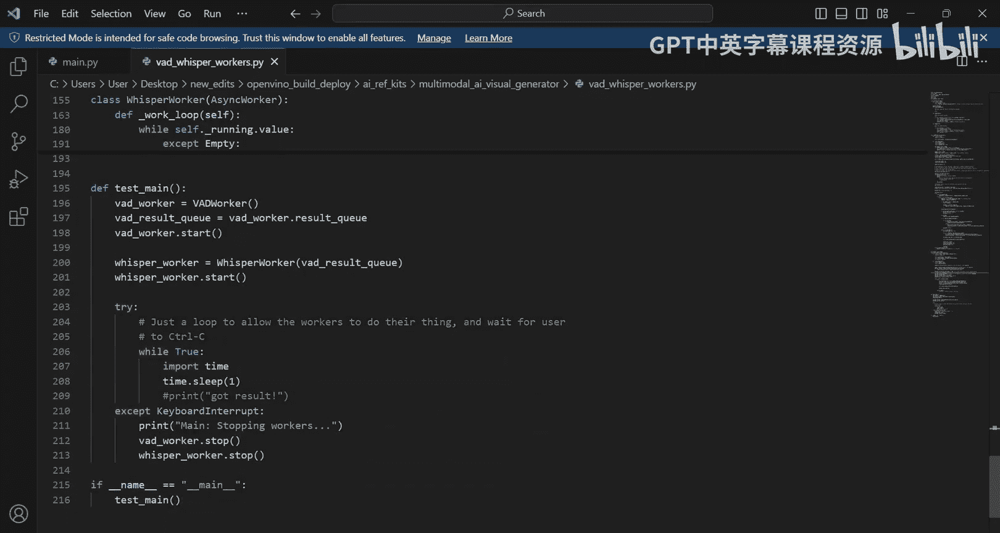

Now as you can see here， we have a couple of other files as part of the directory itself。

 but those are kind of the key elements， we also have a super resolution file that is dedicated to implementing specific elements of the super resolution model。

 including instantiating the core OpenBo toolkit， being able to define a bunch of really key helper functions for super resolution and being able to run it given the target device。

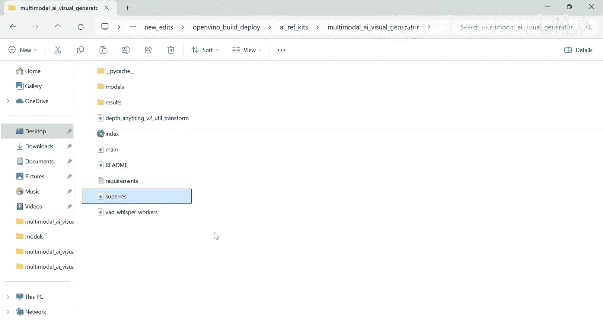

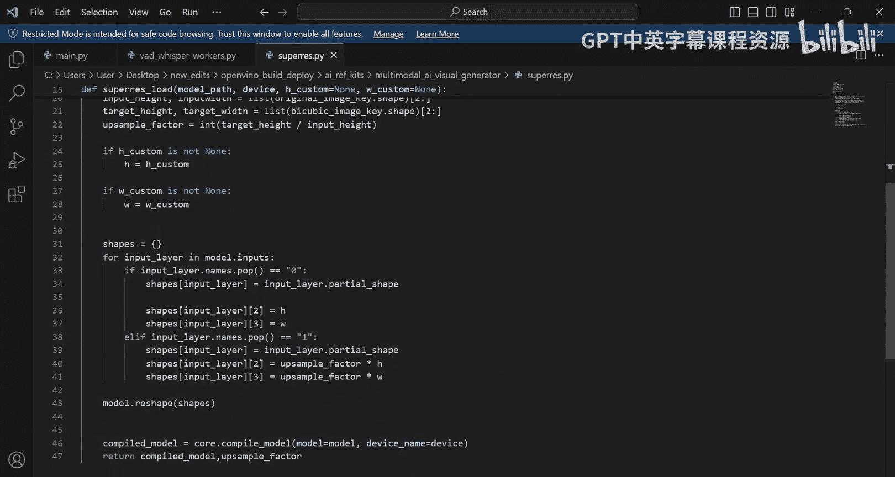

We also have an additional file dedicated to the depth Anything model as I mentioned earlier。

 but again， given that this is out of the scope for this particular project we'll put a pause。

We'll put a pause on that particular one。

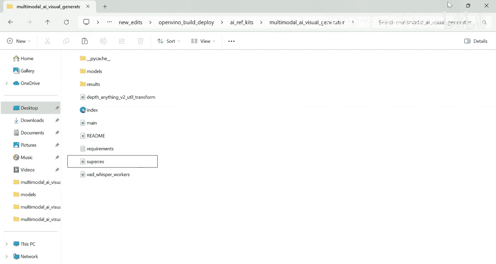

Al right， so now that we've kind of explored the main Python files let's go ahead and run the application right so again we have our model files that we've locally downloaded here as part of the models directory so let's go ahead and CDd into it really quick and we can see a bunch of different models here。

😊。

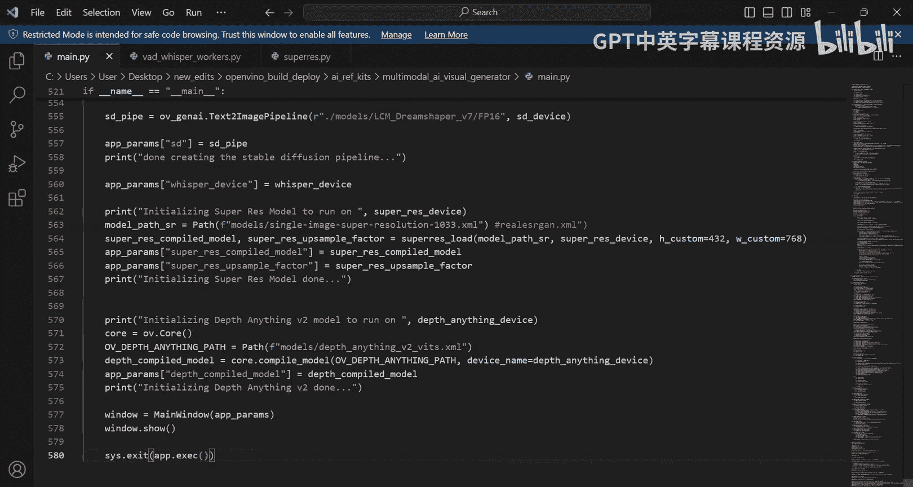

And what we're then going to do is go ahead and activate our environment。

 which we've probably already done from the model installation step and you should kind of have this already popped up。

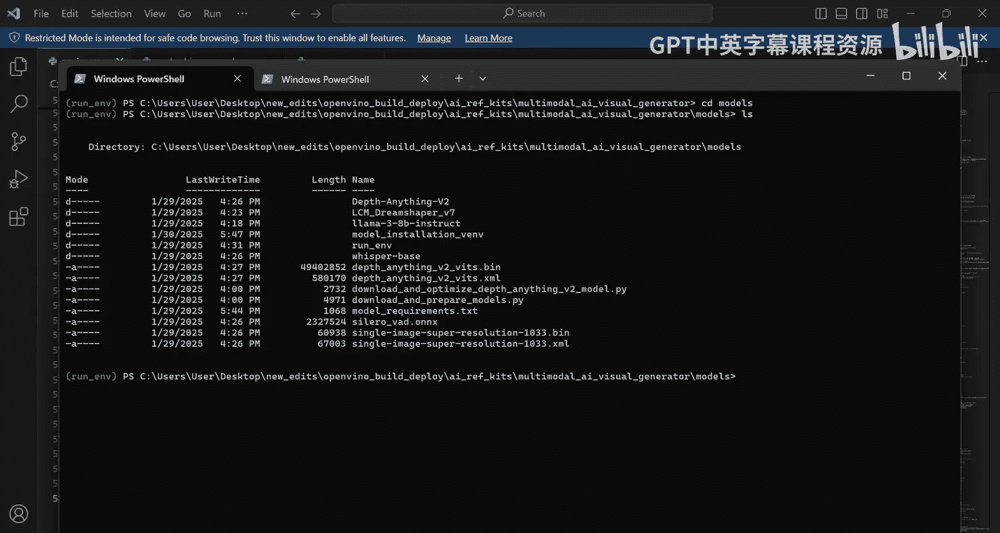

All right， now what I'm going to do is go ahead and run the Python mainoff pi。

File in order to basically kickstart the application and get started。All right。

 so when we trigger this， we're going to see a couple of interesting things happen。

As the application is loading， we're going to see a message pop up saying just a minute doing some application setup and we're going to get some notifications around creating the LLM pipeline to run on the GPU which involves kind of loading the model and setting it up and that's when finished creating the stable diffusion model pipeline and getting that set up right along with our super resolution model and again optionally our depth anything model Again you may recall these are all set up to run on the GPU and then we have our Wer model running on the CPUU right。

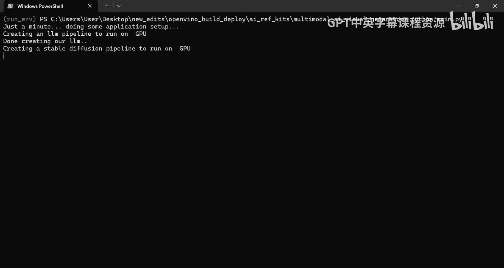

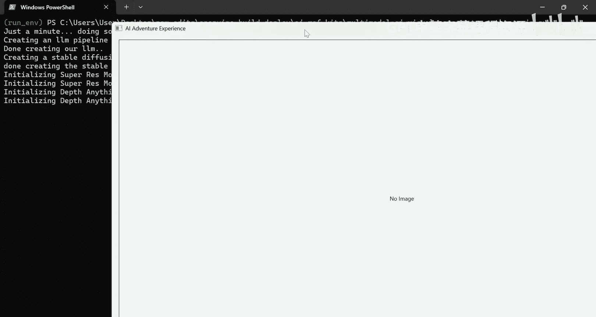

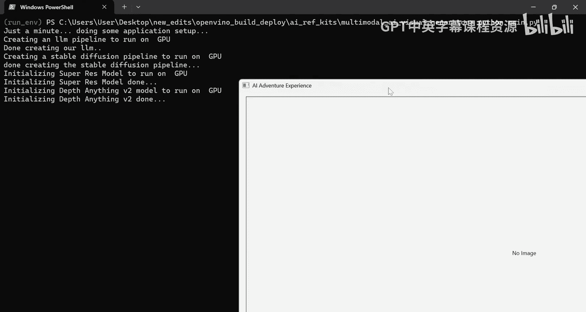

All right， so we have our AI adventure experience and multimodal language experience generator ready to go Now there's a couple of different ways to experiment with this so first I'll kind of show you the Chinese version of it I'm gonna to give Google translatelate some text in English and then it's going to say something in Chinese and I'm going to point it towards the microphone and we'll see how the model is able to basically take it in and use it as influence for the image and then I'll also show you a version of it with English as well and this is all because I can't speak Chinese so we're going to use Google translatelate as a substitute for that first part All right so I'm going to go ahead and click start which is going to kickstart the application right and is able to basically start the application in terms of the activity detection。

😊，一座紫色的城堡。Allright， I just stopped the listening so that it doesn't pick up on my text。

 but as you can see here， I actually provided a couple of words in Chinese as input a purple castle and you probably heard it right and you can see the whisper model kind of detected that hey。

 I'm talking about something medieval themed and then it translated it over into English saying a purple castle and then the large language model took it and ran from there creating this lavish purple lavender kind of situation with a castle right and we can see our image generator then took that English prompt as input and it was able to generate an image So there's a couple of super fun things that you can go back and forth here doing I was playing around with being able to generate a prompt like a dragon and then seeing the model kind of generate that in real time and other types of cool inputs。

 So we'll do one more here。😊，A sky filled with stars。And there we have it。

 that's kind of the application working in English on the fly。All right。

 so what can you do from here？While there's a couple of different ways to extend this further。

 you're welcome to kind of go ahead navigate over to the repository and play further with the depth Anything model Also some other things that you can do to kind of enhance and follow through the workshop include being able to modify the different devices that are being leveraged for the models For example。

 maybe you have an AIPC at hand and are able to modify over the GPU to an NPU or maybe you want to figure out how your system behaves if you offload most of the compute to your CPUU instead of you're integrated GPU。

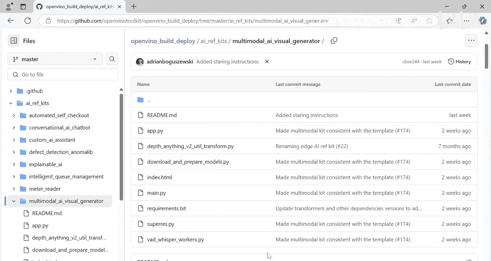

Or use a discrete GPU instead。There's a lot of different ways to kind of extend that from the hardware angle and again also explore some of those software extensions from the depth anything and other types of model angle as well。

Finally， you're welcome to kind of experiment with other models as well。

 maybe you want to pick a newer large language model like Deepseq R1 or others。

 and you can find a list of some of the supported large language models from the OpenBeno GenI toolkit as part of the repository itself。

We can also experiment with different types of image generation models as well。

 so again these are some of the key elements I'd recommend as extending exercises for the workshop。

 but to kind of conclude what we've done here， we basically got started with cloning the code。

 being able to perform the model download and set and then being able to walk through the implementation and see what's going on with all of the different models that we have working in a pipeline and werere able to run it as part of an interactive and immersive application。

😊，If you have any questions， please feel free to reach out via the discussion section at the Open VinoBuildEmploy Reository as well。

 we'd love to kind of help you and identify some next steps if you want to take the project further。

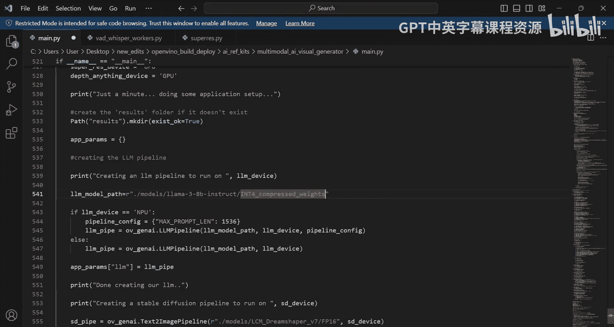

All right， thanks for your time。