# ExamPro《生成式AI训练营｜Free GenAI Bootcamp》中英字幕（deepseek - P56：-56-Visual Novel Image Generation.zh_en - GPT中英字幕课程资源 - BV1SFEWzLEab

Hey， Boabers， it's Andrew Brown。 In this video， we're going to be building out the visual novel editor。

 I actually was working on the JP Mu， but I had lost the original video with the guest instructor。

 that's my fault。 And so I have to come back and revisit that application。

 But what I'm thinking here is that I want to I just want to。

Not go super crazy with this one because my， my biggest challenge here is like the JP mud。

 It's just too dynamic， right， which is good。 But I think what I'm gonna do is try to make a visual novel where it's a lot more constrained in terms of what it is。

 Before I do that， I'm gonna just restart my windsurf as that one's a little bit out of date here。

 And once my windsurf's up to date。 I'm going to jump into it。 Of course， use whatever you want。

 cursor Github Copit， whatever is available to you。 But once this is updated。

 we're gonna jump into it， okay。😊，All right， we are up to date。 And you know what。

 I'm actually kind of curious about using Gemini flash after talking to Rohe。

 I think that I've put off not using Gemini flash for so long。

 It's a great opportunity to see its capabilities。 I think it'll do perfectly fine。

 So there are a couple aspects to this， the ideas that we need a game that is going to display text。

 right， but we also need to have images and interfaces。

 So I'm gonna to go ahead and we're gonna make a new one。 We're going call this visual novel。

 And I don't know， like maybe I'll use Amazon Amazon canvas because some of the images were totally fine。

 I would love to use comfy Ui and use like control net and generate out custom images。

 I just need to set the scope small here， get out of the way。 And if there's time。

 I will go do that as I think a lot of people will find that really， really interesting。

 But I'm gonna go ahead here。 And under the visual novel， I'm gonna create a visual novel text specs。

 as we normally do， Okay， and I'm gonna go ahead and make this M file。

 We're going to call this text specs。😊，Text specifications。And then under here， we will call this。呃。

Game like maybe， well， it depends like we can start a name where we want。

 But we'll just describe the。I'm not sure I'm gonna go over here in this ask and we'll。

 and we'll ask him I flash， which is super fast， but I am writing。A tech tech tech spec。

To describe how a visual novel。Video game will work。 It can you give me headings I need。

Or my tax back。Game design。Game concept， target， audience， stuff like that。

 So we're going to go here and we'll say game concept。So the game concept here is。

Where the player can interact with NPCs and other objects to learn Japanese。 But like visual novels。

Are not interactive。 They're， I mean， they are they're， they， they have a level of interaction。

 So the game is a visual novel where the player can interact， where the player。Has。Can choose it has。

Choose your own path。Cause that's not。 I'm trying to describe that。 So like。

 when describing a game concept。For the visual novel， I'm trying to describe how visual novels。

Don't have much interaction。Or if they do its choices。 And so it's just a big。If else。3， how do I。

 how do I describe that。Like， I'm not sure。So they go here limited player interaction。

 the wallss around playing playing through visual text with company visuals interactions is limited to making choices。

 These choices that influence the neighbor。 So focus on player agency。 Okay， so in one paragraph。

How do I describe。6。Right， Bull it down。Okay， but。Okay， but now from now for the dock。Yeah。

 I said I don't really like that description， though， because。Anyway， so I'm gonna go。

 we're gonna just switch out for a second here。 I'm gonna go to sonnet and we'll say， okay。

 try again。Okay， so this's a little bit slower， but maybe it'll do a bit better job。Okay。

 just try again here。The gameplay follows a traditional visual novel format where interactive is deliberate limited to key key point decisions。

 The decision points create a branching narrative， essentially functioning as an F else programming tree where players choices determine story paths fault。

 ultimately leading different scenarios。 This format that also focus on delivering rich Japanese language content while maintaining engaging story experience。

 So that's a better definition。 So this is where you saw flash struggling a little bit。 But。

 you know， this is more like verbo。 So I want to go here and like， okay， great， great。

 Can we condense。😊，Make can we make it more concise。And structured。Okay， so Im。

 I'm just trying to drive it forward a bit more。A Japanese language was learning visual novel with minimal in focus on key decision points。

 The game structure following a branching narrative。

Where player choices determine story past scenarios。

 the format effectively delivers Japanese language content while maintaining narrative。 So that is。

 you know， better。 I think it's more concise。So， this is。What we want， right？

 So I' would say a game concept。 I'm gonna go back up to our， our here up here。 And so maybe。

 you know， Gei flash， we'll use it for coding。 But for now。

 I'm just going to focus on using a more intelligent model for reasoning or thinking here。

 So we have our game concept。 as target audience。😊，You know。Yeah。

 we'll say Japanese language learners beginner GLP T N 5。 That actually sounds good to me。

 I like that。 I think it's probably picking that up from my other parts of my documents。

 I'm not sure how we'll go here and we'll say genre。 So we need to set it in a specific set。 Well。

 I guess that is the。😊，That's not really the genre。And。platform。Web application， right？

So now we'll kind of focus on our， this is the overview here。 So's say overview。

And we'll bring this here。 whoops， we actually don't have to do that。

 We just have to bring this a level like this。And。I mean， we don't have to follow this exactly。

 but we'll go through here。So game concept， target audience platform。

 The game concept could describe a little bit more。Is that more like the genre of game。

 But I don't think it matters that much。 So we will continue over here。

We have story story storying settings。Yeah， these visual novels are like there's games out there that are like telltale games。

 You know， they made like， those kind of games。 they're more like 3D immersive stories with with limited choic。

 or if there's any choices at all。 It'll be fun here。 Sotorian setting。 So synopsis characters。

 So it'll set up a location。😊，So we have synopsis， which is kind of a。

 I'm gonna do setting because I kind of prefer that time period。 So the time period is。Like。

 where are we， Where do we want to set our， our story。We'll say， like small town。Small town。

 Small town。Yeah， late summer， that's a good idea。I can say， small。Me。

 we're learning Japanese It'd be very odd if we did it in Canada， and people speak。

Speak English will say small Japanese town。Late summer。Okay， and then we'll say characters。

So who do we have。Well， we might also want to describe like places that we can go， so。

Where do we have， We have maybe a post office。Post office， cafe。嗯。Could you school。Maybe a， like a。

Private school。Language learning school。And then you have your apartment。Apartment。

So have post office， cafe， private language school， learning school apartment most。

 I'm trying to think maybe Koini， like a corner store。Corner store。 so we have these three。

 these  four，4 or five locations。We don't want to overdo it here。 Let's think of some characters。So。

Give me some character ideas。I guess the other thing is like we can go up here back to setting or。

 or we'll say synopsis。Here， synopsis。You are。呃。No， you are an adult。In Japan。Going to a private。

Language learning school for one month。To immerse。Yourself in the language， right， There we go。

 And like， there has to be some kind of like story arc or something。Okay。

 so we'll have to think about that for a second， but。

We have you're an adult in Japan going to a private language learning school for one month immersing yourself in there。

 you know， there is like characters， we have post post person。

 post office clerk there we go that's a good thing， we have student one， student three teacher。

 maybe barista。Vista。We also have a store clerk。Corner store clerk。What else do we have？

Post office clerk。Student 1， student 3。Apartment neighbor。 yeah， apartment neighbor。

Apartment neighbor and apartment。roommate。So there we go， we have our characters。嗯。I would say。

 we'll just make this other person like maybe have another student。 So this one。We have teacher。

 We have two other students。Okay， so we'll go here and。We go here。 Can we。

 can we flesh out possible character possible character descriptions。With their own。Sheading。

Re character。Okay， I'm gonna give it right mode over here。Maybe a bit dangerous。 but， you know。

 I need it to be a little bit more intelligent here。 So we'll let it do that。

 I almost kind of feel like going to the reasoning model。 I mean。

 the reasoning is being done on the windsurf side。 I'm not sure how that kind of inter workss with each of them。

 but we'll see what happens here。And so here we have， it's analyzing the file。

Sometimes I don't know why， but it can't。can't you view it， I don't know why。

 sometimes it can't seem to access files。 I'm not sure as to why。I don't。Can you not access the file。

What's your problem。Student one， student2 teacher。 okay， I don't understand。 it seems to be working。

 no problem。And so。This actually looks pretty good。

I'm going to just go ahead and tweak this a little bit。Okay， we'll go ahead and paste this in here。

Like this。And so now what we have here。So let's say we have Taakka heroro Hiroshi， age 45。啊。

We have this student， Garcia Carlos。Kimingji， kimingji。And you might sense say。Oh。

 that's a pro click。 Okay， you' amount a sense say。Youki。拳治。And I would just say， like。

 for the roommate， can we。Can we make the roommate。From Canada。Great。And I'll go back over to here。

It doesn't seem to be updating the document here。We'll go ahead and copy this。Great。

 so now we have some characters here， right， So we got， we go over to here。😊。

I wanted to like fill in nationalities here。So personality， role， language level， key interactions。

But it's not describing here。You know what people look like。 So， you know， looking at。

Visual text back。Can we describe nationality for。Each character。 And also， what do they look like。

 Because we are going to need to generate images based on that information。 Okay。

 so we'll go ahead and we'll let it see if we can update。 Let me try the access file file again。

 I don't know why can't access the file。Okay， now I can see it。 I don't know why。

 So we'll go ahead and let it do whatever it wants here。And you can see like key interactions。

 It kind of describes like what， what can happen here。 And so I think the thing is like。

 we can just generate out a branching story that we can practice on。 But I mean。

 it also be really interesting is if we made an agent again， not trying to blow out scope。

 but we had an agent for each。For each person， like it， like their own little agent script to。

 to role play as them。 But we'll see here。 So you have post clerkeric， student 1， student 2。

So here we have Japanese， South Korean， Spanish， Japanese。

 professional with conservativeserv style hair bun， appearance with dyed hair。

 piercings and personalized uniform。 dyed hair， piercings。 Is that common in Japan， I guess so。

 I don't know why。 for some reason， it seems to me like that， that might be bit too much。

 Maybe for Brisa。 I have no idea。 Can we， you know， can we just。

Cause this reading is a little bit hard。 Maybe it's less of an issue if we go to this mode here and take a look here。

Yeah， maybe that's not big deal。 So let's take a look and see if this is good enough。

 So we have teachers， teachers player how to send packages by stamp， fill forms that makes sense。

Another thing we could have done is the bank in here， but we're well not over over here。

 speak slightly clearly uses basic inter Japanese， formal， helpful patient with language learners。

 helps players learn postal vocabulary。Middle aged man with short， neatly combed， black hair。

 redt blue glasses， clean shaved and always wearing a crisp postal uniform。Yeah。

 I guess they have descriptions here。 So these are。These are fine enough。

 I guess now what we need are scenes， right， So we do have different areas。

 If we go back over to here。 So we we define the settings， right。

 So now let's go ahead and expand the settings。Okay， and so I'm gonna go here and just say。

 we need to， those sides selected this if it's already over here， which is right。

 So we need to now have subheads。For each area in the town。For each for each。Can we， can we。

Create a description because。Will'll need。To use it in a prompt to generate out images。Okay。

 so we'll go ahead and do that。Okay， so it's gonna go ahead and update those things。

 So we'll have those images。 We have the people defined find。

We then we just need to make our images here。 And then after that， it's like a big if all statement。

 right when we get to coding， we'll switch over to Gemini flash and we'll see its capabilities。

 But here we have a small but def post office with traditional red box boxes outside interior features clean counters。

 organized shelves and stuff like that。 large windows in the natural light and office。

 So the only thing I would say is like， you know， I noticed I noticed with the with the description for the post office。

 It's talking about。😊，Inside and outside。Like these the description is to produce an image。So。

 you know， we can't。Show two locations at the same time。It doesn't seem to understand that。

So we'll go ahead and do that。 And again， you know， we could do a lot more。

 but I guess these are all basically indoor locations。

 but we'll see what it comes up with here and then we'll just work with it。

So well give that a moment there to generate。 All right， let's Koto take a look here。

 So we have a bright organized Japanese office interior with clean services。

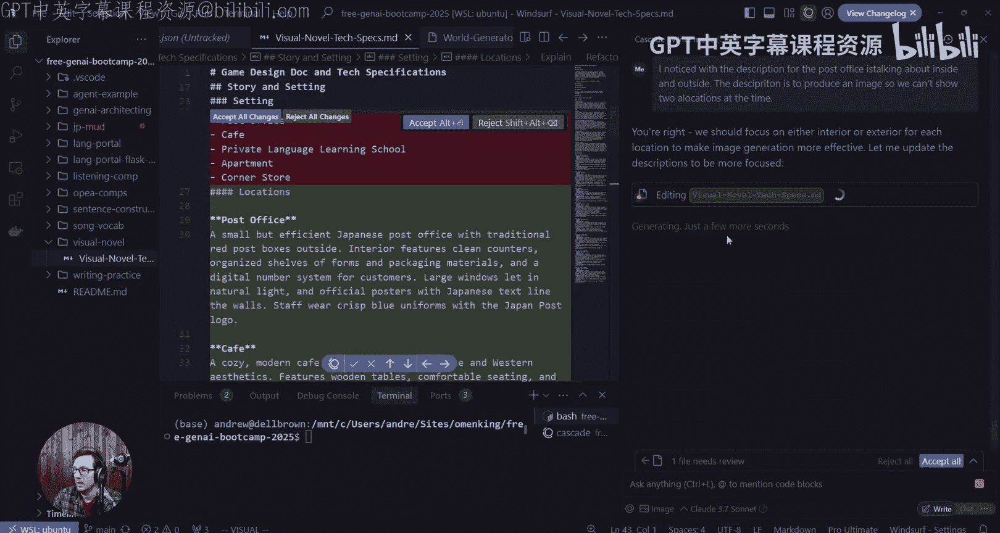

Organized shelves displayed forms and packaginging materials along one wall。

 large window let let in natural light， illuminated polish。

 a digital number displays shows who's next in line。 A lot of little details here。

 The question will it actually work out when we generate them out because we're not going to know until we do that。

But we'll find out as we there。 So now we have our locations。 We have our folks。

 We don't necessarily need to have a story at this point。

 What we need to do is start generatinging out our images。 I guess since we used Amazon。

 you could see probably could see it down here。 I really like this song。 I mean。

 let's see this song quite a bit。 recently， it's a Japanese song by a band， that's really。

 really catchy。 If you want to。😊，Take a look here。I don't know。 I never。

 I'm not sure have you ever heard this spam before， but they're， they're really fine。 But anyway。

 I'm gonna just close out a few tabs here and then get Amazon A of us open here and we'll get to it。

All there we go。 So I'm now in my developers' account。

 I'm going to make my way over to Amazon bedrock。 And I mean， really。

 we don't even need to actually do any coding if we want this to work。 again。

 if we want it to be dynamic， we might do that later on。

 But I just don't have confidence in in dynamic generation for these things unless there's a thing。

 And so it's not really necessary。

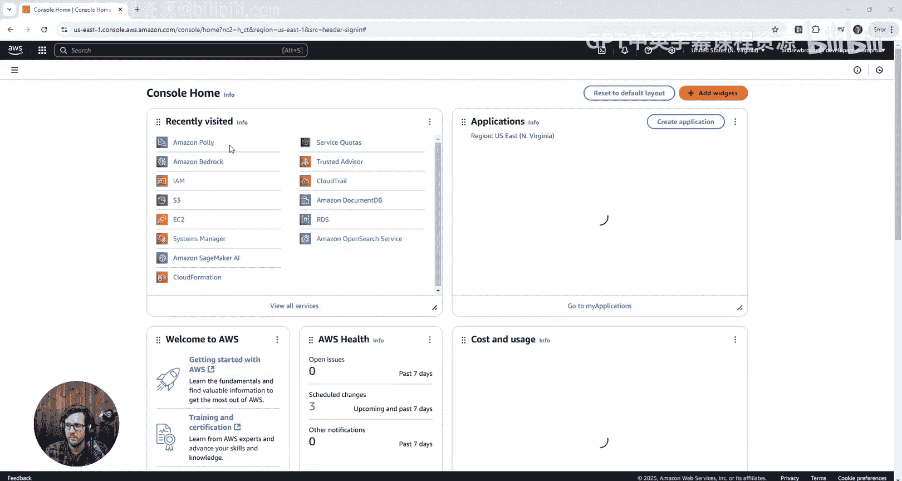

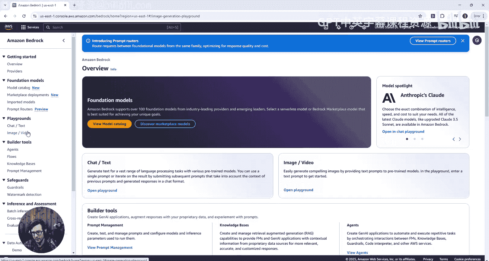

We'll go over to here and we'll select our models。 And again。

 you have to worry about the cost yourself。 but I'm not really worried about it。

 We have stability AI。 We also have Nova Canvas。 It might be interesting to compare these two。

 But anyway， we go down below here。 We have different size of images，16 by 9。

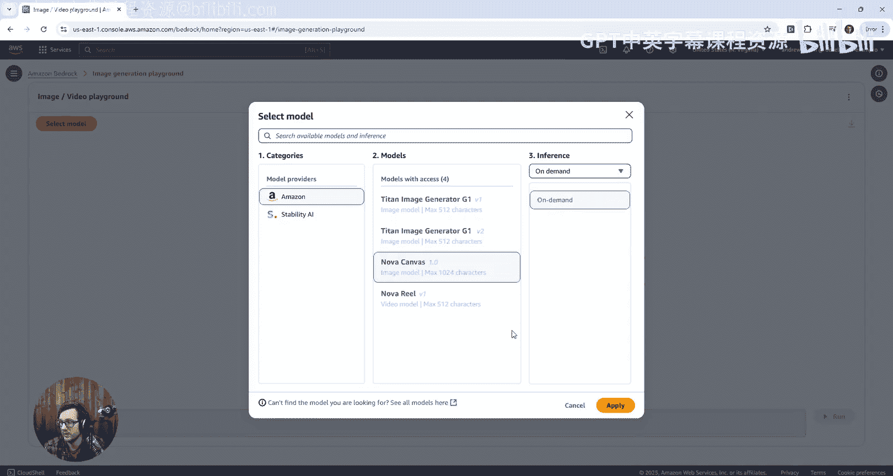

That。120 by 720， that's probably okay。嗯。But we need larger than that。 I mean。

 we could always upscale if we had to 1，20 by 7，120 by 7，20。 Why does it seem small。

 I it 1920 by 1080。It's that the size we're supposed to have，1920 by 1080。嗯。

It's where we don't have a。We have that。 or we have that。 We don't have in between。

 So I'm going go with the the 1，02，4 by 7，20。 It's not a big deal。 We have to upscale。

 We just upscale the image or we'll go larger。 I just don't know what the cost is when we're utilizing this stuff。

 So I'm going to go over here and you know， I want to make it clear that this prompt is for this。

 So like， if I take this， like， okay， so how do I turn the description。

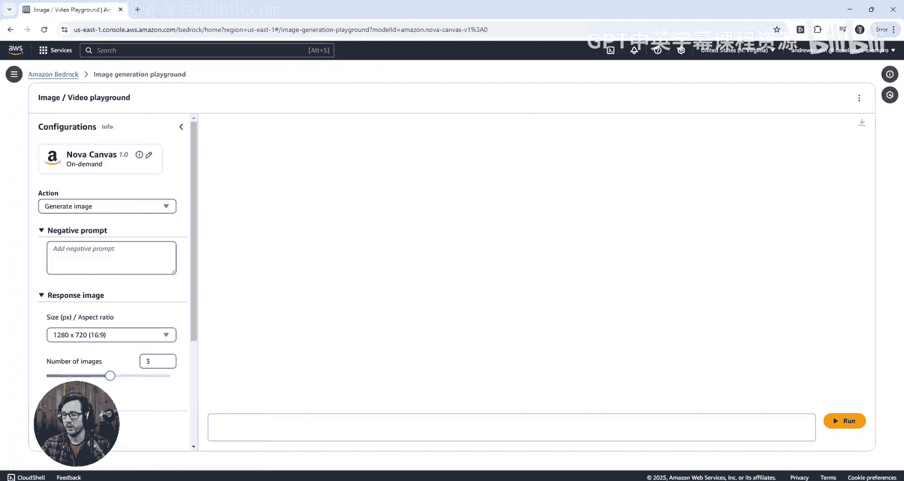

Let me make a new file here willll say folders prompts。Okay， prompts。

And we're going to start with the another folder here。 This will be images。And in here。

 I'm gonna make one for the cafe。 let's say cafe interior。Interior dot T X T。 Okay。

 so so I'm gonna go back over to here。Alright， And so we're gonna just。I want this to wraps。

 so I can see what I'm doing here。And I guess for now。

 what we can do is we just copy this right now as is and see what happens， right。

 So if I go back over to。

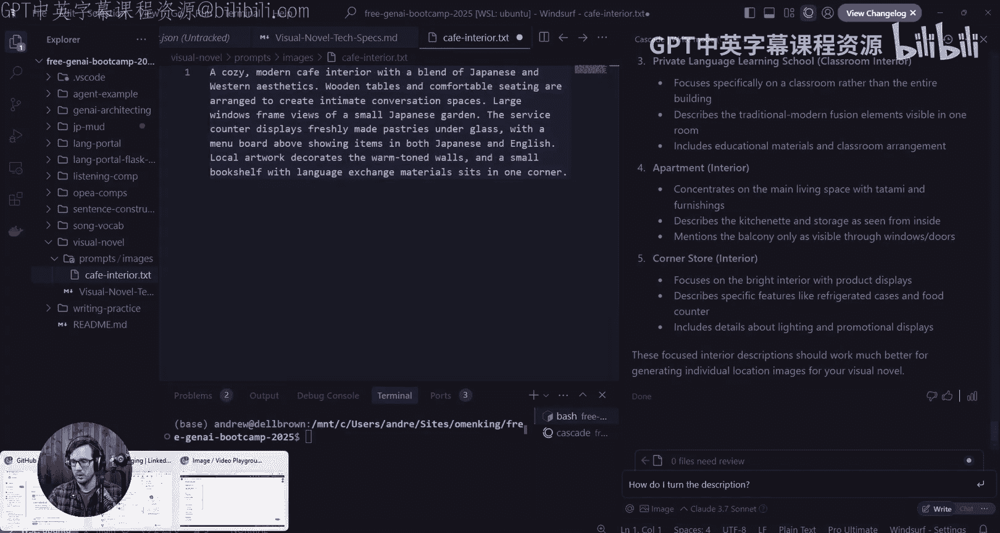

呃。Or was it here。And we drop in， we got create images。 That's right。What else do we have。 No。

 that's good and。Oh， the problemss over here， we put this in here。 Let's see what we get。

And we said three images。 I didn't actually specify how much I actually wanted。

 Im have no idea what the cost is。 I'm not worried about cost， I。Don't care。

 And I don't think it'll cost much。 So I'm not that worried about it。

 We'll go ahead and we'll see what comes out here。 And if we like them， that's good。 if we don't。

 we can try the other stability model。 Now， we're not optimizing this at all right now。

 We're just putting in whatever image text we have here。

 The other thing is that we're not specifying any kind of stylization。

 And so I would say that these are。

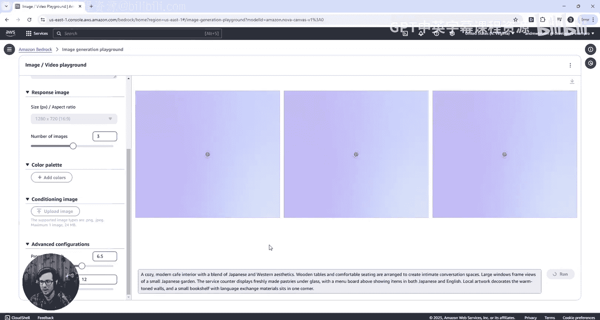

This is a modern cafe interior。 So the cafe。And these are actually pretty good。Right now。

 we didn't tell it to do any kind of styling here。

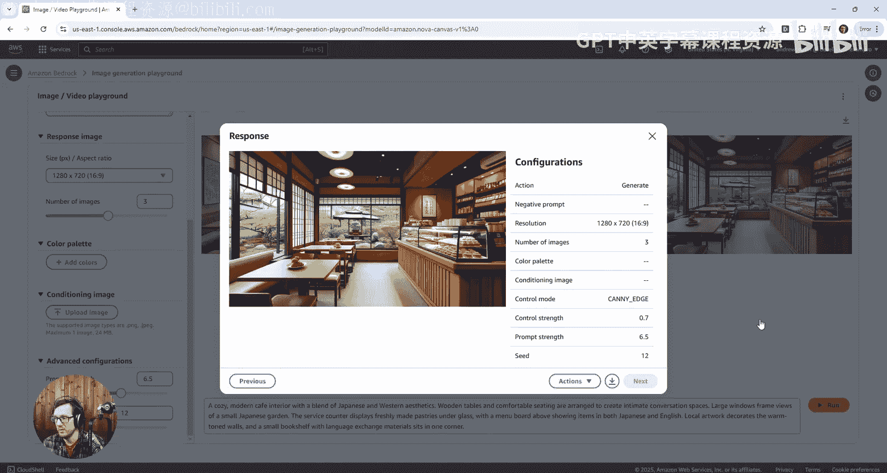

And I don't know what happens if we don't download them。 So I'm gonna just download these。

And they all actually look pretty good。 So I'm gonna go ahead and just download。Okay。

 and so it downloads the zip。 And so this will be。I'll just unzip that。

 And so we'll just bring these into here。 So I'm gonna go back over into windsurf and。

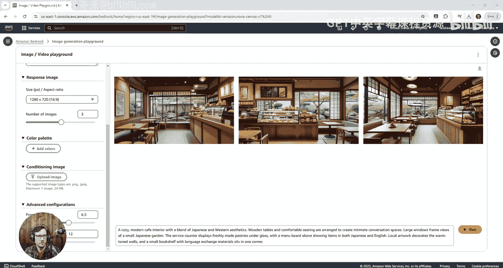

I'm just gonna go make a new folder here called outputs。And I'll make a new one here， a new folder。

 and this will be。I mean， these are all images， right， I really should name this。Settings。

Image scenes， maybe image scenes。Or scene images。Image scenes。

And so here I'll just go make a new folder say image。ss。And this here will be。KNoow the canvas。Cafe。

 right， so this is my first attempt。 So we'll bring these on over here。

And those actually look pretty okay， especially since I didn't give it any kind of additional prompting。

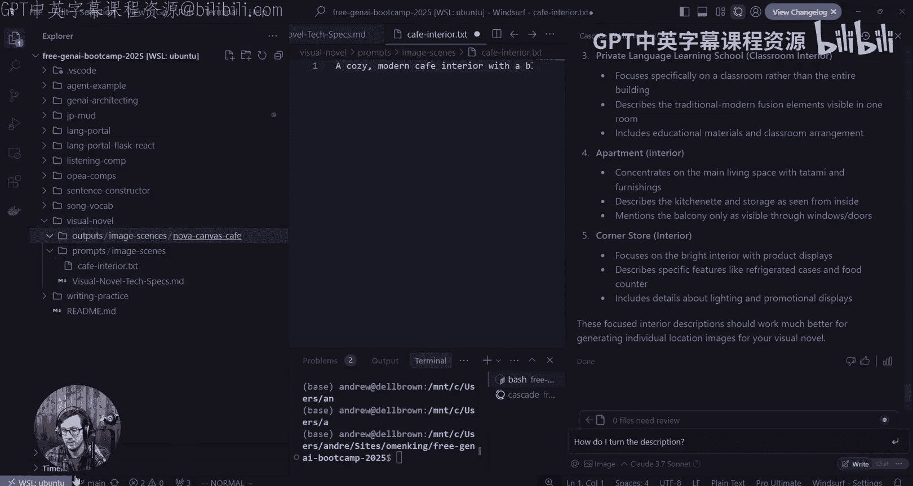

Right， so now I might want this in a different style。 So what if we go here。I saw an option here。

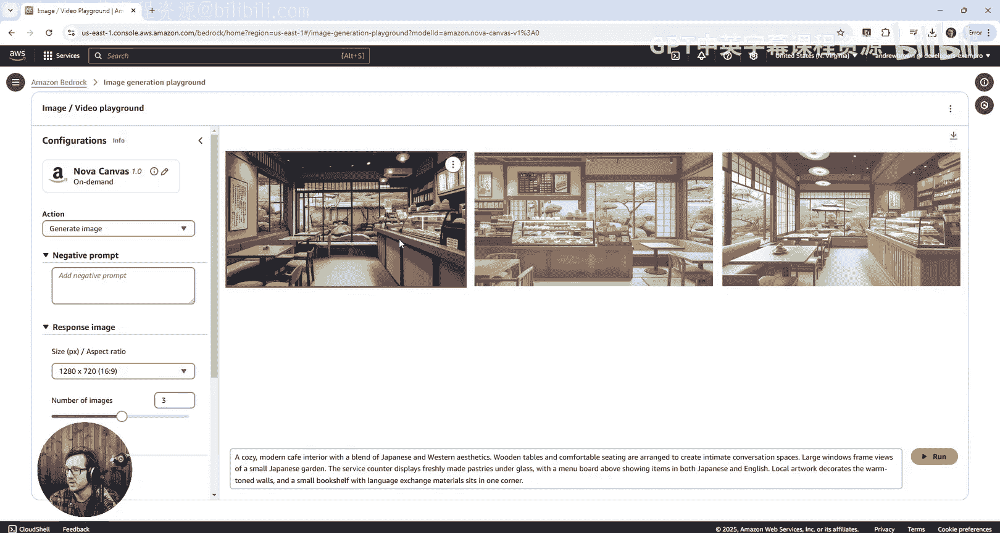

First of all， like， do I like any of these， Like， that one's pretty good。嗯。This is pretty good。

 They really， they're really trying to make a Japanese。 Like see how they have the。

 they might have overdone it， right， Like， yes， it's like this。

 But would you actually ever go to Japan And would they actually have these doors and these。

 these cafes in the back。 So they might have overdone it， right？

 So here it says a cozy modern with a blend of Japanese weather sex， etc cetera。 So I might just say。

 like in the style。😊。

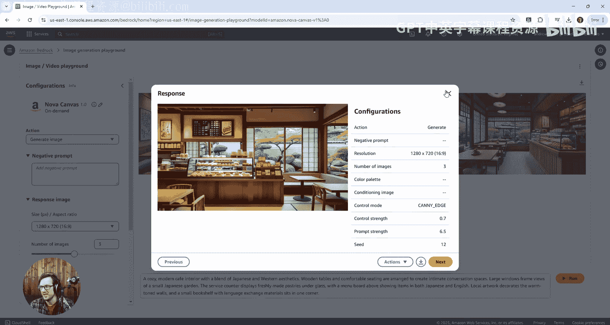

Of anime， right。I just wonder if we have any options down here。 We do not。

What if we click into this for a second。And so I'm gonna go ahead and click this。

 So this will generate another one。 So this would be the style of anime。 I didn't spell style， right。

 So that's probably a problem。Because， you know， is there really a difference between。

This Japanese cafe， let's go take a look here。And you go here and you go， okay。But， you know。

 cafes can be really modern， too， in Japan， right， There's nothing。 You know， I mean， like。

 look at that。 That's just， that's just a regular regular old cafe， right。

 in an actual location in Japan。You know， but then there's ones that are like。Oh， I guess it kinda。

 yeah， I guess this one kinda has this。 That's kind of a touristy touristy one， right。That's cool。

That is really， really， really cool。Okay， so。

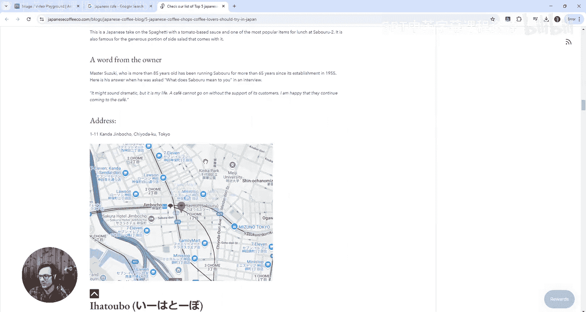

We'll go back over to here。 And so now it's in the style of。And may， I suppose。

And those are pretty good。嗯。I mean， that， they look fine。 There's nothing。

 There's no reason we can't use those。So I don't need all of these。 But， I mean。

 we could actually use all。 There's no reason we can't。 So I'm gonna to go ahead。 is actually。

 is it consistently the same place， too， I didn't even realize that I that we have this。

 and then we go here。

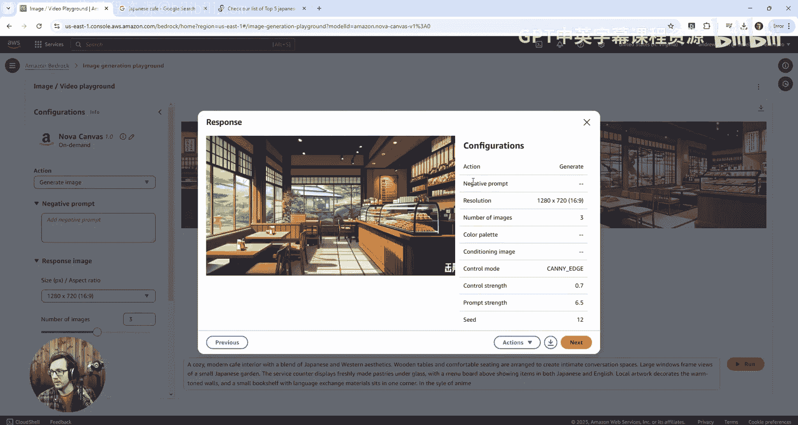

Here it's on this side。 we have tables here。And then on this side， we have tables there。And then。

 here。呃。You know， I mean， there is some consistency to it。 Like， I， if you。

 if you told me that these weren't the same， I wouldn't know to glance， right， Like。

 you'd have to be really paying close attention to tell。

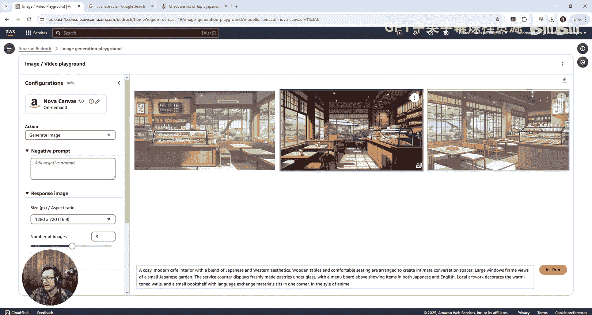

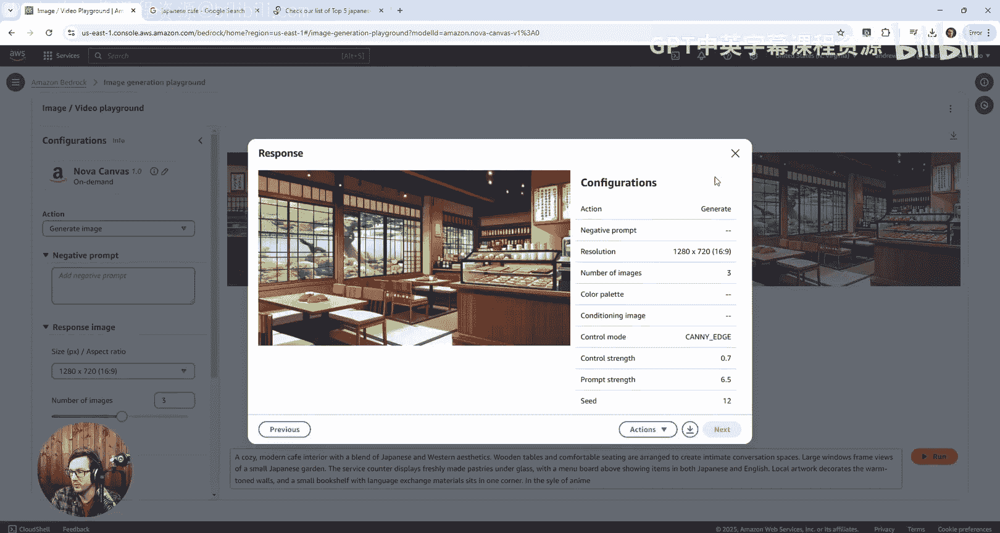

And I honestly cannot tell。Right， so， but we'll go back to the other ones that we had opened up just a second ago。

'cause I can't even remember what they look like， to be honest。

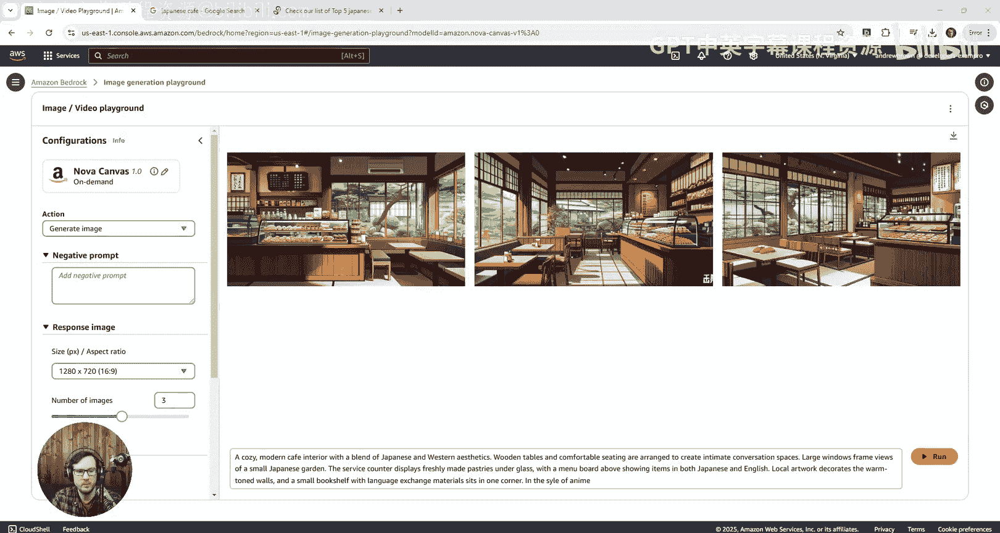

And so we go over to here to。而。Images here。 Do I not drag them on in here like this。

OrDo they not just want to drag here。What I don't like is， oh， here is's finding folders。

 They do have it。 No， they don't。 I， one thing I don't like that they don't have in here is's like。

 whenever I want to open a folder。It it never goes where I want it to go。

But that's the one thing I wish they。You know， they still had in。In here， But I will have to。

I guess drag these to my desktop or something one second here。啊。Oh my goodness。

 I' having a lot of trouble here with this。Open the zip again。We will extract。

I'm just doing this off screen。 I'm just trying to extract it anywhere， extraction。

The path is too long。 So it doesn't like the name of the files。

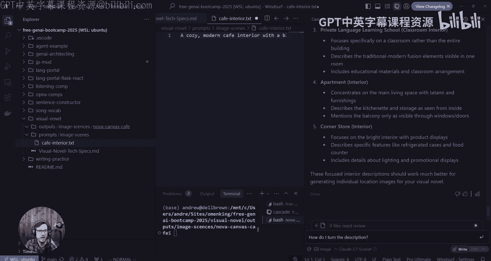

So that's， I guess， one default problem of this is that they name the files like stupidly long。So I。

 can I just download an individual wide， I suppose。 So we go here。 We'll download。

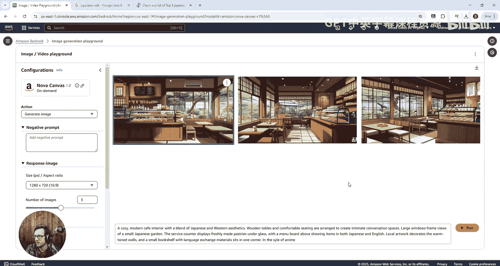

I don't know what the old ones look like。 So I guess it doesn't really matter at this point。

And so we have our， our three here， okay。And let'll just say， image1。

I'm just renaming the off screen here。Cause they have stupidly long names。Image 2。Image 3。Alright。

 so I'm gonna go back over to here。

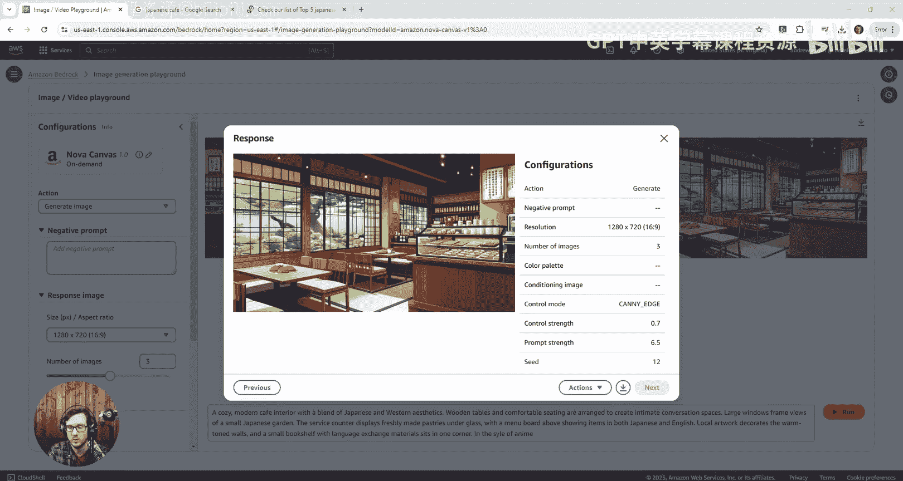

And we will。Drag these on into here， like this。And so that， that's our prompt。

 It just has a bit of in the style of anime， right， So we say in the corner in the style。Of anime。

 right。I'm going to go ahead and copy this。

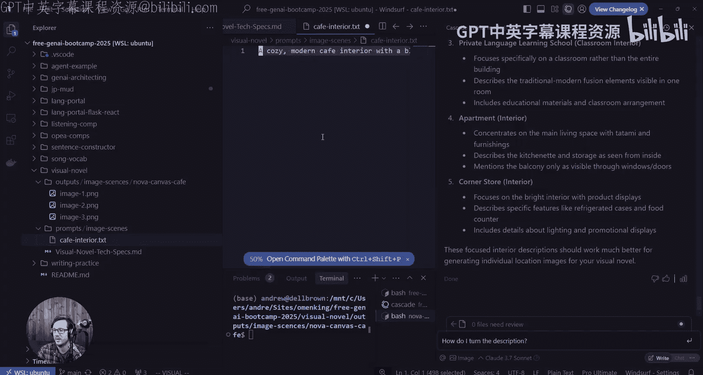

I'm gonna go back over。To here。And we're going to go to stability AI。 So we'll switch the model out。

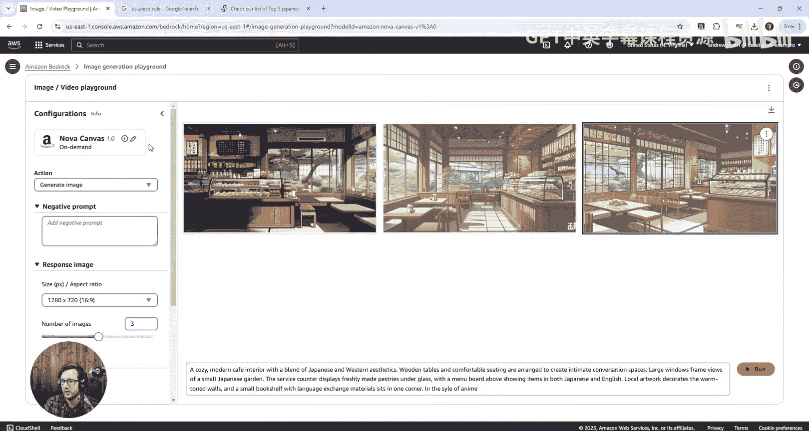

2。

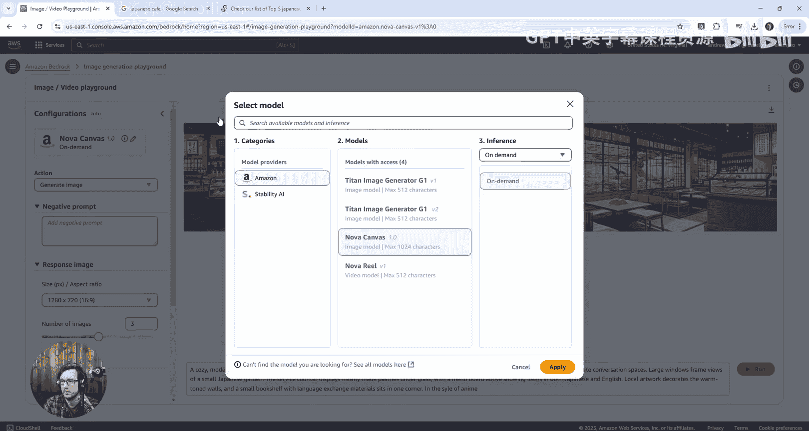

Stability A I。I'm going to pacee this in again。 It just has the spelling correction here。

 We'll go generate it again。 Let'll see what we get。 I forgot to change the size。

 but we'll see what we get to see if it's any good。SDX L is not a new one， so。

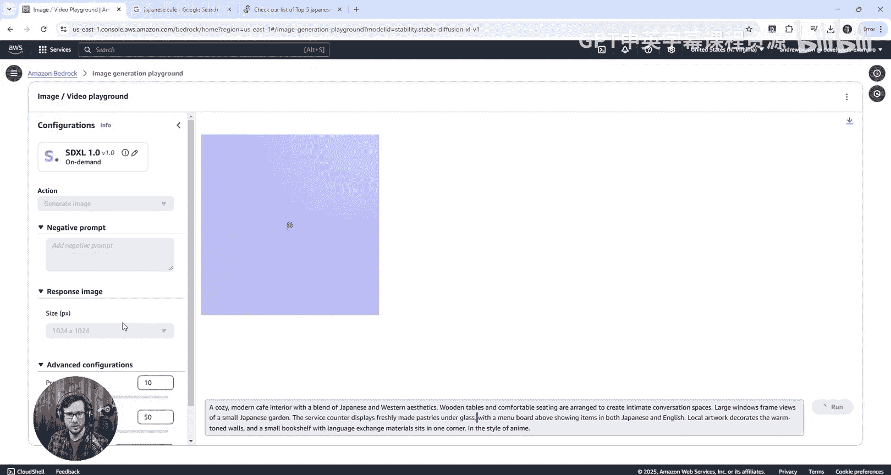

嗯。Yeah， I mean， yeah， looks， I mean， you could take the image and then style it later on。

 which would be fine。 But I would say that I actually like the Nova canvasva a lot better there。

 I think they did it a lot better job。 I could also just try this in Goc off screen one second。

 Get Let me go to Twitter for a second。

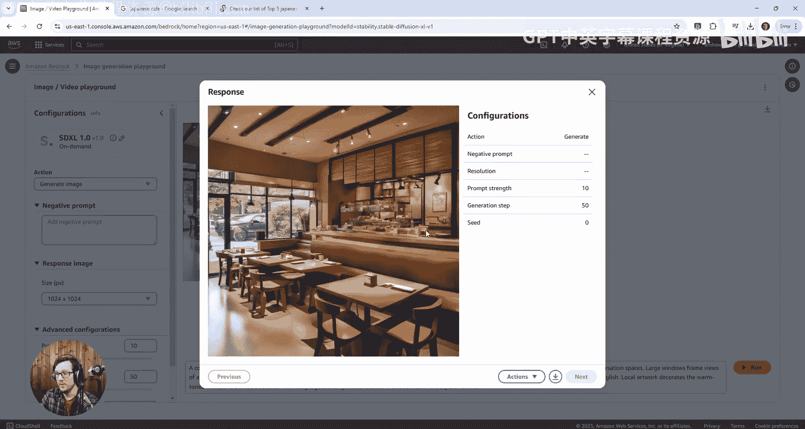

And。I'm going to go ahead and grab this here。

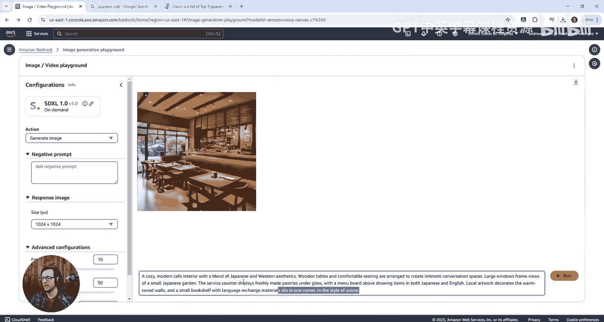

See if it figures out what I want。 I didn't tell to make an image。Okay， but。Create the image， right。

 Create the image。Gock's not that smart。let's say what we get。We might get better images。

 I don't know。And it's going， It's really slow。Okay， these are。I mean， it's fine。

 The only thing is that it's。Not the st anime， okay。Okay， but it's。

In the style of anime for a visual novel， right， So slow have to help it along can make really good images。

 though。But dumb， da， da， just so dumb。We'll give it a moment here to generate。

 I also have mid journey， so we could also try it there as well。But again， these。

 these problems aren't very optimized， right， so。And you see here that it's just not。

That's kind of a nice image。 I like that。

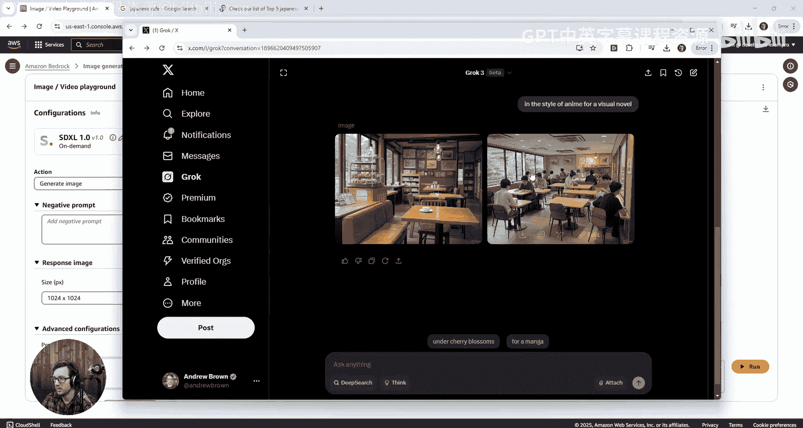

There's actually people in this one。 That's kind of cool。😊，So that's also kind of interesting。

 But let's let's download this one for a second。 I actually kind of like this one quite a bit。

 even though it's not really the resolution if we add it with Goc。

IIt didn't really do in the style of anime。 So what I'm gonna do because I have Photoshop。

 Let's open up Photoshop。 Let's see if we could apply a the same image， but bring in the stylization。

Right I don't know if it will work， but we'll try。 We always have a bit of difficulties here。

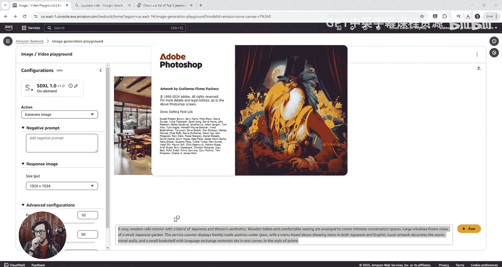

But I'm just trying to figure out like， what do I like for images， right， Again。

 the first ones we generated were fine。 There was nothing wrong with them。

 We could' have probably just stuck with that。 I'm gonna go ahead and drag this on over here。

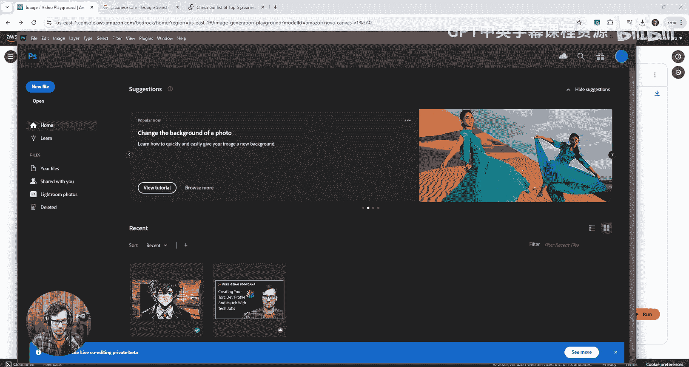

So now we have this。 and， you know， I actually quite like， I quite like this。

You can kind of see some Japanese text here， but I know it was down here。 if we go down to here。

Style reference， select from the gallery to choose your own image。I don't know。

We could also just do this。Just try here。 It's not going to apply the effect， but we'll try here。

We say style。 where's our anime。Where is our anime， Anime， Anime， Anime， Does anyone see anime here。

How they got that kind of goofy stuff。I'm looking for。Where's anime。Maybe it's a effects anime。

 there it is。 We'll go ahead and we'll generate the out。 We'll see what we get here， right。

 becauseuse I don't know what we're going to get here。The only thing is gonna generate a new image。

 It's not going stylize this one here。Oh， that's terrible。 Thats just horrendous。 Let's。

 let's undo that。 And let's go ahead and see if we can apply a neural filter。

 It's another thing in Photoshop。 again， if you don't Photoshop it's totally fine。

 But I just want to see we have style transfer。 this is what will take a artistic style and transferred onto something。

 right。So it just depends if they have it， image styles。Artist styles。Okay， but we don't have。

Anutime here。Yeah， I， I don't know why they just don't do that。 This is， well。

 that doesn't really work。 This is like ink ink lot painting。 I was just trying it for fun。

That does not work。Try this。Its also kind of like looks like Japanese ink plot painting。嗯。

Which also doesn't work。 So I'd say style transfer is a failure。You know。

 is there another way that we could maybe， yeah， so Photoshop's not going to help us out here。

So let's say cancel。 It's not。 It's not doing a good job。 I'm gonna go over here， and。

Go to the internet like style stylized anime。Image to anime。Style filter。

And maybe there's something out there that can do it for free。Convert photo to AI anime， right。

 So here's that background。 Not exactly what I want in terms of this， but。Convert photo to anime。

 and we'll go ahead and try this out。If you don't want to totally fine。

 like this stuff who knows what we're getting into when we do this。 But I have this image here。

 you can see some photos of me。 I was doing that for thumbnails。 If we go into our downloads here。

 we go to image here。So generate， see if it can do it。Now， again， if I set up comfy UI。

 I could do this for for free and we go a bit closer here。We'll download that。

 we'll take a look here。呃，我个人。Drag it off screen here。 No， okay， I'll sign up once。Sure， let's。This。

 we'll go ahead and we'll take a look here and see what we have。Yeah， I mean， that's nice， too。

 though the trouble with this is that it's not gonna match whatever the， the foreground is。

 but I do like it， right， You can't see the Japanese text anymore。 unfortunately。

 So there's there's no way of knowing that this is Japanese。 But this looks good。

 The background looks good。 So that might be a， a possible avenue here。

 I'm not sure if we were to go over to this one and try again。Right， let's just try another。

 another one that says this is epic epic manga。 We have an up here。 as if I know the difference here。

 We'll take a look and see what we get。

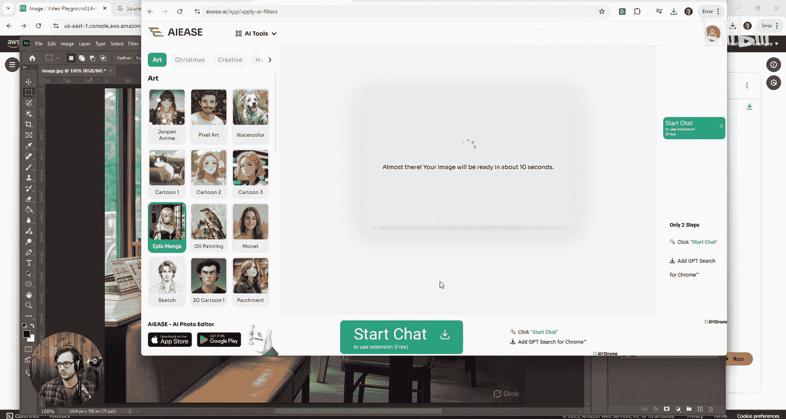

Oh， that's terrible。 Okay， so at least that one worked out。 So that's kind of cool。

 But the challenge is that we really need to have someone in frame here。 Yeah。

 you can see rock down here below。 that's so easy to remove。 If we want to get rid of that。

 it takes two seconds。 Also， we can kind of， if we don't like the size of this。

 I can kind of extend it in here。😊，So here we just say generative expand。

 And then I can get my ratio that I want。 So finish， you know， fill in。Fill in cafe。

We'll see if that even works here in Photoshop。 There's other things that are not paid that you can do that with。

 but we're just trying this here quickly。嗯。And see what kind of results we get。

Seemless they extended it， which was perfect。So that's good。 So I don't know。

 Maybe I'll use Grooc for the image generation。 I don't know。

 Let's go back over and take a look at our images that we brought in over here。

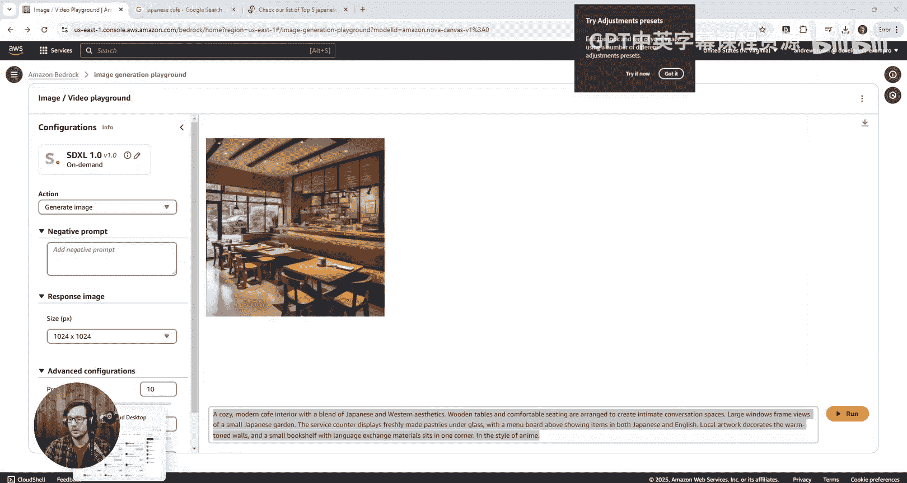

Yeah。We go here to this one。I don't， I kinda like this one， to be honest。

 I think I like what Grock did。 So I'm actually gonna get rid of these here。🎼And。🎼You know。

 I think that， again， we could still use。Use that there。

 But I'm gonna go back over to here and we'll make a prompt for character prompt， so。Image。

Iage characters。So now that we have that， let's focus on seeing if we can get。

This I'm just going to go ahead and make a new file here， readme。md。Read me do M D。

 Thiss kind of my research notes。 So background image generation。You know， so say Amazon， Amazon。

 Nova canvas generated。Decent images。Background images。You know。Gock。3， despite。

Being difficult to prompt。Genrated very good。Backgrounds。But would not do them in anime style。

It could。😔，Generate anime style。But I didn't like the style stylization。Style。Stylization。

 And then we had， what was it S DL X， S DL X。SLD x。呃。Was not very good at generating。Images。

 I don't know if it's free。 so， you know。Even though。Rock 3。Has no API。 I'll likely。

Generate the scenes。The background images。Vick 3。And maybe apply a styling filter。

With another service。 Okay， so there we are getting our our backgrounds。 And so clearly。

 Gro 3 is the winner here。 So that's what I'm gonna do for this one。

 And then the next thing is to focus on the generation of the characters。

 So we'll go down to our visual novel specs。And I'm gonna go into the here。

 then into the post office clip。 Well， actually， we're focused on the cafe right now。

 So we'll go down here。Spanishmato。So， here。So I'm going to grab this here。

And so we'll go back over to this。And I want， we want the。Yuki。

 so I'm going to go ahead and we're going to make a prompt here， a file called Yuki。

T T paste it in here。 This doesn't feel optimize。 So maybe there's a way we can optimize this。

 So I'll go back over to here。Now I'm going to try thinking for fun。 And we'll just say， how do we。

I have to。Uki dot T X T， How do we change， change this So it is。Optimized。To be a prompt。4。

An image generator。And for our use case。A visual novel， right， So hopefully it does。

 I'm putting the reasoning there。 Hopefully does more reasoning involved。 I'm not again。

 not sure how that works。 She shows it right in place。

 So the current prompt in Yuki is not optimized in image generation It still needs a format。

 Let me think about how to optimize that Specing art style。 focus on the visual elements。

 Add technical specifications with portrait framing。So， here， it says。Well。

 it really is thinking quite good here。 surprisinglypriingly。

 So we have converted from bullet points to cohesive paragraph that flows better。

 add a character name。 Why specified portrait type。

 close up detailed piercings added specific tattoo design。 Japanese style waves。 Oh。

 did this person have tattoos。😊，啊。Yep， tattoos， Okay， describe uniforms。Added facial expressions。

 visual novel， art style， lighting information， studio， lighting soft lights。

 focus on visual characteristics。Completed this create a self contained prompt that gives all the necessary information。

 The other thing is like the， this should work in most things， G 3 SL SLD X。

 I don't know if it's SLD X。 What is it。We'd have to go back over to。S DX L， S DX L。

And so if it doesn't even know what it's talking about。 it's like， yeah， it'll work it。

 It'll work in that。S D X L， this is S， S D X L。嗯。So， you know。

 the only thing I'm not sure about this is like， why do we need their name in the prompt。

So accept all。Okay， so why have the name in the prompt。That's what I don't understand。Oh。

 so some can use consistency。 Okay， that's pretty cool。😊，So， let's go ahead and。Oops。

Let's go ahead and use that prompt then。Now， I wonder if it's going do it actually in the style of anime。

 That's my kind of question here。 as I don't know if I should specifyify it there。

 but we'll copy that here。 We'll go。 I'm gonna give Photoshop but go。 Photoshop is terrible。

 We actually didn't also talk about our experience of Photoshop。 We'll go ahead and do that。

 I'm not even。 yeah， we can say anime in here。 I suppose it affect anime。

Let's just give it a try for fun。 I really have no hope for。No hope here for。For this here。Cool。

 I mean， technically， yeah， I be it's a little bit， little bit too much。I like got the ones。

 that's different kind of person。 We'll go ahead and， I mean， I I do want to do more with this。

 I'll leave it open here for now。 or I could just use the size there。 But we'll go back over here。

 We're gonna give。A a fair shake here to。To Amazon， to Amazon Nova Canvas， right。

 So we'll go ahead and copy this。

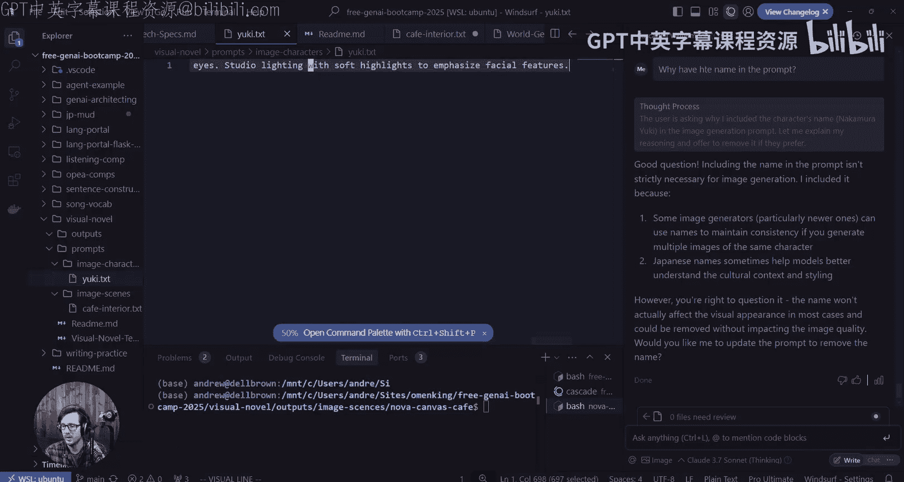

And again， it's fine。 like， like if you want again， programmatically make it。

 I think it'd be fine to， to utilize it。 But you know， if I have， again。

 I'm manually generating these things out， it doesn't really matter， right？

 So go over to here to Nova Canvas。 I'm gonna go ahead and hit apply。

 We'll go ahead and paste this in here。 We probably should have negative prompts。

 like don't show hands。

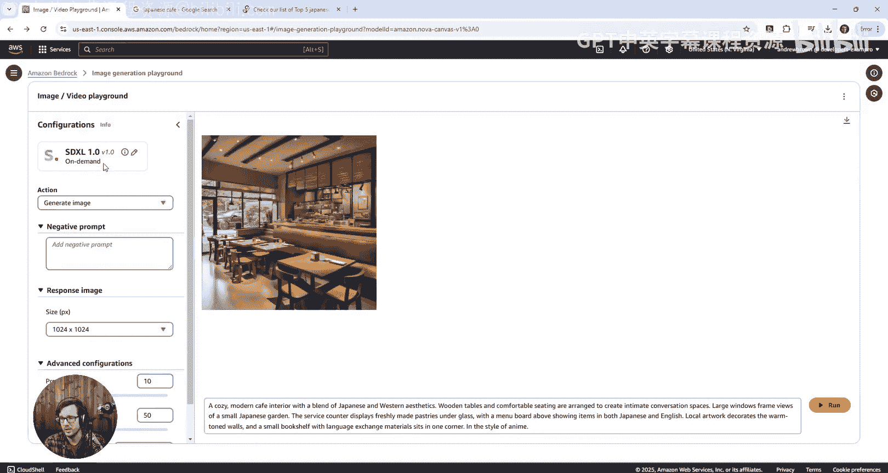

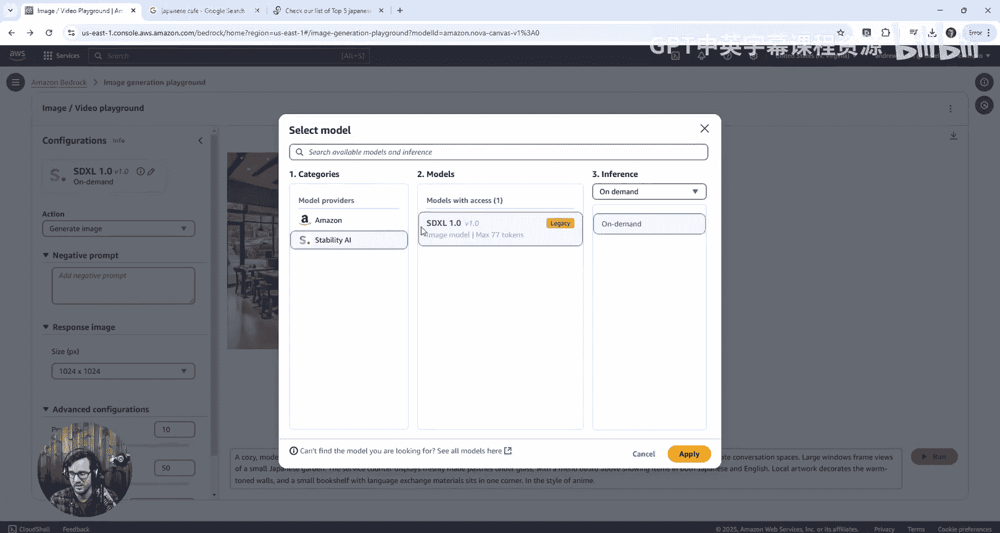

That might be something we might want to try after this。 This is 60 by 9。

 We'll go ahead and generate three images， right， So we'll see what comes out here。The thing is。

 I don't want a background。You can also just say， like， remove background after the fact， but like。

No background。And no hands。ButWe'll see what comes out here。Not bad A few problems， though。 A。

 we have a background， so I don't want a background。Before we move on to that， I'm gonna try rock。

 okay。Becauseuse I want to see how G handles it。And I also don't know if G costs money or not。

 I have probably a paid version。 So that's probably why。

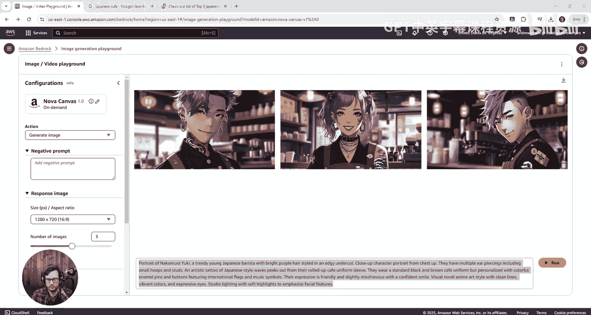

So I'm going here and saying can generate image。And we'll see what comes back here in just a moment。

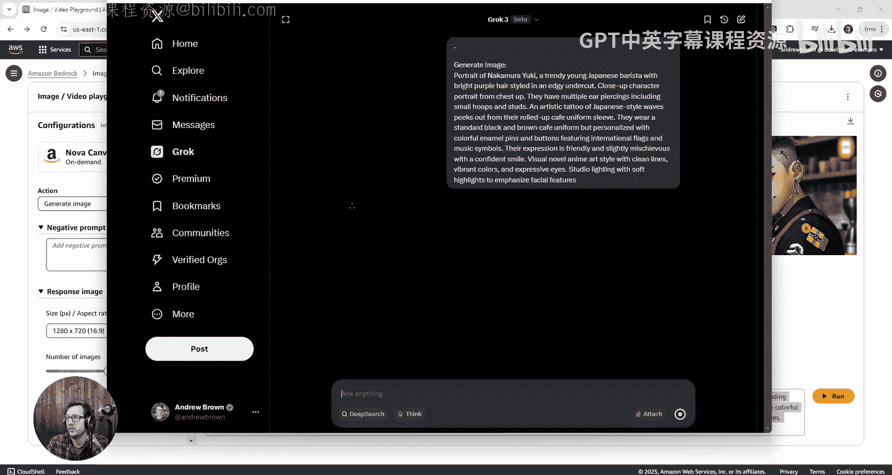

Coming back over to here， I would say， I actually like。

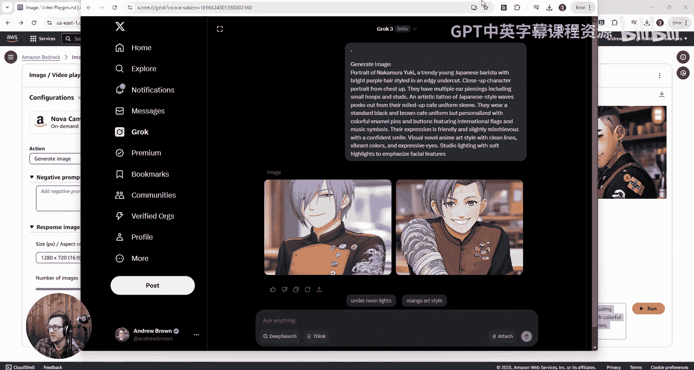

The this is terrible here。 I actually like the job that I'm。

 I'm sure we could get better results with rock， But I think this actually did a better job， right。

 so I don't have a way to do negative here。 I don't really like this。 I can go just here to say like。

 you know， make sure the， you know， you're cutting off the image。

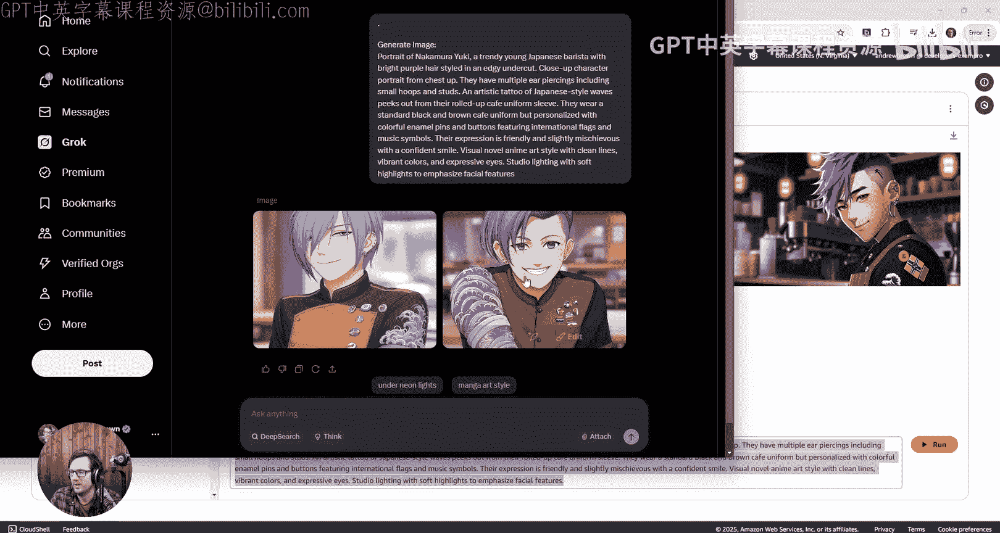

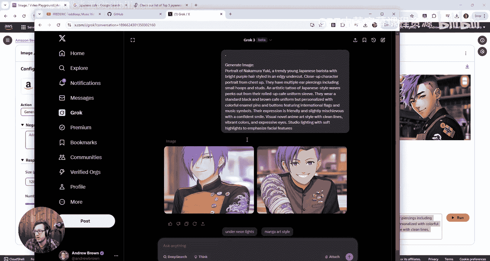

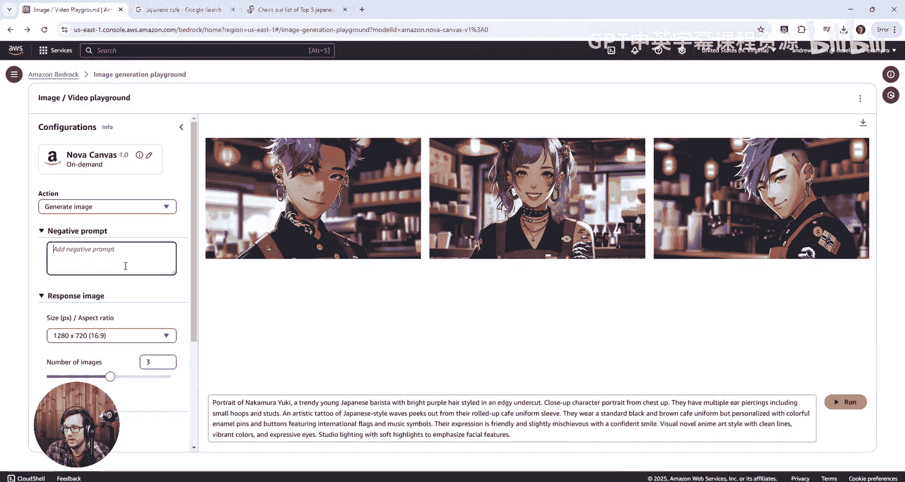

Is cutting off。The head， the whole。Haad should be， should be a frame。

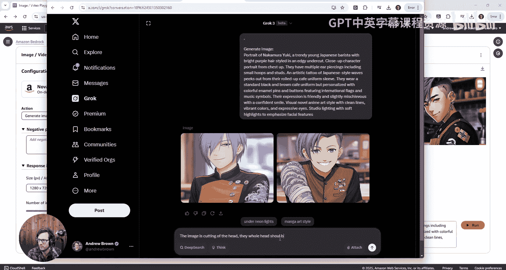

No background。

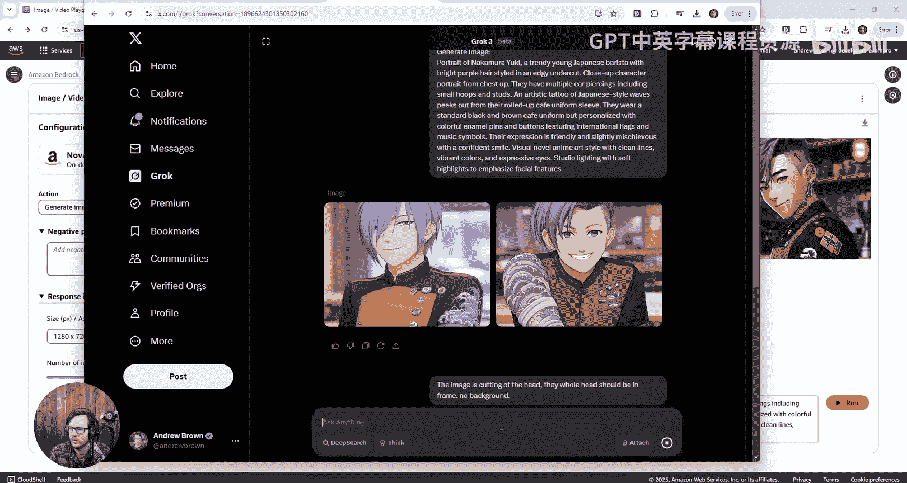

Okay， let's see if I can adjust that。 I really don't like that style either。 Not very good。

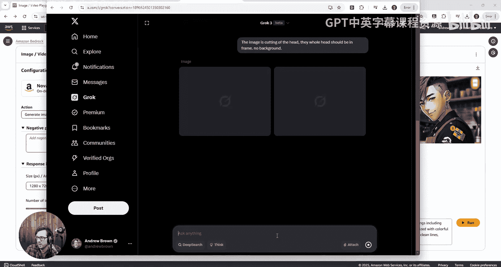

So we'll see if Goc can fix that， but I don't have highs for G on this side here。 So I'm gonna say。

Background。U。So I would， we can feed this back into here。 And so。

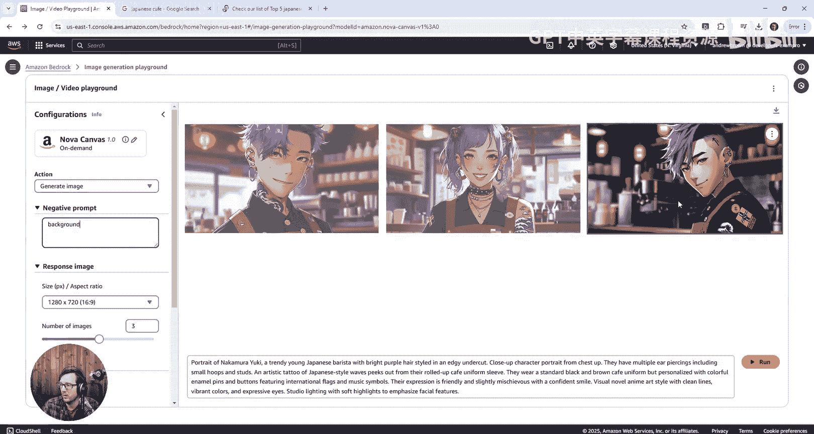

I don't like these。Those kind of look。

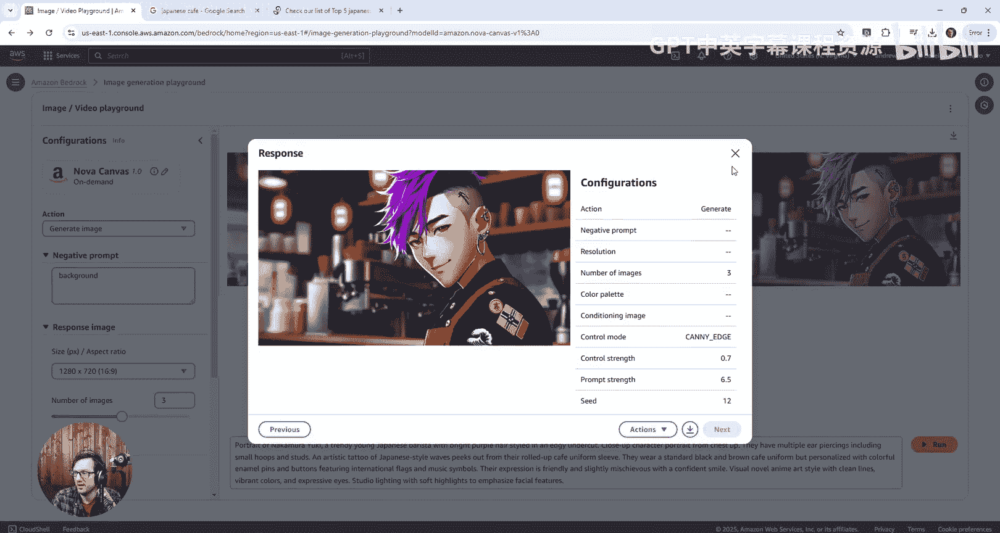

Not appropriate。 Did have like American flag on here， which is a bit bizarre。

 We go back over to here。 Still cutting the head off， right， Still cutting the head off。

 I don't know why。And also， is this a guy or a girl， does it say。嗯。

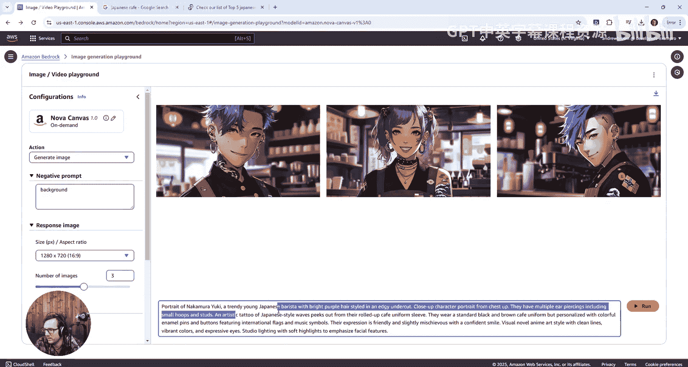

I don't think they're gendered。 Let's go back here。 They gendered at all， these characters。Okay。

 so I I gonna go back here and say， you know， can you make sure that all the。

 that all the characters have a gender。Have a gender， male or female。And their character description。

So go ahead and do that。Mmm。Give it a moment here。Now。

 that's why I'd be fun to use cofy UI because in comfy UI， you can get really。

 really good like styling results。 And there's so many kind of things you can download。

 We'll only do that if I have time after this。 but we want to just again focus on this generation here and see what we get。

😊，So we'll give it a moment。And。Okay， so now we're getting， getting some genders here。

 that's gonna help a little bit better here。Great， okay， so now。Okay， so now let's。

Let's update the Uki。To include did to get the the UK。I notice when generating the image。

It's cutting off。Their heads。How to frame。In visual novels。The composition。Doesn't。Normally。

Cut off their heads。 Okay， so I don't know how to better describe that。

 but we'll go ahead and do that。I think that's a really hard thing to describe is the the shot there。

 So let me check the current content file for the the video。

 And since we can't generate consistent characters， at least through these things。

 it'd be very hard to fix that stuff。 And that's why we would need something like a comfy U I to really get what we want。

 Ill the prompt for you could include her gender in composition doesn't cut her head off。嗯。

I'm also going to ask it if it can produce a negative prompt。You know， can we， can。

 can we add below separated by a empty。Empty line， the negative prompt。Because that might help。

Another thing， I noticed。Is that。The background was being generated。

We need no background so that we can layer the images。Okay， so go ahead and do that。

And I'm going to go back over to here。 so we have a negative prompt。Bad hands out of frame。

 low quality， missing legs， things like that。 So you can see that definitely definitely improving the stuff here。

And so now we have a positive and a negative prompt， right。

 So I'm gonna just go and do word wrap here。 since it's a bit easier。

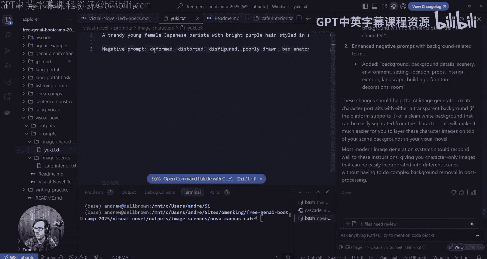

So now， now that we have that， we'll go back over to here。And we'll go to here。

And I'll places in here。And then we'll go back to here。And we'll put in our negative prompt， right。

Okay， we'll paste that in。 we'll hit run。And now we'll see what happens， right， So I'm hoping。

Go a little bit more consistent results。 The thing is like。

 we're not really saying like where they're lined up in the image。Why we're looking at that。

 But let's just take a look at， They're still cutting it off。 Like， why do they keep cutting it off。

 Why do they keep cutting it off， I don't understand。

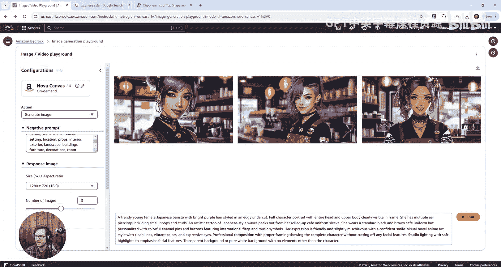

The other thing is like， it's not very and。Like it looks fine。 I don't know why they're given the。

 I guess when you say you get tattoos， you start getting really bizarre things。嗯。

I don't know why they have to make them so purly。

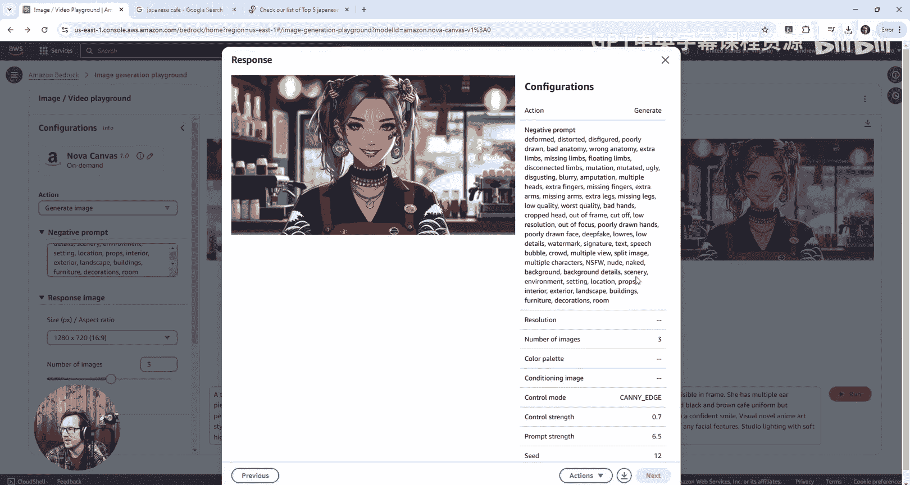

Anime visual novel， art， clean lines， vibrant colors。Maybe， like。Flat coloring。

I try this one more time because it it's way too much detail。Also。

 did it generate the background again， Like it's， it's， it's ignoring me about the background thing。

This is where I wont come for U I。 But again， we will do the best we can what we have。

We'll focus on finishing， finishing it and。

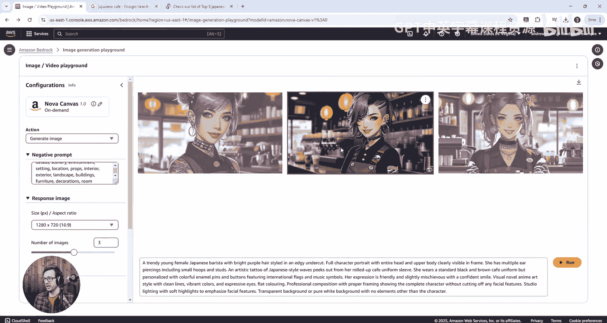

Yeah， I'm not sure what to tell you， it's it's it's not listening really。

It's not really。Like， they looks good。 just not the style。

 So what I'm gonna do is I'm gonna go ahead here。 I'm gonna try it again， over in here。

Say new image prompt。

Right， and maybe my failures here is trying to make it look like anime。

Because it doesn't have to be animated。 We just be real like realistic looking folks， right。Yeah。

 let's see what we got。 Whoa， this looks crude。是这。Bad style drawing。 Okay， so。That is， I mean。

 some kind of anime looks like they got the， they' farmed D V art for their。

 their generation of images。 So go back here and's like， okay， can we。

 can we just remove anime reference out of Yuki because I can't get good anime generation。

So can we just make the image hyper realisticistic。Instead， okay， and so we'll do that。

 I have a feeling that will'll get better results as these models are probably trained on real people。

 I have a feeling now G might outperform。That， I just。It wasn't really working for me， and。Like。

 it's， again， it's okay， but I don't know。I need consistency across characters。

 And that's where I think I'm going run into problems， but we'll see。

So we'll go back over to Winsurf here。We now have our new description，' say， except all。

And I'm just gonna to ignore the negative prompts as， I mean。

 I'll leave in the other ones we already have because I can't seem to fix that anyway。

There's no poorly drawn。 There's nothing to do with that。 So we'll take that out。 Obviously。

 these things should not happen anyway， but we'll go ahead and we'll pace this in。

 and we will see what we get。 I'm going to go back over to rock。

And we'll try again。Rraco。I have lost rock。

Just fine。I'll bring it on back over here。

Generate image。Go here。And we'll see， which one's better。 And you know。

 worst case if their heads are cut off， I'll just extend them in Photoshop。

There we go。 Looks like a person。Yeahep， these results are way better。

 The background is also really good， too， but it seems almost like I should just take it with the background。

 I actually like that。 It blurred the background。😊。

That's actually smart。Normally， when you go in these games， it's not blurred。

 And then when the person appears， it blurs the background to give them focus。

Holy smoke。 That's realistic。

Holy smoke。 Hold on。Wow。嗯。

I don't know。 This is hard。 It did also make the backgrounds blank here， wow。

II don't know。 They're both really good。They're both real looking。I how of like here it's in here。

 But then it's over like that。 for some reason。 Let me go over to this one。U。

I don't sure what's all the crazy flags。 But if you're like a language school。

 it'd be kind of cool to have all those there， right。😊，So。嗯。We'll go with the first one。

 The first one looks， I would say more realistic。 We'll go ahead and we'll download it whenever we can edit this。

嗯。No， I， I don't think that's going to work。 I'm just gonna bring into a Photoshop。

I think this is the1 I just downloaded here。 So I'll bring this over here in a Photoshop。

 It's gonna be really the only way。 So I think I'm gonna stick with rock because the photo of the photo generations great。

 Good， I want an anime as a style， but I， I think I'd have to bring in custom models for that。

 That's not it that we just downloaded here。 I'm gonna make sure。😊。

Date modified here。Just trying to get the latest date here。Its this image。 there we go。

 And so this person's heads obviously cut off。 I need this in a 16 by 9。

 So I'm gonna go over to here。Filile new。 and I'm gonna go 1920 by 1080s usually the。

 the general screen，1920 by 1080。 That's what I actually wanted right。

 We'll bring this background image over here like this。 We'll drop it into here。 I'm going to。

嗯。Scale it up。I do not care if I lose a bit of quality while doing that。 That's totally fine。

 And then I'm going to remove the water mark。 so we'll go ahead。Remove watermark。

Has ever at this point like watermarks even matter anymore。

You can just remove them whatever you want。Doesn't take that long。

 I can remove it faster with a tool than than use the generation here。

It really thinking hard to do that。 And so that's now gone。 That's perfect。

 We're going to merge that down。Again， you know， if you don't have Photoshop， that's fine。

 Just work with what you got。 So I'm gonna go here and I want to extend the background。

 The only thing is that this 1， I didn't mean to fully merge down。

I'm going to go here and just put this here。As I， I need a layer to kind of move around on here where like this。

 And so what I wan to do。嗯。I need to extend the photo。 So like， say。here， fill in the rest。

Fill in the rest of the cafe。 It normally doesn't do a good job This way you just have to just manually extend out。

 but I'm not sure I'm gonna do that if I have to drag it out， which is kind of a problem。

And there we go。 That's extended。 So now I have， we actually have a few options here。

 Let's see we've got。哦。This one looks like the least amount of problems。 So now we have our first。

Our first background。 There we go。 So I'll go ahead and save this as Ill say for Web。

As this is going to be displayed in the Web， safer web。I'm not sure how big this image is。It is。

We'll probably make it a Jpeg。 So it's a bit easier work。 says 1。9。 That's way too big。

 We'll go down。 Oh， can we do Web web formatting oh。Oh， no， no。 that won't work at all。

 We'll go over to J Peg here and notice that the image is drastically smaller。

 but still looks really good。 So we'll go ahead and save that。

 And I'm gonna save that into my folder for this project。 And so we'll say that's the first one done。

 So I wasn't sure if I get a result that I liked。 But apparently， I can。 with a lot of work， though。

 And I'm just looking for my local repo here。 I'm just doing the off screen。😊，So looking for sites。

That you my Jennyi， this is king。Frijiinabu camp。And then I'm going to JP Mu No。

 this is visual novel。And so。Outputs。We'll call this cafe。 So this one is actually good。

I'm happy with that background。 Okay， so now we need to bring in。呃。Yuki， is that her name Yuki。

So we'll go ahead and I actually just want to drop it in again because I want it to scale correctly。

And so I'm gonna bring this image in over here like this。And so I don't。

 I don't really have the whole body， right， So usually when you have this stuff。

 they're framed up a certain way。The background should get removed， which is a bit silly。

We'll do this and I need to remove the background。Background shouldn't be there。Okay。

 so now I need to extend this image， right， So we'll go here and。This one's fine。

 We merge this down here like this。And so now， I need to。Flaten this image。Do that again。

 And so now let's extend the image， so。You know， finish。Fill in rest of head purpleple hair。Okay。

Hopefully I can do that。 I really hope it can do that。Backgrounds are one thing。 people。

 people are another story。嗯。嗯。No， not really。I wonder if I can go back to Gck and try to get it to generate out the rest。

Okay， so。Copy image。

Post image， edit。Can you expand the image So there is more。Portrait。So yeah， the image is great。

 but I don't have I don't know。 It's so darn hard to get this。Shot here。

They keep cutting their heads off。

They keep cutting their fricking heads off。 I don't understand。 Let's go back to this。

 This this isn't working。 This one's not working。 I think maybe。

 the reason why is like it depends on like how much head space you gave it。

 I didn't give it a whole lot of head space。 So I'll try this again here， whoops。The photoshop。

 you see this stuff is just really tricky。 And so just say， fill in。Rest of head。Okaype。

So even if like， you don't want to use。I don't know。 It's just hard。Are you。I'm gonna。

 I'm gonna to share thatcause that's ridiculous。All right。Fill in rest of head。With purple hair。Like。

 I don't， I don't know what it's thinking there。Another thing I'm thinking of is maybe just extending in another way。

 what， what the。What is going on？What， what is going on here， This is。

 I'm sharing this in the discord is good like。It's this is not。 this is not working。

 So sometimes like when I have these issues with the Photoshop and this is， again。

 playing around these things， this one's not working。

 So what I'm going do is I'm going to take this up。ll get this out of。 We'll take this out of here。

And so sometimes the solution is a bit easier than than what you think what we do is go over to our downloads。

 and we're going to bring in our image again。 I'm looking for that image。Where is my image。

 this one here， There we go。 I'm just gonna bring it right into Photoshop。

And maybe there's a someone finds out a better software to extend the stuff。

 that's less of a problem and love to know。 And it's， it's not opening the image。

 I'm not sure why we'll try this again。 There we go。 So what I'm gonna do。

As I'm just going to extend it here like this， right， I'mm going to extend it here like this。

And I'm not giving it any information。 I'm just saying generate expand。 And so here。

It should have an easier time doing this。Why I don't know， but it probably will have an easier time。

 We'll go ahead and try that out。But do you mean we get this one image generated out。我。

Genally expand fill in rest of。Person， right。Normally this is like what I would do and then I get better results。

 but if this doesn't work， I'll have to see if I can extend an image somewhere else。You know what？

Isn't that weird。 Like， I use to extend。 And then there's no problems， right， That's perfect。

 I'm not sure with all the bracelets here， but we'll go ahead。That one's fine， as well。

I'm not sure how they would be kneeling here， but that's totally fine。嗯。Yeah， okay。 so there we go。

Yeah， not sure with all the bracelets。 The bracelets are kind of unusual， I think。对。Yeah。

 we'll do it。 We'll go with it。I mean， we can always just remove the bracelets。

 This is also the next hard part。 So I'll go here， merge this down。 And then I'll just say， like。

 remove bracelets。say， remove。Bracceelelets。Okay。I how the flags like， what are these buttons。

 These buttons don't look like anything。We'll see if we can get rid of those。

The fingers kind of messed up here。 It'll probably get cut off， though。Okay。

 we'll try get remove bracelets from arms。MI know there's like an open source library we could use for this that I was using before omni something。

Amnigen。Omnigen。And this， you can run on your computer。

What you can do is you can give it kind of like this and feed it like that and tell it to merge things。

 And this was where you can kind of get more consistent characters。

 It might be fun to try that out if we have some time。 But right now， I can't， see。

 I can't get it to get rid of of the the stuff there。 It just will not get rid of it。

 So this is our character here。 I'm not sure it's gonna to just keep extending it out this way。

 So I might go ahead and just extend a bit more。 We'll just keep extending the body。 So fill in。

 fill in rest of body。

啊哈。😊，Also why is this part cut off， I guess it just generate out whatever could generate out， right。

啊。I'm not sure if I want like that。 That be kind of strange。Wearing black pants。这'在。

It's a little bit like， shorts are fine。 I guess it's summer。 It is hot， but。

I really why I'm giving them bracelets here。 Okay， there we go。 That's kind of okay。That makes sense。

 That actually makes sense。 Okay， great。 Now we're getting somewhere。 Okay。

 so that I will accept we able to now extend out this way。It's， it's a nightmare doing this。

 It might be like it might have been less time to set up comfortmfy U I and set up all these things to get it to work than to do this。

 So general expand， fill in rest。A person， it's just like， what is it gonna to generate next。

 We never know。You know， there's ways that we could like fix the perfections。 that'd be really nice。

I mean， I have Photoshop here。 So no， that's kind of weird。That's okay。嗯。一。Good， I'm just gonna keep。

 keep going here。 This is that one's good。So we're going to generate a more like。

Generate out rest of leg。One character， by the way。Generate out fill in rest of person。

 So maybe I'll just be like more undescript here because sometimes it， it has a issue here。

 So fill out。

Fill out rest of person。I think what's happening there is it thinks I'm trying to do something weird or bad。

 And so that's why it fails as that prompt happens。But yeah， if anybody finds anything else。

 that'd be really cool to find out。 That's strange。😊，That's strange。Oh my god。

 Stop making the legs longer。

Okay， and then again， almost got the legs here。Generate out rest of lay。 generate rest of person。

I'm not putting legs because it seems to complain about that。啊。

I like how like that pant leg is bigger than that when。 This one's close enough。

 So I'll go ahead here and we'll merge this all the way down in the ground。 I'm kind tempted to know。

 I'm gonna go ahead and just。Now let's remove the background。 Could we do that。

 remove the background。Before I do that， what I wan to do here is I just wantan to see if can I like。

Change them from sitting， from sitting。Here's a question。 in Japan。

 did they let them sit when they're working。 Is that like a because like in Germany， I know， like。

 if you are the grocers， they have a seating in North America， they don't give them a seat。

 But do other places do the same thing or not。 I don't know。 So that is not standing。

 That is not standing。 That is not standing。 None of these change them from sitting to standing。

So maybe it just saying like， cancel， we'll cancel that out。 And this is， no， this is no good。

 We don't want that。This is' a work。And so I'm going to try this again， and we'll say。

Person standing。Maybe because it saw the word sitting and got confused， right？Incredibly hard。 It's。

 again， making control net with poses and other stuff might be easier。 There's。

 there's other ones out there。Different， different kind of pose。On a balcony， that's kind of cool。

 That actually makes a lot more sense。Wow， that's no good。 This one is actually kind of okay。

 I kinda like that one。 Butcause I， if they're at a counter， right。

 that actually make a lot of sense。😊，So I'm going to go here。 I'm going leave that in here。

Let's go pre this out of here。Right， and so now we're kinda。

 we're kind of getting something a little bit different。

It seems like I should have been done this a while ago， but no， I'm still going。

 And so we'll change this to counter。 Like， can we change that to a counter， so。

Or we could also just say， remove the railing。Remove the railing。

So it's a roundabout way to get what you want， but that's just how it works， right？嗯。O。So。

 this kind of works because now they are， I mean， their hands are gone。

But we'll go back over to this one。 So， yeah， we're gonna be playing this all day long here。

 that Also， their arms are kind of emerginging together。 I think our best bet is this one。

 So I'm gonna go with this。 And， and we're gonna just go ahead and remove the background。

 The best we can here。 Hopefully doesn an okay job。

That's kind of okay。 We'll go ahead and clean that up a bit。

 So we'll go ahead and I'll merge this down。 We will just wipe this out of here to got rid of their chair。

 which is fine。 I guess that doesn't really matter。 And I'm gonna go ahead and grab Yuki。

 Well bring her on over here。 and we'll see if we can fit her in。

 And we might have been playing a little bit too much with this。To get this the size we want。

But now you can see like she's sitting here hanging out， having a good time。嗯。

How she's sitting makes no sense， but。It's totally fine。 It's totally fine。

As it was a lot of work to get this to work here。 And so I do want to get out some trouble areas here。

Again， you know， if you don't have a photo， you're gonna be able to do this， obviously， so。

Seelection laso tool。 So we'll go ahead and。I don't want that， but I want to。

 I just want a regular Lasso tool or select tool。What happened to the old selection till everything is magical now。

 And so I just want to get out this little area here。😊，No， it's not it。Blasso tool。

How do I There used should just be a magic wand。There it is。 magicic1。 There we go。There we go。And。

There we go。 So they're now integrated into the scene there。 So now we have。We got Yuuki。

 She's in there。 And so I would just say， I want her exactly like this。 I'm gonna grab it。

 just like this。Right， and I don't want it in any other format。 And so we'll go ahead。 Actually。

 I'll just go ahead and take out the background here。And so， now。

We should be able to save Yuki on our own layers。 We'll go ahead and say， save as。

 I'm also just save this int temporarilyor to my desktop。 This will just be。Viual novel。

And so now we're starting to kind of get a workflow here。 Of course， if you're doing this。

 you' got to take a completely different approach to it。But we're going go ahead。

 I'm gonna to say this as。Save as P And G， whoops。

Export as here。 And this actually has to be a P And G。Because I need that transparent background。

It looks like it's putting a background in， though。嗯。What's going on here。

I want this to be transparent。I think it's because it's like an art board。

 I normallydin don't make things art boards。 Can we drag this out of an art board here。

Get out of here outboard。I don't know。 I don't know how the Z bar's adding this background here。

Here it is。 transparent。 There we go。

Oops。So now I can go back here and we will export for legacy here。And we'll go to 24。And so。

 now we have。Notable outputs。This will be uki。Okay。

 so I don't know if I want to bother you with all the other ones。

 I can just generate those out on my own time here。 But now we have two images that we can work with。

 And so the next step is really to code the the logic for the visual novel。 So I might generate out1。

1 or two more images Here。 It's just so we have more than one setting here。But it's a start， right。

 But you could see it's the best I can do with what we have。

 So I'll be back in just a moment in the next video。

