# ExamPro《生成式AI训练营｜Free GenAI Bootcamp》中英字幕（deepseek - P58：-58-Visual Novel Get Working.zh_en - GPT中英字幕课程资源 - BV1SFEWzLEab

Al right， folks， we are back。 And so what do I want to do here， Because we now have。You know。

 adjacent structure file。 I want to start implementing。The back and front and right， so。I'm not。

I'm going to use what do you call it。Was it called Streo， We're not doing that radio。

 We're not doing that。I wonder if we should use phaseer for this or not。

The challenge is that if we use phaser， I'm not sure if it can interpret the Japanese characters。

 if you don't know what phaseaser is， it's actually a game framework。

 the typing tutor app is built on it。 So if we go to Fser JS here。It has a bit more interactivity。

 things that we can do with it。 But technically， everything that we're doing here doesn't necessarily require this because what we're doing is pretty straightforward。

 It just depends on what level of interactivity we want to have inside the game。 So you know。

 we use HTMLtl react。 It's gonna be a lot easier But then if we want to have transitions and things like that。

 It might not be as nice。 So I'm very tempted to use phaser for this。

 And I think we'll just give it a go and we'll use Gemini and see how well it does。

 So I'm gonna go over to here。 And so we obviously have like static files right now。

 So Id say like we don't even need to really write a server per se。

 but I'm gonna go back and open up this and we're gonna to switch over because I keep saying that I'm gonna to do it。

 So we're gonna go over here and we're gonna switch over to Gemini flash 2。0。

 And so what I want to do is I want to start building my game。 So you know。

 I am building a visual novel game。😊，And maybe this comes back down to writing this text spec， right。

 so。I don't know。 We'll say I'm building a visual visual novel game。

Visual novel game for Japanese language learning。I want to build it in。Pser JS， you know， can you。

Build it for me。Take a look， take a look at my visual novel docs， so the visual novel。Text back。

And the story。Structure。Okay， so hopefully between those two resources it again。

 But I kind of feel like it needs a little bit more to know。 So I can say I'm gonna read this first。

 I need to read the contents of the files to understand them。Okay。You know， please do that。

And so right away， it's having a hard time。It's already failing。

 So I think maybe if it didn't have to re files it'd be less of an issue。 But you can see here。

 understand the requirements。 And it's having an issue， so。Sorry。

 I guess we just can't really work with that right now。 So I'm gonna go back over to G Cha G。

 I do like G 4。0， but I'm gonna 4。5。 I'm gonna cloud it So please， please try again。

Because I just have to switch back to this。I was just struggling， maybe like if I use Deminite flash。

 not in windsurf and copy and paste， or maybe if I had more of my code base along。

 it'd have less than an issue， but right now it's having a hard time reading the stuff。

So I'm just gonna have to just do this manually or like with Claude。 I really wanted to do gemini。

 like， really seemed very impressive， but maybe it might be better for your like text generation。

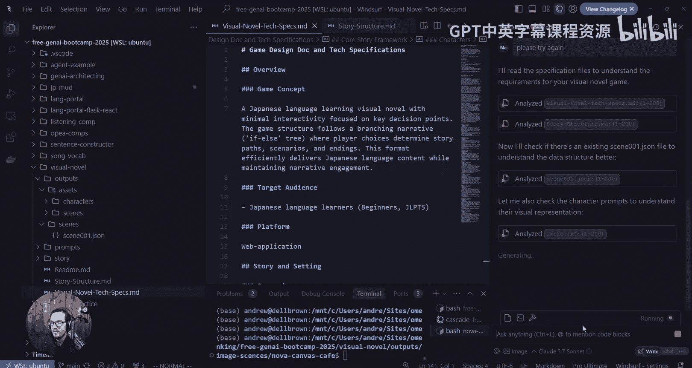

Maybe that's what it might be better for。 but right now。

 like maybe if we want to build Ls into the game， we'll do that。

 but I guess Gemini is just not really working out as we hoped here in windsurf。

So here it's gonna check。 and it's just analyzing the file。

 It's really just checking everything to understand the code structure。

 So it's gonna go ahead and create an next H file。 There is a very particular way I I like to build up my phaser games。

 but。I don't have it in here。 I could bring in the code over so we would know， but it's totally fine。

So let's take a look here at the index HTMLs that's going。 So here we have Bo screen。

 preload screen menu， game， language help score I know phaseer。 and if you don't。

 then that's a bummer， but here it says phaseer 3。55。 What is the latest version of phaseer。

So that's another question I have is if we go over to here what version of phaser do we have。

 So we'll go to phaseaser JS Github， because I want to make sure that it's using the latest version and not an older version。

 So we're going to here。

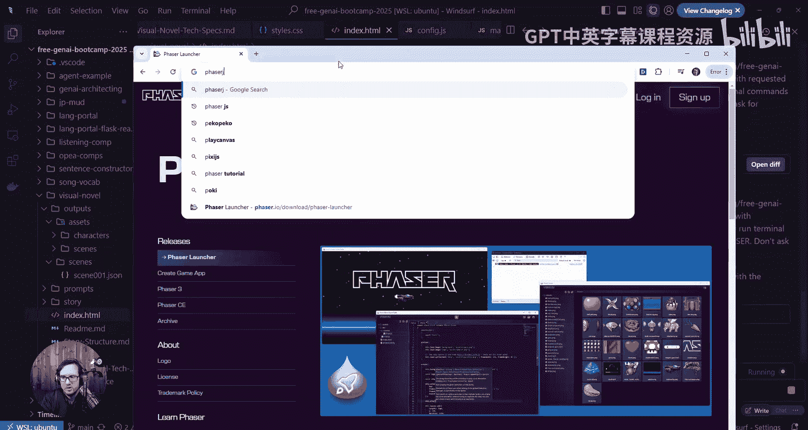

This says version 4， is version 4 out？嗯哼。😊，Here's saying， 3，8，8。So it's interesting。

 like we have 38 8， but then it's talking about phaseer 4。 So phaseer 4。

 I don't think phaseer 4 is even node。

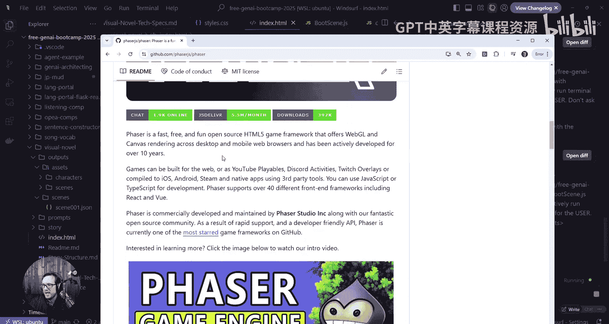

Core rendering engine fixes in the latest issue， so the fourth release of phaseer 4 essential fixes to arcade physics resolving several issues。

The stack group mechanism has been overhauled。 The engine now handles failed textures under the hood。

 the rendering pipeline improves the render stream line。

 You can use phaser for here over here in beta。 Again， I'd probably just take with 3。

 This is using 3。55。 There's been quite a few changes since then。 if we go back over to here。

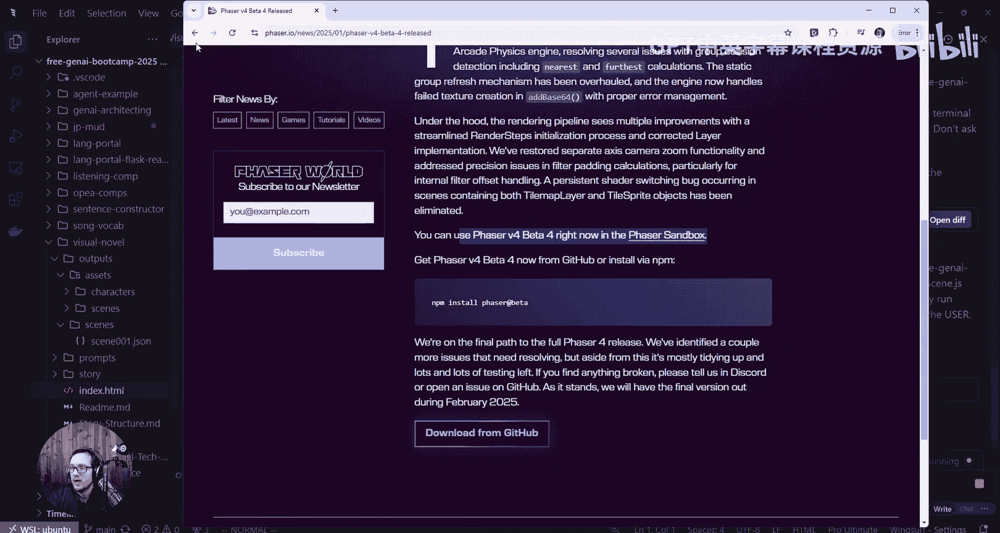

I mean， there's just a few version differences， right， but we've go over to releases。We can see。不是。

Like， how far out are we with this。Bit over here。

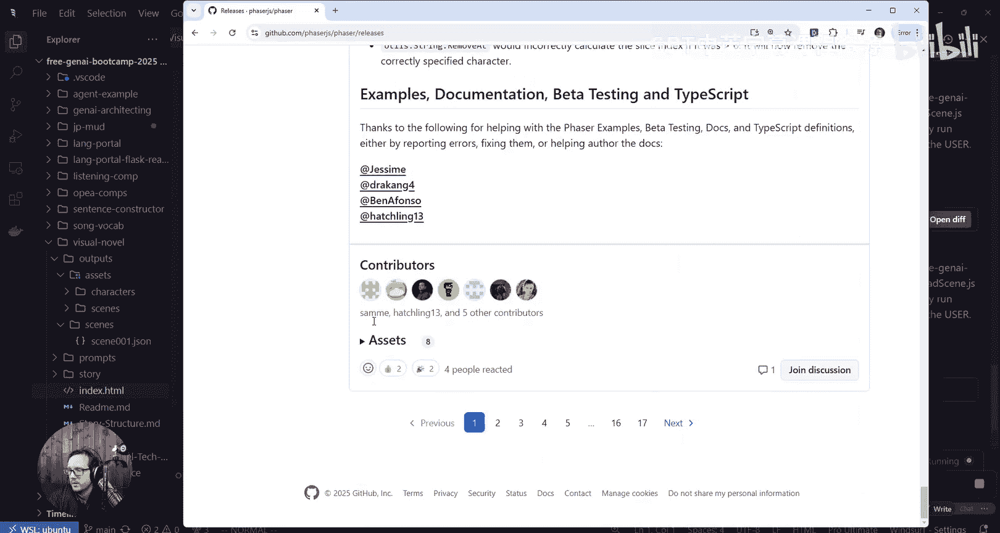

So I don't know。 I kind of wanted to use the latest。 I'm gonna let it continue on there。

 And after maybe it once it works with what it's working with， we'll have less of an issue。

 This is actually how I would start to implement it。

 I would just go and make an index file and then load them this way。

 I would use HB server to serve it， which is actually what we did before。

 because it's nice refresher。 We'll go into the ja directory。 probably wouldn't call it J S。

 but that's fine。 That doesn't matter。 I do think we might have。😊，So over here。

 I'm not sure why it's top level like that， but that's totally fine。

 We can fix that after it's done generation。 But let's go take a look what it's doing。

 So here it's adding the scenes。 So starts the game adds the scenes。 This makes sense。

 we have boot preload menu game。Language help， I'm not sure if we need this scene。

 but it's interesting that it did that here it extracted out the configuration， which is fine。

1280 by 7，20， technically， our graphics are 1920 by 1080。

 So it would actually have to scale down for that to fix it。

 I might want to bump that act back up to 1920 by 1080， as that's more of a default screen。

 Here has some game settings， so。That might be interesting。 So it does have some settings in here。

 which is kind of cool。 We'll go over to scenes。 We have our boot screen here。

 withs loading graphics。😊，嗯。We have our assets UI is's loading it。 not sure why it's doing this。

 I guess it's a placeholder image。 We don't have a placeholder image。

 I'm not sure why it's doing that， in particular。We'll go over to our menu。

 It's bringing a noal sands JP， which is not a bad idea。

 though I'm not sure how it's going to leverage that unless we already have that font downloaded。

 So that's kind of a bit of a challenge there。 I know for these games。

 I like to change the configuration as much as I can to get exactly what I want。

 So that might be something that we do here。 I'm gonna go over to the preload screen。

 Let's take a look here。Create loading bar， assets， characters， backgrounds。

 So's actually doing a kind of a decent job here。 I don't know if you need a loading bar as it should be able to load this pretty good here。

 It's trying to add a bunch of assets we don't have。So I'm not sure as to why it's doing that。

It's still going， which is really， really good。 But yeah。

 it's actually doing quite an impressive job。 I'm gonna wait until this is gets the end。

 And we'll take a look here。 But clearly， there's a lot of assets that it's asking for that aren't here。

 And then， this stuff is not even in the correct directory。 So we're gonna have some challenges here。

 I'm not sure why it stopped here， But we'll say do you need to。Keep going。

Cause I'm not sure why it stopped here。Okay， so we'll let it continue on here。

It's having a little bit of trouble proceeding here， which is a bit frustrating here。

 But while we're waiting here， we might as well take a look and see what we have。 So in the menu。

I guess the question like， where is the main game， I'm。

 I'm assuming it hasn't implemented that yet as we go back to our。Our main file here。

 boot preload menu game。So I don't see a game dot G S yet。

 And that's probably what it's trying to work on next。 Here it is。 I'll create the game scene。

 which is the most important part of the visual novel。 I'd say it is。

So I guess I'll just wait for this to generate。Here it's failure on the game scene。

 I'm just be I gonna just first log over to thinking and just be like， okay， you keep airing out。

 trying to make。The game scene。Can you break it down into smaller tasks。So that you are writing。

Something， right。And so I'm gonna just kind of help it out there。

 I switch it over to the thinking model。Okay， so it's gonna think first。

 we need to create a basic scheme with the structure。

 Then I'll create the method for handling the dialogue system。

 Then I'll create methods for handling choices。 If， I'll add a method for seeing transition。

 saving loading。 This approach should help errors， avoid errors。

 So now it's gonna go ahead here and we'll we'll come back。 And well， at least now what we can do。

So we， we don't even have to， we don't have to like wait around。

 We can actually kind of see what it's doing。 So here it's bringing a game。

I see it's setting up some of the properties。 I'm not sure how it knows about these properties。

 as it's not extending anything。But I guess the thing is that over here we have the game configuration。

Specific global settings。 Maybe this is something I haven't really used before。 but yeah。

 that has the config here。 Okay， so maybe then it's just available to the game everywhere it is。

 But this is game dot， whatever。 If we go over to here， This isn't extending the game in particular。

 So how does it know about that。 I guess over here， we have game settings， current scene， otherwise。

 scene 0，0，1。 Okay， so again， not sure。 I guess maybe it's saying like the current game。

 This is the settings that we here。 And then there' is global configuration settings。

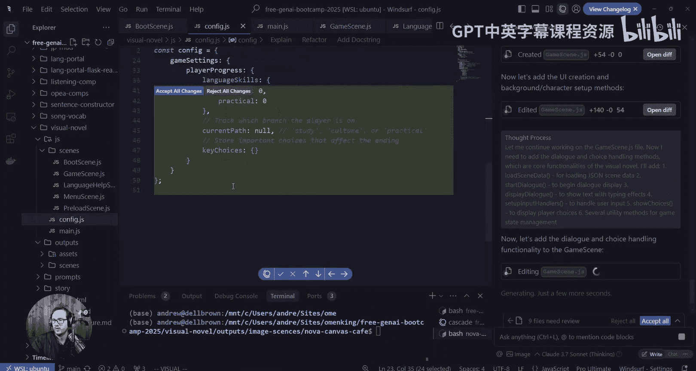

So I guess it's fine， yet it's fine， I guess that makes sense。

 I'd probably extract this out into its own data file， as that would make more sense。So， here。

So have low dialogue data， start the dialogueg data。So create the background here。

 It sets it to the apartment。 It really shouldn't be hard coding stuff here。 It's setting is Alex。

 which is the initial scene， which is fine。 Then we have our dialg box， which is fine。 Again。

 we don't have any graphics for those。 It's setting the font， which is aer。

 I'm not sure if we should be using aial， but to here we have the Japanese text。

 I guess said makes sense。We have create U I controls， which is good as well。

 So lots of stuff going on。 We'll wait till it's done。 Allright， so what do we have here。

 So let's check the config J to make sure it's all required。 So great Now， finally。

 it's a game scene and implementation。 So we have a lot going on here。

 I'm gonna move it around a bit because1 of all， I'm just not， it's not where I want things。

 I'm gonna to call this public。😊，🎼Okay， that's the first change you're gonna make。 Actually。

 let me change the the file Finally。 And the other part is that we have scenes data in here。

 If I could go and drag this into public as well。 say， yes， we're gonna move it。

 I don't know why just doesn't。 it gives me that error there。嗯。But。Where did our stuff go。

Where did our stuff go。It's almost like it deleted it， which is the same。 Yeah， like， look。

 it just deleted them。 I didn't say to delete them。

So we'll go say and we'll say disc discard changes because we don't want to get rid of those files。

 We want to keep them around。 And so this is where I think the number one feature I'd like Winsurf Dad is like。

 right click be able to find something exploreer。 It's always frustrating can't be able to find something。

 So I'm gonna go into I'm just doing this off screen here。

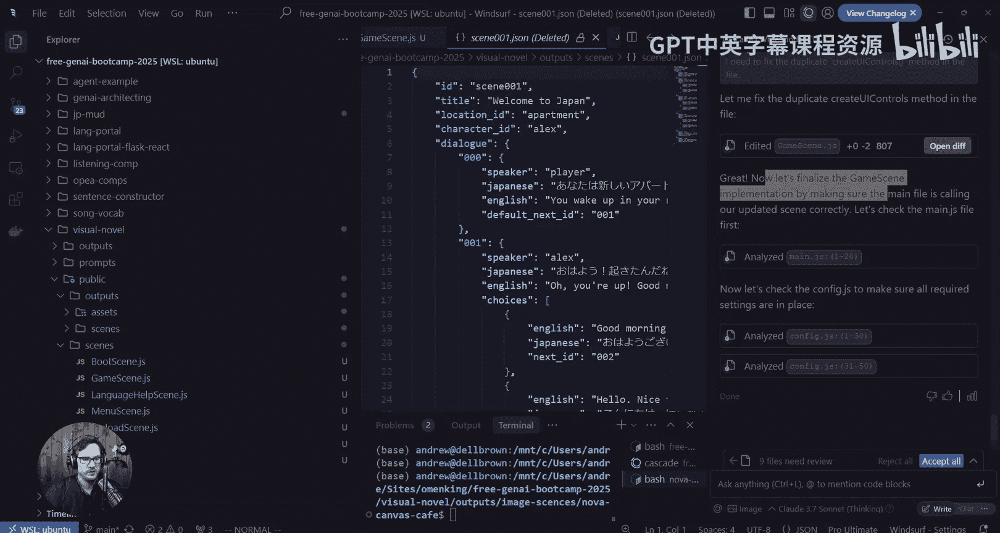

As we have all of our assets here， I'm going to rename this directory to data。

As it's just struggling with that there， and then I'm going to drag this into public。Okay。

 and so now I have this public directory with everything I need in it。 Then our data is in here。

 This output directory is。Redundant， I guess。Now now we have double of things。 go back here。

 I's gonna make sure that everything is in here。🎼Yep， it is。 Okay。

 I'm just gonna delete this outputus directory。 And so now it has this new structure。

 It's still going show maybe this outputus directory。 Nope， that's fixed。

 I'm gonna go ahead and just add all this here。

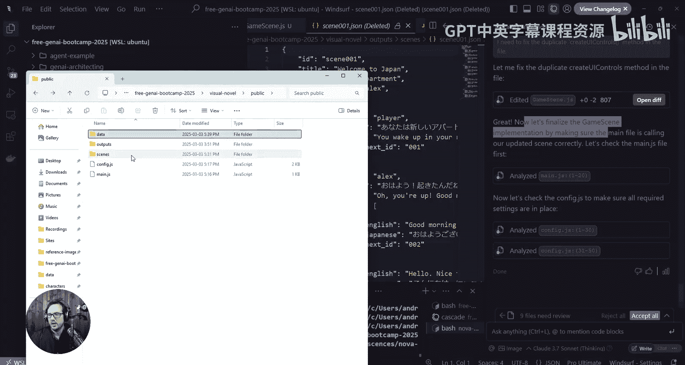

I don't care。 It's fine。 Just add it all。Everything， everything。 I want everything。

 There we go to say WIP。In progress。And so now what we'll do now that we have that。

 I'm gonna need HB server to run this。 I'm gonna see D back until we get to our visual novel。

 And I'm gonna， I think I have HP server already installed。 you can do MPM MPM install HP server。

 if you've never done this before。 we'll go ahead and do that。

 That's gonna globally install that package everywhere。 And so we do HB server。

 it should now serve the public directory。 If it's not that then it's the build directory。So， yeah。

 it's already serving it， which is perfect。 So I'm gonna go over to any kind of browser here you can see about bunch of stuff going on here。

😊。

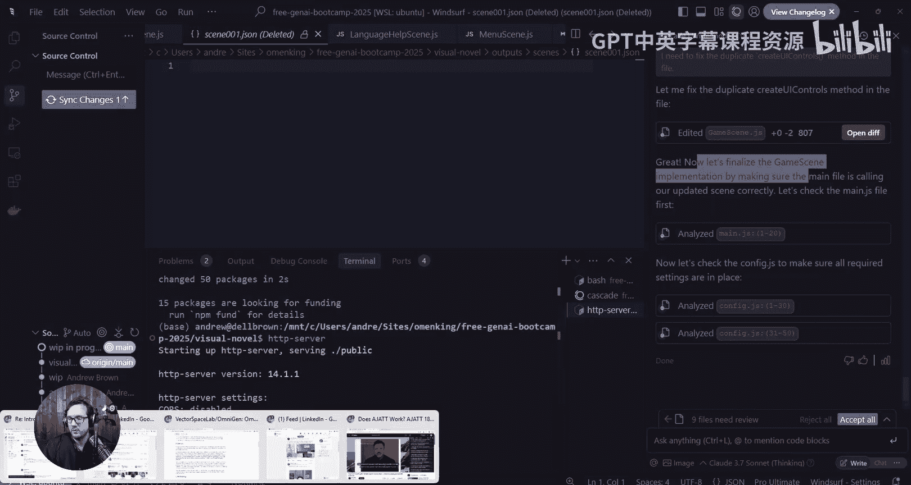

And we'll go ahead and we'll say local hosts。 Was it 8080。 I think it defaults too。

 And so we're in here。 What it's not loading is the index HL page。So I'm gonna go ahead。

 I got some stuff off on the tab there。 So why is that not working。 Also。

 we'll go back over to here for a second。

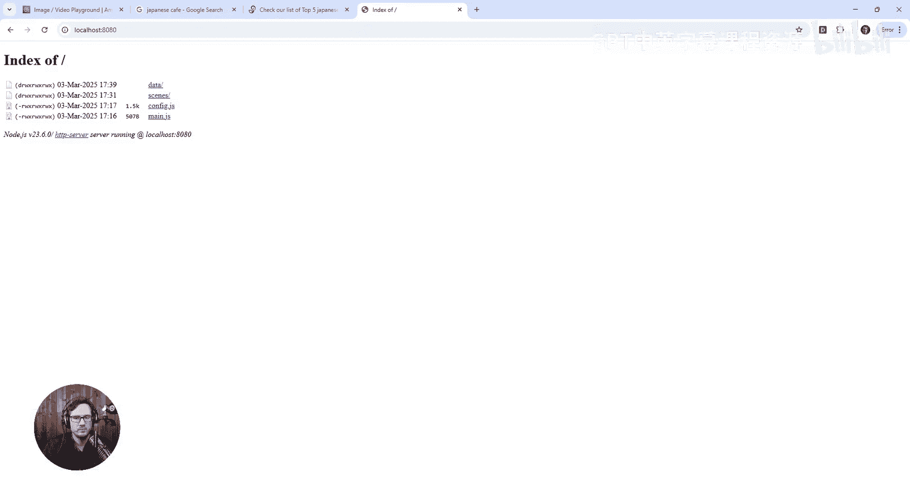

🎼I'd like to sink those changes， if I cant sink changes， please。 Thank you。

 Well we'll go back over to here。And。🎼I don't think this is in here。

 So we'll bring listen to the public director。 We'll move it。

 So now everything that CSS should be in there， too， I guess。We'll move that as well。

 I'd probably put under the assets。 I don't like it hanging， hanging around there。

 Not that there's much going on here， but we'll go back over to here to here。

 We'll give this nice refresh。😊。

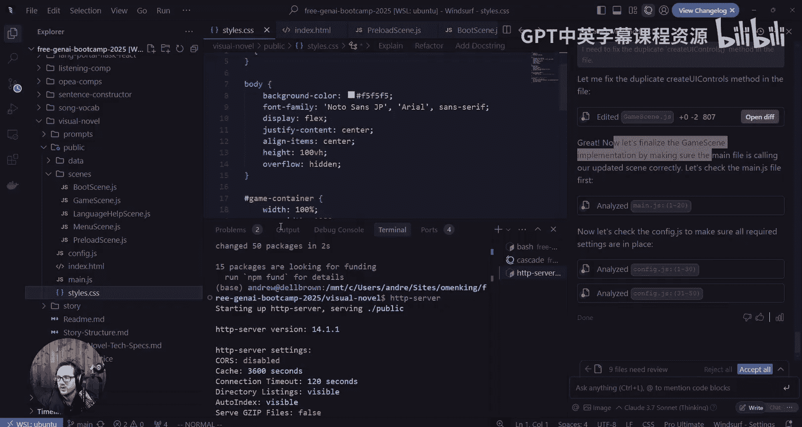

And so it should， in theory， serve that indexed HTMLL。 It's not。 So I'm gonna go back over to here。

 I'm gonna stop it， Start it again。 so maybe you can detect that that file is actually there。

 We'll go back over to here。 get this a refresh。

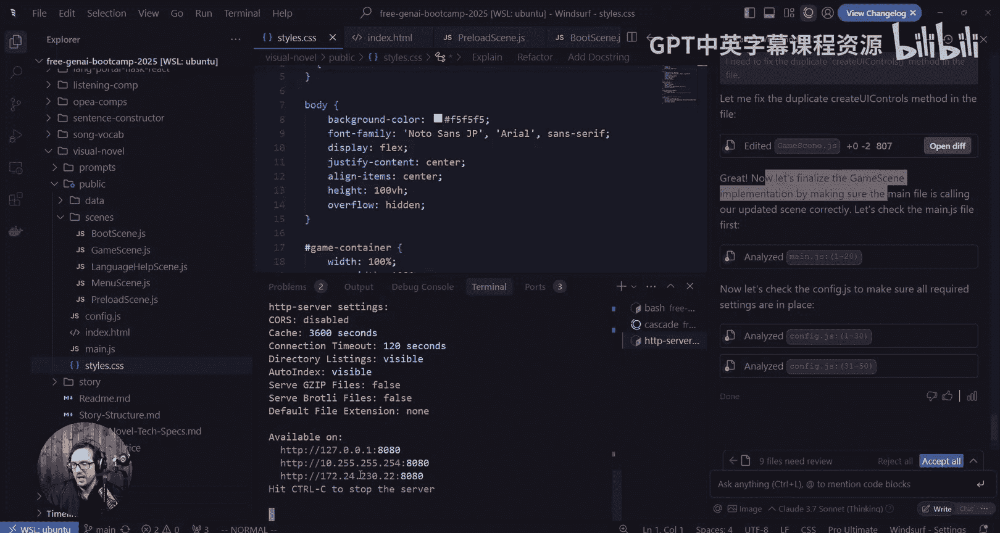

And。It is still not serving it。 That's kind of frustrating。 Let's go back over to here。

 I could aswore。 We have our nextation amount in our correct location。 It is。

 It's in the public directory。 So why isn't it serving it then。

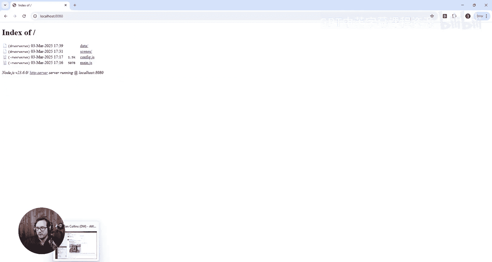

Right， because if it's here， it's here， right， So serve it， please。

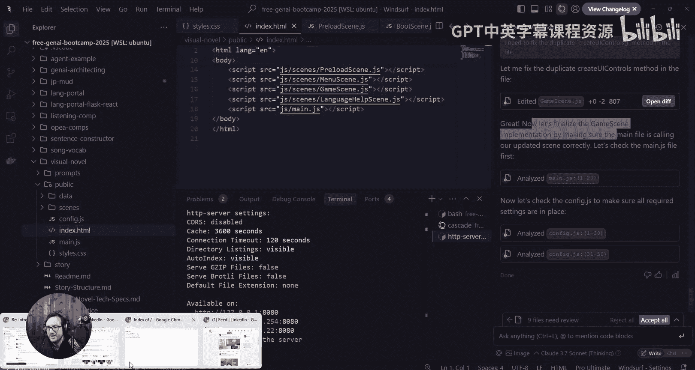

I'm going to go ahead and open up inspector。 Maybe it's caching it。 So just by opening this。

 sometimes this fixes the caching issues here。And yeah， it does Now。

 Just make sure when you're on your network tab that you have disabled cash。 So you can have stuff。

 So now we have this。 it's clearly not working， which is fine。

 I kind of expect that because we'd let it write a lot of the code It' saying can't load a bunch of this stuff。

 right， So Air 40，4 Js not found。's because it's hard coded for this Js directory。

 This is where I'm gonna kind of maybe drive for a little bit and adjust the code。

 So right here' saying JS scenes。 This is not true。 So where is this stuff。I mean。

 we have a directory specifically four scenes， which is here， which is fine。

 And so I'm gonna just take this out like this。And the configure is right here like this。Okay。

 and that's the first thing we're fixing here。So we'll go back over to our browser。To here。

hard refresh。And so now we'll take a look at the next thing。 So here。

 there's a bunch of assets that don't exist， right， which is fair。

 That doesn't mean that it's going to break。 It just means that we're not going to see stuff here。

 as we don't really have。All these assets。 But it's say， like。

 it doesn't know where these folks are because it's going assets audio。 So bunch to audio stuff。

 which I guess we'd probably want that stuff。 Let's go take a look and see what， where it's doing。

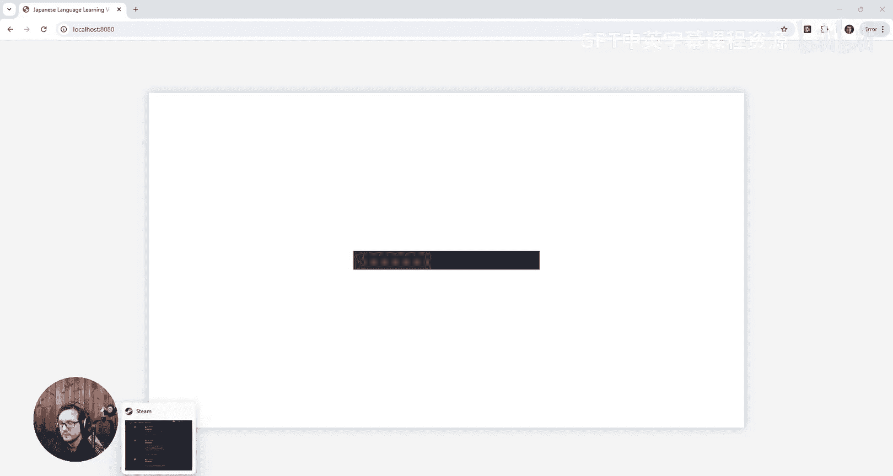

So if I go back over to here。We have our main ass。Right， and so this is going to load up phasesr。

 It's gonna add seedss and go to the boot scene first For now， what I'm gonna do is I'm going to。

Maybe comment out that like these。Please here。Oops。And let's just take a look at our boot scene。

So whats our bootsing doing is loading a background， loading a bar。

 loadment assets needed for loading screen。So that's kind of interesting。

I'm going go back over to here。 I'm not sure I have to stop it every time。

 but I'm gonna go ahead and just stop and start。 I don't think I have to， but。

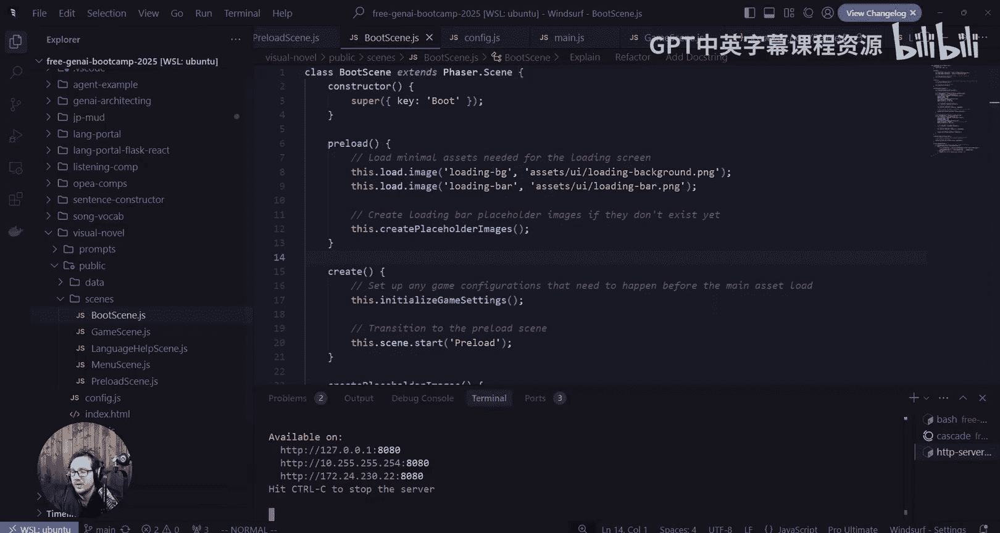

Just in case I do， I'm gonna keep doing that。 So we'll give this a nice hard refresh。

 So I'm just trying to get less errors right now。 That's all I'm trying to focus on。

 just trying to get this down， paired down。 so I don't see any errors here。

And so these obviously need to be in here。 Then we have a bunch of assets we don't have。

 So we'll go back over to here。 Ass normally get loaded in the。

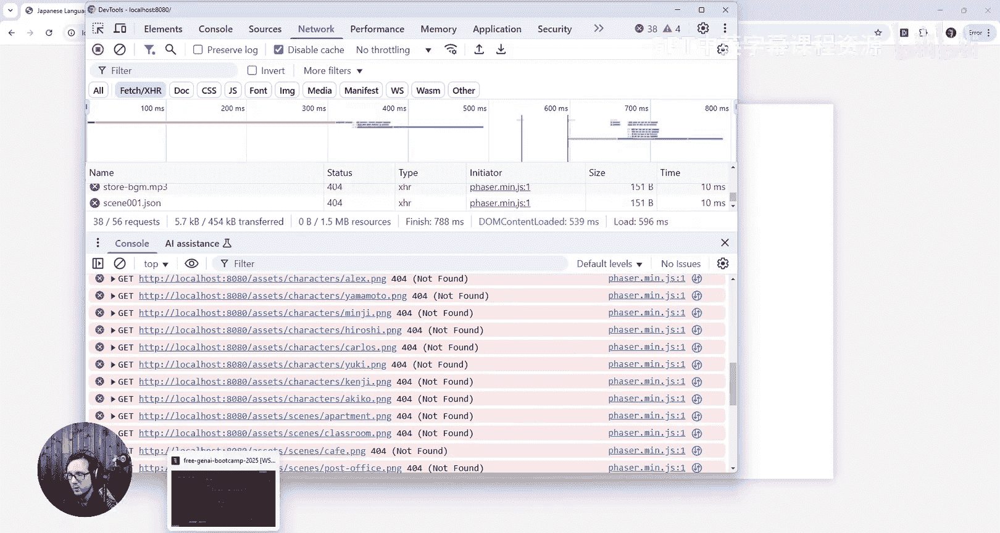

The preo itself， this is really just the boot screen。But if we go over to our preload scene。

 this is where it's trying to load all of our assets， right。 So we have characters， which is fine。

And it's trying to load them into the assets here， which is actually data assets。

I suppose like we could just separate this out from data and assets and drag this up one layer like this。

And then now data is just data and scenes。 and now assets are assets。But notice when I dragged it up。

I know， it's still there， okay。It's there。 And so that's going to resolve。Some of our issues。

 here's going outputs， which is fine。 actually data。Does that resolve that。嗯。

I guess background music is not a bad idea for some of these scenes。 I' even think about that。

Whichs kind of cool。I can't remember what Brian was using when he made the boot campamp song。

 but we could probably use that to make some cool background music。嗯。Data scenes。 Where's the users。

 though。Asset scenes， background。I mean， that is technically correct， y y。

But what I'm looking for here is this， yeah， assets characters。 Yeah， so that。Are they G PN Gs。

 They are PN Gs。 Okay， so that's going resolve should you resolve quite。

 quite quite a amount of the errors here。

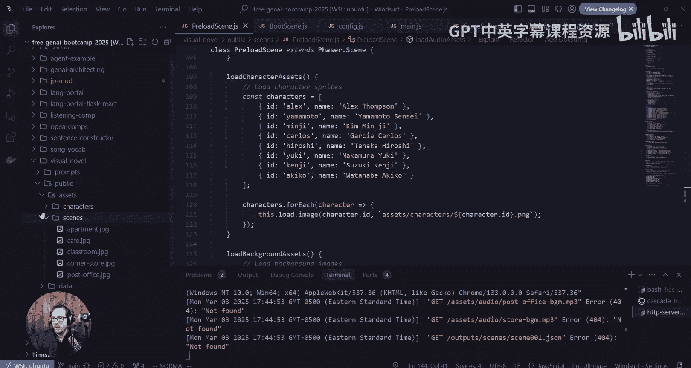

So'll go back over to this。And we'll go here， get us some nice refresh。And so， now。

It's just U I and background music。 That's the problem， right。

 So maybe we can get like some background music。 So generate looping background music。Beo games。

 Like， is that something we can do。Looping background music。Jenny I。

 is it something we can generate out？Cut the sound。

 maybe increase the volume for the first two seconds。 I'm just again trying to find something。

How to make looping BGM。Loping music。Not loops。

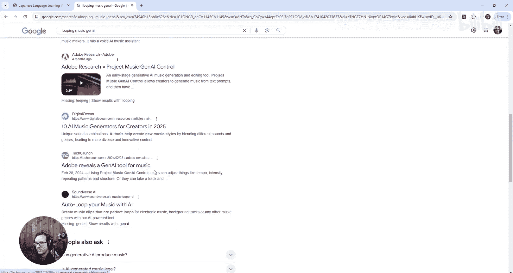

Auto lip your music with AI。Create seamless loops from electronic music backgrounds and stuff。

 That sounds good to me。 I'm not sure what the pricing is for this product。😊。

Free for trial。

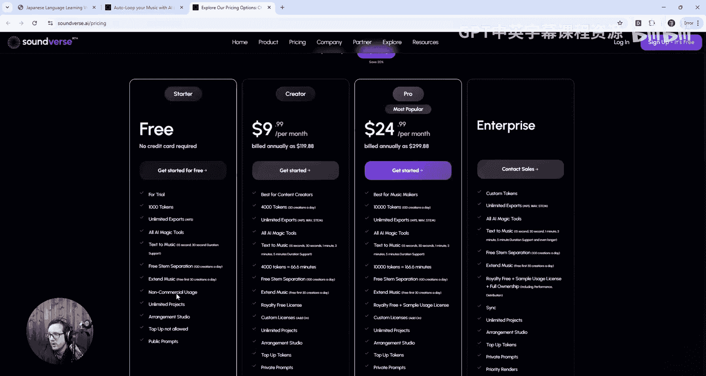

Okay， well I'm going to give it a try here。

Sign up， it's free。And then Baker was like， what do you spending money oncause you gotta remember to turn these services off。

 I just need the music again， you know， you don't have to have music if you don't want to。

 You could just not have it in there。

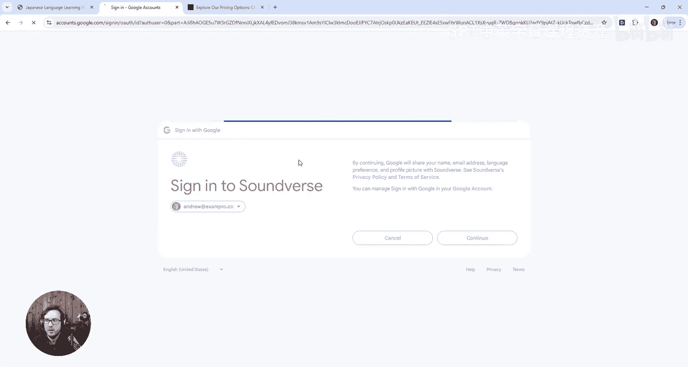

Or we could just have like looping looping sound that isient ambient sounds。Sure。

 we'll make that my handle。 I don't care。

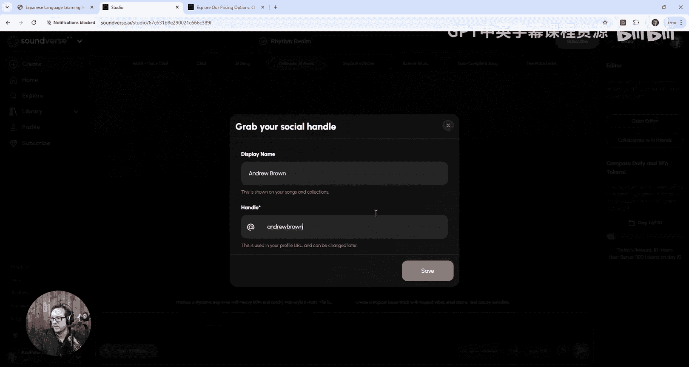

I don't care， sir， sir， sir。 Let me， let me do that。Skip tour。

 I don't want a to or I just want to generate music， so generate AI music。嗯。

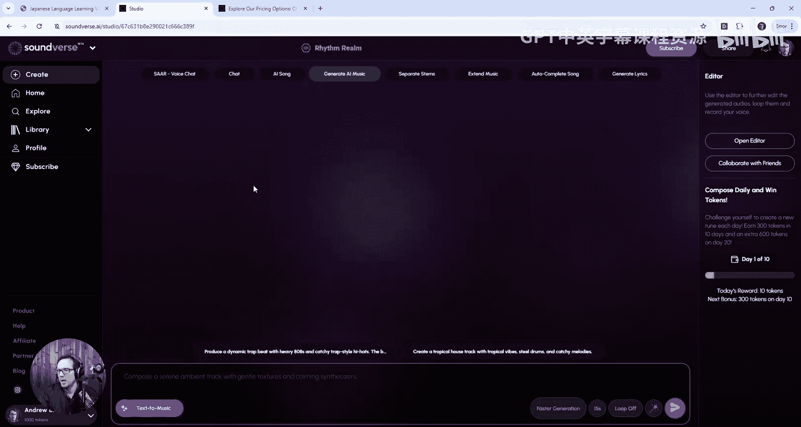

Loop。

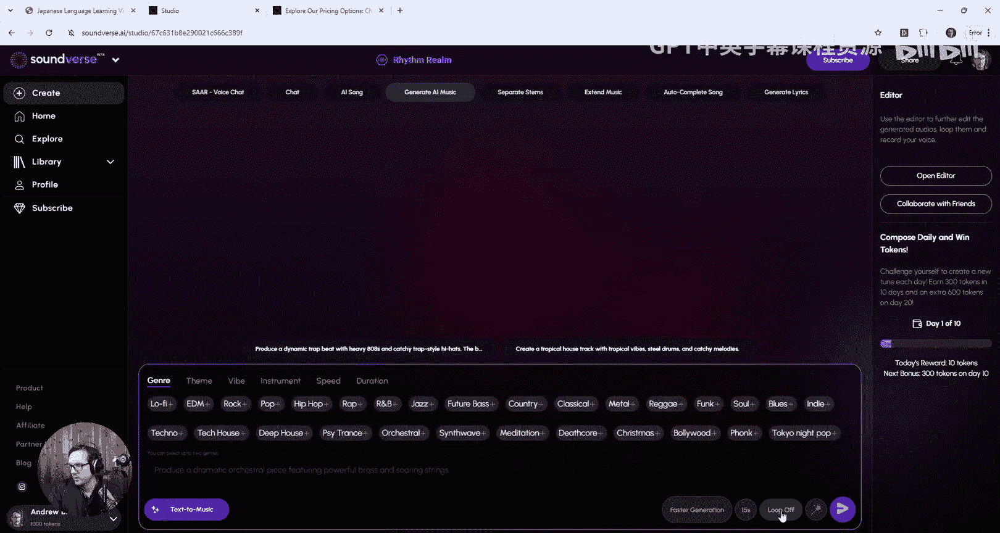

We want the music to loop。So， here we want。Compos an adrenaline pumping song。 We don't want that。

We want a song。 That is。Instrument vibe。Theme。We have background， like podcast background。

TV soundtrack。Web series soundtrack。 I kind of like how film background score。

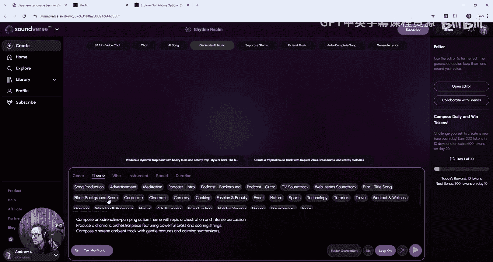

Ttorials。嗯。mean gaming would be correct。But we clear this up for like we give gaming。fibe。😔，Comm。

Instrumental。speed。Slow。嗯。It's like， I don't know， background， background music。

Background music for a cafe。 like， I du't know。 This is always the。

 the challenge is trying to figure this out。 So we'll go ahead and well。

 we'll just generate that out and see what we get。 I don't know if we'll get anything that is any any good。

 I think the audio will pick up here。 I'll have to just check my system sound to see if it picks it up。

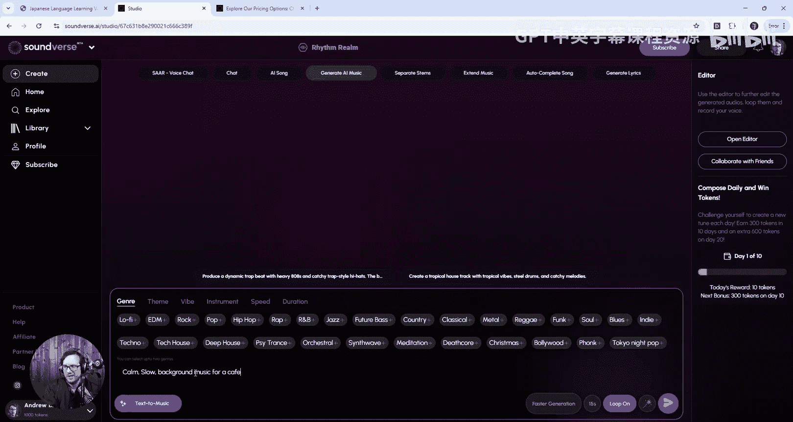

But， you know， I don't want to spend too much time on this。

 And We could also just try to find like existing music。 I probably can download。

 I have it a subscription to and Vao， so I could just go there and find some music and be happy with it。

 Don't always have to generate things out。 But if we can， I mean， it just adds to the boot camp here。

 We also might just want ambient ambient sounds， right。😊，I'll give this a moment to generate that。

 okay。Now it's also just generating that out so。I don't know。 It seems like it'll take a bit of time。

嗯。I just need， it's going to take forever to fill these in。

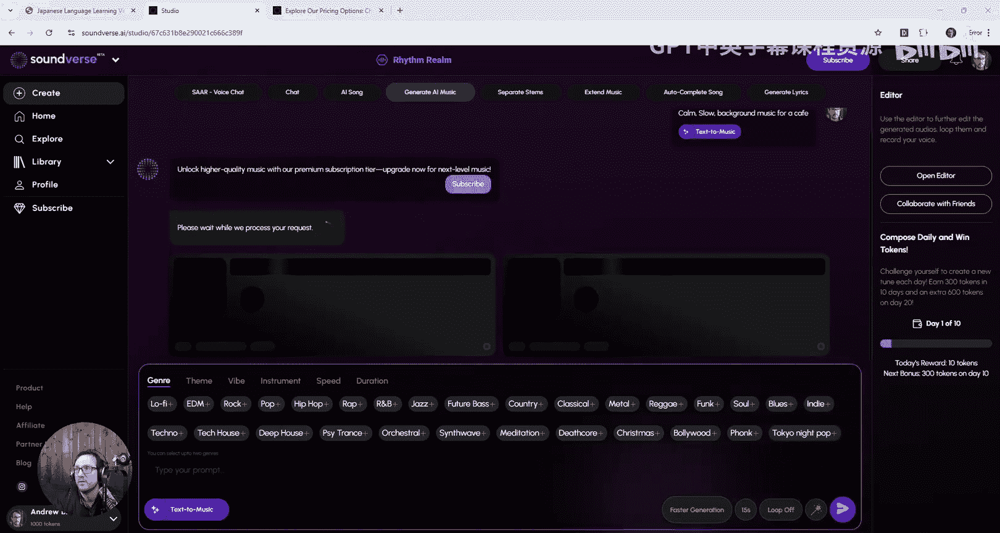

Let's go here back to this we have。Click sound， but it's also not loading the assets here。好。

Cause they definitely， they definitely exist now， right， I can close this tab out。

 I don't necessarily trust it。 We'll go back over to our language visual novel here。

 We'll go ahead and ahead inspector。

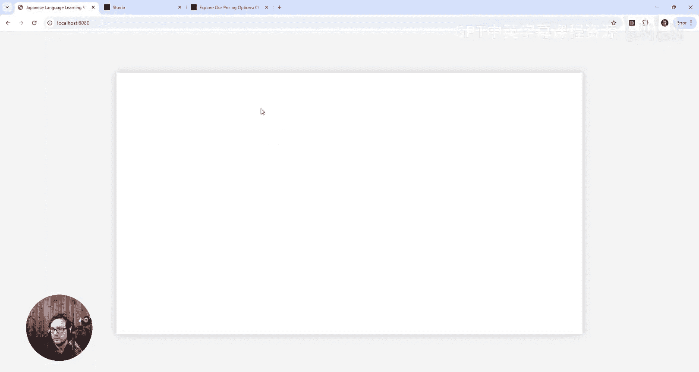

And is it still having issues loading the characterscause it that should be loading。 Yeah， it's not。

 it's， well， first of all， these are， these are Jpegs， right， So that that's clearly wrong。

 So we'll go back over to。Winsurf here。And characters are P And Gs。 But these， these， I believe。

 are Jpegs， right。If we check here yeah， So that's one def definite issue that we have here。

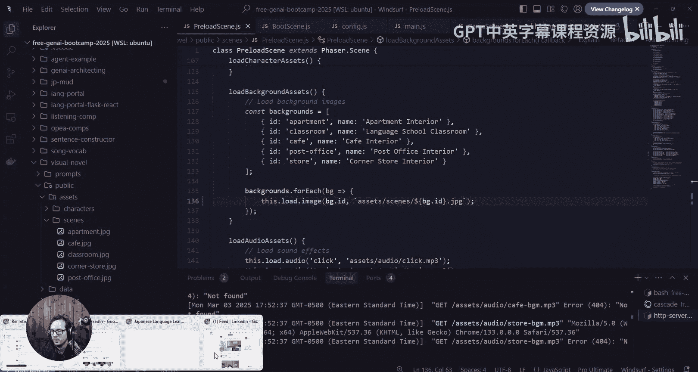

And I'm gonna go back over to here， give this a nice refresh whoops。And we'll inspect this again。

And so， we have。Okay， so those that's resolved now， great。And so now it really is just music。 Well。

 no， characters， characters， assets， characters Yuuki dot PNG Oh， is it just yuki。 That's a problem。

Why don't， why can't they load Yuuki。Let's go back over to this。 I was like our first character。

 right。

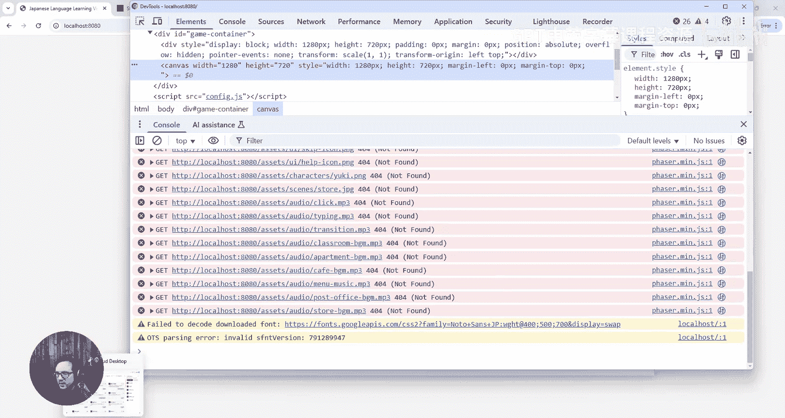

Oh， there's a style mistake。 Here we go。We'll go back over to this。

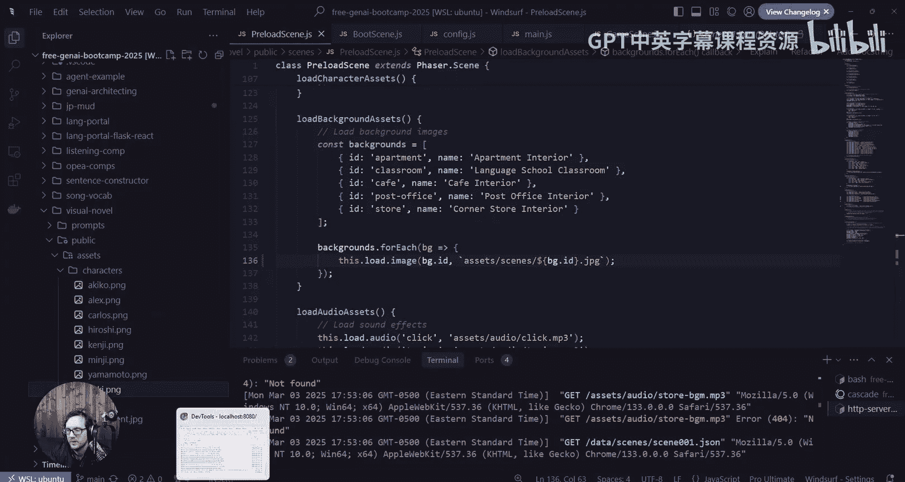

Give us a nice refresh。Yuki should it be now good。嗯。Fair enough。And still not， still working， so。

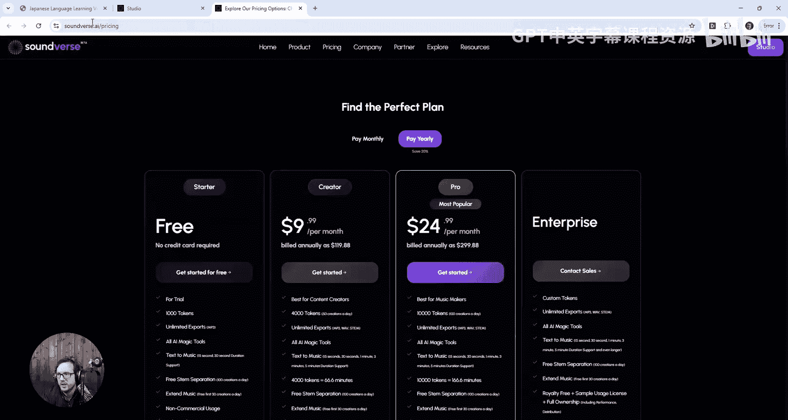

Anyway， I guess we should really try to see something here。 So now， I mean。

 I'm not really worried about all those other assets not loading。 So I'm gonna go back over to。

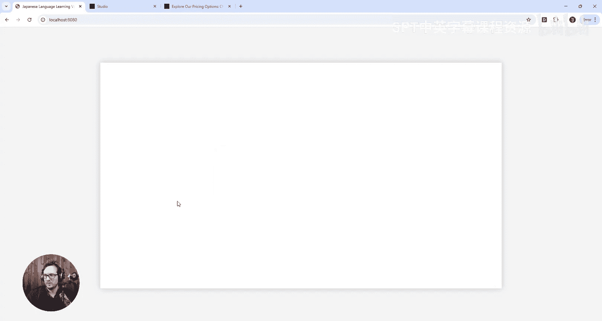

The main J S， I'm gonna go to the menu see。 I mean。

 we're gonna need more assets here to make the game work， which is fine。

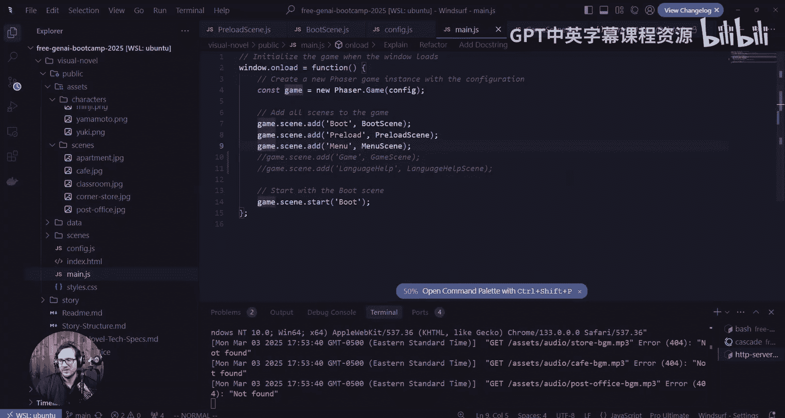

But I'll go back over to here， give us a refresh。Mnu music， missing cash。So yeah。

 I'm gonna have a serious problem here。 So I'm gonna go to invao。Invado， I mean。

 you can get music wherever you want， But I， I pay for invado。 So I want to use it。

 And so I'm gonna go here and try to find some music。 I'm gonna sign in here。 Give me just a moment。

 Alright， so I'm back in here and I'm gonna go over to。Music。Right， theres， again。

 there's probably free sources and or just don't have music in your game。

 But I'm trying to find there should be categories， right， all music。Ambient。Funnyqui。I mean， really。

 what I want is looping。Lo， loop。😔，L， look，Loed， that's the first thing。突突突。

That's kind of fun if there was a French area。🎼，I'm going I'll be back here in a second， okay。

Alright， so I got one that I like。 But I think that's what I'm just gonna stick with is the one audio file for now。

 because it's gonna be too much work if I have to do other stuff here。

 So I'm gonna just ask it to refactor it。 So， you know， I changed the the structure of the files。

 I fixed most of them。😊。

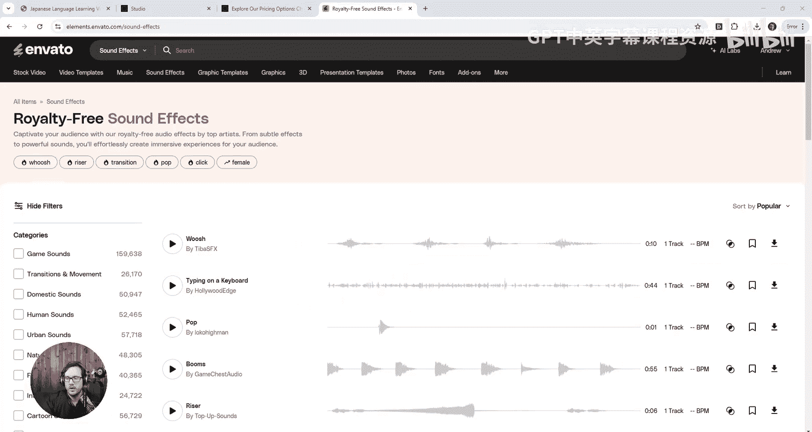

In the code， I only have a single track for background music。Can we just use that， It's called。

BG dot wave in the audio directory。Okay， because I， I don't have time to figure out all this。 And I。

 I think like even that， that， that requires some thinking and engineering in terms of like。

 how to make all that stuff seamless and stuff。 And I don't have time to figure that out。

 So we're just gonna let this generate out， okay。Sure did a lot to， to fix that。

 which is I'm not sure I'm not gonna check all that。

 but we'll go ahead and we'll start up a server again。

 We'll go over to here and see what errors we get now。 But， I mean。

 we've really simplified it so that I didn't mean really to close that。

 I might have to go back to that。 get some sound effects。

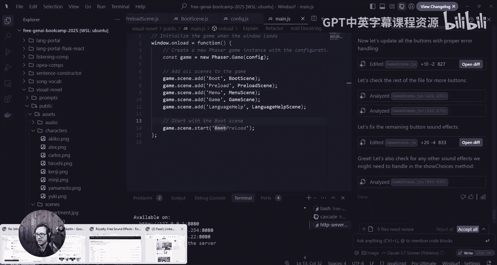

When we go ahead and inspect this。 now we have music menu。 menu music is missing from the cache。So。

 you know， I don't understand， like， I thought。

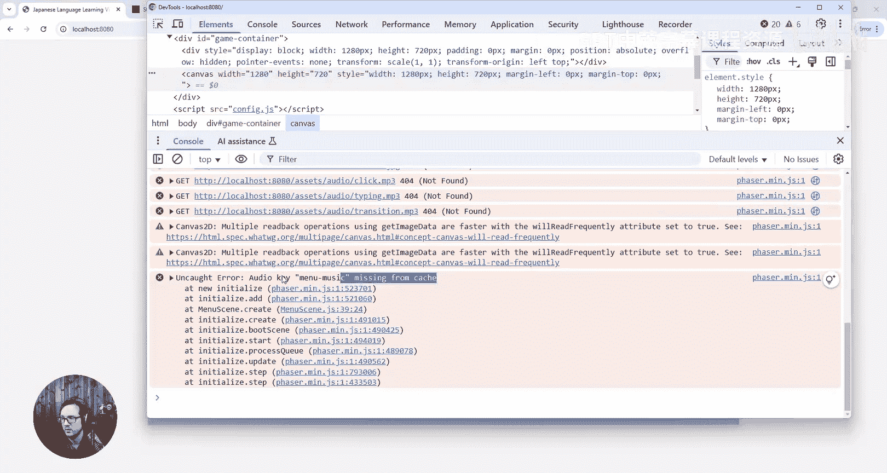

Hey， I， you know， I thought we are only using。One music for B G now。Alright， like why。

 like why am I getting this。Com on柏。

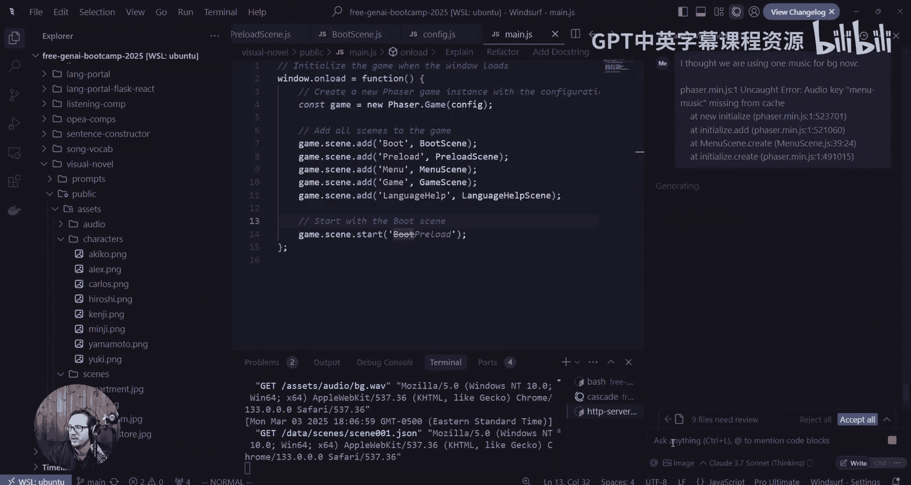

Are you even doing what I'm asking to do or you're off something else？Oh， you're gonna to fix that。

 okay。It's like it didn't even do what I asked it to do。 It was just like off doing something else。

Mm we'll just wait for that to fix。 Alright， now it's here saying like all the sound effect it。

It's fing not listening。 It's just doing whatever。And this is where I find， again， cloud 3。

7 frustrating。Cause it， it can't。 everything can't be the same sound effect。 But hey。

 we got a game here。 Dh， Neh。Got something。She knows how much Japanese I know， Go something。都。G。主。

阿so。Beル。😔，Oh， I don't know。 anyway。 But the point is。

 is that we do have graphics despite it being quite ugly。 I was。

 I was saying it was gonna be a lot more difficult than this。 If we go over to here。

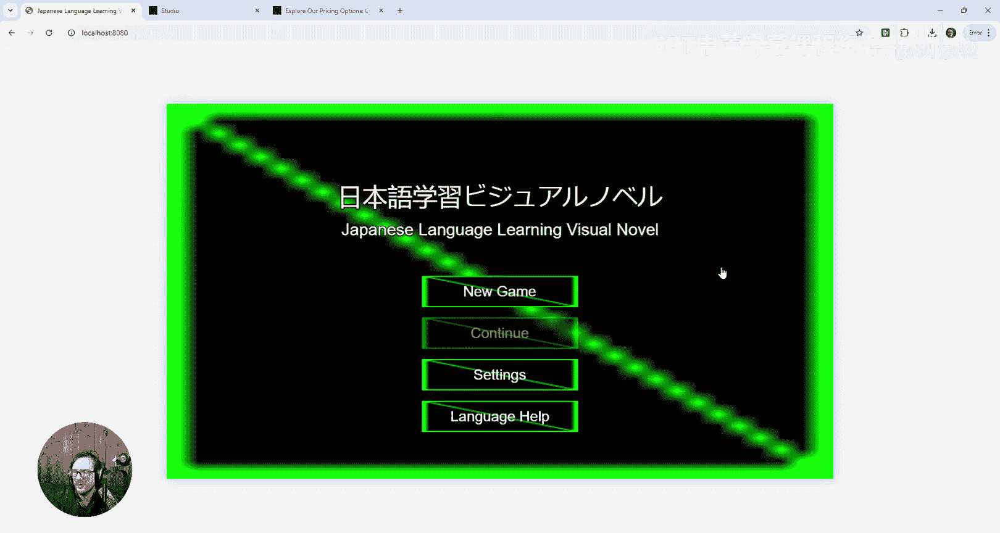

You know， still lots of graphics out low。 That's fine。 We don't have certain click sounds。

 That's fine。 Click audio is missing from cache。 As long as it doesn't break anything。 that's。

 that's fine。 Let's go ahead and see if we。

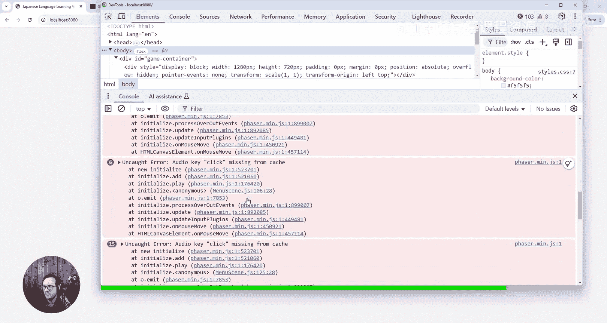

Really， really loud that audio there。🎼Okay， and so。It only plays when we have it selected。

 That's good to know。 Can we go over to our settings here and maybe turn down the default setting as it's really loud。

 I'm gonna bring it down to a 0，1， as that is just blaring out my ears。

 I apologize for that loud noise。 We're gonna go back over to the game。

 I'm got to give it a hard refresh here。😊，As I'm hoping。🎼So now it's it's a lot more manageable。

 I'm gonna to go back over to here and it's really impressive that we have as much as we do here。

 but I still want to bring it down a little bit more。 I'm gonna go 0。5。

 if that's even if that's even something we can do and we'll go back over to。🎼It was a refresh。

There we go， that's nice。

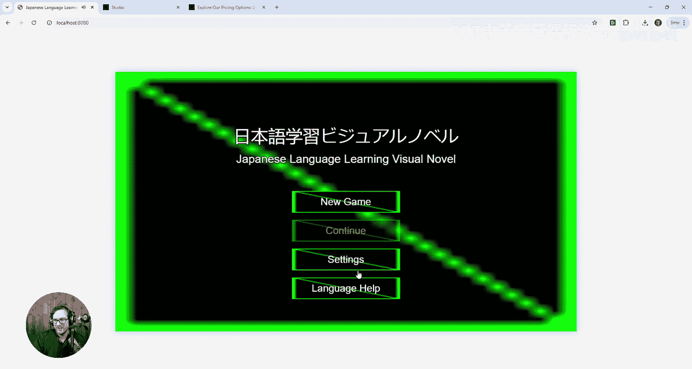

Now just' saying click missing sound， so maybe we should get a click sound in here。

 I'm going to go back over to Avado。A vtico， I can of never spell it。呃把。Tacco。Audio and an elephant。

And Vato， there we go。 I'm gonna get some sound effects。

 I'll be back in just a moment as I pick out some sound effects。All right。

 so I have a sound effect for a click and a transition for typing。 I don't know if we need that。

 that would be like。But with making that sound。 And I don't， I don't know if I could even find that。

 I didn'd even look for one。 But even if it did， it would have to play during the time it does that。

 So I'd have to go and say， like， you know。Video game。Message typing， like。

 I don't even know how you call that jungle。Oo jungle。Right， so it'd have to be。Po jugle。🎼Yeah。

 like I， again， I'm not sure what that would be。 So we're gonna keep that out of here for now。

 I'm gonna go close this out for now。 and I'll probably get rid of that。

 but we'll give the nice refresh。

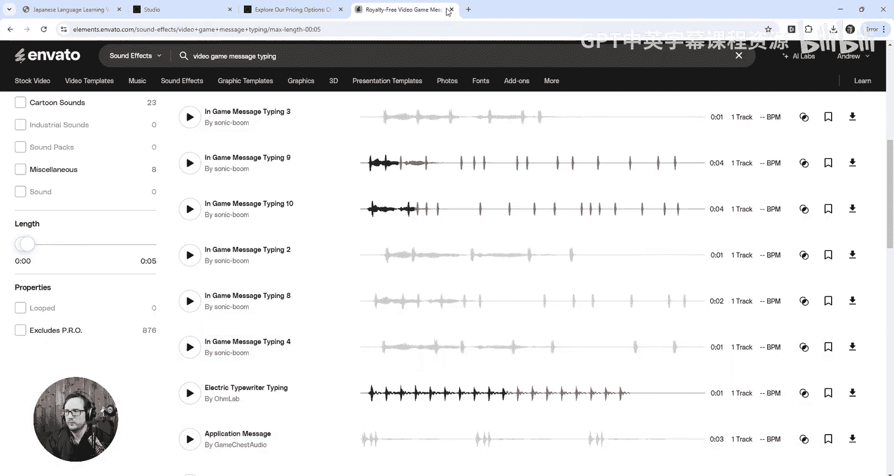

So really shouldn't make a noise。Until we actually click。 So there's a few things， which is like。

We'll just reject this。 So we don't have a typing noise。The other thing is our game is 1920 by 1080。

嗯。The click should only。Happen when you actually click。好般。Can we update those。Okay。

 but one thing that was interesting is the fact that we actually had the player loaded in here。

 so we I can go back here just take a look here just for fun。And whileow it did type out。

 the only thing is that the text is a little bit messed up here。We have some icons around here。

 so yeah， we can figure out the resolution， that'll be nice。

Probably what we really want to do is fix it in 1960 by 1680。

But it'd be nice if there was some way that we could。This never seem to actually finish。

 It seems like it takes forever。

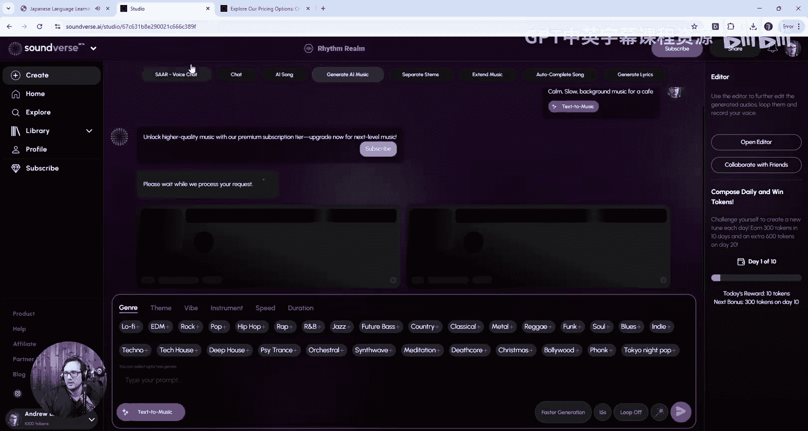

But coming back over to Winsurf， yeah， it'd be better if it like scaled based on the size of the game and that's。

Kind of what probably be better because if you're playing this game。

 right and you have a smaller screen than 1920 by 10。

 even though this is smaller than 1910 to20 by 1080， that would resolve some issues for us。But。

 we're going to wait for it to update that code there。Alright， and so we have some improvements here。

 fix the sound play for the clicks。🎼Using the full resolution。

 I think that resolution is going to be a problem for us in just a moment here。

 We'll go ahead and give us a nice refresh and。

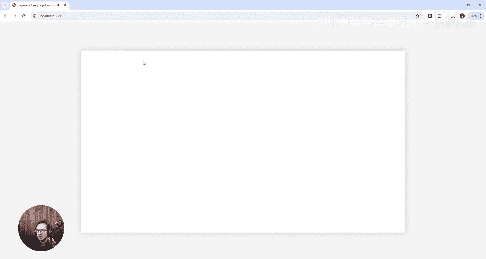

So we have some music。It's still's still doing what it's not supposed to be doing。Like。You know。

 it's still making the click sound on hover， it's only supposed to happen。Un click。

So I'm not sure what。 like what's going on here。 I guess we could go look at our menu screen here for a second。

 and it's gonna try to figure it out as it goes here。But it says pointer down， pointer out。

 pointer over。 It's right here， right， That's what it's。Doing that that has to get out of here。 Like。

 I don't know why it's doing that。 The other thing is like。

 it's maybe having the same button constantlying。 So some of this code should be refactored out because it is a bit repetitive。

 It's not gonna hurt the game in any way， But you'd have to delete it here。 and then here。

So dressinging like here's this volume 0。5。 I'm not sure why it does that went over here。

 it's like that， play the click sound。嗯。嗯嗯。😊，But this is where probably what I would do。IsYeah。

 again， I refer factories out as separate components in here。

Because there's obviously reusable stuff。 and we're setting things over and over and over again。

 And this makes it more work for the LLM because it has to go and update in all these places。

 which is a bit silly。Right。So。嗯。Upd the menu。 Okay， and so we'll go back over to the game now。

Very good。🎼Well strange is like， even though it's192 by 1080， I guess it's fixed based on that size。

 The resolutions obviously now better。 So it's actually scaling to whatever it is。

 And so this bounding box is what's limiting it。 It's a little bit hard to see if we're going going out on here。

 but we have Alex。I of messsses this up， will' refresh us here。

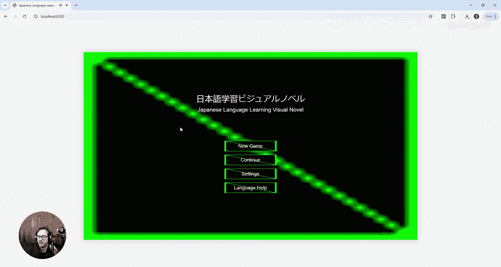

So you wake up in your。🎼Yeah， so there's some typing issues， right。

 So I'm going go back over this and。I gonna commitment what we have currently。

 I got go eat some dinner。 I'm gonna have to do a pause here， but I'm gonna go just add all this。So。

Game starting to work。Right， the， the audio is still a little bit too loud for my my taste。

 And I'm gonna go back over to the。config here。 And I'm just gonna really bring it down。 Really。

 really bring it down to like， one。And this is also kind of high hard out my ears。

 I'll bring that down to two。 So， you know， first of all， it's like。有了。I think it's this index HTML。

Index cS。Right， so for the game can， you know， for the。For the game container。Can we just。

Have it scale to fit the screen。The available window。In the H says。

Because that's going to probably resolve some of issues here。Like being able to actually see stuff。

 But then we have the， the typing issue。 So the typing is not typing as good as it could。

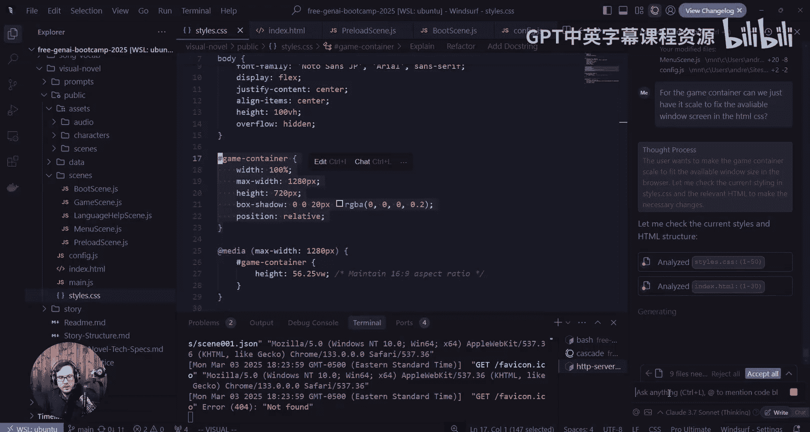

Question is like， do we need typing because it really depends because if you have a game where you have audio right。

 I would kind of prefer that each audio step is said and the word is shown what it's said。

 and we can actually get that if we export out the audio stuff， but really just depends on。

Know how we work with it here。 So here。Okay， so it's made the changes we're gonna stop and start this again。

Its a nice refresher。So now it's scaling it's perfect。🎼Okay， so this is better。

 It's still hard to see the font down here， and I can't tell what's going on。

 There should be a button to actually click。

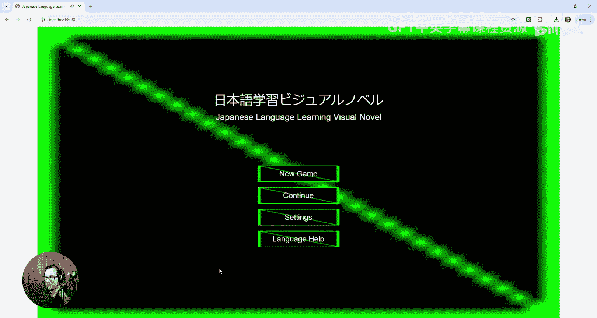

So， you know， there should be a button that you click to advance。The the， the story， I'm clicking。

 I click anywhere。嗯，对。Advances。Which is。Right。And so that's one thing that I'd like to fix。

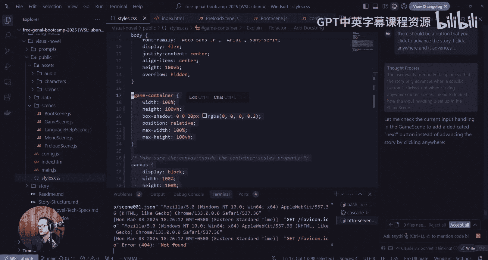

Anyway， I'm going to go stop the video here'll be back in a separate one， but in the next video。

 we're just basically refining this， trying to get the buttons。All working correctly。

 getting the graphics in， just trying to improve the experience for that initial scene。

 And then once that scene is solved， then we can go and then try to finalize stuff The the typing experience。

 I'm not sure。 like， again， I'd like to have audio files， maybe， but。We'll see， okay。

Do back in a bit。