# ExamPro《生成式AI训练营｜Free GenAI Bootcamp》中英字幕（deepseek - P59：-59-Visual Novel Major Refactor.zh_en - GPT中英字幕课程资源 - BV1SFEWzLEab

We'll make the camera a little bit larger here， but I am maybe a little bit larger here。

 but I am back。 and I'm not turning my lights onca they've been blinding me here all day。

 But I did run one little thing prior to this here。 Let me see if I can pull it up one second。

 Allright here we go， so。

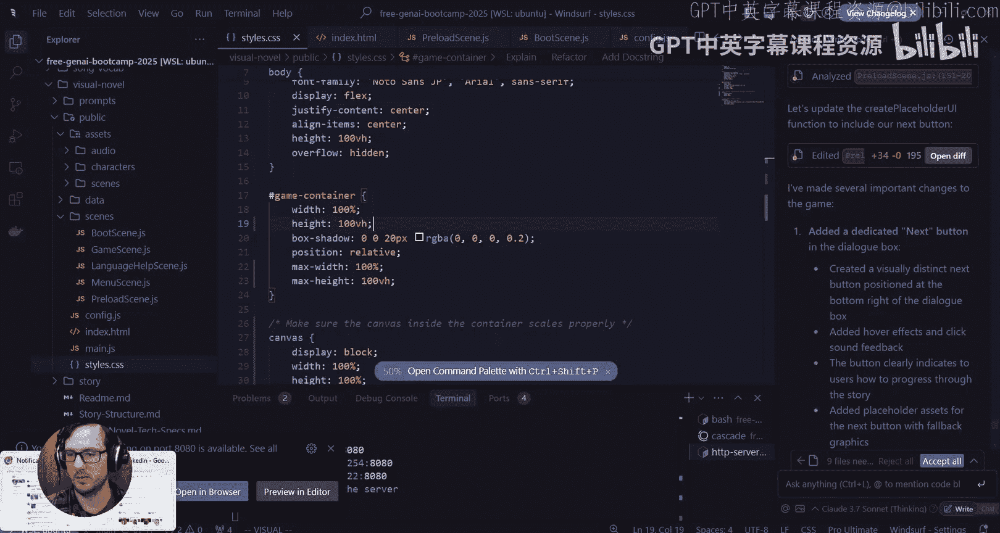

🎼We got our our music here， which is not bad。 We'll go ahead into the new thing。

 That button clicks a little bit loud and a bit hard on the ears。

 And so now we have this next button。 This animation here is not working really well。

 I'm kind of curious。Like what other kind of。What do you call it？

Visual novel games I could look at and see what they do for this。

 but I'm not really sure in terms of how they do that but。You notice I go back here and it messes up。

 So I don't know why it cycles back to that after the end of that scene。

 We'll give a nice another refresh here。

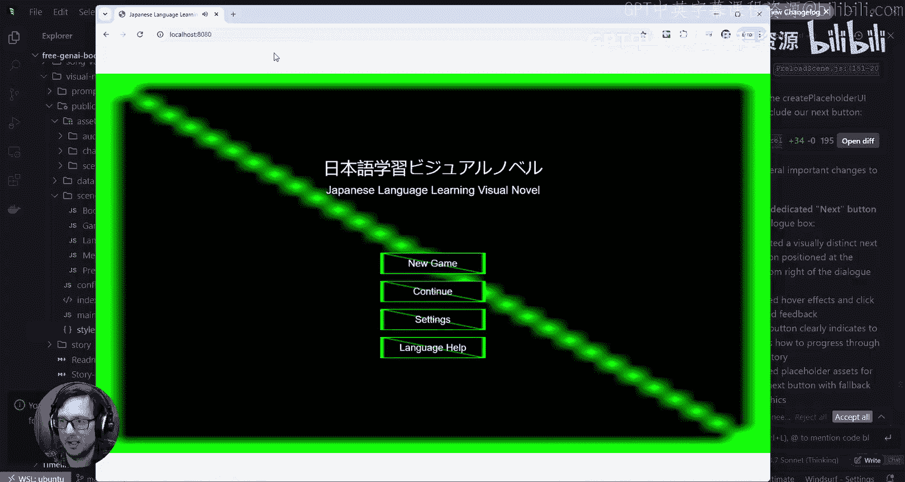

Okay。And not sure what this is supposed to be。🎼You wake up in your order。🎼Apartment in Japan。

 the morning， ettera， et cetera。 Okay， Alex says something， and then it's blank。

 So we'll go over to here and I guess we can just describe as to what our issues are。

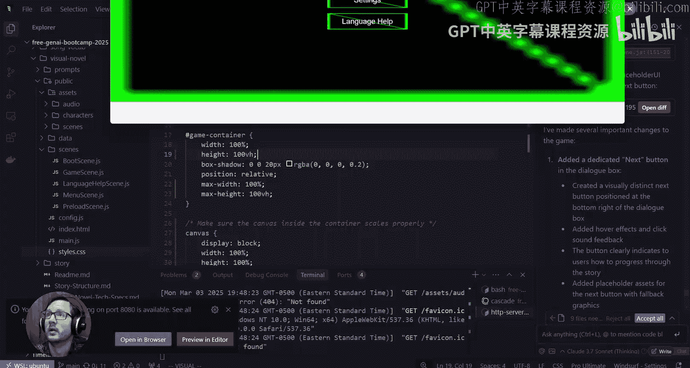

🎼There is a。There we go。But the same time。We could just read the code。

So I'm gonna go over to the game scene， which is the main scene for the game。

 I kind of w to refactor all those buttons。 Maybe we could， I don't know。

 Maybe we'll leave that alone for now。 But here we can see we have a lot of settings here in the front。

 And so I'm just gonna go ahead and try to read through this and try to make sense of it。

 So here initialize the scene with the data provided。 right， So we have the scene I D。

Is typing is false style complete。I don't know。 I guess my question is like。

 do we need that typing animation。 So what I'm gonna do is I'm gonna launch up a couple of visual novel games。

 I'm gonna have to probably buy some on steam。 I'll be back here in just in a moment。

 Ill tell you how it goes， okay。Alright， so I took a look at a couple。

 And they actually all do print the， the stuff out。 Now， the thing is like。

 if you have internal dialogue， like you're the person that's talking， audio normally doesn't play。

 but there's no reason we can't set an audio voice like to say。

 like what is your own voice and hear it out。 I kind of prefer if the words would appear as they are said。

 which we can do if we get the audio transcription。 So I'm no， no。

 I'm not sure if I particularly like。The the， the text going across like that。 And obviously。

 we're having some issues with the typing。 Let's go take a look and see if we can kind of pin down where that typing code is。

 So we're gonna go here。 we have the typing effect。

 So is typing is still typing completely immediately finish the typing display dial text with typing effect。

 Okay， so it is there I don't know why the typing effect is aligned to the left。

 which is a little bit frustrating。 But。Let's take a look here。嗯嗯。I don't know。

 there's a lot of code going on in here。 So there must be like a way that we can refactor out this code a bit。

 We go over to here to our files here。 when we go to outline。

 It should show us the structure of the application。 Wow， there's a lot going on here。

 So we'll we'll drop down， create。 I'm not sure what's going on here。 Why is there so much stuff。

 but we will collapse some of these functions here。

And this will help us kind of navigate a little bit better。About what's going on here。So obviously。

 there's a lot going on， lots and lots of lots of stuff here。

 I don't think that there should be this much in our game， our game scene。 So we have save game。

 load game。 Is this stuff that should be here。Like， where are these functions coming from， Sa game。

So I can see those toggle， auto mode， stuff like that。 There's a lot of interface stuff。

 So I'm gonna go over to here and， and we'll say the game scene file is very large。

Can we refactor out。A lot of the UI interactions into their own files。In a lib directory。Please。

Make a plan。Of files to refactor。Okay， and I'm gonna go switch to chat just so it doesn't go off the rails here and starts doing things that I don't want it to do。

And this will help us a little bit here。 So we're going to wait a moment and see what happens。

Alright， let's see what it has done here。 So if we go back over here in the right hand side。

 we've got a lot of stuff here。 let's go up and see what it's suggesting。 So， this is what we have。

 We have the next button there。 That's good。Create the directory structure as following。

 so we have UI dialogue， character management， save input， audio utilities， it's a lot of stuff here。

 main UI orchestratrator class， dial， box render management， name box。Component button。

 choice system， notifications， dialogueog manager， main dialogue， handler， logic， text displays。

 language handler。I guess， character manager。Save manager， input manager， input bindings。

 audio manager， audio assets， create base。啊。I mean， if it works。🎼You know what。 Let's see here。

 I'm going to see if I have any code here。 We'll just sync it。This， I might regret。

 but I'm gonna let it do it。 Okay， great。Go do it。That just seems crazy。

 The amount of systems it wants to put in there。 I mean， like if there's small files。

 it's not a big deal。 I can handle that。 But to me， it seems like that's a lot。But， I mean。

 I can't argue with any of those systems。 It all kind of makes sense to me。

 I'm not sure exactly how it's going to execute all those。But we will let it go through here。

 So we'll go ahead and we's going to go ahead and create a bunch of those directories。

There is just a lot going on in that game file。And so I was thinking more like。

 start with buttons and things like that。 But that's fine。 So now we have all these systems。

I'm not sure why we need subfolds like this。Go over to here。You either make sense， dialogue。 No。

 I guess that makes sense。And yeah， now' was just going。

 So I'm gonna just keep driving it till it's done， okay。Alright， so over here， it says。

 I've updated the index HTMLM and include all the new modules。Oh， that'd be a lot a lot of。

 actually not that bad to be honest， but is that the full implementation。 I don't think so。

 let's go ahead and take a look here because it has to make a lot of files here we have the audio manager。

 the character manager dialogueo， input， save U Y。 this is not done。 Okay， so I've updated。

 I've tested the modules individual test the modules individually。 Now let's keep going。

 just keep going。 keep implementing， keep implementing the modules you said you need to finish。 Okay。

I don't want to test。 I just want to go。Right， I'll clean it all up afterwards。 again。

 the bit worst approach ever， but I don't care。 I just want to make all the code I already approved it。

 And then we will I'll step through the， the。

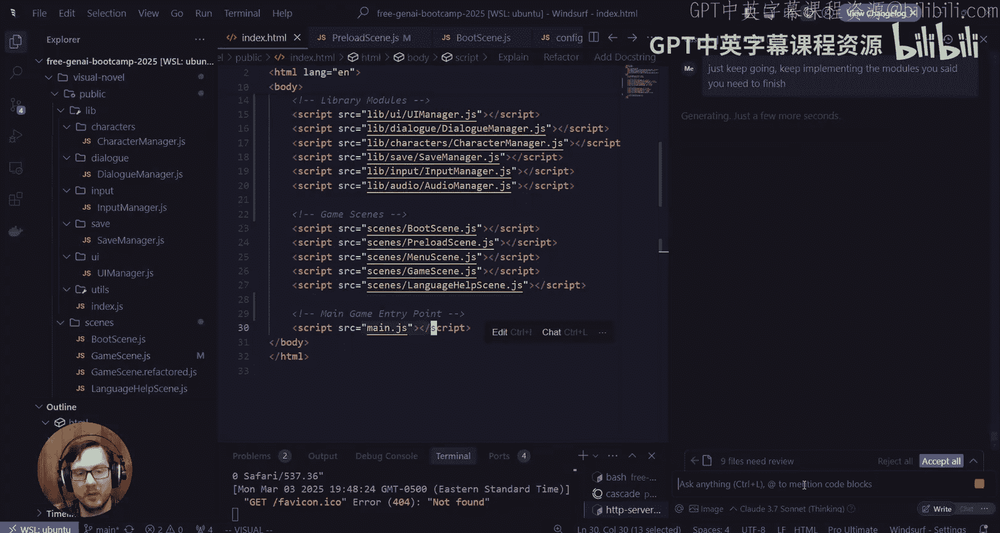

The modules individually while we're running it， and it'll be less of an issue。

So we're going to go ahead and let that continue on， okay。As I'm waiting for the stuff to generate。

 I'm watching killll a kill， I've never actually seen this series。

 but if you didn't know in the Jennyai boot camp。We're actually using this font up here。

That's the kill kill font。 But， you know， for those who actually know the show。

 which I don't really know much about it。

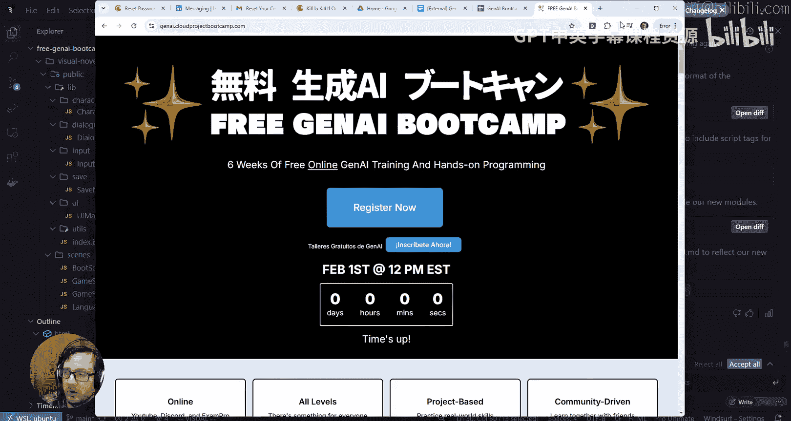

I got a。I got cruncher roll here again， I don't， I don't really watch anime。

 So I don't really know a whole lot about it， but I figured I'd pick a little bit up and。

 and see if I can pick up any vocabulary with it。 But I don't know。 I might。

 I might stop with itcause I'm， again。Anime is not exactly for me。 But anyway。

 let's continue on here and take a look here and see what it has。 So it really。

 really was going for a while。 I literally was watching 14 minutes of the show， letting it go。

 This is what they call vibe coding。 I guess you just let it do whatever it wants。

 But let's go give it a refresh here and see what systems we have。 We have。 What have we got now。

 We have。😊，Let's see。 We have all of our inputs。 We have。Oops。

I got there's achievements in here probably don't need an achievement system。

 but that's fine we achievements manager。What is this。So this， this achievement master here， I don't。

 I don't know about that。 It depends if like we make something that is cause like in visual novels。

 there's no， you don't have to have any checks， right， We don't have any knowledge checks。

 So that one might be kind of useless regarding your audio manager。

Here it is setting up the background music stuff like that。Background music， play sound effects。

 stop， so。You know， some of these abstractions don't really matter。

 But the thing is by having them through an audio manager。

 Then we can centralize all the changes of one ghost。 That's not bad idea。 character manager。

 not a bad idea with and height。 I mean， they're always 100% for， for that。 That's fine。

 We have background data。Not sure why they decided to make it。I mean， like， yes。

 characters are linked to very specific backgrounds。

 but I'm not exactly sure as to why they did that。 I like out this expression neutral。

 maybe in the future when I add more， that's actually not a bad idea。

 Here It createates the background， creates the character， puts the background here。 character here。

 position for character， slightly centered lower。

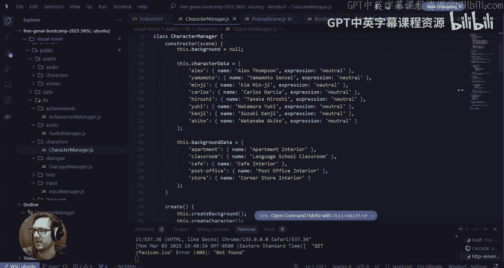

It doesn't know。That the dimensions。Makes it a perfect fit。

So that's something we'll have to tell it about。Here we have update the background。

 So fade out the current background update the character。 So again， not 100% certain。

 if that's what I want， we have the show the character set character expression， not a bad idea。

 If we decide to add that。 And we saw it earlier。 I can I can do it。 It just won't be very accurate。

 We have the dial manager。 So here we can see the text speed， create the load scene。

 start the dialogue， displayplay the dialogue。 So now we can kind of go down there into that one。

 I'm not sure what the help system manager is supposed to do。 explains how the game works。

 Not a bad idea。 But I'm not sure if I like that。 we'll go over into the input manager。

 set input handler。😊，No， not a bad idea。I'm surprised like how many hockeys it added in here。

 That's pretty impressive。 We'll go over to our language manager。

Dictionary of Japanese words with translations。 I don't think the language manager makes any sense。

 Grmmar points with explanations。 I don't know why I keeps doing this。Right， so the。

 the the language manager does not make sense。Unless you' like to click into words and try to understand them than maybe。

 but that's too much。 progress tracker。Learning levels。 I don't know about that。 I mean， like， again。

 if this game。Like was a， what do you call it a。A daily a daily salmon every day you did the same thing。

 that'd be really， really smart。We'll go to our save manager。Okay， so our save manager。

 pretty straightforward， our settings。Again， pretty straightforward。 Everything looks fine there。

 That's fine。 We'll go to our story where there could be a lot step going on here。

Maybe now we have a story manager， right？I don't think I like， well， these are chapters， right？Okay。

 so this kind of managing。 Now， we didn't really define the story structure。

 So that could be another file that we have here。 but you can see that we have a series of scenes。

 It goes internal and it's going straight through those ones。

 But this is not exactly how it's supposed to work because what sends it to the next scene is the code there。

 So there might be some issues there with that。Yeah， we got a lot， a lot of code。

 We got our UI notification manager。😊，Oh my goodness， we got a UI manager， asset loader event bus。

Wow， we have like a whole game here。 Now， again， this might have been a terrible mistake because we don't know how all these systems work。

But I'll go down below here， it says now， let's update the migration path to reflect our new modules over here。

 it describes everything that it has done， which is kind of like an additional doc。

 It's kind of like our tech spec now。But I wna go over to game dot dot JS。

 It's just really interesting to see that it could produce that much code。😊，We're go our main JS。

 and it's actually a game JS and our scenes that we want to go to。And so what I want to know is like。

 is this thing， has this thing shrunk。Right， becauseuse that was the whole reason I was behind this。

Great character。 Great load。Okay， so here's my question。I don't think it uses any。 Okay， so， okay。

 so， so now that we have。All these modules。Update the scenes。To actually use them。

Because I don't think it did that。Make a plan。Because it's still using the old code， right？

This is not because I would just want to watch more kill killll， so。First episode， never seen it。

I understand some of the Japanese I， so。Create a new character scene， refactored。

I don't know why it wants to do that。嗯。Look， no， just， just implement in place。

Don't worry about testing。Right now。Okay， so go ahead and do that and。

I don't want it to make a new file。I don't want to do that。 Just， just fucking just fix the coat。

 I didn't mean to swear， sorry。I usually don't swear too much， but。

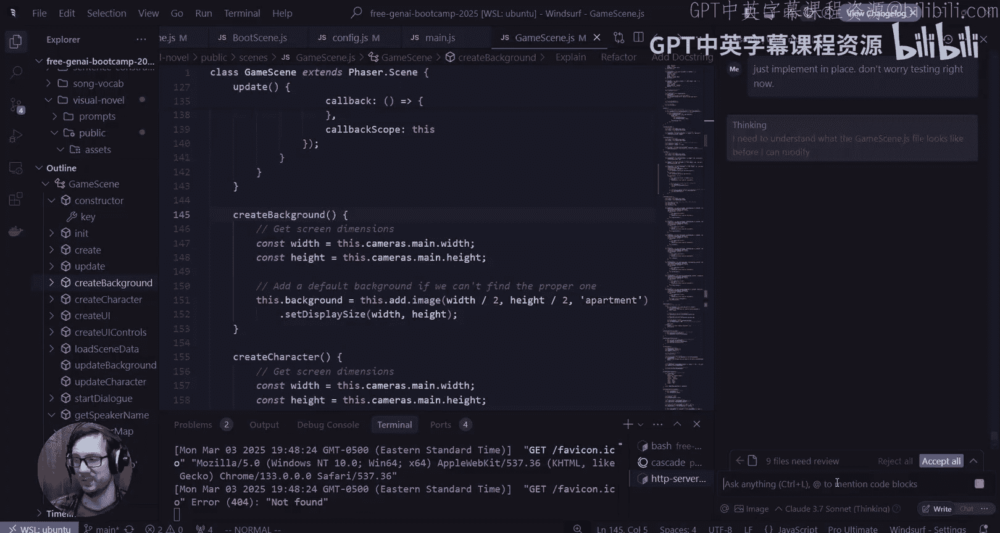

It's been a long day。 I apologize， folks。Let's look at the create method and see how it understands it works。

 So it's going to go off to the races here， and then'll I'll review and see how it goes。All right。

 so I've been trying to let it run。 And it's just， it's too hard for it's to pick out a lot of jump code。

 And so I think it's really struggling with the amount of changes it has to make for this game game state file。

 That's okay。 Like I feel like I could probably figure it out to figure it out。

 So says initialize global event bus for communication between model modules。

 I guess that is a design choice that's made here， which is a little bit insane。

 but we'll go down below and we'll take a look and see what the event buses。

 So simple event bus for combining for communication between different modules。

 And so here we have an on state an off state， a mid state and remove all listeners。 actually。

 I like this because normally when I make a system。 that's probably what I would do。

 I would have on off stuff like that。 So I actually don't mind that that seems totally fine。

 but we don't have much documentation on how we would use that。 So I mean。

 we can just tell it to produce it。 obviously， we have initialized this scene with the provided data。

 So here we have a scene I that gets passed in through the game setting， which is going into game 00。

1。😊，We're loading our settings。 We are initializing all managers。

 and they were setting up the event listeners。 Okay， so， I mean。

 like these names are pretty self explanatory。 So I don't need that information to explain it。

 I can also see that this is setting。The the scene I D。 so I don't need that either。

 I can see that that's setting up the event bus。 So we don't need that documentationca it's self explanatory。

 right up here， we have our game settings that are set initially。 So we have dual 3005，0，7。

 That's fine。 Then we're loading our settings in。 So here we have local storage dot get Japanese with V and settings。

 visual novel settings。Which is our first setting。 So what is it doing， It is。

 I think from local stores， the， the visual novel settings。 Now。

 this doesn't make sense because if we have settings， it should be managed by one of our。Managers。

 right？But notice that's happening here。So， maybe。It doesn't do at that point。

 So we have a settings manager here， right， But over here。You know， we have this happening here。

 So what I want to do is go look at our setting manager。Here。

And it willll just collapse this so I can see what I'm doing。 And I'm just kind of like wondering。

 like， why is this happening here。Because if we go here。Load settings。Right。

 this seems like this does。Similar to same thing。 So here says get item。Get item。

But here we have the settings key， which is set up here as well。

 So I think that this function here is redundant， right， So this is redundant。

 We still need to make a load settings call from this manager。And so， you know， after， after all the。

 the settings are low， I'm not sure well we have to load that in。 We have this load settings。

 but this is actually in the。Game manager called or settings manager， which is here。So。

 we will go ahead。You can see I'm， I'm having no issues cutting through this code because I've worked in large code bases。

 So for me， it's just， this is not an issue。 So to do， to do。

 do we have to have load settings here or can it occur after。After all。

 the managers are loaded because that's something I don't know。 The question is like。

 when we have these managers and construct stuff， is it doing anything， Actually。

 load settings right here。 So we don't even have to call this。

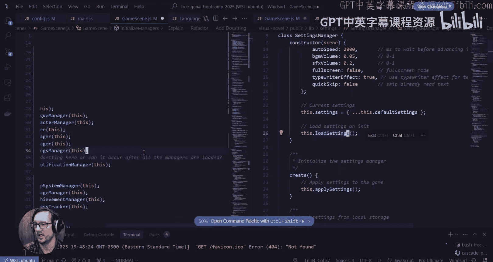

Okay， as soon as this thing gets loaded， it's gonna call it right there。 So that is very clear。

 Now we're on the initialized manager。 So first， we have the UI manager。

 let's go take a look and see what it's doing as it sets things up。

 And so we'll go over here into our UI manager over to here。 And so we it sets the scene。

 we have the main window height matching exactly to the camera makes sense。

 dialog box namebox next button controls， choice systems。

 So I'm not sure about this because if we have Ui， I feel like there's different Ui for different things。

 And so I don't know like namebox next button controls， choice systems。

 like what about menus and stuff。嗯。But I guess those are on other screens。

 So maybe that's less of an issue， right， And this is really just focusing on the UI manager for this particular scene。

But anyway， so we have dialog box， name box， next button controls， choice system。

 And here it's creating them all。 Now， notice here that it doesn't create these at at some step。

 So we do have to create these at some point。And so I w to know。

 does it use the UI manager anywhere here， And does it call that step。 So we say U I manager， whoops。

s not what I want， U I manager。Create， and so it is creating。 it's creating U I elements。

But where is the actual other one。 So we'll go here this saying create U I elements。

 right But here it's just called create。And I don't think there is a function called UI elements in here。

So go create U I elements。 There isn't。 So I think what it really means to do here is to say， create。

Right， create the first U I elements。 I mean， the description there was actually a little bit better。

 But here， this is a little bit more clear， I mean， it's a simpler language。

 And I kind of prefer that。 So this will create the first ones。

 I'm gonna go put the comment on the end here。 And that's good to know。

We'll go back all the way the top here。 So we have UI manager。

 This is going to create the dialog box， the crate name box， the next button。

 You can see that we have some calls here。 Still， the buttons aren't refactored。

 which is kind of annoying。 We have our controls， our create control buttons。Create controls。

 create control button。 So these are these obviously have a lot of size within them。

 So it's kind of managing a lot of stuff in here。 This one could even be broken up a little bit more export for file and other uses。

 I don't know if we really need that。 But that's totally fine。 So that makes sense。

 And we have our dialogue managers。 Let's go take a look at that。

So go over to our dialogueog manager， which is under what。Language probably help。

Dialogue just onet system under here is silly。 I'd probably refactor this and put them all in the same level because we don't really need subfolders like that。

 That's a bit silly。 Maybe for the U I， we do。 And so here we're setting the text speed。

 a bunch of other settings。 We have a create， load the scene data。

 So load the current scene data from the cache。 Now， should the dial manager do that。

 That actually seems fine to me。And this is just called create。

 So I'm going assume that that appears。The same place as our dialogue， we have this。But I don't see。

That here。So we have great characters。嗯哼嗯。😊，And we don't have， I don't worry this is。

 So' say dialogue。Dialogue。Manager。Great， so notice we don't have anything for that。

 So we do have start the dialogue flow to start the game。

And I'm not sure if we even have that as a function in here。 I didn't see it。 start dialogue here。

 Yep， it is。 but it doesn't create it anywhere。 So that's missing。

 I'm going to place it in there in our initialized function。

 I'm not sure why it's not going to create function， whatever。 And so I'm going to go here。

 And since it's the next thing we'll say U I or dialogue manager create。 so。Greatate。The。

 what is it creating。Well， it's great creating the。I mean， just loading data。

 we don't really need to create and then load data， but。Well， it's say like loads。

 loads the initial data。The dialogue， because that's really what it's doing here。

Called after the UI is created。 So after U I is created， that is exactly what's happening here。

 So that is set up。Now we have create our background and seen elements。 This， again。

 I don't like the fact that it is grouped together。 I think that's a bit silly。

 It should be characters and backgrounds separate because they're separate entities。

 But I'm not gonna worry about it right now。 We're gonna make our way over to our character manager that is located under。

 I think characters。we go here characters， and I'll go over to here into characters。

 We have our constructor function， right。Let's take a look at what we have。

 So we have seen with high character background， our character data， our background data。

 createate the background， create the character。 Now here it says create character。

 Why wouldn't it be just create。 And so I think that that's just a little bit of a mistake。

 So we'll go ahead and fix it by setting that。 And that will fix our problem。

 Does it create the correct order。 It does。 So that should make sure we don't have issues there。

 It doesn't understand the character stuff。 The character stuff should be just 0，0。

 but we'll have to double check that when we get into it。 But right now， that's not set correctly。

 The background music， yep， that looks good to me。 but we will need to go in here and take a look and just make sure it's not doing anything funny。

 So we go into audio here into our audio manager。 and in here we have create。

 So says set up background music。 So same thing。 it's says set up background music。

 Do we set that anywhere。😊，Right， so audio manager。The other interesting thing is like right now。

 we're using this in。This。Does it get called create when it initializes no。

 But this might be an issue when we start looking at different scenes。

 But this is play background music， which is correct。 But then here's a set background music。

So here it would create it。 So set it up。 And then it plays it right away。

 So we don't even need this。 but it is cool that they thought we could do that。

So we'll go ahead just say create。啊。Play background music。

 This doesn't really make a whole lot of sense of this， it's the audio manager。

 I think that should be kind of set up separately。So maybe we'll go back to this。

 I'm take this here and say this。I think I prefer that。 Okay。

 so we'll go ahead and we'll take that out。 So we have set up。Stop， this is more like setup and play。

Set up， stop， resume。嗯。It's more like set up and play， set up and play background music。

Maybe not the best code， but that's fine。 So now we have that set up。 Let's go into our next one。

 So after our character manager， we have our save manager pretty straightforward。

 I'm not sure if there's any setup that has to be done for that。 Let's take a look here。

 Our save manager has a create function。 Nothing in it perfect。 We'll go to our input manager。😊。

And we will take a look at that one。 So we'll go up to here。 We'll check our input manager。

 It does have set up input handlers。 So we have point down on the scene。

 All dialogue advancements is now handled by the next button。

 This handler remains only for other UI interactions。

 Not exactly sure what it's thinking it's doing here。 No longer advances the dialogue by clicking。

 Yeah， I don't want that。 So we do have other things in here。 So set up。The point down。

I guess if we wanted to override it， we could， but that doesn't make sense。

 but we do have some space and escape and some other key set up here。 we have set up input handlers。

And I set up initial keyboard cut shortcuts。 I'm not sure why they separate those out。

We'll go take a look here and we'll just search。 So that's not called at all。

 So I would think that we would do this。You know， really， this shouldn't be separated out。

 but that's fine。 This， I think， is useless。 We probably w to get rid of that， But that's fine。

 For now。 we have our input。 Let's go to our audio manager。

 I think we already checked our audio manager。 So that's fine。

 There's this crate does need to get called。 So we'll go down to here。And this is going to be create。

So it really depends。 like， do we want to call this directly or just call create functions。

 I don't know。 Here the I did that is because the crate doesn't do more than one action。

 And so I thought it was a bit unnecessary。 or help system manager。

 if needed shows help for first time players。 I don't think it's that hard to play。

 So I'm gonna take out the help system manager。 I think the help system manager is useless。

 So I'm gonna go ahead and rip that out。 I'm gonna go over to our help here。

 I'm gonna delete this out。 we don't need it， we don't need a help system manager。

 Maybe the game got more complicated。 But right now， I can't see it requiring that。

 We're gonna take out this help button as well。 which ends here。 yup， I just want to make sure。呃。

We just rip it all out of here。Is there any more help stuff in here。 I hope it's gone。

 I'll go to my index here We're got get rid of that help manager。

 We're gonna have a problem if we don't take it out。 if it's even included in here， help。

Help here it is Help system。 We just pulled that out。嗯。

We'll go back over to our game scene here and just continue on down。 So we did audio。

 We have settings manager。 So settings manager， we were already looking at initially。

 This is pretty straightforward。 createate apply settings。嗯。Do we have the audio manager。

 it's setting the volume level， things like that。 that should occur probably before anything else。

So I would bring this on up here and put this up here。 That seems like it needs to be happening way。

 way earlier。 I mean， that just initializes it right， But the settings manager。

 if it gets created has a create call， it does。 We need to make sure that happens way earlier。

 So let's go over to our settings manager， wherever that is。Settings。Manager here。

 here it has load settings，Which doesn't make sensecause it happens before the initialized managers that that can't make any sense。

 That can， that can't happen。 But if we go to our initialize。Okay。

 we have initialized and then create。 don't know what。's like。

 why do we have like actually calls it right here。 So why not just take these。Right like this。

 And then boom， things that make a little bit more sense， right。

 We don't even need this initialized function。 This is kind of pointless。

 So now what we need is we need to say this settings manager load settings。

 actually just gonna be create。Right。And this is gonna to apply settings initially， apply settings。

It's not loading settings here。 I think it load settings when it creates it additional。 Yeah。

 right here。So even before that， it already doest。 Now。

 we could take this and then move it into here， load and then apply settings initially。

 It just depends if any of those needed prior。 But honestly。

 nothing's getting triggered until this point。 So we could。Take this。Just move this here。You know。

 again， the functions are self explanatory。 so we don't really need that there， current settings。

So I'm going to go ahead and do that instead， and I think that makes a lot more sense。Okay。

 load save state。Now。That would be like the state manager， right， or loading the game。

So not sure why load the state if available over here。Right， we have。The load save state， like， why。

 why do that here， Why do that here， right， Because if we have this and we are。

We have our state manager or sorry， our save manager。Let's take a look at our save manager。Again。

 a lot of these don't， we don't really need them。 I mean， which one actually has multiple systems。No。

 I don't like this structure。 This is kind of annoying。 So， I mean， those are fine。

 The uils are fine。But I think what I might do here。

 just to make my code a little bit easier to navigate。

 I'm gonna go to my folders or wherever that is。 we're gonna do a nice quick fix on this。

 So I'm the visual novel here。 We're gonna go into our live directory。

 And we obviously have a bunch of these。 So I'm gonna go here。 I'm gonna drag this on up。

Im going to do that for each of these， right， and we are going to。Make this a lot more clear。Right。

ca I can't have。Any of this like this， this isn't going help me。Right， so we're gonna to go here。

 drag this up， drag that up。 We're going keep going here， save manager。

 we're gonna to keep going settings。 we're going keep going。 We're gonna go into our story。

 We're gonna go here， bringing all those to a top level here。 So， I mean， this is fine。 I mean。

 technically notification manager is you， I sure。 So now those are all top level。

 All these folders should be useless。 So delete this one。 There shouldn't be anything of that one。

 delete that one。Does it going to look like a game structure for sure。

Definitely a waterfall approach。 but you can kind of see that I'm very comfortable doing that。

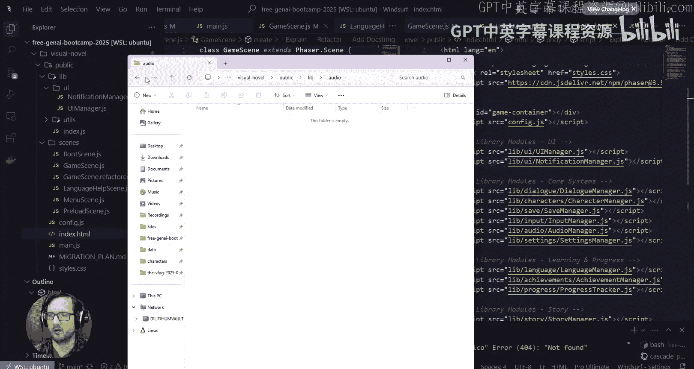

Is it faster， I think it might be。 Sometimes we have an index J S in there。

 I'm not sure why we have that。 I'm not sure what， what purpose that serves。

 I'm gonna give us a nice refresh。 So that is more condensed。 Let's go into index J S。 This is。

L do we even use this anywhere。Like we have this， which is fine。 But if we go into our。

 our index J S So in or was it， our index H L， it's not like it's loading it in here anywhere。

So that's great and all。 But I don't think this index JS does anything for us because we're not actually utilizing it。

 So I'm going to go delete this permanently。 This is completely useless。 It has serves no purpose。

 And so we'll go back into our index HTMLL。 And so we have all this stuff。 right， So I'll get。

 I' change this over。 Change this over this， this， save manager， manager， manager manager。

 There's all manager。😊，Sure I made a folder called manager。 We have progress tracker。 I mean。

 it's kind of a progress manager。These details will leave alone。 That's fine。 And so this is really。

These are really the managers， right。Managers。Okay， so now we have all those there。

 some of our modules。Call them， call them all We call them all managers if we really want to。

 And so now that's a little bit more streamlined， right， so。That's interesting。

We have initialized managers。 that's what we're doing here。 That's fine。

Do we even need to reflect on the function。 I guess it's fine。 We have set up event listeners。

 We'll go down down below here。 And so this is where it starts to use the event bus。

 which is kind of cool。 So we go here and want to do a notification show transition， seeing。

 I like this。😊，嗯。I don't think we need to even describe what these are。

 They're very straightforward what they are。Right， so we'll do that。Again。

 just trying to make the code more manageable。You know， we could even do this。Again。

 if the code is simple， why not make it easy to read， right？Here。You know。😔，There we go。

It's up to you。 But like， you can see that there's not much happening here。

 So there's no reason we can't just do that。 I might end up changing it back to the other format later。

 as that is a bad habit of mine。 We saw a bunch of junk in here that we probably don't want。

 So we're just continually just kind of massaging this together here。 So we have initialize managers。

 which， that's fine。 We don't need to really divide these here。 It doesn't really matter。

 We'll just go ahead and do this。嗯。It's interesting because like these says initialized managers and the ones that are in us。

 they're calling the managers as well。That's fine we'll leave that there。

So we initialize our managers， and then we're setting up our event listeners， which is fine。

 I guess the question is like， should these be set up， I guess it doesn't matter because this only。

 these only get triggered if these events happen， which aren't happening as of yet， right。

 So I guess we're not really worried about that， that down in the cr。

 we are creating all of our stuff。 did we actually cover everything we had to create。 I think we did。

 But just in case we didn't。I just want to double triple check this。 Okay， so we'll go here。

At just ignore， ignore that。Or example of those comments is like we can't really tell what's going on in those create functions。

 And maybe again， we shouldn't call and create。 We should actually name them exactly what they are。

 We have a settings manager here， A U manager there， dialogueo character， We have the same manager。

 which I don't think has a create。 We have the input manager， which shows up at the end。

 We have our audio manager here， which happens there。 notification manager。

 we haven't done anything with yet。 I don't know what that does。

 Let's go take a look and see what it actually does。

 So if we go over to our notification manager handles in game notifications and messages。😊，For what。

Show a notification message。嗯，哼。I don't know。I guess like in games。

 you have like achievements and things like that。 So that's kind of what it might be talking about。

 We don't really need that。 So I'm going to leave it alone， but we're not doing anything with it。

 Then we have our language manager。So we'll go back up to。Our game code here， wherever that is here。

And in here， we're not creating our language manager。Let's go take a look at our language manager。

Our language manager should be here。There we go。And I mean。

 it has its own create low dictionary data。So here， kichiwa Seni grammar points。

Make text interactive。 I mean， that's kind of interesting。Where like， you click on the words。

But I don't want that。Right， I think that。Proronunciation， words， playing， pronunciation， sound。

 It's really interesting， like。But I think that that's so complex。 And I can't。

 I can't expect that to actually work right now。 The other challenge is like。

 how is this even integrated with the other stuff， because that seems really complicated。Right。

 the language manager here。 So I， I don't know about that。 And also like the dictionary is too small。

 That makes no sense。 So I would say that the language manager can go because it's not really doing what I wanted to do。

Right， and maybe it's trying to pick up something from our one of our other co bases。 I'm not sure。

 but we'll get rid of the language manager because that thing is not going to help us whatsoever。

So we need to make sure we go back to our index and make sure we get rid of the language manager。

 So that one's gonna go。 I'm leaving the notifications around。 But then we have achievements。

 What's the difference between notifications and achievements， I don't know。Because to me， I mean。

 like maybe it manages what achievements you have。 So chapterpt  one complete。

 chapter 2 complete words， all choices， speed reader， stats。I don't need this。Right now。

 I don't need this。 I mean， it's interesting， like you can unlock achievements stuff like that。

 But since it wrote the code so easily， Im， I'm very happy to get rid of it for now。

 So we'll go get rid of our achievements managers for now。 I don't need that。

 So we'll go ahead and get rid of that out of there。

 We'll go into our game scene and we'll get rid of the achievements managers。😊。

And we'll get rid of that。 Then we have progress tracker。 That sounds kind of like the same thing。

 What progress are we tracking because we have learning levels。Yeah。

 this would make sense if we did multiple iterations。 I like again， that the event bus。

 we have these study options here。But there's no way to really track these kind of things。

 I'm gonna to delete this for now。 This is a very complex system。

 That's not something I'm gonna to leave to this to try to write。

 I'm gonna step through it step by step to help figure it out。 Okay。

 so we'll go ahead and get rid of the progress tracker and the language tracker。

 Those both have to go。 right， And let's make sure we get rid of the progress tracker in here。

Love its enthusiasm。 But there's no way it's gonna to complete it to the end。

 Story manager sounds like something we definitely do need。Let's go back over to our game scene here。

And we'll take a look at our story manager。 So our story manager there。 And it sets。

 sets the current scene at start of the game， which is fine。😊，That's fine。 Ac load。

 I'm not sure why that's so far down。Let's go take a look at the story manager。

If we have not already。 So here it's sort the structure， that's actually fine。

This is kind of loading a very specific one。 but later on， I'll have to fix it， subscribe to events。

Dialog complete choice made。 So sure。I mean， we're setting up event handlers。

 but why not set the event handlers all in one place， why do we have them here？

Because if we can do this， why wouldn't we do that everywhere， Right？ Like。

 why't just have the event handlers all in one place。

 So this is something that I'm kind of wondering that。嗯。Maybe。We should change here。 This is， yeah。

 so I'm gonna just take this out of here。O。And we will put all of our events in one place because then we can see what's going on。

 right。🎼Yeah。Canceil， cancel， save that。And so here。

 this is not gonna to make sense unless this is the what do you call the。Story manager。Okay。

 and so now what I'll do is go back to our story manager here。Okay。

 and so we don't even need this function here just doesn't do anything。 We don't need to do create。

 We don't need subscribe to events。 That's complete， complete waste。嗯。I mean。

 maybe we want to initialize the default state。 why that isn't set in here。 I don't know。

 but we did just see it somewhere else， but we might go and fix that as we work through it because I think it was on another step here。

We'll go back to our game dot scene here。Over here。Okay。

 so this is starting to look a little bit nicer。 It's saying this dot whatever。

 But I'm guessing it needs to bind on the actual story manager。Not exactly sure。

The other ones aren't binding on the second one here。嗯。On of that bus。

It's interesting because these one are calling literal functions， right， Like。

 this happens called these little functions。I du't know。 Maybe I made a mistake here。

 but I think that， you know， if I'm gonna have this stuff， I want it all in place。

 I really like this eventbu because this is how I actually build my apps in our delithium thing。

 I find it much easier way to manage applications。 So we have that the asset loader。

 Let's go take look at the asset loader。😊，Wherever that is here， asset loader where are you。

 do we even have one。We don't even have that。 That does not exist。 Is it over here， Oh。

 it's over here， okay。Preload images。 So this is something that belongs in。Not in this area。

 it doesn't even belong in the game scene。So the acid loader really should go into。

The maybe the boot screen。Yeah， I'm not sure about this。Because we also have the preload scene。

 right？So take a look at our。Acet loader here。 Go back over to this asset loader。

Where is our asset loaders over here？So what is it doing， It is preloading images。Preloading audio。

Preloadings rights， preloading data， preloading the loading bar。So。What about fonts and stuff。

So that doesn't look like this is completely implemented。

 I might ask it just a on a focus on those two， but let's keep paring down the game file as again。

 it doesn't seem like。It should be as complicated it is， but the the。

 the asset meant loaders not supposed to be in here。 Def not supposed to be in here。

So we'll go ahead and do this asset loader。It it's not used anywhere else。 That's good。

 We have seen transition。 I don't know if we really know as a separate thing， or is this。

It's probably under U scene transition。And so。This， again， I'm not sure if it should be in here。

 as this is something that。I mean， it's really just wrapping existing scenes。

 But this should be more of like a global， a global。Thing here。 So I'm not sure about that。

 but I'll say to do， maybe， maybe this is moved globally。Okay。

 cause I don't think that's where it's supposed to go。 Then we have our crate。

 Then we have our load save state。 and then start the game。 So in load save state here。

Load any save state via the save manager。啊。Notify the modules that we' loading。O。

IfIf this a initialize the progress tracking， we're not going to do that。

 so we'll just take that out that doesn't exist anymore。I don't know if really this should be here。

 to be honest， but it's fine， I guess。I said that because， you know。

 if we want to just load the state， I guess it's fine。

Cause we could also put it in the start game function， too， right。

 So here we have set the current scene。Then we're loading the data over here。

 So sorry manager load data。 I this where we should load it。And we have this dial manager。

 start dial。All of our update functions create the background。

 So we definitely don't need create background anymore。 This was gone。Right， so this。

Has been refactored out。 Cate the character has been refactored out。

 Cate the U Is all have been refactored out。 Though the U I was working fine where it was。

 C the the U I controls。 This is out of here。Right， we got a lot of stuff going here。

 load scene data。 This doesn't need to be here either。Update the background， update the character。

Start the dialogue， we don't need that。嗯。Get speaker name。 I don't think we need that。

 That's J 2 display the dialogue。So these are all the old functions type of fact。

 I don't even like the type of fact， to be honest。On typing complete。On typing complete。

 is it still being used， No， it is not。Show choices， Is this being used？It is。嗯哼。

I don't feel like show show choices should be managed this way， but。Hm。

Because if this is our dialogue manager。Start start dialogue and dial typing effect on typing Comp。

Advanced dialogue。Handle choice。Yeah， so we have handle choice in here。 We' got get speaker name。

Not sure about this。 So I'm going to go over to here， and I'm going to just delete it out。Yeah， I'm。

 I'm very confident if we need the code again， we can regenerate it。 It's not a big deal。

 So I'm gonna take out this handle choices， clear choices。Show choices， clear choices。

 set up input handlers。 This， again， has been refactored out。 so we don't need this。Yeah。

 this is all not even in here anymore。I can't believe how much code it made and it was actually working。

We don't do this here anymore。So game save。 yeah， so it is notifications load the game。

Show notification， toggle， toggle auto mode。Lo game， actually， a lot of games have auto modes。

 that kind of makes sense。Toggle language。Open settings。So， now。This thing is really， really thin。

Okay， I'm not saying it works。 I'm just saying like we have refactored it out here。 I again。

 not a big fan of what's going on in our create function here。

 but starting to get some managers going here。 So that is good， right。So， now。

My guess my question is， we have all these。These things here。I'm trying to think。

I'm trying to think about what it is that I want to do next。

So probably what I wantan to do is solve the preloader。 Well， first， I'll commit my code， right。

 So I'll go here and we'll just have major refactor， major。

And we'll call it a major major blind reray if you worked at a real startup。

 they would never let you do this。You know what I mean because there'd be so much。

 so much changes you have to do incremental changes。But when you're a team of one。

 you can do whatever you want。So。Now that that has been changed。

 I want to see if we get the preloader back and working。

And there's a little bit going on with the preloaders。 So I'm gonna ask it to try to help out here。

 So， you know， I've refactored， I've refactored the code further。

What I want you to do is focus on the boot scene。And the preload。

Seen because it's not using the asset。Loader in the u。It's called asset loader。Folder。Can we。

Get that。Re to use it and refactor out。Existing code。 So we'll go。

 go ahead and let that do that there。So it's going to go ahead and do that。All right。

 so apparently we have a successful refactor here。 So it says I've successfully refactored the boot seen the preload seen the asset loader class manager for loading assets。

 added an instance of asset loader class in the preload。

 replace the phaser loading calls with phaser load organize boot asset in the array of cleaner code management。

 reduce the refactored the scene to use asset loader。

 replace the custom loading bar implementation with the asset create loading sync。

 created a new load all assets， Restructured all assets loading methods to use the asset loader utility。

 hopefully didn't mess up any my structures here that still looks fine。

 Ben of this centralized asset management， cleaner code， improve error handling better scalability。

 Maybe it sounds like it's trying to oversell me on it。

 But it would reduce the code there and just be able to just files in and load them in。

 assuming the implementation is correct。 But we'll go up to here。 We'll take a look。 the boot is the。

😊，First thing that loads， and so it has UI loading background loading bar， which we again。

 still don't have this here。So I'm not sure why， oh it passes it into this here。

 what does it do with that？ if you w to do that， I suppose so， I guess。

 I guess if you wanted to change out the preloaded images， it's only loading these， these two here。

I don't know why these don't do that。 It's fine。 I guess if you wanted to check the code。

 So I'm just gonna go ahead and just do this。As a little。Lower factor， it was probably fine before。

 load minimal assets for the loading screen。 create the loading bar placeholder， if they don't exist。

Do we still need that。M， that still kind of looks hard coded。Is that something we still need？ok。

Because， you know， my thought was like。If you have。Here the preload screen。Not here， preload。

detailstail here， like the asset loader。Preload audio， preload sprites， preload data。

 create loading bar。 So like we have that here。 Then why do we need。This one。

 maybe because it doesn't have them。And I mean， to be fair， it doesn't actually have them。

 So I kind of understand that， but I'd probably rather put the other ones in create simple loading bar if it doesn't exist。

CCheck and create the directory in the browser。 We can't directly create directories。

 This would be implemented in O GS。O的。Why do we have to create a directory， that create a directory。

Check and creator a directorycause I don't then we would never use that， right。

If you want to check it， that's fine。Check and create directory。No， you're never。

 you're never going to do that。 So we'll， we'll go ahead and take this out。Right。嗯。

Initialized game settings。 I this something that we'd actually do here。

 because if any games are setting available， then do this here and。I mean。

 it's not a bad idea to set our initialized settings here， but this， again， is going to be set by。

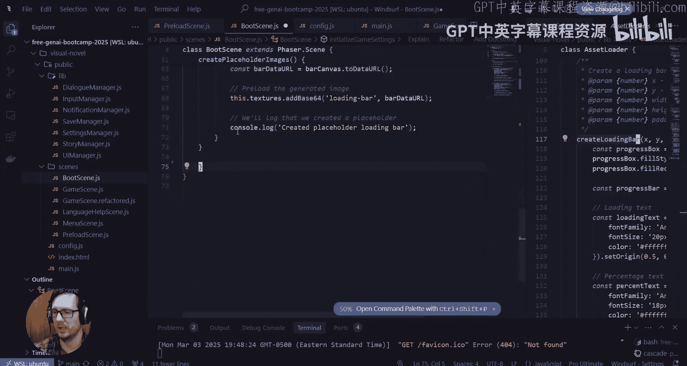

Are there manager here。 So here。To do。Should use。Configug manager。Does this happen here。And。

Settings manager， settingstting manager。And then we have the preload， so transition to the first one。

So the thing in here is this， this because I don't have graphics。Right， and I can make graphics。

 I just， I'm a little bit lazy。 But if we create them。

 then I can get rid of this entire function here。 Let's go over to our preload scene and let's see if it actually utilizes this stuff correctly。

 So now we're over to here。😊，We're getting almost at the hour。

 So I'm probably gonna stop here and go to sleep and continue on this in the morning。

 But here we have load U I assets， all this stuff。 This looks like。Okay， so it's using the preload。

 Allright， so it's just feeding into here and then loading it that way。You， we can do it that way。

 Just get just。A little bit of a preference of mine。So we're not gonna to pass them any other way。

 So I'm just gonna go here and do this。My eyes will just try to reduce our footprint of code a little bit。

There we go。Look at that， that we don't even need that constant。嗯。Create UI U I。

 create placeholder UI elements。 Yeah Yeah， yeah， yeah， yeah。嗯。There's animations to create。

 I didn't realize that。Put out here。Yeah。I don't know。 I don't think it really。

 we really need create animations。 There are no animations。

So we'll just take that out since I's not doing anything。And then we had like， fonts。Okay。

 so that is also useless。So take that out。嗯。I don't know why we create a loading bar here。

 and then the other scene that we have it again， like we have two loading bars。嗯。

I guess it just creates the assets and then we used later on。Create loading bar。 asset loader。Okay。

 so then why do we even need this one。Texture based loading B G。Oh， then it loads them into here。

 Okay， I see。So that makes sense。And that has the asset loader over here。

We also have the asset loader over here。How does that work， Because then we loaded into one， so。

You know， I noticed， I noticed we。Iitialized the asset loader。In the boot scene。

And the preload scene。How will the preload scene。Have the preloaded assets。If they are in separate。

 if they are initial， if it's initialized twice。Like， maybe it still works。 I don't know。

 Is there something I don't understand。Maybe this is a non problem。Cause in this one。

 the preload is just loading some things initially。

Don't cause any issues because SL class doesn't actually store loads。 It's just。

 it's just utility wrapper。Okay， so it's saying that that's a non issue。 Okay， that's fine。

Pretyload the scene。 This is fine。 We'll go back to our boot here。

So here's just loading the different kinds of assets。characterracter assets。

 the order here doesn't really matter。Load audio assets， which we don't have much of。

 load story data。 I don't know。 Do we have to load story data， I guess probably。嗯。I mean。

 obviously that that's what it would do。When everythings loaded。 Yeah， because this will。

 automatically actually get called after the preload。So we have this one here。This one here。

 This one here。 This one here。That's fine。And then we have our big old placeholder here for buttons。

So let's go ahead。I mean， the thing that might give us trouble is the games。 I mean。

 we've changed so much。 I， we should get lots of problems， to be honest， But we'll go over to here。

 and I'll go over to this。

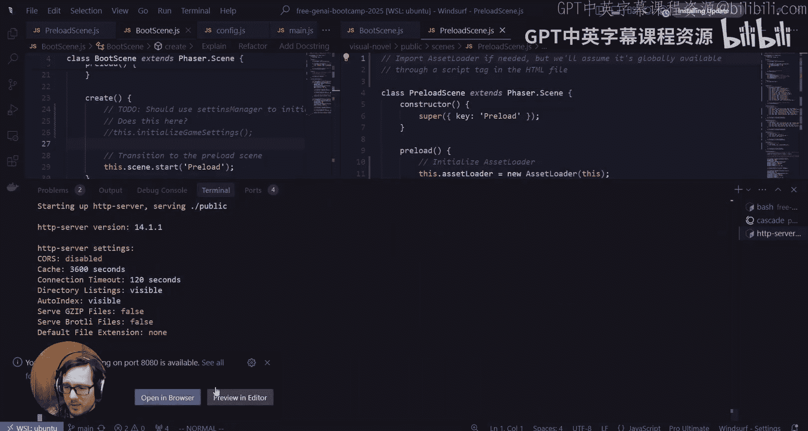

We'll take a look and give us a nice hard refresh。It still loads， How does it load？

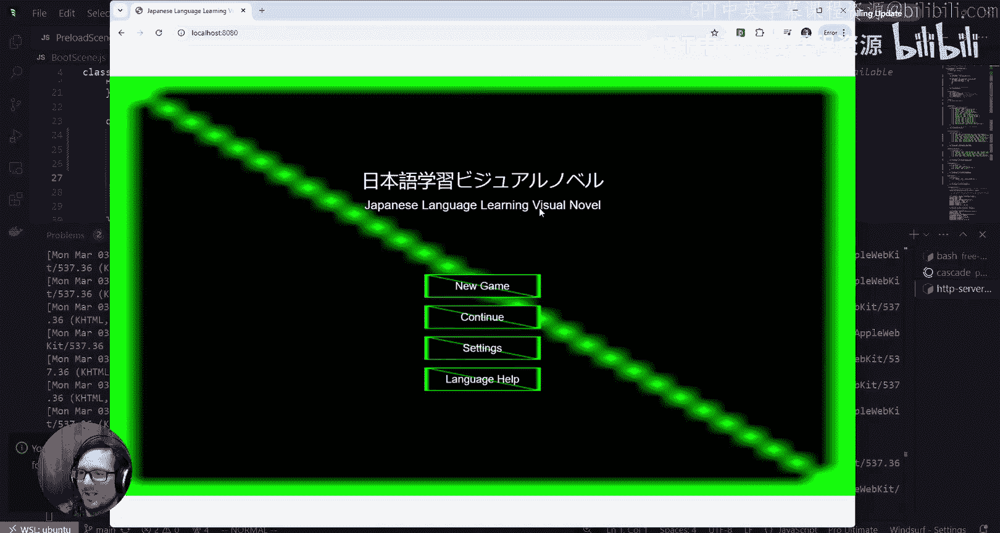

It must be cache。 There's no way that that's loading。 I cannot believe that。

 We'll give a hard refresh。

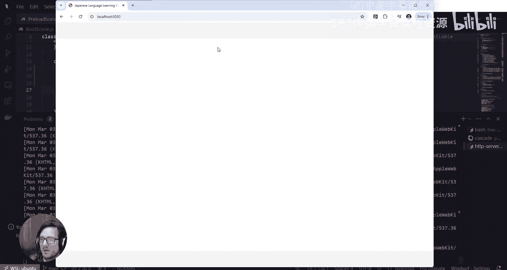

No， it's loading。Wow， really， really， with all those changes。😮，Impressive。Now。

 obviously when we click here， that doesn't work。🎼Notice that the music doesn't play on this scene either because it hasn't been loaded until the one after that。

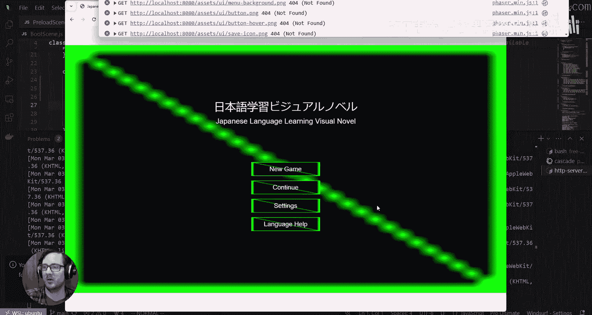

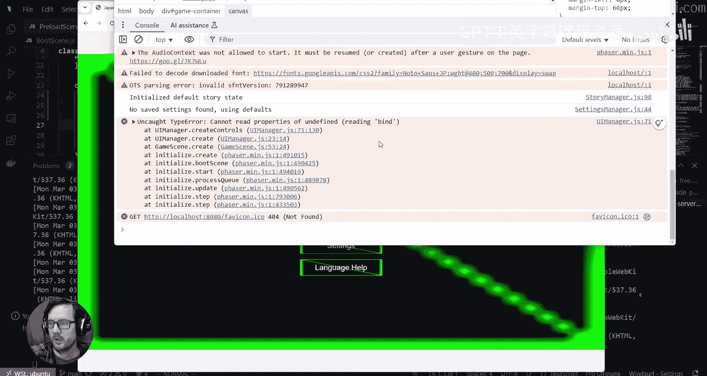

But we have cannot read properties of buying， so it's already having problems where。

🎼On something here， on one of our。Here。Okay， so。🎼Cannot read undefined but binds for toggle auto mode。

🎼Dot bind。Fair enough。 But the point is， is that we were able to do a massive refactor and actually is working。

 This is the language react。 It's a plugin I used to。😊。

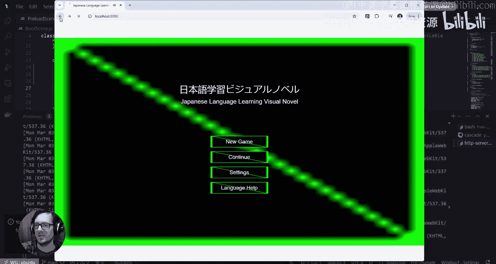

Yeah for， for like learninging。 But the point is， is that。I can't stop the the music there。

But the point is， is that that was that was very interesting that we got to that point。

 So let's go over to the binds。 And then we'll just kind of stop here and continue on。

 But the next thing will'll actually be getting the game working。 But I think actually。

 this approach worked out pretty， pretty fine。 So far。

 I don't feel intimidated by all this code here。 I agree with all of it。 And it looks fine to me。

 So let's go down to our event， our event listeners。 And so here it's having issue with the bind。

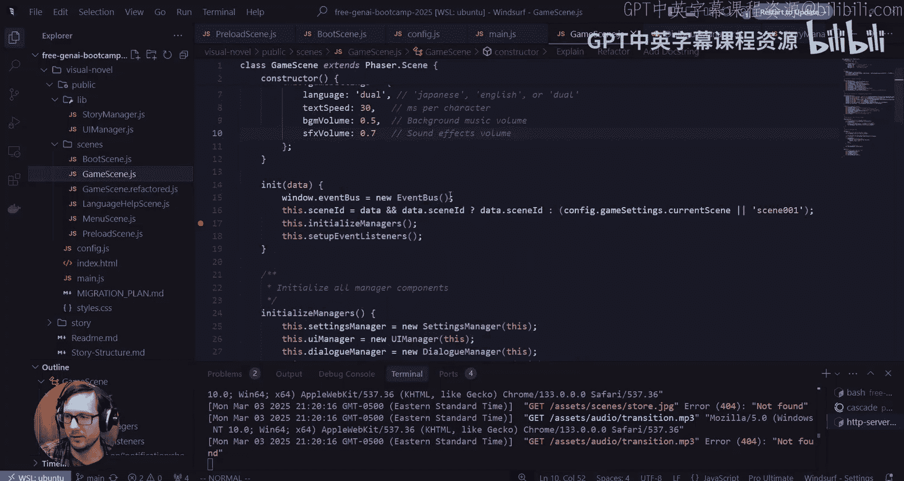

I don't see a bind here。It must have been on the interior of something。

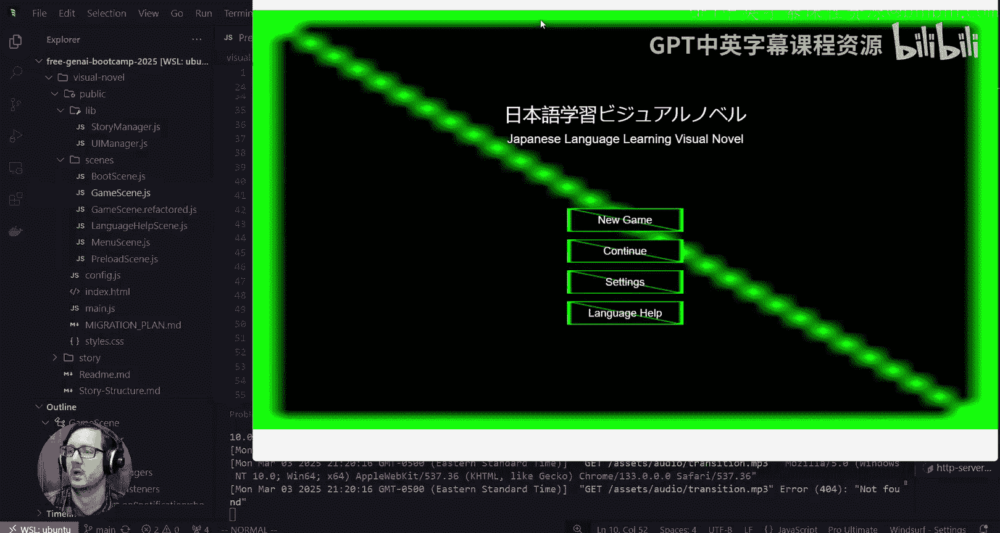

Let's give this an inspect here。🎼Again， also again。

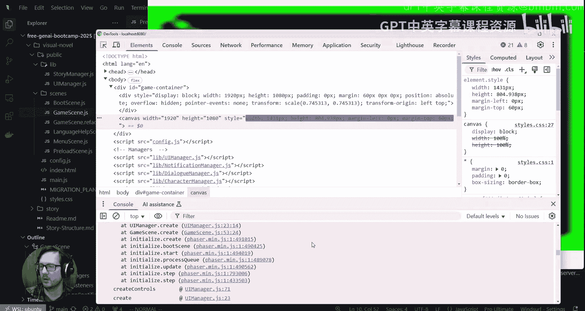

This problem is within the UI manager， okay。

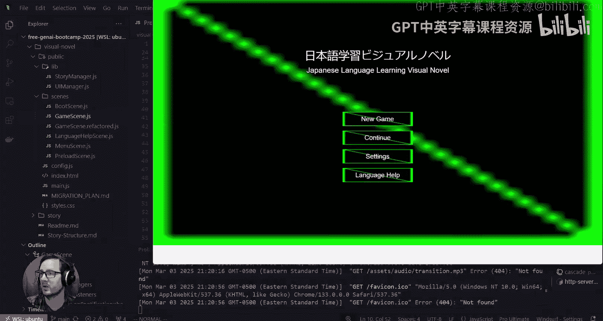

MAnd let's click off there。 So if we go back to our UI manager here。Inside of this， we have。

Obviously， events being called。Here it's having issue with this。Seen autotoggled bind。嗯。嗯嗯。

Interesting。So I think this buying thing is coming， I think it's coming from somewhere。

 but I think it's a built in thing with phaseser。So here， you know。We'll go ahead and copy this。

 so we'll just ask a question about it。嗯。Well put this in chat。See what what it says， right。Now。

 bind is not something that that I'm not unfamiliar with， but sometimes it's it's coded into systems。

 And so we have to see if it actually is here。The is about the UI manager。

 specifically at the lines where this is， Let me take a look at the UI manager policyacy。

Happens when you're trying to call blind on something that is undefined。Oh。

 so maybe it's just that it's undefined at the stage of time。

So here is calling this dot scene toggle auto mode。How does he even know what those things are？

I guess that's at the scene level here。Oh， you know what。 I delete leave those out， right， Hold on。

 holdd on， hold on， hold on， hold on。 I， I don't even need to read that。 I know that， you know。

 those are， are not there anymore。 So if we go here。Toggle auto mode， which is here。

This seen by toggle auto mode， this has been refactored out probably somewhere。 Toggle auto mode。

 is it iss it in here， toggle auto mode。Toggle skip mode。 This might be in our dialogueg manager。

Auto mode。Tole。Where's it again all these settings。I remember who was having it before。

 but I'm trying to find it。Like， obviously， they were in our they were in our game。

 and I delete them because I I saw them as useless。嗯。I'm not seeing any toggle auto mode around here。

So we'll go back to our UI manager here and so we have auto button， skip button， Sa button。

These will close this window out here。嗯哼。Save game， load game。

All these functions don't existcause we deleted them。 Open settings， toggle language， setting scenes。

 I'm wondering if like， those even should be set there like that。

I'm not necessarily sure if I agree with this implementation， because this is its callback， right。

 Like， what should happen when you click that button。 But we have that， we have an event bus。

 So why don't we just use the event bus to kind of define what kind of events we want to trigger。嗯。嗯。

So this is where I'm not sure， so。It does create a control button， which is great。

Butm just thinking about this。 So this is the callback of what we want to happen， right， Sa。

 save game， load game， like save game， load game。 That's obviously in。

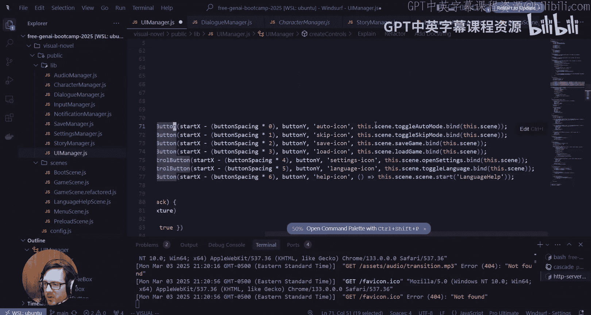

Are that manager， the save manager。 But seems like this should actually be be calling the event bus。

Should be triggering event bus actions， right。So if we go back over to our event bus actions over here into our game。

 setting sort of this is game scene。Or like save game， low game， right。

 So like it really should be emitting。Li， let's go over to our event bus。

And in here we have a mi right， so instead of doing these， it should be emitting these events。

 that's what it should be doing。Right。嗯。Yeah， that's what it should be doing so。

Let's see if we can fix that quickly with the code here。 So I'm gonna go here and。

We'll go into here and just say these are calling functions that don't exist。 what we should do。

Is use the event bus to emit events。And then watch， and then。On watch。The events。On the on the game。

Seen with all。The other events。For now， we can leave the。On events， triggered functions。

As a console log for testing。Okay， so we'll go ahead and we'll do that。

 We'll see if it can just fix that for us。 This conversation is getting kind of long。

 I'm not sure if I we should restarted or if that becomes an issue at any given point in time。

 But that's something that I would do to fix that issue there。

And then just decide where we want to bring in those elements， right？It's very simple。 It's on emit。

Right， it's not complicated。We'll give it a moment here。Alright， suppose。

 so it looks like it supposedly updated our code here。

 We're gonna go over to our game dot scene and wherever it is here。

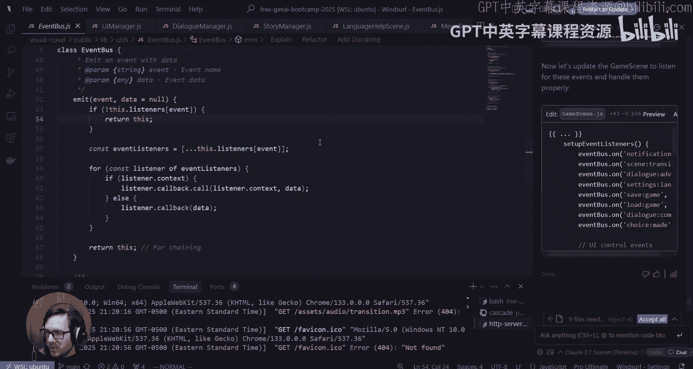

Game got seen here。 And so now。Did it actually implement， Oh。

 it can't actually do it because I'd actually have to give it right axis， right？

So here we will go and apply this one。Okay。So I don't like the fact that it did that。

 but that's fine。 So that's admitting those buses， right， in the UI manager。That's half the story。

And then we need to apply this one next。 So now it will bring in。

I'm not sure why it does it like that， but that's fine， I guess。

Oh because now it's just doing console log， but I don't know why I just didn't do it all in place。

 But anyway， there's all the other ones。 I kind of like when it's more condensed like this。

 but whatever。 And so now you know， we're getting a little bit farther along。

 That that might get us around some of our， at least our existing issues。

🎼And so I'm going to go ahead and stop this and restart it。

 I'm going to go back over to our actual application here， and we'll bring this on down here。

 I'm not expecting it again to work， but just maybe proceed past that step。

 We have a nice click here。

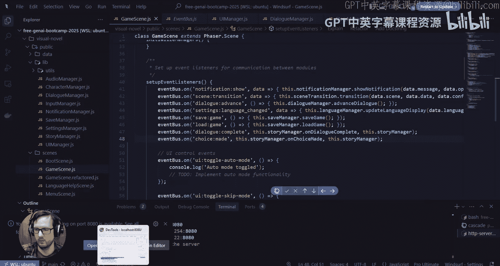

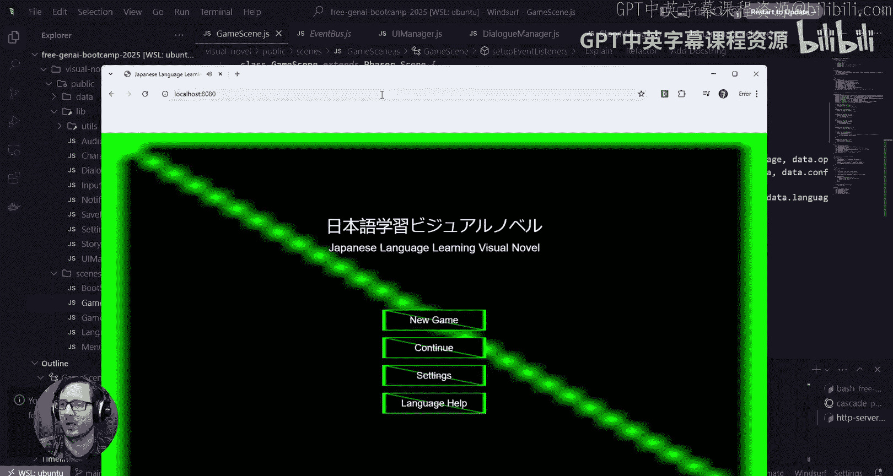

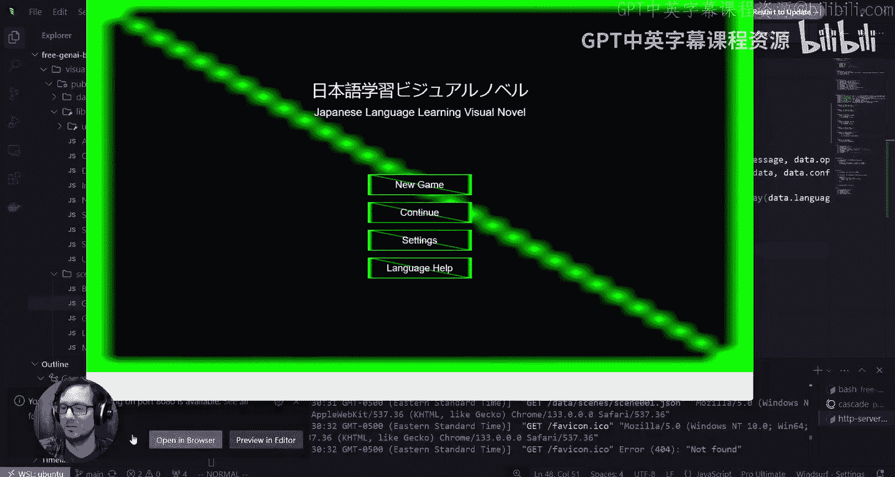

We'll go over to this， let's take a look at see what the problem is。

 unless it's still showing the old air。🎼Set up a play background is not a function。It's not。

 I thought it was。I mean， I did rename it manually。Maybe just call great。would play background。

 we'll put that back in they were set up and play background music。

We're going to copy that and we're going to go， it's playing it already， so I'm not sure。

Not sure what else we're expecting here。But maybe somewhere else it actually plays the audio music because it's clearly already playing。

🎼Set up and play。 So we'll go ahead， stop this。 We'll go back over to here。

 and I'm going to go back over to this。

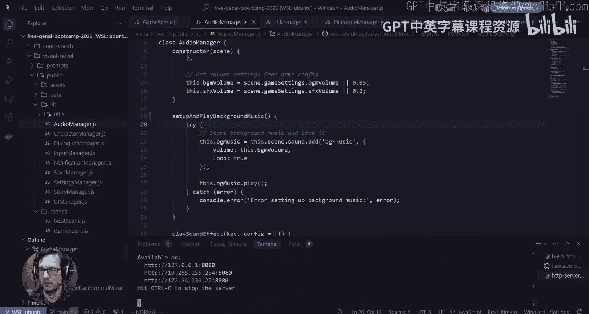

We give us a nice refresh for fun。

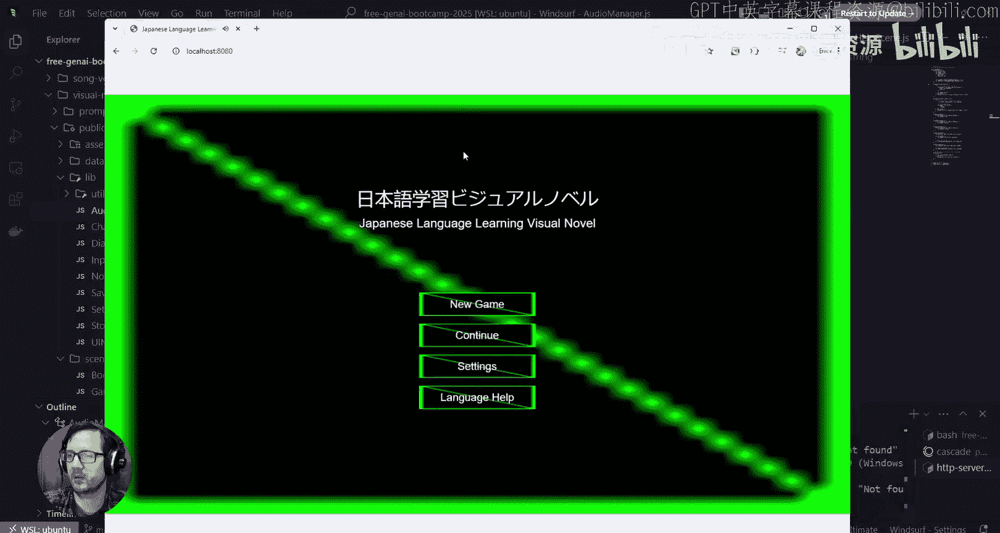

🎼And we will click into this。 Again， the music's playing。 So clearly。

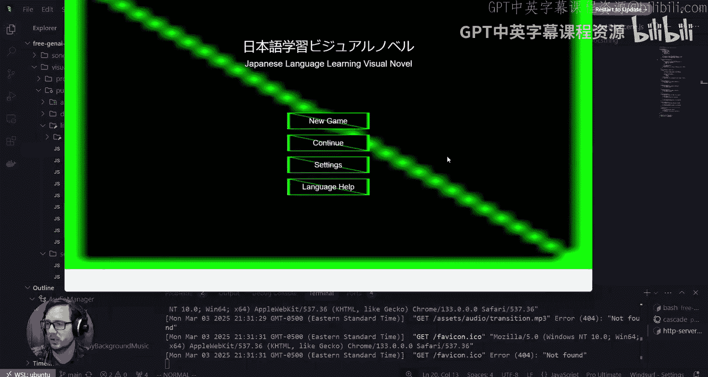

🎼Is not a function。 What are you talking about。 It clearly is a function。 We're clicking it。

 You're playing the music。

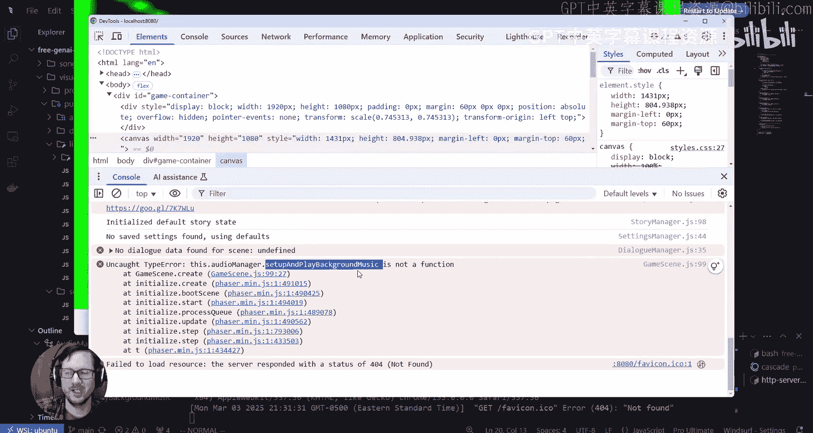

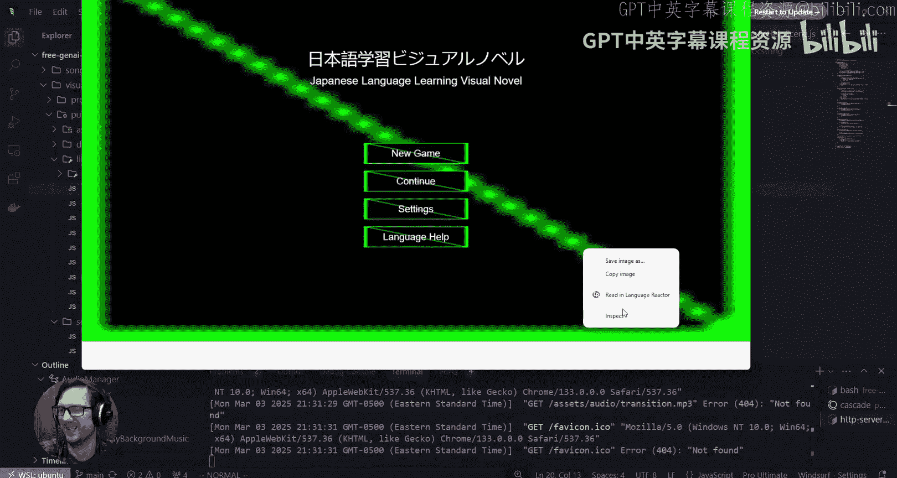

It says's working as expected， I'm going to go back over to here。🎼It is a function。 It's a function。

 I can see right here， it's a function。I'm not crazy。 We'll go back over to the game scene here。

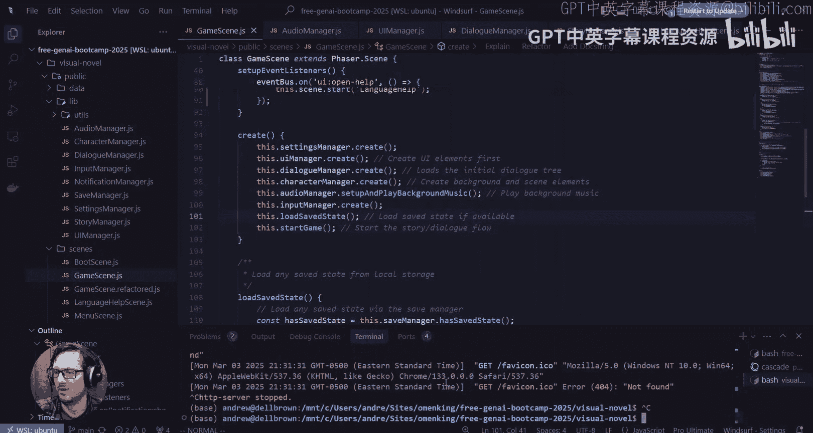

So maybe like there's something else that's going on。 that's a problem。🎼Maybe inside of it。

 it's calling another function。 I don't know。

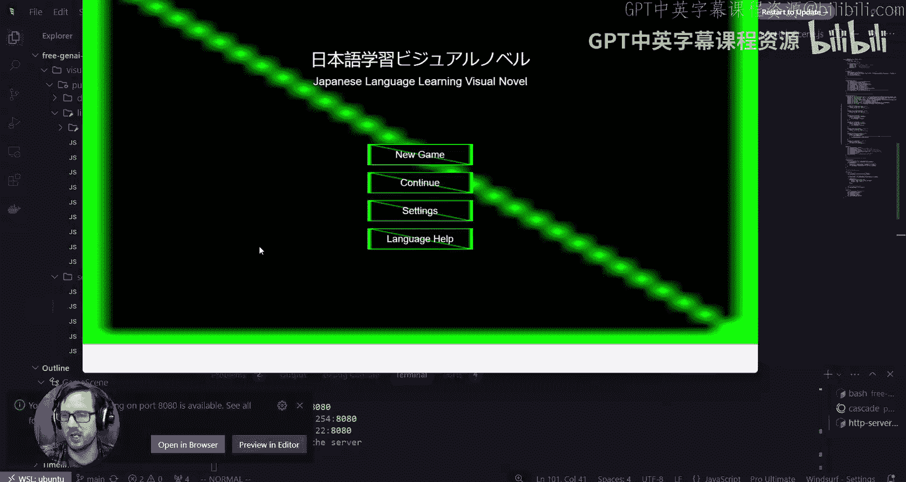

So they try here， clearly playing the music。 we'll clear this out， clear console， and I'm going hit。

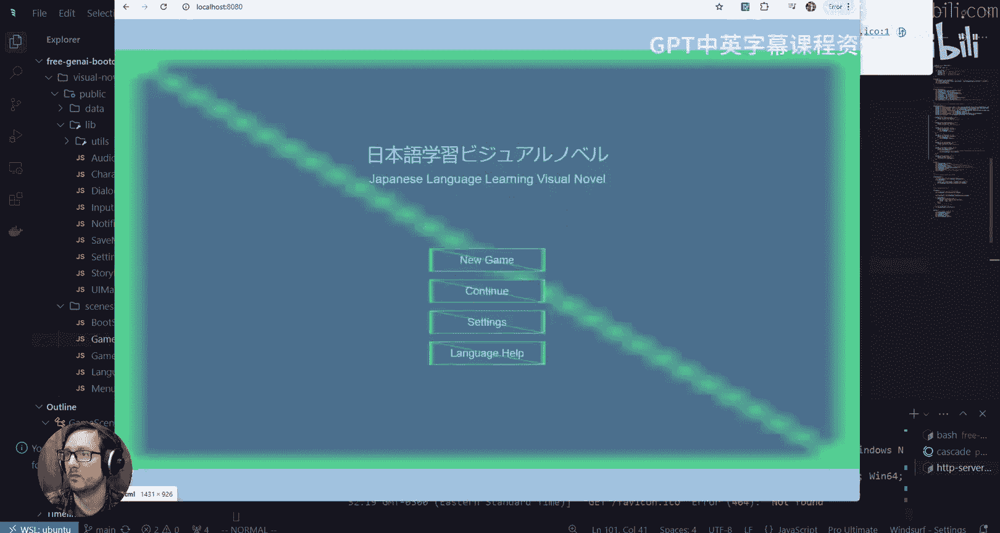

It's really loud now。We have a different era， so that's good， right？

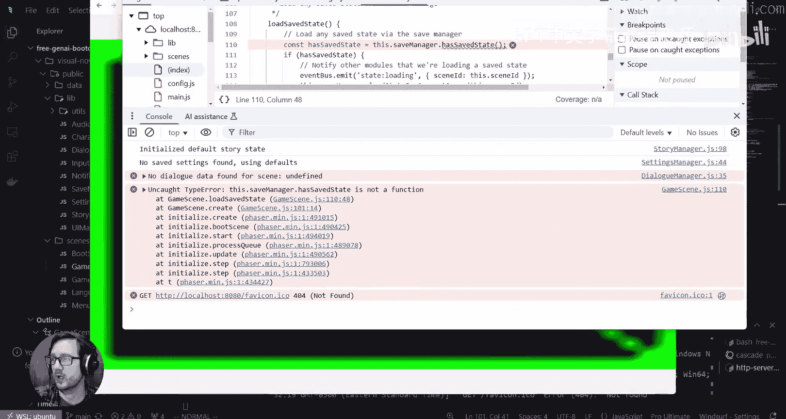

🎼So now we're just kind of stepping through， Oh course that note。

 But now we're just kind of stepping through the code。 And we are getting somewhere。

 So I'm pretty confident that we can get this working。 There is a lot of work ahead。

 might take another hour to get everything into shape。 But if all that stuff is in place。

 then then we're back to where I was just a moment ago。

 But with all the code more manageable and refactored and。😊。

Then I can think about expanding that story。 I really do like the idea of a daily Sim because imagine if you're playing a game every day you wake up and you can kind of add a little bit of complexity and variation on on those daily routines。

 You could even play this game every single day as your daily routine to see where that variation is。

 It could test you at the end of it。 And that would be a real， a real big deal for， for folks。

 But anyway， I'm gonna let folks go here。 and I'll see you in the next video。 Okay， Co。😊。

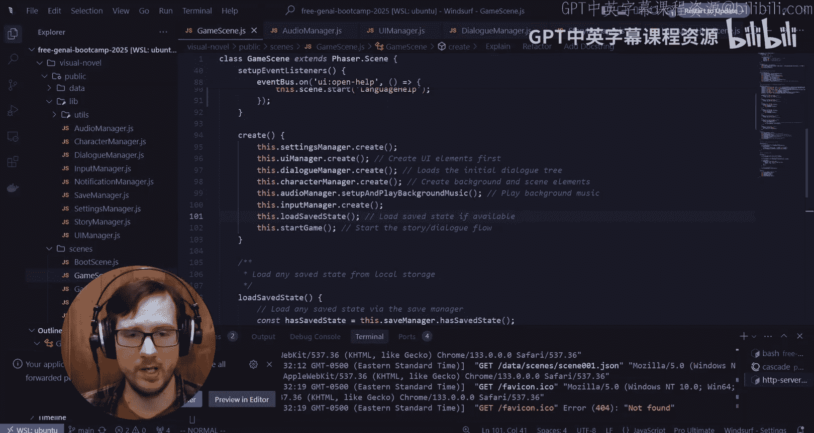