# ExamPro《生成式AI训练营｜Free GenAI Bootcamp》中英字幕（deepseek - P60：-60-Visual Novel Fix Global Managers Issues.zh_en - GPT中英字幕课程资源 - BV1SFEWzLEab

🎼Hey， boot campers， it's age Brown。 And we're getting to it。 It is really， really。

 really cold to my office。 Not that cold outside。's just that it's windy。

 and that really affects the temperature in here。 So hopefully it'll get a bit warmer as I have turned on the furnace。

 not doing the wood stove right now， which is nice。 But last place we checked。

 We started to get this kind of into a working shape。 I think we got the loading screen working。

 but beyond that it was not the main game was not loading correctly。 So I can go down here。

 I just need something opening here we'll say local host 8080。

 I think it might still be running for the last time it is here we get our music。 And by the way。

 I noticed that if I play this music。 It actually demonets the videos， which I don't care。

 I'm not trying to make money off these videos。 but that was interesting。

 I never had that flag before。 However， I did pay for this song。 So I am allowed to use it。

 but apparently not in a monetization standpoint for YouTube。 But anyway， so we have our things here。

 we could just focus on settings maybe And then come back over to new game or doesn't really matter。

 but。😊。

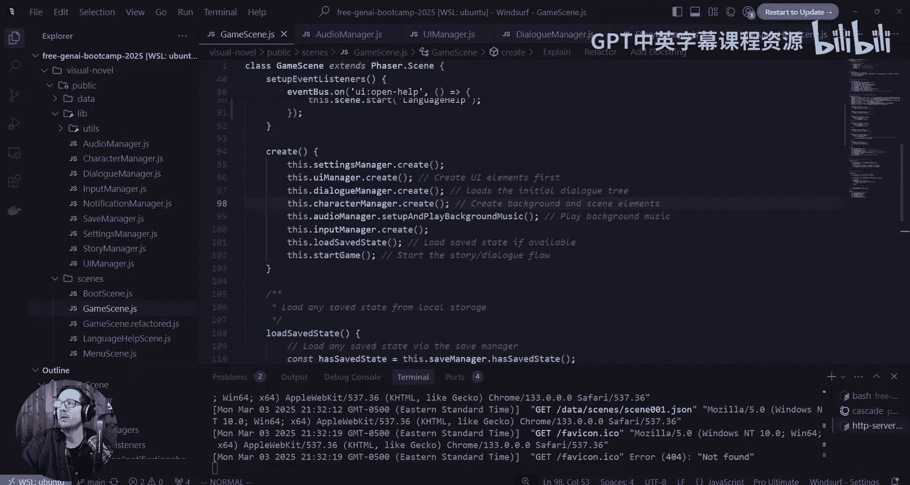

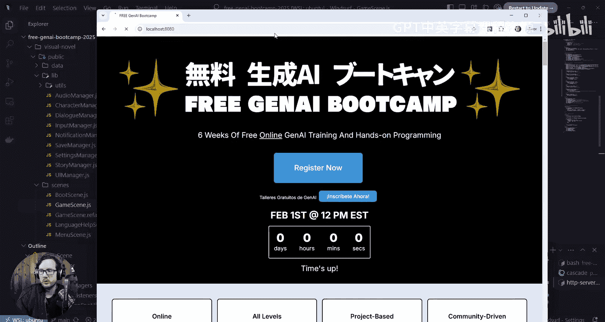

We might want to oh。🎼You know， fix it here some way。 But notice as I clicked it， nothing happened。

 and also the music got louder， which is kind of annoying。

 So here it has an issue with the save state manager。

 So I think what's happening is that it's playing the music twice because it's being called twice。

 So what I'm going to do， is I'm going to go over to here。

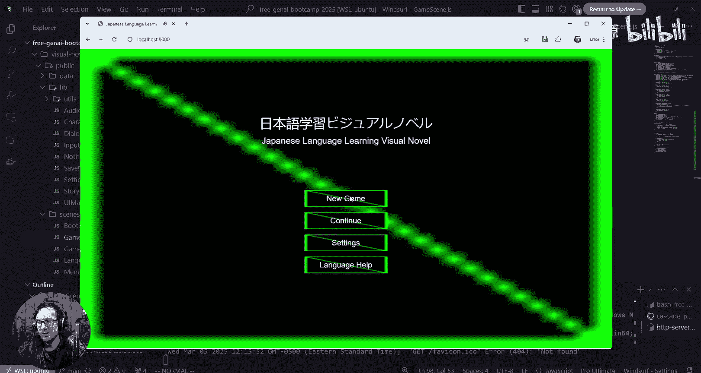

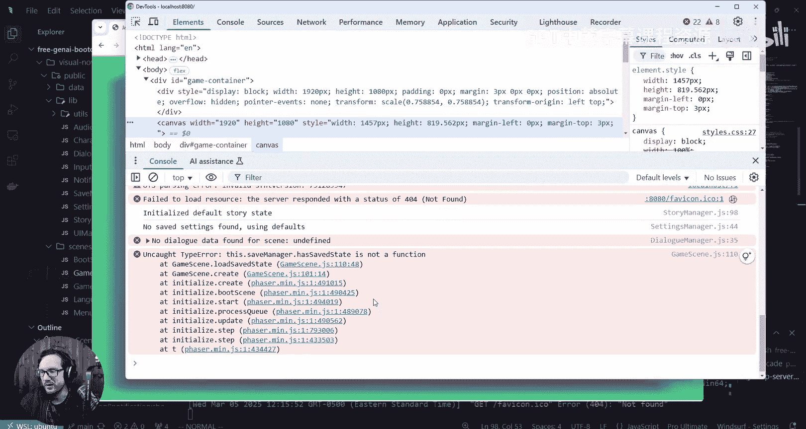

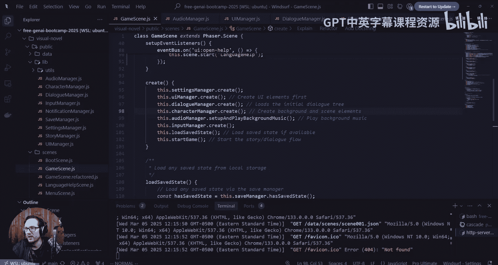

You look at our boot screen and what I'm looking for is where it might be playing that music。

RightSo it's not in the loading screen。 So it's probably in the preload menu here。

Its in the preload menu。 It's also not in the preload menu。

 So then maybe it's in the menu screen here。And aha， here we go。 Okay。

 so here we have it's setting the width and the height of the game。 That's fine。

 We have the text of the start。 That is totally fine。 might want to get a text helper here。

 This is quite verbose， but it's fine for now。 And then this is where it's setting the background music。

 So it's saying sound ad get playing the music here。😊，It sets it to loop。

 and it's a little bit quieter， which is nice。 But this is not where I really want to utilize it。

 So the thing is， is that we have the audio manager over here。 But some of these should be global。

 right， because this is gonna to be a bit of a challenge if they're not。

 So I'm gonna go over to here。 I'm just gonna say， I'm gonna make sure we're on chat mode。

 And I don't care about the same。 I'm going to just say like， you know， I noticed we load all of。Of。

Of all of our managers in the game scene。However， some managers need to work in other scenes， E G。

 Bo screen。Sorry， the menu screen。And。Game screen。Because。If you start playing music， right？

Background music。You you might want it to continue between scenes。Alright。

 so maybe it understands that I'm trying to get it。 Maybe it doesn't。

 But we'll see what it comes up with。 I'm still using cloud sign 3。7 sonnet thinking。

 And we'll see what kind of result we get。 So the user is point out of validel concern。

 You're absolutely right。 See seems like the manager should be work across multiple scenes。

 like keeping background music planes separate scenes。

 We'll create a global manager system to help crossse functionality。

 So create a global manager class to initialize and manage global managers。 I like that idea。

 modified the boot scene to initialize the global managers， make them accessible to other scenes。

 And notice like right now， I'm not on right mode just because I remember earlier when we're on game scene that was struggling。

 I just wanted this to work as expected。 So it has implemented a global manager。

 which is not a bad idea。 I like that idea。😊，U。And then， whoops here。Set up global event listeners。

 So here we're having global events everywhere， as opposed to just inside the game。

 which is interesting。 Okay， and then set up the scene。 And then here we have the boot screen and。😊。

The game scene。I'm happy with that。 I' gonna switch into right and。 Okay， I'm good， good。 Please go。

 please go write and update the code now。😊，With the proposed changes。Okay， so I looked it over。

 I proved that。 I don't think it's going to do anything bad there。

 So we could probably just hit apply in all those cases， and it would work。

 but some of them have to create a file， so I didn't want to go around with that。

And so we'll come back here in a second when it does that work there。All right， I am back and。

Let's see。It trying to run it again， which is fine。 we're going just stop and start it。

 And so there shouldn't be any noticeable difference， I mean。

 unless it stops by the music and the other one， but we'll see here。And so load's no problem。

 music plays。

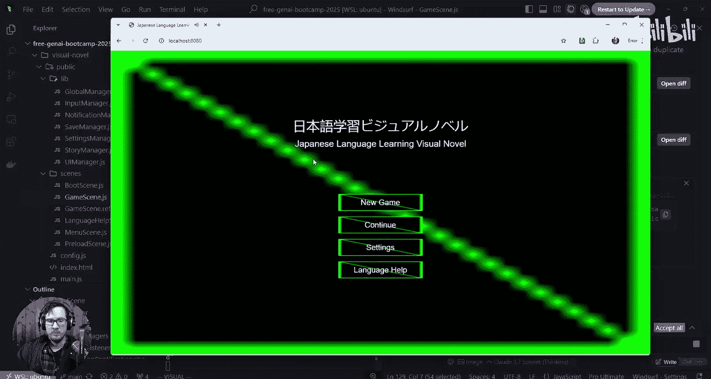

Music still gets loud。 We're probably going still have the same error， which is fine。

 but let's go take a look。

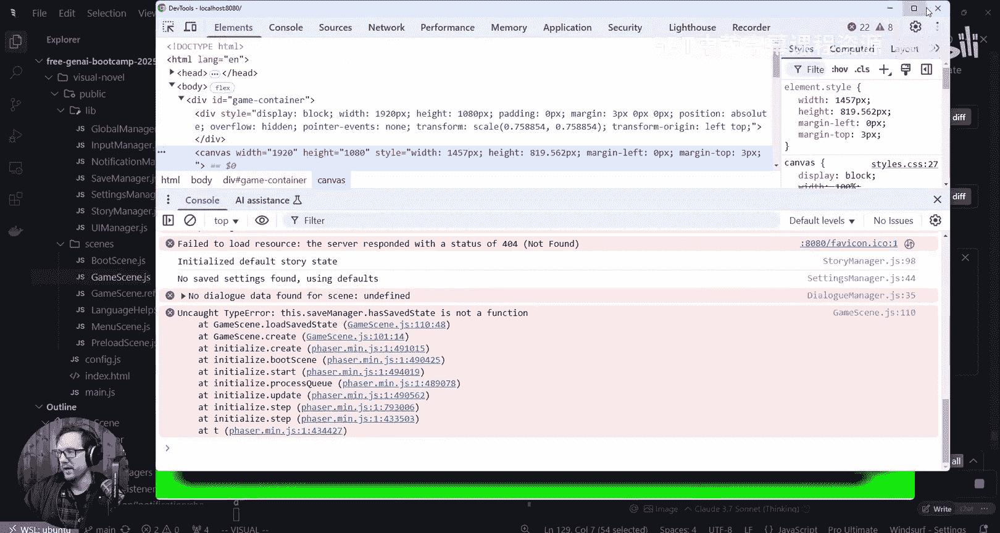

Also， one thing I wanted to do is make sure I have this open when I refresh this。

 otherwise it might cache it。That's loud。🎼啊。And now it's double playing。

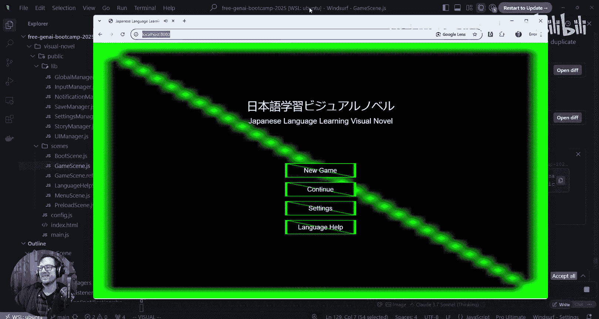

Well， hey， at least we got some code updates。 whether they're good code updates is a different story here。

 but we're gonna have to drive manual as per usual。 So we'll just bring this on over here。

 And it kind of started doing the code for me。 So we'll go over to our。 So it was the boot screen。

 They were loading it， right。 So in here。😊，We initialized our global managers。 why in here。

 I don't know。 Do we have to do it here。Because all this thing does is set up that。

 I guess it's fine if we do that there。 So we have initialized little managers here， right。

 store and registry later for initialization， game registry dot set。 I don't know what registry is。嗯。

Let me go look up phaseer3 registry。

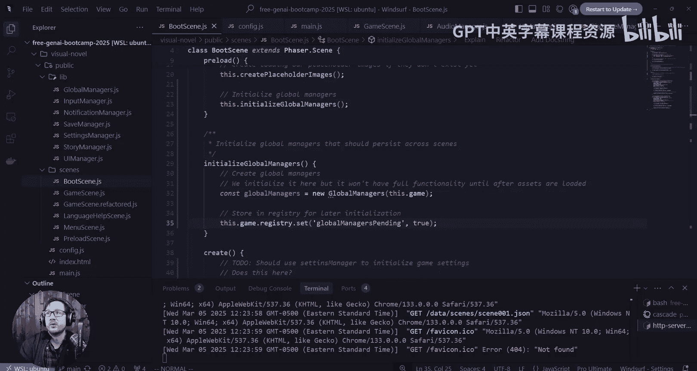

ItCrazy that they're all working on a phaseer four。 It's like I've completely missed a version of it。

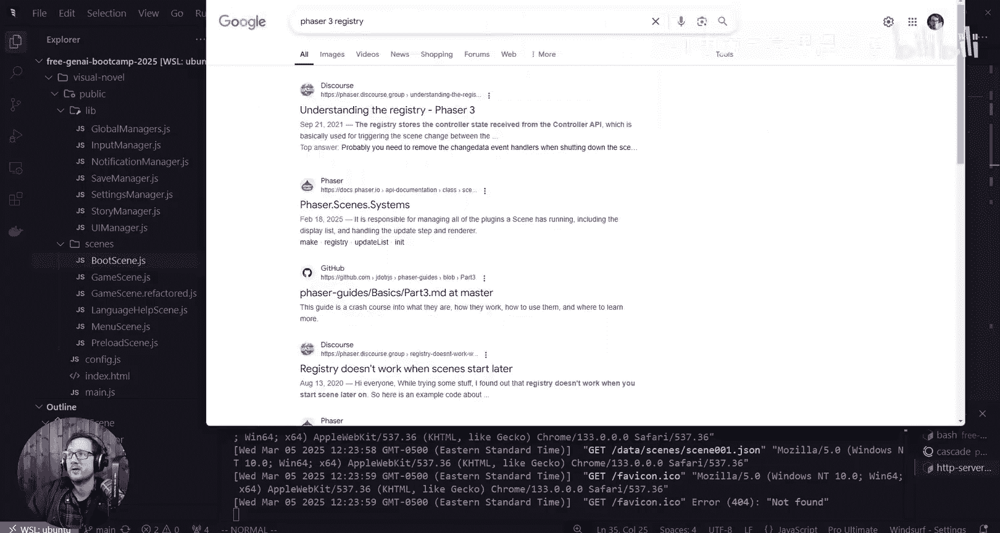

So this is related to the former pose， but I hope it make sense， all scenes are standard。

I'm using registry as a convenient way to communicate between the scenes since it's not too much input coming from the controller。

Okay， but what is registries phaser。嗯哼。😊，Here's a life cycle of one。 that's kind of interesting。

 I want this for later on if we just put this as a note。

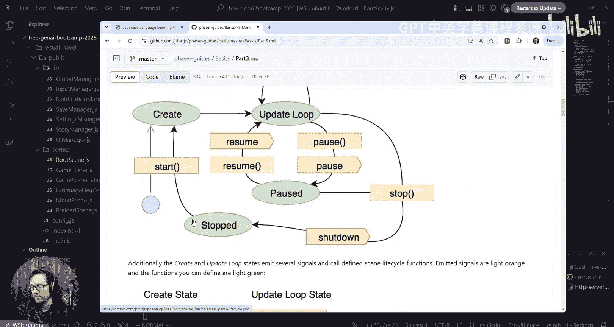

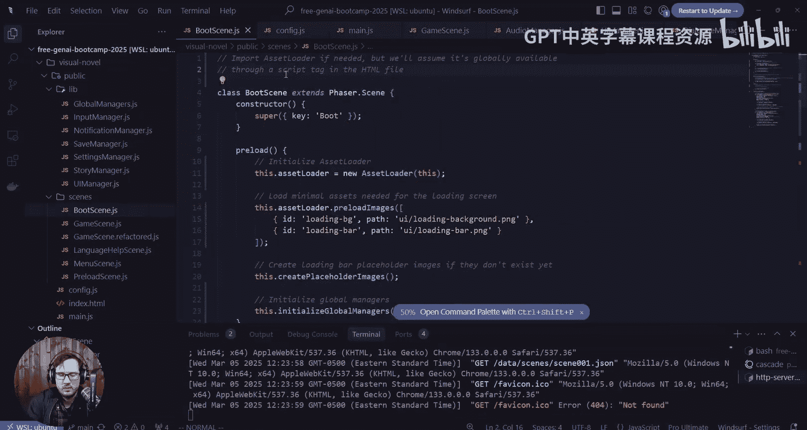

As that might be interesting to take a look at。 But we'll go down here。

All I want to know is about the registry， I kind of like already know how this the data registry attribute attribute as your scene offers access to globally shared data manager。

 so one of its key features is that an event is admitted when the data is stored。

 its stores is changed additionally since it's shared。

 it's it's trivially easy to build syn scene communication right almost sounds like this is an event bus。

Right， but。Yeah， I wonder if we should be using that for everything or not。

 this approach certainly is not bad and it's connecting multiple scenes。 It relies on a global state。

 If you decide that you want to use a type system。There's no good way to maintain it。

 None of these are terrible in arguments。 then it's terribly written， but。

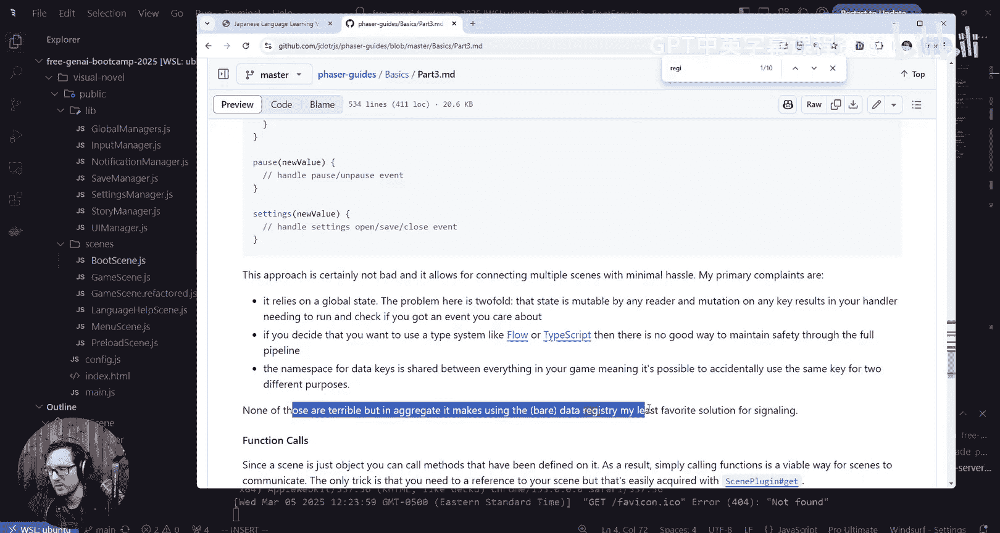

I， I， I get what they're getting at。 This is just， I guess it's just another event bus for scene to scene stuff。

 but we have our own， right， for actual events。 So here we have our global manager。

 new global manager here， which is this。 Let's go take a look at what the global manager is doing。

So here manages the that should be available globally， so definitely。

Should the language manager be global， I'm not sure about that。嗯。

The audio one is character ones not that makes sense。 dialogue， ones not。

 there is no language manager。Because we got rid of that。

 So it's adding stuff in here that doesn't exist anymore。It's a bit confused that was is fine。

Initialized event Bu if not already， so it's creating the event bus here。

So now the event bus is stored on the global manager。

 which is fine that or it's a separate event bus right。

 and then we have the audio settings and save manager set up event listeners。

We are storing this as a reference， so we can reference it later on。

 and then we're setting up our ones here。 So we have things for audio。

 which is something that we do care about。 So we have play background music， stop background music。

 play sound effects， stop update， settings， save game， load game。 Yeah， those are fine， I suppose。😊。

The only time you'd really save a game is when you're inside the game， I suppose， But we will。

 maybe there's another scene where that you want to save if we yeah， we'll see because maybe like。

 let's say you added a mini game。 and was a different scene。 You might want to do that。 I dont know。

 Upd， scene reference in all global managers。So， here。

I guess the idea is that as you switch to different scenes。

It'll just make sure that you have a local reference to that one。 I suppose that's fine。

 I don't mind that。Let's go over to our。Preload screen， again。

 just carefully looking if it added it anywhere strange in here。Finalize the global manager。

 So complete initialization of global manager after all assets are loaded。 So here。We initialize it。

Hm。Okay。But I guess my thought is like， why would we do this here？

Because it's not stored on anything， right。And we go back over to this one here。

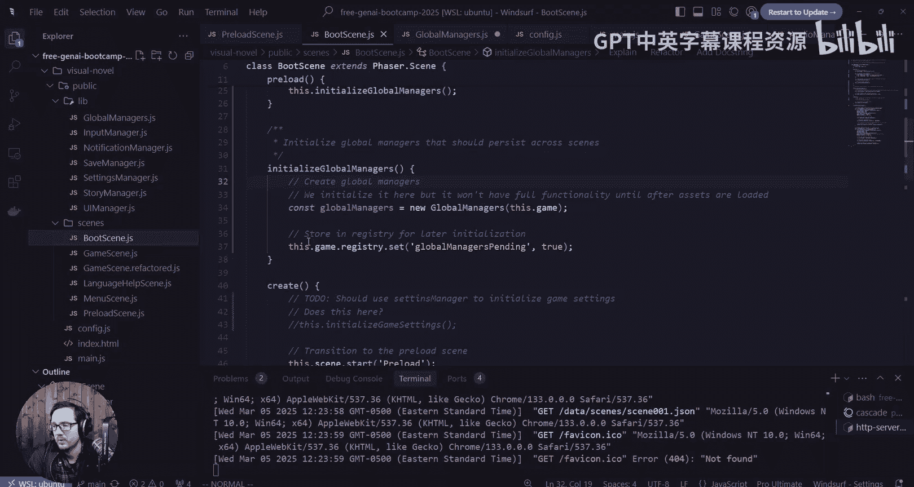

So I need an explanation， and apparently I needed updates。

 so I'll be back here with an update in just a moment。

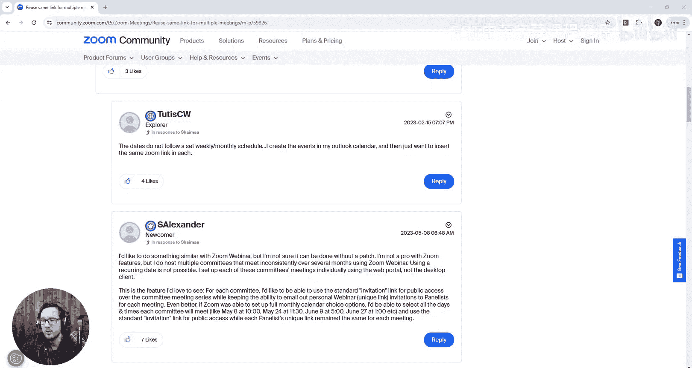

But why would we have it in one place and not the other place？ That's what I don't understand。

So I've got my nice little update and I'm going to put this to chat and I'm going to ask it like why is it doing that because it's not stored globally。

 right？We're going to chat。 Why do we， Why do we。Create an instance of the global manager。

In the boot， and then the preload。Like， does that make sense？

Because I don't get why they would do that。Yeah， you go， you go do that。

 You go look at them because I， I don't understand why would we do that twice。

Because we're not using it anywhere here。 So then why do we do that， and we can't access it globally。

 After viewing the code， I can answer your question。Look at the im， there's actually two phases。

 so a global manager instance is created， but it's not fully initialized。

 a flag global managed pending is set to the game registry。This is a placeholder。

 Another Google is instance created after all assets are loaded。

The stored in both the game registertry and the global window。Okay。But how is it globally stored。

 I don't see it stor。 Okay， how is it storing it。Doesn't actually make sense since you you're creating shoes。

 Yeah， this' what I thought。 Yeah， okay， please fix。So it says create a single instance。

 store in the registry right away and the preload， retrieve it， okay， then fix that。

Does to me that makes more sense， right？As you can see as the complexity grows。

 it gets a little bit confused。 And this is where， you know。

 we are driving because the complexity of the code is too much for it。

 Maybe if it like you didn't have to go across files， it'd be less of an issue。

 So I'm gonna go ahead here and we'll review that。 So this one is the boot scene。So。Yep。

 and then it would store the registertry。 That makes sense to me， right， That makes absolute sense。

And then we go down here。I mean， that's only one part of it。 Then we go to the preload screen here。Y。

 so that makes sense。 So we'll go ahead and apply that and we'll apply that。 Okay。

 so now those are both applied。 So that makes sense to me。So now the preload makes sense。

 I'm not sure if this error is out and makes sense， but now we're in the menu。Okay。

 and this one gets it。 So that's perfect。 That's exactly how we would grab it。

 updateate the same reference Google manager。 That's fine。 We can do that as well。 if it。

 if it is assigned， I mean， it should be there at this point。 But， you。

 it doesn't hurt to have those checks， I suppose。😊，So now at this point， we should have it。

And now it says create menu buttons， Play the background music using the global manager if available。

 It really wants to make sure that it's there。 Check if the music is already playing。

 So if the sound dot get is playing， then do this。 Otherwise fall back。

 If the global manager isn't available。 we don't want to fall back。

 It always always should use the global manager。 So this， to me， is redundant。

 There's no way that the global manager should not exist at this point。

 I think we're kind of overdoing the checks here。 So unless we actually have this problem。

 take this out of here like this。I do like this idea if it's already playing then check it。

 but this should be built into the actual code here。 It shouldn't， again。

 we don't want to be littered with all these issues here。Same here。 There's no way。

 There's no way we don't have it。 So I'm just gonna go ahead and reduce this like this。

And I like that idea。 It's fine to set them temporary like that。

 I'm not sure if that will cause any other issues for us。

 But we need to focus on this part here where it spending so much time on fricking music。

 But at least we got those global global things set。 So that kind of helped here。 But anyway。

 this sound dot yet。 Now， I'd rather， when you're writing these systems like the audio manager should be actually managing all this。

 And so if we go back over to our audio manager wherever it is here。😊，In here。

Here we have updated scene。Right， set up and play background music。So。

I'm not sure if we need setup up， so to speak because it says start the background music and loop it。

Otherwise， catch an error。The scene add sound。So I guess my thought is like we want to play background music where we have stop。

 play sound effect。Stop， pause， resume。Volume play。So。I think for this。We change this to play。B。

 G music。And。Obviously， they're adding it to here as the music that's being set。

But I almost feel that right now we're only using one， one kind of music or sound。

 So I kind of would like this to be initialized at one point。But we don't have that。

Initialize or create function， right， So we're initializing them right now in the game scene。

If I recall， if we go back over to our game here and I check the game scene。

So we have their managers here， right？They get initialized here。

But these things exist prior to this state。 So are we resetting them for the scene or we creating them when they first do it。

 So here it like， creates U I elements first。Load's initial dialogue， character stuff。

 so this is stuff that is。I mean， like this stuff here is right now for the scene。 right now。

 these are generic ones right up here。 So these are global systems。

And so these are specific managers for the game。For the game scene， and these are specific managers。

Our global managers。Global managers， right？So， you know， when we see this。

 I'm kind of thinking like maybe this should happen prior to even getting to the menu right。

 so if that's the case， then we're going to go back over to our preload screen or not a yeah preload screen。

And on its create， it says finalize global Manager。So， here。嗯。

Get the existing gold manager's instance now initialize it with all assets loaded。Okay。

We don't want to do this。I don't like that idea。Pending flag。Okay， and so let's go into the。

Where is this。 This is the。Global manager here。And it has an ait scene here。 So here it says audio。

 new， whatever， whatever。And it's not creating them in any way。 It's not setting。

 It's not calling the crate on them。 So we， we do initialize them。

 but it is being called in the create C function。 I almost kind of prefer this to be called。Create。

Okay， I'm gonna go back here。I'm just trying to be consistent with the naming。

SI didn't really change much in there， why won't it save？Oh there we go。

 I was driving driving me crazy there。 So we're in the preload scene。 We'll go to the net。

 and I'm just gonna say。Here。Finalize global managers。mmm。And so I' just say create there。

Now we are initializing them。And so then in this scene here， we can then go。This dot audio manager。

 create， yep， this dot settings manager。 Yep， and then all three of those are set A settings save。

 Was there another one that's missing from here， I'm not sure we'd have to take a look at the U I manager。

 I can't remember it's game specific， but this will set those initial things up。

 So now I can go back over to our。Our audio manager。 and in the play music， the idea is that if。

 if there's a create step here， which now there will be。So say create。Like this。Then I can go here。

Don't care about shutdown。 I can。Go here， and then。Copy this， right。 So now I can copy this。

I can bring this up here。Well， you can also make another function like create B G。Okay。

 and I just wanna create that object。And I lost my copy paste。 I'm not sure why。

So what I'm going to do is I'm just going to copy this function。Like this。

And we'll paste it down a little like that。 So create。B， G， BGM， I actually like BGM。

 That's a lot shorter。 And then we just go like this dot， create BGM。

 And then our life will be a lot easier to work with here。All right。So， yeah， we create the BGM here。

 We do not need to play it right now。 This is something that we will。Do manually over here。I mean。

 we could have put it in the constructor， but we might want to separate that out。I think it's fine。

 Over here' is a separate step。 And then that we'll go down here。 This will instead be play。B， G，M。

 I really like that。 That's， that's really nice。 And then all we gotta do is this。😊，That's it， right。

 so that becomes a lot nicer。Right， why， why can't we just do dot BGM play music from a Cody perspective。

 You're always supposed to kind of wrap it like this just so that it's a little bit more。

 a little bit more efficient here。 I'm gonna bring it on down so that it's with the other ones here。

And I'm just going to use our stop BGM。Here。Pause Bgm。So here， if the music is playing， then stop it。

If the music is playing， then pause it。 Okay， it's interesting that it does that。 I don't， I guess。

That might be smart to do。 I'm not sure， but。Because sometimes things will air out if you don't do that。

 but I'm not sure in this case that that's true。So here， B G volume。Set BG volume。

 it would be nice to be able to just set BG volume in one go here。I probably。Would want to do that。

 but I think I'll leave them a separate actions。I'm not sure what the default B G volume is。

 Here we have。It gets it from the game settings， right， so it loads it in from here。

So here we have 0。05 or whatever if that is set， and then that is set as well。

 So we have a few defaults it can work with。 Not sure why we have coal in here。Yeah， I'm not。

 not sure what about that syntax， but I'm not gonna worry about it right now。

 So that should get loaded in。 And then we'll go back over to here， so。Now we are in our， whoops。

 this is our audio Manager now up to date。 we're going to go over to our preload screen。And。

We're not calling music yet。 Then we go to a menu screen here。And so， in here。

We had music playing before， right， Here it is。So we do want to use a global manager。

 we have global managers， audio manager。Play BGM。 That's all we have to do。

 We don't have to check if it exists。 It should exist exist at this point in time。

 So I'm gonna just keep our code nice and simple。 This page is a little bit verbo。

 So we'll have to require some refactoring here。 But the idea is that it will play the music here。

 The only thing I'm wondering is like， if it's already playing， will this trigger it twice。

 And that could be a bit of an issue right now， it doesn't load in other stuff。

 So I don't want to stop and restart over， which is what play might do。

So that might be something we need to fix。 but I， you know。

 I might just go ahead and say if it's not playing。So， if。If it is playing。You have here， if。

Is paused。Okay。Sorry， they're had a big sneeze。 But here what I'm going to do is I'm just going put this in here like this。

And we're just going to reverse this here。Yeah， it wants to reverse it do。 That's perfect。Okay。

 so now we have a play， we have a stop here。 that's great。And I play BGM， right， so that is。

 that's interesting。That should resolve our issues there。 If I scroll on down。

 we have continue button， add text， setting buttons， add text， help buttons， start new game。

And so that seems fine。 I want to get a little bit ahead here。

And take a look at what happens in our game scene。We might want to do the settings pages first just because it might be easier to get it out of the way。

 but it's not as fun as getting the game to work， but it might be nice to not have to deal with a lot of the loud sounds。

 We can see that we have settings here， initialize the game settings。

 So obviously when this loads initializes them here。

 But I would like to have game settings prior to this。 You can see here。

 scene ID D game settings current scene 0，01。 This is stuff that should be set much earlier， right。

 and。I mean， if there are defaults。嗯。You know， why wouldn't we just pick them up from the initial。

Configud yes， because these are gonna give us the defaults。 These are the defaults。

 game specific global settings。 So we have dual。 We have 30，0，5，0，7。 So this is gonna to override。

 And that's probably what's making it really， really loud。 So I'm gonna take this out here。

 We don't need this here。 This doesn't make any sense。 So I you see like。We're using AI stuff。

 But if you don't know what's going on， you might be struggling with this part because you're not sure what to do。

 And， you know， that's not， that's not something that AI is gonna be able to help you with。

 at least not in the short term。 But anyway， we have our。

I know the game settings heres just bring that back for two seconds game settings。Okay。

 game settings。 I gotta look for this here。Game settings。It's confusing， because here。Oh。

 but that's the， that's， that's somewhere else。 Okay， I， I guess what I was trying to figure out was。

What the heck is happening here。Sometimes the undo doesn't do well。 Like， it's all mangled my code。

Okay， if the event bus doesn't exist， create it。Do we want to have a separate event bus。For the。

For the game， that's what I don't know。 I just need some tissues one second。Okay。

 so we have an event bus here。 I'm not sure about that。 And you can see that if it doesn't exist。

 it's already gonna create it。 So that might be。Window dot event bus。

 good a reference to the event bus。 This is just so we can globally use it。 Or yeah。

 if it's storeded here globally， then you can use it anywhere。 I'm not sure if I like that idea。

 I kind of feel like it should be attached somewhere， but I'm gonna worry about it later。

 Here we have config game settings。 So where is config coming from。😊，Right， so I'm here。

Where's Confeg。I don't know where that's coming from。 So maybe before we， I used to initialize。Oh。

 no， So this is come from game doc config。 Okay， so if we go back over to here， it's from this。

 literally from here。 Game config at at currency scene， right。Which I don't know if these are。

These are set in stone， and they're not necessarily data driven stored ones。

 But here you can see it's trying to set the scene here。 We don't need to have all these defaults。

 This is a bit silly。 Iize manage exactly what it says set up is exactly what it says。

Set the scene is exactly what it looks like。I mean， yeah， it has to exist at this point。

 So we'll take that out。 So that one's really straightforward。 That's really straightforward。

That's really straightforward。 I don't need instructions for things I already know。Right， so here。

Okay， we got that。Nice and nice and clean。Then we're going on to initialize manager。

 so use global managers， if a available， otherwise create new ones and says， no， never。

 ever create new ones that is really dumb。So here they're just kind of providing a shorthand to get to them。

嗯。Guess we can do that。Here they're initializing them twice。 We wouldn't。 No， maybe they're not。

Input。Mification stories， scene transition。Yeah， I don't know if we need to reference them like this。

To do。Do we need to。Do shorthand here。So that's for， well， I guess we're of initializers anyway。

 So I'll just leave it over here。And then here， it's actually creating the other ones。 I again。

 don't know if these should be global or not。 but we'll figure that as we go。

 Then we have a bunch of listeners。 We have save and load game。

 We already have that in the other event bus。 So we might not necessarily need them here。

 So I'm going to go over to our global manager。😊。

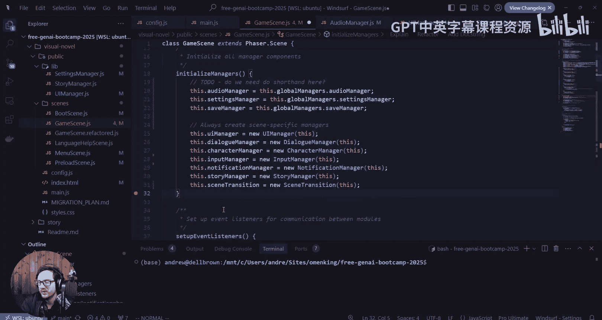

And down below here。We have save game， load game。 So we don't need these here。 This is pointless。嗯。

We have a bunch of audio ones here as well and settings update。

So I'm just again looking to see if there's anyone similar ones here。We took out language helps。

 So this one doesn't even exist anymore。 so we could take that out。

I'm not sure if we want to change that， open UI settings。嗯。😊，Maybe。Save game， load game。

 This is like the exact same thing， just in a different place。So this is repeated。

 It's a little bit city silly。 We have this auto mode， skip toggle mode。

 We don't have these implemented yet。 So I'm just gonna take these out。Right。

 we these are more specific to the game。 probably don't need them either。

 but we'll just leave that in。 And they'll probably get rid of our other air that we're having with the the manager。

 This， we have some kind of weird artifact here。Here we can see that we are。

Creating these down the road here。We don't need this anymore， we're not。

Going to play the audio there。 We don't need to。 The settings manager。

 I believe that is now part of our。Global scene， it is。 So we don't need to create it here。

 That would be pointless。The input manager is still over here。

 but I almost feel like that is a global service， but we'll find out as we go。

We have this load save state start game， okay。So， now we are。Starting to get somewhere here。

 I'm going to go and take a look at our game and see what we have。Well。

 we first got to stop this here， whoops。I don't even think the game are running right now。No。

 I don't think it's running it all H serve。 we'll just serve it again。

🎼Is this actually serving the right folder， It is not。 I'm not sure what happened we restarted。

 That's why。 Okay， so let's say H should be served。

 Hopefully it doesn't complain about being on the same port。 It does not。 That iss good。

 We'll go down。 Give us a nice refresh here。

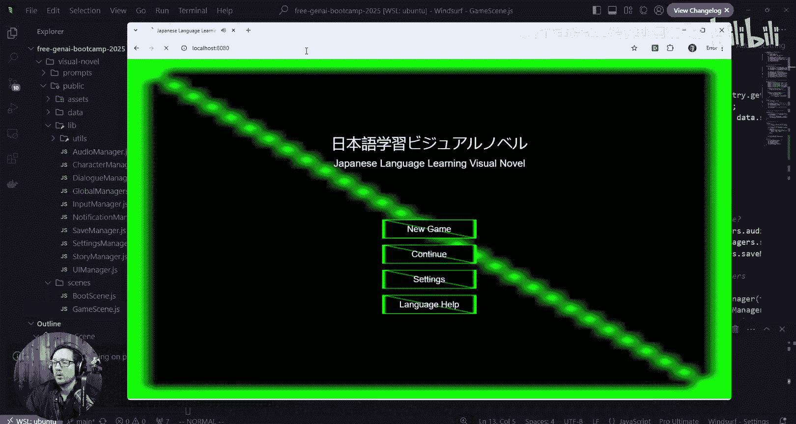

Inspect。Refresh， perfect errors。 All we have is errors。 Okay， so here we have undefined registry。

 undefined， right， So we go here。😊。

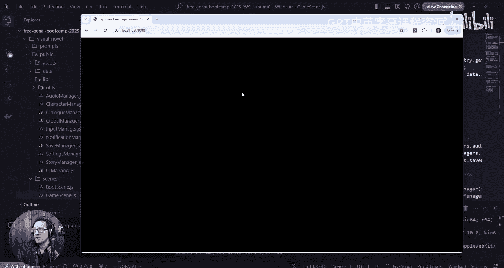

I don't know we need this registry thing， but this is what it decided to use this stockgame。

 registry Global managers。So we'll go here， maybe at this the point in time。

 it doesn't know what it is。

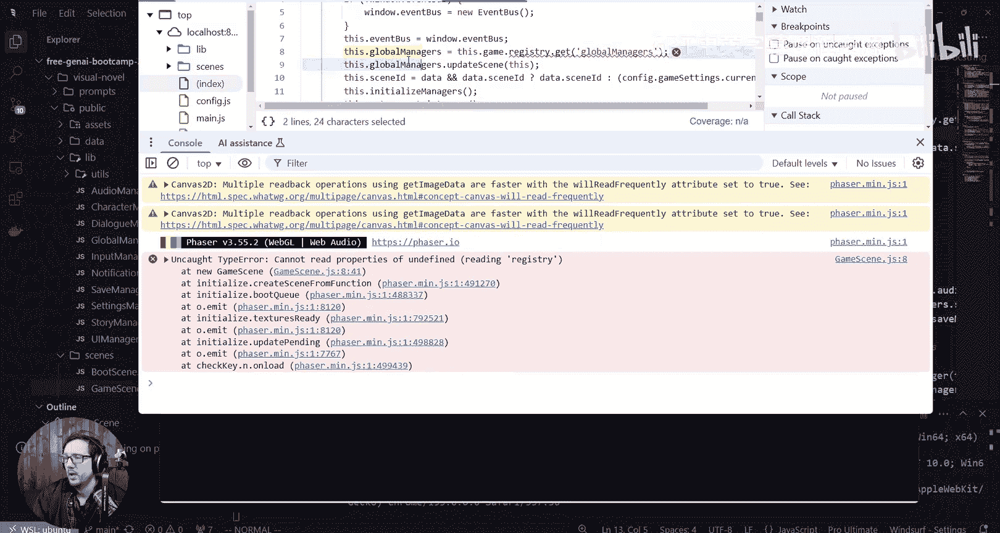

But I'm going to go ahead and ask。And see if it can work through that issue there。

We actually didn't grab the error。So'll go ahead and ask Seva and figure out what the problem is。

So it's thinking through the problem。 I think that was happening in our。Oh， in the game scene。

 that's a problem。Interesting。This is happening because you're trying to access the in the game constructor。

 but this this game is not available at this point。

 in phaseser scenes properties like this game are only initialized after the constructor runs。

 So let's fix the game by doing this。What did it do？They put it in the net。

Do we have an knit in here， I don't see a knit。Where。Where is this a knit function。Coming from。

Is this。Part of the life cycle of a sea。I think I actually shared the or say the link earlier。

 So lucky for me， I did do that。 So we'll go over to here。 yes， and it。 we'll open up this link here。

 I believe it had a graphic showing us the life cycle。😊。

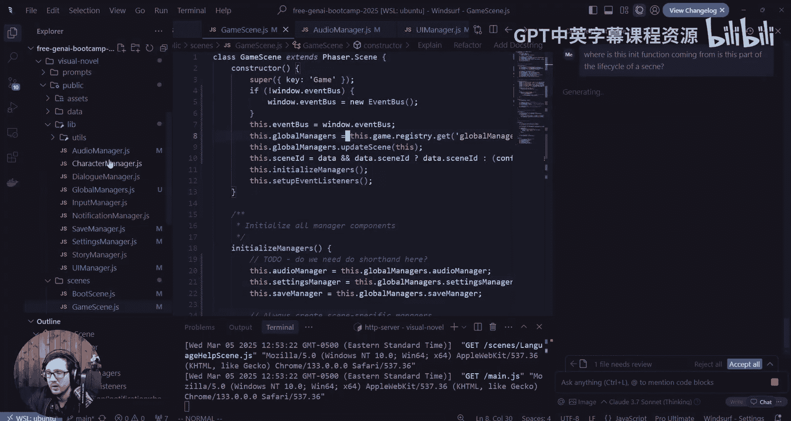

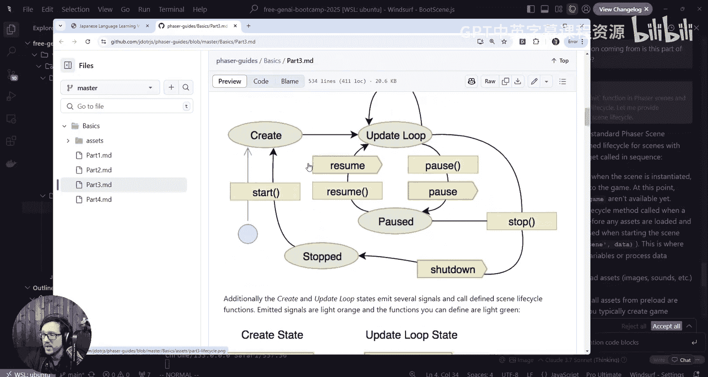

So we have ready and knit preload create。 So there is in it stage。I did not know that。嗯。

So we'll go back over to our game scene。And in here， will apply it。Okay， sure。And so now。

We should be in a niche scene here， here。 It's down here。

' sure why they put it all the way down here， but it's down here。 We know what these are。

 So I'm again， I'm just gonna take those out。 I don't need super verbo logging here。

Or a comment here， if they don't serve any purpose， let's just get rid of them。

We'll go back give this a nice refresh here， we are inner game。

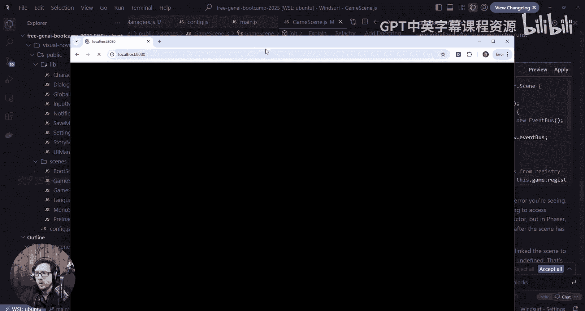

Oh too loud， too loud， why is it blasting？

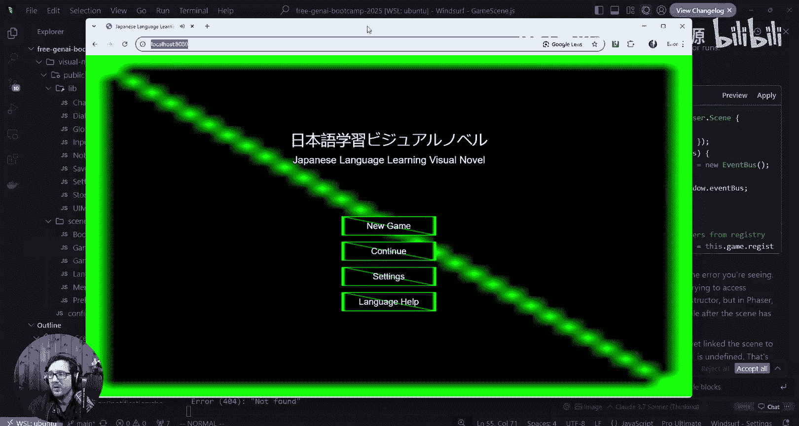

Well go to config here。 Let's go to background music。 Background music should be 0。1。

 It's like it's not even taking in account。 Now， I guess the thing is that it's supposed to load in the music at that point。

 right？ So if we go over to。What a pain about this is into the。Audio manager。

Whenn' it loaded in from here？Right， and so I don't want these defaults， it should always load it in。

Get the volume settings from the game config。Right， should it not do this。So。

 and it should always be defined。 There's no wage。 It shouldn't based on doing this。

I'd rather error out and say， hey， it doesn't exist than for us to get that blasting music。

And just so that I can be sure that again， this will say console log， this dot BGM。Music。

 I guess the other thing is that even though it sets it up。

It's not like it sets it to that volume level， right？Because。We play the music a here。Right。

And then here it sets it。 But like， how do we know that it's actually setting that volume level。

 So I'm gonna go look up play audio phaser。Because the audio is just insane here。嗯哼。😊，Mute。

Set volume。Set volume， right。

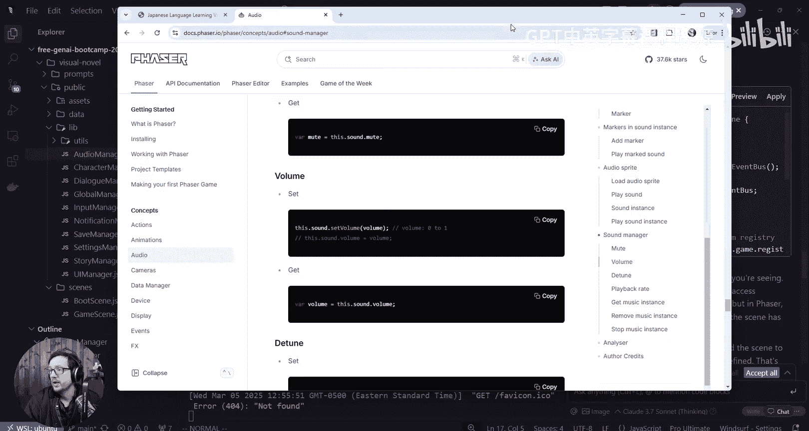

嗯。I think what I would do。Cause in here， I guess it would set， Yeah， here is hit as the volume。

 So config dot volume。 Otherwise this dot S SF X set volume。

 I'm not sure even sure why we have double of those。We have it here。Otherwise。

 grab it from the scene。 Well， which is it， right， Is it taking from the config or。You know。

 like which is the source of truth？嗯。To make it less confusing。

 I would probably just take these out like this。I mean。

 it's basically doing the exact same thing twice。 It's really silly。 That's。

 that's how it's doing it。But。If we go down to。This。Yeah。

 why don't we just do this a constant like that。Right or why don't we just assign that and not even have this middle step？

So here， a gad will just say constant。We just say volume。Volume。And then so this is volume like that。

And that's going to lead us to much better code， if background music。yeah， it exists at this point。

 So we don't need that there。 again， just simplifying the code。Making your lives a lot easier here。

Here， that's fine。 That's fine。 That's fine。 That's fine。Yeah。

 see in the this option play and it has volume。 So here we， it has config volume。

 which is not accurate。 What we want to grab here is the。The volume， the setting here， right。

 So we'll go by the way， we don't need a semicolon on there。

 But I'm just gonna do that for consistency。 We'll go up here。

 and I'm going to bring this in like this。Right， I don't even need to assign it。 I'll just go。

Grab it like that。And put it like that。 Okay， so there。I don't need it to do the key like that。

 Holold on。 let's go back for a second。What's the problem， why can't it just do that？

I'll just assign it to volume for now， I guess。And it'll get set that way。

 I'm not sure I was giving us some trouble there， but that should hopefully resolve our issue and also make our code a little bit less complicated。

 So you can see again， the code is a little bit of mess。 I don't like having these like this。

 I normally would reverse this in other way。 So he says if B G background is this and the music is playing。

 then do this。 I'm not going try to figure out what the logic we're going。

 But normally I like to do like a return like this。

 or in this case it be like return and then have them a separate lines。

 but we'll leave them alone for now。 And so I think that should resolve our blasting audio sound and it should load in the correct one because there's no chance that it can bring the incorrect one。

 right， hopefully that's the case。 but we never know。

 So I'm gonna go ahead and stop and restart this。 and then we're gonna go over to here I'm going to give this a hard refresh if I can find the page。

😊，Please don't be blasting， cover your ears folks。

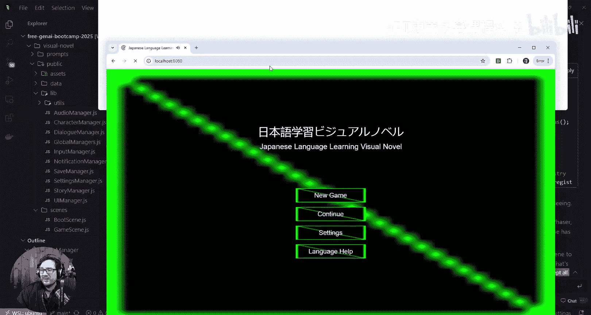

Well， we didn't get an error， but now we have an audio manager issue。 So we go here。

 and this is the global manager。 So we'll go over to this。 I'm not sure why this is now a problem。

That's on line 28。So，28。Jump。As saying new audio manager is not defined。 How is it not defined。

What do you mean， it's right here？

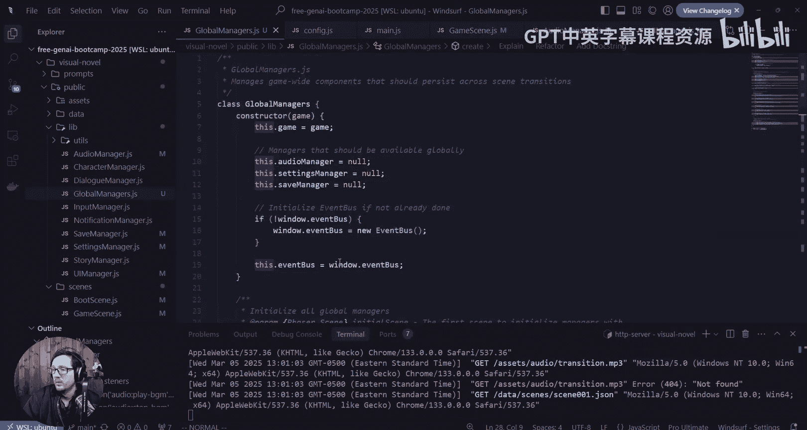

嗯。

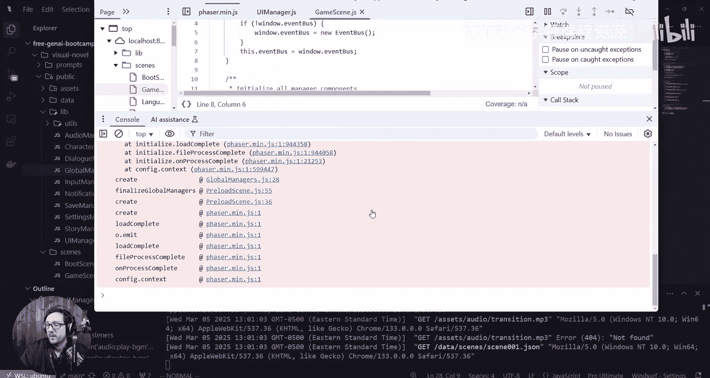

I， it worked fine just a moment ago。 It makes me think that there is maybe a different problem going on here。

What， what could be wrong， What could be wrong， I'm not sure what's wrong here。

 We'll go back down below here。 We'll give this a nice refresh。😊。

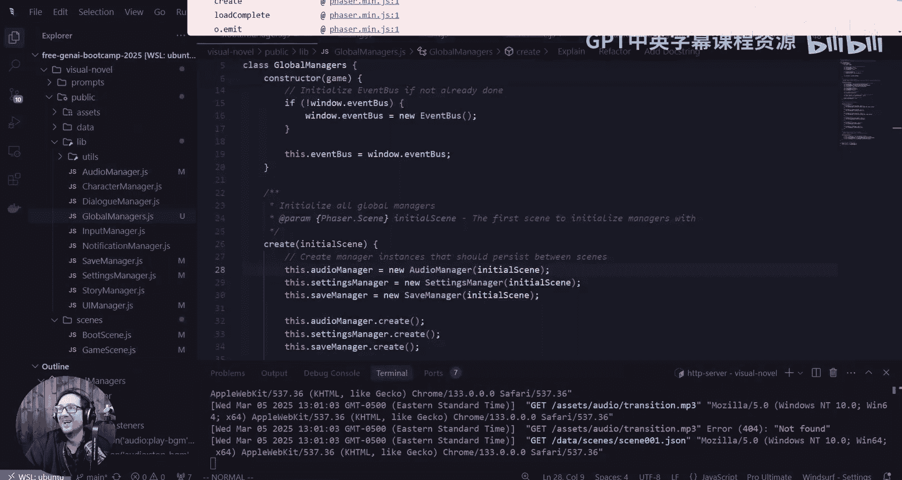

Audio manager is not defined。 I don't know what you're talking about。 It's right there。

So we go over to here。 and this is again， where we'll get a little bit of help because I don't understand it's。

 it's defined here。 The thing I can think of is like， it's not loaded in the index H T L。It is。

So let's say I missed like a curly or something。 Maybe it's broken。 I see the issue。Load before。 Oh。

 so we bring this down here。Right， this has to go last。Has to go less。

I'll just leave that alone there。 but that will resolve that issue there。 Okay。

 now we're obviously not using any kind of package manager。

 and there's a way that we could kind of roll this stuff up。 I don't care it。

 When I built the other game， this is exactly how I did it。 And it was fine。 It worked fine。

 So now we have our load screen here。 Audio manager still not defined。 Are you serious。

 We put it afterwards。It should。Exist now。 Did we stop and start this。

Stop and start audio managers up here。 Google managers down there。 this nice refresh here。嗯。Yes。

 still not defined。 I don't know what its problem is。So again。

 I'll go ahead and ask it to do this again。So the individual manager classes aren't， isn't that？

Did I， Did I not。Already fixed the order。Like， am I missing something here because it looks like this one's last。

 right？It didn't check。 It's just telling me that。 Yeah， the air is happening because the sequence。

 So you're right。 I apologize。 Yeah， yeah， yeah， The air is happening because。In the sequence。

 preload scene finalizes calling global managers and is trying to access it here。

Let me check your global Manager file， I see the issue the defensive coding changes I proposed earlier weren't implemented。

 let's try to modify the global manager's files differently。

 The simplest approach is to update the index HTML file to make sure the script order is correct。我i。

The utility modules， including event bus and gold management depends on it。

 are loaded after the managers。Okay， well。I mean， this one here， we'll bring these up here。Like this。

 I don't think that's the problem， but we'll go ahead and do that anyway。

I don't think we need a language help score， do we help soon。We might need to delete that out。

 but okay， so I've moved the scripts around a little bit。

 It's weird that we weren't getting errors before， but maybe we weren't getting where we thought we were before。

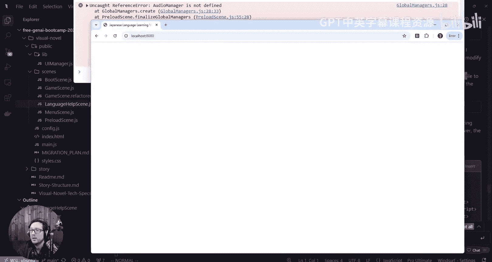

And still says audio manager not defined。 Wow， it really， really is getting annoying。

 Let's go in here。 says audio manager not defined。 It is defined。It's making me mad here， so。Like。

 are you sure it has to be？

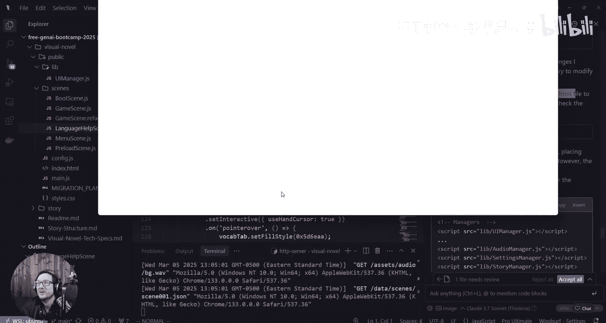

We fix the order。One thing we can do is we can look at the page。

 I'm going look at it directly and see its order。 Global managers， audio manager。

 if by click into this， Can I see it sources here。Audio manager， here it is。No。

 it makes me think that there's something wrong。 Look， we have a little error here。

 I'm not sure if that's our problem。Constant volume equals this parentheses， parentheses。No， to me。

 I think that there's something wrong。With the code， well we do have an error here for some reason。

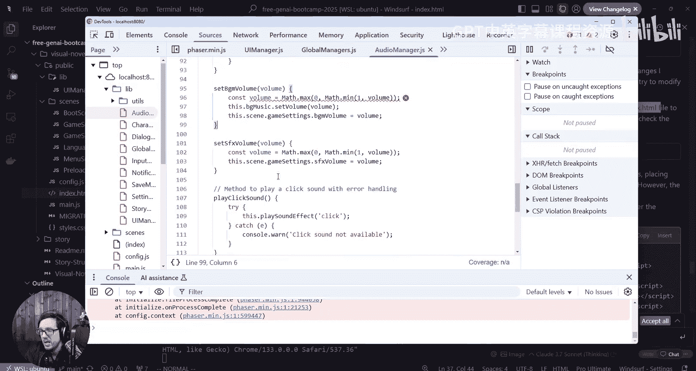

And we were working on that， right。 So now it， no， the， no。

 the problem has to be in the volume manager。Because the order of files is correct。没有。

And it's still happening。Check if there is a。So tax error。Breaking the class definition。 Okay。

 so that's what it has to be。But we did see that issue where like play around here or set。

Here is having issue。There are duplicate syntax errors。

 there are duplicate volume variables in the definition。Okay， where， where is their duplicates。U。

Why does that matter？A volume as a parameter。Where am I doing that？Yeah， sure about that。I don't。

 don't see the problem here。U。You know。Here。😔，What's different。Oh， it's up here。I see。Okay。Now。

 that doesn't mean that that's our problem。But I mean， it was showing an error there。

 so I would think。Right， that could be related。It's interesting here。 Like。

 it doesn't set it here It sets the volume on this， but it doesn't set it on our sound。

 But I guess we'll figure that out as we go here。 This is supposed to be just volume。Okay。

 so maybe that might have been no issue。 Sometimes you get like ghost errors。Like there's a problem。

 but it doesn't exactly tell you what the problem is。

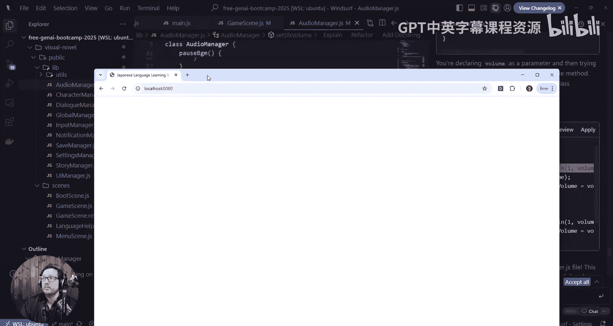

We'll get this a nice refresh here。Good， now s。Please don't be blasting。

It's still really freaking love。Why， why is it so loud？

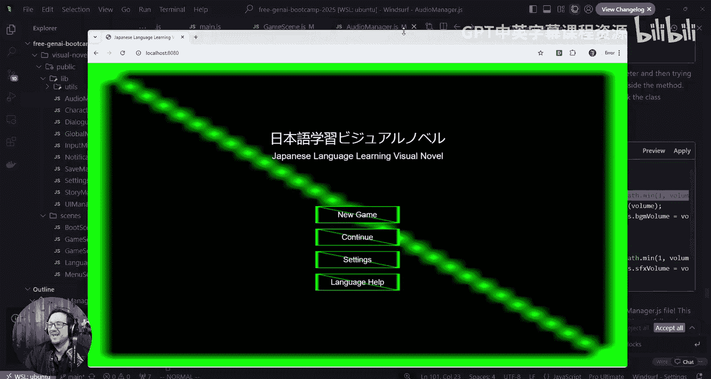

🎼I'm gonna to go back over to here。 I'm gonna go back over to here。

 almost felt like not even putting sound in because it's totally not worth all the struggle。

 But here we have this B G M volume。That's not right。Yeah， like here， here it is。

I was also referencing this one again。 What the heck。That doesn't exist， folks。

You're killing me here。 Okay， so。All right。Config。Here it is。 Yeah。 So this is the one。

That sets here， play sound effect。 So I guess it was never said in this one here。Oh。

 did we set it in the wrong one。 Yeah， this one's supposed to be F S FX。Okay。

 so now the B G volume is actually getting set being set here。 Yes， please fix that。

 I don't want any more BGM volume， B，GM volume。No， we don't do that。

 So update the volume and if the scene has them。What。U。I mean， we can do that。

 This is like more of an aggressive way of doing it because the idea， like I see。

 the other thing is like。And other ones， it depends like what you want to do。 So like。

 this is happy on every single frame。 So if the volume has changed。Then it would adjust it。

 so here it says。This game settings is not defined， then set it， right。

 updatedate the current music volume if it exists。And so， here。I don't know。

 This seems like junk to me。 So I'm gonna go ahead and just change this out here like that。Okay。

BGM volume。This dot， BGM。Volume， okay， so that should resolve a lot of our issues。

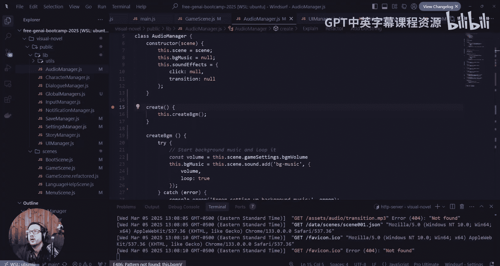

I'm gonna go stop and start this again。 I'm not sure if Ive have to stop it every time。

 but I'm doing that anyway。

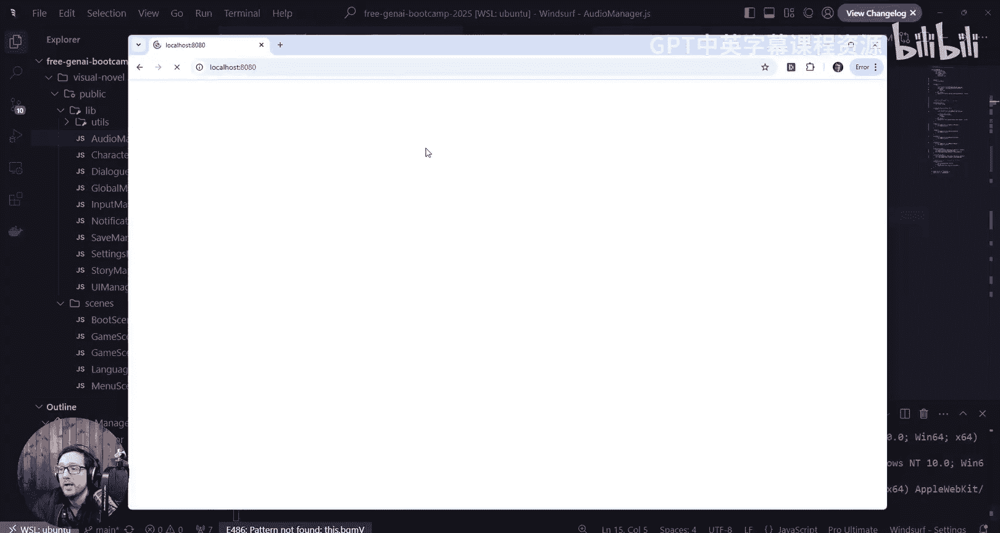

I don't hear anything， which is great。Like from the fact that my ears aren't being blown out here。

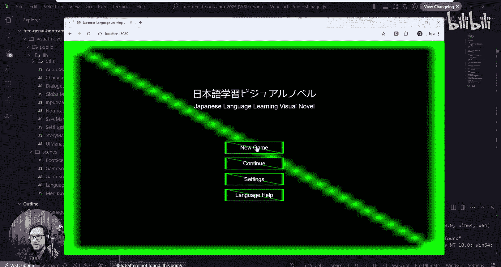

The click works。 So that's good。But now we don't have any audio。

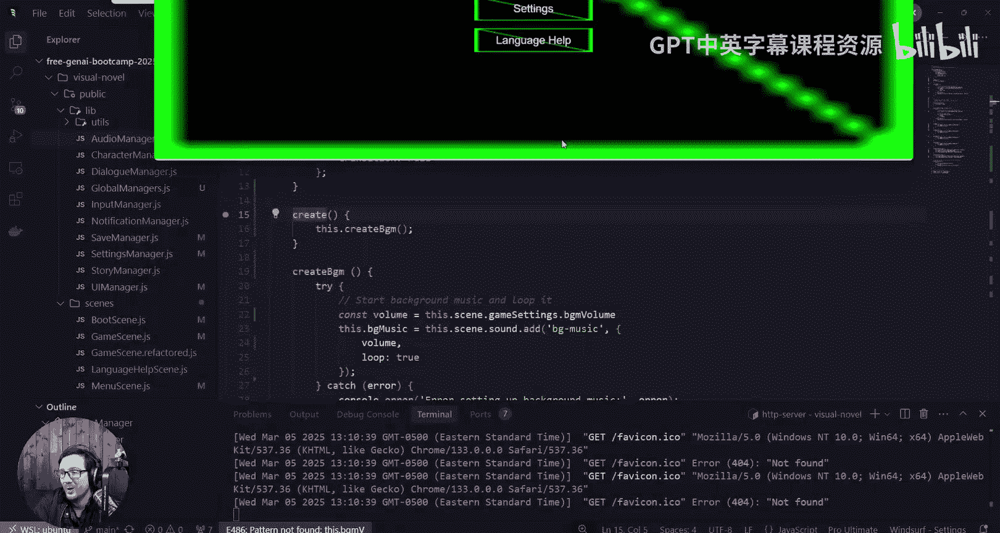

So， you know， my question is like， what is being said as the the volume model， So say console log。

BGM。Volume。Volume here。I'm going to go back here， give us a nice refresh here。

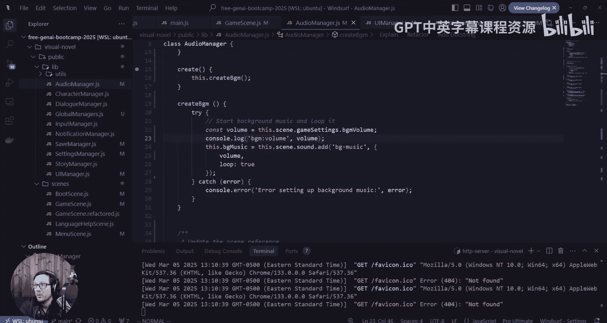

It loaded。 I don't see。Anything set here？Has an error。Cannot read properties that undeed BGM volume。

Yeah， sure about that。We'll go here in the left hand side， good workfig we have here。Game settings。

BGM volume。Right， so I go here。You're telling me that this doesn't exist。Okay。

 let's do a little bit more。 Let's be a little bit more aggressive。 This dot scene。Game settings。

And then we'll do this one like this。Normally， would it be like dot config。

 not just scene game settings， How do we know that the setting like there is settings that way。

So there was like another way， like this dot game。Why is it this dot scene， Maybe it is on the scene。

 I don't know。We'll go ahead and stop and restart this。 I don't really think we have to every time。

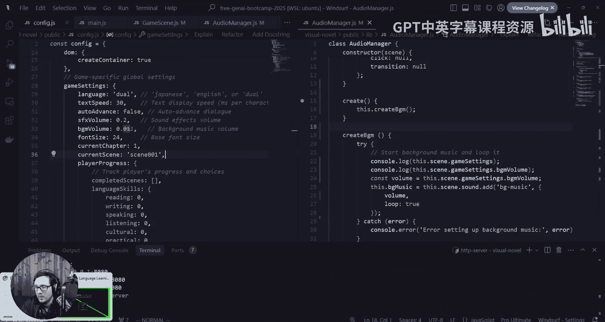

I'll bring this up here。It was a nice hard refresh。

And here。We have it undefied。So it doesn't know what they。 We also have a settings manager as well。

 So like。You know， should we be getting our settings from our settings manager。

 because that kind of makes more sense now that I'm talking about it out loud。

 So we'll go over to here into our settings manager。ItIt depends on what this thing actually does。

 right？ So this one here， we have our default settings。Haands game settings and preferences。

So we have English， so I've been doing dual。 we have the tech speed， the volume。

 which is different from our defaults here。So then why do we have those settings and those ones？

And then we got this one here。 this is our config， so。Like， is this something that we can set？

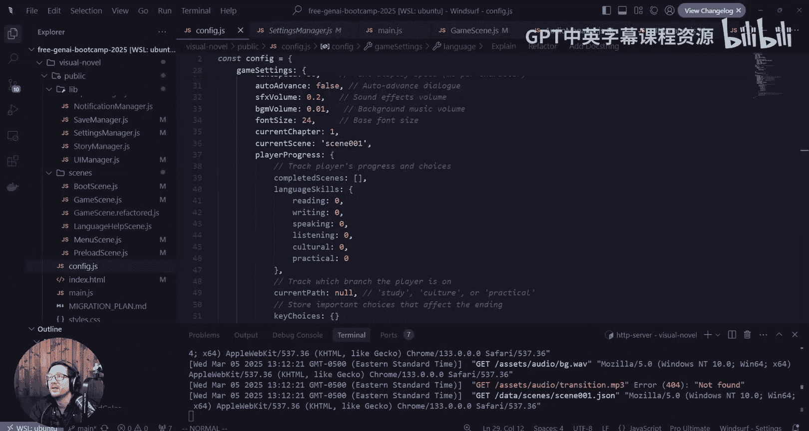

So we have even a deeper problem， which is our audio settings here。 So we over here。

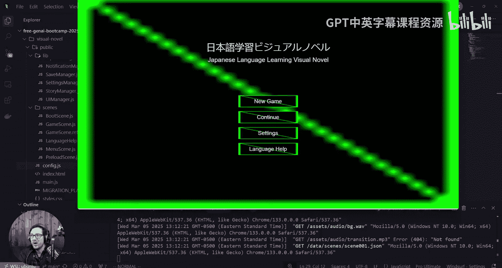

And we'll say config game game settings， phaser。Like is there any convention for this？So here。

 new config， the active game configurations for parse text game config。Mmhmm。😊，U。

I don't think this is anything special， I think it's just kind of like whatever。

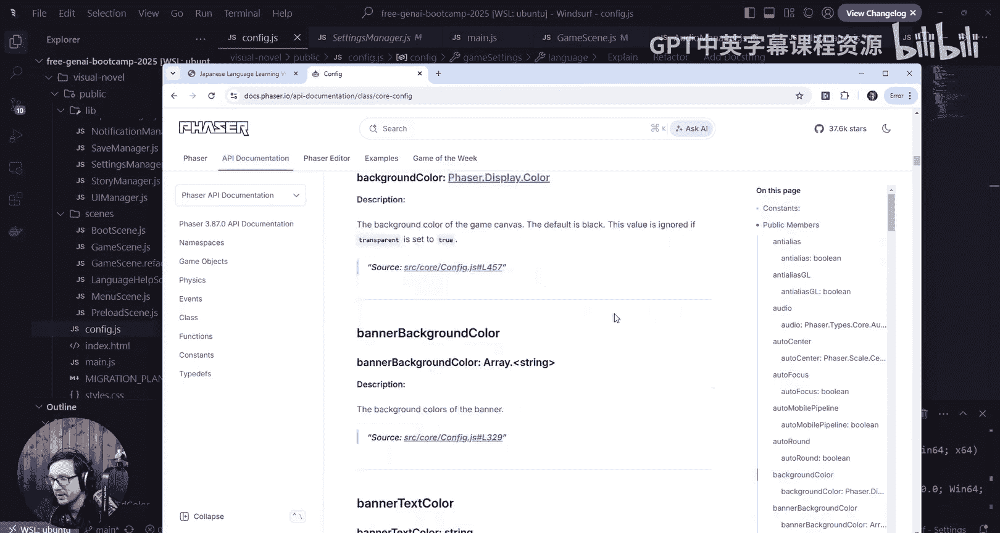

Yeah， I don't think there's any kind of built in thing here。Like， obviously， we have。

These settings here。嗯。

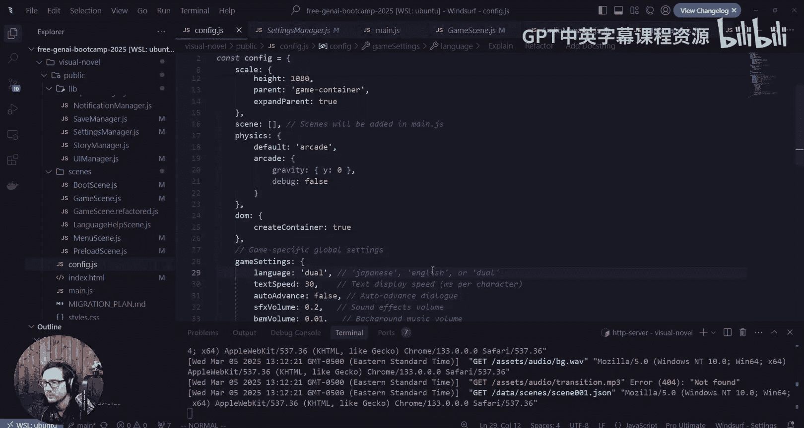

I'm just going to go ask。Is this game settings？A specific pattern。In phaseer。Or did we just。

Put our settings here。Right， cause I， I don't know。 I don't think that's a real thing。

 I think they just kind of threw them there。

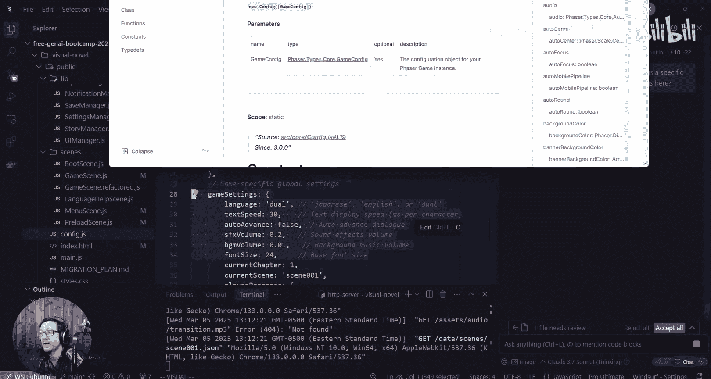

Willie Nelly。Pattern， yeah， it's not a specific pattern。

So this is where it doesn't make a whole lot of sense。

 So we really I've been changing these and we're loading them in， but this is not helping us out。

 This should really be in our our settings manager。 So I'm going to go over here。

 I'm going to go to our settings manager。Where that is， we're all over the place in this 1， a。

 And so we have default settings。 These are our default settings。Language， player progress。

 I don't need this player progress， as we are。Not doing that right now。And。I mean。

 there's some other settings here like typewriter effect and stuff like that。

 but we'll bring this on over。 So we need this。 This is gonna be dual。I'll be fine。

 We have speed text。 That's fine。 auto speed。We have auto advanced。

 I'm not sure if we're going to end up implementing all these options。auto speed。BG M 0，1。

Sound effect 0，2。 I probably bring this down to even like one。 It was it was pretty loud before。

Fauunt size is not in here。 So font size。24， we're getting door full screen。

 That's just not an option right now that we have。Typewriter effect。 sure， we'll have that for now。

Quick quick ski。Sure， I don't know if that is， but skip already read text。How do you do that？

But I don't， I don't understand that how you do that。 That doesn't make any sense。C scene。

Scenes there0 1， current chapter。 There we go。 Okay， so now we have our settings here。

 We're gonna rip this thing out of here。Right， becauseuse that didn't make any sense。

 Like we have arcadeic physics。 We're not even using any physics in this game。

 So I would probably just take this out of here。I don't think it would break anything。

 I'm just gonna comment it out because I don't think we are using any kind of physics。Right。

 right now， we're not making a platformer in any way。 so we don't need that。So now that we have that。

 the question is like。You know， what's the state of this。 You know， it's like。

 it doesn't matter what we do。 We have to understand all of our code， no matter what。

 So that's a bit frustrating。 that's just how it is。

They have a setting key to probably name the settings file。Update the scene。

 so apply current settings to the new scene if the game has been applied。Mmhmm。😊。

Do we need to do that。This dot settings。So I guess the idea is like。

 if you want to get the settings from there， it just depends like。

 how do you want to access these global managers， right。嗯。I don't know if that even makes sense。

 Loing settings， applyinging settings。I don't。 I don't think we have to call it like load， load。

 like settings， load settings。 We just call settings dot load settings dot save。

 I'm going change this to just be load。And this one's is gonna be saved。

 We don't need to be so darn verbose。It is saving the string somewhere。Apply current settings。

 I guess we do that apply。How is apply and load any different。From local storage。嗯。😊，Yeah， I guess。

 I guess that's where we'd have to store it right， because right now。

 there's no other way to store the settings of the game。

 We'd have to store it there because we don't have any server site implementation right now。

 And we might never have that。 So down below， we have apply。 So this do seen audio， full screen。

 we don't have a full screen option。Apply tech speed。 We don't need that。

 I feel like they can just reference them。Where they need them， right here。

 So that's where it was setting set to the B G volume。Which I guess it can do it that way。

 That's not how he would do it。 So I'm gonna take that out。 This function is completely useless。

Reset settings， not a bad idea。Save settings， well call save apply。So basically。

 it just says load in the default settings and then save it， right？Get setting。 there we go。

 So we have get it， get a setting。U。But， I mean， that would then just be get， right。

 So then we'd be like whatever it is settings dot get。And then we have an initial individual one。

 so let's just close an update。This will be save。We don't need to apply。

 That one's completely useless。We're not toggling full screen。

 that doesn't make sense for our browser base game。Setting create a settings panel U I。

 So this is specific for setting up the U I for panels。 This should not be in the manager。嗯。Yeah。

 I don't。 I don't think that this is where I would put it。Right。

 so I want to rip this code out for now。Because we have like the U I manager， right。

 But what does the U I manage。Right， because。You know， you have a scene and a scene has like have。

 you have a scene and scenes have you eyes。Right， so you might have multiple Us。

 And so maybe this is where you put something in another folder。

 I would call probably U Is over here， U eyess。Right， and this is where I would put my Us， right。

 So I'd go here and I'd have settings。 U I do Js， right， And that's what I would want to do。

 And so then in our， and I'll use the UI manager to manage things about that thing there。

 So we'll go over to our settings manager here。 And we can see we have a bunch of junk code。

 So if we go down below here。 we have this stuff here。 right， So so I'm going to go into this。

This isn't loaded anywhere。 So it doesn't really matter if I even make it valid。

 But you gonna go here and just call this class。Settings， UI。Here。Yeah。

 I will add a constructor for now。 But what I need to do is go down here。

 and I need to grab all this junk out of here。 So this crate panel。This high panel。

Don't even know what it does right now。And we will paste it in here for now。 Get that out of the way。

 This whole exports module thing is kind of uselesscause we are doing everything via the browser for now。

 but。This is now over here and out of the way。 So this is now way， way more simplified。Okay。

 it has load settings。 It's just going to be load。Should we load settings as soon as it initializes？

I don't know， Cause here also， it's saying， it's setting the current settings as the default， Right。

 So it sets it here， and then it loads it。 Why do we do that， Why don't we just load it once。

 And then we have our settings， right， So we have load settings here agains。 we have load。

We also have it here。 And this is also kind of redundant。 So I'm just gonna take that out。

 There's a lot of redundancy here that we don't need。It's fine that it's doing that。

 but really it should be doing the load here。嗯。So if there are no settings and load it。Yeah。

 so if save settings。Is there already setting saved？Load them。 Otherwise set the default， right。

 so we don't even need this。Right， and we don't need a load of here。 We can to have a guarantee。

 But I would rather do that isolate from here。 just in case we want to do that。

 So now the settings manager is， is really important over the audios。

 And this is why we're having some many issues because it wrote wrote so much junk code。

 It just seems like there's only so much it can do to figure out where to update code。

 But we'll go over to our boot scene。I'm just saying if there's anything in our bootsing that relies on our settings。

 I don't think it does。I'm just gonna accept all for now。 So we have less of a mess。

Great placeholderers。I think where I would do this is in the global manager。

 so if we go back to our global manager over here。嗯。

And now we could almost even have a folder called managers， right， I know we have the global manager。

 But if we wanted to make this a little bit more。Less of a mess。

 We might make a folder called managers and then keep global managers at the top just so that it's easier for us to navigate here。

 I'm going do that right now。 I'm gonna make a new folder and called managers。

And so I'm going grab all of these， not the global one。

 I'm just going to grab all the other ones here。 I'll bring that into the settings manager。

 We'll say move right Another question is like why isn't the save manager also part of the settings manager Because if your settings save things like current scene or is that separation from configuration and game state data right。

 So that might be some distinction we might want to make there and actually move that into the wrong folder？

 So we are just going to grab these here。I'm I'm a rubia。 so I'd like to minimize the names。

 And if I had everything in the folder I'd take out the word manager here。 But in some cases。

 it's good to have it。 Something another thing I might do is put manager in the front so that it would order order neatly。

 But again， that is just comes down to code crafting， right。

 like how you want your code to look like。 But now we have this a little bit organized a little bit differently。

 We're gonna to go over to here into our index Hl。 And I'm looking for my managers。

 I'm going to go ahead here and write。😊，Managers。 And then I'm gonna keep the global one here。

 And that gives it kind of a distinction that， you know that there's something different about it。

 right， There's a reason why we did that for a particular reason。

 So here we are creating these things here。 for the settings manager。

 It needs to appear before anything else。 It clearly is important， right。

We don't need to say that there。 And so we create our settings manager。 And right away。

 I wantan to do settings manager。嗯。Load， that's the first thing I want to do。

And we will take out the settings manager from here。 That doesn't make sense。

The other thing is like we're calling these like manager， manager manager。

 Whyt we just call it audio。 Why don't we call this one settings。 And why't we call this one， say。

 Because it's all like all of these things are managers。 We don't need to be super explicit here。

And so then this way。I could just say settings。Right like that。Audio save。Audio。Save， right。

 And so then。The management of these things become a lot easier， right， the same thing here。Audio。

Audio。Audio。 it's up to you。 But like， if you have to write a lot of your code。

 then it might make a little bit easier， save。Save。Audio。Settings。Save， same thing here。

And so now that is greatly reduced。 So now it's very clear。What's going on？ So first， we have to。

 you know， before， before anything else。We need to make sure we。We load our settings。

 because other managers。Rely on it。 Okay， so。That's the first thing we have to do。

Then we have audio and we have save。 So audio is going to set up our audio， obviously。

 and save is going to set up or save data， or it at least allows us to manage it， right。

 And this is just another way that we could do it。 Like we could do all like initialize and create separately。

 But I'm just gonna do it this way。😊，And so。That is different， right。

 We probably broke our audio manager because I changed some of the code here。T type in manager here。

 manager。No apparently do。Ppparently it's fight。 Oh， because it's still doing this。

 this weird game settings issue， right。The other thing is like。

 we have this global manager and we're going have to keep referencing like this global manager was kind of annoying。

I guess it's not a big deal。But right now， we have this audio manager。And well well， first of all。

 let's go back to our scene because I believe in our scene。We。Maybe not at a preload。

Did we play music and preload game global managers create here？No， no。 It's in our menu。

 This is where we start playing music， right。Yeah， here。 So now this is just audio。

 global managerss audio。So my question is like， you know， would it be nice to just call this like G。

 G manager or something。G managers or something like that。 because then， again。

 if you have to type this constantly， it just becomes a bit of a headache。

Or we could even call something like underscore G。 Sometimes that just indicates that it's global。

 right。You have to decide if you want to do short short short keys like that or not。

 But here it loads in the global managers。 And so we're able to utilize it。

 I think I'm going to go with the shorthand G。And that way， I know that it's。

 it's referencing to global managers。Okay， because if we have to keep calling it。

 it's gonna be kind of a bit of a headache。 And I'd rather just do dot G on every。

 on everything here。So now we have a way of referencing our， the managers here， right。

Down below here， we have start new game。 And so here it is setting up the settings。

 That makes sense if we are starting a new game。 That totally makes sense。

But this is not setting the settings for the game。 It's setting it for the save state， right。

 so we are going to clear this out for now。Right。So right now， I want。

 all I want to see is that it's going to load in the audio and not blair in our ears the wrong stuff。

 I'm going to go over to our audio manager。Cause that's still not loading in the correct audio。

 right。And。We'll go into here audioud Manager。So here it's going this dot seen dot game settings。

 So that's not what it is。What it is now is it is this dot G。And then it is settings。Get。Like this。

Okay。If we really wanted to， we could create methods to to grab those。

 but I'm not really worried about that right now。So here， that's how we are grabbing the sound。

 I'm going to go and say console log。Volume。So， I'm hoping。I'm not sure why that why。

 why I want to print that out。Totop being goofy here。 Okay， and so I'm hoping that that。

 that works as expected。So we're going go ahead and stop it。 start it。

 There might be some other calls to settings， but then that will resolve our。

 our initial issue there。 We'll give this nice refresh。 Please don't blur my ears。

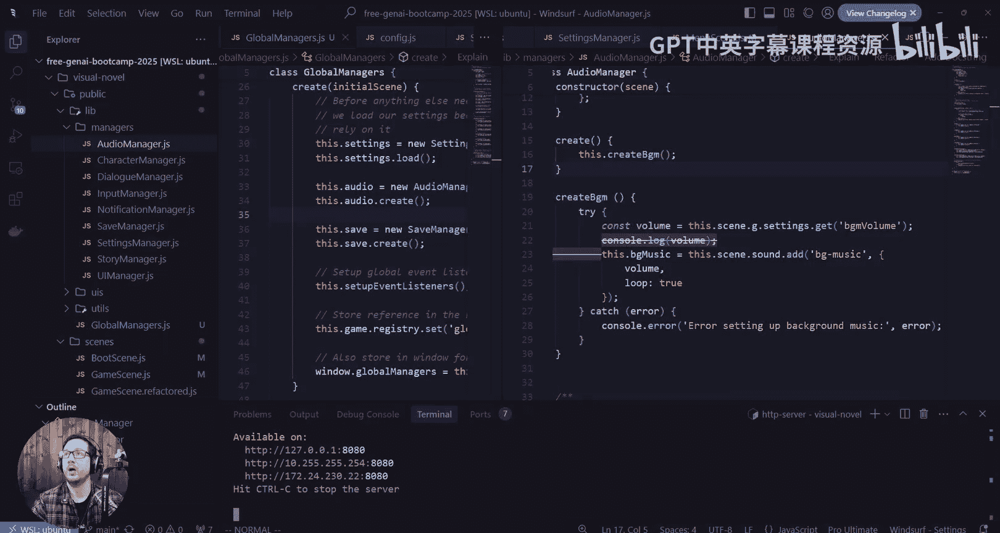

No blaring music， which is nice。 But we go over to here and says undefined readings of settings。

 So doesn't know what G dot settings is。 The question doesn't even know what G is。

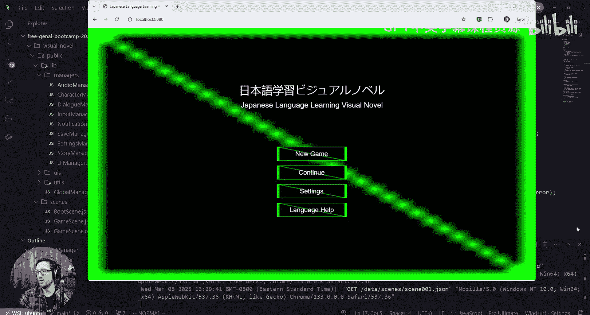

So because we did set it in our menu， right， If we go back over a menu。Here。

We go all the way to the top。You see that we set G。Like this， right。

 So there clearly is something here。 Also， we have like default game settings up here。

 just defaults all over the place that we do not need that are completely useless。So at this point。

 it should know what it is as update scene。 I'm not sure。Oh， right。 That is a call on it。

 That's right。What is that updated with， Let's go back into our little managers。Update scene。啊哈。

And that's a function here update scene。Oh， like the reference to it so that when we call this dot scene。

 it takes effect within the audio manager。Interesting。嗯。Do we need to do that？Because， like。

This thing is trying to reference other managers， right？ So wouldn't we just set the manager in here。

Scene， scene， scene， what are we using scene for in here？Game settings。 Yeah。

 that doesn't even make any sense。 We don't really need to set scene in here。 This。

 this is kind of silly。What we should for our managers is they should all take the global manager。

 that's for sure。We'll go back over to our menu here。Into our update， we'll take this out of here。

 We don't need that。 But when we actually define these things， we should actually。

Give it a reference to， to the global manager。 So here says initial scene。 We don't need that。

 We don't never need to know what the initial scene is。 We do need to know。

 We do need a reference to this。Right， and。That way in here we can then set。see global manager。

Global manager。And then this would be global managers。AndThis will just be G。

 And so now we can reference that in any of our， our things。 And so that makes a lot more sense。

 So that's the audio 1。 We also have one for settings， right。

That was the one that we were specifically working on。And then we also have the one that is our。

Audio 1。 is that what it was， It is that one set。Save manager， save manager。

 which we we haven't done anything with yet。 So we'll go ahead and take this and put that there if we need。

 if we need it， which we will。At some point， I think， so we'll go ahead global managers。

And we'll take out this。 this is completely useless。I don't even know what's going on in this one。

 Do we have scene stuff in here， Yeah， so this should just be G。Yeah。

 this is it's trying to save the game data too， which is not correct。嗯。Right， so here again。

 we just want to anywhere。 Yeah， see it's just referencing other。 Well， here it's point a sound。

 which is not correct。You know， this will be it to do， to do。Excuse。😔，Are you manager up。Now。

 the camera might be something that the sea needs。But。If these are transitions。

 shouldn't this be in the transition manager， right？ See， it's just made a mess of our code。

 So I'm expecting some errors there。 That's totally fine。

 Global manager is starting to shape up in the way that I want to use it。嗯。

So let's just stop and start again， I'm expecting this toarrow out。

 but I just can't think about what to do next。 And so whenever I can't think of something。

 I just go run and I just watch it break。 and I just try to get something in front of me。

 So give this a nice refresh here。 And we have global managers is not defined。

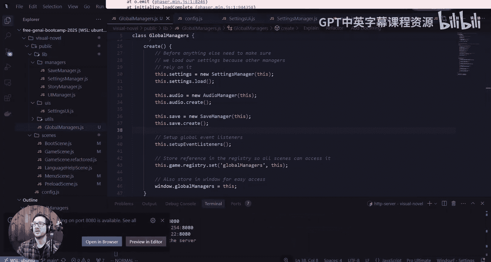

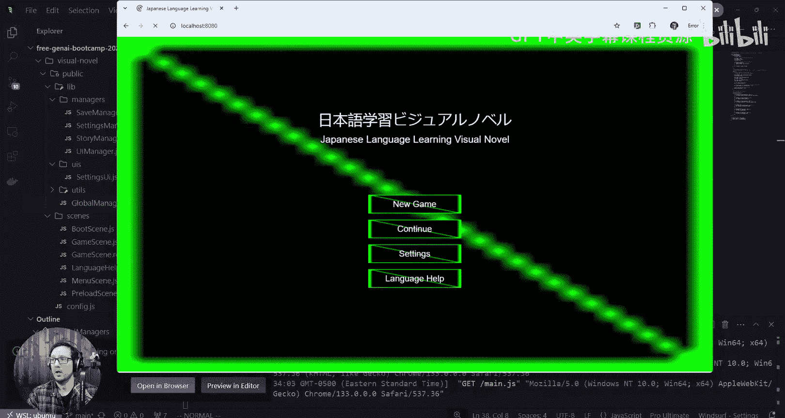

Under the settings manager。 Well， that's fair enough because we did not pass it in correctly。

 So we'll go into our settings manager。 No now I'm basically off the LM。

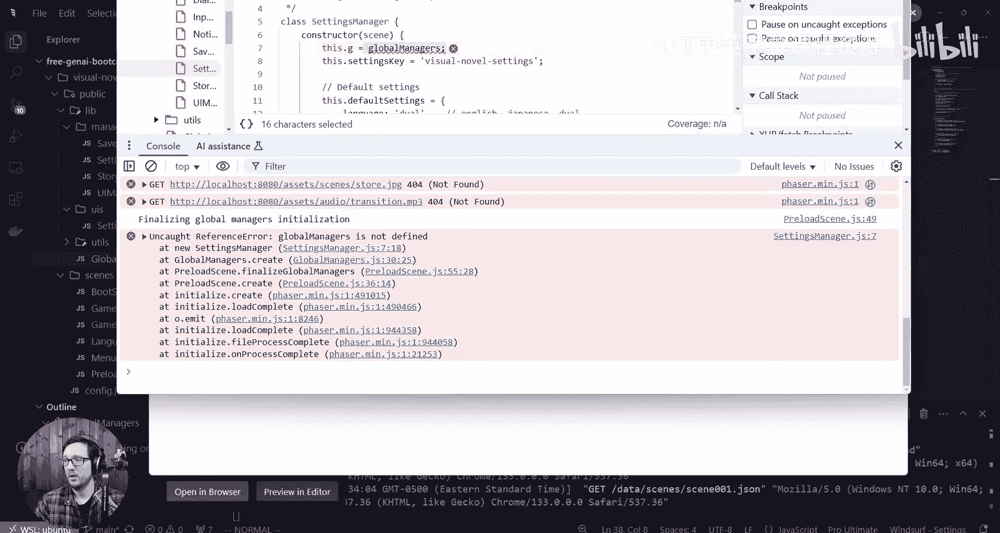

People say they're making full games out of this thing。 I just think it's boney。 Let's say。

 record an entire video ended end。 I do not believe them。You know theyre oh。

 we're making full games and then yeah， right。

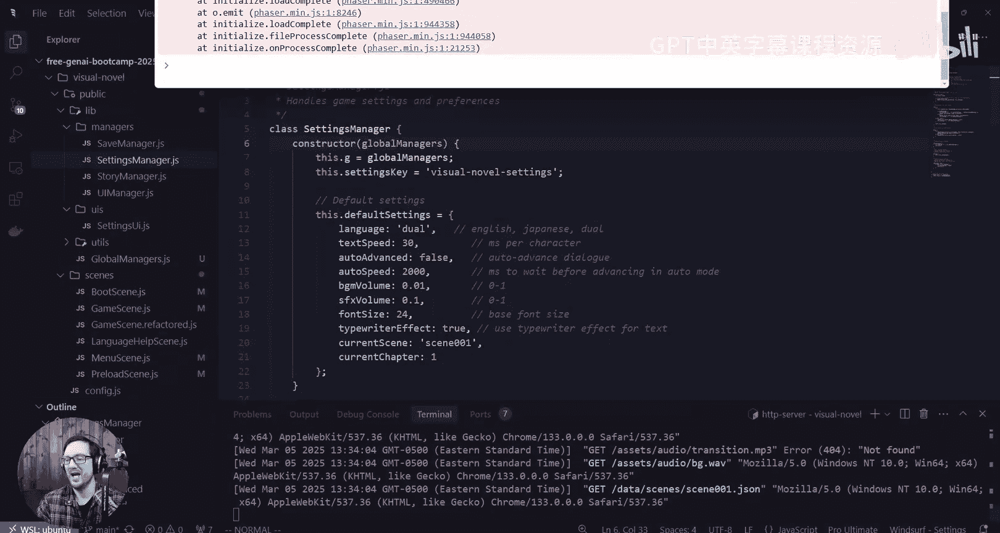

You're making viral videos。 That's what you're doing。 Okay， so we'll go over to here。

 give us a nice refresh here。😊。

No audio still。 that's fine。 New error。 That's totally fine。 What do we have now， undefined audio G。

 Yeah， I see that problem here。 Aud manager line 21 audio manager。

Line 21 G。And with's the G here， that's fine。Here， this makes sense because we'd add it to the scene。

 right。嗯。But here's my question。 If we add the sound to the scene and it's between。Sces。

 how does that work？Okay， so this is a question I have。If we add a sound to a scene， how。

How would it work in。How would it carry over。Andto another scene in Frser。Are normally seen specific。

 right， and don't automatically carry over when you transition when you， when you switch screens。

 the previous scene is either shut down or put to sleep。

Which means any sounds playing in that scene will stop。

 There are several approach to this global Sam manager， which you have。

 Your current approach is to use the audio manager。 creative manager exists the sound outside of it。

 This works because the gold manager instance persists the scenes。

 but you currently have an issue because the sound is still created within a specific scene。

 Sound controller scene。 Another approach is to create a dedicated scene that runs parallel in game scenes。

 Oh， that's a mess。Okay， so for now， I think what's going happen。And I don't care。 It's totally fine。

But we'll just have to set the background music each time when we create it。

 The only problem is that it sets it up here initially， says create the music， right。

 part of that scene。So this is where we have a little bit of a challenge。

Where maybe we should have a separate scene。 Maybe that should be our approach to manage the sounds。

 at least for our transitions between scenes， but。You knowHow often are we going between the main menu？

The main menu here and this one and normally main menus will have different music from the other one。

 So maybe we should actually just have a separate separate music for for that particular one。

We have G sound dot add。Well， sorry， it has to be seen， right， seen。So and then here。

 we do have to pass and sing。Okay， and so now we're finding our dependency on scene。Which is fine。

And so we don't need this function。 This one silly。This one is still wrong。

 We're not worried about that right now。 I'm just looking for where this is so that when I do this。嗯。

Play the sound here。啊啊。Hm。Good question。Good， good good question， though。

 So now I'm a bit confused because I'm not confused。

 but I'm just like confused in terms of how I want to implement it。Because here where the scene is。

I just took out that update function。 But every time wed load a scene。

 we would have to tell it to give a reference to the scene so that it does it。

 So maybe we need to go back there and and bring in that function I just delete。

 which is called update scene。Right， and then in here， where we had the this， where we had that。

 we'll help to bring that back in like that。 There's really no way around it。Yeah。

 that's just going to be what it is。Okay， but now we're kind of driving towards something that we want。

 but we do need to update the scene。So in our。UI manager or sorry， our menu screen here。Mnu scene。

When it starts up， we have to。Set it。 So we have to say this dot G audio。Update seeing this。

 This is something we have to do。 We don't have a choice。That's fine。

 Like we don't need to refactor it。 A lot of folks might try to like abstract it out。

 so you don't have to see it。 but there's so little code going in here。 It's not that big of a deal。

 We don't have to go overboard here。 We're gonna give this a nice refresh here。

 I do want to stop the video soon because I don't want to have a big video， and then it fails。

 and I lose it。

But here， I just want to get a little bit farther。 Maybe get the audio plane， then we'll stop here。

 So it says this dot sound can read。 This is this dot scene dot sound。

So at this point， it doesn't。 It can't create the background music。

 So I don't know why because at this point。It should update。This menu scene with this， right。

 So we go here， we say。What the heckx at doing。 No， no， no， no， no。 I don't know you're doing。

Don't do that。 We have this G dot audio update scene。And here we grab it from the registry here。

 we set it here。And then over here， we end up playing it， right， So we could even。

 we could even just group these together。 So our lives a little bit easier。

 We can see exactly what we're doing。 But this point in time， it should know what this is。

 And we do console do log here。 This should give us the scene back。Xin。This， right。

So we'll give us a nice refresh here again。Maybe will stop it。

 just make sure that it actually is refreshing。 It should sort about the latest one。

Okay。

And those here returns the scene。 So no problem here。But then over here， it says。

 cannot read properties un definedfin。Sund。So this is kind of like a race case where it is trying to play the sound before it's created because this is something that。

。

Javascript just naturally does。And so it could just be the phases into which we， we're doing this。

 right。

So maybe what I would do。As I'll do it in the in over here。

 and then then we'll have less of an issue。 Probably possibly。 We get some nice refresh here。

Okay， I got just stop it。 make sure that it actually， again。

 I don't know if I need to stop it or not。

And again， it just refuses。Undefined reading sound。Yeah， and drugs here。 Like， it is definitely。

Set because we said it in the update manager here。 Up scene that scene scene right there。

What's your problem。

Yeah， what's your problem。 I don't understand。 So we'll go back over to here。 We'll go ask。

We'll give this a second here。Here it's saying this is because youve changed the audio manager Conor to take a global management instance of scene。

 but you're still trying to access this dots。 sound。A。Okay。

 so let's take a look at our audio manager。 Maybe it's a very obvious issue。

 We go all the way to top here。This is fine。 They set initial an empty one right now。

 So initialize it。 Maybe， I mean， that could be the problem， but I don't think it is。If it works。

 I don't care， I'll take it。That's all they did。Right， so we'll go here。

And we'll go back over to here。Freshes。Yeah， that that didn't do。 that did nothing。

呃。That did nothing。啊。Well， then make it clear what you would need me to change then， please。

You have already an update scene method， but there's still problem with the Cate BG BGm。 it's called。

 Let's fix it。Which is what。What do you mean。

Oh， don't call it here。A， I see。Yeah， that makes sense In the globals manager。

 we can't we can't actually create it there， right。Yep， so we'll take that out。

That actually makes sense now yep。So that's nice。 Like it's nice to find problems。

 but and it does nice that I wrote all this code。 I don't mind working my way back through this。

 even though it's a bit of a mess。 But you know， it's debatable if I just wrote it from scratch and stepped through which one would have been faster。

 So now we'll just go ahead and take out the audio here。

 This save might break because it's not fully set up。 Let's go back here and take a look to our code。

😊，Nice refresh here。

Right， we'll go here。

嗯。Xin。No safe savings found。No error。No audio， though。 So we're getting closer。Right， so here， well。

 we， we don't load the， the sound。 we don't create the background sound。 That's fine。 So now we have。

 now we have to individually do it。Until unlessless we want to manage it another way。

But here it has play。 And so it can't play something if it doesn't exist。Right。

 so now I'm going to take this update C， I'm going to move it here。We' going say this dot G audio。

Create BGM。 And then I'm just play it like this。Okay， hopefully that there's no race case issue here。

 but we'll find out here in a moment。There we go。🎼Okay， now we'll solve the video here。

 but we finally fixed it。 And so we've finally untangled the mess。 That is this。

 But you know I'm glad that this is starting to work out。

 but obviously we're going have to keep stepping through the code。 And we're seeing that， you know。

 the larger the code base and the more changes across it。

 It doesn't matter if you have the smartest model it's going to make a mess of things。

 And so you have to really。😊，Maybe there's two ways it's like you make a mess and you clean it up or you have to step through each part and act as a pair programmer it depends on your approach to coding you can see that I'm obviously more confident making having a mess and cleaning it up。

 but yeah， we'll see you in the next one。

