# ExamPro《生成式AI训练营｜Free GenAI Bootcamp》中英字幕（deepseek - P61：-61-Visual Novel UI Manager and EventBus.zh_en - GPT中英字幕课程资源 - BV1SFEWzLEab

Hey， folks， I'm back。 And I guess I could put a little bit of light on here。 It just was blinding me。

 I to adjust now that's not going。 I'm just gonna to keep the lights off。 It's not a big deal。

 I'm just gonna make my head smaller so that the audio quality is not as bad。y。

 I'll zoom in for fun and ring this up a little bit here。😊，I'm sure nobody cares about this。

 but I'm gonna do that anyway， and。There we go。Tiny， tiny and in the corner anyway。

 so finally we got the audio to respect the settings and obviously there it would be cool to have a separate scene to manage the audio where where we need seamless transitions。

 but now that we I think have settings in audio kind of not necessarily the sound effects， but the。

The what do he called the。The mamam mumm。The anyway， we got to work on save， right。

 So save is gonna to save the state state data， which is separate from settings。Right。

 settings is the configuration of the gate。Save。Is the state of the game Right now。

 the only thing to store is where you last left off， right， real， like。

 what scene were you on and in particular， it could even be like。

 what state of the scene were you in。So。I guess that's what we need to save。

 So let's go over to our save settings。Save manager here。 And so in here we have load。

 we have save with load game， no no UI。 we have the UI manager saying like show notification to show that it was saved or whatever。

 but that UI manager is not even properly implemented or fully implemented right now。

 so we'll have to see here。嗯。This。It says saveve the current game state to local storage。

 which is fine， but that's not what it does。Let's go take a look at our settings。A managerana。

 because I'm wondering if does it even save it to。Local storage， when we make changes。Its， look here。

Save， there's a save right here。So we already have the save right here， right？Get update。

 And it saves it after each key。 So right now， our settings manager。Saving settings， which is fine。

 But I think that we really want to separate this out into。Its own kind of action。

You have load game state， save game， load game。啊哈啊哈。😊，Add a visual transition this。

I guess it really depends like。I mean， we have this here。

But it it depends on like what we want it to do because the thing is。

 is that if we were to save and load， we could take this code and we could put it into our event calls because then we could separate out of here。

 I don't feel like this code belongs in here， right， has save data Yeah， a bunch of stuff in here。

 So I kind of feel like I want to mirror the settings， the settings page。

 But the difference is that it's going to just save in a different location。

 So we'll go over to here。 and it won't have like update key because it will just update everything in one go。

I think anyway。 So in here， we have our Google manager。 We have our save key， which is fine。

 You can see， oh， yeah， they're different。 That makes sense。 We don't need to create。

 There's nothing to do in the cr。 So we'll just take that out of here。Do we need to update the scene。

 I don't know。 Let's take a look at the scene。 It will need for the transition。So for this。

 but that shouldn't be in here， right， And same with this， This shouldn't be in here。

 This stuff here will be for the save。 So I'm going to go over to our global settings。

 our globals managers here。And。Under here， we have。Save game。Right。

 where it's go save and then save game。So we'll do a save， save， right， save， save， load， load。Right。

I'd probably call the saves and not just save。Go ahead and fix that。 So call it saves。Saves， y。

 that's good。 There's nothing to create。 So we'll go down here and we'll do this one。

 and we'll do this one。 Okay， so now those are adjusted as such。

 I'm not sure why if we have data dot slot。 not sure what's going on there。

 I guess if there was slots to save， and that kind of makes sense。

But I'm going to go to the top here。嗯。No， no， not the top。 I'm going to grab out our transition code。

 So it's this that we want to cut out。Okay， and then we want to bring it in。Over to here。Okay。

 so I'm gonna paste that right into here。And we'll bring this on up like this and we'll indent it。

And so I'm not sure， I don't think there are any errors here， but that's fine。 Yep。

 seem like there might have been some errors， but I don't think there is。 So now we have that。

 And then we have a notification。So， you know， we might want to。Show that as well。

Not exactly sure how those notifications work right now， but we'll go ahead and cut this out。

I'm going to bring this in over to here。And。That's now out of here， Right。

 So this is now way simplified。 This is now just load。And this one is。Save。And。

This one here is load game。 Y， and this one over here is save game。 So here。

We're just going to cut this out。And we're going to paste this in here like that。 Okay。

 so we have game， save game state。嗯。Which we don't need， like， it's just load and save data。

 So we have some redundancies here。I don't know if we need a notification like that。Bound。

 I don't think we need that。 that's kind of useless。And this is kind of useless。

I don't know if we even use that have save state。 have save state。 No， we don't。

 So we'll take that out as well， right， So now we just have save and load。But I'm。

 I'm just gonna delete these out as well， because these are now our save and load functions。

 So we have save。And load。Okay。And I'm going to go back over to our settings page here。

And let's take a look at what we have。 So， I mean， these functions should basically work the same way。

 If I go ahead and copy this。Right， and。嗯。😊，Yeah， pretty much the same way。 Yeah。

 so go ahead and we'll paste this in like this。And so now the only thing is like load， save data。

Right， save data here。 And now we just close this stuff out。

 I don't think we use scene anywhere in here， but let's take a look scene。 Yeah。

 we're not using scene anywhere in here。So here it save settings。The only thing is that we are。

 it has this dot settings key， which makes sense。 Local storage get。It says save settings。

 I'm just going to call this to。Saaved data。Just so that it's very clear。Save data， y， save data。

There is no。Default settings。嗯。😊，The saw default， save。And here this would be currency。Y。

 we have current scene， current chapter。And then there， there'd be like the state within the scene。

 And this would be。What do we call it in the thing。Might be dialogue， current dialogue。Right。

 so we have that。 then we'll probably have some choices that we make in certain chapters and stuff like that。

 So that might be important。 But for now， these are our settings that we have， right。

 because then like there will probably like choices and stuff。 But we we're not there yet。

 So we'll go back over to here and。I want to call this says Se key。Safe key。

 I will call the safe key。Sa机。Save data。Defa save。s， no， no， that was right。 This not save。

This to save data， right？It's fine，We'm going to just go up here。 this do。

 This dot save equals null for now。Right， can also just call this dot save data。 But in here。

 we load our save data and still saying settings， which is kind of annoying here。 Oh。

 that's the load， okay。It's a bit hard to see what I'm doing as it's updating so quickly。

But is doing a good job。Okay。And so。Yeah， same thing there， yep。Yeah。

 local storage set item this this do save key there。 And so now we are setting our save data。

 So very straightforward。I a few thoughts here is like。

 well maybe we should worry about that later on， but we will need to store in the choices that we make。

 right， but we don't have any choices right now。 So we're going to just kind of ignore that。

 But if there is stuff that we have to store， it's going to go into here。

 So this thing is really simple and straightforward。 And so if we go back into our。What is it our。

Game menu scene， our menu scene has a button that allows us to start a new game， right？

And so if we go down to here。We're not doing that here。 The other thing is like， do we have slots。

Right， so that might be something we might want to store is slot information。

I'm not sure how much we can store in local storage， I think quite a bit。

 and our data structure is quite small， so we might want to specify what slot we're saving in。嗯。

So I'm just thinking about this for a second。Because a lot of the times these games allow you to jump around。

 right？And so I'm going to go back over to our。Save manager。And。It says default save information。

 that's right， building that's missing here is the slot information。

So where would we place the slot in because this this not save the current one。嗯哼哼哼。😊，Yeah。

 I'm trying to decide here。Trying to side here。And I mean。

 because we're going to manually save the game when we choose it。

 it's not like it's just going to save in place。嗯。Okay， so I， I'm not， I。

 I'm kind of blanking on this one。 but I'm gonna go here and just say like， we need it。

 we need our save manager。To allow us。To choose a slot to save to。Okay。

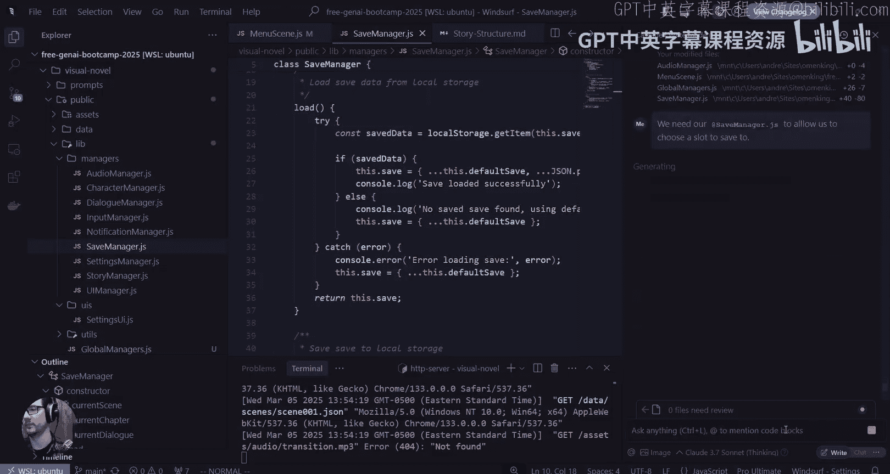

Hopefully it doesn't。 I don't regret it changes here。

 but we can always just say don't change it and just roll it back here。 after this， I'll。

 I'll do a commit。 I don't want to lose all the stuff It did an hour ago and have a big problem here。

 Super multiple safe slots。 So we'll modify the code here。Hopefully， it does what I wanted to do。

 Something I was just thinking about is that there's a thing called heygen。

 I'm not sure if folks know what it is。 But what it can do is it can it's still writing the code in the back。

 I'm not sure why it's taking so darn long， but it can take a video and make the person talking。

 And so I thought it would maybe I'm not gonna do this。

 But I think it's really interesting that you know， if we had the audio。 we generate out。

 we could probably match it up with a video here。 but you'd have to produce it and then clip out the background and stuff like that。

 But this is actually using real people， So I think I mean。

 you could take any image and put it in there， but that could be something that would be really interesting。

 But this relies on existing video footage。 So like you can't just take。😊。

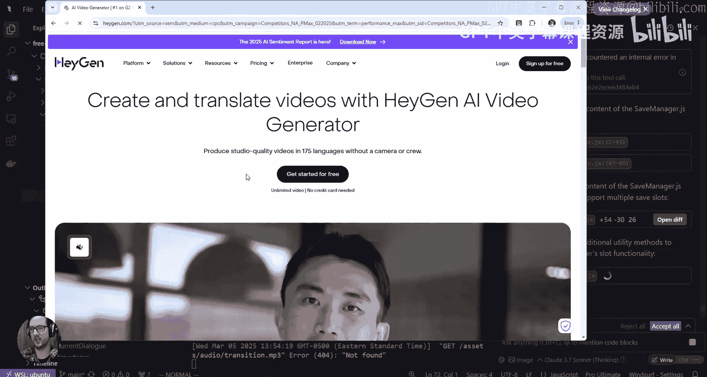

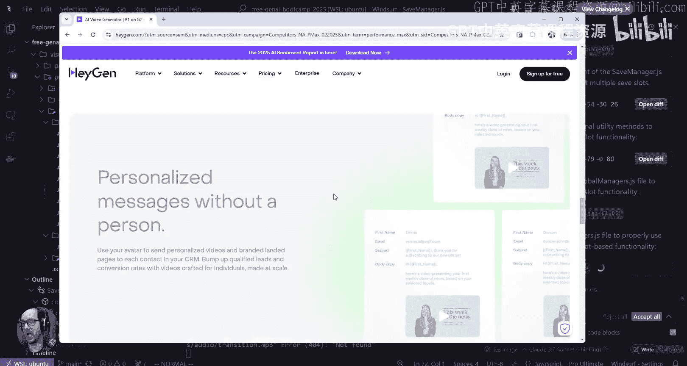

Anything you'd actually have to produce some， you'd have to try to make your avatar talk。

 And then after like the graphics we make and some other generator。 But then you can feed it here。

 And then it could do like mouth syncing for audio， which would be really， really cool。

 So it's fun to think about how these， these things go together here。

 Let's take a look and see what it did。 So here we have。😊，Save key prefix。 Why did it rename it。

 Max 5 slo current save current dialogue， timestamp。 Sure， we could have a times stampamp。

 Let's actually about that idea。 load slot 1。 Oh， yeah。 that makes sense。 load slot。

 And then we have data。Yeah， I guess so。嗯。I mean， the data is。Here， I suppose，ca we。

 we can't get it anywhere else， I guess。Save state key， have state， have has state， get all saves。

Delete saves， create， save kind of， it's kind of okay。 I guess it's not。 I don't really like it。

 but we'll go up here and we'll just tweak it。 So if we go to the top here。

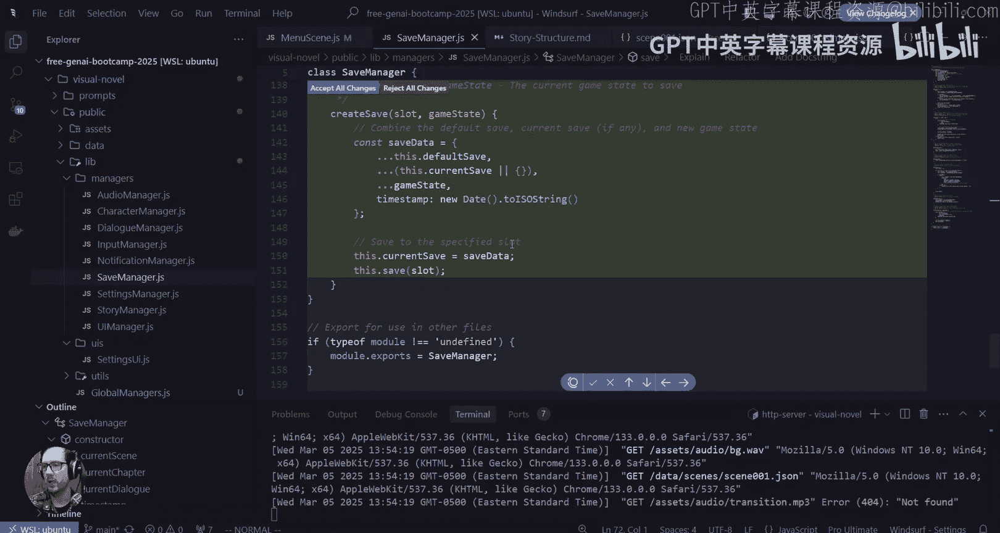

Like， why do we need to name it save key prefix， maybe because it's saving them individually。

 max5 slots，5， that seems fair。I'd think 6 is a number， to be honest， we' would make it 6。

Current save。Sure。Default save。 That's fine。So here we get our save key。Get save key slot。

So go down and we'll take a look at get Save key。Ensure the slide is within the valid range。

Add the prefix and get the slot。 Okay， that makes sense。And then that's going to save data。Okay。

 that makes hands， Sa it or otherwise do that。Let's look at our save。 So in our save。

 we are providing the data。 I would feel like the data is already in the。Yeah， I'll think about that。

 often think about this， but that technically does work， but I might change that。

So we have a load here。 Why do we have two loads， load。At load。I think this is identical。Oh， no。

 this loads save data for a specific slot。Low data。 No， it is the same。 Okay。

 so I think this one's redundant。So go ahead and delete that out。

Seems like it made a little mistake there。Get Save key。Yeah， that one's fine。Has save。Sure。

 all save data。And。Yeah， we'll probably want that for displaying delete save G。 create save。

 Why do we have create save and create save twice。Maybe this one's used within the other one。Yeah。

 so here。Like why do we have it twice？So we'll split it。Oh that doesnt split the screen。

 This splits the screen， whoops。

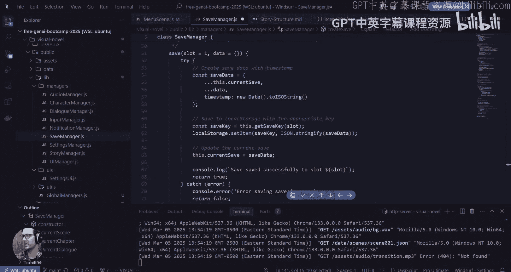

We'll split this here。And we'll go down here， we'll take a look at CateSa。So create save。

Current save this dot save。 It does it here why， like why is it doing that way。

Combine the default save and the current save and new game state。 So like why do we need this。

So go here and。Why do we need this function doesn't take care of saving。Is it， oh， yes。

 you're right kind of moment。Mmhm。😊，You're right，hu。Oh， I'm always right。The key difference is。

 is a lower level method that simply saves the data current state plus additional provided information is a higher level method that ensures all required fields are present。

 It combines。The sources here。All the necessary fields。

 or you could merge the functionality together。I think that I don't want a redundant one because in data here。

 we can set the timet ourselves。 So nose here， it's already setting it。

 like that's the only thing that it might not do。We have the default data。

 that's something that we could just pass in。 So I'm going to take this one out。

 It is completely redundant。But， that's fine。Okay， so now。

And we could say like default save might be like like default new game save。

 I don't know whatever it is here。 So now we should be able to create a new game here it's setting the current scene。

 We don't need to do that。 What we can do is。😊，We can。Also。

 do we need to get rid of this save game state thing。Yep， that's old jump here。And。

Here we have G dot saves。The thing is that the user would need to pick the slot， right？But right now。

 we're just going to hard code it for one。 So I'm going to say save and slot。 Oh。

 actually defaults to one， right。And。It does。But I feel like you'd have to put in one anyway。

 because it's the second parameter。 This here will do this dot G dot saves default save， right。

 And so this will set up a new game， initial game。With that stuff there。 So that is great。

 And then down below here， you can see that it's making the transition over from here to the next one。

So that is really， really good。 When we do save the game。

 it should call that I'm not sure if it does， but it should call the or admit。嗯。

It should call ait on the actual event bus notes here we don't have any emits in here and we don't have the event bus accessible in here。

 So I can't imagine the event bus is even being used right now。

 but we should use it and we will use it when we when we get to it here， okay。

So I'm going to go over to here and stop our application。Start it back up。Go back over to here。

And I'm just looking for my Japanese app over here， giving a nice hard refresh here。

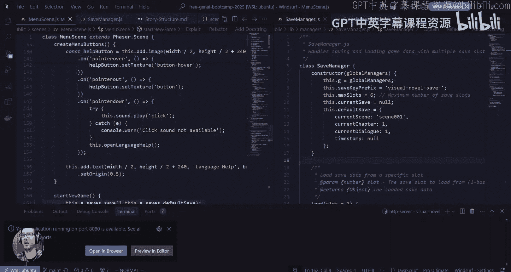

🎼Audio is not blaring， which is really， really nice。

 This is probably more work than the textex mud game。

 I'm not sure why I'm going so folded on the Japanese visual novel， but I am。

 And I click the new game。 Nothing works， which is totally fine。 The click sound is really， really。

 really loud。 saves， save successfully the slot1， which is good。 But then over here。

 it says this global manager。😊。

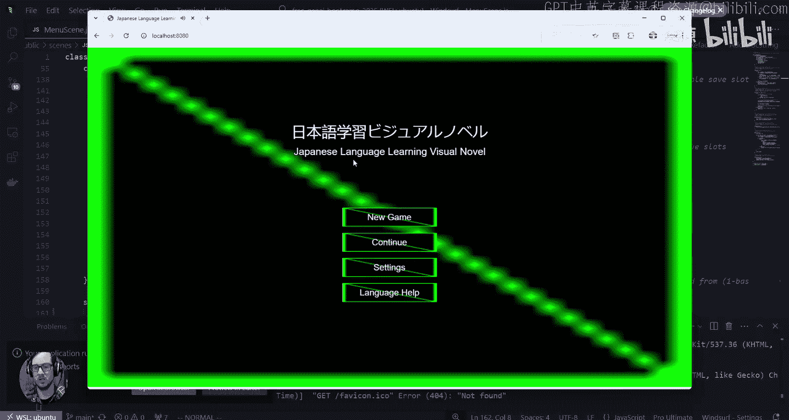

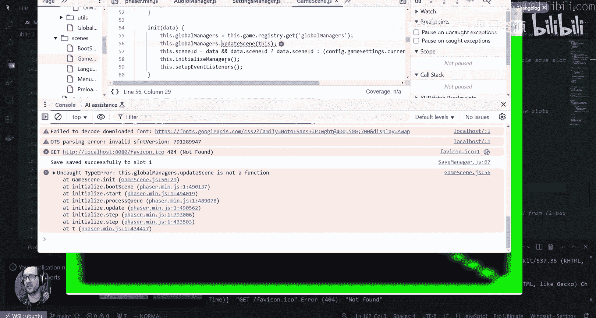

The interesting part is like the continue button should really only pay appear if there aren't if there is any save data。

 right， we also don't have like connu really should be load。Right， should we load， which that's。

 I mean， continues fine as well， but I probably rename it to load。

 But here we have goal manager update scene。

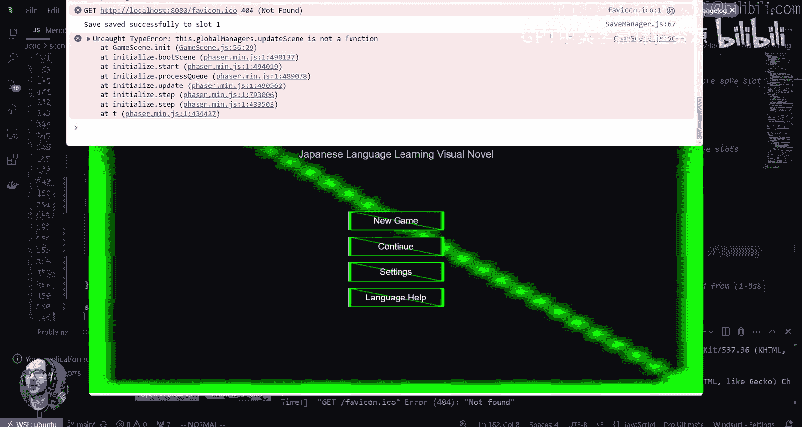

Because we got rid of that。

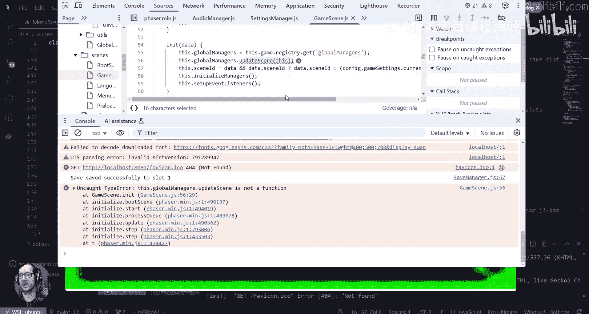

嗯。I think I'd rather just set it manually for now until we can justify needing it。

 So we'll go over to our game settings or game scene。

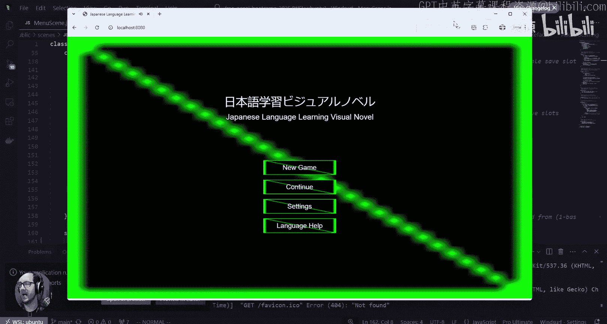

And。We'll close this out。We'll go to a game scene。 And I'm looking for this here。

 here it is right there。 So just kick that out。 I am gonna go here and say G dot。

Where we do need it G dot。 come on。 Oh， that's why it not says G G dot audio update scene。

 because that one definitely requires it for it to work。

 And this is happening in the initial initialization。 Could it happen in the createate。

 Where do we actually place it in the other one。 If we go into our other one here。

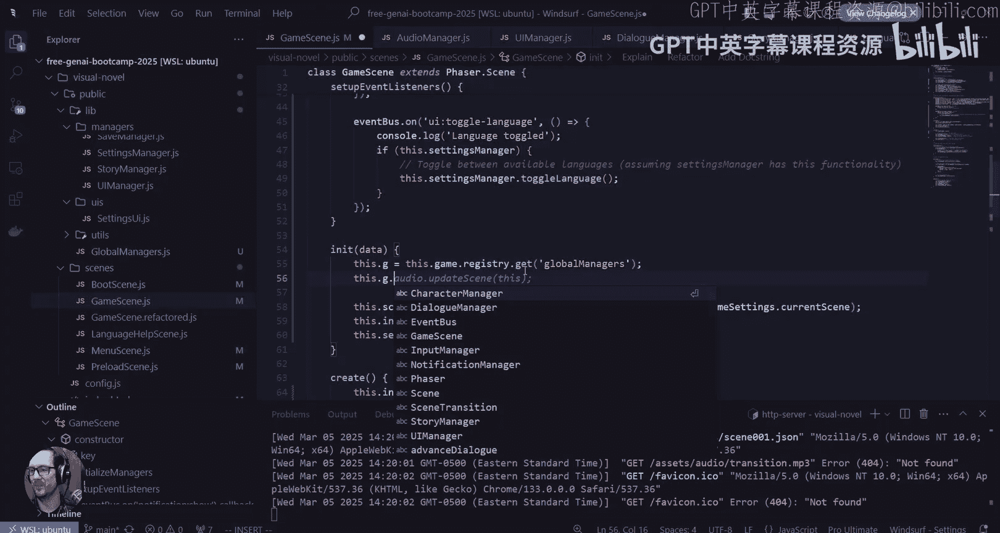

It's just a scene ID here。 we don't， I don't think we need to do that。

Because we can just load in and access to the game data when we need it。

So I'm just going to take that out， but if we go to our menu。We initialize it here。

 But then in the create is where we actually update the scene。 So here is where we actually do this。

 right。Okay。And also， it sets up the background music as well so we can go ahead and bring that back in here。

That is not what I wanted。 We'll go ahead and copy that again。And we' paste。Right。

 so now our our music should continue playing in this area now， I'm just going to。

We do initialize our managers here。Which still， I guess， happens wherever that is。

 is that function even， Does that function even still exist。 It does。 It's up here。 audio manager。

 settings， manager。I don't。 I don't need to do that because we can just reference things manually。

 Now。 we do have all this other stuff， but。They're fine， I suppose， for now。

We're not even you using our events right now。 So I kind of want to just commented it out。

 said of event listeners。Because it's just like less problems for us to worry about。

 And Even right now， we're not even using any of these initialized managers。

 So I might just comment them out until we start adding them back in。

But here you can see we have set up our scene and we do have other things going on here。

 which we have yet to do， so I'm just going to go ahead and comment these out。Okay。

 load save state start game。 I'll just stick this up for now。 Okay， so right now。

 I'm not expecting a whole lot。 I'm just expecting the game to go to the next screen and be blank。

 I guess， And the music to continue playing。😊。

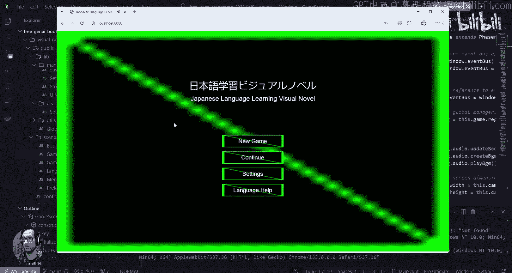

And I press the button， I've got to turn down that audio default setting。

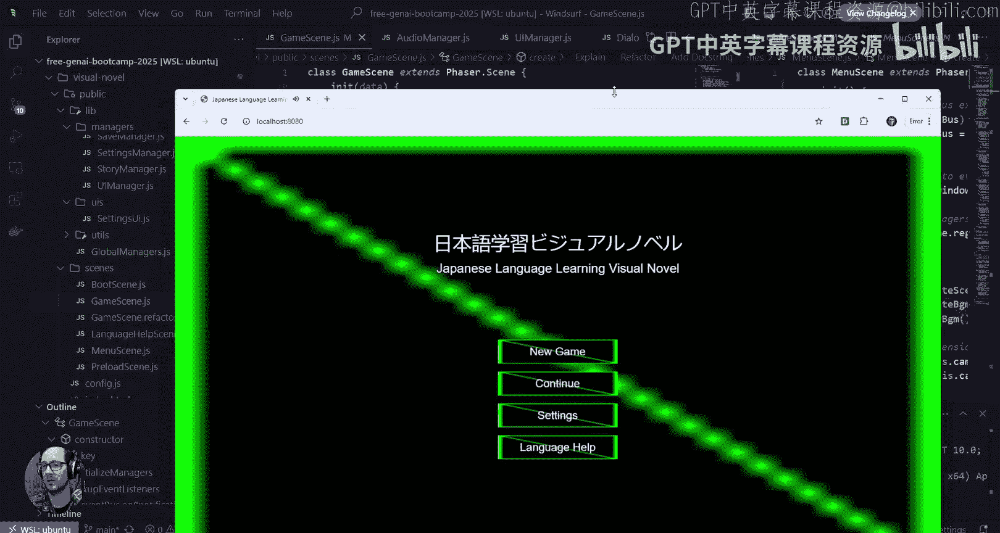

UIt's playing double， right？

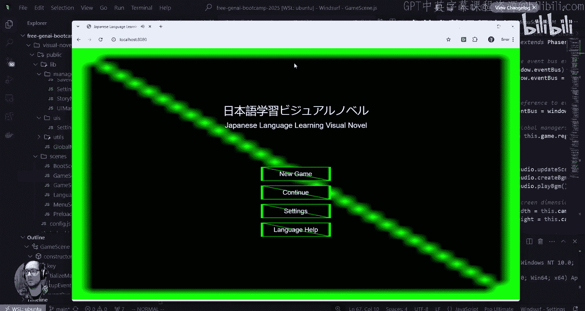

Okay， so that's no good。 I think the thing is that。

Wouldn't the other scene like close out and the music would stop playing when you moved to the next one。

 I'm a little bit confused。 I would have thought that it would have stopped， right。Hm。

Or maybe just because it threw an error， that's where it ran into a problem。

 So here we have an update has an issue in the updates。 Let's make sure first。

That we just kind of comment the stuff out here。Okay， and just get no errors to start with。

 It does try to start the game。 But I think we commented that out。 So right now。

 it shouldn't do anything。 I just want to make sure that that's what's happening here。

 And by the way， I don't have to restart the app to get it to work properly。

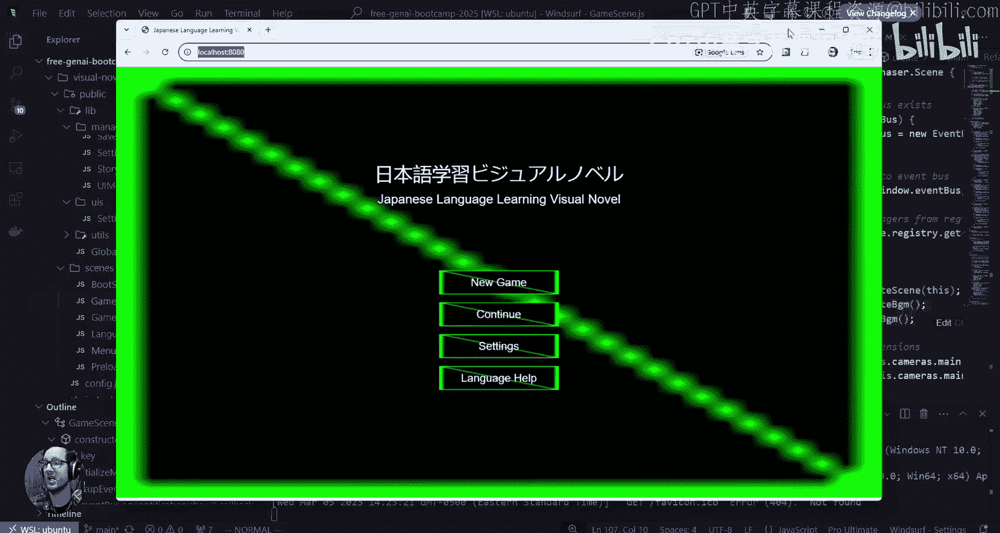

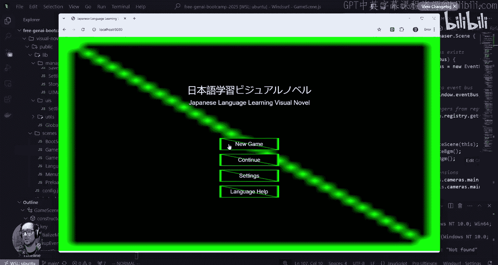

🎼Okay， so transitioned。 and now I don't have any audio issues， right， So that was the problem there。

 The sound is really， really loud。 I don't like how loud it is。

 But if we were to go update the config settings， it's not gonna help us because it's storing the config settings right now in our。

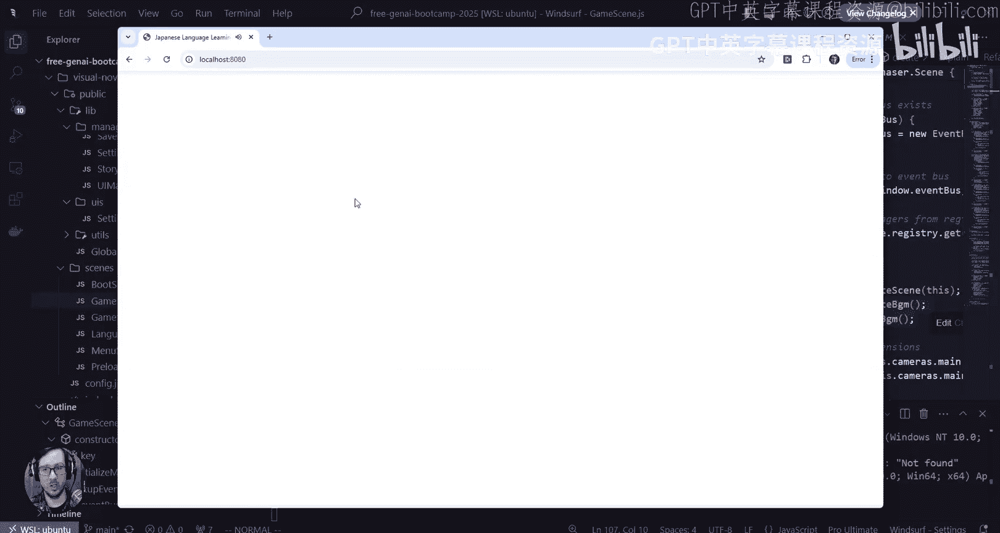

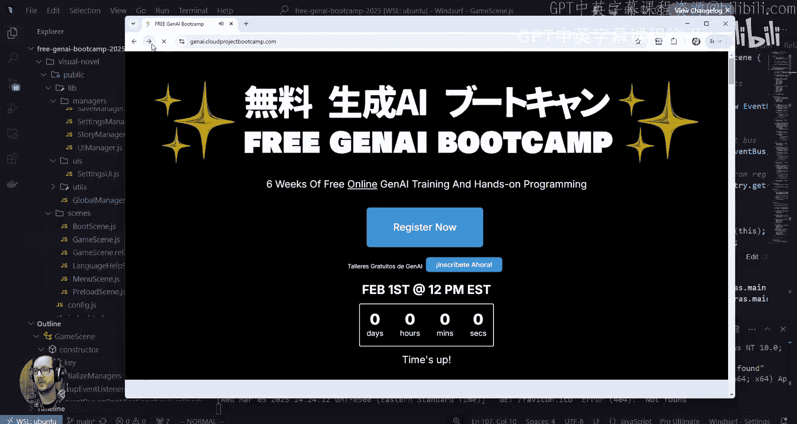

In our actual what do you call it a config log， right。

 so we need to get set up our menu screen or not our menu screen， but our actual setting screen。

So in here， we don't have a settings screen per se。

But it really depends on how we want to implement this。You know。

 do we want settings to be available in other scenes， I think so， right。

 And so we are not necessarily going to have a scene for it。

 but we're going to have a settings G I and that settings G I is going to be accessible in other places。

 If we go back over to here， and give us a refresh。

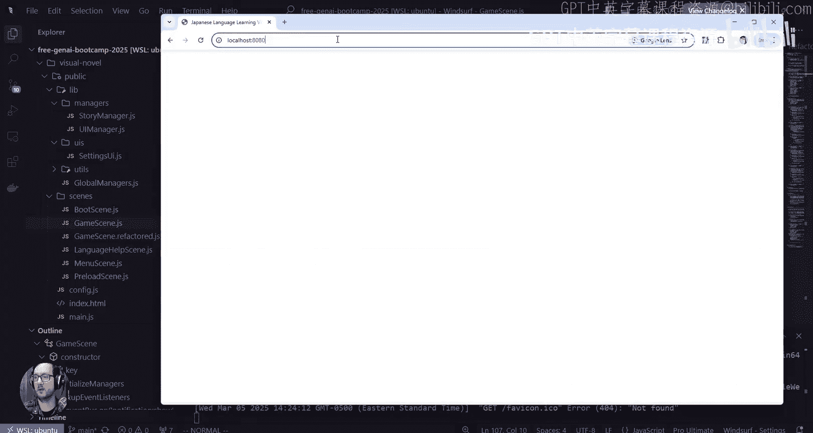

Where are settings， we have settings here。 So we can click it here。 There's language help。

 I don't think we need language help。 I'm probably gonna get rid of that。

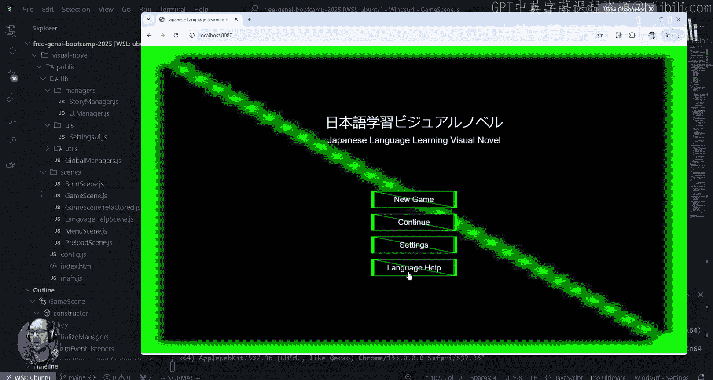

So wherever that is in the buttons。ButLet's go over to our menu first and get rid of language help because I don't know what that is。

 and I't， I don't know what to do with that。 And I think I deleted out。

 though I still have the scene here。 Let's read and see what it has。So what do we have in here。

 We have get dimensions， add background， add title， back button with height， basic phrase tab。

Grammar tab， bookab tab。 This is kind of stuff that I guess like if you were learning and collecting stuff。

 it would have it here。 So I would think I'm not really ready for this。

 I'm gonna go ahead and delete that out。 And I'm gonna go to our main and just make sure it's over here as well。

 I'm gonna get rid of it in here。 I'm gonna go into our index H just make sure that we get rid of that。

 So that's helper。😊，Language helper because I don't。 I don't want that。

 We'll go back into our main scene， and we have continue， which is fine。

Your would be like a button continue and then load。 So continue would be whatever you play last。

 And then load would be if you want to load a very specific scene。

 But even like those buttons aren't being managed by the U I right now， which is kind of annoying。

 So let's go take a look at what our U I manager actually does。So UI manager。

 it creates a dialog box， name box， create next button， create control。 So what this is doing。

It's actually setting up a U I， specifically for。The game。

So I wouldn't call this I wouldn't call this a UI manager。

 this thing in particular is just setting up a DUI specifically for。🎼The game。

 So let' me move this over。 and I'm gonna call this one。 I'm gonna rename this to。 not。

 it's not U I manager anymore。 This is。Dialogue UI。Becauseuse that's， that's really what it is。

 right？ And since I already had a lowercase， I'm gonna be consistent with that。

 even though it really is， well， we haven't even used it yet。

 so we can actually capitalize and put an eye on that。 I'm gonna do that。Didn't want to move it。

 Okay， so。One second here， I'm going to go and find the folder。And then we'll fix this manually。

So we'll go here。AndI'm going to go into my Lib directory into my manager's Nope， into my UI here。

 and I'm just going to rename these manually。 sometimes windurf does not。

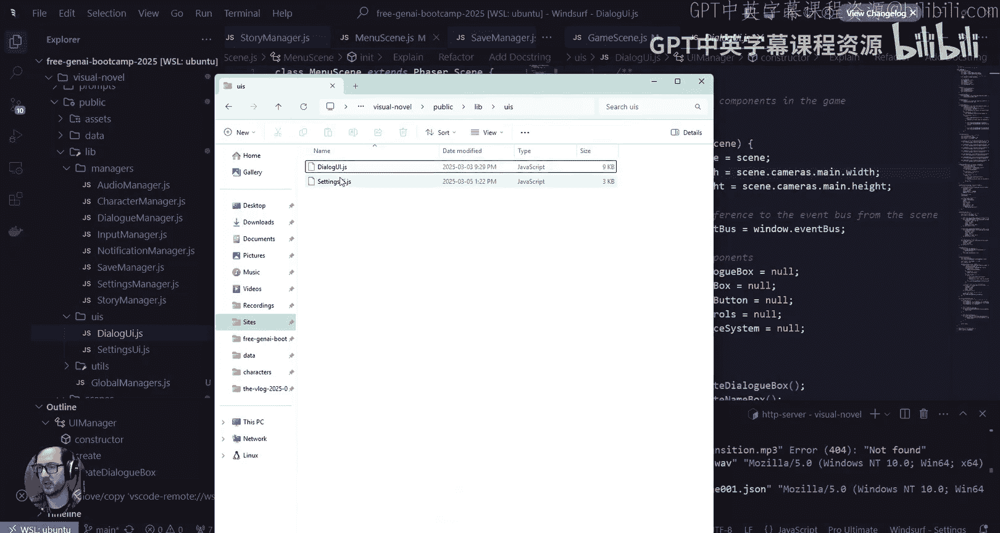

Let your rename files I' not sure why it doesn't。We'll go ahead and do that。So those are now renamed。

So， that's nice。So want this to be UI。And this one is now going to be dialogue Ui。

 but we don't have a manager。 And the idea is like the manager should help create buttons and do things like that。

 Do we even need a UI manager at this point。 I don't know。 The question is like。

 is this stuff for both。 I think like UI manager is like setting some defaults。

 And controlling the scalability and stuff of the thing。 So I do think that we need a a UI manager。

 So I'm going go back over to here。 I'm gonna to go ahead and add the UI manager in here。 UI manager。

We'll add the UI manager that we always wanted。We'd never had， right？

 So whatever that bat that Batman。Quote is， so we go here UI manager。And we'll go ahead and do that。

 We'll want a constructor。 Sure， we probably do need a scene。Maybe， I don't know yet， but。

What is it that the UI manager is going to do for us？ Now。

 let's go get our U I manager loaded up into our global manager。

 as this is something we need in more than one place。Okay， so I'm going to go。

 I'm not sure what code it changed there， but I'm going to go all the way up here into here。And。

Audio saves， saves can come next， and then。We are going to do this dot。UI manager。

 so now we have a UI manager， right？What will the you like also settings can store settings of like UI UI size and stuff like that。

 So font， obviously something that needs to be managed here。 But you know。

 when we're creating these UIs， the UI manager should make it easier for us to create these UI。

 So they're not so cluttered。And so。Right now， in our game scene。We obviously have。

Not our game scene or menu scene。Where's their menu。Mu， menu， menu menu scene， right。

 So our menu scene， we have buttons。 We have backgrounds。 We have stuff like that。

 But it's quite minimal in terms of what it's showing here。 So we don't necessarily need a full。

 a full Ui thing because we really just have this floating component。

 But I suppose we can do it because it is this individual part， right？ And so we could。

 in theory do that because that's really the only Ui here。

 It's just a series of buttons But maybe that's what we'll do。

 So what I'm gonna to do is go over to here。 I'm gonna to make a new one call this menu Ui。

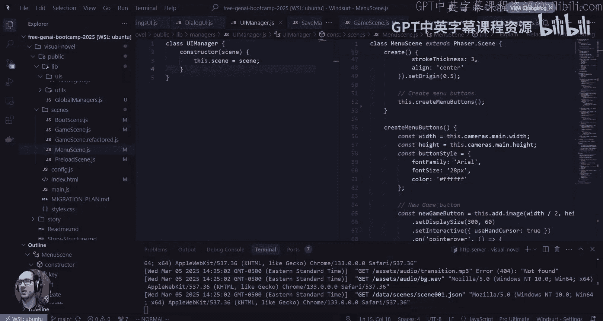

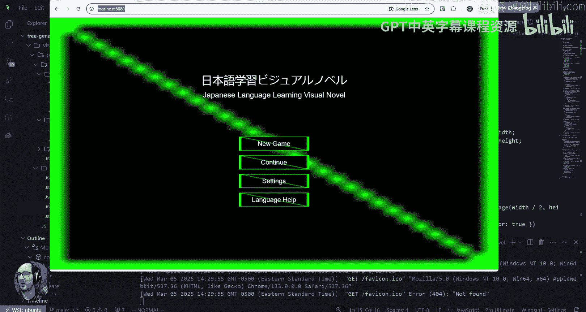

Do you yes。I'm going to make sure。Oh， it doesn't let me rename it so silly。

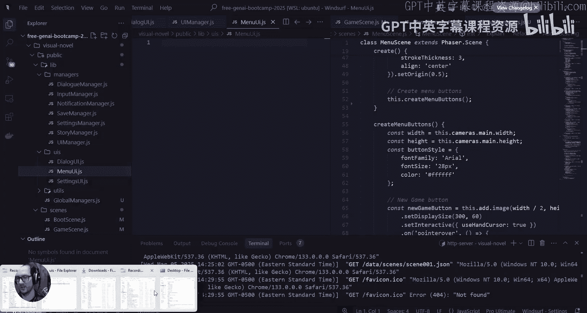

So we'll go over to UI here。

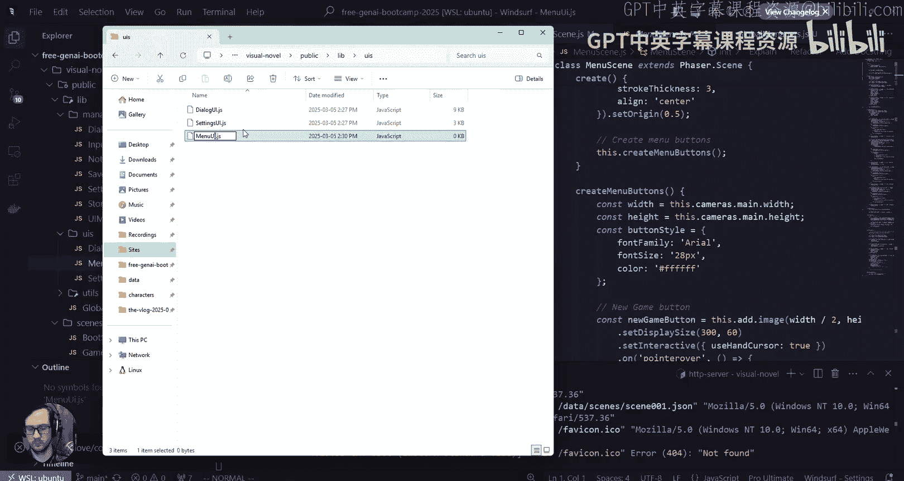

Right， and then I'm gonna just fix that naming。 We'll go back over to here。 And what I wantan to do。

Many U I。Right， and it does have a scene， right， It will absolutely have a scene。

 So I'm gonna go over to our menu。Seen， and all of our button stuff should be in here。

 So I'm going to go。And。Grab out all this button stuff。All this button stuff。We're going to cut it。

And now。We're going to。Paste it in like that。So if we need a menu。I think that。

And not all of this stuff is menu stuff。 like this stuff here is clearly text and images that show up on the front。

 So I'm going to leave that alone。 But down here， like we need to work with our。Menu， so。

We need to update our scenes， so we should do this。g。t update。Here update， I'm sorry。

 this will be UI。And I want to have an update scene because this is something we we're definitely going to need。

Right， so we'll have this set as null。As at this point。Oh no， actually， that should be。

 that should be silly like that。 That should be fine。Well we'll see here in a moment。

 actually because it might， it might go across different ones。 We'll go into our UI manager。Here。

 and it's going to need that function。No that's not what I want， I want the update scene function。

 there we go。There we go。 Great。 Okay， so now we have that one。

 So that is clearly being set in this specific。Thing， we need to。Bring in a very specific menu。

 So the question is like， is the U I， like we have this UI manager， which updates the currency。

 And that's fine。Do we even need it in here？I guess we do， because。The U I manager is gonna use it。

 So I'm not sure where to put this right now， but I'm just gonna go ahead and say U I。

 what's this called menu U I。Was it， is it new。Oh， it's just that， right， Just menu， whatever this。

Yeah， this dot Ui。Equals new， right。Okay， and so now we have that。

 And then I can say this dot U I create。 And so that will set up that here。 Now。

 this one obviously relies on that one。 And so I almost kind of wonder if the global manager should be actually passed into here。

😊，Yeah， I'm not sure。I mean， this actually has to access the menu， the gold manager。

 so it doesn't need access to it。So I'm just deciding like。How do we do that。So， I would probably。

Say this doci， I'm going to just do this。The statue like that。And then we'll do that so。

We can have it in here， which is fine。But I think that I would rather have it in the update scene。

 So our sorry in here when the createate function。 So we'll go here and have our cr function。Create。

And。Here we have seen， and then we have G for global manager， this global manager。

 I'm just gonna to call global managers here so that it's a lot easier to see what's going on here。

 I mean， we only really need one global manager in here。 and that is the。What。

 what's the name of that global manager， It is the UI global manager。 So UI global manager。意 why。

Manager。And they'll just say U I am。UI manager。So we know exactly what it is。 And then here。

 we just say。U I， right， so that way。It can access the UI manager here。嗯。

And so then we're just gonna create it there。 That'll actually be the UI。

 So and this is a little bit confusing because this is G UI then here。

 but I think I think it's not that much of an issues。 Now we have U U IM on the interior here。

 We're just changing the names as we go。 but we definitely need to update it before we do anything else。

'll say this do U IM and I'll say update scene。With this scene。And so this one doesn't。Well。

 this is the UI manager， right？嗯。So this thing's already actually been created。

And we wouldn't pass into itself its own thing。 So this doesn't actually make any sense。嗯。

So I think this would actually have nothing here。 And then this thing here would be null。 Yeah。

 that's right and。We'll take that out and what we actually have to do is go back over to our UI in our menu here。

And we have some stuff here， but we're actually。Going to change this so that there is UI manager in here。

It was a UI。Manager， yeah， UI manager。U IM。 There we go。 And so that's going keep it in order。

 That's what I want。 And So now we can think about， okay。

 how do we refactor these components so that they're a little bit easier to work with。

 Because right now， they're a little bit of a mess。And it's kind of annoying。

 So we're gonna go over to。A UI manager。 And now what we're going to think about is like。

 what are we factoring out to here and what advantages do we get。

 Because then we can globally because you see how we have like styling set here。

 Maybe we do want to set individual styling， but we might want to have like global styling and defaults in here that we can work with。

 So what is this thing doing， It's creating a series of buttons for the menu U I。

 I would probably separate these out into their own calls。But we have width and height。

I'm not sure I were doing that。Sine。This duck cameras do mean， okay。

And this is because before it was on the scene。 So this is actually expecting scenes here。

Just start saying yeah。But I guess this is if you want a center where you want to place this stuff。

But I think this is something that I would。Put in to let it set externally like when it actually sets the menu and it creates it。

So here I'm going to say create as our function。I'm not doing that right now。

But we do have button styles and things like that。 So I'm just thinking about this for a second。

What is it that we want to re factor out and make our lives a lot easier， right， Because again。

 this is quite the mess。Like can， can it be refactored in the U I manager。

 This is just hard to look at。 So we need to tackle this individually。

 So we know we have a new new game button。 So this dot create。New game button。

We have this do create Se button， that's true。This stock create。Continue。Button。Right。

 and that's the only buttons we have right now。 So those are our three buttons。Yeah。

 create a new game button。For now。Oops。Then we have our continue button enter settingss button。

 Don't know what we're doing with them right now。 So now what I'm going to do is extract out the code individually。

 This is kind of helps me think about what's going on here。ll put this up here right now。

 We're not really utilizing this。 But we have some styling here for this button。嗯。

That we might want to have。But I'm gonna go ahead and put this above here right now。

 is this is kind of our global styling。And。We'll go here。This is new game。Okay。

 and we'll put in our createate new game button。And says this button only enabled if it's a save。

 yep。So really only show up if it's a say， but it maybe should show like a different state。

 And so I'm going to go here and grab this。Okay， we'll have our continue button here now。

 and then we'll go。Over here， grab。This。And so now we have。

Our three buttons still don't have justification for a U I manager yet。

 but we'll get rid of this one here。 Okay， so now we have。

Three buttons that are more distinctly defined here。So my question is like。

 what do I want to re factor out to make this easier because basically we're just creating a DSL。

 a domain specific language so that when were creating these elements that's easier to manage。

 we can update them all in one go。 And so here we have， we have to add an image， it's a button。

 set the display， set interactive when you hover over it， it takes actions。 So， you know。

 I would rather。Pass the call backs to these things as opposed to doing them this way。

 So maybe I would make a new component here called button。Right。And。I mean， the other thing is。

 is this actually using the button functionality in the。

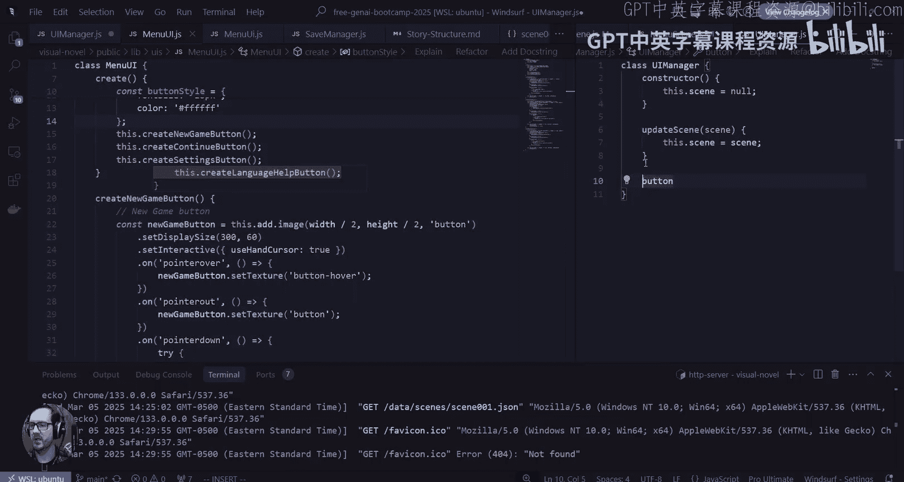

I thought Fraser had buttons。

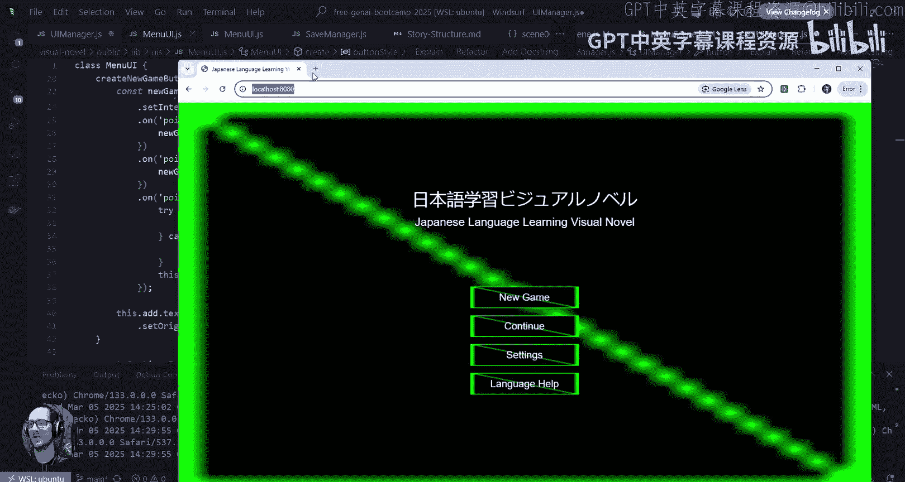

Fser button。Buttons， yeah。啊哼。So， here。

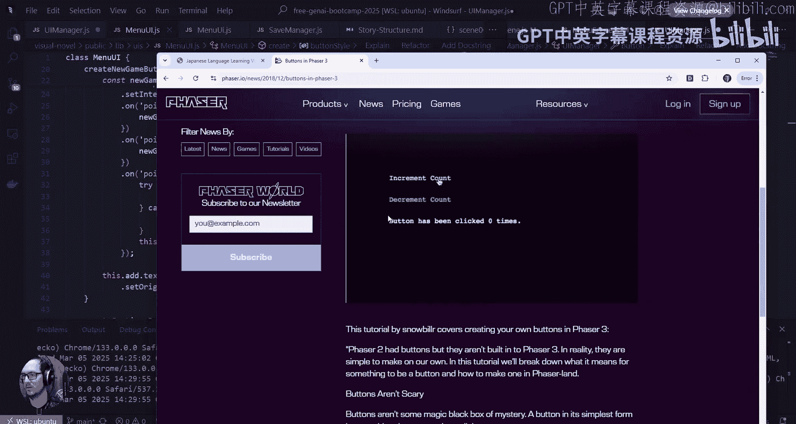

Read more。 Frr buttons。2018 doesn't feel like 2018。We'll go down below here， and。Hello interactive。

No， not really。佢奔。

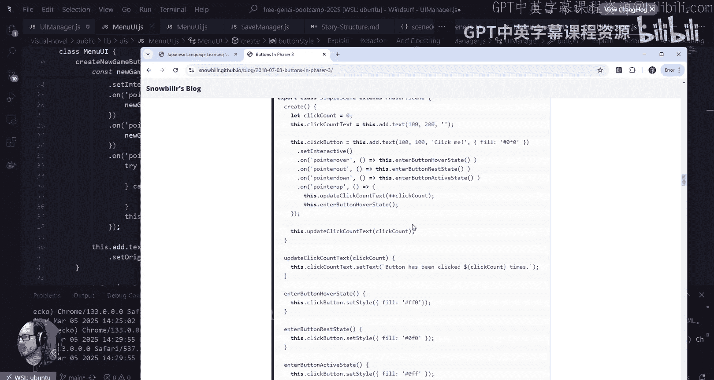

I guess not。 So I thought there was a component for button。 Maybe there isn't。 Now。

 we could have make this a separate object， right， Just call it buttons。

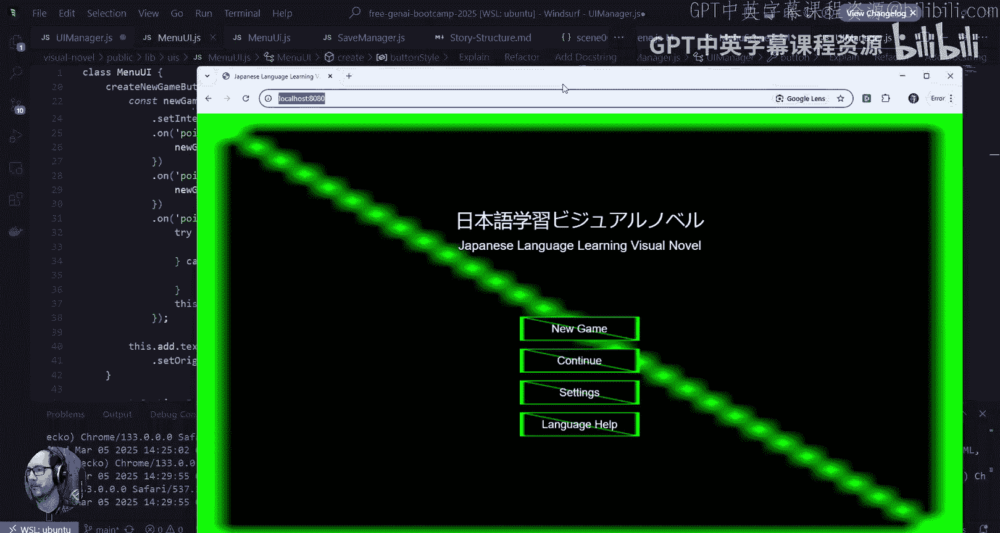

And that might make sense。We might want to do that， right， I'm not sure。嗯。But you know。

 what I'm thinking about here is。Right， because that。We can for now just call it button。

 Let's just call it a function button for now。 that's what I'm going to do。

I was just going to call it button。Or create button。

And that's going to just create ourselves a button。

What do we need to create our button here returns back the image， which is one thing。

So I'm gonna go here and try to start defining what that is。 So here we have this dot U I M， U I M。

Dot create button。And so I'm trying to think of like what is it that we need to set？Well。

 there are callbacks。 That's definitely for sure。 So we have on point over on point stuff like that。

 So that is something that I would probably want to set。 So here we might have point over。And。

It really depends， so like if we press these buttons。

 should the logic be handled here or should it be handled in our event bus？Because。

I kind of want to have them in our event bus。Because then we can exactly see where these are going。

So that's probably what I would do。But then do we have them here？Like this。嗯。Okay。

 so what I'm gonna to do first。 So I'm gonna copy this part。Ca whole thing over here。Into here。

 right。And it does seem like we kind of need to contain this in a separate component。

So I'm going to go up here， I'm going to just say class UI button。It's like we do need a class here。

 constructors， whatever， whatever， whatever。Constructor。And。

And now I'm bringing this up here like this。 Y， Yeah， we're just。

 we're just going down the rabbit hole here。 And so here， this is creating the new button。

 So just say， yeah， new U I button， right， And so then it'll return that。😊。

That's actually what I was thinking of here y， and then return button。

Because then we have something we can work with， right， So we go here and if we create a new button。

This will be our this dot create button。Create new。Or new game button。 So just be new game button。

Right， and so now。We can do that。 Do we have all the other code here。 We do。

 So what is it that we need to pass along here， Well， there is the display size。 that's for sure。

So we have that。There's the image。It depends like， like if we have a consistent theme for images。

 that can make it a little bit easier。 but we like we don't。

 we don't have any of those graphics to find right now。

 This text thing obviously is gonna be refactored out of here。

 So definitely having button text will be the first thing。 So we'll just have here text。

And I'm actually just going to go here and do this so that it's a little bit more clear。Okay。

 and so we'll say text。New game， right， So that's gonna be the first thing that's going go。

So we'll take that out of here， right？The next thing is。The size。So to say， you know， like。

The size should be。300 by 60。And so that makes it really clear。Yeah， we have position as well。

 There we go。 That's good， too。For callbacks。I think that what I would rather do is call it like like handler。

And so this one is gonna be。New game。But。Ill call this event handler。Event handle。

And we'll say event handle。 I'm， I'm kind of trying to stick to the this。

 I I'm used to doing snake case。 That's why you keep seeing me doing that in some places。

 But here we have event handle。 And so that way， when it gets called。

 then we'll know exactly what it is。Right。And here you can see it's setting textures and things like that。

 That's stuff that we can continue on with the other part here， but we will need to om。

Some of these actions and then starting the new game here， but really。

 we don't want to start the new game here。So I'm going to go ahead and rip this on out。

So it says the play button。 That's why I wasn't playing correctly because it was doing that there。

 And so now we've defined。Our button definition。 So that's really nice， nice and clean。

 Conue is really， really old and outdated。😊，But we can see that we want something similar。

 The only difference here is that。I mean， it does show out if it's grayed out in a certain case here。

But the key difference here is that。The width and height will be different。 So we'll go here。

We'll say this dot continue button。Right， and so now this one's updated。

The only other thing here is that we might want to set the opacity。So say alpha。Like that。Which is。

Oh， yeah， I can see that there。 I， I could barely see it。

 So that might be an issue that we need to set。I mean。

 this is basically set on a conditional like why should it be alpha？嗯。嗯。😊，I'm not sure about that。

 I'm gonna leave that out for now， and we'll figure it out as we go。

 I don't really want to do an alpha on that， to be honest。So if continue， continue， stuff like that。

 So this stuff here。We are going to rip out。So， now。We're getting somewhere， right？Same thing here。

 Let's do this this one。 Let's see if it just does it for me。mhm。😊， there we go。Good。

And then we'll go down to the ground here， and I'm going to。Delete this out。

So now we have our three buttons。 It seems to be a little bit of an issue here。Okay， oh right here。

 that's missing there。 Great。 But now we have our three buttons。 You can see that's a lot cleaner。

 It's much easier to see what's going on here。😊，So I'm， I think I'm happy with that。

And if we want to do things to our buttons， we absolutely still can， which is totally fine。

So now that we have that set up， the next thing is to go back and actually put in。The code for here。

 the only thing that's missing here is our styling， our button styling。嗯。

I guess that's something that we can set in this if we want to。I kinda w to have it hard coded。So。

 I might go here。And。Cut this here like this。Cause maybe we might want to override this at some point。

 But for now， I'm just going to。Place this into here。Like this。And we'll call this。

This all like this。 And that way up here， when we need the button style， we can fix that later on。

 This now is setting this base on the screen main width and height。

 This stuff could be relative to where everything is。 So right now。

 it's doing like width height position， whatever， whatever。I think there is a better way to do this。

As we want to set the。What do you call the width？And height here。

So you know exactly where we are going to put this element right。

 or this will be our it says width and height， but really it's like our x and our y， right？嗯。

And I'm actually going to set this do X。And this thought why。Over here。

 it's trying to figure out what those default settings are， but clearly it's just those。

 So I'm going to go back over to our original menu scene。 And in here。

 we are we are obviously calling them here。 I'm going to just go up like this for a second。

And I put this here。And really， it's going to be。It's kind of like this。

 but it's really actually half and half。 So the first one is half and half。

 And that's what it's setting as our initial position for our X and our Y。 That's what it's doing。

So that's fine。 and we'll go back over to here， and this doesn't make any sense anymore。

 so this is just going to be x and y。This will be x and y。And then， here。The X will stay the same。

And then the y will be plus 80 like that。And then here we'll say。The x is the same。

And the y is like that。 Now， it is adding it this way。

 And if we want to kind of control the spacing of the buttons。

I might put just like constant spacing here。 And then all I'm going to put in here is the y value of what we want。

是设备嗯。Maybe menu Y， menu X menu Y， just so that we're having a less of an issue。Or u I。X。And U I Y。

 I just don't want to have those conflicts down below or have something weird happen。 yeah。

 we'll fix that there。 So now we're， we're setting the spacing。 I guess it is spacing right here。

 I'm not sure why I had to do that。 We'll go， I'll put those back to normal because the spacing iss kind of indicating as to where it is。

 and so。We maybe are' like our spacing here。 What's it incrementing by。

 It is incrementing by what we have 60 then 80， then whatever。 So it's doing it plus 80， right。

 So we have 80。 And so then here we go like 0，0 times spacing。And then this is one time spacing。

 And then this is two time spacing。 And so then it becomes a little bit more clear as where this is going。

So this would be why offset。And。I， this one doesn't really need an offset， but just in case it does。

Oh， yeah。 that's right。 That's it actually was right there a second ago。Thiss dot x。

Let's stop y plus y offset， right。 And so now I can copy this here， and I'll have to use this。

 And so now I have more fine tune control over。The actual lie off set。

So if I want to like space them a little bit more， I'll have to just change that one value Now。

 that's a lot easier。 We are setting the the width here of the button。

 So I might say like constant button width。Button with。Here， and this one's going to be 300。

And so I'm going to go and。We're going to say button width。Right， so I have a button width like that。

 Yep， that's right。That's right。 Yep， that's good。That's good。 I don't only get updated this one。

 though。There we go。 And so now we have that。 The other thing is like。

 we can also figure out the button， the button height if we want as well。

 So might as well just go ahead and do that Conant button。He， you got it。And。那么你肯定。But。W。

 there we go。 There we go。 There we go。 Good， good， good， good， good。 Thank you。There we go， yep。Yep。

Yep。There we go。 And so now。We have a much easier way to lay out our components。

 coming back over to our。Oh， we're in our menu scene。 let's go back to our UI manager here。

And we have some things that are hard coded that aren't going to work for us， right， So if we go。

I mean， this one's fine， like the button style over here is fine。

 but if we go up to here and we will reference this button here。

This is supposed to bring in a lot of。Stuff。So， here。

I'm hoping that it kind of figures out what I want。I guess we don't set it down here。

 so that's probably the confusion。So if we go here and open this up。We can see that。

This needs parameters。So let's put options。So I would just go ahead and say， like， hey。

 this is now where I want to use Cha PT。 So I'm gonna to go here and say， you know。

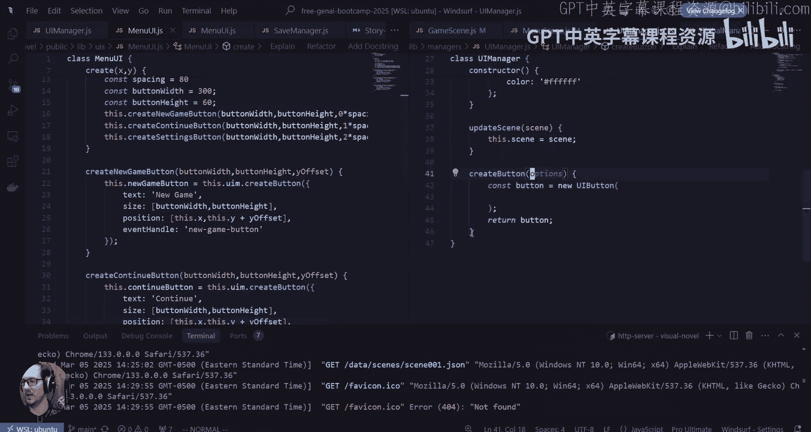

I need to implement。The UI button。Can you look at menu Y。And fill in the code。And adjust the code。

 and add the grams。And。Adjust accordingly。Okay， so hopefully it doesn't get too aggressive here as 3。

7 does that。 But if it looks at these references， it should be able to figure this out and replace this accordingly。

 So we'll give that a moment to figure that。 This thing is taken forever。

 And I almost kind of regret letting it do it because it's going forever and ever and ever。Right， so。

Like， what's going on here， iss it going to make it for us？Let's take a look at what it's done。

Did it just finish？And not yet。' still going。But what do we have。

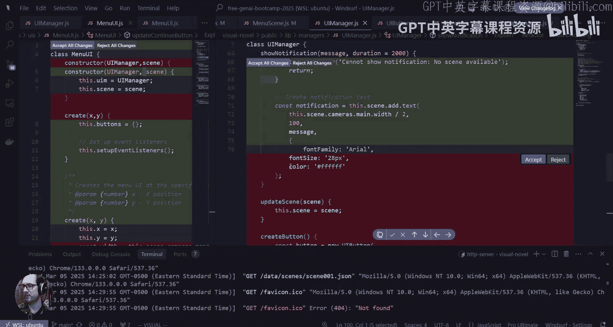

No。No，m just gonna stop。No， I'm rejecting it。 It did too much and nothing that I asked for it no。No。

 no， no， I don't want。 I don't want your changes。Garla， it couldn't do it。Crazy， I。

Not even asking for anything hard here。And it didn't undo all the junk that it it put in here。

 either。What a pain。 What a pain。 I got now a broken， a broken thing。 Should have committed sooner。

 I have W I classes now。Yi button。So this one still is okay。 We'll go all the way the top here。

This is a duplicate of the other one。 So I'm just gonna go here， and。I don't know why I didn't。

 There's no notifications in this thing。 So I'm not sure what it's doing。

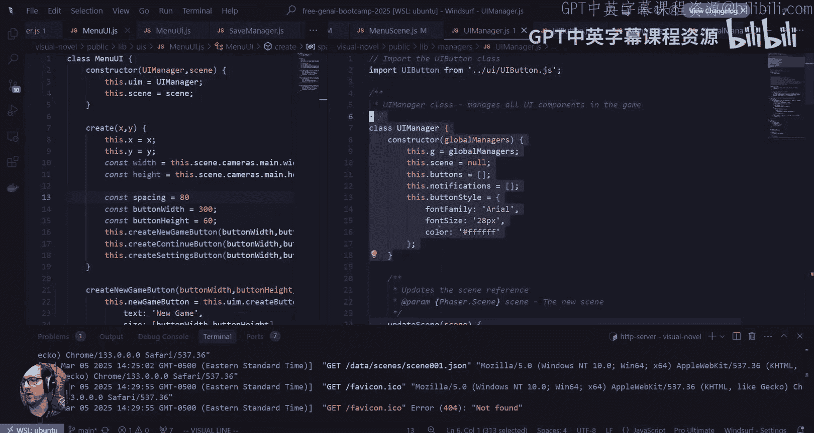

But it's clearly overreaching。Just kind of annoying。 I like， why is it importing like this。

 It doesn't do that。 Did it create a stupid new file here， UI button that I didn't ask for。It did。

This is UI button now。嗯。Where's all my UIs。 They're over here。Just get out of here。

But didn't understand what I wanted。 So I'm going to go ahead and delete this。What a gross mess。

 And we're gonna go back over to here and just try to dix undo the the junk it did here。 So go here。

 and we still have our createate button up here。 I view a button here。 I think that's my old code。

 And so I'm gonna go here and just rip this on out。 It just didn't do what I wanted to do。 Now。

 of course， we might want to have this as a separate。something separate。 But for now。

 I just want to have it in here because I'm not ready to do anything extra。

 So that was a little bit frustrating。IAgain， I could try to make it work again。

 but I just don't even want to。 So here we're going to pass in options。And。

We'll have to say like validate options， validate options。

I guess we don't really have to do that right now。 We just pass pass it like this because that could be the responsibility of this one up here。

 right？ And so in here， we're gonna have options。Right， and then we'll go here and just say。Validate。

Options。Before we do anything else。Validate options。Okay。And。

What is it that needs to get passed in here so。We have in here， in the button。We have。Fields。

 possible fields here。 trying to get this here。No， that's not it。 We have。Text。Size。X， y。

Size of button。Actually， this is width height。And then here we have position。 there we go。

 that's good。TheThe string that is used。That。Is omitted。That is admitted。In the event bus， right。

 we don't have that right now， but we will， we'll work on that。 And so there we go。

 We have those now set。 If we go down here， then we can validate those。So， we need to。Validate text。

Validate。Size。Okay， it's not really validating。Validate is array and two values and two。

To integer values。Validate is array Ar is to。2 cells。 and。Both are integers， right， so we'll go here。

啊哈。😊，To do that。嗯。😊，I hope so。Same thing here， so this is going to be the same thing。Same code here。

嗯。Valid is string good。And then up here， validate is string good。

 So now we have our validate options。 If it passes all that， that's good。

So now that was really nice how fast that wrote that。There are libraries to do validation。

'm not necessarily on the javascript side the way we're doing it。

 We'd have to be doing things a little bit different。

 But I think that is fine for what we're doing here。 So now what we need to do is。Get the image。

 So here's says new game button。 This is twice。 So that's a little bit of an issue。

It's saying add an image。So really， what we're doing here is we're going to take this up here and we'll say image。

 right。And。Then， instead of this。We can just call image on all these like this。

So it's all it's doing as well， right。And。We bring this back a layer。 Now。

 what it needs to actually add an image to is via the scene。 So that is something it will need。

We also need it here as well。 So seen， we don't have。A scene here。

 but we'll go ahead and there we go。And so now we have this， right。

 And so that's going to help it out。So I'm going to go here， let's say scene。

 let's say this dot scene equal scene。Okay， I'm not sure if we need it other places， but if we do。

Now this is starting to get a little bit large。 And so this is where we might want to have our UI components。

So we do have here UIs。But then I'm gonna make another one in here。 another folder we'll call it U I。

 So now we actually have a reason to have that UI button。 So we'll go here and make a file。

 We'll call this U I button dot J S。And I'm going to go back over to here。And。嗯。M， where does it end。

 It's creating a bunch but dialogue。 Oh， sorry， yeah， yeah。 This is the wrong one。 It's over。

 over in our manager here。 U I manager。 And so I'm gonna go ahead and just cut this out。Cut。

 we'll go over to here。 we're going to go ahead and paste it in here now。

 we'll have to import that not there。 I don't want it there。

 and I'm going to go over to our was it index HTML。And in here， we have our。UI manager。

But we need to load our UI components， UI components。Yeah， and we just have the one right now。

 which is totally fine。We'll go back over to here to our actual UI button。And。

Just close these out for a second here。 And yeah， except that all not only did a whole lot。

 but trying to take credit for our work。 So we have this。 if we go down below to。

 I guess it's not in this one。 but we'll start replacing these things。 So we validate the options。

 And if it， if it fail， like if anything fails， it will throw an error。Right。

 if there's a problem there。 So now what we have are， our position。 So we have options， position 0。

 position 1， which is perfect。 Is this the name of the button。😊，Right， is this the what is this。

 This is what what， but what image we want to load in here。

So this is something we might want to replace。Image。Name of image to load。And then we go here。

Options。Image， we're gonna have to go down here to our validators and same， same things。

 So'll have validate image。Yep， that's all right。Oh， no， it almost had it。There we go。 That's good。

 Okay， so now that's set up。Set display size。 Sam thing。Set texture。

So here what we have is we have a bunch of different。Things going on here。

 So this is where I'm not sure。 So here。Like we have a button。Right。嗯。😊，What do I want to do here。

 point point down point over， as you can see， like the state can change point over， point down。嗯。

So maybe for now， what I'm gonna do is I'm just gonna hard code it button for now。

 because I I don't want this extra complexity。 And maybe as we build our game， we don't care。 I mean。

 we just want it to be button。 And that's less of an issue。 I'm gonna take out this validator here。

 And I'm gonna go back at the top here。 And so we have point over， point out， point down， right。

This is saying new game button。 There is no new game button anymore。 I'm just gonna go here and yeah。

 just image that's what it wants to do。 That's actually correct。Okay， and then this one as well。

 change that out。And so that is good。嗯。Just say this dot text。Like that it's a little bit easier。

 And then I can say the do text like that。 So I can see to see what I'm doing。

It's a little bit hard to see what's going on here。 Just gonna bring this on down to the next lines。

 Again， just making this a little bit easier for me to work with。 I don't want to be 100 miles long。

 So we'll go ahead and fix that。 So now we have our scene text。So， that's good。Right。

We do have all the like point over， point out， point down。

 all the stuff is set up the sound effects and stuff like this， it really shouldn't be in here。

 So I'm gonna just take this out。 Also， that's just not correct。

 It's a set event handler or this not event handler。 that's not even correct here。

 What it needs to do is actually emit from the event bus。 So there is an event bus on the。

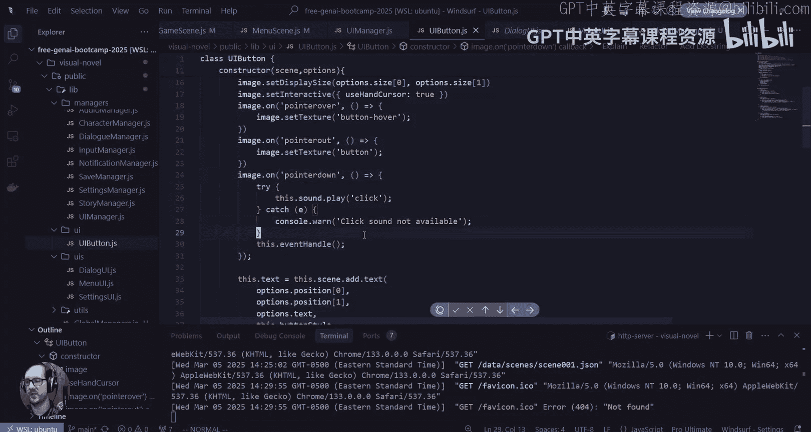

On the global manager。 So again， it depends on like， who is managing this stuff， right。

 Where do we want to see these events。Because context really matters， right， Like if you are。

Currently， well， the other thing is like these， these screens can appear other places。 Now。

 this one doesn't。 but like other screens can appear other places of the setting page。

 we only want that U I to appear on two different screens。

And so now we're trying to think about like where these events are managed。

 So I'm thinking that I probably want to imagine manage them in the global events。 So， I mean。

 I'll put them there for now， the global manager。 But over here， we'll have settings here， right？

 So what I want。To do。As we'll just collapses for a second。I'm just trying to think about。

 what buttons we have。And so I'm going to go here and。I might just like， yeah， we'll have like menu。

Mu events。Here， and then because then we can just say like this menu events here like this。

And then what I can do is say this dot event bus。Which is fine。It's not exactly that。 I mean。

 like we can we can preent it so it always says that。 So it says UI open settings right。

 but here we have point over， point out， point down right So these are the actions we have point down。

 I think is the click。And so in here。I mean， this is fine， but we'd have。No， point over。Right。

 and then we have our。啊哈。Point down。Point down， point out。I mean。

 we could have all of them in here and wire them up。 But right now。

 I just I just want these three because that's what we're working with right。

 And so here you can see that we are changing the texture。

 So that's something we definitely want to do。 but we also want to omit omit from the event bus。

 So the event bus is going to be like this dot event bus emitmit and here we have our handler right So really we'll do back ticks here。

This says hover， but I'm really going to do point over。So I want to match the language here。

 and we want to do some interpolation。 And this is gonna have this sort of venttr。

 And then in front of it will do U I。 So now we are kind of defining D see。Something here。

 we could even go a bit further and say like U I button。 So then we always know that it's a button。

 right？ And so then here I can go say like U I button。And then it's very clear。Was happening。

 In fact， we could also。You know， we could put point over and stuff prior to that。

 But I think I would like to do in this order。 And so now we are defining kind of our setup here。

 The question is like， what did we need name those buttons， Right， So if we go back over to our。UI。

 where's the dialogue UI here？Down below here， we do set dialog UI， is this right？Great dial box。

Great next button。No， no， that's not it。 It's a menu U I menu U I。 And we go into here。

 we do have event handlers here， but we can just call this new game， right， So new game， continue。

Right settings。So then now we can go back over to our event bus。

 wherever that is or wherever we're doing that global managerger。 And now we have things like。

New game。New game。New game。 Now， we don't really need to do all of it。

 We really just need it on the point down。Because that is going to be the actual click。

Right we we want， we could rename these。 But right now I'm going to leave them alone。

 And this is where we'd have like this dot start game。Right。

 this is where we actually want this to occur。 The only thing is that in order to start the game。

 we need to。Call the appropriate。Transition or function for that。 So we'll have to think about that。

 But right now， that's the implementation that we want。 You know， we might want to like play a sound。

 play sound。 That's gonna be something that we want。

 or maybe the start game function takes care of that when it does it， right。

 But I would probably extract these as simple simply as the are。

 So I'd probably have just this like that's what it does it。 is this do game。

 because I'd rather keep these nice and simple。 if I could。

 I'd probably also just do like this do game like this， this do start game， right。

 start game wherever this is。I don't know where this is right now。 But the point is。

 is this is what I would want to do。 So we have that。 We also have settings。Right。

 we also have continue。Khan。Continue， and so now we're starting to get continue game。

Open game settings。 right， So now we're starting to get our event buses in place。

 And if we go back over to our UI button， we can see that we， Well we don't。

 while we're emitting them， but we don't right now have the stuff configure。 We point over。Right。

 this one is。Here， it's saying button not this。 So it's passing a reference to it。

 So that's actually good because if we need to manipulate that button， then we can actually do that。

 So that's， that's a good idea。We could also pass in the scene as well。

 so we could say like scene this。And that will also help us out as well。

 because now we can contextually。

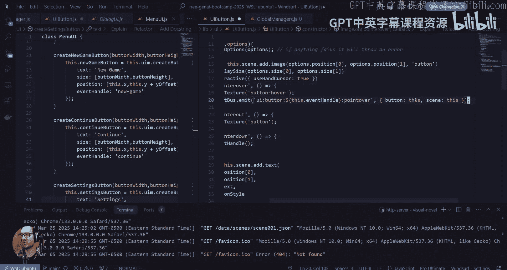

Work with that。 So that's not a bad idea。 I like that。

 The only thing that's not in here is the event bus。 We could access the event bus via the scene。

 So it is a roundabout way， but I don't see any other way around it。

 So I'll just have to say scene G event bus。 Yeah， you know it's， it's quite a mess。

 But now what we can do is bring this down here and we can do this one。

I'm going to go down to this one。Right， and we can do that oops。That， and so now。

RightWe have our means of oting stuff and watching stuff Now we've never used our event bus before。

 so we don't know if it works， but we're kind of starting getting to somewhere here so。I， again。

 I don't know we need the button seen in here， but I'm gonna do that there。 This is not correct。

 This should be dot。Seecene， right， otherwise。It's something make sense。

 And this one is that this is referencing the existing button。 So that works perfectly fine for。

 for that there。We do have image here and we might want to store on this this dot image。That way。

 if we need to reference it for any reason we can。Alright， same thing for here。 Yep。

 same thing for this。 Yep， come on。 You can do it。This dot。Good。

AndNow it's not doing it for some reason。嗯。Oh， we did do it down below here。Oh， no， that's image。

 right。 That's that's text。 That's image and text are separate。

 But now we have a reference to text and image。 So if we need to manipulate them in any way。

 update the text or do something， we can do that。 We could make another function to also update the text dynamically。

 We don't need that right now， But at some point， we might。

 We might also want to extract out the text into a UI text。

 So we have a little bit more control when working with it。 obviously， we have an image。

 And so the image could also be done something with because a button doesn't necessarily have to be an image。

 but it is。 But anyway， so we have that major re factor there。 Let's go back over to our。

 I know we're getting a lot of things here。'll go back to our UI manager。

 We have create button very straightforward。 The button styles are over here。

 So that is a little bit of a challenge as we probably want to。😊，something little bit different here。

 Let's go back to our U I button manager here， but there should be style， somewhere in your style。

 We have button style down below here for the text。嗯。So right now， I don't know。

 I'm just going to take that from the UI manager and just hard code it into the thing for now。

 and we'll worry about that later if it even becomes an issue。

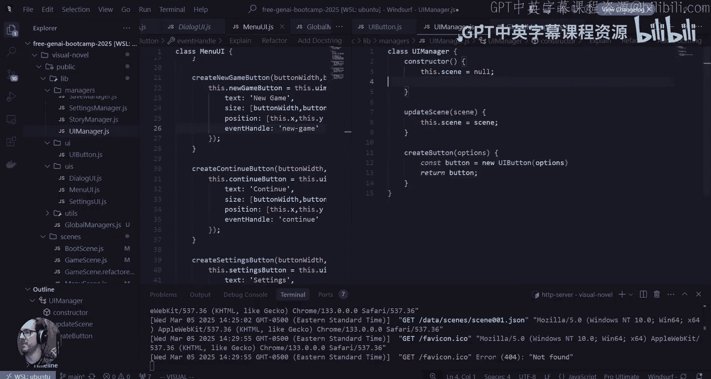

So go back to our UI button here。 and I'm just going to go here。And we'll paste in the style here。

 And so that will be something that we now have access to。 Okay， so all I'm hoping for。

 I don't want any functional code。 We're gonna get some errorss first。

 But I just want the buttons to display in the same location that they were before。 And if they do。

 we will be in good shape。 But we did make quite a few changes。 So we'll see how much we have to fix。

嗯。It's not like， I don't mind if I'm making M S。 I have to fix my own stuff。 But once it's the， the。

Agent， we started getting diminishing returns。

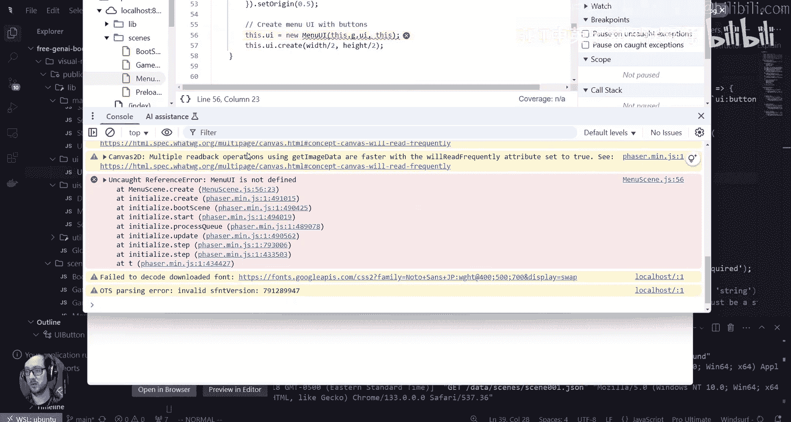

Mu U I is not defined。 It isn't。So we'll go over into our index HTMLL。

And here we can see we have UI components。We don't have the U I， the actual U I screen。

 So we have U I。嗯。You eyes。we'll go here and this one needs to be DIs。And one will be you。Mu U I。

 right， or sorry， menu U I gets in the order Then ones U I menu。 And so now this should load。

 no problem。 We don't have game U I right yet。And I don't know if I would call it that。

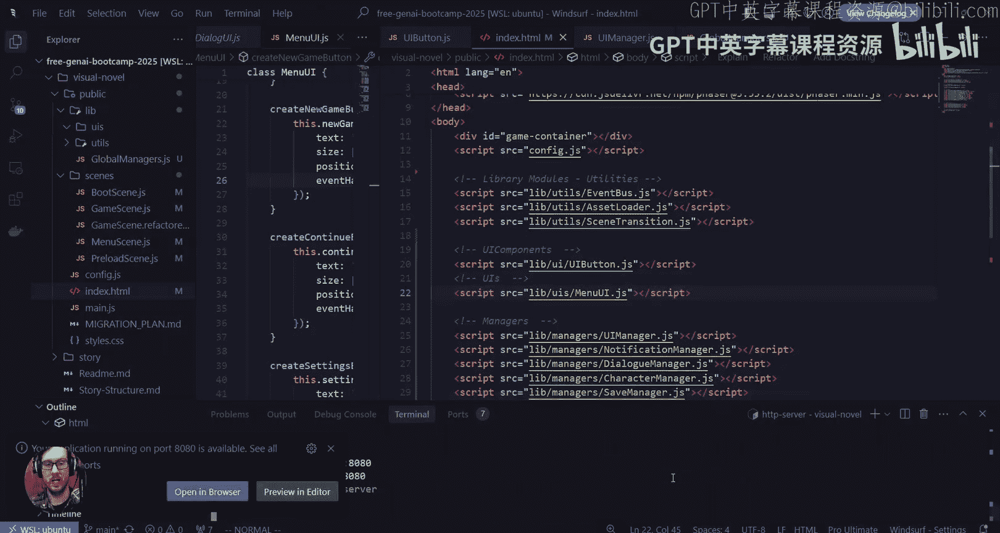

But we'll go back over to here and we'll give this a nice refresh here。

And so we have here cannot read text totally fine options dot text， right， So right away。

 it doesn't know what that is。 I'm not sure why。 So we need to kind of crawl through this。

 So options。

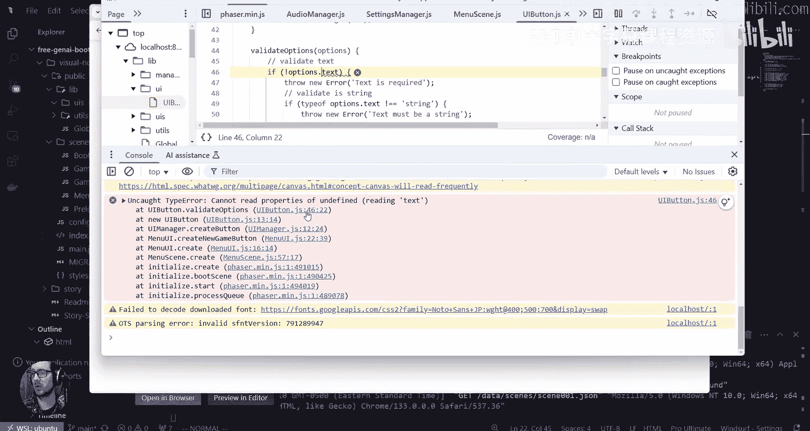

Comes from。Here， which comes from here。 Right， So that's spine。 And that comes from our U I manager。

 which is from here， which passes it to a crate button， which is here。 And then that then comes from。

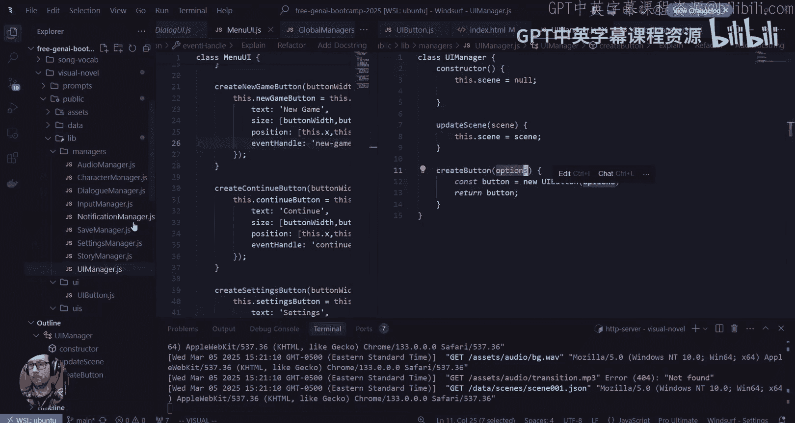

，Mnu I， which is here。So if we go into here into our menu UI， it should pass it in and we see text。

So I'm not sure what it's talking about。 It clearly is there。

 So I'm going to go and I'm going to see if junk GTP or whatever this one is。

 Claude can try to figure that out。So I'm gonna go ask it and see if we can figure it out。

 because I don't understand it it's， it should be defined。 I just walked through it all， right。And。

 you know， if we're debugging this by hand， we would just keep walking through it till we find it。

 So in here。We have。Options， maybe we don't pass。 No， we do pass the options to validate。

So I'm not sure what it's talking about。I found the issue。

 UI manager to create button methods not passing the scene to the UI button constructor， oh。

It doesn't。 okay， and so here。We just do that because in the first option we' be seen。

 That's why it's getting confused。 So this will resolve the issue there。

 I'm not sure if we called U I manager update， but I guess we'll find out as we work through this。

And so we'll go back over to here。 we'll give this a nice hard refresh。

But once all these systems are in place， the game code is going to be really easy， I think。

I say I think Taylor it says scene not def， I forgot to put the disc on it。

So we go back to this here， Yeah I'll just fix that there。And I'll go back over to here。

 We'll give this a nice refresh。

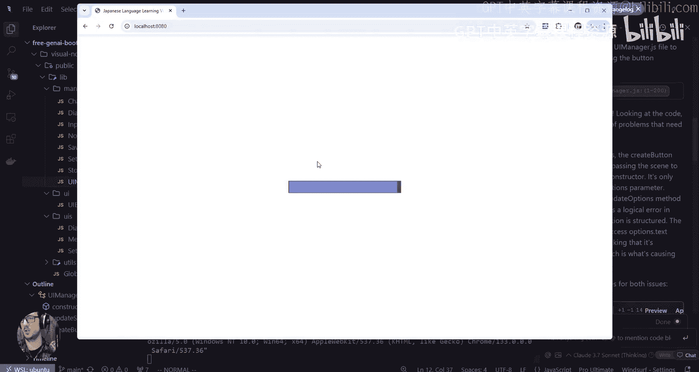

Hes getting a little bit cold in my office。's no suit on here。I， I was writing the heat。

 but I'm trying not to waste it too much。 It's not that cold out。

 It's just that it's getting cold in here because it's really windy today。

 And that's giving me a lot of problems。 we will。F this up here。

I know a lot of folks like had built out games using Amazon Q， but I can't imagine。

It would have done that well。 I mean， this is windsur is really good。

 but it's as best as it can get here。So， oh， yeah， Anyway， it's displaying。 So it looks like。

This works。 and this will be a good natural stop for us here。

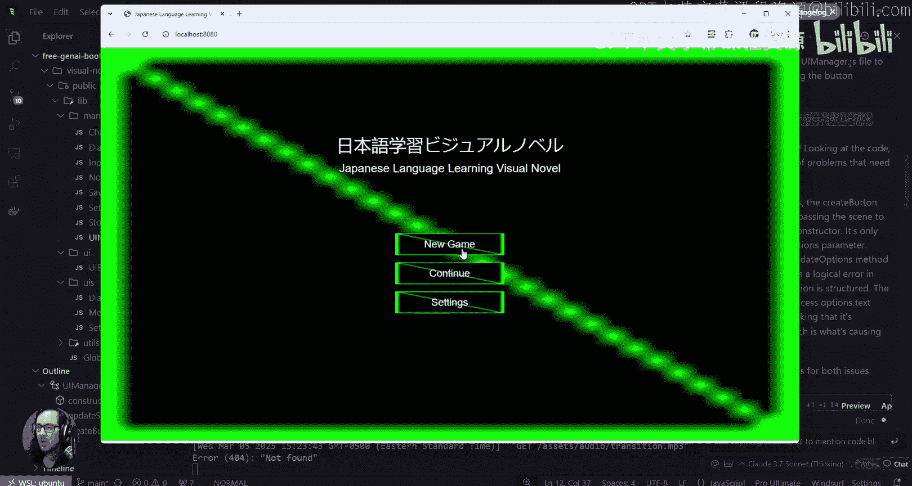

I don't want to pressing these buttons， I don't expect them to work， right， if I go here。Oh。

 actually got audio。Wait， why did I get audio。

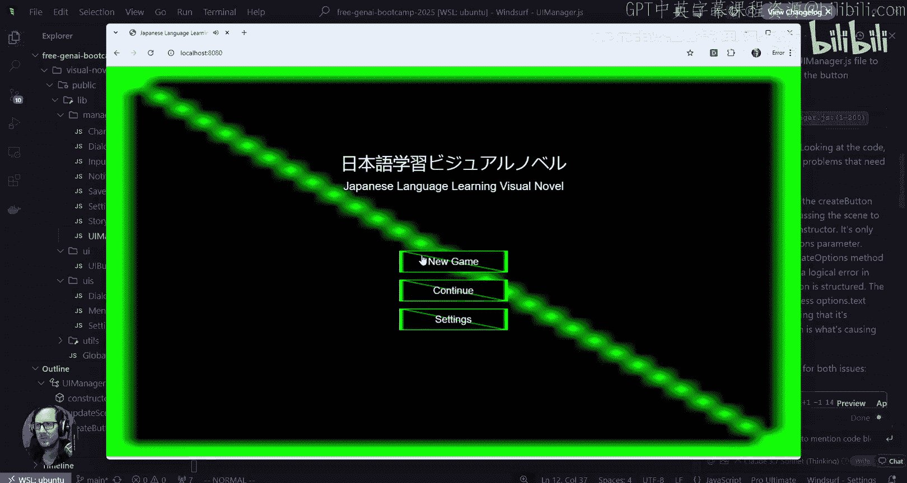

No， no， no， no， that doesn't make any sense。That doesn't make any sense。 That's not working。

 There maybe the old code is still there。 Let's go take a look at our menu menu page。

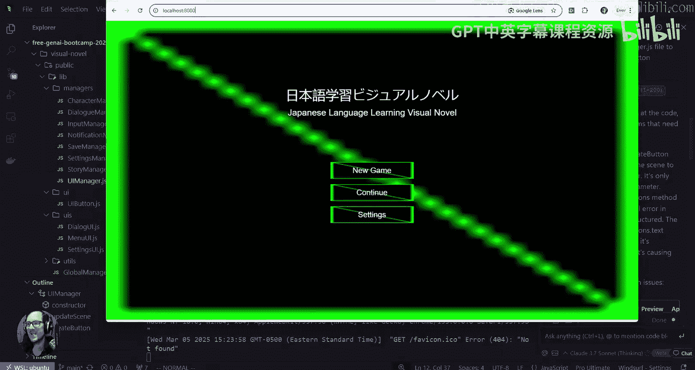

There's no way。create a new menu。hu， start a new game。 Start a new game button still here， right。

Continue again。No， no， no， no， no。 Well， you know， one way we can we can test if this is actually working is we can change the spacing of the button。

 So I'm gonna go here and this is the prior spacing。 right， We'll do something really dramatic。

 We'll make this larger。 So we'll say 500， and then we'll make this 80。

 So the spacing and the buttons are going to， that's it the button size。 Well。

 we'll make them fatter。😊，And maybe we'll actually make this smaller for fun。And then we will see。

 becauseuse if， if it is actually working， that will actually update。Oh， it is。

 The only thing is that it's overlapping。 So there is a little bit of logic problem with our， our。

 our buttons here。 This has to do with the fact that。

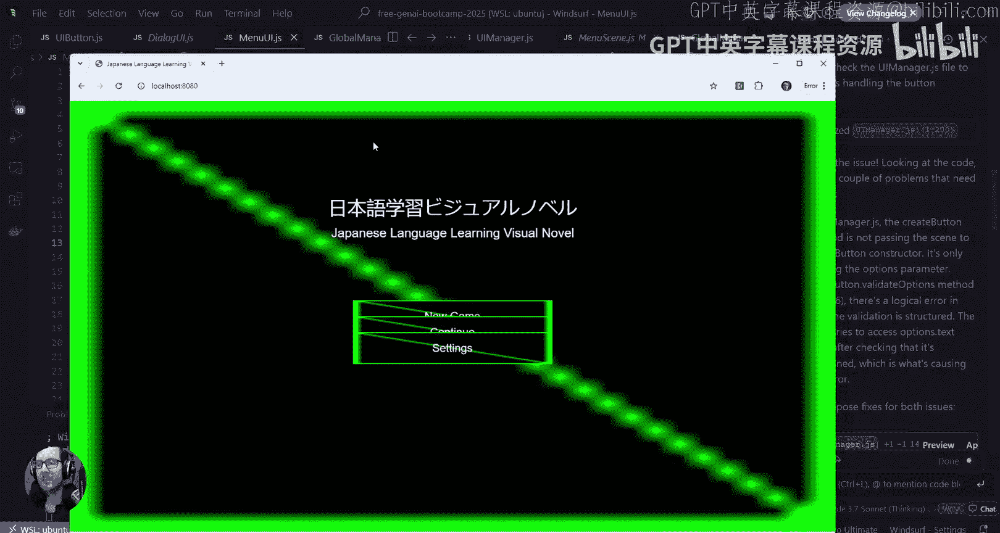

The way it should determine the offset is also by bringing in the。The button size， right？ So really。

 it should be this dot width。Let me think about this for a second。

So I'm just trying to think about this for a second。 So we have button with。Right， button height。

Spaccing。So that's our， that's our offset。 So we have0 plus spacing。

HI'm just trying to think here for a second。I'm sure the logic's not hard， but yeah。

 I guess our code is updated。 So we are basically done， but we'll fix this one last thing。

 And then we'll， we'll make this the natural break for the video。 But the next thing we like。

 I guess we're moving on to the event bus， basically， making sure our event bus works。😊。

I'm trying to get to that settings page right so the event buss works and we have a bit of a framework for our UI buttons are basically most of the UI here。

 so that's going to work out really really well for us。But we have 0，1，2。 So what。

 what is it we have here， It's， it has this， and it's doing like times the value， right。

 So but basically， we have here， the button sizes。

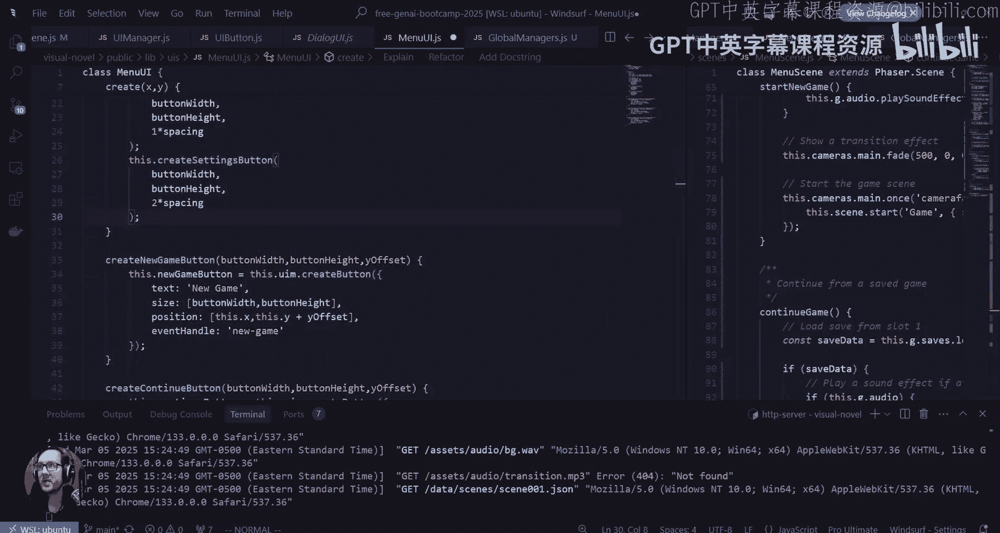

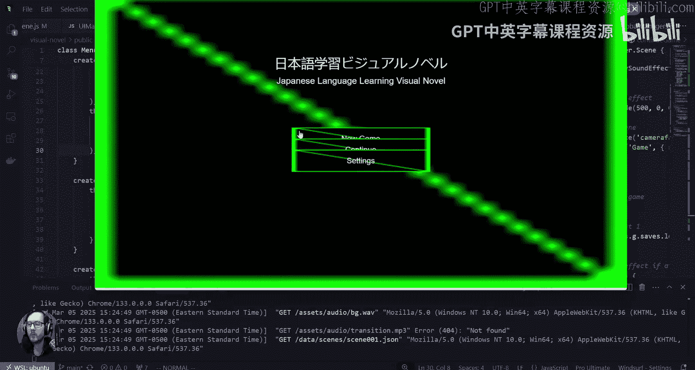

Is what it should be timeing it by。 And then it's also adding the out of spaces。

 So if you have this button here。

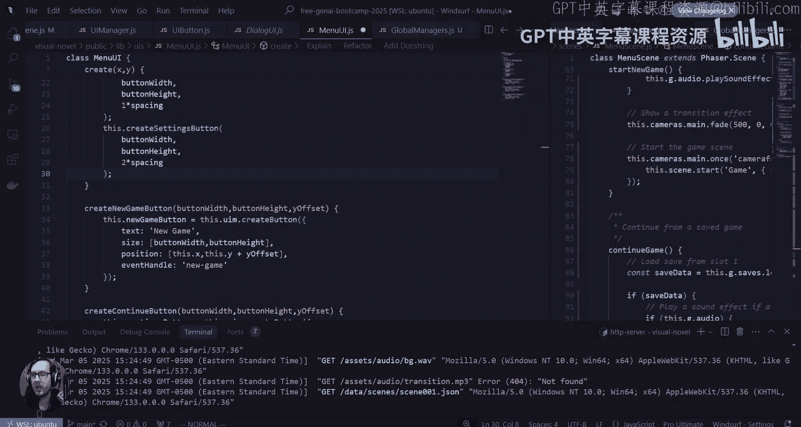

I'm trying to think about this。 We have three buttons， right， And so the first one。

 if it's the space 0， then。It's going to be 0， right now we're on button button one。

 So if it's button  one， we need the height of the previous buttons。

 We're going do one times height of previous button。And then we need the spacing added to it。Right。

 and then if we go to the next button， if it's two。Then it's going to be 2。

 But then we need the previous spacing always。 So I think the logic here is that we need。

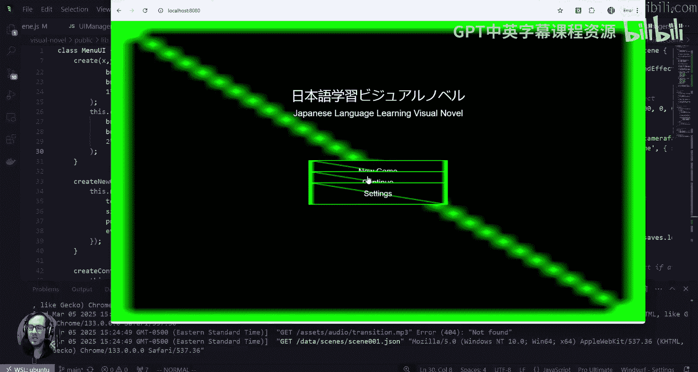

嗯。I'm trying to think of this for a second。 So we have。0 times button height。And then， we have。

I mean， the first one is going to be zero。 So it's not like really we need it。

 but I'm just trying to do this as a pattern so I can remember what it is。 And even the first one。

 it's zero times spacing， right。And so， then the first one。Yeah， you think that。

But that's not going to work because。It's going to be one times the button height。

 and then one times the spacing。Oh， maybe it is。 Okay， maybe it is as simple as that。

 Let's go take a look here。 Give us a nice refresh。

Yeah， I guess that works。Yep， okay。I mean， it is consistent。 So we could go here and just now。Go。

 and。Make it all one line again， But I wasn't expecting it to be that easy。 So whatever it is。

 So that's good。 But， you know， I might want to tighten the spacing here。

 So I'm gonna bring this to 20 here。

And we'll go ahead， and。

But wouldn't that change the spacing for each one， I guess not。

I'm not sure why the last buttons not there。So， it's must be too。

 It's probably over top of each other。There we go。 So the second button。

I don't know。 what's still on here。 Try this again。Yup。Yeah， and yeah， okay， there we go。

 So we'll go back here。 So now we have。

Our three buttons。 And now if we want to add another button， which I do want to add another button。

 I can very easily。 So I'm going add in here。

，Load button。That's pretty common for this game to have a load button here。And so then it's now2，2。3。

3。Okay。嗯。And so then in here， I want to have my。Load button， such just copy this like this。

 Lo button。Load button。 One thing I'm also noticing is that almost all of this codes the same as well。

 So we really wantan to clean this up。 We're gonna clean it up。

 We're gonna call this a create button。😊，AndHere I know it seems like unnecessary。

 but I'm going to do it anyway， I don't care。And。嗯。😊，No， you know what。 I'm not going to。 But。

 you know， like my point is that we're repeating the same code， repeating， repeating， repeating。

 repeating。 And so， you know what， screwed。 I'm gonna do it。 I'm gonna do it， I'm。

I'm going to refactor this all the way to hell， and I'm going to go here and grab in these values here。

And I'm going to put them right here like this。Right， and then we also have， I mean。

 those values are set there as that， but I'm going to go ahead and grab those like that。Okay。

 and so then I'm going go here。And do this。And then I'm going to go up to here。

 I'm gonna say buttons。Let's stop buttons。And we're gonna have the create button。Or new game。

New game， create continue load， right？ Oh， we don't even have a quit。 That's a good idea。 I mean。

 there's nothing to quit， too， because you're in a browsersy， right。

 So you can't really quit the game like in that sense。 But yeah， if we did more with the game。

 we could probably do that。 And So now that we have that， what I'm thinking is。

This is gonna change a little bit。 So now we just can kind of say what position it's in。

 So we just say position。Right， and。Down below here。You know， we see that。

 but we have this logic here。 We have button width， button height。 So that's not going to change。

But what is going to change is this thing here， which is its actual offset。 Yeah。

 this is the constant Y offset。And so this is going to really be positioned。Position。Yup， yup， right。

 And so now we have the y offset like that。 And the only other thing is like， we need to specify。

 we have position。呃。Text， and then。A non event。Handle， right。 So now we have that。

 and I can replace text here。And we replace event handle here， yep。And we are。Going to refactor hell。

 I'm going to refactor hell for doing this， for over refactoring this。

But it does make it a bit nicer。 So now what I can do is when I want to create these buttons。

 I can just say。Just stop it。 Stop it。 Stop suggesting， no， I don't want any of that。 I want to say。

 no， stop it。 Stop it。 Stop it。 This， this do create button。 It just will not listen here today。

So now I can just do this and say this stock create button。嗯。Position。New game， new game。 Yeah。

 there we go。 Okay， And so they do this one。This button， no， this create button。

You are not getting the messageenger yet。 Con， continue。That one's gone。This dot。Settings。load。

 but I want load to be here。So， now。Our coat is clean。 We're clean。

 Have everyone ever seen the walking dead and there was that character。

 And he's trying to clean all the houses out。It's an apocalypse thing。

Then you'd understand what I'm saying。 But now we can， you know， position our buttons。

 We can control the width and height and stuff like that。 It's over here， right。

 But we can also set it up there and have it referenced instead， so。Here it says button。

 has the scene camera main height width。We're supposed to bring in the X and Y here。 We do。

Do we even need these， We don't even use those because those get passed in， right。

 So those are now out of there。 And we can now lift these up here。Into our。

We don't need them to be globally available， but I'm going to anyway。

 And now we can just do this instead。And then we go down below here。We can。啊。

We don't need all these other buttons now。 All these other buttons can go away。 Bye bye。

RightAnd so now we just have this one function。And。Yeah， we're referenceencing like that。

And so that just sets the buttons。And so now Dallasas is nice and clean。

 we can create as many buttons as we want。And we have our event handlers。

 I'm gonna just stop and make sure this still works。

Please， please， just work。 Please， please， please。Please， please， please， please， please。 It does。

 That's excellent。 I'm gonna just comment out one button for a second here。

 Maybe the continue button for a second。 We'll go back over to here。

Well give us a nice refresh。Good notice that it still holds that position like that。 That's because。

It's not iterative here。嗯。I'd have to go like here and just say like position。Const position here。0。

Yeah' not really what I want。嗯。No， again， again， if you want this to be in a very particular order。

 then what we could do is we could go here and just say， you know， constant button data。啊哈。Okay。

 but we don't need the position like this。Right like that。And then we'll just give a four loop。

 whoops。T dot text。Yeah， there we go。4。Okay， but that's the increment。 So loop and increment。

Increment position。4 loop。Increment position。Of button data。Pause。Just do it for me。啊。啊。😊，Yup。

There we go。 Cool。 I didn't have to write it。 I used to use like stack like really direct for loops causeuse I don't necessarily trust this stuff。

 But now we can just render our buttons。 So now I can go down here and just say， create buttons。😊。

I am going to render hell。 I'm going to refactor， sorry， not render hell， but refactor hell。

 because I'm just overdoing this stuff。 And So now what we can do is grab this like this and say button data。

 oops。😊，Put it back。 Put it back。Does it doesn't know what I want to do。 So we say button data。 Yep。

 there we go。 And so now I can go here and just say。Cate。Buttons， look at that。Yeah， it does have to。

 Yeah。 Okay。 Yeah， yeah， you want that。 we've got that。 So now we've， we've like。

 really refactored it。 And so this way， I can add one。 I don't have this weird gap here。

And now we like're really just like we're using the AI still to help us assist code， but not。

 not to write it for us。 So we have those here that looks good。

 I'm gonna go ahead and just comment this one out。 I think I can comment in the middle here and should should not break anything。

 We have a nice refresh。 We now have three buttons perfect。 And we can move this wherever we want。

 So later I want to move over here left right， I can do that at the top level。

 And so the next video will be the event bus。 So you know what。

 I have a little bit of time because I'm gonna have office hours right after this。

 So I'm just gonna test to see if the event bus works。

 And so I'm going go over to the global manager。 And we have these buttons here。 now。

 they these are possible handlers。😊。

I kind of like to do it like this and then deal the functions afterwards。 So I're gonna go here。

 and I want to。Say we'll do start game， right， So I'm gonna say start game。Like this。And。This thing。

 I think， passes in like we have options or data payload。Call this here。 I'm going to do console log。

Pyload。Or， well， actually， this is event data or this event。So say events。

There might be other stuff that we might want to pass along other than those two things。

 but if it works。Right， then that'd be really cool because then we have our event bus。

 But the question really is like， you know， where do these event live， Do they live here。

 Do they live somewhere else。 But right now， they do live in the global manager。

 This could be a mistake。 But， But if you've ever looked at video game code。

 video game code is an absolute mess， right， And just the fact that we can get this working。

 willll be exciting。 So we'll go here。 And we have our buttons here， right。😊。

And。Now I can click， I think new game。I hear music playing， which is fine。

I think maybe the music always would have played if we just went into here。🎼Cause it was not focused。

But I'm clicking new。

Right， and so I want this to。Tgger， I'm seeing no triggers here。 I'm not getting any errors。

 that's not a problem。 So it's like our event bus is not oting。

Emmitting， so could be just the name of this is wrong。 This is point down， right， And I don't know。

 I don't know if that's the case。 So we'd have to kind of look at that。

 So maybe we'll go over to our event bus， wherever that is。嗯。And we'll do a little bit of logging。

Where is our event bus。Sonner you Tis。So we go here。And when emit happens。

 I want it to log so I can see what's going on here。Event。Data。Call back。 call back。嗯。Data。

Amit the event。The data here， Oh， and then the on that it's doing that that that's doing it there。

 okay。So， then we have。O。I guess it's the on function that we have to do on the Okay here because if the on function gets called。

 then we have the information。 So we do console log。Arguments。

So should just print out all the arguments here， and I'm just going to go dot on。

 And that way I'm going to be able to see what's going on here， right？

Assuming that I can call arguments here， but that's normal what you can do。

 We'll go back over to here。 We'll give us a nice refresh。

And I'll click new。And I want to see。Did we have an on call。Oh， we do。 We actually have a bunch。

 but I'm not sure when that actually occurred because this looks like they're getting initialized。

 Let's refresh this page。

Yeah， this is， this is happening right away。 It's not even when a click has occurred。

 So I only want this to happen when we actually click it。 So here we have event。

 and then we have our call back。So。But then how do we know。

I guess it has to be on the o。Yeah， yeah。 It has to be on the admit。So we'll go down here。Yeah。

 so you know what we're doing we're looking for。The emit arguments。

 this is actually what were looking for。 Okay， so we'll give this a nice refresh because I just need to check what the name of that。

That key is， that maybe we should make our keys shorter so that our lives are a little bit easier here。

But I'm just going back over here。It was a nice refresh。I'm going to click this button here。

And it's oting。 okay， so it has UI button undefined。 So it's not passing the event handled。

 There's there a problem。 Our our， our event bus is a little bit long to be fair。

 but it is not pressing that new game button。 Another issue we might have to worry about is if we have conflicting buttons。

 So we might need to uniquely name them， based on some settings here， which is fine。

 but I'm going to go here We have UI button。如 i笨。And what I'm looking for here is。

We have a event handler here， which makes sense。 So must be UI button。

Because here's supposed to admit it， right， this event handlembr。Oh， it's options。It's options。

 that's our problem， says specific options of in handler options。Okay。And。

We're getting closer to our solution。Thiss a nice refresh here。And I'll oh， we have a met。Oh。

 it's midt and cool。🎼I click it boom， and we have our event data。 Now。

 this is technically the event data。 It's not the event information because the event information would be things like the actual event Id。

 Well， which we don't need to parse， right， because I don't know there's there's nothing really interesting in there that we need The one thing we might want to know is like where it's coming from。

 So that might be something we might want to say like， you know。

 where did this event get clicked from。

🎼嗯。But that's just unique stuff。 And so now we have basically， we have the event bus sort of working。

 right Like， I mean， it definitely calls out。 But like。

 does it call out the actions that we want is the next thing。

 which we could just call like scene dot start game， right， So we could just do that。

But I would say that we're very close to。Getting past the systems。 But obviously， the setting system。

 sorry， the UI manager is almost there our event bus seems to be working。

 And so now we're trying to drive towards that settings page， right。

 But we might have a bit more UI work to do there because if we're doing UI， then we need to。

 I don't know。 we need sliders or inputs or something like that。

 but that might be a bit pain pain and phaser， but we'll find it as we work through that。 But yeah。

 I'm gonna commit this。 And we're going to say refresh this is way more than that。

 There must be way more than that， right， There has to be。

Sos good control。 Oh， yeah， yeah， yeah， yeah。 We got lots and lots of changes here。

 So super epic game。 So we say just super epic game。😊。

I'd love to bring in Hayja now that I thought about it。Like， it'd be kind of creepy， but well。

 maybe not， but like。I don't know if it could be do Japanese， though。 That's the only challenge。

 But anyway， I'll see the next video。 I'm sorry this could have been an hour video。

 but we extended to 1，40， but there you go。 See the next one。 Okay， Co。

