# ExamPro《生成式AI训练营｜Free GenAI Bootcamp》中英字幕（deepseek - P63：-63-Visual Novel Spacing Origin Containers.zh_en - GPT中英字幕课程资源 - BV1SFEWzLEab

Hey， folks， we are back。 Were working on the refactor of the base UI here。 And so we'll walk through。

 first of all， is' try to put base Ui up here。 That's not how we do our imports。

 It actually happens in our index HTML。 So I'll go over to here and in the That's that before we define our UIs。

 We only have a couple right now。 But this is going go above it。 So we'll have our base。😊。

Base U I right here that will get imported here。 And then we'll go back here。

 We need to walk through the code。 So this here is。Not supposed to be there， but this is fine。

Initially it shows it， so when it creates it， it shows it。I guess it's fine in here。

 I might remove that out in a second。 Here we creates a button。

 then we register the button with the base Ui because I was figuring that would'd have to do some kind of registration to know about the button。

 And so here it says this dot buttons register the button with the base UI。Yeah， yeah。

 so'll do that in iteration。 So that actually will work out fine。 and it exports it。

 We do not need to export this。 That doesn't matter because we are loading every file individually so it's not going to work the way it thinks we'll go to the next one here。

 This is the actual base UI file。 So here we have scenes UI elements。

 which is correct interactive elements。 I'm not sure why we have a separation of it Disable objects。

 I'm not sure why we have a separation of that。 I it visible is enabled， that makes sense。

 So we register an element。 So register UIM element to be managed by this class。

 And so we are pushing the element onto it， which makes sense。 if it's interactive。

 we add it to the interactive elements。Okay。I guess that's fine， I mean。

 if you have to hide or show it， that kind of makes sense。Register the elements。

 so element for each element， we iterate through it， and it's going to do that。

 So we have an individual way to register it， and then we have register UI elements all at once。

 If we don't use this， I'm not sure why。why we have that， but I guess it's fine。This is iterating。

 It's not a big deal。 We have the visibility。 So if it's visible， update the visibility。

 So we're going to iterate through it and set the visibility on it， whether it's true or not。

 and then we have enabled。 So this is similar， but it should also show whether it's visible or not。

Enabled， so if it's enabled。We'll set the interactivity here。

 And that actually is something that we can set with set interactivity。

 So that's not gonna work for all of our elements， but it'll work for some of them。😊。

We have scene input manager game objects。 So disable all interactive objects in the scene。

 which I guess is a way that we can do that。 Check if an object is part of a UI parameter show。

And then hide， destroy， I guess the interactivity really has to do with the like hover and stuff effects like that。

 destroy。And this looks good。 I'll just take this one line out。 and then we will say， keep changes。

We'll go to the next file。 We'll go sorry settings。We don't need this。 We don't need。This， okay。

 will keep changes。 Now， does it show it when it creates it。It's not supposed to， so。嗯。

By default hide these settings in the UI， I think I would rather manually set those so they're more explicit。

And so we'll go here。And we'll go into our menu。 And so now we can actually kind of transition between the two。

 which is really nice。 But in here we create our UIs， right。

 and I'm going to say here they can say this do UI settings hide。 and this will be this do UI。😊，Show。

 and so hopefully that is setting up the base for it。

I wouldn't be surprised if our calls don't happen the way we expect them to。

 but I want to rule that out and make sure that's not our problem where we're having those hover effect issues。

 And that will be the way that we。Do that there。 So we'll go ahead。And。

I'm just uploading the current video here。 I would say monetization off。

 I'm just trying to upload the last video here。 off screen。 It's kind of in my way。And。

Give this a second here。Anyway， that's gonna just come on。 its is， I've drawn upload this video。

 It's， it's really just not proceeding forward here。 It's kind of frustrating。

 I'm gonna put that off the screen。What are you doing。

 I'm just gonna have to give it a hard refresher。 It's just not doing what I'm asking it to do。

Which is fine。

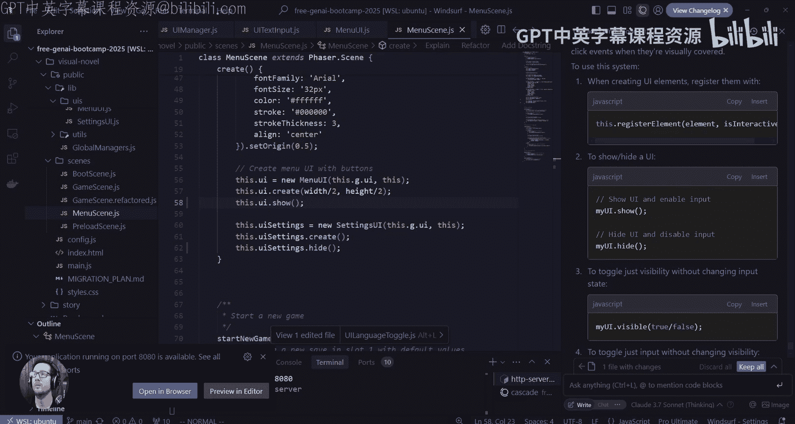

And we'll go down here。 We'll give this hard refresh。 We've made major changes。

 I'm expecting breaking， breaking stuff。 We do have breaking stuff。 It says menu Ui is not defined。

 Men Ui is not defined here。

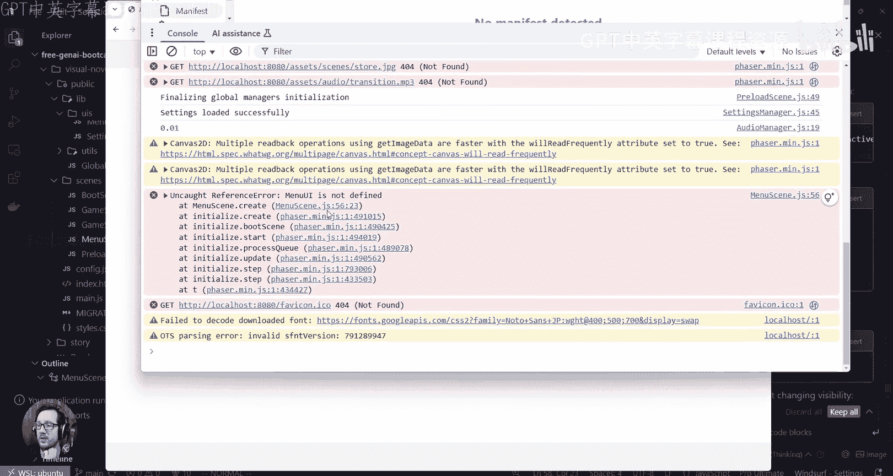

Right， so we'll go back over to here。

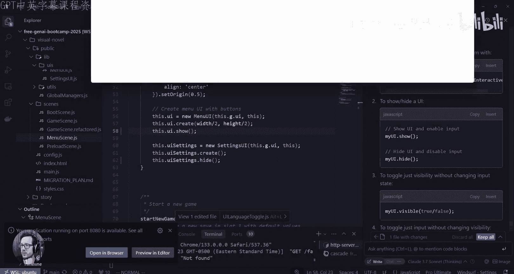

Meu UI is not defined， it's going to menu UI。Here it is。 We're not exporting in these other ones。

 right？I guess we kind of have this exports here。 I， I don't think we need it。

Buger put it in just in case it wants it。

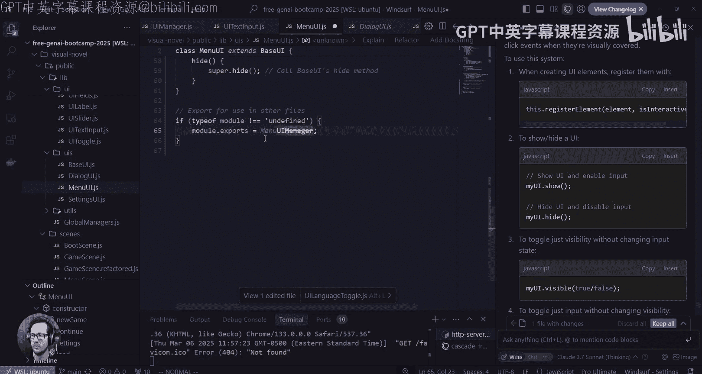

Me U I， right， I I just don't expect that it needs that。 will' give this a refresh here。

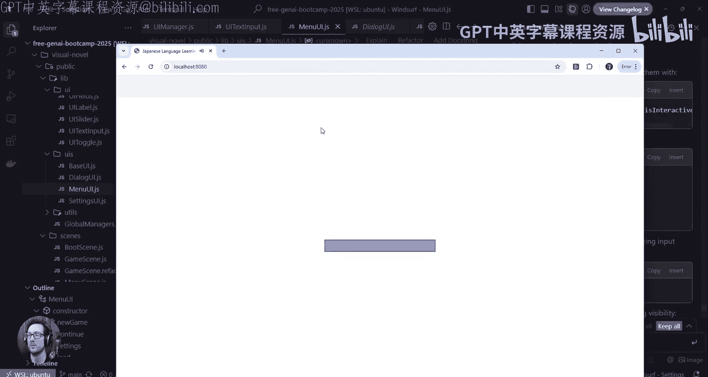

It's。Yeah， I actually did fix our problem， okay， so I guess we do need it。I don know。

 I thought we didn't need it。 Here's do like export default。 But we are， again。

 we're not in typescript or whatever。 This is all little browser。 So I'm gonna stick with this。

If somebody are looking here to saying， Andrew or， why are you do it this way。

 It's just because it works。I'm not going to think too hard about it。We'll go over to here。

 we'll go over to here， we'll go over to here， I'm just making sure that if I removed it。

 I'm putting it back in here so that our imports work here。

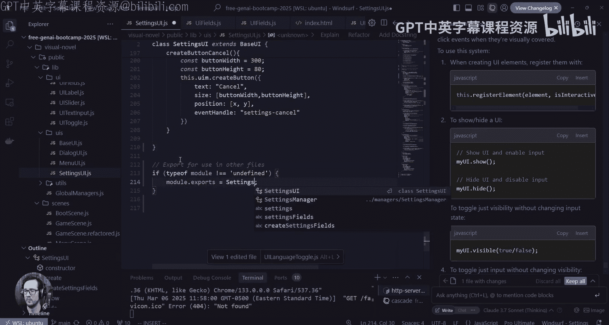

Come on， auto complete for me。 Thank you。 We will go over to here or bring this on down we'll give us a nice refresh and so it says cannot read for each。

 cannot read for each in the settings UI here。This is in our game objects manager for each。Okay。

I'm going to go ahead and just grab， whoops， we'll grab this here。

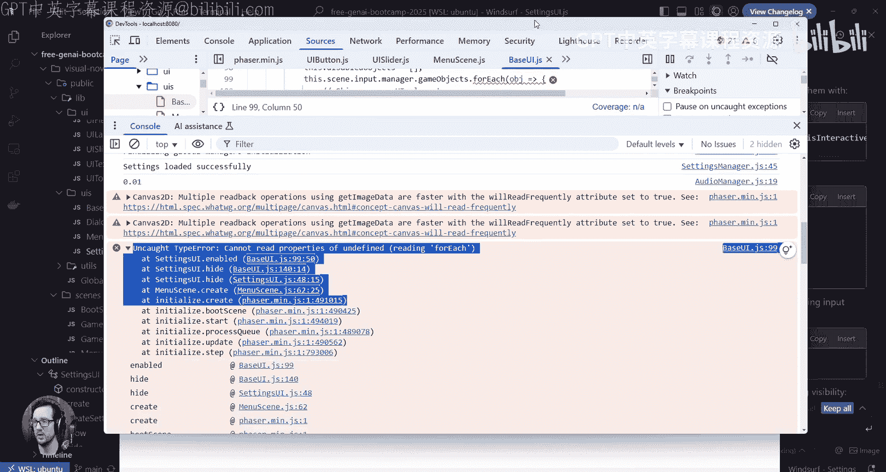

Because maybe it's doing something that doesn't actually exist。

Because now we're getting to like phase your specific code。

 I'm going to go ahead and dump this in here， and we're going to iterate through that and give it a moment。

Let's see what it thinks here。 I need to fix this by。 Oh， did I leave this on right mode。 Oh， no。

 I did not want this on right mode。 I need to fix this by adding a check for existence of game objects before we're trying to iterate there is occurring because。

But it appears not to exist。嗯。Okay， hold on。Hold on。 Are you just。Making up this game object thing。

Or is it part of phaseer？Okay， that's what I wanna know。

Because I don't want to just making things up here。

Paser does have a concept of game objects in base class。

 but I need to double check that's real based on my knowledge。

 There might not be a direct game object。 You're right。 My implementation there isn't accurate。

 isn't a standard phaser property。 and phaseaser， there isn't a direct game object。

 Let me try fixing this approach。Hold on。 Hold on。 Hold on。 Hold on。 Hold on。Hold on， hold on。

 you didn't have right axis。Try fixing your mistake。

I feel like this is where in because we are doing something very specific where like windsurf allows you to put a thing and be like。

 yeah， whenever you do something， make， make sure it's something that Pazer actually supports， right？

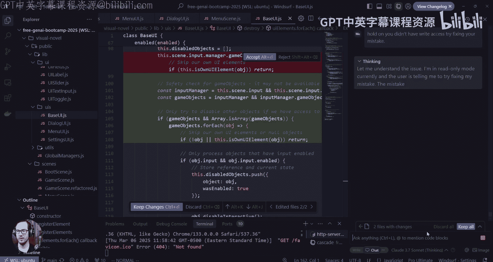

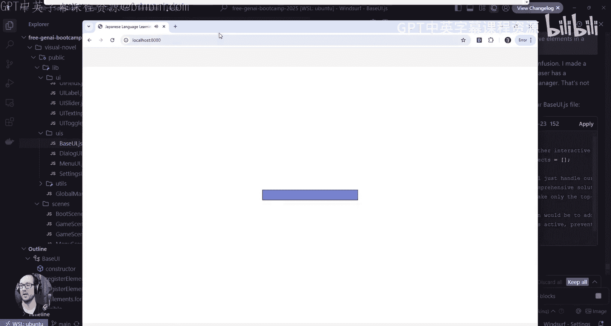

So maybe like windsurf。Windsurf rules。Todium， let's see if we can figure this out here。

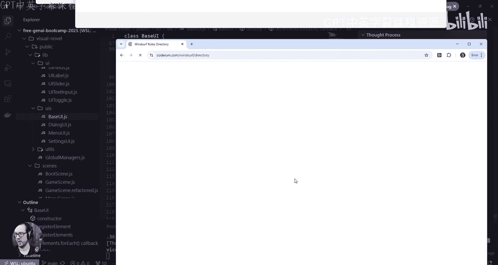

Yeah， like how do we write rules， So the best rules are specific to the user and can tell cascade things that would do。

 So we have front end rules， science， whatever， whatever。 Okay， but how do I write them， right。

 How do I write rules， Where do I write rule rules。

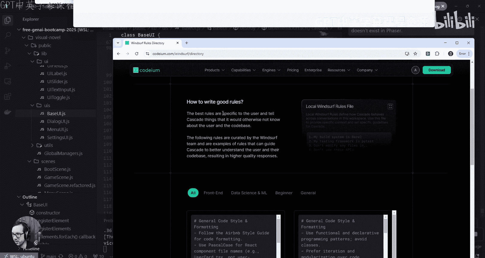

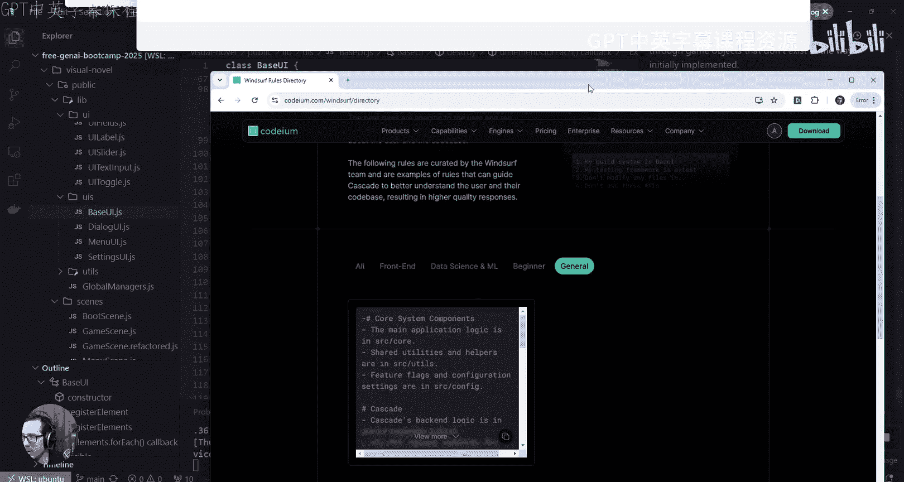

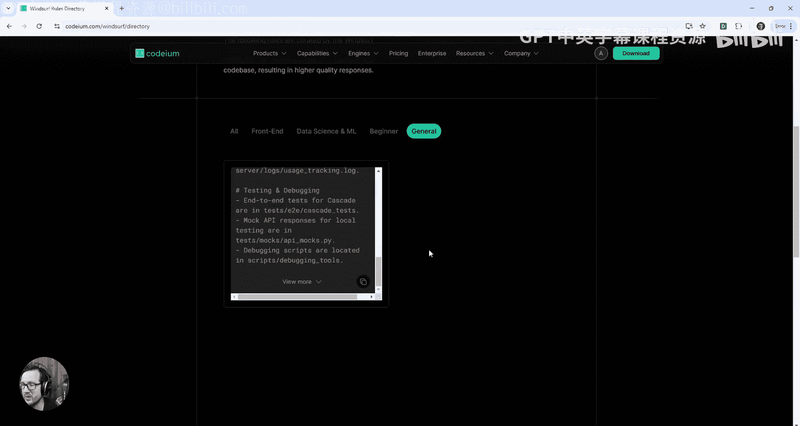

Okay。Doocks。So we're in here。We have。Where are rules， I want rules。That's what I'm looking for here。

 So we go into getting started。Memories， build the contact usage。Cascade。Mem memories and rules。

 So here it says there are two mechanisms， memories。

 which can automatically generate cascade and rules which are manually defined by the user at both local and global levels。

 So during conversation， cascade can automatically generate in store memories if it encounters context。

Additionally， you can ask Cascade to create a memory at the time。

 just prompt it to create a memory of Cascade autogenerated memories are associated with the workspace that they are created。

 so this is kind of a challenge because we have a mono repo right the memory panels can be accessed by any time by going to that settings windsurf settings。

And next to an alternative you can access memory panel by clicking the three dots below did not know it had memories。

 so if we go here。

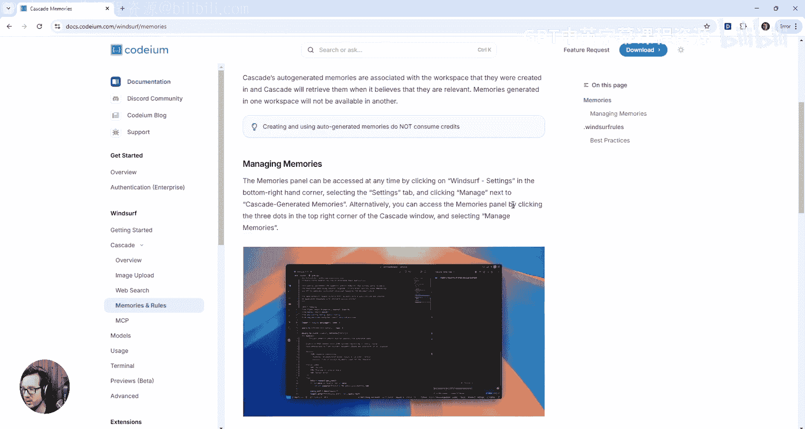

I'm so underut this service， I really need to make a course on it。

So that I'll note the full thing here users can explicitly define their own rules。

 Cascade will be aware of rules at all time。So rules are defined in designated rule files。

For the local workspace files to ensure the rules are only applied to your local project。

 windsurf rules to your projects。geigngnore。The other thing is like， I don't know。U。I don't know。

 like even if I add this here， I don't know if， like if they would pick it up because there's not enough information about it。

 I would love to use that feature， but I can't， I can't tell， right。

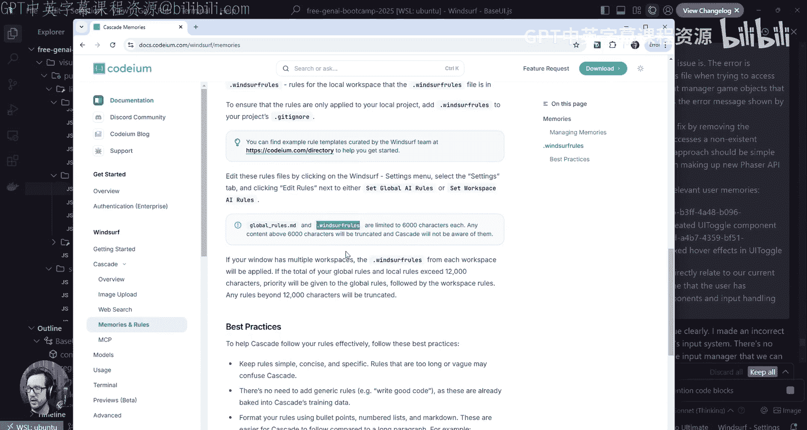

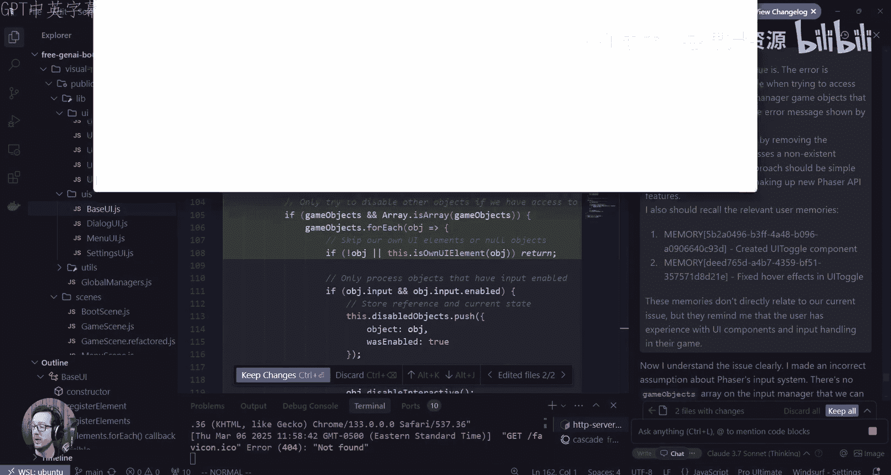

So。Here it's done more stuff。 Did it finish doing something here as we were working through， wow。

 it did a whole lot， is this still going， It just finished。 Let's take a look at what it did。

 so we'll go back here， just close up this tab here。And we will go back here。So what did it do。

 Safety check for game objects， It may not be available depending on it's why are you writing that。

 we know it's not available。 You just made it up， only try to disable objects if we have access to them。

Right， so I don't want to。

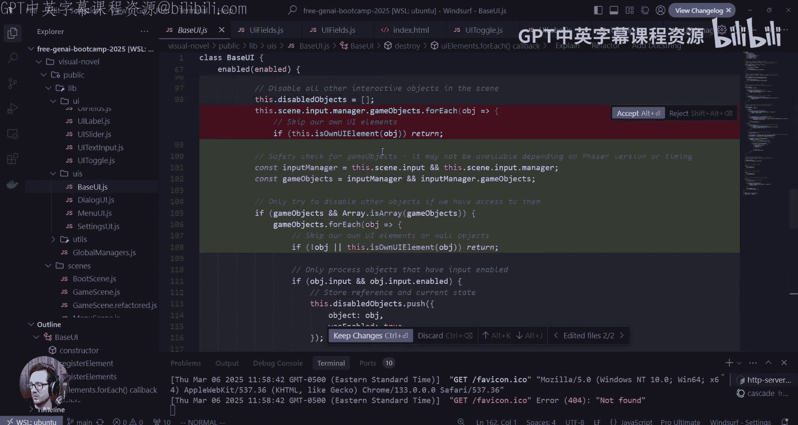

Oh， what is it doing？Look， okay， so we'll go back here。 Oh， that's the old code。

 So it actually removed it。So here we'll just say keep changes。I don't know why it has that， though。

This scene input manager。嗯。I don't know if that's true or not。 but we will。 if it works， it works。

 right， But the thing is， I just don't know if I believe that it's actually looked that up。

 And it's not checking the reference here。 Okay， but at least we're seeing stuff。 So this is good。

 The only thing right now is that what's hidden and what's shown is not actually working as expected。

 We shouldn't be seeing both of them， right。 I'm going go ahead and just select this here。

 and we're going go back over to here。 I'm gonna show it like look here we can see both。

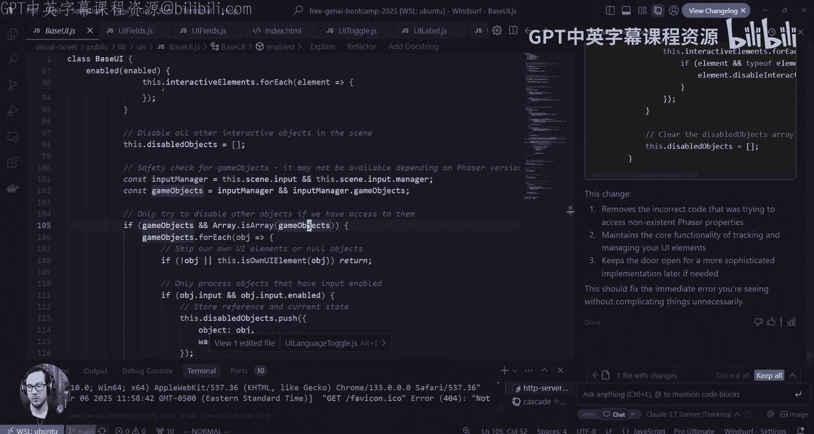

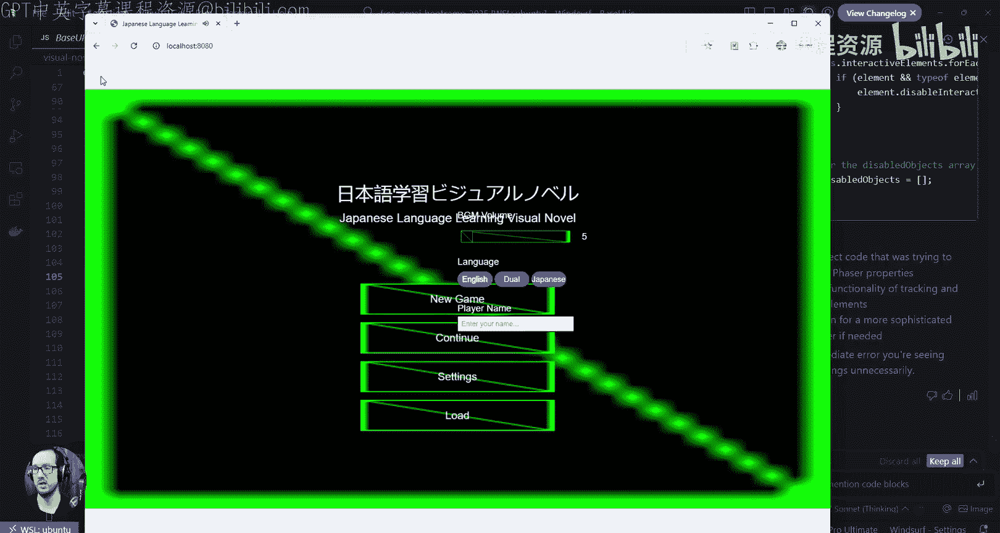

Both。UIs are being shown in the menu UI， was it menu seen？

It should be hiding the settings UI initially。Can you investigate。Okay， see what it comes up with。

 Let's take a look at what says here so。I see the issue。

 the problems that we're creating UI elements in the settings UI class。

 but we're not registering them in the base UI system so they don't hide， oh。

 I thought they did register them。In particular， I can see that the panel background and title elements are created in the Cate B G element。

 but they're never registered with base UI。 This means the UI hide elements may be visible。Okay。

 so I guess it's going through here and doing more updates。 We'll give it a moment。

 I just interrupted it。 and I'm gonna give it right access so it can go do what it needs to do so that I can try to fix that problem。

 And it also identified other elements that like the title and other stuff that should be part of the scenes。

 It's gonna go ahead and fix that。 It's back here。 And so it says when the game starts it should only show the menu buttons。

 this demonstrates the base UI classes so useful。 I mean， it was my idea。

 But you're taking credit for it。 whatever。 that's fine。 I guess I'll accept the changes。

 There's a lot of changes going on here。 So I'm not going to fully read all of this。

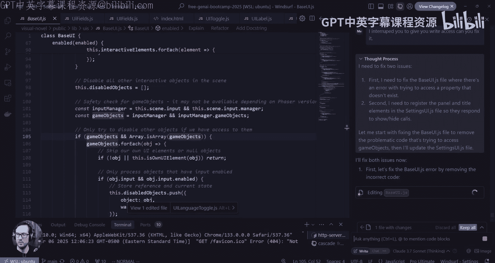

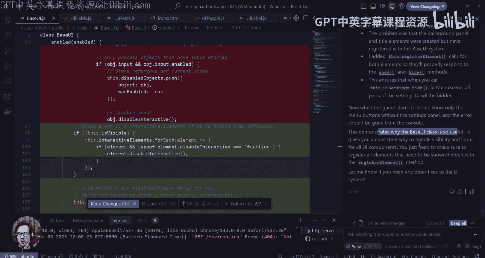

There's just that one line there。 I guess we'll stop and start and see if it works。 But yeah。

 this will be really， really useful when we get into the actual game because we will have。

 we want we want to access the settings menu from the main game。😊。

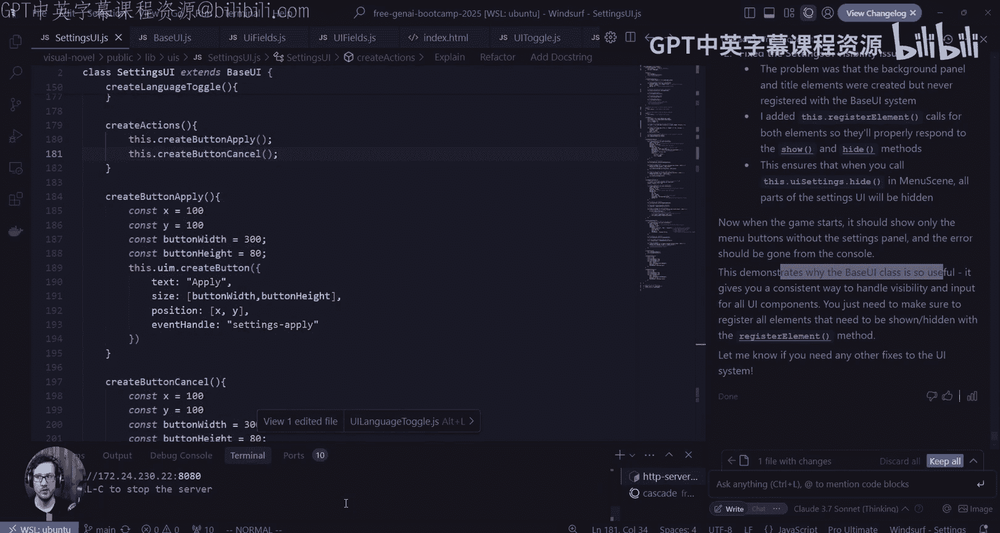

It's still， it's still， it still shows。 Are they like crazy here。

 It still shows the friricked screen。 We'll go back over to here。 Give us a refresh。😊。

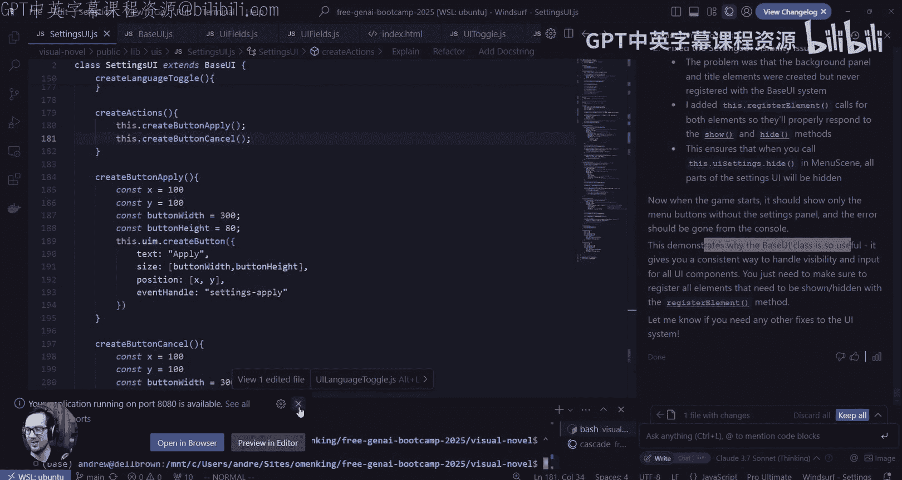

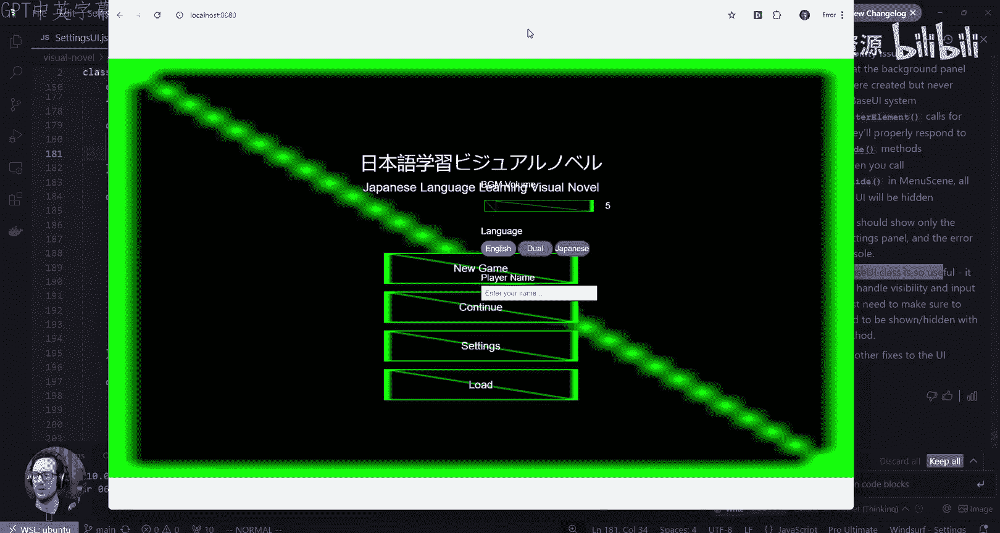

I I don't know what it things it's doing， so。I guess I will have to drive for a little bit here。

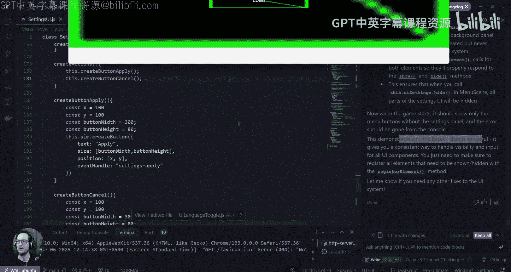

Let's go over into our。U。In our in our us in here and we'll go into not another u or UIs。

 and we'll go into no， I don't know that we'll go to menu settings。

 And so here we're explicitly saying hide the UI。For UI settings， hide it。Right， and so we go into。

Settings U I。 There is no hide function in here。 There shouldn't be。It should be calling。

 oh there is， okay， it's calling the superh， that's fine。So if we go to here。

 this one should now have a hide， right？ So the first thing I want to do is make sure that this is getting called to say console log hide。

at least one of these calls should appear。Let's make sure we have our dev tools still here。

 We can get this nice hard refresh。And it is calling hide。 We can see that， but it's not hiding。

Why is it not hiding， I don't know， But we know that this comes into the base U I。 So well， actually。

 we're writing in the base U I right now。 So we have visible， false， enabled false。

 Let's focus on visible first。 So go div visible。Right and here it just is， if it's visible。

 it's going to iterate through all the registered elements。And mark them as invisible。

 So we'll go ahead andll do a console log here。 And I want to get this do Ui elements。

 I want to see what is it iterating through， iss it actually iterating through anything or is it just pretending to do that。

 So we'll go back over to here and we'll give this a nice hard refresh。

 And now we should see it itating through objects。 It is now remember it's displaying both of them。

 So I mean， we called hidede。 But the thing is is that。

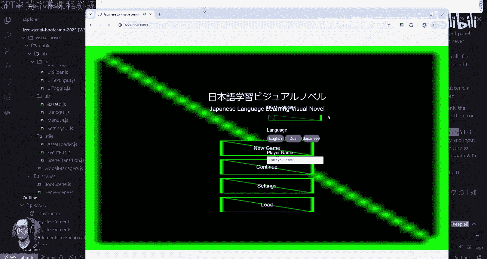

Well， these are the buttons for。Whatever。 But then over here， we have。Rectangle， text and UI fields。

 So this one here in particular。

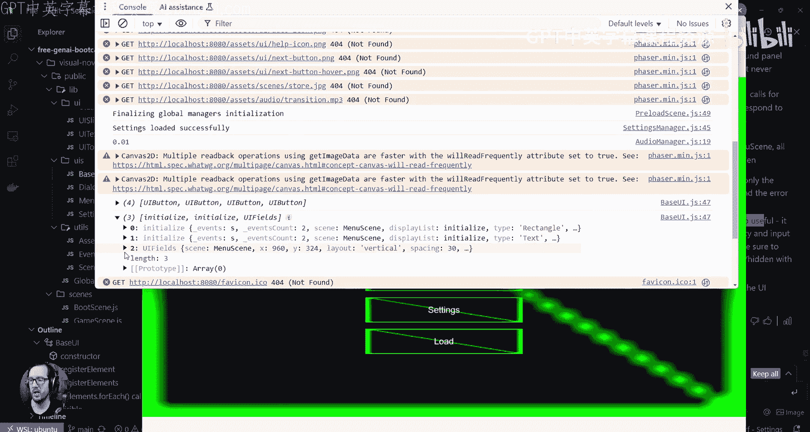

Is the actual。

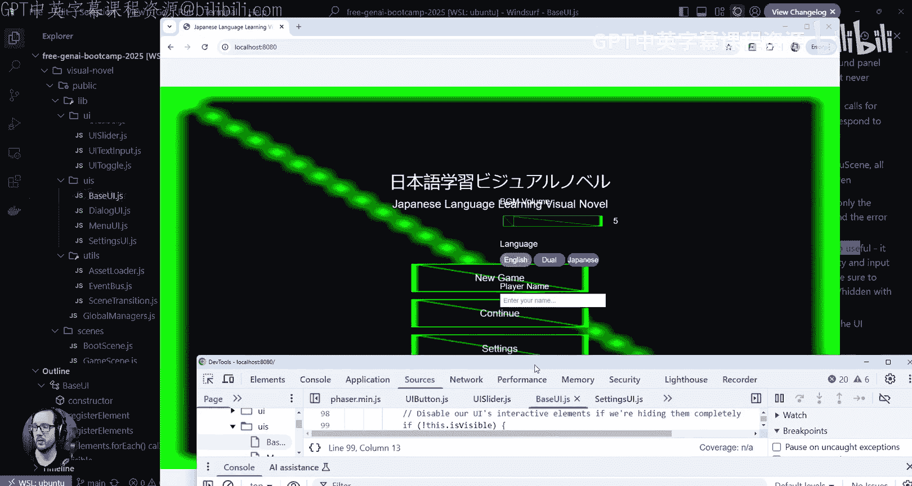

Settings， right， so now the thing is is that it actually is hiding the background right。

 so clearly it's working but not for the actual fields itself。

 So I'm thinking what's happening here is that the it's trying to iterate on fields。

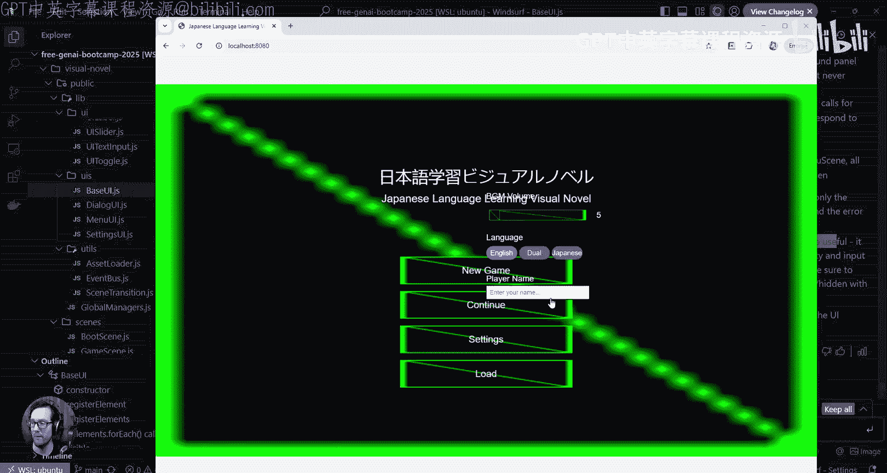

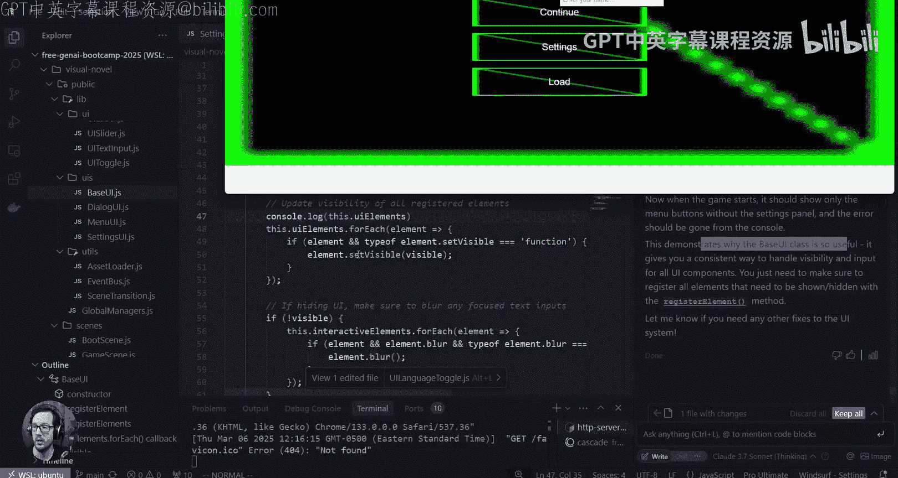

Right， calling set visible on fields and that doesn't exist。So here we have an issue， right， where。

Okay， we're going to have to explain it that。This is where the problem is。

 because this is where our problem is so here so yeah。The fields on the settings page。

Are still visible。You you know， I see that set elements being called。Set visible is being called。But。

Field。Fields Ui is not a。It does not have。That property。Right。And。Okay， so like。

 this is where I think the problem is。

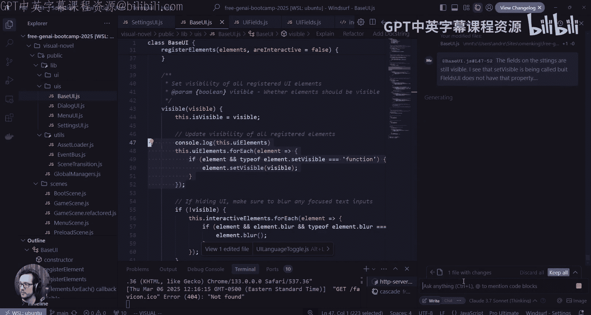

We'll see if it agrees with me here。Mmhm。Mhmm。嗯m。I'm watching it right here。Well， doesn't。

 Why would it。啊哈。Yeah， there you go。And we'll let it continue on。Al right。

 so I think probably what it is crawled through the code here。 I mean， it's doing U I toggle。

 I would think they would have to also do that for。Our text field and other things like that。

 but it really just focused on that single one there。 So I don't think it did all the work。

 but here we're in UI field， so it says set。The label is visible false， so that's good。

 So that's one thing that we need resolved there， which is good。

 We'll continue on to the next file here。 We'll just go back and prove this one。 This one is good。

 Keep changes。I'm not sure if there was something else in there， I think that was it for that one。

We'll go back to UI toggle， so we have set visible。That would make sense。 That's good。 Keep changes。

 but I don't think it did everything because there is our text input and our slider， right。

 so I expect those will still appear。

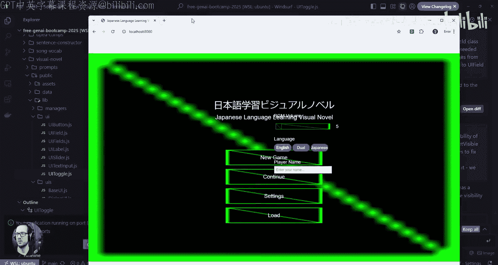

We'll give this a nice refresh here。And yeah， exactly what I thought， okay， so great。

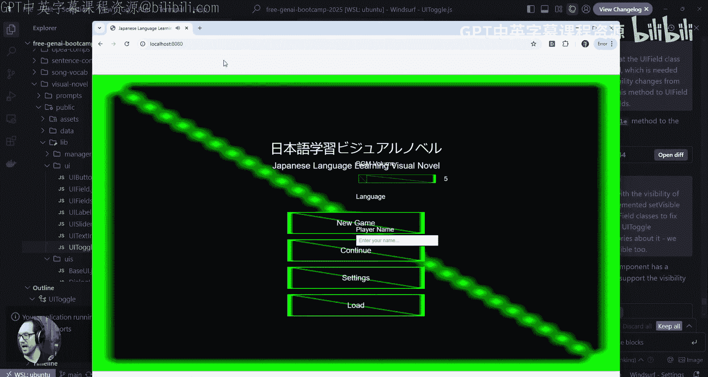

You still need to do the UI toggle。And U I。Okay sorry。Great， but you need to。Finish。Implement it。

For UI slider and UI text。Input still， so we'll go ahead and let that do that there back in just a moment。

 okay？Alright， so it's made some changes here。 Let's take a look at this one。

 So we have set visibility。 This is UI text。 So clearly there's a lot of work to be done there。

 which is fine。 We'll go to well accept that one keep changes。 We'll go over to this one here。

 So this is in the UI fields。 set the visibility container of all fields in here。😊，嗯。Yep。

 so it's just checking to make sure that that exists before it attempts to do that。

 so that kind of makes sense there。And we'll go to UI Slider。

Probably fine it's crazy how long it took for it to do that。

 but I didn't have to do anything except wait， so I guess I can't complain。

 I don't know if button included into that because the UI button is its its own thing as well。

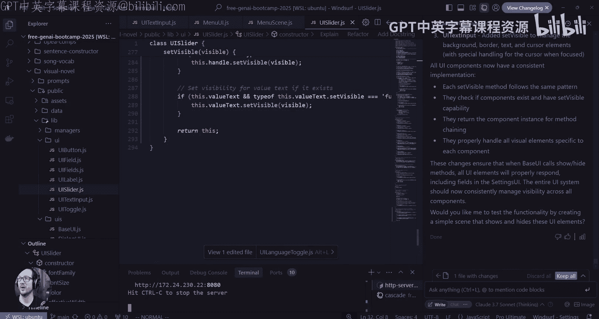

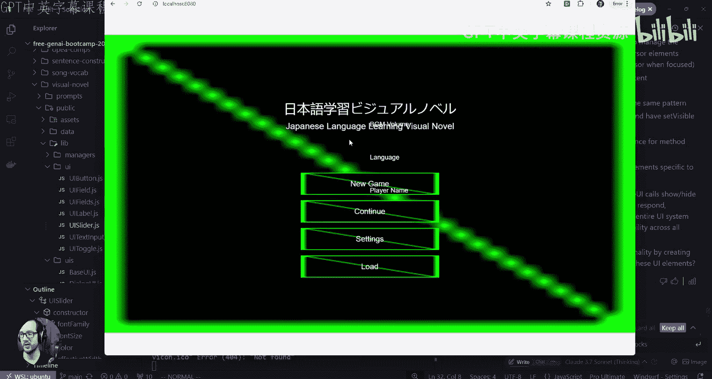

And so this thing that's still showing up are the labels。 So those have should be hiding。

 but I guess it there is no。

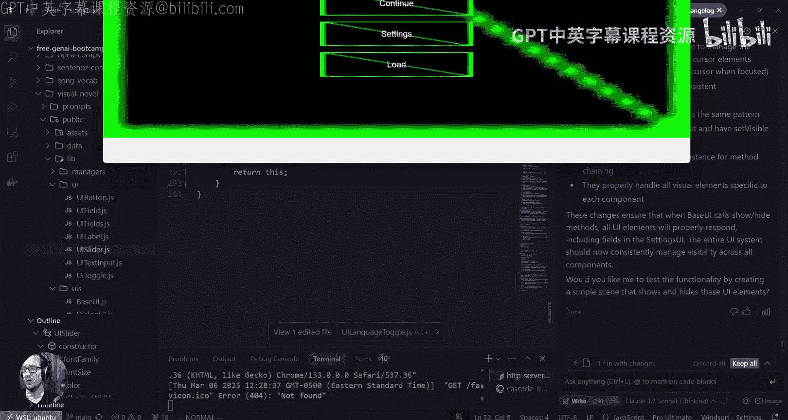

Se visibilityibility for that。 So I would say like， okay， now need to do it for。UI field sorry。

 UI label and UI Bu。Okay， and so that will wrap that up there and so then we can kind of test the next thing question is like。

 okay， we have a set visibility， but what about disabling right？

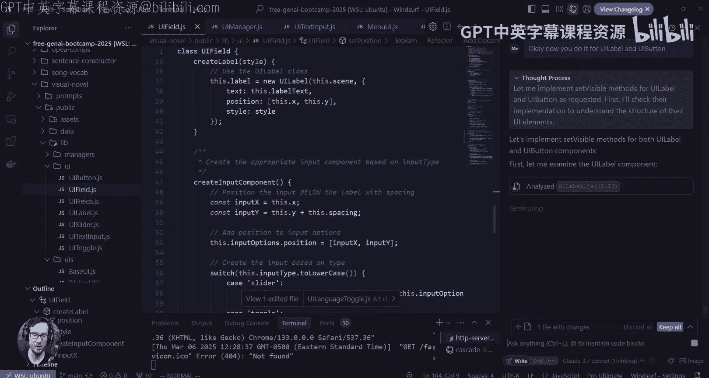

Alright， so it looks like it's gone through here and should be doing what we expected it to do。

 Let's go give it a nice hard refresh。 And so now we only see what we're supposed to see。

 That's perfect， right right now， I do have if we go over here。

 I can see all of these events being emitted， right。

 And I think it's because we have console logs in those。 But if we go into settings。

 is this open yet。😊。

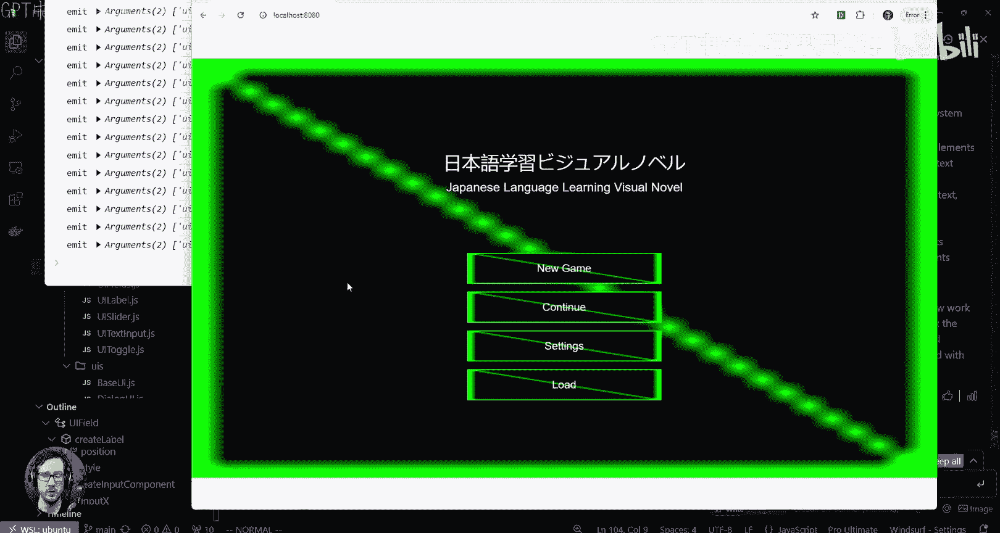

Oh， it'd be so nicece if it did。But we do have this event bus admit。Where we have our point out。

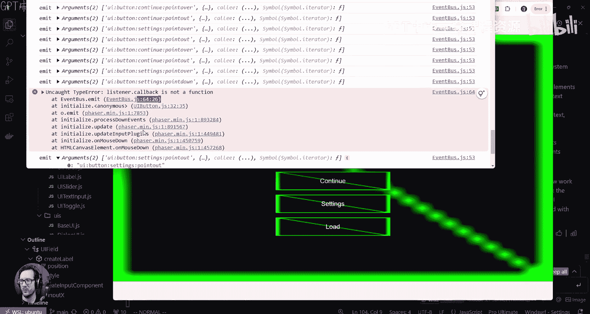

So I'm going to go back over to， I think this is our global manager， where we currently have it。

 And then here we have our settings， right， And so our settings is supposed to。

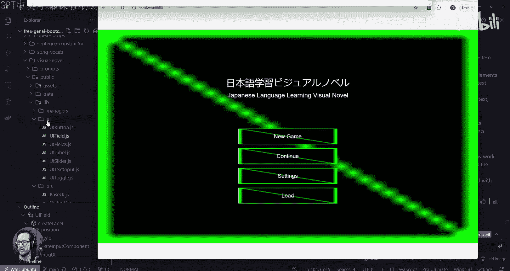

Open up。It's called open settings， where this one's called Se game。

 I'm not sure why it's named that way， but we'll go ahead and fix it here。 And now what we can do。

 since we have the current scene， we say this dot。This dot U I or this scene。Dot ui。Hide。

 and then it'd be this。Sin。And the other one was called。Settings Ui。It's not that。

But we'll go back over to。Sorry， I got a really bad really congested here， apologize for the noises。

 but if we go into menu here。This is called what。 What is it called。Where are ya。嗯。UI settings。

 UI settings。So then we can go， yeah， say UI settings here。

 And so the idea is that maybe that will do what we want it to do， that'd be really nice Now。

 whether it disabledable stuff is a different story， right。

 because those events might still trigger and that might be an issue。

 but we'll find out here in just a moment。

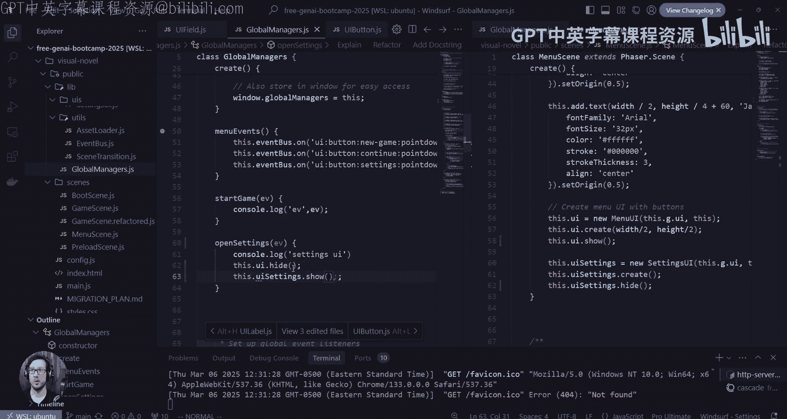

We got a nice hard refresh here。Let's try settings。It has an issue with high for undefied。

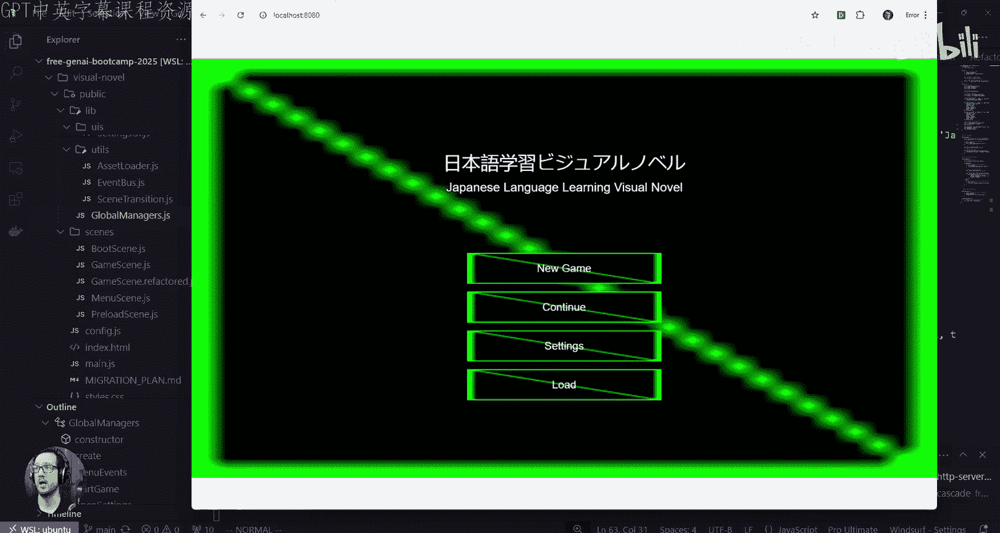

So this UI， it's supposed to be this scene UI。

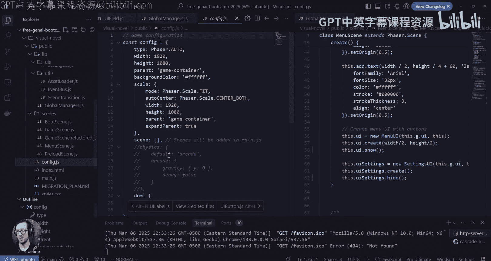

I just lost where I was。Ho be manager here？We'll go back over to here。It's supposed to be this scene。

But it's not this scene because it's actually on the event。 So it's gonna to be E V， E V， C。

 UI like that because it does pass along the scene。

 It also passes along the button that's clicked or whatever。 The actual object there。

 But we will go back over to。Here， give us a nice refresh here。And it loads it up settings。Okay。

 and so it did do something。The reason why this isn't 100% hidden is because maybe this stuff is not like the background。

 this other components aren't registered。

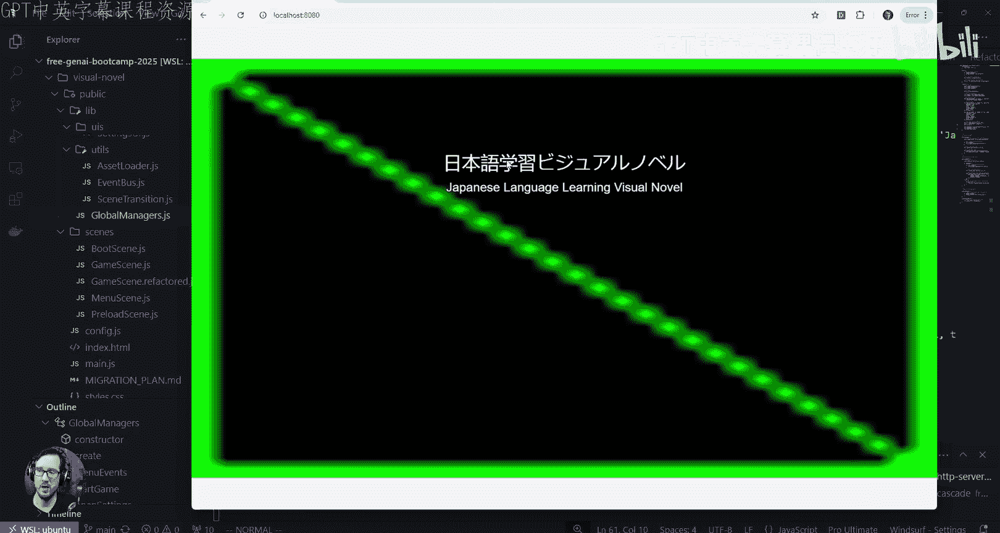

Right， so we'll go over to here and we'll take a look at our actual。

Because here we have our settings UI right and technically that is managing it all。

 but this stuff here is not part of that UI right is it's just kind of floating around there in the world。

 So if we want that to be respected we would actually have to include it into our settings UI but the thing is is that I wanted the settings UI to act like a group and so when I first made that I was thinking。

 okay， well this is just a component on the screen right but。Yeah， that's not exactly the case。

 I guess so the question is like why wouldn't it show on top of it because before it did no problem。

 right？So at least the buttons vanish， but now we don't see。That there。嗯。😊。

I guess the question is like is the show implemented correctly， that might be an indicator。

 but it's a toggle right， so I'm pretty sure we made it a toggle。

Yeah visible right so here it would iterate through it and change the visibility of the object if hiding UI make sure to blur any focused text inputs as well。

 that also makes sense。

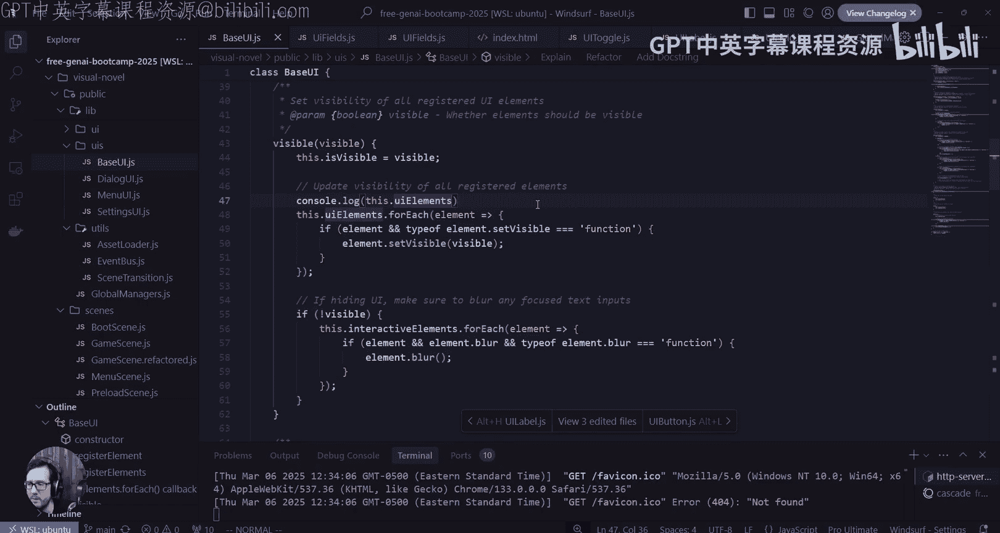

So you know the background should show up here。But I'm not sure if these are the problems。

 So what I'm going to do just to do a test。 I'm going to go over to our main menu scene。

 And what I want to do is I want to go ahead and hide out the actual background。

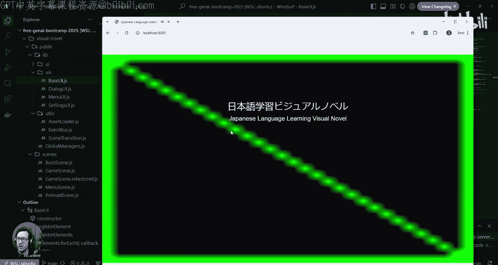

Because that is causing us some issues here， it's this menu background which we obviously don't have right now。

 we'll go ahead and refresh this here。

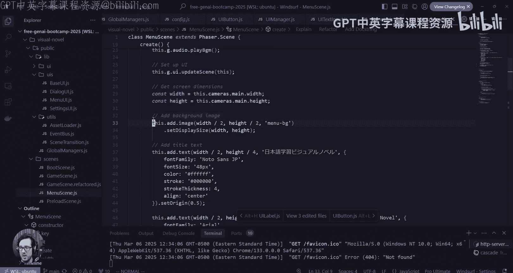

And now I see this， so go to settings， and so it's not showing the background from this one。

 right when we click it。

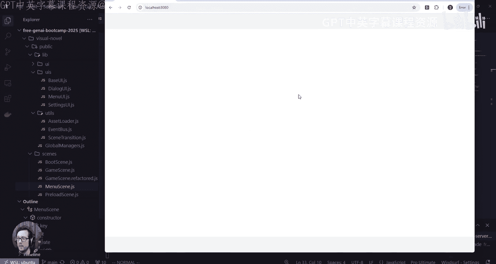

Okay。So it is hiding technically， the menu， hiding those buttons。Maybe it's our show。

 That's the problem， right， because we're not seeing anything that's coming back here。

 So go into our global managers。 I'm not sure if I'd like where the events are。

 but they are where they are right now。 So we have UI settings show。Right。Oh， it's hide and show。

Isn't supposed to be toggle？Bei。Visible。Enable。Oh， we have helpers here， Hy and show， Okay。

 so Hyde would or show would visible， visible， false， false， right？So this one here。I du't know。 chi。

 Oh， ba scene spelled wrong。 There we go。 That's a problem。 Couldt even tell。

 We're not using statically type language here。 So errors are abound。😊。

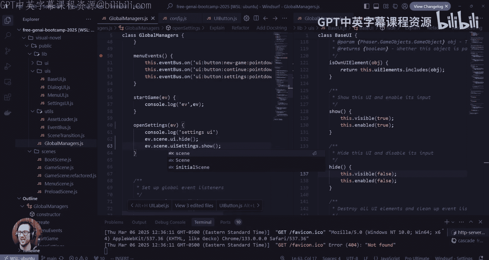

Cool， there we go。 I'm not sure why the backgrounds transparent。 Maybe it always was transparent。

It's not bad， it's not bothering me， but I didn't think it was transparent。Um， so that's fine。

 we'll go take a look here at our settings。

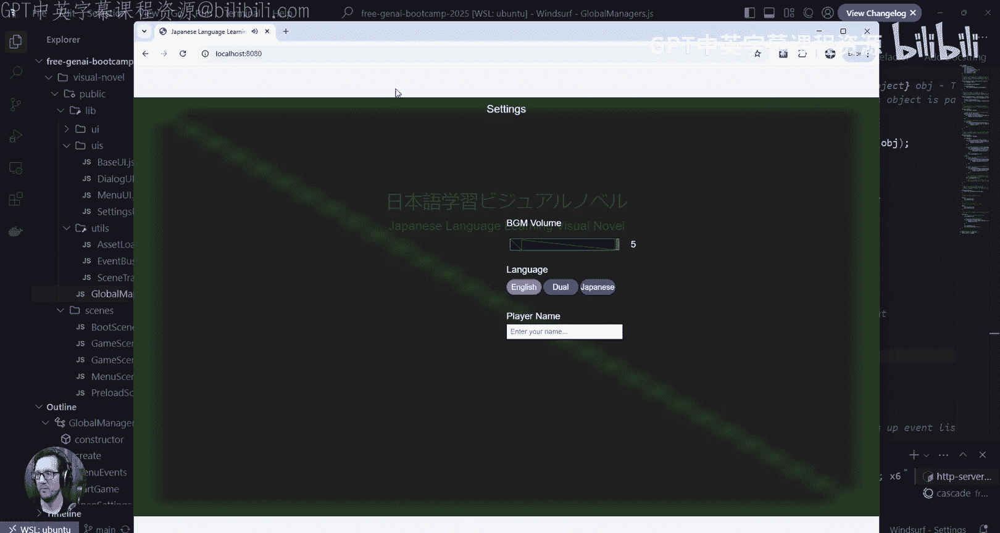

And we'll just take a look at the cr background here。It is， why is it transparent？

It is transparent right here。Sure， it changed the code on me， but whatever I don't care。

 so we do have our settings， the UI is a little bit icky。

So notice like if we change our background here， we have a little bit of white back here。

 I might just go fix that real quick in our styling here。And。I'd rather have。

 I'm going to go here to say HTML body and game container。I'm going to just make the background here。

Not the game container， I guess， but we don't even need this， we don't need this。 that's silly。

 but we'll go ahead and just make the background black。Okay， and so we have one，2，3。 Yeah。

 there we go。 we'll fix that there like that。 And now I can go back over to I don't know if we need notice sands here。

 but I guess it would load it into the actual game here。 We'll get a nice refresh。

And that's a little bit nicer， I think。

But anyway， so another thing we could do is we could try to make it so that no matter what size we do this。

 it would fit the UI， but right now we are limiting the aspect ratio is that's easiest thing to do。

 but this brings that up， we have no way to go back but I think the way I really want to check out was like is it still triggering？

Is it still triggering our button events because I'm going here and it's not right， so that's good。

 now if I click it to here。

It is's kind of working。

See here I'm clicking， trying to get into the field。And then sometimes it works sometimes it doesn't。

Right， one。2，3。Yeah， yeah， our zones are really， really bad for this。

嗯。But anyway， we now have show and hide for settings。 So that is a good achievement。

 whether disabling is working or not， I don't know。 But， I mean， it seems to be working。

 So I'm not going to argue with it right now。 It's not calling the events behind there。

 So I'm less worried about it。 So we'll go ahead and just say update code。UHere。🎼Okay。

 I guess we should take a look。 now， I'm not gonna worry about it， actually。I decided I don't care。

Because if it's not calling them， then it must be disabled like that's。

At least for now， we think so。Okay。I'm just trying to click in place， I'm trying to understand。

Yeah it's really finic key the click， so I'm going to。

So I'm going just tell it like the input player field。 there is。

 there's definitely issues with the clicking with that。 And it's really， really annoying。

 If I can fix that， then we can move on from the UI stuff as now we have， I mean。

 we still have to implement our fields。 But really。

 the sound was the big thing that we really wanted。😊。

but I really need to fix that input because that's going to drive me crazy。

 I know it's just like a single element we probably might not even get that much use out of it at least in the short term。

 but I'm persistent， I want to fix so I'm going go over to here and I'm just going close up these tabs here and so you know we are having clicking issues。

With。The UI text input。Doesn't always。Focus。Wen click。It takes。

Multiple clicks and moving around so there are clicking issues。To right。Okay。

 I really did fail in this before， but I'm going to try again。And see what it can do here。Mhm。

Valued options。If we're going to have more like validation， again。

 we might want to factor that out into its own class set position。Bur。Focus。Clip text if needed。

 no update tax， no。There's not like a lot going on in here。I got to just let it run here。

 I got to go turn my furnace off。All right， so。We are。

While we let it go there and and try to make some fixes here。 now， did it fix something。

 That's the question one second here。 Sorry， sorry， anyway。 yeah， my phone was ding in。

 Nothing going on。 Just need to set my phone to not ding here。

There we go and let's see what it tried to do so it added interactivity to all three components。

 created a single focus handler， improved cursor positioning that was an issue enhanced the focus and blur methods。

 Add explicit events for focus and blur improved hit detection。

 added safety check to prevent redundant focus operations。

 Let's see what level complexity it added to do that。Does't look like it added too much。

So center activity on more levels， which is quite a bit。I wonder when it adds to the interactivity。

 if it added it into the disable。嗯。For that is visible or not， so hopefully it did do that。

Because here it's based on those things， I think that。It's not an issue。

 So we'll go ahead we'll just test it。 And either it's either improved or it's not， right。

 So we'll go here and we only spend so much time on that input field。 But if， if it does fix it。

Oh yeah， yes！🎼Hooray， yeah， I can type my name there too。 Excellent。 Okay， great。

 So now we have some elements。 Now， this is obviously kind of weirdly centered， but。😊，That's fine。

 But we do have some options。 Now， we need to get a back button here。 We're 30 minutes in this video。

 but。😊，I would say what I want to do is。Get a back button right and we're basically starting to get to the game now we didn't do all the settings here。

 I'm not really worried about it until we actually have to deal with this problem。

 like if we want to clear out settings or stuff like that。

 but the very least I want a back button on this so。

We're going to go here。And I'm going to go to our。Settings， where is the setting， setting settings。

So， it's so great when you get to move on from。 Like， obviously， we're。

 we're making progress every video。 But just to be past the settings page will be really。

 really nice。 So here it says store references for later use。

 I'm not sure why that's I'm not sure what。 It's not letting me write code。 Here we go。😊，So， here。

I'm not sure。Come on， give me my controls back。 Thank you。

 I think it's being a little bit aggressive about some of the stuff I don't know。😊。

What is it doing and sometimes it does that where it gets really all messed up here？

So hopefully I didn't I didn't lose anything while we working with that。

 but I want to bring in the create actions。 so we'll do this， go to create actions。

 and then here we have the apply button and the other ones here。

 so I'm not sure if button apply exists， it does。So it does create it this way， which is great。

I guess they have always been here， but we didn't really。嗯。Test or implement this stuff。

So I think for this。I would probably want to wrap our actions。Okay， so we'll。

Create our actions within a within a horizontal horizontal。With a horizontal。Fields container。

So go here， we'll do that。啊。M， good。If it needs that sure， it's not going to be0，0， but。

Position in the bottom。Right of the screen。I might say bottom left。

cause I don't have to then deal with that there。 So we'll say bottom left。And。Sure， okay。

And I'm not sure why it does it that way， but if it works， I don't care。

 I'll come back and tweak it later。 The the createate button actually apply here。

 These actually have to be added。 So this should really be a field。

 Do we have that field option in our in here。So we go here。And we create label， get input。

Do you have button type in here？In the field。We don't， so we want to go here and add button， right？

I don't think it's super complicated， but we'll go here and just say。呃，本。

And then this here input would be。UI button， right？Simple enough。

And so now we can go over to this one here。And this is actually now create field。And。And put button。

Lput options。There we go。I'm not sure if there is more to that than that。

We'd have to take a look at one of the other ones here because we have label position input type。

Right， so this text here is going to actually go into here。We don't need a。

We don't need a label field， so I'm not sure if that's going to mess things up。

 maybe if it's left blank， it would just know not to create that there。

Here the position is going to get set to 0，0。Because we are not setting it this way， right？

The button width and height， we probably do want to set that would。We have position here。

 which is not right， but we'd have what is size， I think， we do have size already in there。

 So that's perfect。And so that will add the button we do need to， we'll assign this to something。

 so we'll go here。嗯，好先。Button field y， and then down here we need to add it。Yep， like that。

 so there we go， so now it's being added as a field， is there anything else we need to do？

Because there is。One second here site。Sorry， there is， we obviously have the language field。

But don't these fields have to get added or registered， so I'm not sure。

Were the registers happening here？I'm kind of wondering。Add it to the container， yep。

But where's the register？They must register them， right？🤧Sorry。

And so if they go here and say register。Yeah， like here， register elements。 Oh。

 it's registering the the top level of this element。 Okay， and then it grabs them all underneath。

 Well， that's good because that will make our lies a little bit easier。 We'll hold on a second。

 This says createate fields。😊，Yeah， yeah， okay。 So then we'll just bring this in over。

And the other one here， wherever this is create name input。Does it create actions。Here。

And so this one here。We need to do that， so that it。Then registers them all。 There we go。

 Back to our buttons。 This one， obviously has been refactored over to be this one。

 We do the same thing here。 So this will be create。Field。And then this is going to be。Input type。

Position。Input options， good。There we go。 That's better。And then the button field。Come on。

 you can do it。So not doing it。This dot。

Actions container button field。 Okay， so that will add it there。 So now we have our two buttons。

 okay。So the only thing is like will the button actually work。

 will it show a field there that we don't expect to see there， we don't need this， this is useless。

But， you know， this is an idea of what we want to happen here。

 so I'm going to go ahead and give us a nice refresh here。And we got an error， that's okay。

Label is required， right， So this is what I thought might run into an issue here。

 So I would say for our label。

Here。Sos keep changes here。 I'm going to go to say like I， you know， I want to update the UI label。

For UI label。For UI field， sorry， for UI field， if no field call up。

 or if no label option is provided。Then it shouldn't render a label， a label。The U I label。Okay。

 so that's what I wanted to do。

And let's see if it can actually go ahead and do that and not make a mess on my code。 But you know。

 if we have that， then we have our buttons， we can go back and forward。

 apply stuff and we'll be in good shape。 but we'll give this a moment here。 Allright， so。

Now we have made the label optional， maintain consistent layout， fixed validation。

 move the validation error。We got a lot validation going on。

 I almost kind of want to refactor that as that might be something we might end up having to utilize multiple times。

 so that might be something we should be refactoring， but you know maybe it'll be a problem。

 maybe it won't be if we leave it alone for now， I don't know。

 we'll see we have an issue label text is required。 I thought we just said we do not need it。Right。

I thought we just said we do not need it。

おつです。Other hard refresh， just make sure that that aerosol， happens does it does， right？

It's like it didn't really completely finish it。Is requiring the label even。 Yeah， okay， fair enough。

 because I think that the element is still there， right， It's just the fact that it's just going to。

 I don't know what it's doing。 We'll have to just take a look。 I guess here。

 I'll just kind of look at what it's been working on。 So I'm gonna go to U I text input。

What did it do。啊。I mean， that's fine， but I'm again， I'm interested in the field。Let's go to next。

Okay， it's optional。So it still creates it just in case。Not sure why we don't need it。

 Why do we have it there， I don't get it。 Label text must be a string。

 So just really didn't do what I thought it was going to do。 but that's fine， I guess。

Because if it's an optional， then why would it even render， right？Yeah。

 I don't know if it's really doing what I'm asking for to do。 it's exactly pretty dumb right now。

Let's go and take a look here and check again， we'll get this nice refresh。 What do we have？

🎼Okay， so we don't have errors now， which is good。 We'll go to our settings page。 and we have our。

 our buttons up here。 I can't really see them。 I think the buttons are centered。

 That's one thing we need to go fix， so。

I' just gonna go and commit the code that I currently have to keep all changes right now。 I。

 I don't think it really implemented the， the， the that label thing correctly。

 but it's technically might be working properly。 We'll only know when we show it there。

 I wanna get this code committed to WI work in progress code。I need to。Fix the centering。

 So we'll just stop this here。 The the UI button。The UI button。Is centering。

 I don't want it to center。I want it so when we position buttons。X and 0。Are its top left corner。

I think this has to do。With origin。Okay， that's what I really want to happen。

 so we'll just take a moment to fix that。This is something we knew from prior。

 but the idea is like if I do 00， I want this not to be centered here， I want that to be there。

 that's going to mess up this one here because this other one's going to try to attempt to center and it's going to be off。

 but that's totally fine for now I don't care。

Itd be nice to have more controls about like left， right， center or stuff like that。

 but maybe not for fields， but for the field container。But right now。

 I'm not really worried about it。 We can kind of work around that by just hard coding things into the correct position。

 I need to also update the set position method in the UI button class to maintain the top position。

 Yep， that's what we need to do。 We'll give it a moment there to solve them。 Alright。

 so the changes make the U I button component more consistent with the standard U I position conventions。

 which is X and Y， the button remain centered， et cetera， et cetera。 So I do expect some。

🎼Unual behavior here， which is not a big deal。 The other thing was like。

 I don't think we saw both buttons。 we just saw one。

 were they on top of each other And the fields flow was not working correctly。 Yeah， see how it's。

 it's a little bit offset center now。 So we'll go here。 And this is starting to get better。

 The only thing is that this is not taking account The actual width of the button。

 So it is spacing it out。 But I think it's， it's totally unaware of the button width。

Which is something that is a bit of a challenge I to go and just update or just save the code here as it is kind of working。

Give this a moment here。So say， update。And I would just say for the fields。

Right， because we have the， well， the technically the we can't hit cancel right now。

 but when we go to this one， that other one is this one here。

This one here is not reliant on the fields input。 And so that might be something we might want to swap out just so that we could have more consistent control of it。

 So I'm going to go over， I know we need to fix。

A couple of things， but I want to fix that one first。

 so go into our menu U I and I want to swap out this this logic here。With。The other one here。

 so instead of create button， we want to create a field。So in here。

 it's actually going to be Cate field。Create field。Field。Okay， and then。Input button， that's good。

We don't have labels， there's no label。We just want input options。 There we go。 Thank you。

And then we'll bring this in like this。Right， and then instead of doing it this way。

 we'll take that out like that。It is registering the element this way。

 Register the moment with the base UI component， which we can do。 But I think in this case。

 what we really want to do is we want to， we want to create。The actual。呃。

Contain the buttons within a fields。UI field。That is vertical。Y， so we'll do that。嗯哼。😊，Fiels。

I think't he got confused。T again。Create fields， fields。Why is saying field？Fields， am I crazy here。

 It's fields， right。UI fields。 it's really， it's really getting mixed up here， fields。Fields。Right。

 there you go。 Okay， And so we have our。Budton data， I probably does hoisting here。

 but I'm just gonna go。嗯。I don't want to add them right， right away to it。 So if we go here。嗯。

What is it doing。It's like we lost the iteration here。 hold on here。There。

I sorry sometimes it just kind of mucks up your code，Yeah， it's， it's totally mess messed it up。

 So I'd have to redo this whole darn thing。Just kind of frustrating。

Contains the buttons with fields with Yeah， there we go。 Okay， great。Iterate over the button data。

And create button。嗯哼。😊，嗯嗯。😊，We don't need the position。We don't need to do the offset in here。

Because we're just going to set the position to be zero zero。嗯。Sorry， actually here position。

This would be 0，0。

Okay， and then up here。Like， we can' add fields this way。 I'm not gonna do it that way。

 I just want to。No， I want to do this dot。This is not assigned to anything。

 so we got to go here and say constant。We'll say this dot。This dot。呃。Mnu container。Okay。

 and then down here。WeWan to add the fields like that there。 That's how we actually want to do it。

 and so。That'll add it。 Now I don't know if I'm missing something here。

 but I'm expecting that this like this will this won't take into account the height and。

 we'll see that problem there。 and then we can actually fix that problem here。

 I'm not sure everyone will run in some code problems here is it was kind of mucking up the code quite a bit。

 I'm gonna give this a nice refresh here。 We'll go and take a look。 position is required。

 Po is required。 Why is position required。

And for what。

For。What do UI feel it is required。

Oh， I guess it is， yeah。I thought I put it in here positions right here， no。And。

I guess I need to see another example to really know， so we'll go over into our settings UI。

And looking here。We have physician right here。And then we go here。Positions right here。

 so I'm not sure what it's talking about it has。A position。啊。It's right there。 So I。

 unless I spelt it wrong。 Let's go ahead。 And， I mean， I didn't spell it at all。 It did the spelling。

And we don't have one down below here。Right， so we'll go and stop and start this。

I basically say the same thing。

And it does。So here it's saying。UI meant， menu， U I， U I field， U I field， it's， it's。

It required， it looks like it's already， is it not。Am I not？Already including it。Like。

 I don't know what it's getting at because I'm seeing it right here。

 It's right in front of me unless it's not calling that。 It's something else。嗯哼。😊，Oh， this one。

This one needs it， I see。Now， I understand。嗯。That makes sense。Okay， so I can just。I mean， it stopped。

 which is fine， it's not what I wanted to do， but I'm going to go here and say position。

And so now we're getting the X and Y here。 That's probably what was missing。

 I'm gonna go ahead and stop and start this again。All right。

 and so now we've added the position with x and y， we're going to go back over to here。

 we' get some nice heart refresh here。

And so I it's loading， but we still have an error now what's a problem， input type is required。

For U I field on UI field， are we not。Sotting that on the create create UI Manager， Cate buttons。Oh。

 we're not apparently well this is。

It's fields。 I don't know why it refuses to make this。Oh， because it's speaking hold on a second。

 is that actually how we created this UIM cray fields？

Let's take a look here。Split it again here。I'm going to go to Se GI。Create fields。Create。Fields。

 spacing layout。Spaccing positions， okay。We'll go ahead， we'll hit up。We will go over to here。

 I'm going give this a nice hard refresh。And we still have an error， just forever and ever。

Tex is required for what for the UI button。 Okay， fair enough。 We'll go down here。 Its right here。

 I'm not sure what it's talking about。It's right here。哎。Is this tiresome？

Let's take a look at another button here。Input options。Input options to make sure that's。

That's not what I want。 Just copy the single word， please thank you。Input options。

 I have text right here。Im not sure what's talking about， we'll try this again。And。Go ahead up here。

All right， I'll just give it this。I'm not sure what the problem is， it's annoying。

 We'll go ahead and we will ask it to go try to solve that there。Go off to the races。

 try to figure it out。Cloths on it。Alright， so the changes make the button component more flexible。

 You can create the buttons without text if needed， which kept， why， would I want to do that。

 The changes make the button。 You can create buttons without text， if needed。

Which can be useful for icons。 I guess so。 But that wasn't my problem。

 I wanted the text to actually be there。Oh， were we not passing it in？No， we're passing it in here。

I'm not sure if that's exactly what I wanted。 I need the buttons that still show up here one second here。

Alright， so I see the fixes are both made optional U I。 Again， not necessarily what I wanted。

 but there is a case where I might actually want icons instead。So， you know。

 fix the parameter mismatch with the menus you like create button here。

 So let's go take a look and see what it did。 It might have done the wrong thing。But we'll find out。

Okay， I mean， no problems， it's it's bizarre that it complains about the text field。

 but they are now here， they are spaced fine， so I'm surprised。

That's a on issue。

Here， maybe it takes into account vertical， but not horizontal。

And so the next thing I want to do is like。Update the so for the UI fields。

I want to be able to change the origin。Change the origin。EG based on words。So you， I mean。

 maybe we don't want to do words。 Yeah， I think。For UI field。

 I want to be able to change the origin because I want to not UI fields， for UI fields。

I want to be able to change the origin so that I can center。That doesn't mean the sub。Objects。

 origins。Should change。But they need to。Can I get a function that lets me。Can I get a property？该e。

Change origin。As an option during the construction of the fields。Okay。

 hopefully understands why I say fields， not individual fields。

 but we'll wait there and see if we can do that。 Alright。

 so here it's suggesting that we can now change it。

Additude methods and so now I would just say well we have the origin here， which is fine。

 I want to go and go back over to the origin wherever that is here。And so now， yeah。

 we can say the 0。5 center center。 So for example， center of the menu would be this。 Okay。

 so I want to， if you want to write a align， it would be 10。So it'll be， come on。 It'll be。Come on。

 give me the origin here。 It's gonna be origin and then 0 because I don't want to fully align it center。

 But let's see if that works。 We'll go ahead and stop it and start it back up。

We'll go back over to here。We'll give a nice refresh that didn't do anything that didn't do anything。

 Let's go try this again， So I'm going to go give it a zero here。

 Let's see if that does anything here。

This is the correct menu， right， createate buttons。In the menu。Mnu container， Yeah， it is。Cate field。

 right。Yeaha。Cray fields。So。Allright， let's try 1，0。Origin， origin。

We'll give this a nice refresh here。Okay， it is working。

But maybe I don't understand how it's supposed to work。 So we go here。 We do 0，0。

 So that should be top left corner， right。

Okay， good。 and so now。

We do 0。5， the idea is I'm trying to get a center here。

It definitely changed， but I think。X and then y， right， So x。Like， should be vertical， right？

 So if I did this。This would be， you know， this direction in the middle， right？

啊哈。Anyway， so what I'm gonna to do， I'm gonna， So it is 0。5 here。

 But what I'm thinking is that maybe what's going on here is that it's not actually going center in here。

 So if we go back up to our game scene here and we added this menu here。

Where are you。Where are you。Where are you， I mean， oh， I'm in game scene in the wrong place。

 We got to go to menu scene， right。And I go over to here。Where is it here。Half the width。

 half the height。 I mean， that's。What I expected it to be。

 but it's not doing what I was hoping for to do。We give a sensor refresher。Yeah。

II don't understand。Okay， an easier way that we can tell right now is I'm just going to go 0。

0 for this and then common this out for now。So just want to see if this is centered。

 it would go up to here， right， top left corner。 So it's now the top left corner， right。

 so I go over to here。 I'm going to go back to our menu。

I guess the other question， How does it know what it's actual with this， right？ So if I go 0，0。

 then this should be， it should just perfectly fit in the top left corner， which， which it should。

 It does。 Now we do 0。5。

Right。

Yeah， it's not cutting it correctly， so I can go here and。

So we'll go here and so this is。This is the the menu where I with the menu container。

Where I have origin 0。5 on the X axis。If。If this was correct， it would。Show only half。

 half the buttons。I think the container isn't taking in consideration the maximum。

With of the fields underneath。So it's probably is centering。But。The with。Of the container。

 it doesn't know， maybe。Okay， because that's what it looks like to me。

 And I remember it hard coding those values。 And that was kind of a concern。 So I don't think it's。

 yeah。Yeah， it's a hard coded estimate。 So it has to go and figure that out。 Well let。

 let it go ahead and do that。 We're making a little bit complicated as we could just try to manually position it some weird way。

 But I would rather get this that working there。 And then when that stuff is centered。

 there is the spacing of the buttons。 But then our U I stuff is。Done for now。

 and then we can get really close to the game。 The game should be hopefully more fun。I'm hoping。

 but we'll see if we can get this working， okay？Alright， so here we have run command visualg。 Okay。

 so it thinks that it's fixed the issue。 It probably did quite a bit here to implement that。 Or。

 I mean， if it did， there's a high chance it could have got that wrong because it's a very complicated check。

 I would think。 well， not super complicated， but complicated enough that you have to go integrateerate through all the objects and find out So update field positions。

 container dimensions。 calculate the effectiveness of the position。

 So that's the thing that I think that calculate container dimensions。

It would have to know。Here this stuff fields。Try to get the dimensions of the fields of its components。

And get the max field width and height， right？So yeah， there's a lot going on there。 The question is。

 did it work， Let's hope and see if it does。Please just work。And so now， it's perfectly centered。

 perfectly centered。 now it looks like it went back and reverted the let's change here。

It did。 So if I just go。 And no， I guess it's fine， this is fine here。 But let's go back to sorry。

 it was in settings， I believe， settings or menu scene， menu scene。 Yeah， changed it back to。

 to its original thing， right， So if we were to take this。 Sorry， just for a second。 And now I think。

 I think it's working now。 So we'll go ahead and do that。 But that's something like。You know。

 if you're a game programmer， you might just kind of avoid doing that because it's so much starting work。

 notice that it's coming down center here as well so we can fix that by going over to our settings UI。

And if we want。Where is it here。Where is our container？I'm looking for origin here， origin。

Not that origin。Oh menu Ui， sorry， menu UI， we can just change this to be 0。5 as well。

 and then we'll get a nice little centering here。

Will that work？It does， I mean it's a little bit tighter， but we could also just。

Do that a little bit different。 But I think that's fine。 So now we have that。

 we have an issue with our horizontal buttons。

But I want to save this code here as that was， I'm gonna to stop the video once we have horizontal fix as well here。

 we'll go ahead and say update and fix or。Update origin。 We did quite a。

 quite a bit of stuff in this one。 F the buttons。I'm not even sure what we did。 I got to forgot。

 But in here， there's one other thing we want to do。 So I want to go ahead here and whoops。Nope。

 not it's not grabbing that I was trying to paste in the。Grab it here。

So we'll go here and say， I think for the fields。It's not taking in account the width of the actual fields。

 So these buttons are overlapping。When it calculates。Calculates spacing for vertical。Or horizontal。

It should。Know the field， the field underneath。Height， height and width。So it correctly spaces it。

Okay， so we'll go ahead and do that。stop here and also now that we have that origin there。

 I wonder if we can center right because I want those those buttons on the right hand side and we might be able to do that。

 so we're going to let that go ahead and try to figure that out。Alright。

 so it's supposedly done something here。 Let's take a look and see what it's done。

Container dimension， so still working with that container dimensions is update the all fields。

 I thought this was here before calculate the effectiveness position based on the origin we need determine the total width and height of origin set。

Within fields， okay？I mean， this was here before， but I think this is new。

 So maybe we didn't accept it。 And that's why we're a little bit confused。

But let's hope that that has。 I wanted to see like， which code actually changed， but I can't tell。

Okay， we'll go to settings here。 Oh， perfect， perfect， perfect， perfect。 except now the。

 so the horizontals find， right。😊，Let's go here and just show horizontal。Is good， but now vertical。

Is messed up。At least for the settings page。嗯。I mean。

 this might have to do something with the actual。If we give us a refresher。Settings。

 I'm trying to think about this because。

Maybe something like the input field now I'm not sure so you know， horizontal is good。

 but for the vertical it's messed up， at least for the settings page where there are there are fields which are not buttons。

Buds， vertical and horizontal。Spaccing are correct。Maybe there'。Please check。

What could be the issue with these other input field types。Okay。

 and I think it's because there's like hard code of values in there。

And so we'll see if I can fix that。 let's take a look at what it's done。

So things that it might have fixed out now it become more comprehensive spacing system UI fields that should properly calculate dimensions of all component types including UI components that sounds really good。

 Obviously this gets a little bit more complex as it's doing more stuff， but if it works。

 I'm happy with it。I'm surprised that。Val the origin if， if present there， I'm。

 I'm just surprised that it was able to even at this point code， code that stuff。

 So normally I would spend a lot of time trying to figure that up myself and it'd be quite the headache。

 We do have an error here。 What's the problem。 U I Field is not defined。

嗯。So here， crate fields。U I feel is not defined。嗯。It was just a moment ago。Fair enough。

 that is in the。We'll go here。

Last code change。And now it's giving this error。Right。I'm not sure why as we didn't。

Sometimes when there's like some kind of issue with the file that could result in it。嗯哼。嗯。

The file is name correctly， UI fields that we need to ensure it properly。 Let's fix you。

 not define the issues。 Those that are file UI fields， but the class inside might have a mismatch。

Yeah， it is how you modified the class。

Line211， there we go。没笔。I mean， did write a lot of code。I don't see a mismatch here。

 but maybe it's missing the one there。Your guy says，Now let's test the syntax error。Okay。

 please try running it again。 So， and that's something that I could even say like hey。

 if I made a windsurf thing like I will test things myself manually， which I haven't been doing。

 we'll go ahead and give us a nice refresh and。

Sping good。Okay。Where's all my other elements？Okay， I only see the slider。After。After。Okay。

 that's kind that's kind of weird。 But， but now we're seeing were getting a really complex logic here。

 The images shows that this component， the high calculation might be too large for nonlr components。

 componentson might be positioned outside of the visibility。😊。

It seems that the only slide is visible。 Let me check U I feel。

 The screenshot shows the U I is visible， but the language toggle player inputs are missing。

 I like how it knows exactly what is supposed to be there。 And it is working through it。

 We'll see what it。 I guess there was something that was there before and saying it's no longer there。

 You previously mentioned that our spacing logic update that only saw the slider。It's really。

 really struggling here， but I'm going to leave it alone and and let it loop for bit。 All right。

 And so we're going to go ahead and。Go ahead and try this again， hopefully it just works。

 just work just work， please just work the spacing good so far。U。Okay， so now。

It's like it reverted， okay， okay， but now they overlap。This is how it originally was。

So it's like the height thing。You implemented。For spacing didn't work。I guess try again。Okay， so it。

 it did fail to to do that。 And it's almost like it reverted it back to its original state。嗯。

I thought this one would be easy for it。 I mean， at least the horizontals working， but。

Calculate the total dimensions of the container based on the fields。

 I'm going to just read it while it's going here layout and fields。

 So here we have the fields and the width and height is0。 So right now。

 if there are no fields and width and height is0， that makes sense。

 But that's not what we're worried about。 what we're worried about is the spacing of stuff right So in here。

 Ex for each field to get the dimensions where they possibly are。 So we get field and height。

 And this is doing that。 calculate the total dimensions based on the layout。

 So we have the vertical here， which is fine。I'm not sure if this takes into account the spacing。

In here。I could ignore that for a second。What I want to know is update field position。

 So this is going to determine where it's supposed to go。 looking at the screenshot， it's going。

 It's thinking hard。Apply the original offset starting position。

 container dimensions width and height。How would it know its height until。It's done， right， Like。

 how would it know at this point in time， it wouldn't。

 But we'll go through here and it'll set the current position if it's vertical and we have a field height of 90。

 which is hard coded right now。 It's going to additionally add that as it goes。

It needs to know the field height。Of the actual field。Oh， it's just hard coded here。嗯嗯。So right now。

 it's just hard coded。 Thats， and this one's also hard coded。 Why are these hard coded。嗯。

It's strange because the other one worked fine， but maybe it's matching the buttons to the same hard coded value。

We're going to buttons here。Is that value hard coded？啊。I don't see that hard coded。

 so it must be getting set。Is it just coincidental that our buttons are the same？

So if we go over into our。I guess menu menu seeing， I guess this in the U I here， the。

And here the menu Ui。And we look at the buttons， Cpe button。What is the button with？Crayfield。

Bton with。It's set definitely larger than that one。 So that's surprising。

 But what are the ones in the settings you I， Maybe those ones are 200。

 and that's what we don't notice。

Right。So in here。We create the buttons。Where's their with。Size 40。

Those buttons don't look like they're size 40。Let's remember the key points here。Okay。

 I don't know today， but I'm going to go ahead and start and stop it。

 but definitely is hard coding those values。 And that's our problem。 We saw that earlier as an issue。

So。

Now the spacing's completely messed up。 Oh well that's better， there we go。So， I mean。

 it's getting a little bit better。 So now the spacing is， I mean。

 we're having less issues on the horizontal of the， that one makes sense。But now， in the main page。

There's no spacing whatsoever。So if we go back over to our。

I just want to go and accept all the changes， keep changes。

 keep changes just so I can see what I'm doing here。Keep changes， keep changes。Okay。

 I don't know why it does that， but。What I'm thinking here is that if we go into the。Mu scene。

In here， we create。Mu UI and in the menu UI， it has spacing set here， which is set to 20。So， clearly。

 it's not doing any spacing whatsoever。Right。I think maybe and we have button height here。

 which is fine， but I think maybe the issue that we're having。

Is that those values are hard coded in the UI。And this field here。

Or it was when we looked at it last time。So we'll go up to our update field position。And here。

Label height component spacing after component。What is this stuff。Are these hard coded values again？

Set the absolute positions， these values are carefully chosen by actual testing。

 label height components。But what are these are these hard coded values？Are these hard coded？Values。

 like。Why are we hard coding？Like why don't you just calculate them？Okay。

 but this is an ideal long term solution， great， I don't want this hard coded。So。嗯哈。嗯呵。Hold on。

 I'll just stop here， okay。Okay， I gave you right access。Please don't hard code the values。And fix。

Okay， because sure that works in the temporary。 But like， I don't want that。

 I want it to be a dynamic。And it's frustrating because I have to kind of step through this whole darn thing to fix it。

 I'm sure I can figure it out like this is insane like here， it's， again。

 we're getting hard coded values。 Why is it doing that。Right。We'll give it a second here。

 And after the hard code stuffs out there， we'll walk through the code。 Okay， Alright。

 so it thinks it's fixed it。 I don't believe it。 I don't feel like it would probably do the correct job。

 But we'll take a look here。 And if I have to have to step through the code and fix this issue。

Look at this nice hard refresh here and I mean， spacing looks fine here， spacing。

It's perfect spacing now， how did it do it， I just don't trust it， right。

 like how did it get it right？Because it makes me think like something's hard coded here。

 but this looks a lot more simplified。 set position， get dimensions， get field dimensions。

 I was kind of expecting it to like， let's see here， get fields dimensions。Here， 0，0 width height。

 So goes through it。 Toggle needs more space。 Slider needs more space， default spacing。

 These are fine。 I suppose we might want to change those later on。

But I'm not seeing hard coded values now。 There is this last resort fallback。

 I don't want it to fall back like that。 That kind of bothers me。😔，Holy smokes。

 I it doing a lot of code。 I feel like if I had a little bit time。

 I could go through and cut this down， But you know what， It is working for now。

I will worry about it when it is a real problem here。But that is now working correctly。

 So I guess we're lucky。 The only thing I want to do here is just set that cancel button up so that we can close that out there。

 So let's go look for where that is。 If we go into our。😊。

Settings。UI， wherever that is settings you I。Sa do I hear？And。We have the cancel button。

Which is not configured right now。 We， I don't really want to do these in line。 But for now。

 I'm just gonna do that。 gonna be lazy， lazy， lazy and。I'm going to put the cancel button in here。

 this is going be changed too。This is。Now all the Senate settings cancel。

RightI'm not sure why it's doing click。Is that even what it can it even follow a click？

I thought it was on。I thought it was on down or something。嗯。I don't think it's a click。

If we go back over to our buttons here。UI button， I don't think it does click。Yeah， it's point。

 point over， point down。 There's no， there's no click event being triggered here。

 So we'll go back over to wherever that was a second ago。Into。I guess it was our settings manager。

 no， no， no， it's not there， the UI settings manager here。Y， now it's now it's doing what I want。

And we're not changing the language， but it' just we just want to go and。I， I say like this is data。

 but we have data do seen。And。In here we have UI， so it's say UI show。

And then data seen UI setting UI settings， I think it is。Hide， and so that way。

 you can toggle back to it。 We're not saving stuff right now in here。 But the point is。

 is that when we want to fix this， we can fix this。

When we need to， we'll go see if that works。

Okay， look at that。 Whoa， The only thing is like the load button should really be above the settings button。

So we'll go ahead and just quickly fix that。And then this video。

 which is now almost an hour and a half， is done and will'll be in good shape here。

 So I'm gonna go into the。menunu， maybe here。Yeah， I'm not sure how this load got on the end here。

 it's not a big deal we'll move that back up。And we'll take the comma off of that one。

 We'll make sure this still works。

Yeah， I'm excited that I'm not like how complex that code is， but I'm excited that it does work。

And。

🎼いー、 nice。ThatSo， so nice。 So now what we can do。Is we can work。 Well。

 I don't know we have more menu stuff to do。 The reason I say that is because we need to be able to make a game。

 continue， load， stuff like that。But we are getting close to the actual game functionality。

 but we might have to do some stuff with like saving the game and loading it。

 But I guess we will find out here in a moment。 But yeah， I'll see you in the next one， Okay， Chow。

