# ExamPro《生成式AI训练营｜Free GenAI Bootcamp》中英字幕（deepseek - P64：-64-Visual Novel Scenes and EventBus.zh_en - GPT中英字幕课程资源 - BV1SFEWzLEab

Hey， everyone， it's Andrew Brown， and we were back working on the visual novel game。 I。

 I swear there's some Jen in this thing。 we get through it。

 What I'm doing now is what I'm trying to do is actually start the game。 So we got the settings。

 I mean， none none of this is saving right now。 But the point is that we have a setting screen when we want to get to something here。

 I was really motivated to do this because I just wanted to turn down the audio。😊。

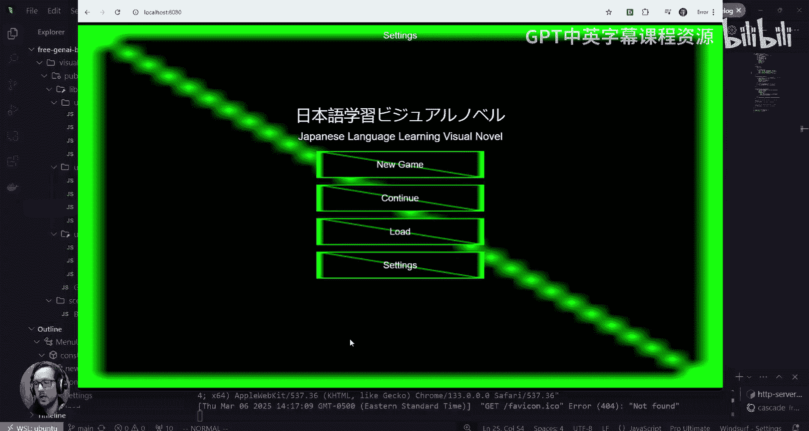

And I mean， it is really low right now， so it's totally fine。

 But before we were having some issues with it。 And I think next thing we want to do is work out this on this new button here。

 So that's what we need to hook up next。 And so we're going to go over here。

 And we do have a bit of an issue because we're not managing our events in a great way。

 They're kind of like all over the place。 And the question is do we centralize them in the globals manager。

 I don't know。 we do have some global ones over here that we have like save game。

 load game stuff like that。 But then we also have some actions that are in other places。

 So here we do have new game continue setting。😊。

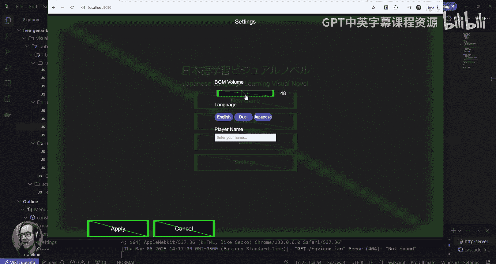

And， you know， should they be in here or should they be in the menu。 I don't know at this point。

 And we do have some in the setting。 So it is a bit of a mess。

 but we'll figure that out as we go here。So what do we want to do。

 We want to transition to the next scene。 And that's right。

 We want to go to the scene scene game start now。We do want to have transitions。

 We do have a scene transition manager， but it depends on what they mean by scene。

 Do they mean scenes between scenes within。What do you call it？

Within phaseaser or scenes within the scene of the game。

 So I'm not going to worry about that right this moment。

 what I'm going focus on is getting the new game to transition over to that and new game we haven't touched in a very。

 very long time so that should be really interesting if we go back over to our menu scene or sorry our not that the global managers we have this where it says start the scene now does that transition the scene So we'll go here and just take a look at phaseer scene change。

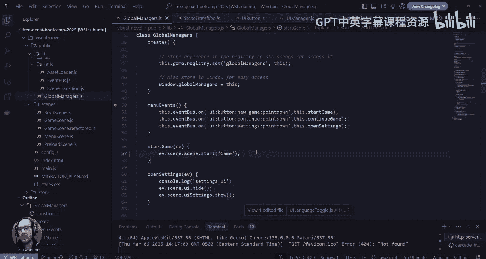

Or maybe life cycle， because a life cycle will tell us。

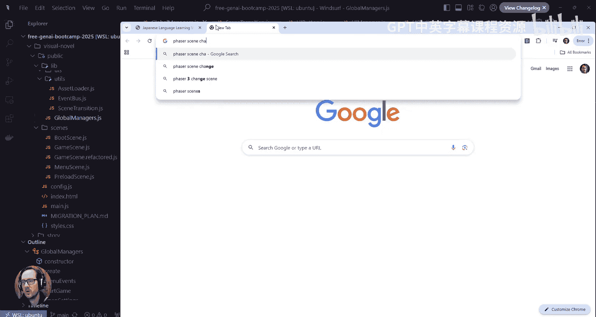

A lot of bat will go into this one， which tells us about the life cycle。And so here we have。Start。

 which will create a scene。RightWe can stop a scene， shut it down。

 Why would we want to do these things？They create an update amid states。

 so I'm not sure what we want to do。But I know that I want to start the next scene。

 So I'm just gonna to go with that for now。 This where that comes down to like。

 is there performance issues by doing that。 And so I'm going give this refresh as we've already hooked up that。

 And so if I click this， it goes to the next one。 We're getting weird double playing here because we're having some issues。

 I assume that the reason we're getting that is because we're running into an error。

 But I don't actually see an error。

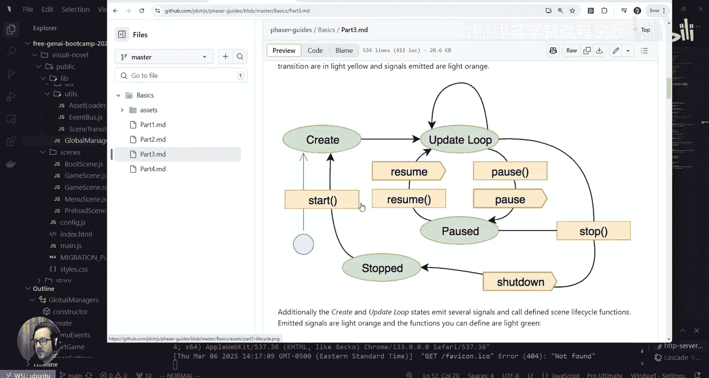

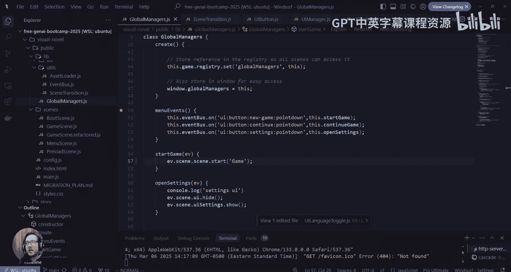

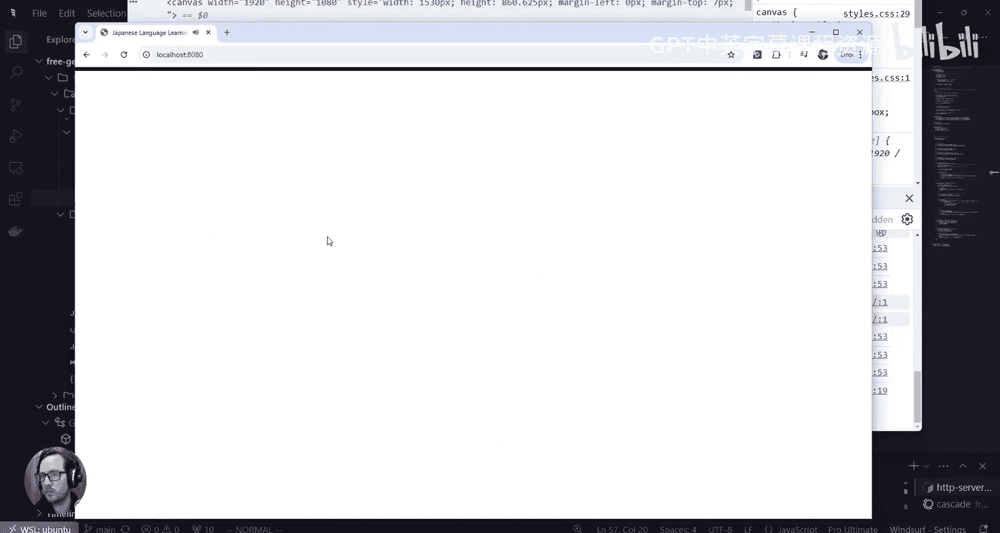

Which is interesting because if we transition to the other one， it should stop the other music。

 right？It shouldn't continue on。 So I guess my question is like， if we hit stop。

 does it stop the other scene。 So does start stop the other scene in phaseser。

 That's what we don't know。

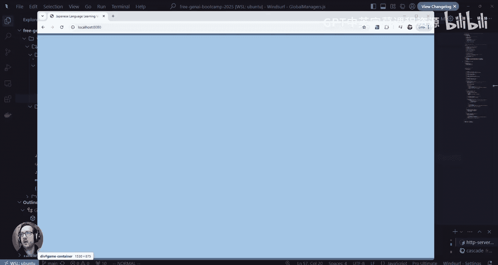

So。And this won't even work as a phaser， scene operations should go via the scene plugin。

 which is accessible via this scene。From within it。

 So this scene start will stop the current scene and then start the other one。

 But I don't think we're calling game dot scene。 We're calling， well， has scene dot scene dot start。

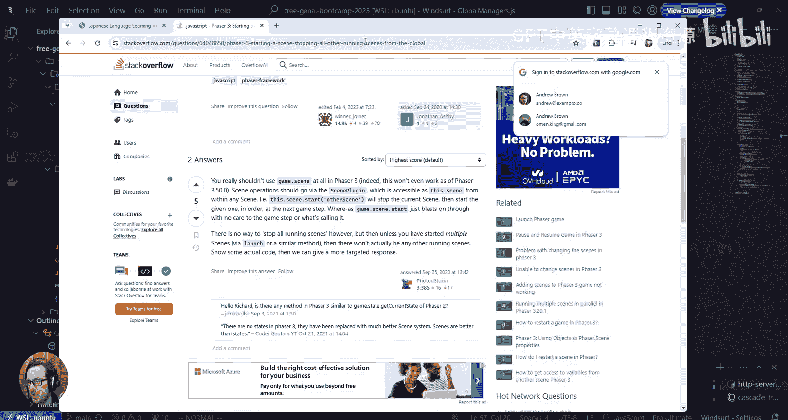

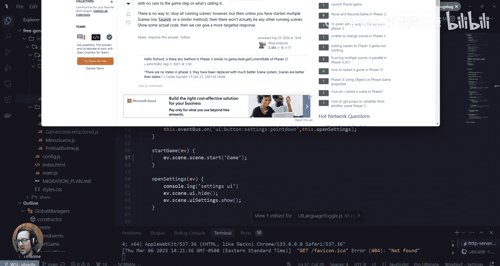

I don't know why it's doing that。Would it just be event do scene dot start？Yeah。

 why is it calling it twice。It's already the scene， right？So I'm not sure。

 but I'm not sure if thatll fix our problem， but we'll take a look here， as that's a bit unusual and。

What I want to do is go back over to here。

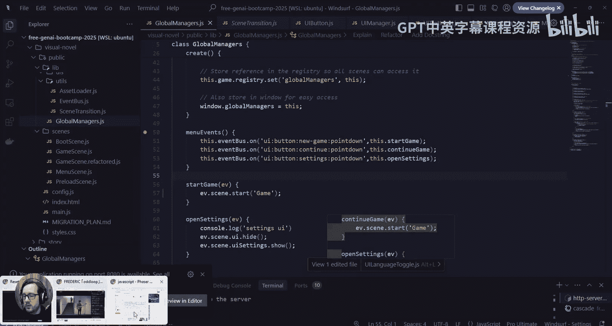

Or is it over to。You got here。And we'll give this a nice refresh here。

And here says events seen scene， start is not a function。 I don't understand because isn't。

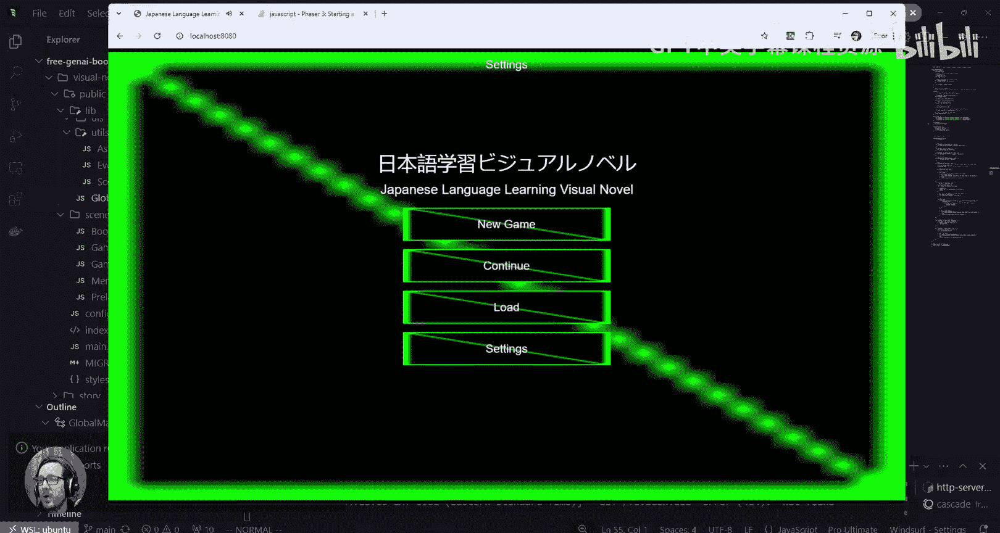

Seen here。What I think is being passed along here。 So we'll give this a console log here。

 console log。Event here， and then we'll give this a nice refresh here。

And we'll see what we're getting when we click this。 So when we click this， it。嗯。Butuning。Mnu scene。

Oh， I guess so， yeah， so you still do have to call scene scene。Alright， but what I don't understand。

Is like， why is the music playing twice because？When you go to New scene， wouldn't the other one。

Close out， I guess I the question like， does it actually stop the other scene？

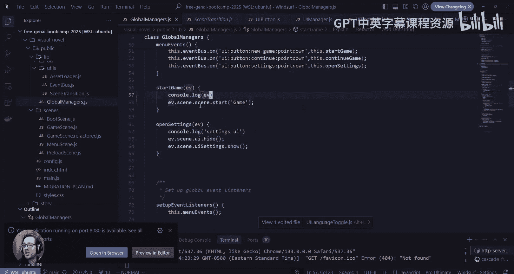

So if we go back over to。

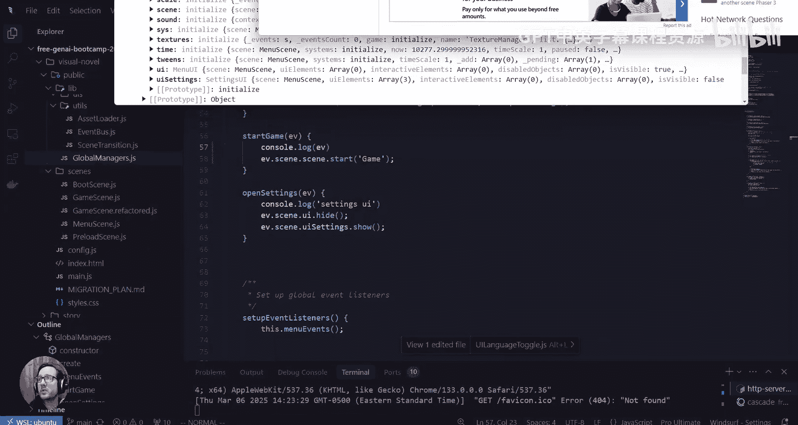

Where is it the。Paser。Seeceing lifecycl。Here。We have start。

 but I wonder if we actually have stop or shutdown being called here。

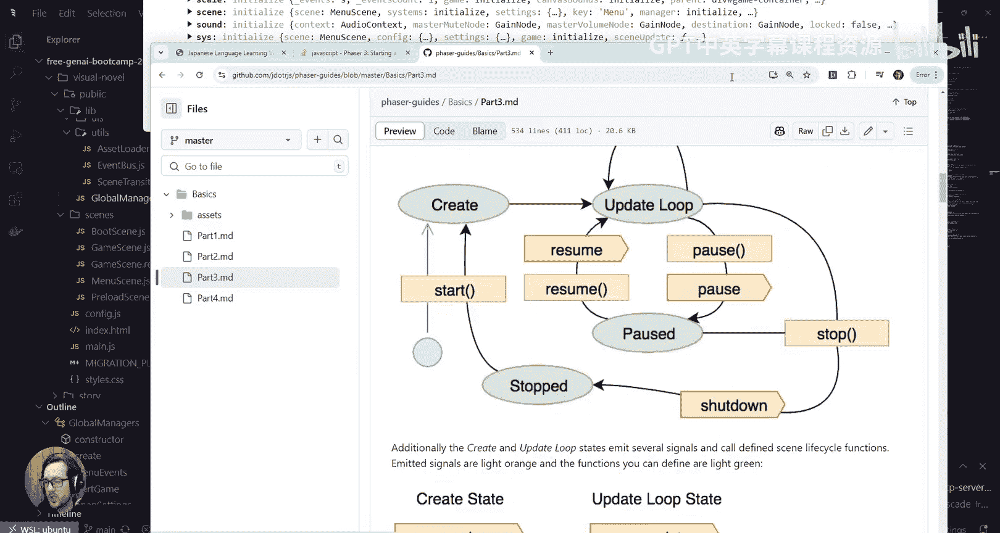

So we're going to do。Let's go into our menu scene。We a knit。

And I just want to go ahead and see if we have like， we'll say start。

Sure if this would break it in any way。Well first let's just see if it calls this a like starting scene。

Right， because I don't know phase is going to be or， I mean， cled with。

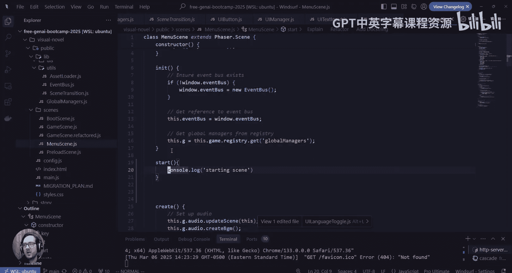

Windur is going to be smart enough to figure out what's going on here。

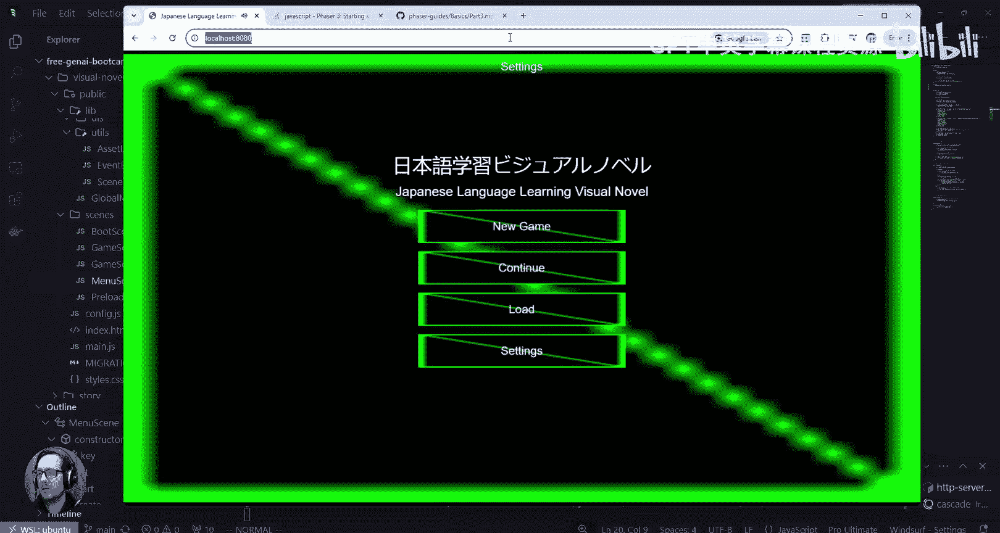

So go here and what I'm looking for is it call start， I don't see it there at all。

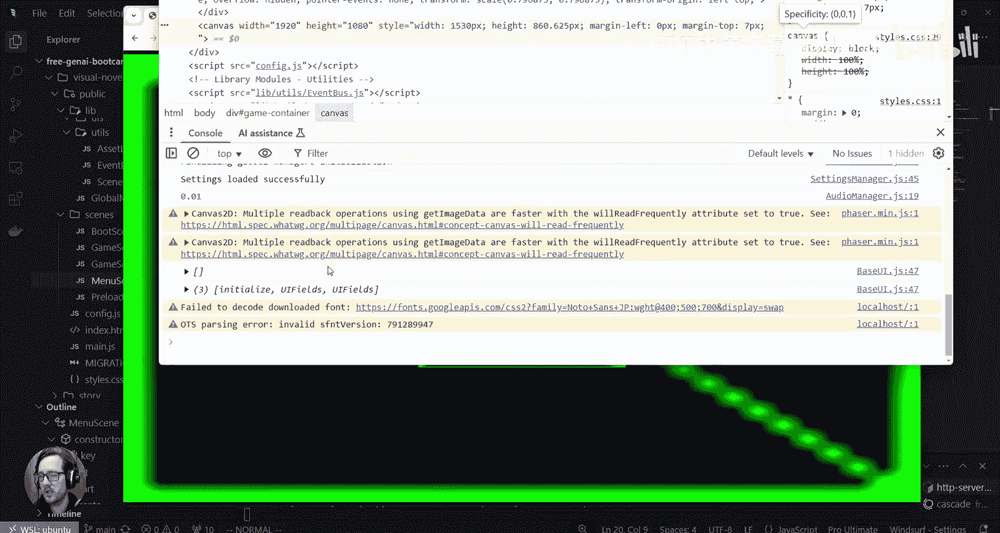

Setting successfully loaded。Yeah， I don't see that。

I don't know， so I guess this is where I'm going to ask。Here if it can figure it out。 So when I。Oop是。

When I start game。And it loads the other。gaame先。The music。Is playing twice。

 I was under the impression。When we transition scenes。In phaseer。

That the previous music would stop because it exists in that previous scene。

Doesn't the previous scene。Stop when we start another one。Okay。

 so I'm going to go over here and move to chat because this is where I'm I'm confused。

Because we tested it earlier and we heard it stop when it would transition。Normally phaser。

 when you transition to a new scene， the previous scenario should stop。

 if it's not set to persist between scenes， let me investigate why。Okay。嗯哼。😊。

I see the issue now both scenes are creating playing background music independently with the same code pattern。

Okay， so when transitioning from a menu scene to game scene。

 the game scene is creating new audio with without the menu screen audio being stopped。

 This is likely related to how global audio manager is implemented。 Let's take a look at that。I mean。

 originally， that's what we wanted， but I couldn't get that to work。

I need to find the audio manager implementation， the code based to understand it。

Even the phaser scene typically manages their own resources。 So this issue。

 this issue is when transitioning from scenes isn't being stopped。

 even though phaseer scene typically manages their own resources is in the case of the audio is being managed by global audio manager。

 When the new scene starts， it doesn't automatically stop the previous audio。

 the solution is is to stop the background music before creating the new one。I mean， sure。

 I just didn't think that that was a problem。 So for now， what I will do。

 it's a little bit unusual that that's our problem。 But I'm gonna go over。

I can see what's happening with the music in the hold on here。In the current code。

 when you're transitioning， both scenes independently creating the playground music。Okay。

 you keeps saying that I get it。 I just thought originally that when we transition scenes。

 that that's not how it works。 So that's easy enough to fix。Because what I can do。

I I can go ahead and just。Disable that problem there。So if we go up to wherever we create our game。

 game scene。Here。It's creating and doing this， so if I just take this here and comment that out。

That I will kind of resolve the issue， but again， I thought。I thought that's not how that worked。

 right？

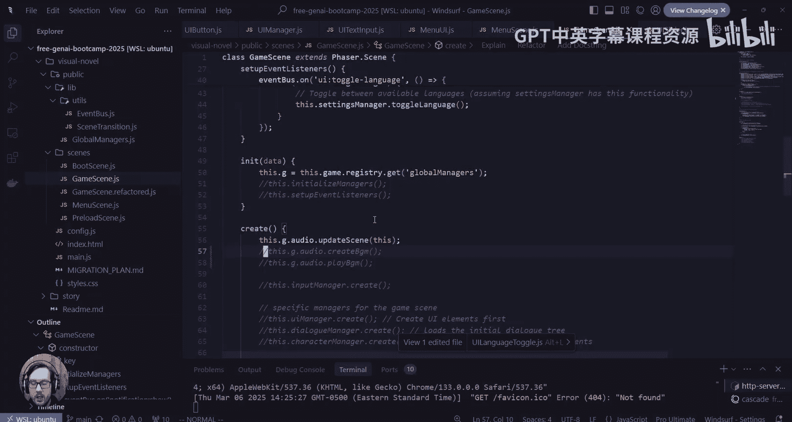

So give this a nice hard refresh here。And so I clicked it and it's still playing the music interesting。

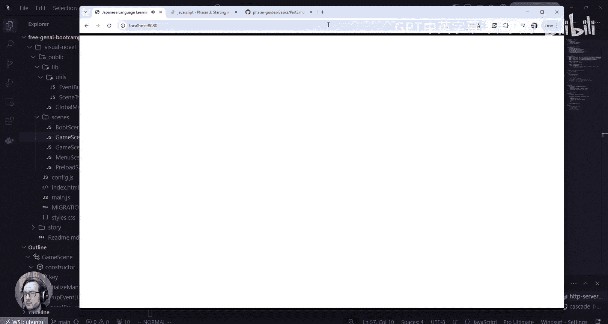

Alright， well， that's not a problem for me。 I don't care about that。 So now we're onto this screen。

 And， and the rest of the game is not loaded。 One thing that we might want to be able to access from here is the settings。

 So that's probably the first thing that I would want to put in here。So， we need to。Create a menu。

I'm just trying to think about this for a second because。We have。

I guess we have a dialogue menu or a settings menu。

And I'm just trying to think of it like how games handle this。

 they usually put like a cog or something somewhere。So。嗯。

I'm just trying to think about this for a second。Give me a second to think about it， okay。Yeah。

 so what I'm going to do is I'm going to go ahead and I'm going to create a new UI here。And。

We are creating the UI for the。Game scene， I guess。 So this will be。But we got to go under UIs。

So we'll go to UIs and then we'll have we have dialogueo UI， which is in the main game here。What。

 which we haven't really dining with， but。It just depends like。

 do we want to keep these U I separate or do we want to have one U I with all the components in it。

 I'm going to separate them out for now， I'm going call this like。Game UI actions。JS。

 and so this one's responsible for containing the game UI actions， a class。Game UY actions。

 construct your scene。We'll do that and so what do we want to do with this here？I want to。

This should be extending， should it not？Extend the other one。 Don't these always extend the scenes。

 Hol on here。We'll go to this one here。 This one doesn't。 but this one does。 So we want to extends。

Base UI actions here， we expect this to have a。Why is the UI manager being called like this？

That's weird。 Oh， it is being passed in here。 Okay， sure。

I thought maybe it wasn't there for a second， so we have UI manager。And。We'll do this next。

The the thing that we need here well we obviously need X and a Y， so we'll put that in here。

And we'll have this dot x。And then we'll have。This stop why？Okay， I need to say this dot create。嗯。

It's basically very similar to that。 But I'm gonna go ahead down here and say create actions。

And we're going to have a container， so。Container horse。Horizontal container。For actions。Yeah。

 absolutely that。 crate fields， horizontal， spacing， spacing。 I want this one to be aligned， right。

 I'm gonna to go 0。Or're actually one here， and then I want this to be zero。

The other part of this is that I want to now add a button。

 so we'll say this dot create config button or settings button。嗯哼。😊。

The other thing is that we have that menu。I didn't really think about this when I was working on it。

 but technically we could have the the other menu show up and then click settings。

 It really just depends on what we want because some games。

Like imagine you wanted to reload the game， right， like how would you even do that right now。

 you'd have to quit the entire game to do that。嗯。I didn't really think about that。 Give me a second。

 go check out a video game。 It'll be back in a moment。You know what I really just can't decide。

 It's a little bit hard to kind of figure that out。 So I think we just have to start doing something。

 And if I don't like it， I'll just have to go change it。 But right now we have these settings here。

 And so when we go to a new game， I want to have ability to get to those settings very easily。

 at the same time， it's like we need to also be able to load which would be definitely one that we might need to do settings and load are our two actions。

 So maybe I can just list those on the page。 The other thing is like maybe we don't want to have Y elements clutter the screen。

 So。

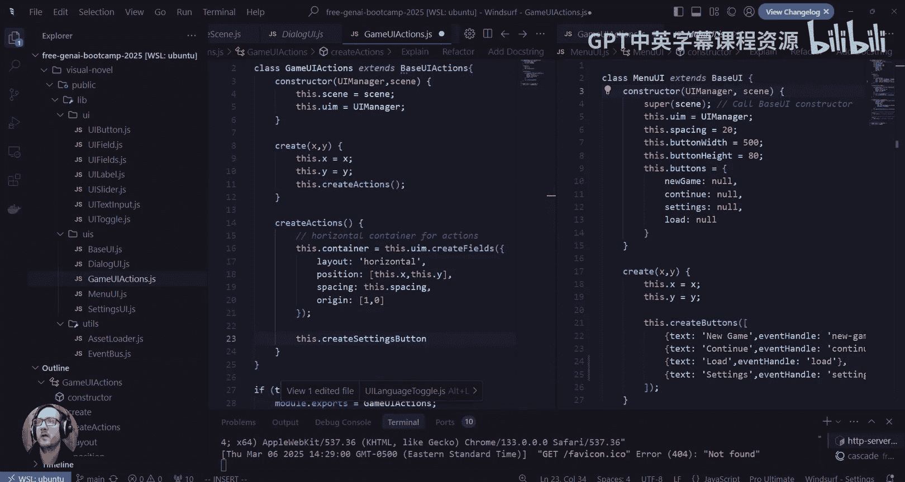

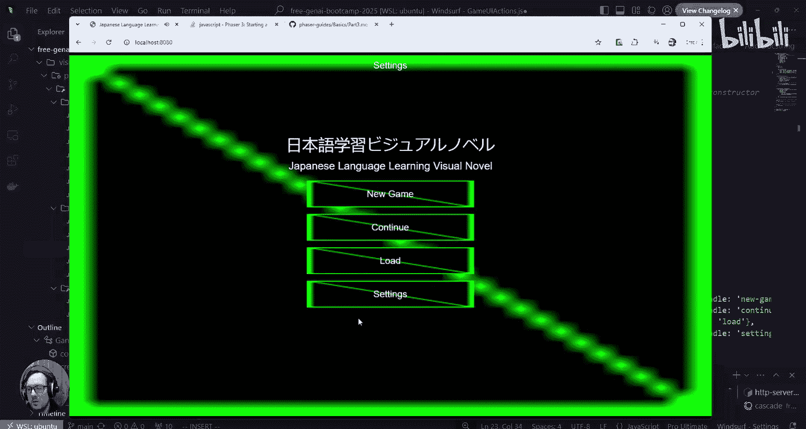

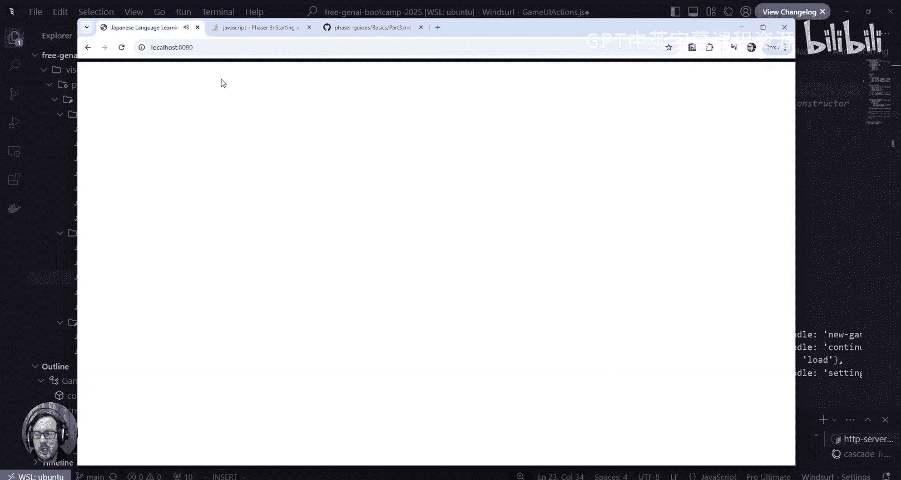

That could be something that we might want to。Change， but load settings， quick load， I don't know。

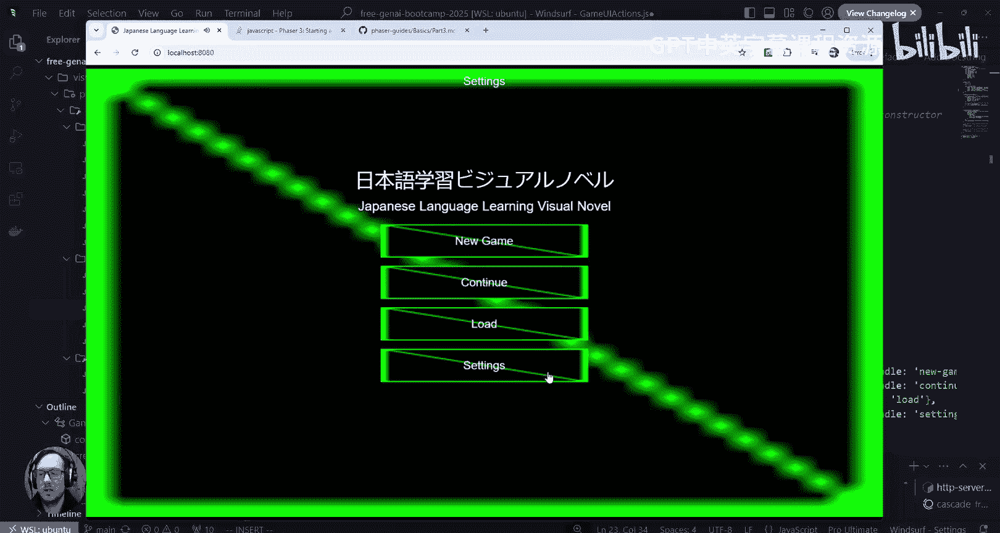

Anyway， for now I'm just going to go ahead and。Go this going here。 I have it horizontal。

 which I don't know if we need it that way， but we're gonna do it that way anyway。

 And we are gonna have some buttons。 So we have create settings buttons。 There are a few we need。

 We have create settings button。 this dot create load button。We have this dot create Quick save。嗯。

And。We have this dot create。Save button， right。And it really depends if we even want to press a manual say。

 I think a lot of these games let you do that。So maybe that's what it is。 So we have quick save。

 save， load， load button here。 And I mean， all these buttons are gonna be kind of the same。

 So maybe I should really just have button data in this。I say， like button data。And we'll do this。

And bring this down here。There we go。 And so then instead of doing this。The dot create。I mean。

 this is arguing going to create the buttons anyway。Loop through and create buttons。

I don't think it needs a position。Yep， yep， yep， yep， that's fine。

And I probably want these to be icons， but for now。We'll have them as bulky text。嗯哼。😊，嗯哼 keep going。

Keep going。It is。Kind to do what we want。I'm not sure what the problem is here。Ohim isn that， okay？

So a text in a bent hand。 it seems like it's supposed to have more than that。It was a constant。But。

This dot。Container addfields button， right？ This doesn't seem like this is enough information。

 Let's go over to the menu U I as a comparison。 So here it would have been nice of the buttons。

It looked like this， which is fine。 if it's a little bit different， it doesn't really matter。

 But in here we can see the field， we say create button and create field， we did say create field。

 We have input options， text size， event handle。 So here we should have size， right。嗯哼。😊。

And we can probably。Go here。 Yeah， we can set that up here。 Like that sure。 Why not。

 It's probably identical to the other one。 These buttons are way too large， but that's fine。

 So now we should have those there。The game Ui actions is not added to the scene。

 So we're going go over to our game scene here。 and let's go ahead and add those。

 So wherever that is， this is。In our create。We have the this game create menu。No。This would be。

We need to kind of compare this with our menu one here。And。This is going to。 Yeah。

 we have update the scenes scene。 So we have this dot。Where's our interfaces？Down here， okay。

 so we have this dot UI。UI。Game actions。Equals new UI game actions like that。

 and we'll say this dot UI game actions。Dot show。So those should show up here。

 The thing is that we're not setting its position。 So here we're supposed to say create And here is saying width。

 with and height like that。 But I really want this to be the entire width。 and then the height。

Should be zero。So I'm trying to get in the top right corner， right？

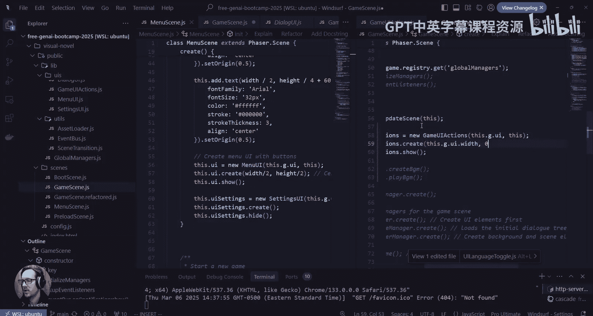

So we'll go ahead and do that。The other thing here is that I don't know if we've actually included this into our。

Actions here。 So in our settings， we have this one。And now we've added that one here。

 so let's go ahead and stop and start this， go over to here， take a look see what we get。

So hopefully that renders out that new UI。And we have reference game actions U I not defined。

 We probably don't have the export on that。 I think we did do that， though。

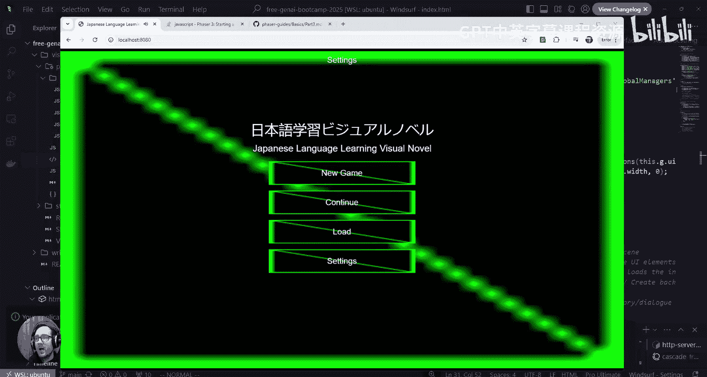

Yeahep， the exports there。And I can give us a nice other hard refresher。

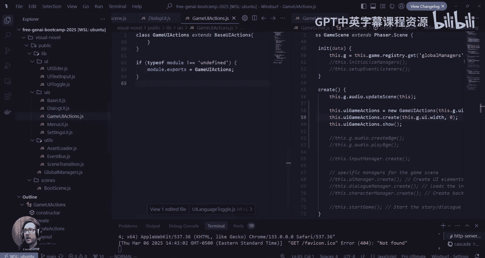

Not saying it's not defined。It's definitely defined。 It's right here。G me actions。

 Give me my actions。 We'll go back to our index HTML L。 I did save that， right。

You folks saw whether I saved that， right？And it could be like the order in which we load it。

 I don't think that's the problem。 The game scenes get loaded later on， right， Yeah， way down here。

 So that should be a non issue。 I'm gonna stop and start this just because we added a new file。

 I don't sure if H shouldB server serving it or not。

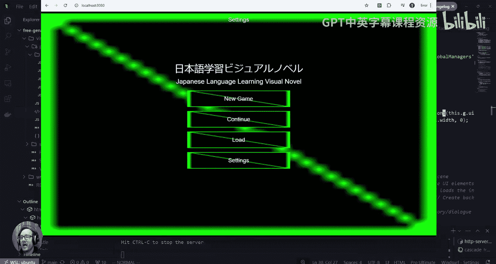

And so now we go here， I still having this problem。

I don't know what it's talking about。This is， I mean， Lisa gets us through these issues。

 But that's usually the initial problem I have was like， when you're adding new files， like， oh。

 doesn't exist。 Why doesn't exist， Go it around with it。Mmhm。

Why is there a game frame refactored in this。This is a。Oh yeah， let is try to do something over here。

I don't know if this is delete this so。 I never asked for that。And。Okay， let's go fix that。

We'll supply that。 so it says we have a little bit of an issue。 We'll go over to here。Okay， great。

 sorry， so we'll go ahead and do that。We'll accept those changes。

 I didn't realize that we had a super command there now。 We'll go ahead and give us a refresh。

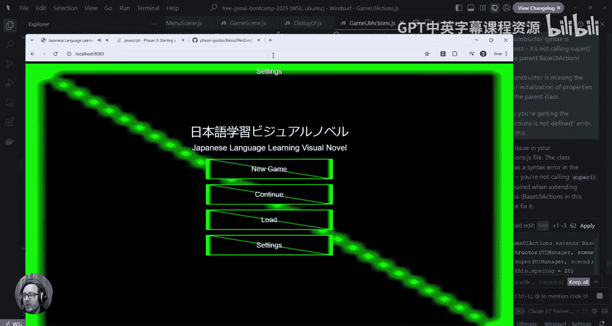

And I mean， you know， like we are waiting like for the LN to produce stuff， but back of the day。

 I used to have to spend hours trying to figure out basic bugs like that。

So I guess I can't really complain， you know what I mean？It still says it's fricking， not defined。

Come on， Give me a break。

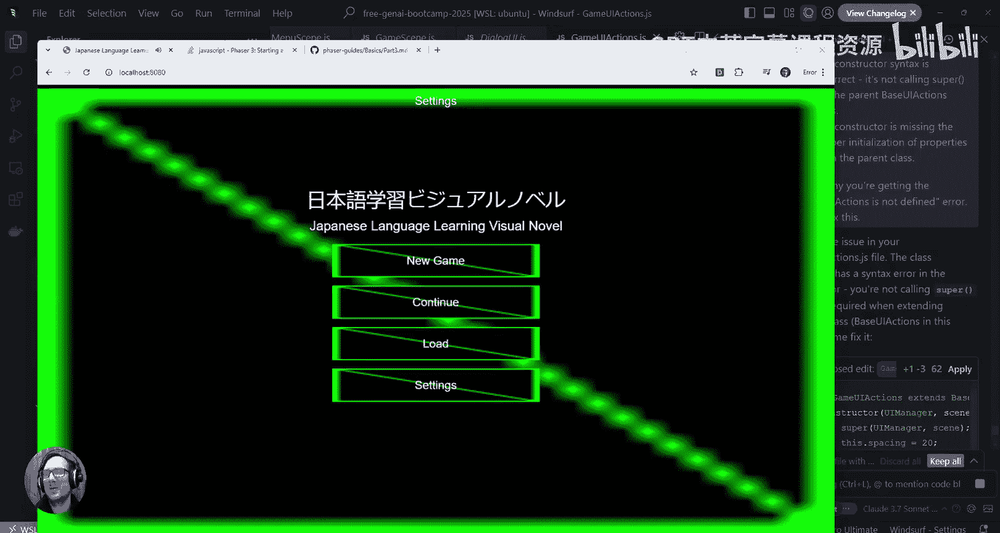

Just， just work， just work， Just work， Come on， just work。Today， please。

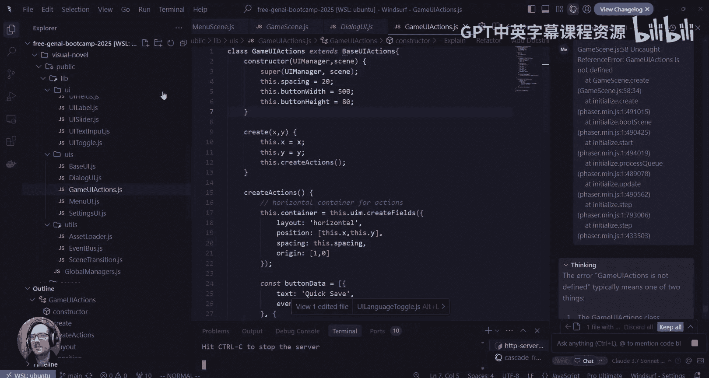

still doesn't work。 I know settings is up here， which is not supposed to be hereca we're on the main page。

 We'll worry about that at some other time， but it is a little bit of a glitch I just noticed。

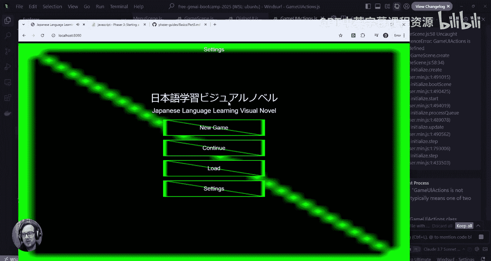

嗯哼。😊，Interesting here， it's setting it a bit different， so it looks like maybe it got confused。ok。

And I'm actually surprised it doesn't said it like that。

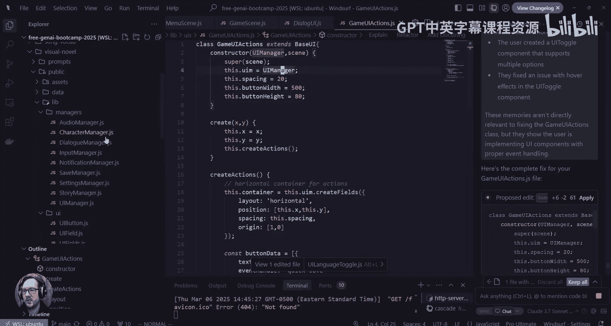

Yeah， it doesn't。 That's interesting。 I'm not sure why we don't do that。Whatever。Still works。

We'll give this a nice refresh here。 We'll go to New game。 position must be an array of two numbers。

 and that's in the UI fields。

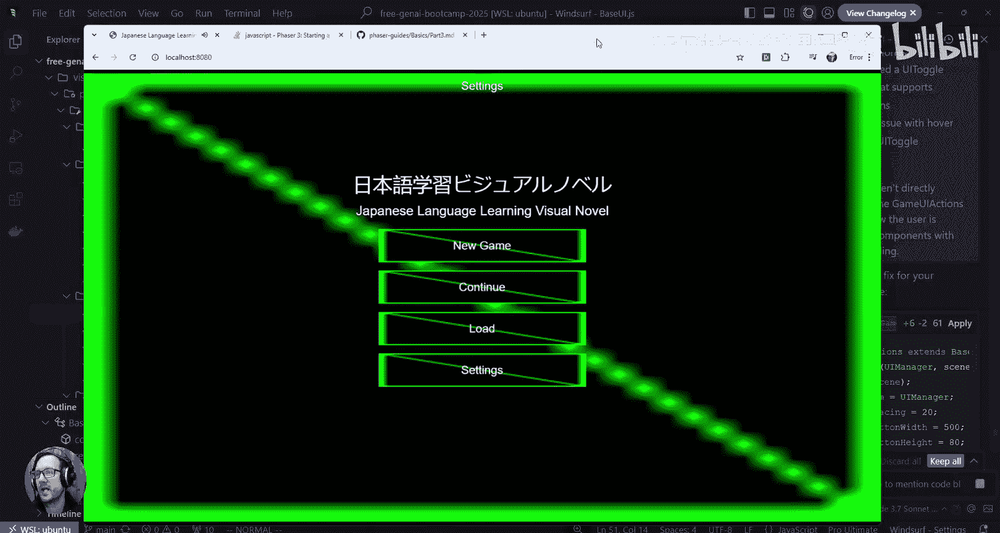

So we'll go back over to our game UI actions， I think。And here we have position。啊。

And then we have position down here。So this is messing up on UI fields validate option。

 So I'm going to assume it's this is the problem。 We have the x and the y that are being set here on the create。

 Maybe we don't set them at all， but I thought we did。So we go back to our scene here。

But right there。 So we're gonna go ahead。 and I'm just gonna give it。Or the information again I just。

Tired when this doesn't work， right。And so we'll go here and we'll see if it can fix that issue as well。

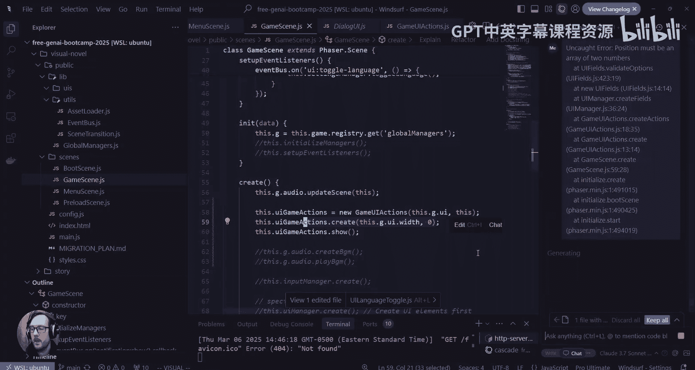

嗯。But yeah， excited to be on a different screen， even it， But it seems like， like。

 seems like 90% of this game is just U I stuff。😊，Really， it does。Feel that way。

I feel like we were making the mud。 we'd be more focused on generating that stuff here。

 we'll go through here。 it says there is a new there is a new error different。

 We fix in the extension class， but now there's a new problem。 The position must be an array of two。

Oh， is it not？啊h。Okay， so then。I thought it was an ray of two。How is it not an array of two。

 It looks like it is。We'll give us a second， okay。Well here it says。

 let me implement a proper fixed position， the error says position of array2。

 we're passing a single number width to the create in the first。

 I need to sure the position is properly formatted。

I said this now you're trying to pass with as a parameter。

 but that's not an array as a required UI fields。啊。Okay。

 so I'm going to go back over to the game scene here and take a look at that again。I understand。

 like it's this and then it's that。It's really thinking hard to fix this。Holy smokes just shut up。

 It's not even figuring it out。 We're gonna go split this here。

 We have game game U I game actions create， right， U I game actions create。

 We're going to open up our U I game actions， wherever that is。

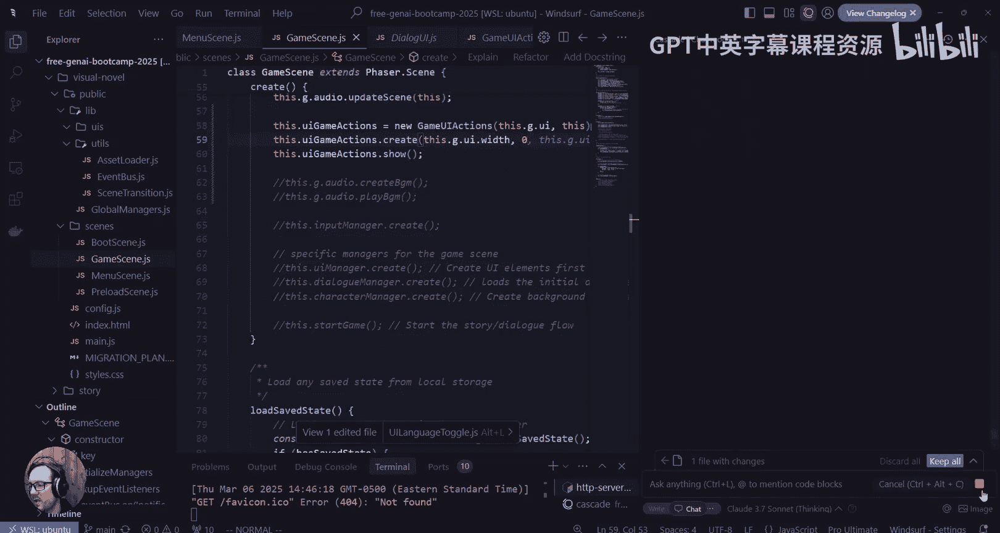

That's under。UI game actions。

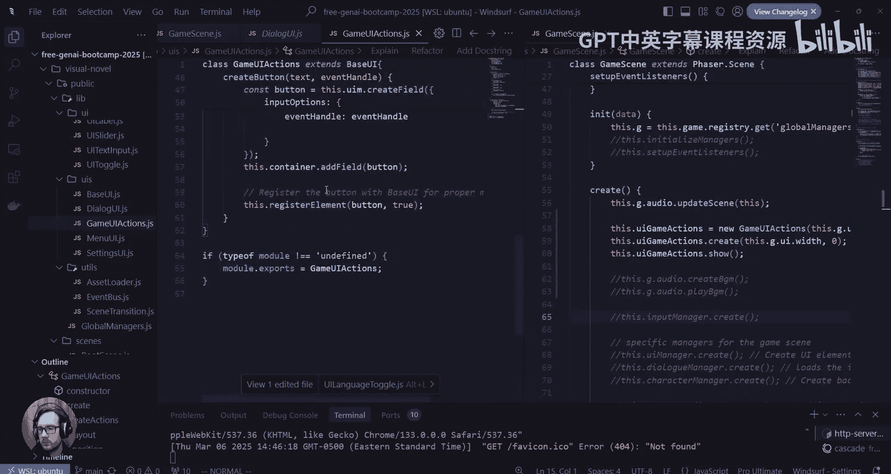

And。UI game actions。 This is our create function up here， X and Y。Right。

 the down here we have X and Y。 We're setting it。 So let's give this console console log and say console log X and Y。

 right。It's probably one is null or some weird value。That's probably what it is。

 we' give this some nice refresh here。We got。Click this here。 Y， the first one's undefined。

 That's a problem。 So it's undefined at that point in time。

 And that's where we're running into an issue。

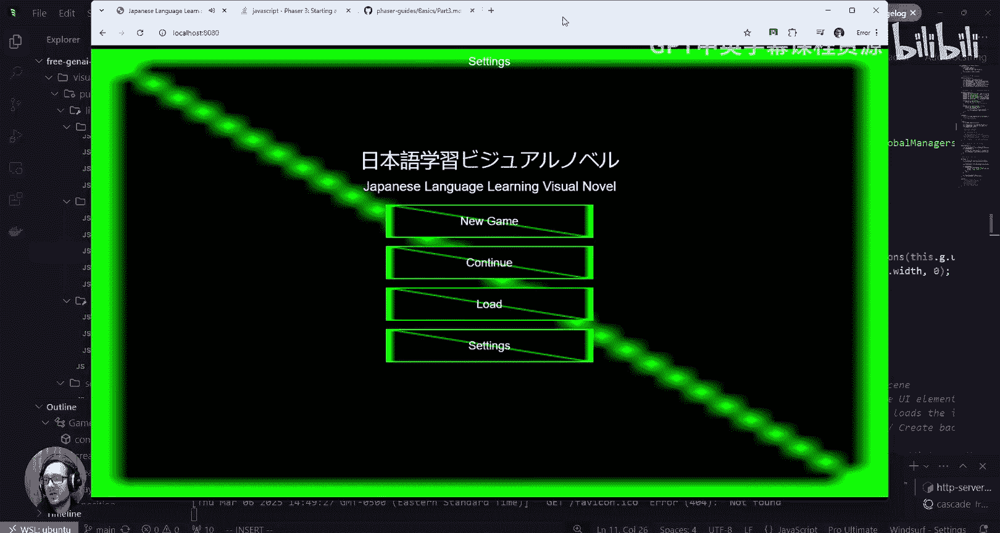

So we'll go back over to our game scene， which is over here。

And so it's saying this G UI with that's not actually what we want。 If we go back over to our menu。

 the thing that we actually want is like it's camera or something。So。Should be in your camera。With。

嗯嗯，嗯。Or not menu I menu scene。This is。Yeah， here it is。 This do camera is dealt with。 So this。Here。

Yeah， I want to hide as well。Sometimes this happens where I hit tab and it just doesn't work。

Tab for accept， accept it， accept it， accept it， accept it。 there we go。 Okay。

 so now I can just put with in here and that will resolve that issue that we're having there before。

 I want icons in there instead。 I don't want to slot those in right now。

 We could probably fix that if we want to no errors。

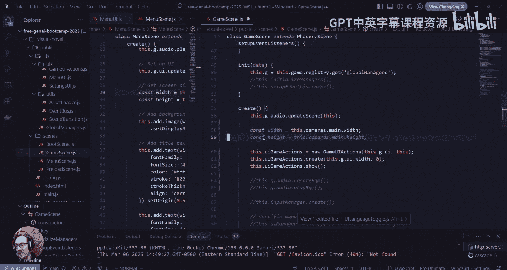

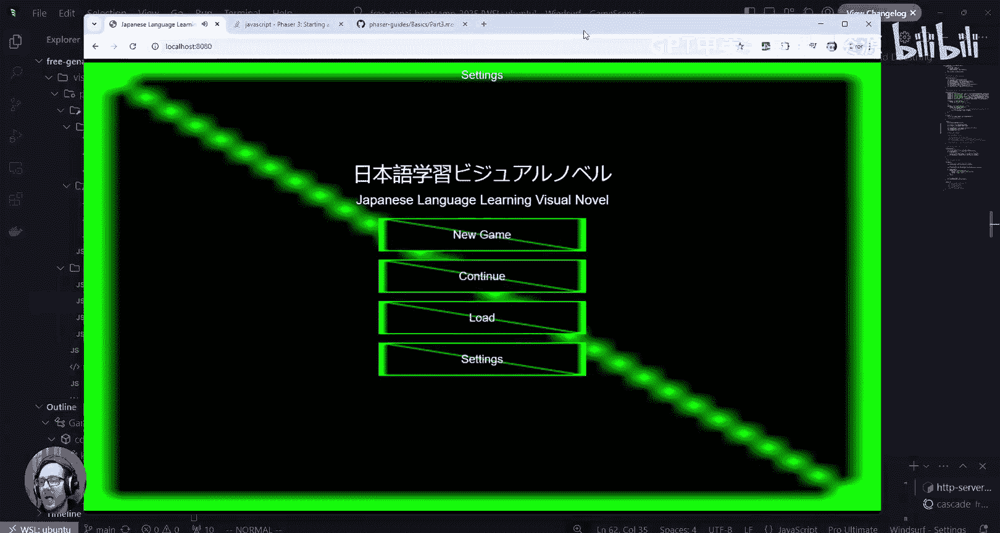

Right， no errors， but I don't see any buttons。

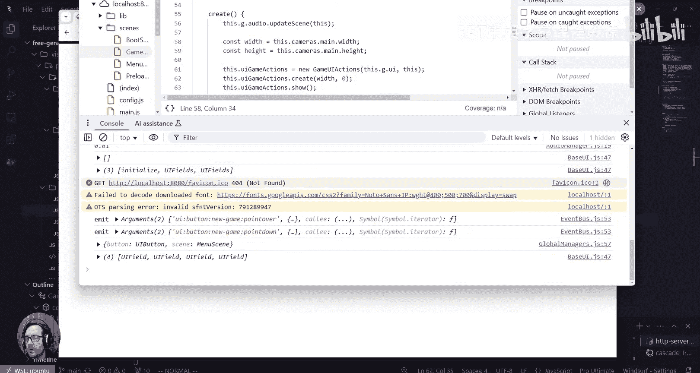

Right， so if they're there， I I don't see them。 If we go back to this one。

 These buttons have some kind of graphics， so they should appear。

And we are saying for it to show。So maybe for now， I'm just gonna to put 0，0。

 so we can just see if that's our problem。 could also be off screen because。

How we're setting stuff here？And so I still don't see it。

 I'm again just going to reset things back to their normal defaults here so that。

We're more likely to see the game actions。 if it's just not appearing。 We do create the actions here。

 So there's no reason that it shouldn't show up。 We are attaching the fields。

 We are registering the fields， registerister the button with the base UI management。

 So we're not supposed to do that。 We're supposed to add the field because if we do that there。

 it's kind of redundantly twice， which I don't believe we want。But for our positioning our origin。

 I'm going to set this to zero just so that it stays on screen because maybe one is pushing it up because if we have one。

 it shouldn' and it should be to the right of it。But for whatever reason， if it's messing it up。

 I want to just put it back to normal origins。Okay， we go new， I still don't see any buttons。

I don't see any errors。

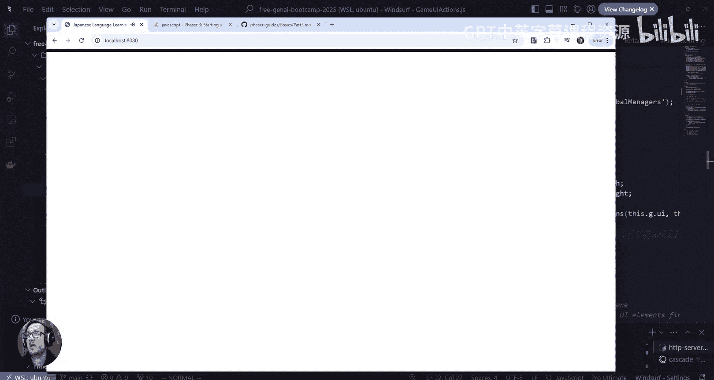

I don't see any errors， but I also don't see any buttons。So let's go and compare。Our menu scene？

Oh sorry。Mu UI and I'm just trying to make sense of what could be different here。

So in here we have our create action and we create our we create our actions。

 we have the code down here， we could have just had it there as well。

 but for whatever reason we coded it there instead then we have create button separately here its through the buttons。

 which is fine。Here we have this one's horizontal as opposed to vertical。

 We could also just change it to vertical for now。And that's fine。We iterate through the buttons。

 and each button gets added。As a field here it's actually adding the event handler。

 and this one's actually adding the button。 So I think this is supposed to choose。Oh， but that's the。

嗯。嗯嗯。Like why do weerate， Why do we even have buttons managed that way， Do we even need that。

We don't。We don't。 I think it's just because it's like legacy code， right。

 So we originally did this because we needed it。 So I just gonna take that out。

 I just want to try to like normal laserer code a bit more here。 And so we have the buttons here。

 And really， what we can do is just say like cont， like cont button here。 cons button。Like this。

I'm just trying to normalize our code so I can just exactly what we're doing。

 This actually does return the button。Right so this one is a little bit more simplified。Okay。

 and now it's just iterating through the button data。 I don' not sure if I broke the other one。

 but we'll go ahead and take a look here。

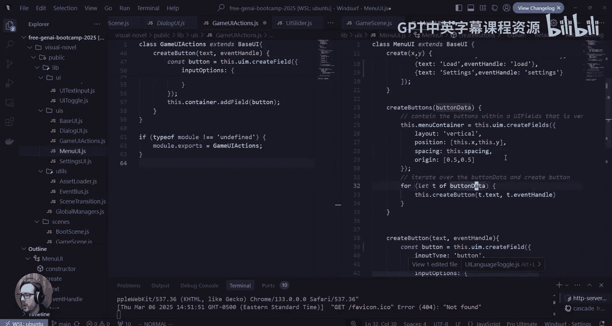

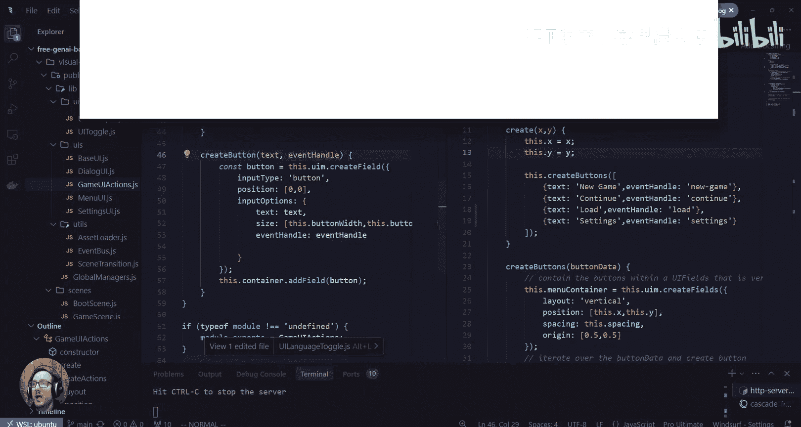

So this is still laying out perfectly fine， we still don't see buttons here。Okay。

 so now I know for certain。I know for certain that the code is more similar， right， because。

The only thing is like this data button' is a little bit different。And。

I don't think that's a problem， but I'm going to console log out here just make sure that it is doing the buttons here。

笨笨。And we're just going to keep stepping through this here。

And I click New and it does iterate through the buttons， I can see them right here， right。

 there they are。

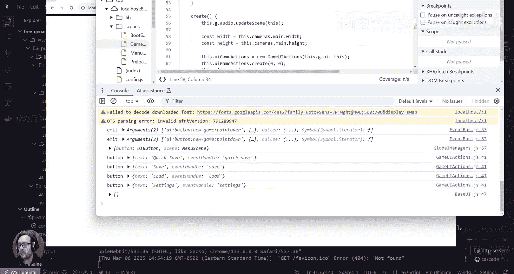

But again， I still don't see any buttons。 So we have create button here。Input item button position 0。

0。 The text is there。 So that's getting inputted。 The button width and height are there。

 We have the handler。 So that's all correct。 It's the same as this other one here。

Here it's adding the button to the field， so that's less of an issue。

 there are these show and hide functions now I don't have them in here， but maybe that's our problem。

I don't feel like we'd have to enter those because those are if we wanted to override them right if we inherenther from them。

 this should automatically work， but just in case it needs that for some dumb reason。

 we'll go ahead and put that in there and maybe that will resolve our issue so go ahead and give us a nice refresh here。

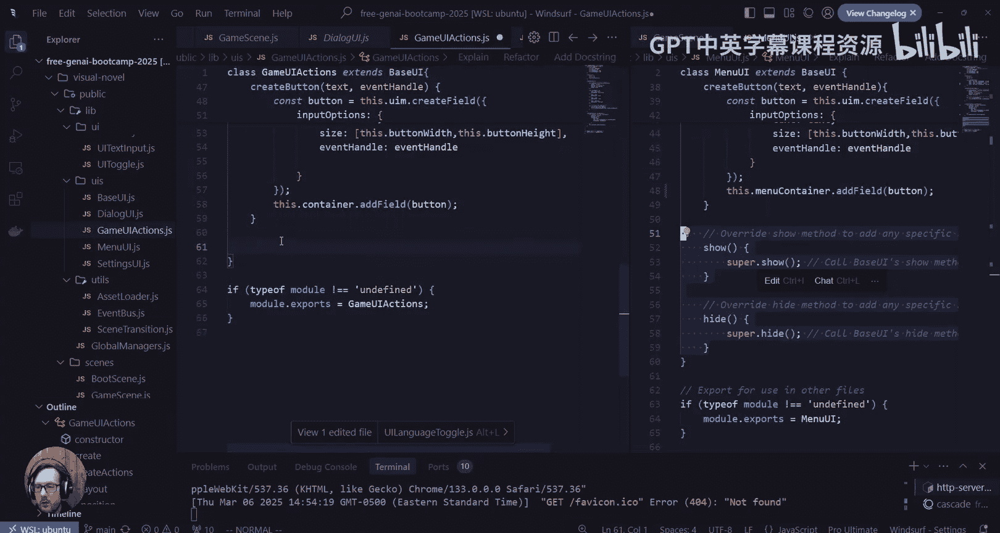

And we still don't see anything here， so I'm going to go into our base UI。

And in here we have our show。Say console log。S this should happen at least once。

But then when we click on that one should happen twice。So we go here。 It shows it once， right。

 We click it again。It shows it twice。Right， twice as nice。 so it's showing it。 but again。

 I still don't freakrick and see the buttons。 We'll go over to game scene here and we say create 0，0。

 I'm gonna just put this out a little bit center and say 1 hundred and100 right This way it's getting pushed out a little bit here。

 I'm not sure maybe there's like something in our update frame that's messed up。

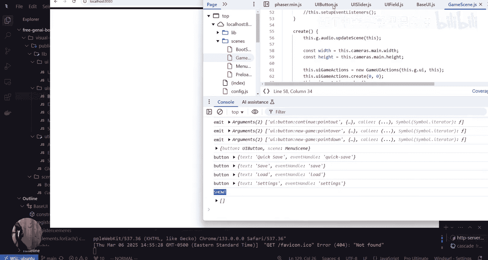

I don't think we'd use update in this， do we？

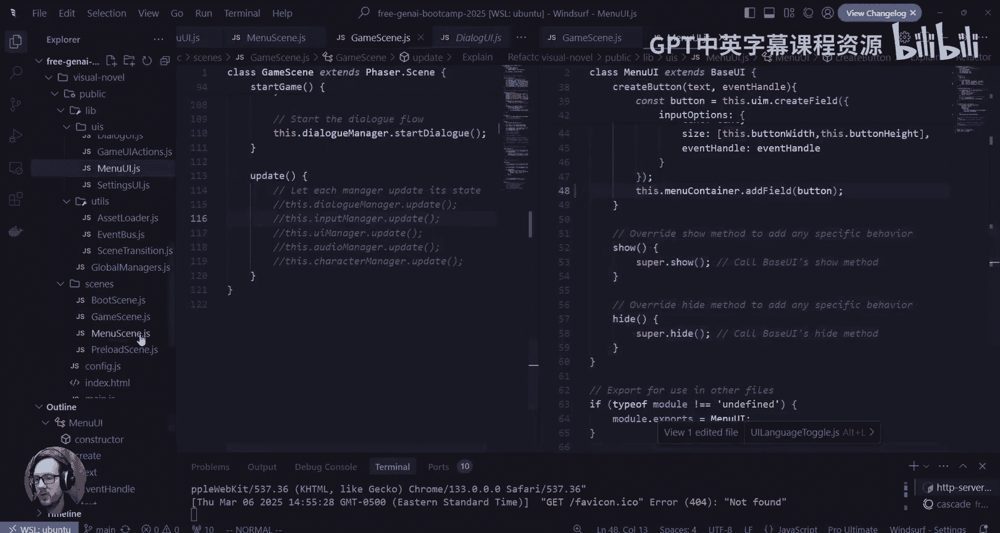

No， we do not。So nothing that should be messing it up， right， so go， we'll stop this， we'll start it。

We'll go over to here。Yeah， I don't know。 I can't。

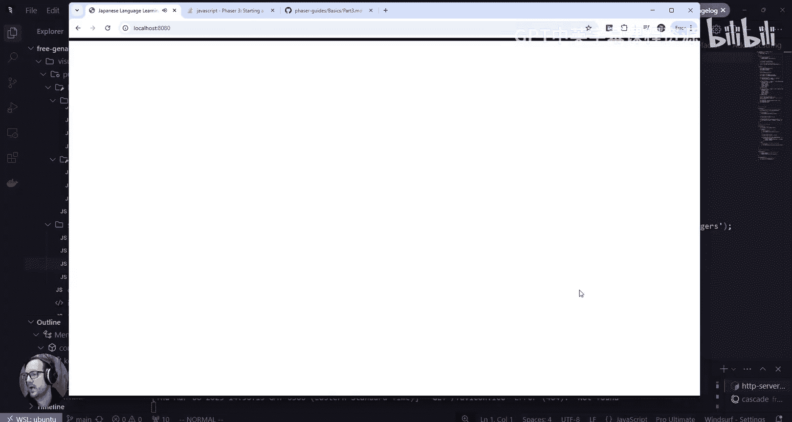

This is frustrating。When when I go to game scene。I don't see the menu。I'm expecting。

It's just not is not on screen。However， show is show is being called。

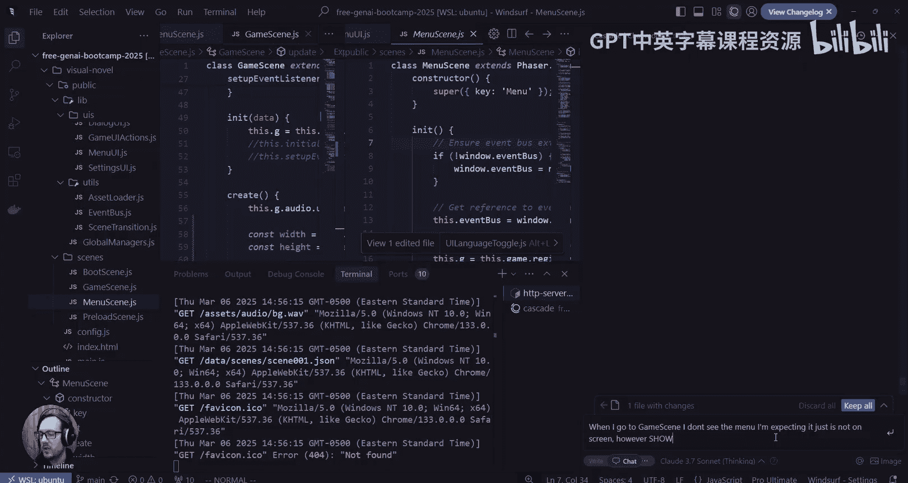

Okay， we'll see if I cant give me an answer。Let's see if it figured out any reasoning here。

 I need to determine why the UI isn't showing up。 Let me think about what's happening in the game actions you're doing this。

 look at the base class， I need to propose a fix to make sure the game Ui is showing up。

I've identified your game isn't showing up despite the show menu。

 this issue is that you're creating the UI elements in the game action but not registering them with the base UI class。

 they're not being made visible in the show call oh so we did need to do that。Do we。

 I thought the register element。Let's take a look at this one here。In the。Menu Ui。

I don't understand we add the field here， we don't do that there。So。嗯哼。😊，Okay。

 but here it's saying that， but that's not。The AI creates a component， but doesn't register them。

 the menu class doesn't seem to explicitly register。Stop， let me say， like， so， no， sorry， look。

 sorry， the， the fields。The UI fields。Does register them？Okay。 yeah， you do。

 So the thing never goes deep enough， right， The elements might be registered。

 but positions off screen has incorrect coordinates。

 There might be a z index layer where the elements are behind other elements。 It can't be。

 There are no other elements on the screen。You know， it can't be a Z index problem。

There are no other elements on the screen。For this scene。RightIt's a new freakricking scene， folks。

嗯哼。😊，It really can't figure it out。 I'm getting really frustrated with。

 It should be really easy to get this to work here。 I see critical differences with the origins。

That's not the problem。No， that's not even。That it's so dumb。 It's so so dumb。

 That is not our problem， right， So we can set it 0。5 was for 0。5， but。

I think that what we need to do。

Do you bug this is like。If it's being rendered， right， the elements are being rendered。

 they should be shown somewhere。 I guess the question is like。

When we do show， it should propagate down and show all the elements， right？And right now。

 all we're doing is we're showing buttons。So。Here。It should be visible。Yeah。

Let me pause and figure this out。 Okay， All right， so I've just been going through and refactoring the game scenes thing and I tried a lot of stuff。

 but one thing that I didn't do is I didn't register the elements and everything in the main menu。

 we never noticed it， but I never actually in the main Where is it here。

 May I never actually called that here。 So I now applied it there。

 but I also I'm just realizing coming back over to here。 I'm just walking through it。

 and I don't see this update scene in here。 So if it doesn't update the scene。

 it would be calling the old scene， which would be an issue。

And so maybe that's our problem here， so I'm going to go ahead and try this and say update scene。

To this。And that might be our actual problem。 I just have a strong strong feeling that's probably what it is。

 I am going to go back over into my global managers。

 I've been fiddling with things as you folks probably didn't see here。

 but I'm going to bring this back this show back in here。Okay， and so I'm going to stop this。

 Start this again。 I'm going to go back over to here。 I'm gonna give this a hard refresh here。

 And so now。

There we go。 Our buttons are actually show up Now， These buttons are a little bit too large for my。

 for my liking here， but I'm gonna go into。😊。

That was really， really hard to figure out。 But I did figure it out。 I'm gonna go into the。

Back into game actions UI and up here， I think the buttons are way too freaking Laura。

 you're going to make this 40 and。50， one thing that might be nice to have are buttons that are like exactly fit the size that they need to fit。

 but that's just overkilling the code here。SoSo we go to a new game here and you can see the buttons are a lot smaller。

Again， I just need these to work a little bit better。 So I'll just say 60 and。100 for now。

Right now we don't have the means to override our styling for ours。So go ahead and do that。

And they are a bit cut off， but I can understand and make sense of them for now。

 So I'm okay with that for now。I guess we said to that， I'm gonna say put this back to horizontal。

Horizontal。The origin here。This is gonna to be to the right here。

 and we have our position before I wanted this position to be something else I go back over to our game scene here。

 And I think we actually have it open here on the right hand side。

 And before we used to tell the width to be over here。

 I'm going to try that again and see if I can get them onto the right side of the screen。

 they might be hugging a little bit， which is not a big deal。They're actually off screen now。

 which is not what I wanted。 So I'm gonna go just say， like with。Half here and see what happened。

As we haven't really done a line right much， so I'm not sure exactly how the line right would work。

So go here， I don't see them at all。嗯。We'll bring it down a bit。

I don't see them at all。 but it was working in the default settings。

 which is a bit frustrating going back over to here，0，0，1，0。 So if I。

 I put the origin back to 0 here。She really changes these elements one at a time。Okay。

 they're back and so for whatever reason， when they're on one， they kind of mess up。

Which is confusing because it seems like they should work if I do 0。5 that should center now， right？

Okay， they do。And so my other thought was like， we have the width here。

We're going to create it based on the width。But isn't the with that， like if I go 100。

 wouldn't it go all the way to the right？

It's not moving at all。Interesting。This dot x and this dot y， right， so we have that set here。

Do those dosees not get even set anywhere in our。It doesn't。Yeah， it's not taking account that。

 So I think it's because I hard coded them from from prior。 That's why。

 So this probably does actually work。 It's just I needed to get that one part in there。

 And so now we'll go back here。 So I don't I keep stopping。 I don't have to do that。

 And we'll give this a nice refresh here。

There we go。 Now， it's a little bit farther down than I'd like it to be。

 So I'm going go back over to here， and we'll say 0。 and I'll just， well。

 maybe give it like 12 and plus 12 here。

So we just bring it in a little bit。Not that it matters。And so， now I have。

Whyise or not。嗯。It should be。Coming in by 12， Oh， maybe minus-12。嗯。That's probably what it was。

Yeah， it's okay， it's not exactly what I want but。Because what's confusing here， It's like。

 we have this， right？ This is the width-12， And then we have 12。

 So you think it'd come down and be even on both sides。 So if I go back to 0 and do width here again。

 let's try this again。

Where does it go？Yeah， I'm not sure why I have this little weird gap at the top。

Wouldn't zero be right at the top here， like absolute top？

Mhm。Okay。

Yeah， I don't know。But it does work for now， so。

I guess I'll worry about those anomalies later on as this was so freaking hard to get working that I don't even want to think about it right now。

So I would say here。You know， what is it that we need to do next， We obviously have our buttons here。

 I'd like it if I click the settings button， it would open up our settings。

So I'm gonna bring that back in here。 So well we even bring back。 It just actually added in。

 And so we will go over to。嗯。We are going to something， we are going to our game scene。And in here。

 we need to add in the other menu。 So we have this dot UI settings。New settings。

And we will create it。This will be 0，0， and it'll be hidden initially。

 And so we do need to rig up the the UI game actions where we should set these actions。

 I still don't know， but I'm doing them on the global manager for now， but you know。

 if there are things that are specific， I mean like。

We have menu events of new game continue settings。We have。These are new game continue settings。

 What are these actions called they don't even know So we'll go into our game actions here。

And these are called settings load quicks saveve。 So that's not going to cut it because we need to be very clear。

 So let's say GM for game， GM save， GM， whatever， and GM settings here。

And so I'll go back over to here。And we have menu settings。

 well have game action settings game action events。Game action events， and so it'll go here。

I'll say game action events。啊哼。And yep， there we go， so those are now set。

You can see like having all the stuff in here is kind of a pain。 But if there is shared stuff。

 that's not a bad idea。But these are a little bit different， right。

 So I'm thinking maybe these actions really do belong in the actual scene itself。

I'm not sure if we can just move these around。 I don't see why we can't， because the event buses。

On the actual global manager right。 So if we go back to our game or menu scene。

We could just set them up anywhere we want so。Maybe just right here， we'll set them up。

 And so I'm going to take these game actions。 What else do we have in this， We have start new game。

 continue game。This stuff is。Well， they're not even being called， are they？Yeah， they're not。

And we don't have continue game either or open setting。 So all this stuff is really， really old。

 I'm going to go ahead and delete that out。And yeah。

 I think we now know that what we should be doing。Is we should be storing these events in here。

 I think what I'll do is I'll put these。Last in the function here。Okay， so we'll go down here。

And I'm going to go ahead and grab these menu events from here。And we'll cut them out。

We'll paste of in here。And if we want to， yeah， exactly， we just need to do that。

 So now we can bring in our start game， continue game open settings。

So we have our start game open settings here， we'll cut those out。And so that will make things。

A little bit more clear， so have start game， open settings。And。Continue game。Right， so right now。

 it's just doing that。 technically， it would also， yeah， it would do that as well。

And so now we don't need in here menu events or this one either。We。We need to bring this into。

The actual game scene， I don't know if this is going to break anything as we work through this。

 but we'll find out as we do it。And so we're gonna to go ahead and cut out these。Here。

And we'll paste this in here。So， now we have。Those auctions there。No menu events in here anymore。

Okay， settings update， save game， load game。Those are a global ones still there。 That's fine。

 So we'll go over to here。 And now we need our function。 right now。

 we're just focusing on open settings。 I'm gonna go to open settings。😊，Open。Settings。Thank you。

And so that's all I really wanted them to do。 I just wanted to toggle like that， exactly， right。So。

 I mean， hopefully they still work。 But again， I expect these two work。 Okay。

 we got to just make sure I put the G on those。And we don't have all these defined， but that's okay。

 if it doesn't go anywhere， we're not pressing those buttons， it's not going to matter right now。

So go over to here， get a sentence nice refresh， please still work， we still work。

 it still does settings， that's fine， cancel， good new game。

Setting， settings settings， right click inspect， and we have a bit of an error here cannot read the property hide of undefining UI game actions。

Now， I thought that this was set up here It is。So it's saying it's undefined at this point in time now when we call these。

It usually passes along event data， So it's supposed to be event data。

 and then we say scene gott event data like that。 So maybe that's our problem here。

Go back over to here， give us some refresh。

Okay。Still doesn't work。

UI game actions on scene。 so clearly。

There's something we're missing here， let's go back to our menu scene and take a look here。

Evenvet scene scene， okay。Event seen scene。

There we go。Give us a nice refresh here。And we'll go new settings， I'm clicking settings。

 and we're getting an error here。

Now， what's our problem。 It's still undefined。

Oh， you know what， Cause we're doing this dot scene。 It's supposed to be E V， E V。 Okay， so E V。TV。

 we'll go back here。 We'll give us a nice refresh here。New game settings still does it work。

Unfined。Unfined method。 It's just， it refuses to cooperate here。 Let's do console log。

 Sorry for smack on the table， But I am getting kind of mad here。 We have this。

 I have this dot scene。 I have this dot scene scene， okay。😊，So what are these things。

Is going to work。 Now， this is set as I dot this on this scene， right。

 So I expect this to kind of work。

This sayss refresh here。New。Settings， let's look at our logs。

So I clicked it。

I clicked it。So here we have UI and then scene。It's his game scene。Right。

 and then this one here is the game scene so we can see that。啊哈。UI game actions， it's right there。

It's right there。 It's like crazy。 I think what it was saying that that maybe the hide function doesn't exist。

Unfined reading hide cannot be properties of undefined reading hide。

 It makes me think that the game scene is undefined。

But I'm going to go here。 and I just want to make sure that this is defined。

 So I just go go here and just say like U I game actions。I understand。

 because it's an extension of I our U I think。 So it should be there。

We'll give this a nice hard refresh。 We'll inspect here， and we will go back over to here。

We'll click into this， we'll check it again。

And so， now。Well， it's not。 that's not it。 but we'll go into settings here。

 We're gonna get rid of some of those loggings there。

 We have a lot of logs and saying you like game action is not defined。

 This doesn't make sense because when we access a scene， it clearly is there。

Right， like it clearly worked just a moment ago。So like scene， scene， right， So we have scene scene。

And we'll go back over to here， give a refresh。

🎼No errors， new game。嗯哼。😊。

Settings。Unfined。This is UI game actions right here。This is the scene。And well， I mean。

 this one definitely doesn't have it。

Event dot seen scene。I may make this clear。BV dot scene。Xing。EV dot scene。Right。E V dot scene。

 sing game actions U I。 I'm just trying to find。Wherever the frick this thing is。

S dinner isn't helping me out here， we'll try this again here， we'll go into here， we'll check it。

Here we have。Click on settings here。EV dot scene， So here we have the game scene。

This one has UI game actions。

Well， okay。That's what I thought it was supposed to be。So we'll go and set it to this one。

 If it works， I don't care。 I don't care about being wrong here， But for whatever reason。

 we're having a hard time， we'll go new。 Maybe because the the ones thought， thought this。

 And that's why I need this do scene scene。There we go。 Okay， great。

 So that was probably the problem from before。 So now we have our our settings pulling up into here。

 We had cancel。 This cancel button doesn't work the same way， right， so。😊。

I mean， this cancel button is being called。But we need to， I guess。

 watch it in here as well because the behavior is a little bit different。

 so if we go into our actual settings page。Where that is。Sattingings you buy。Here。

We can see that it is。Caing them in line， which is a problem， right。

 So this is where we are running to problems。So， I mean， this is not so much a problem。

 This is not so much a problem。 It's those buttons that we call。The applying cancel， right。

 So here we have this one here， and this is supposed to be not in here。 We need to cut that out。

 and it needs to go in here， like this。Okay， and so I'm just gonna close out all these tabs。

 Is see what I'm doing。 And we're gonna have open settings。Cancel。Settings。

Becauseuse Ill should be closed and not necessarily apply。 So in this one here， yes， right。

 that we need game I game game actions open here， game actions。So。

We'll go down here and bring it in like this。It what's gonna to be。This dot。Cancel settings。And yeah。

 that will be like that。 So now we are dealing with that there。 We need to also do that in our menu。

So we' go back to our menu here and I'm going to go down to the ground and here we can see that we are defining these here。

 and so we'll grab that exactly as it is。 These are now separate functions。

 I assume that they're not going to both get called。

Because if the event bus is here， I would think that it would de registergister these events。

I don't know for certain， but I guess if we see a double call， we'll know that for sure then， right。

 but we'll go here。Right， and then。Yeah， we need to change that as such。 This one's also wrong。

 It's saying data。Right， and so this should resolve our issue。 Now here we have settings U I， right。

 where we open it。嗯。But I'm just going to。Yeah， we have this one here。

 May I'll leave it in here for a second， because I want to see if it's actually calling both of them。

 We don't need to start game。 We'll say。Open settings， right？

Cause I need to check if that's also a problem with our event bus。

 but we'll find out as we're working through this here。 So I'm in here， and it loads。

We have。We clear we have lots of myths going on here。 I'm gonna to say。

Settings。

Right， so that。We have our open settings here， right， hit cancel。

Okay， I'm going to clear this。 I go into here。Now， what I'm not expecting here when I hit open is it should not call the other one perfect。

 So it's not， it's not calling the other ones。 Okay， we'll go here。 We get a little error here。

 Not a big deal saying show not found for UI settings。

Oh， it's interesting。

But it called the correct one， right？Listen for change events。

I thought we'd delete that out， maybe we didn't save that file。Let's go over。 I thought we。

 I thought we saved that。 Let's go back to our settings。 Maybe it's not saved。Settings U I。

 settings Ui， wherever that is。And。I'm looking for that settings UI or the apply if we go all the way down the ground here。

It was a cancel， the cancel。 Yeah， this file is not saved。

 So that's going to require us to check again。 I don't have to start the server every time。

 It's just a bad habit。We're going to go here and what I'm looking for is。

Itit settings here。 we see open settings here。 That's fine。 We'll hit cancel。 We go to here。

 we go to settings here。 It does not show that twice。 That's perfect。 When we hit cancel。

 it's not closing it， which is okay。 cannot read show for seeing U I。

 It's calling cancel settings over here， which is in what。

Menu scene。 it's calling。

The wrong one， why is it calling that one？Because we're not in that one。 And we've。

 we've bound it to somewhere else。 So this is where I was kind of concerned that it would open up the incorrect one。

 However， it did not open up the incorrect one in the other one here。 So I'm going to go here to say。

 like console log。Open settings， and this is game scene。Because I want to be really certain。

That it is calling the correct one cancel settings。 We'll go back over to the menu scene。Mnu seeing。

 yep， and well go here。And I just want to again， make sure that it is calling the correct one because how could it call the wrong one when we are over in this scene over here。

 right？Okay， another thing that we could do is we could try to put into the event bus name。

 the actual context of what it's calling in depends if we want it to be a global event or not。

 and so we might have to adjust our event bus accordingly。

So much stuff with event buses and stuff like that。But we'll go over to here。

 we'll give this a nice hard refresh here and。

Again just tracking here on the back end， I really got get rid of that the noise in here。

 so I'm going to go to the base your I just get rid of some of those logs that are just really。

 really noisy console log here so'll rid of that one， we'll get rid of that one。

 we'll get rid of that one and so that should make things way less noisy。

Okay， so I've been here， it's loading up。 This should still be triggering， which is fine。

 I go to settings here。 we get menu settings open， cancel menu settings cancel， right。

 so that's perfect。 We go new game。

Game open settings。Mnu cancel settings， How is it calling that one when it's saying a different one and this one is calling the correct one。

 That is what I want to know。 It might have to do with the name of these things。

 We have this do cancel settings， open settings。 If we go into our menu scene。

 is it name the same or slightly different。

We have open settings， cancel settings， the names are identical， that should not be the problem。Oh。

 you know what it is。This one's settings and settings cancel， this one's GM settings。Gm settings。

Now that makes sense for the open button because they're different open buttons， right， Oh， I see。

 they're both different open buttons。 So really right now this thing isn't scoped。For the event plus。

 that's our problem， right？I got to go over here and。You know， I'm going to just tell like， you know。

 we have an event bus。That is globally defined。However， when we define the on event。

And it's not even calling both of them。 It's just calling one of them。 I guess my question is like。

 if we were to。If we were to comment out to the menu scene。

 I wonder if it would actually call both the on events。Right。

So that is something that we might want to consider。

Or the other thing is that maybe this should automaticallym actually like it should register on and off when the scene loads and stops。

I mean， that would be the easiest fix， right， to say like on and off as。

 as we're working through these scenes。 maybe in our game scene here， we have our you know。

 like register。Register events。Events， I'm going call register events。 I don't need to call that。嗯哼。

😊，We're going to bring them here。So that's fine。 We'll do that also in our menu。 So let's just say。

 yeah， we'll do the same thing here。 Register events。 I believe that these are the same。

 So we'll go here， paste them in here。Register rent。 And then I'll have D register events。

 D register events。I want。Yeah， I want all of them here。

 I don't know if we need to specify what we're dereging when we do that。

I guess it would need to know because then how we would know what function to deregister， right？

But let's go take a look at of our event bus and see what they have normally that's what you do is you also provide the exact callback so that it knows。

Callback and context context for the callback。 I like how you can set that。

 We're not using it right now。 We're just passing the scene through with it。

 but we could have used that I't why we don't。And so we have our listener events。 I want to， again。

 dereg these， remove all event listeners。So we could also do this。But the。

 the dangerous part of this is the to remove all of them， not just the ones that are in the scene。

 but every single one。 And I don't think I want to do that。So this is fine。

 but we need to know what the event cycle is when we transition a scene。

 So well go back over to here。 So when we create， it does this。So start。Create。Update loop。Stopped。嗯。

😊，So when we change scenes。I'll go ask this over here。 This is up in every two seconds when we。

When we change scenes。How can we。Have it deregister。Events， a scene has a create action。

 but does it call an action。During a transition。Okay， that's what I need to know。

We'll give it a second there to think。Okay， so to probably handle event dereistration during transition scene。

 you should use the built in lifecycle methods， that's what I'm trying to do phase are off several methods to automatically a call during transition so register events。

 do register events shut down。Called automaticallyly when scene is stopped or transitioned away。

 So that's what I was trying to find out。 But when we go over to here。It's here， you know， I mean。

 like I couldn't， I couldn't override stop， but maybe this one can be overridden。

Yeah， I'm not sure。When it's stopped your transition， I mean， if that it's that that。

 that's what it does， that'd be really awesome。 So we'll go ahead and we'll try that。

 And so we'll go here and we'll have a shutdown。😊，We'll try that。 I don't think that it does that。

 But I mean， if it does， I don't care， I'll， I'll take it。 Sam thing here。 we ever create。

 We got to do the same thing。 Yeah， De register shut down。 And so this will。

 this is one way to mitigate that problem。

I know it's more maintenance， but well it's fine。It's not like this is a big game。

 We're doing taken forever， even though it's a really small game。 We have the settings。

 We hit cancel。 We go to new game， We have settings。 We hit cancel and we go over to here。

 and it's still calling。😊。

，Rongwan。

Okay， so。You know I thought if we did this。That would work。

 Are these actually getting called is my question。 So we'll call this a call console log。Shu down。

Game scene。小调。Okay， we'll go to the menu scene， we'll try this here as well。

Because it either is getting called or it's not， I didn't think it was getting called。

Might still be getting called。We go here and it doesn't call it at all。

So I don't think shutdown never gets called。Shutdown doesn't get called。

Are you sure that this is something we can override？Like。

 I just don't think that you can because the other one we couldn't， right。

I mean it seems logically we should be able to do it。 There is that stopped function， maybe。

You're right， I should verify your information，Yeah， you should。like， if we go back over to here。

We have ready update render， so we have start， we have create， so create stop， maybe stopped。

So I'll go here。So， I stopped。Like maybe this one gets called。 We'll try this。And we'll try this。

That's talking。 It's thinking， I'm gonna to ignore it。I can do it。 Everything's it's doing。

 It's not doing nothing。 So we'll go over to here。 We'll give this try again here。

🎼And。I'm going to check here and so we have。

New game。

It's not calling't stop either。And you consider the user question about this。It是。

I'm going to switch back to this。It says here， by accessing the currency scene manually and starting a new scene from there。

 you get this will effectively call the scene of the current scene to replace the currency scene by starting the game。

So this is where I just don't think it's calling that stop action。Right like sure。

 it's starting the other scene。I mean， I guess the other thing is。

 can you have multiple scenes running at the same time， probably。So I go go phaseer scene。

Here as。This information is not that useful here and on the right hand side。

There should be something for。闪闪呀。Hongshns。Pser scenes。And then in here。We have create。啊哈。Ss plug。

All there is is create。 I don't know how this fellow wrote this。

 didn't think of these most basic things。 Put so much time and energy。

 When Faer theory is being created， I， I knew a lot about it。 and I tried to help the creator。

 He just didn't want help。 And you know， like had the whole thing in a private repo。

 And it was really frustrating。 But anyway， we'll go down here below and take a look。

Okay， it's just working in circles。 It's getting confused here。

 So Google is gonna be a better choice。 It'd be terrible。

 Google replaced everything with the item when they' really find anything。 So phaseer， how to。

Call actions。On transitioning。A scene。嗯哼。We've seen that stop remove。

I can't even find where the phaser actions are， like phaser scene management。3， right。

It's not really clear here， Note for phaseer 3。 So here we have Addene， right？

We have a start a scene。Launch the given scene in parallel。 start。 So that's interesting。 Start。

 shut down this scene and run the given one。 That's what we want。 Re the scene。Posing。

 resume a stream， sleep a stream， make a stream to run。Stop。said visible。嗯哼。😊，We have。Start。Key。

 and then data。So yeah， this is what I don't understand because maybe it's the way we're calling the scene to be started。

It's very particular， I think， on how it should get called。

Because we have this dot scene dot scene dot start。

 maybe it's just supposed to be this dot scene like this。So I think earlier。

 he actually complained about doing that， and maybe that's our problem。

I'm not sure if that would call it properly， but let's take a look and see what happens。

Because maybe maybe there is life cycle stuff happening。

 we're just not seeing it because we're calling it wrong。

So we're going to clear this out here so we can see what's going on， I get new。

It says this outs scene， not start is not a function I。

I'm gonna console log out that sink because there's clearly something there， right。

It's interesting because。Here we do scene well I guess there's a scene object within it， right。

 but let's go ahead and do a console log。And see what all other kind of stuff we have here do console log here。

 your console log。EV doting。Right， and this will be the。SS。

First starting it up。And we go here。

Mennu scene， Okay， so we go here。We have。What。😡，Got add。Cameras。Game。Xin。嗯哼。

And there we have seen again。Go down here。We have resume， run， restart。

Start， stuff like that。

I don't know what's going on。Let's go back over to here。Into our。M you saying。But clearly。

We can't even get it to call that stupid thing。

Let me go pause here and figure it out。 Okay All right so here they're suggesting that there might be a little bit of an event bus already built in。

 there's like a global one， but also one that is specific to scenes they call them scene signals and so here you're doing events do a and then you can track those there and so they will be scoped within the but here's it's the scene A so we have scene A。

And。Says here to round of the scene communication， let's talk about using the scene itself as an event meter。

 This enables a light less tightly coupled integration than using functions directly and doesn't run afoul of the issue of shoving everything to global namespace。

 So here we see events dot omit pause， Even dot emitmit settings。

 The only challenge with this is that this says emitting。To from scene A to scene B。

 which I don't really want to call in scene A or B。 I just want to I just want。

 I just want this to work。 You know what I mean， it's very frustrating。

 but it seems like they don't have an easy way to register deregister advance。

 There is this thing built in。 I don't know the implementation of the signals R。

 So I'm kind of hesitant to use it， even though it would probably work totally fine。

 The thing I think of is that I have to just manually call the deregistration when we do a scene transition。

 And so to me， it seems like I need to kind of wrap this thing。

 and extend it because it's just not working as expected。

 So I'm gonna to just have to make my own base scene main scene here。

 Like we'll just say what I call the other one base。 Yeah， we'll call it base scene。

 And so saying new file here we'll say base scene because it's just not it's not doing what I want。

Right， and。I don't got time to goof around here all day trying to figure this out。

 So we'll go here into class。Baasein extends that there we go， export。

 that's not how we've been doing our exports。Come on， just do it how we normally do it。

This one doesn't have it。 This one doesn't have it。Oh， it's interesting。

 they don't have exports on them。Why don't those have exports。

 All or other ones have exports like this as an export， right。

So I'm not sure why sometimes we need exports when we don't。 I don't care。

 I'm just gonna go ahead and put this in here。 And so this is gonna extend it。So。

It'd be be nice if it did that every time。 Sure， I'm not sure what we're doing right now in our inits。

嗯。Yeah， I mean， that's not a bad idea。So I might say， yeah， we'll go ahead and do that。

And then we go over here and then this one we can extend our basin instead。

 and so we can just take this out。The we do obviously want to override the constructor there。

 So that's totally fine。 And I'm going to go back into now my boot scene。 This one。

 we will want to leave alone。 We'll look at our preload screen， this one we want to leave alone。

 but our menu screen， we definitely want to override this one。 and then we can take this part out。

 So this kind of helps a little bit with this here。The the other thing is like。

 we always want to call our registers， right， So I know after we call this。We want to do that。

And we are explicitly calling it here。 So it's not that big of a deal。

 But I want to shut this down or stop it or whatever。 Do you register our events。

 And so when we transition。I want to wrap this and we'll just say like change scenes。

 it's like so go here。Change scene。C key。And that is what it's going to do。But also。

 I wanted to say this dot de registerg。

Do register events， right， because that way， we will know that it will de register events。

 also just make a one here for de register events。 De register events。

And this one actually just going to be like。Override。With your own implementation。Okay。

 that way we won'tarrow out when it calls it。 and so now it definitely will call that there now we are manually calling the crate here。

 almost kind of feel like we should just put this in our super。嗯哼。😊。

And here I would say register events。And so here I would actually， yeah， call that there。

 And so now what we can do is call super like that。And that way， it's going to call that。

There we'll go back over to our game one here as well。

 and we'll go down here and we'll say super like this。Okay。

 and we don't need to do shutdown like that。 And so now I'm hoping what will happen is it'll de registergister these events。

 when we w to change scenes。 Sorry， my head's kind of weird。 I， I went to standing desk here。

 I didn't fix my head。 Did I。But what we want to do here is。

We want to change the way we do that scene transition so。

The way we can do that is going into our menu here and。嗯。There's that starts。

 scene or whatever for game。 It's like start game。I'll go down here。 And so， instead of doing。This。

 I'm going say this dot。Change。Seem to game， right。 And so this way。

 it's gonna for sure color de register events or should anyway。

 And I just want to make sure that gets called。 So the console log， D reg。D ragg。

 to make sure that is called， we'll go ahead and hit up。And I'm going to go over to here。

唔。And we do have an error， which is fine。 We did a major refactor menu seen is not defined。

 It's because we didn't import。This base。YouI really didn't think when I built this。

 it was going to get this big bite。I can't stop now。 Unfortunately， when， you know。

 when you get to a certain point and you just want。Your stuff to work。 And you want to have a result。

 You'll see it to the end。 And I will just go， go， go till this frickin thing is built。

 Maybe I'll integrate into the example of a platform for certification training。 So I don't know。

 I'm， I just gonna keep going with it here。 The whole boot camp could has been this fricking app。

 But here it says men you seem not， not defined is definitely defined going go ahead and stop to start this again。

 But it is having a little bit of trouble。We'll give this a nice refresh we know when we get this problem here。

I'm saying super keyword unexpected here。 So something about the overrdes it doesn't like。

 I know we do an override with the base U I。 So in the base U I here， we have this。

嗯。This here。And we can override those functions， but we go into our menu I。Yeah， we have super。Right。

 so maybe it's not super Oh， it's super dot show。 Okay， so we'll go back into our。

Into what do you call it our menu dot scene？Where we're calling that super function and really should be like super dot create。

 There we go。 We'll go into our game。 same thing here， Super dot。😊，Great， there we go。

 We'll go ahead， stop it， start it。 I'll go back over to here。 We'll go into here。

 We'll give this a nice refresh。😊，ok。And。

We don't see anything here， but I'll go over to here and says cannot add seemm with duplicate key base。

Well， that's fine。 It's supposed to override it， right， So here。I thought we were overriding it。

Are we not？Maybe that's not the way we override it。嗯。😊，Okay。

 so I'm I'm going to need a little bit of GT help here。

Okay，How do I， how do I properly。Override the constructor。Okay。

 and I'm going to see if you can help me with that because I'm not really sure。

What its problem is there。All you think of is maybe I just don't set a key there。嗯哼。

So it I' a UI toggle， it gets confused。Oh， I'm gonna start a new combo。 This combo is like so long。

 I can't even see what I'm doing anymore。 So I'm gonna go back and past this problem in and say like。

You know what do I do here？

嗯哼。😊，Sometimes you got to reset that conversation。Which seems to be part of the issue。

As the actual scene itself， it's meant to be a bass class in the other scenes when the player tries to register it。

So I've identified the issue in the game scene。Yeah， how do I solve it。And so here it's saying， oh。

 did you config config like that， Okay， so， I mean， I'm not sure。That really fixes it。

 but we'll go into our basin here。I hear it sayingDo config config。If that works， I'll be happy。

 I'm not sure if that's what we need to do here， but we'll go ahead and give that a try。

It was a nice refresh。 Now， it's loading。 Good。 I remember we said some kind of action over here。

 What is this audio manager。 Oh， it's the audio setting。 I really want to change that。

 I'm getting tired to seeing that。 It's a small console log。 We'll just take it out right now。

 There we go。 And we'll go back over to here。😊。

🎼We will say new game， and it does not work。 We have。Here。

Uncal change thing is not a function。 So doesn't think it's a function。 I mean， it is。We will。

Go back over to。Our menu UI。

Change。Sorry， where is it here our venue scene。Do' I have to call super to do that。

 like why won't it work here at whoops？And so I'm not sure。

 Maybe I have have to call super to define it more than once。 It seems a bit strange to do that。 I。

 it's just so that we're not like we're working with pure ja and other languages。

 It's a little bit more seamless when extending it。 And so I'm getting a little bit confused。

And so maybe you might say like this not super whatever。 it' saying like define it twice。

 which seems a little bit silly to me。嗯。啊。So what is it suggesting here？Oh， Ive。一笔。EV。

It's not easy change thing cause that it should be。 Well， actually， sorry， Yeah， it would be that。

 Let's try this out for a second here。And I mean， we don't， we don't set the context。

 but we could if we wanted to pass the context here on the end。

 and then it would be the context of that becauseuse right now， the function is going nowhere。

So to us what we want to do here， let's try this。There we go。

 So now my question is do I open this I' get it canceled。 There we go。 Look at that。

 We we're getting somewhere。We are getting somewhere。 I know it's like so unimpressive。

 Like how many hours we're in to see what we have。 But for me。

 I'm super excited because now we know our event bus is working as expected。

 We could bind the context here。 And then we don't to do E EV here。 I don't know。

 I could just try that。 I might be one thing I try before we do move on to do anything else。

 I just do this。 I just want to see what happens if I do that。 So if I do this。

 I want to see if it still works。 As that is a maybe a bit nicer way to work with it。😊。

If it does， and it'll care， we have it working。

It's not。Yeah， this is not a function， which is fine。 I thought， I thought it could bind like that。

So I don't care right now， but anyway， the point is。It is。

Working our event bus in in one particular way。 the bind would be nice。

 but I'm not gonna worry about that right now。There's a dot bind we could do as well。

 like dot bind this。Which seems a bit silly。Yeah， I'll try it。 Try this do bind。

Because right now it's not attached to anything。 we'll try that one more time。

 we'll just say console log this。Let's see what we got。

So I think that that will actually bind it。

And。呃。Yeah， it didn't。 It didn't。

I guess context is something else there， but it's fine， I don't care。I do not care。 I。

 I have it working one way。 We'll stop the video here and I'll see the next one。 Okay， Co。

