# ExamPro《生成式AI训练营｜Free GenAI Bootcamp》中英字幕（deepseek - P65：-65-Visual Novel New Game.zh_en - GPT中英字幕课程资源 - BV1SFEWzLEab

🎼Hey， folks to Andrew Brown， we are continuing on with the visual novel game。

 I believe at some point， it will actually do something。 But for now。

 we are still working through it。 I am still pretty excited at the current state。

 the fact that we have the menu going back and forth here。

 which is kind of nice and that we have some controls in here， even though they're not hooked up。

 So now what is it that we need next， we got to actually see a game。

 So now that we have something here。😊。

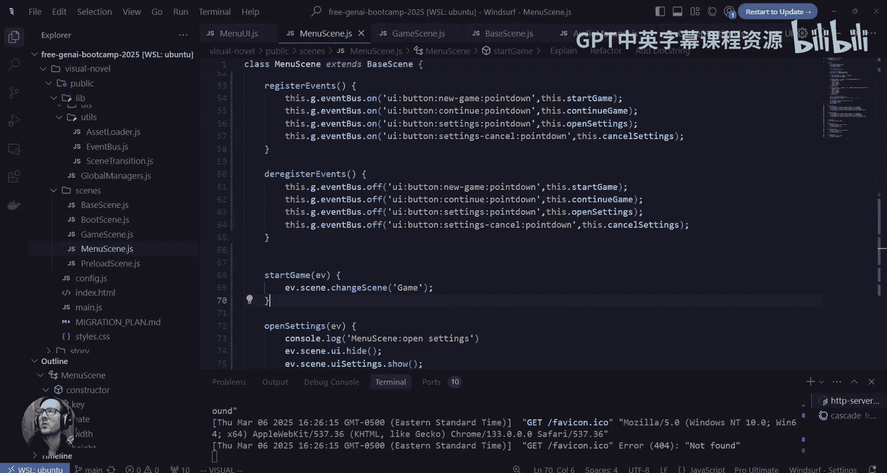

We do obviously want to work with like save day and stuff like that。

 but until we are actually rendering anything， it doesn't really， really matter。

 and we still haven't created any kind of UIs or graphics in the background here。

 these green boxes have been kind of okay for us currently。But I need to。Get。The dialogue to show up。

 Well， the other thing is that if we have a scene， we can probably actually start seeing some graphics here if we load them in。

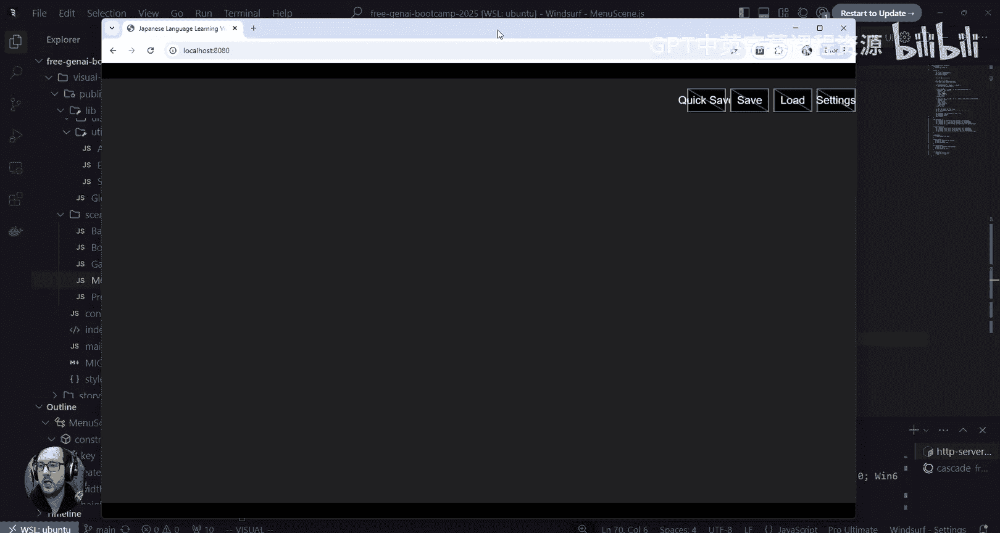

So let's go over to our game scene over here and we had all those。Things that we had， again。

 the audio carried over， which I was really surprised。

We haven't used the input manager whatsoever yet。 I think that the next thing I'd want is。

The character manager。嗯。It's kind of weird that calls it character manager。

 buts background and scene elements。 So I'm going to go here。And bring that back in here。

And somewhere are in here， we have。Our character manager， here it is， okay。And。

We have a bunch of characters。That we work with。we also have to create this character manager has to be initialized somehow。

 our global manager manages those ones because those are between systems。

But this one's a little bit different。 So we need to say this do character manager。No。

 character manager。Yeah， and so that way we are actually initializing it。

 So let's take a look at what we have here。 So we have the scene width and height。

 which we can do there。 I mean， we never ever not wanted full screen so that doesn't really matter。

 We have character and background， So we have our characters with expressions。

 which we don't have any difference with。 We have our background， which we have our interiors。

 which again， is all the same。 Then we want to create our background。 We want to create a character。

 So this is going to add it to the scene and and put it into the large width。

 Here we're positioning the characters slightly center， It doesn't need to do that。

The character X and y should be 0 and 0。Because the image is perfectly fit for the screen。Right。

 there's no no case that we'd ever do anything else here。

 It is loading in Alex initially so that in the apartment initially， which is not what we want。

 but that's fine。For now， as we will need to load in the stuff。

We have create character and background。And they set them there， so that's fine， I guess。Mhm。😊。

Background。The display size to that。So it does half width， half height for the image。

What's it deal that。Oh， because maybe it's centering it。0，0。

That's probably what it's doing because we can just go and set origin on that。

So we go this top background， that origin。Origin。0，0。 There we go。 Sam thing with the character。

 So here it something is false initially。 But for now， we're just going to。Have a show， right so。

Nothings super complicated。And I'm going to go back over to here。

It seemsms that we're respond character manager wrong。It will start it up。

Almost seems like we were going to have to walk through our code anyway。

 I still think it was useful that it created out the code even though we're kind of gutting it all。

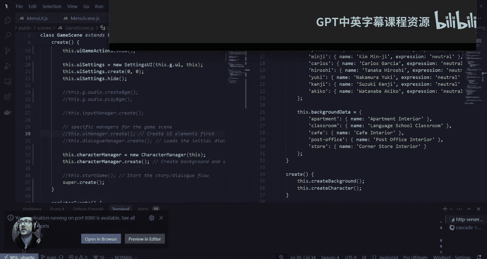

And there we go， so we have our first character showing up on screen。

 though they are over top of the buttons， so maybe we need to put our character manager and have that happen first。

So right now we're just kind of manually managing these UIs this way。嗯。

We'll give this nice refresh here。Okay， and so now our buttons are on top。

And we got our nice Canadian depends on where you are， but this is your Canadian roommate。😊。

Is this it good or bad， considering， you know， like，ca you're supposed to living in the same room。

 It's kind of unusual。 But the point is， is that we have。Or first。Image up here。

 So now we need to do is。Well， we need to control like when they show up and when they don't。

 but we need to start driving the， the game， right， So we need to get a dialogue screen up。

 And so obviously， our character screen doesn't do a whole lot here。 Our dialogue manager。

 like there's a U I。 And then there's the manager， right， So let's get this set up next。

 We're gonna say this。Thought dialogue manager。 good。

 And then we're gonna to go ahead and create that。 So we'll go over to here to our dialogue。

 I don't know if we have to create the dialogue manager。 But we'll go here。 We have a scene。

 We have things like the text typing speed from the scene game setting。

 That's not how it would set up choosing options， false， completete dialogue dialogue。

 complete false。 These settings here。We don't need them in here， right？We have typing effect。

 dialogue data， current dialogue， I D， current scene， things like that。 Again。

 I'm not sure how we want to set those， but here we have load the scene。

And so this will be called after the UI is created。S。Maybe load the current scene data。

So it says this dot scene dot game settings， current scene。

 That's not how we get current scene right now。 We get current seen through the settings。Right。

 that's how we， we get it。 Do we， let's see how we do it for the audio。The audio1。

 because I remember we actually passed it through here， Global managers。

 So I'm gonna go here and just say globals managers up here。 So we actually have access to it。

 So global managers。And we'll go here and set this dot gene。 So now we can access our settings。

 We've got settings through this dot get settings thing here like this。

Right so whatever we need a set， we can set up here。Initially， those values。

 we don't need to change the volume， of course， but we are just doing that so that we can get something like current scene。

 So I don't remember what we set as our values。 So I need to go take a look at wherever that was initially set。

 Maybe it was set in our settings one before we do that。

 I need to make sure that we pass that Google managers before I forget。

 So I'm gonna go into the game scene。 And I'm looking for in here in the game scene where I initialized this here。

 the character manager。 And it's Im gonna go ahead and just do。This do G。

 so that we now have access to the Globals manager。

 I need to go into the settings in the managers here。And in here。

 I just trying to figure out what settings we have。 We have language， tech speed， auto advance。 Oh。

 it's actually in our save data， right，'s because settings and save data are completely separate。

 Now， of course， we need to load in settings。We also need to load in saves。Right。

 so I didn't really think about that。So here， this is going to be important for settings like language。

Go hear to language。ling。Which doesn't want to complete for me。 We have tech speed。

 I don't think you really should be changing tech speed， but we'll see here， we have auto advanced。

I don't know how that's gonna work。 Auto speed。 Like， what's the difference between that and that， I。

 I don't understand。 We have font size。That's more for the UI。Typewriter effect。Okay。

 if we decide to。Have these here language。It's not auto completing anymore。 I don't know why not。

It's like I'm manually coding， which is not a big deal。 I'm totally fine。Doing everything by hand。

But I was kind of used to it updating the code。Maybe did I hit my limit finally with windsurf。

Did I finally hit my windsurf limit。I don't know。 Can' I tell。I can't tell。Plan info。

We're out of premium flow credits。Premium flow actions。Premium user prompt credits。

Cs are new 11 days。 I don't know。 I might be completely out running out of premium。 I don't know。 I'。

 I've never used it this heavily before。 So you never out。

 like we're kind of at a point where I can kind of manage。

So the hard stuff's kind of out of the way for me， but anyway。We know that we want to load。

These values into here， the thing that I want is to show。The save data。

 So save data is a little bit different， right， So in here we need our save data。

 We have default settings。 The idea is that we make a new game。

 We're supposed to create that initial data。Right， and that gets stored in。Our stuff。

 we have new and then we have load。 So we are kind of having to have to take a step back here。

 even though we are starting to see something on the screen， which is kind of nice。

 But I need to go back to our menu seeing here。 And we have to go back to our start action。

 So we have start， but we also should have a load and a continue。 So continue。😊，We don't have load。

This do。G dot， yeah， we are out。 We are out。 I don't care。 I can handle。Strange， I finally ran out。

 That's so weird。Lad game。乐 game。Never have I ran out。

I guess I just had to really go at it for quite a long time。 So now we have our， our low game， right。

 So we have this。 We need low game。😊，And this one's gonna be this little game， E And B。

We'll need to do continue game。 Oh， it's kinda， it's kinda auto completing some here。 save game。

 We don't need to save game。 We just need continue， continue。Continue game。

Some was kind of waking back up there， which is fine。 But the thing is like。

 before we transition the scene， we do need to do that。 But before we do that。

 we need to actually load。 Yeah， the same thing with this one。

 Listens a little bit different because to load the game。 So it continues easy。😊，Continues easy。

 but it's going to be a bit of a challenge for。No， it's supposed to be changing thing。

It's going to be a bit of a challenge for this one because this one， we actually have to， you know。

 show load setting screen， right， Like what was the last thing that we saved。

I really hope we don't have to go and make a bunch of U I again。 I really。

 really don't want to do that right now。 But that is a menu that we do need to create。

 But the idea is that when we start a game， we need to actually create the game， right。

 So starting the game requires us to use the the saves manager or sorry the。

This dot G dot saves manager。 I'm not sure what it's actually called those that try to do saves manager。

 even though that is not a thing。But if we go into our global manager here。

 just double check what it actually is， global manager， where are you global manager。

 you're somewhere here， here you are in here。We have yeah， it's called saves。 That's right。

 So it's just called saves。 And so now I， I know it's kind of auto completing， but I don't care。

 I'm just kind of driving manually because I I kind of felt like I was out of credits。

 So maybe I'm not fully out of credits， but I kind of feel like I' am。 So We have save。

 got save stuff like that。 So save will save data to a specific slot。😊，we have has save， all save。

 delete save， get all save。That doesn't really matter。 I want to just make a new。A new game。So。Load。

Save。嗯。The thing is like， if you make a new game， that doesn't necessarily mean。

That you are saving a game。Right so maybe this is not a problem， we don't actually have to do that。

Like we could。 we could make it to like at the start of it。 you save it。

 But normally where you save is when you actually hit save。 I noticed that with these games。

 that's how they do them。 I'm not saying that's whether that's good or bad。

 I'm just gonna to try to follow what I've seen。And so what I want to do here。

Let's go back to the back into the。What do you call the。The other， the other scene。

 the the actual game scene。 Okay， so we know that's fine for now。

 but we do have to think about our save。 So we do have to load save data in here。嗯。And so。I mean。

 yes， of course， start the game。I'm sure why this is showing up。

 that's really annoying whatever this thing is in the middle of my screen。Get out of here。

 Close all these。 There we go。 We do need to， go here， and we do need to load the game。 So here。

 yeah， it's already trying to do that。But my question here is。What is that going to bring back。Right。

So we go into our load。不。I haven't been using this key at all， Where's my control C P， control T。

 it doesn't work in here。 That's actually why I've been clicking manually because Vim is overriding it。

 I think in here。So that's why I've been clicking everything manually。

 which is kind of crazy because I'm used to doing control P constantly to pull that stuff up。

 But I'm looking for in here， I'm talking in circles so I find the things that I need the saves。

 the saves manager。 So the saves manager， we do need want to load。

 but default' is going to load from slot1， but maybe like really what we want to do is load the latest game。

 if we don't specify it really， it should do that not actually load slot 1。😊，嗯。

And so I would say that if you don't load。Right， so。If there is no slot， slot is null。Z and so。Slot。

Is no。No。So， you know， if there is。This slot is null。Then it should try to load the latest。

 the slot data。That was saved。Last， right， that's what it should do， okay。Maybe。Now。

 let me think about this for a second。Maybe， that's how the load works。

 So I'm going to leave that alone for now。 But right now， like， yes， we are trying to load the game。

嗯嗯。😊，No， I'm really trying to think of this。Because。It's a new game。If we try to load something。

 like we actually have to tell it what scene it actually selected here。So， maybe。

We need to do a little bit scene to scene communication。

And so we have change seen and we can probably pass it to payload， I believe。

I'm going to say slot null。Slot new， there we go， so I'm going to do slot new。

And then I'm gonna to go into， I didn't realize we could do this， but we'll go into our change scene。

 which is in our base controller base scene here。 And we're gonna have to pass that along。

 So we'll data data， right， There we go。 And so I believe on our create action。

 I don't know if it's true。 but we'll see if it actually works。 We might have data in here。

 And so I actually want to console log this out here。

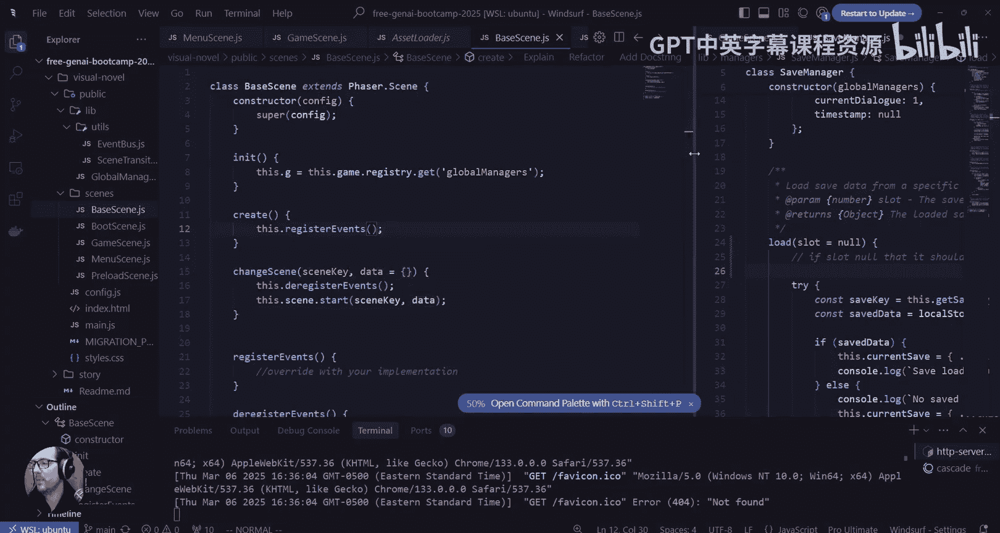

It will say console log out。Seecene data。And I want to see if it actually passed along any of that data because if it did。

 then we know。If it's actually a new。Seecen or not， right？Let go here， new game。Undfined main。

Different kind of problem， though， where it has this problem here on the character。

 I wanted to know if it passed that data along， but we。So having a different problem here。

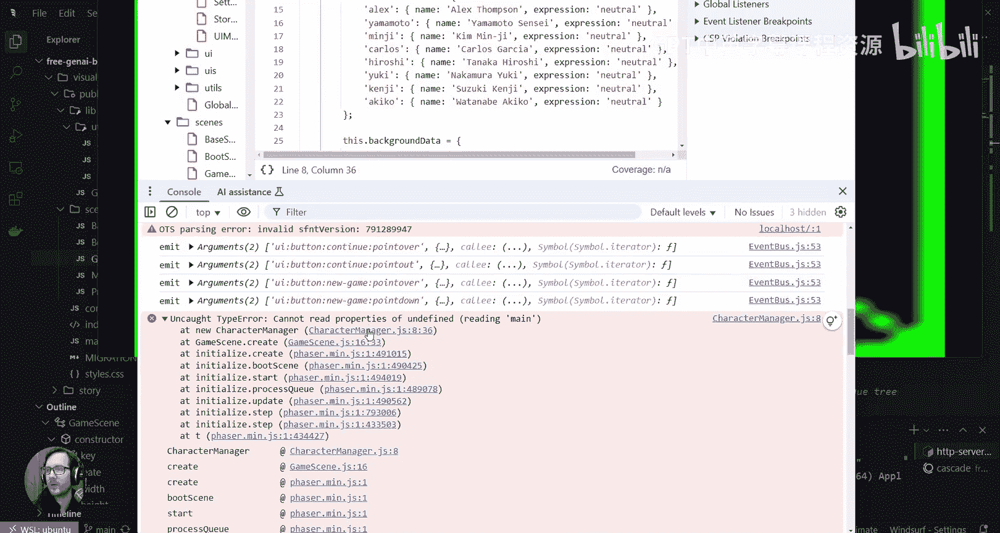

Sn dot camera， scene do camera is not made with， I'm not sure why that's our problem。

Totally unexpected problem。 So I'm gonna go back over to here。 And what I want to do。

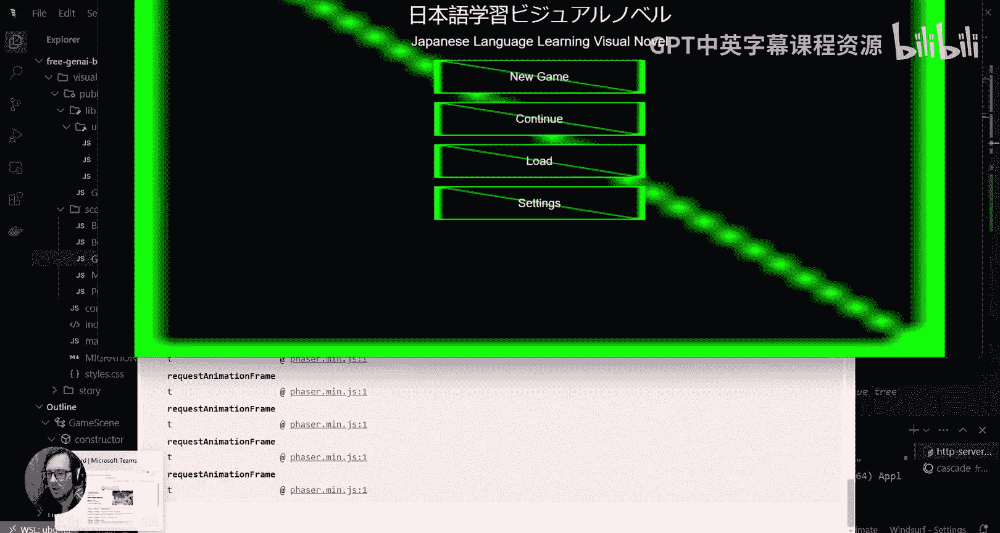

Forward loads any of this other stuff that it's complaining about。

 I just want to make sure that this actually works。Because we are overriding that great action。

 and that might be causing us some issues。We'll see what we get got here。 so we'll go back here。

 give us a refresh。And。Hh， new game。Seecen data slot new， so it is actually passing along。

 so that is good。Why the character manager， all of a sudden is messing up。 I have no idea。

 Let's go back over to here。 Maybe it tried changing some of the code early on。 I don't think it did。

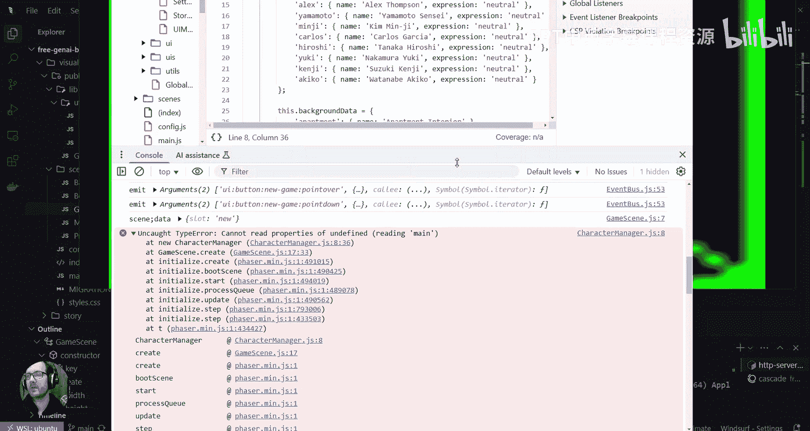

This dot G do this。 Now we're passing this in here now。 Let's go back to our character manager。

 still think that's a bad name。 as we should really have， I mean， it should be character manager。

 background manager right now。 They're serving the same purpose。 I might separate those out。

 if I feel like it。And。Yeah， we're not passing along。Interesting。But aren't we calling the。Oh。

 it was in the other one。 Yeah， yeah， yeah。 Oh， I guess we put it in here in too。 I mean。

 I don't know if we need it。 I'm gonna go ahead and do that。 So I'm to say like global manager。

W managers。And we'll put it in here， even though we're not necessarily using it。

 it's just something that we probably will end up using at some point。

 So let's just go ahead and do that。We'll go ahead and give this nice refresh here。

 Let's take a look and see what we have。 We have new game。

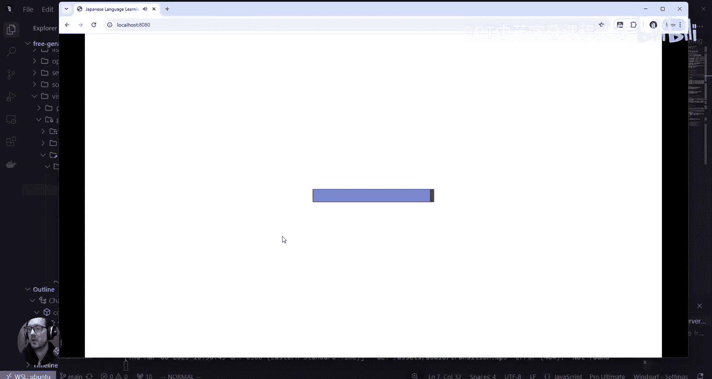

New game， new game， we've got a problem here， cannot load in game settings because this isn't a thing right I'm not sure why it's trying to do that。

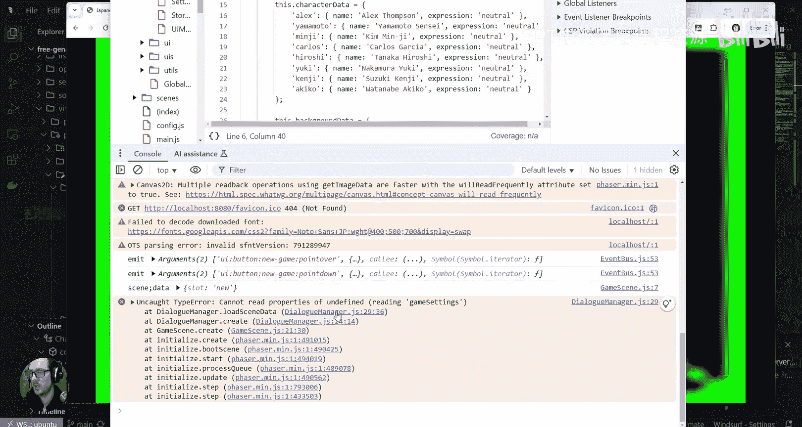

We are we don't want to learn load game settings。It should just work like last time load scene data。

Cate dialogues manager。 Oh， I mean， we did set up the dialogues meant。

 Did we set up the dialogues manager。 Where's that coming from。Super create。Dialogue manager。

Where that is that coming from？Game scene create。Here。Okay， yeah。

 I guess we just weren't ready for it yet。And so I， I created it a little bit to post haste， right。

 So we'll go here， comment that out。 And we do need to load our data。

 We don't even need our interfaces yet to be honest， we could load our data first。 And so basically。

 based on that slot。 So if the slot is。Assigned as new。We're going to do a particular action else。

We're going to load the game。 So here now we can。 Well， actually， this has to come after。

We no ge's in here， actually。But we really should do these actions first before we do anything else just so we don't have any side effects。

And I would just say that here， oh yeah， it almost has it。 We have this dot g dot saves。

 This is not exactly right。 what we want to do is bring in the the data。

 and it has some default datas here。 So for this one。

 we actually want to do this dot g dot saves load。 We definitely want to do that。

 But this one is just get the default data。RightBecause right now it's a new game。

 so it should be the default data， I don't remember what it is called here。

 so we're going to go back over to our sales manager and up here it's just default save。

So we'll go here and say dot default save。Default save， that's going to return that there。

 that's not a function。It shouldn't be anyway， default save， I mean， if it is， it's fine。Yeah。

 it's not。 So what happens when we do load is my question。It returns it。 Okay， so it returns it。

 And so this is where we're actually getting。The state game， so it say like load game。Right， and。

We's on down here for now。A going to。Do this Out game。And we'll put in the data here。

Lttle game start game， whatever you want to call it。 I mean， the games already started in a sense。

But anyway， here we are passing along the data。probably just say slot too。

So that's exactly what it is。 It's a slot。And we'll go up to here to the data here， we' say data。

 slot。And so， that will。Get us started。 So the idea is that。M， we have。This here。

But the thing is like， it returns that data。 And we have our current save。

 So that's really what we want to。What we really want to actually set。 So if we go back to our load。

Save got key has key。 All save。 Dele save。 What does load do， Lode will return。

Lower just return the current save。And I guess those are lower level。Calls， I suppose。

 And that's probably what it wanted to do initially。 So I'm gonna go。

 and I'm just gonna go ahead and just say load here instead。And。I'm not sure what Sa does。

 but I want to。Make a new function here called load。Lo。Yeah， probably slot， load slot。

And so this well call this， it returns it and it will say this dot current save。

Right so now we're not really setting the data that way。

 We're just doing this way to get the current save。 And here we'll say new。Right。

 and this will just simply。Ohoops。Set the current save。As this， Okay。

 so that's going to expand that data。 we don't need to return anything。

 We just need to set that there。 And so now we can go back to our low data here。

 and this is going to be new。I'm not sure we should use new as that might be a loaded word。嗯。

Let slot here。I don't know if we can use new like that， because the construct。

 like usually the same name is something like that。 So no， I think you can use new。

 I think it's fine。 But in some languages， you're not allowed to do that。 So that could run us aok。

 But I think we are okay。And so that should now mean that we have this as our current information。

 our current scene， current chapter， current dialogue timestamp。 And so now we should be able to。

Get the dialogue stuff going or even get before we even do that， set up our， our character manager。

 which。Right now， it's character manager。 I really want to separate those out。 I'm gonna do that。

 Sorry， folks， I'm just gonna separate those out。 I'm gonna make a new one and call it background manager。

Background manager。 Js。Okay， and I'm going to just split this here。Close this out。 Close this out。

And I'm going to go over to here and we're going to call this class background manager。

 background manager。And yep， y， that's what I want。 Yep， I want those。

I don't need the width and height yet just yet， and。I we're putting this down here。

 Some of them don't seem to need it。 but we'll go ahead and grab it anyway。And。

I'm going to cut out some of the stuff， obviously， So we have the background here。It'll go。

And here' dad， whoops。This top background。No， I'll take that out of here like this。

We have our background data here。嗯。So I can go ahead and paste that in like that， whoops。Whoops。

And I'll cut that out。And I'll paste it in here。So now we have our background data in here。

 as opposed to this one。 we have width and height， I guess we can bring that on over。We want here。

 That's not what I want。 That's not what I want。 Just come on。 you， you give me what I want。

What I really， really want。 People know that song。They know what I'm trying to sing。

Cirrcucle 1999 folks。I don't know。 I think scary spice is the best spice， but that's just me。 Anyway。

 anyway， I feel like scary Spice did not get the credit she deserves。I think scary Spice is awesome。

Anyway， so we have creates。Background manager。 Yeah， I probably just call create here。

 I'd rather just。Bring in the background onto the create action like this。It's hard to say。

 like unless we have more actions in our background here。Go copy this。Yeah， you know， what。

 I'll just have it as a separate function。 It's redundant， but I'm gonna do that anyway。

 just in case in the future。I wan to change that。 Sure。 We'll just do that。 That's what it wants。

 Yeah， and then we'll it out there。 Yeah， it knows what I want to do here。And then， we want to。

Take this function here。Cut it out。And then we can manage those separately。

I think that's a better idea。 I the manager separately here。So that is fine。

 not like you could do a transition。 It See like it wants to do transition， but that's fine。 And we。

 we'd have to transition the whole scene。 But I guess like if you transition。

 you'd always remove the character before transitioning the scene。 So we have character， character。

 create character， update， character， show character， set character expression。

 So this one's now specific to that。😊。

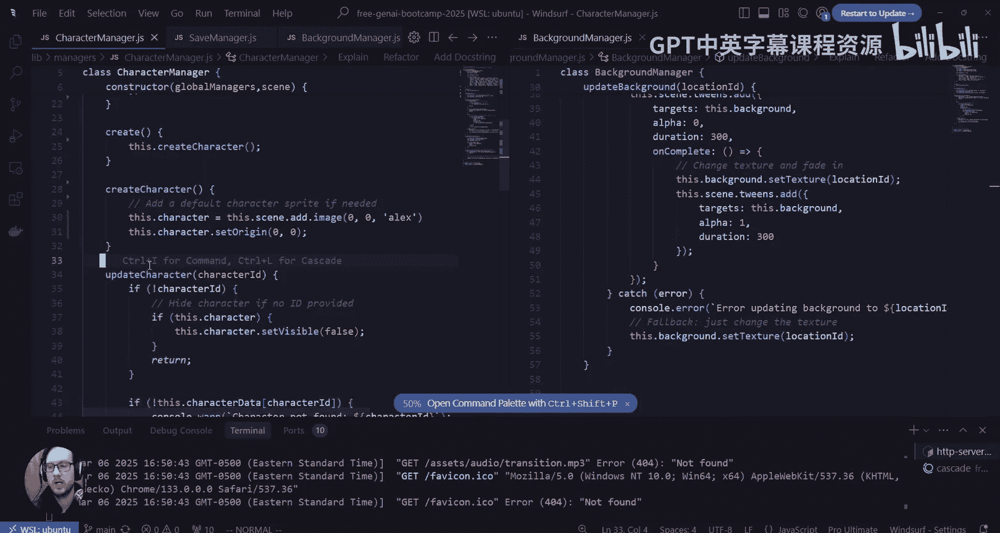

To load the character in， we should really be loading in whatever is in our save data。

 So here we would do a G。This do g。sves。 current state。Current save， I guess。And， I mean， really。

 we should have a function to get it， right， So I'm going to go back here because we have in our settings。

Save manager。We you have a get function。We do not。We're going to go ahead and do that。

 So we're going to go here and say get。I don't know。 Doest know what to do。

I'm gonna bring up our settings manager here becauseuse we have a again set for this one， right。

We do。 So here we have our get。I'll bring in our key here。And this is going to。

Do return this dot saves or this dot current save？And then I'll do key like that。 Okay， so that way。

Yeah， we're doing it that way。 That's good。And then we have our set， which similar。

 But set actually think saves。 Oh， do we not even have a set here。

 I thought we did because we have a save。Well we have an update， so update the key。

 it's addressing they don't call it a set。We have it called update， update a specific key。

I guess I could do that。 I'd rather call this one set。Set key value。

 I might go back and change this update 1 as well to that。 So we'll say。If。

Key in this dot current save。Then we can set it because we don't want to set something that's not there。

 and we'll say this dot current save key equals value。 And So now we have a set in a get。

So now we can go back over to here and in here we'll just say get。And so then whoops， get。that way。

 we grab our character I。 Now， do we have a character I here， We don't。 This is current scene。

 So to get the current character is a little bit different because。We need。We need the。

We need to get that from our。Intermixed with our actual dialogue data， right， so that's。

A little bit trickier。 so like this doesn't store。Now we need to get our current scene from that information。

 So I'm just thinking about this。Because now we're not going through the saves data here。

 We're actually going to go through the dialogueo manager。

And so the dialog manager is necessary for the other two systems。

 the background manager and the stuff like this， which we do call global managers in here。

 but that's not defined within the globals manager。

 So we actually have to put in the dialogue manager in like this。Dialogue manager。With that。

Let's say this dot D。Equals dialg manager。 So that's now in here。 Sam thing with the character。

 So we'll do the same thing here。Dialogue manager。This dot D， okay。

 then we're going to go back over to our game scene。 And we now to need to pass those in there。

 So those are there。 So it needs this。Dot。D。😊，And。I'm gonna do the same thing。 Oh， yeah。

 I mean the background manager in here as well， right， y， y， y。And I'm going to bring that up here。

 but we need to get the dialog manager here above here。And yeah， I want to call it D。

 I just want it to be a little bit easier。 It's not really doesn't need to be D because should be dialogue manager。

 but。That's what I'm going to set it as to me， no， you know， I'm going to go back。

 so it's more explicit。Dialogue。Manager， And then down here， we have dial manager。

 as long as like we're referencing it up here。 So we know what it is。 But inside of it。

 I'm totally fine with it just being called D with these other ones as these files are a little bit smaller and we're not gonna to be so confused about what's going on。

 But this is the order that it should load in。 The other thing is like。

 we need to go back to our dial manager， which we haven't really done much with。

 And so our dial manager。 It does have a create function in here， which would load the scene data。

 which actually is what we need to do。

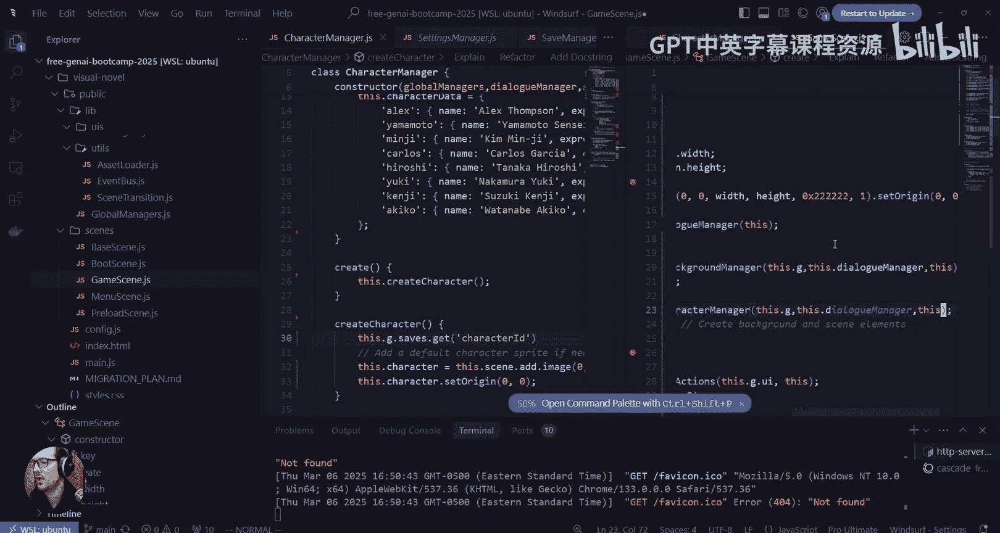

So I'm going to go over to here。And I mean， I brought in all these settings。

 which is something right， but what I need。We do need to set the current scene。

So one thing that we do need to do， I mean， we don't need to set it because we can always just reference it。

 right， We don't need to set it in here。诶。Yeah， because that's part of the save data。

But we would do want to load the dialogue data。So。In here。

This is we're getting this from this dot G dot save scene ID， that's how we're getting it。Okay。

 we don't need to set it as current scene that's not necessary。At least not yet。

And so now what we need to do is we need to grab from our cache。 Yep。

 the actual scene so we have dialogue data， no dialogue data found。

 save from the beginning or or from the save position。 So now it's saying current save data。

 So here is the same thing。 We want to do this dot saves dot get。Dialog data。Otherwise。

 it's going to go start。 There's no start set structure。Let's go look at our data。In our scene here。

 So we go to our data in our scene。There's no start set。Right， it starts at。Z， now we could do that。

 We could say that that's where it starts at。um。And it would give us more flexibility in our schema。

But do we want to do that？Maybe sure。Well， well， do we have an N Z。Default next scene to。You know。

 I'm gonna to just explicitly have a start set。 I don't know why。

 but like I feel that maybe I might want to have a explicit start set。

 So I'm going to go ahead and do that。 And so now we've changed the data structure。

 So here it will try that。 We're starting to do that， which is good。

 Otherwise grab the dialogue I here， which I think that this one has that's what it's called。

 Maybe it's called a current dialogue I。 that's something we need to go check here。

 So we'll go back to our save manager。 And it's called current dialogue。It doesn't say dialogue I D。

 This is current dialogue， current scene。So we could say current dialogue。Yeah。

 this one's also just current scene。This is all one's called scene ID。

 So what are we going to call it right， we're not being consistent with our names。

 so I're going to call the scene chapter dialogue。Dialog I D， dialogue chapter， dialogue scene。

 There we go。 So now it's very clear what's going on。 So now we have dialogue I D。

 And here it starts at that dialogue point there starts at。

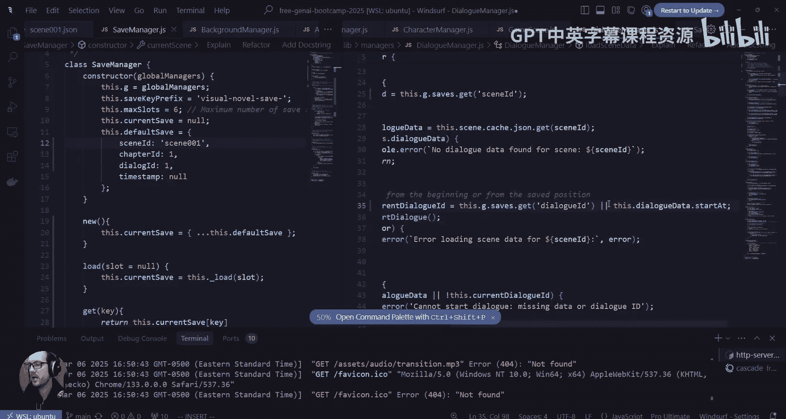

Okay， so now we have our dialogue loaded， we have chapter ID。

 The chapter is the actual file that we're loading in， I think。Because the scene I。Which is it。

Which is it。 We'll go back over to here and take a look at this。

 I don't really think about how chapters work。 So here we have a scene， right。啊。

It's loaded in this specific one。But there's nothing about chapters。

Because I think that we have a chapter structure somewhere else here because chapters orchestrate。

Seecen to scene actions。 But if if that's the case， then why do we have this。

 because this actually tells you where to go next。So maybe this default next I D shouldn't be called that。

 It really should be called。And Z。True， like， you know， I don't know。Right， like。

Because the other question is like， how do we pull that data here。

 but'm going to leave this as default， default next ID like that for now。

But that doesn't make sense because this one here is this。 And this one's obviously a scene。

 And this's not even called the same thing。So right now， we'll just call， I'm going to just say ends。

For now， ends true。I'd have to figure that out as we work through this。But now we're starting to。

Think about that， I know like there was chapter orchestration somewhere in here。

I'm not seeing it here， we have character data， it shouldn't really repeat the character data here like that。

But I remember at one point， we had like a structure。For maybe it was like story manager。

 that's probably what it was。Yeah， story manager。 So then what's the dialogues manager's responsibility。

 Because if the story manager has this stuff and why are we loading the stuff in here， right。

 Maybe it's the story manager that makes more sense because here we load the chapters and it says what order the chapters have to go in。

So if you go here， you'd be like， okay， I'm at the story。 I need to load the intro。

 And that's actually what this is。 I'm gonna go change this to to intro。 Well。

 that might actually mess it up。 And I don't really want to clear out the data right now。

 So maybe the dial manager is a bit of redundant thing。

 And the story manager is really managing the story， but we will。

 we'll figure that out here in just a moment， so。Anyway， we have the dialogue data here。

 it's loading the dialogue data for this particular scene。 it's getting the current dialogue ID。

Which I guess is fine and that starts the dialogue。And that says display the dialogue。So， you know。

 is the manager responsible for displaying it， no， because it has its own interface。

 It's really there to manage the data。 And here says update character， update background。嗯。😊。

This stuff， we can set。But we probably want to do that on the game loop。Sppeeaker's name。

 stuff like that。 Yeah， this is a little bit。I'm not exactly sure what I want to do here。

 So what I'm going to do is I'm going to just stop right now。

 Okay because I got to go in and make dinner。But we're starting to get somewhere。

 And so we have this dialogue， story manager and where things intersect。

 And so I need to figure out how to get through that in order to display what it is I want to display。

 Obviously， at one point， the system made something that worked。

 But I'm obviously not going with that anymore。 But yeah， I'll see you the next one， Okay， Co。

