# ExamPro《生成式AI训练营｜Free GenAI Bootcamp》中英字幕（deepseek - P66：-66-Visual Novel Dialogue Box.zh_en - GPT中英字幕课程资源 - BV1SFEWzLEab

Everyone， I am back。 We are continuing on coding here。 I want this done。 It is late， late at night。

 but I'm going to put in the time to get this over the line as， I mean， with manyty boot campers。

 they're probably trying to get their projects done to get Red S do whatever they can。 I'm。

 it's almost like I'm trying to get Red squ myself。😊，But anyway， we're gonna continue on here。

 And so， you know， we have， we're working on the new game functionality， right。

 So that was the next step was to get that to work here。

 I' just gonna go ahead and close a couple tabs out of here。 I'm gonna get my inspector up over here。

 And so it says。😊。

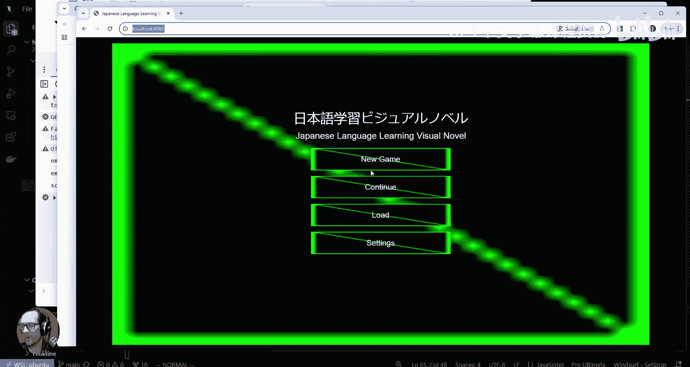

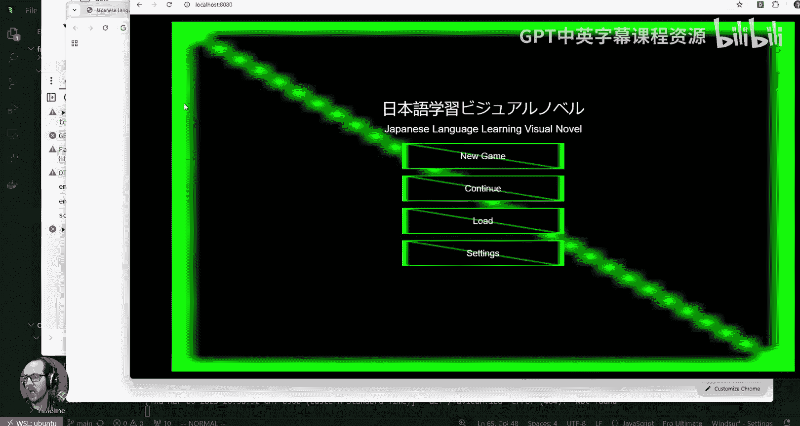

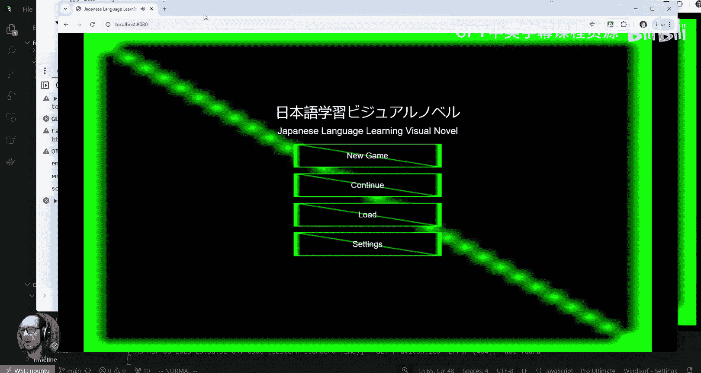

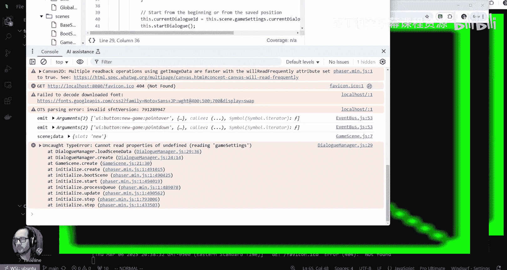

Load scene data， et cetera， et cetera。 So we are working on the stuff。

 We have the dialogue and the store story manager。It's hard to say whether we actually need two managers for that。

As the story manager is managing basically the story state。

And then the dialogue is managing the dialogue today， but it kind of feels like the same。Thing。

I mean， here we have the story structure being loaded into here where we have chapter one。

 chapter two this really should be。External is data。But。

I'm just trying to think about this here for a second because we can make a new folder here called St。

 right？And or maybe stories。Stories， I mean， there really is just the one story。

 but I'll go here just make a new called main dot main dot Json。 And so this。Can actually go into。

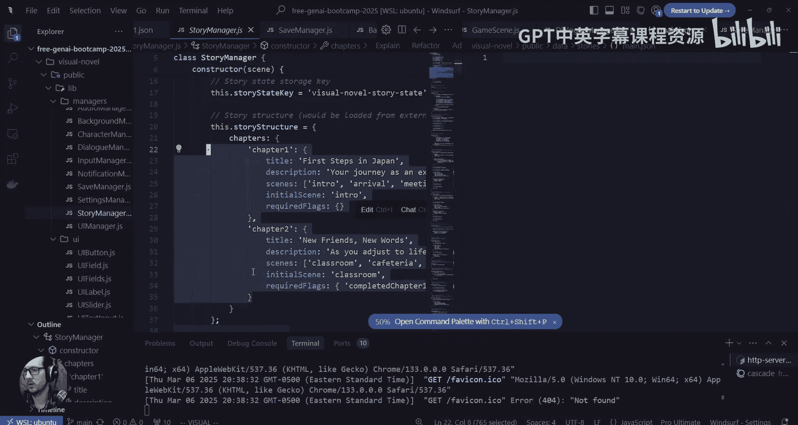

Here。And I'm going to paste it in here。And now。It's kind of messing up because it's not valid Jason。

 but we'll go ahead and kind of fix that up。We have ourselves。Our first。Sorry here。

 I like that says initial scene。 I mean， the scenes are in order。

 So there's no other place for them to go。 required flags。 I'm not sure what that does at this point。

Oh， it's same before you can do the other the other chapter。 you have to complete those things。

 I get it。 I mean， again， this is supposed to be done in a sequential order。

 but we don't really know what we're getting into as we are coding this。 I'm just again。

Trying to get something to work。So if there are things that suggest functionality。

 we might not end up doing it。We'll go ahead and do this here and this here and this here。

And this here and this here and this here。And anything else that has those single quotes。

 I'm just going to go ahead and replace it。 I if you look down below。

 I'm doing a regular expression down below here to do that， that's a BM thing。And so， we have。

Stuff here。Okay， and this is chapters。So let's see you go ahead here and do chapters。

 itd be really interesting to figure out how we can work in LMs into this。 I mean。

 this is a visual novel。 But if we wanted to build a daily simulator， the。

 the mechanics are different because you're doing a repetitious pattern。

 I kind of really want a daily simulator now because I find that would be really useful for study。

 But I'm gonna continue on with the scope of what I decided for this project。

 But we have our chapters。😊，You know， it might have a name like story name， so to say name， you know。

Main quest whatever you want to call that and so that is now in place here。

 we do not need the story structure like this here。 we would probably just load that in as a file。

So we will need to think about that。 So just go go here and just。

Put this empty right now is this should be loaded。Yeah， loaded from external file， yep。

And so now we have that external file。Cause I just defined it。

So that will make that a little bit easier。 But， you know。

 I'm still trying to think about here's like story， state key， probably the way it loads it。

 but I'm still trying to think about like， okay， what is it that we need to drive to get this working right so。

Right now we're just loading。The scene data， so here。

It needs to load a very particular scene as it already knows it's stored。So。

We have this scene Ca Jason get。I don't know what this is。feelel like that's completely made up。

 I don't think there's this station， whatever。 If we go over to here。

 It has an issue with the load scene data on this line here for the scene data， I thought。

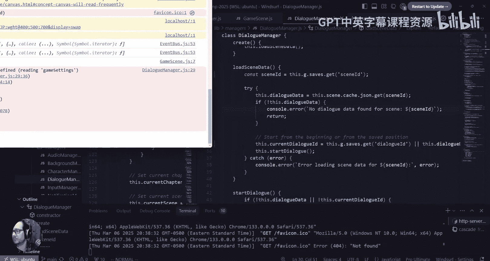

The dialg manager， like this is to have load scene data。I see loading data。

It's like it' showing me old code。Go stop and start this again。

 We've got to kind of cut through this mess here a little bit。 I got close this other tab。

 We don't need two of these open。 Maybe the reason that was showing us that error was because it's loading the wrong thing。

 Has an issue with the dot saves get。 So we have dot saves get。 we did just implement that。

 So we'll go back over to our saves manager。 And in here， we have our get。 So right here。

 So I don' not sure why it says it doesn't have it。

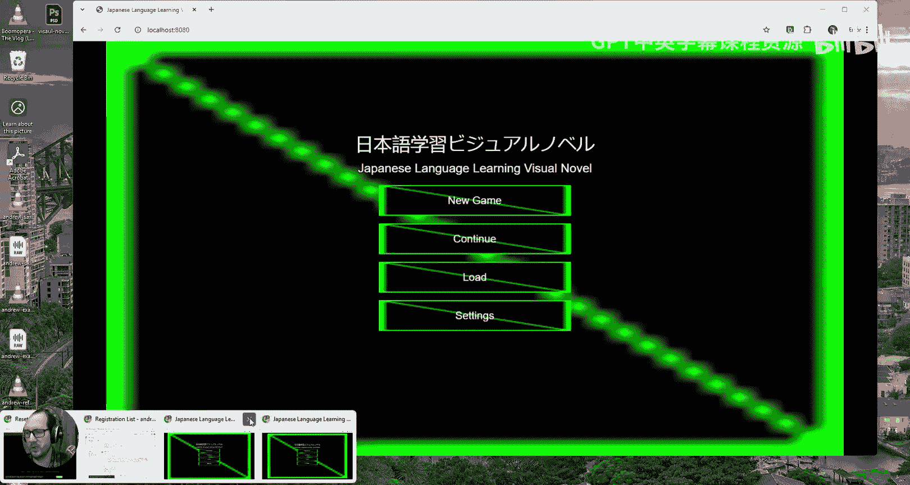

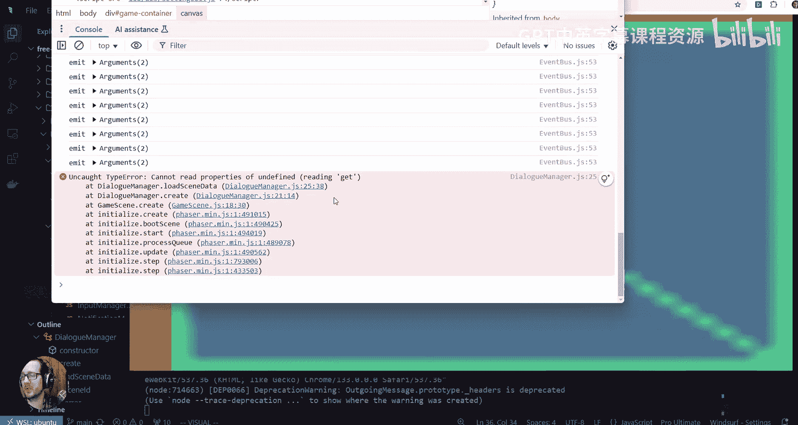

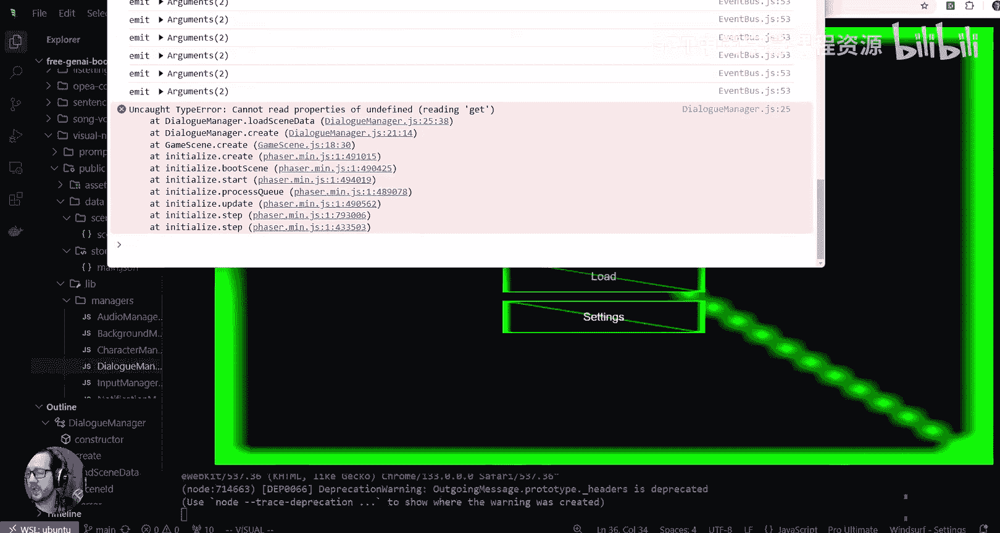

嗯。As it's clearly clearly implemented， let's go back take a look at this again， I suppose。

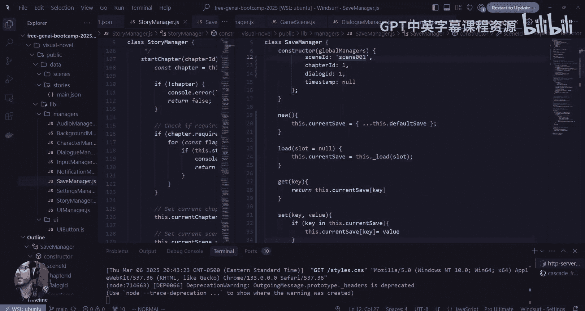

And there is。Undfined reading of get。So you know， when we get that。

 it makes me think that the saves does not exist。Maybe the way we're calling it is incorrect。

So I'm going go， let's go to the top here for a second。 We do sign the global manager。

 So let's there we'll do console log。This。g， you'll see what we got here for that。嗯。

And we'll go back over to here。

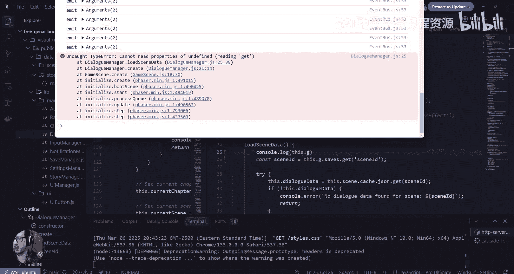

And give this a nice refresh。And so， we get。Or just yet。But this returns the game scene。Oh。

 the game scene。That's not the right file。

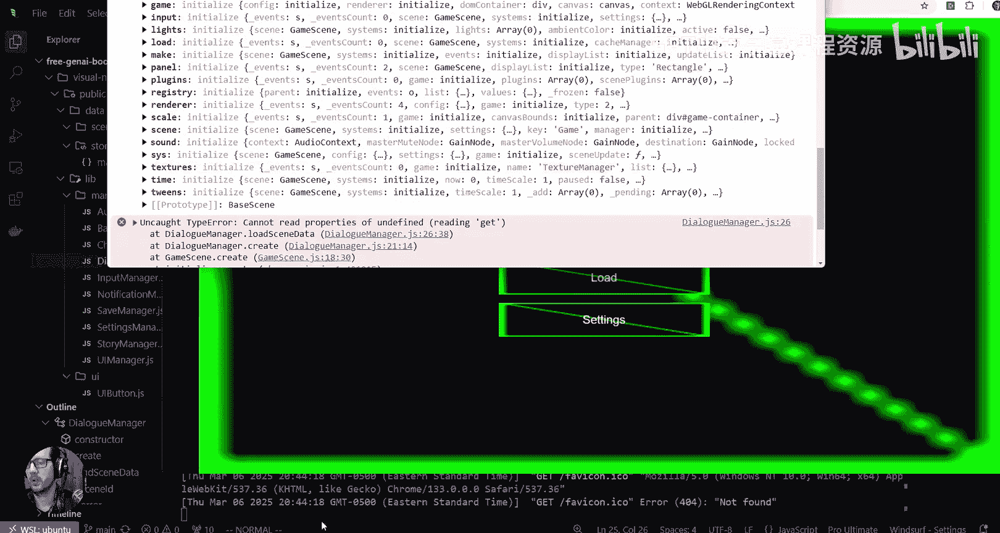

This doy is supposed to be the global managers。So I think it's passing the wrong thing。

Or it doesn't have the second parameter。 so we'll go back to our game state， wherever that is。And。

A game scene。And in here， we have。Something for this， I guess dialogue manager Here it is。

 This is their problem。 We're not passing it in here。 So we'll do this dot G。

 So that's going to get rid of that problem。 But the rest is not going to really follow up correctly。

 because。Does make sense。 We have the scene I D。 This cache thing makes no sense。

 I'm not sure how it's。Grabbbing。That from there。 So the question is like。

 how are we loading in that JO data， their external files。So I mean， it did load it before。Right。

I would think that the data would get loaded in the index HTML because we don't have a server right now。

So if we go here， does it load the data in here at all？Right， we go here， Jason。Where's the data？

So it's not loaded in here， so how is it bringing in the data？Because the data again。

 is over here as a J file， I didn't understand how it can load it in。

So maybe it is loading in with that scene thing。So go back over to our dialog loader。

 wherever that is here， dialog Manager。P this over here。Yeah。

 I don't understand how it's loading data in。So I'm gonna go ask like， how is our。

 our game loading in the。呃。The the scenes， Jason data。Right。

How's it doing that because I don't see it where it's doing it。

 so that's what I need a bit of help with here。

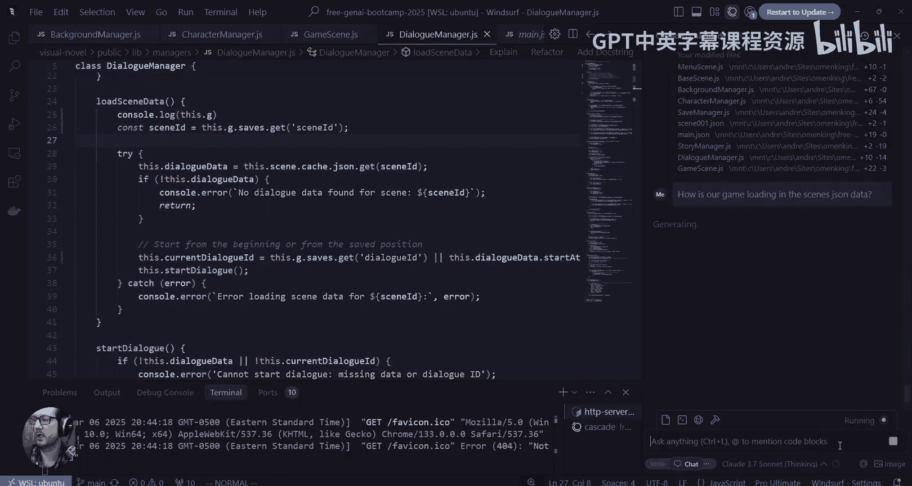

啊。From Faer's Jason Cash。Yeah， maybe the boot screen loads it in or something。Or the preload。

 That might make sense。 The preload might be loading it in。Load story data。

 that's what it is in the preload。Let's go take a look at where that's happening。So we have this。

 these are data files and it's giving them IDs， right？So we have this。All scenes here。

 so it's not just scene data， but we're also going to load the story data。So this would be story。

 story just and path， right？So now we have the other file in there。 So that kind of makes sense。

 That's how it's getting。 And so that's where that I D comes into play。 The only thing is that。

I mean， I guess we'd have to have an I D， but the only thing is that we have to be unique with these I。

 So maybe we would say like scene。Hyhen and then story hyphen main like this。

So this way it can distinguish between the two。 Otherwise。

 I feel like it would have a bit of an issue。 If we go here， we have the scene ID。

 then the cashier is going to be。We'll do this。Yeah， exactly that。

 And so that way it can load in the dialogue data that way。

And then here it start from the beginning of the saved position。

So the idea is that we're getting the current dialogue ID， we don't really need to do that。Like。

 we do have the get save dialogue E D to to figure out where the start point is， but。I mean。

 I guess we can store it there， it's not a big deal。

 but it's not really necessary to store them like that， but I guess we could do that。

So I'll have this dot。呃。Seecene ID D equals null。We don't need tonll it out it's just I'm doing that so I can just see what's going on and stillll have dialogue。

Id equals nu， let's get that corrected there。And so we'll change that out to dialogueog ID like that。

In the dialogue data， there is a start set。 So if it isn't that。

 then that would make sense it would go there。 And then we are now starting the dialogue。

 So if we're starting the dialogue here。I don't know why we're doing so many darn checks。

 but we can do that， I suppose。Is that even necessary？Yeah， I don't think so， because if it loads it。

 we don't need to keep doing all these darn checks Here we have， yeah。

 we'll change that out to the current dialogue。 So dialogue node， this dialogue data， dialogue data。

 So find the dialogue node。 and then it's going to then display it。 We don't need to。Display it here。

 This is something that would get ingested somewhere else。

 So here's talking about displaying it and updating the character based on the location and character。

嗯。I mean， if we have it， we don't need to。Do this some other way。

 so we can go up here and maybe say like this dot dialogue。Noode。Right， and。Yeah。

 then we'll change that out to this。And we don't need to do that that way。 We'll just take that out。

 It is setting them here in the speaker text。Display the Japanese text with the display typing effects。

 What's doing that there。 saveve the current position。 It's not supposed to just automatically save。

 We're being explicit about it。 Here is that typing。Typing effect that we have here。Again， I don'。

 I don't know about that。 I think this would go into the U I， to be honest。

So and then we have on typing complete immediate advanced dial log。Handle choice， go to next scene。

 get speaker name。So。We do have。That information there， this would be more like additional data。

 So just this might be。嗯。Nappings， I might just go like mappings。Do hold on here for a second。

 we'll have mappings dot Jason。That way you can kind of map up those names。

 and so we'll just take this out of here。Copy and then we'll go to our mappings here。

And here I'm going to just swap out the singles for doubles。

 You can see me doing that down below in the substitution， I did it really quick。

I'm going to just say characters。And this way we can swap with their names now。If this is a game。

 we might want to have Japanese names， not just the English names。This will be something we to do。

Figure out as we go get your character names。So we'll say character names like that。

 And so now I'll have to go back into the boot manager here or the yeah， I think it's the preload。

And I'm going to go here and just say mappings。And then we'll have。Mappings。Okay， so that will。

It is data， right， but well， that's the case and why aren't these yeah。

 why aren't these doing that as well。Maybe they're supposed to， and we just haven't done that。Yeah。

 it's not like it says that it has to be， I think we organize into data directory。

 I'm not sure where it was before， but。Yeah， so we'll load that in and so our mappings will just contain whatever we want to map over。

 I'm going to go back over to our dialog manager here so we don't need。This the same way。

 we do need to load our mappings。So we should load that somewhere。嗯。Just go like load naps。

So it goes here。 and yeah， it's really as simple as that this stop mappings， right。

 So go this I say this。Mappings is null。 And then down here， we can replace the character data。Like。

 yep， yep， just get rid of that。Yes， get rid of that， we don't want that， you're right？

So it's come from separate datastar， that is right。

And here it's grabbing it from the mappings like that。 If not loaded。 This mappings。

 mappings loaded return speaker error。The mapping should be loaded。

 but I guess we can put that in there。 It's not gonna hurt anything。

 even though it's kind of verbose。And so now we can get the speaker name， which is nice。 Again。

 all this functionality， this typing stuff。 this really is gonna to go into the U I。 So we have。

 I think， a U I that we created that we're not using just yet， which is the dialogue U I over in。😊。

Or is it here， dialo UI？So we have create next button， stuff like that。 create controls。

 show notifications， create dialogues， clear choices， show choices。

 There's a lot of stuff in here not necessarily that we're going to use it。 but we want to get this。

Some of these effects here， I'm not sure what's going on with all this stuff。With advanced dialogue。

 but we want complete trying typing， so it'll take the typing stuff。And we will move that。

We'll move that into here。 We haven't really been using the update loop whatsoever。

 Usually with these engines， as's what you do， you drive things via the update loop and make things deterministic。

 which we haven't done yet。 It's not a big deal， but we will have to think about that as we are working with this。

 We have handled choices。 Again， it's doing a bunch of stuff。 We don't need it or want it to do。

But right now， it does load in the node。 So we do have here the dial node and the idea is that we might want to extract out information from the dialogueo UI。

 So we have a little bit going on here。 We load the scene data， and that's fine。

I think and then we have start dialogue here， but I don't want to do that here。

 so I'm going to just take that out。And so。What I'm trying to think of here is basically driving the dialogue UI now。

 so let's go back into our game dot scene and we need to add in that UI if we have yet to do so。And。

We have here。 we have the like UI manager。 that's fine。 But let's go in and let's bring in。

This dot ui。Dialogue， that's right。 And then we're gonna to create it。 And it's saying it's hidden。

 but it's actually supposed to be shown because this one's always gonna to be shown on the screen。

All right。So that is fine。Not sure about we're not obviously doing this。

We already loaded the save data， so we don't need this anymore， that makes no sense。

We haven't worked with the input manager yet。 So the UI manager is being utilized。

 It's just being utilized in a different way。 We are using the dial manager。 It's not in that way。

 Do we even need a start game function。 because the game is already kind of started right here。

 it's time like setting the scene， loading the data from the data here， fail to load it。

 start the dialogue， which is a way that we can kind of do it again， not sure about that。

 It really depends on what precedes that in terms of our code， which I don't know yet。

 So' going to go ahead。 I'm just going to maybe leave that in for now。

 but we need to focus on the UI dialogue because that is what is going to power the dialogue。

 So we'll go over to our like it says dialogue Ui but this one's UI dialogue。

 I I didn do Ui in the front of these。 but did UI in the front of those。

 I mean because I think of these as Us Maybe if I put Us on the end there。But it's fine。

 So let's go all the way to top。 There's a lot of stuff in this file。 We got to kind of cut through。

 And I mean， it's defining a bunch of those empty components。But we will close this tab out for now。

 And so the first thing I need is the dialog box， right。

 So I'm going to go here and just comment this out。

 And I just want the dialog box to be created first。 This is really simple。

 It is creating us an image， which is a square。 So that is totally fine。So that's the start of it。

I would say I like it when it's like kind of like this dialyg box。Dialog box。 Come on。 Dog box。

And then we do it this way。Okay， so we're obviously adding an image here the way I want it to do。

 I want it to sit at the bottom of the screen， right， So it's supposed to span most of the width。

 I would probably think that we would。Haved a little bit more a dynamic than the way it's working right now。

 so we have。You know， 1000 as how it is， but we have the width and height here。

 so I probably do like this do with minus and then whatever the the padding of the side is。

 so we'll just say like padding。Or margin。So constant margin。This will。Be the margin。

From the edges of the screen。Okay， and so here we're looking at。嗯。Per side。Right。

 so if we have this and I say I think that might be too horrible， we'll say。Well yeah。

 we'll try not 100。 That's too high。 We'll say 60 or maybe 32 for now，32。 The idea is that， yeah。

 you have to times it by 2。 That's what I was looking for。 We don't need to， because of bed mass。

 It'll be fine， But I'm gonna go ahead and just do it this way。 So so it's very， very clear。

 So there's that。I'm gonna go here and say a height。 And we can fix it to 200 for now。

 I don't know what it should be。 but it's not a bad idea to set it like that。

 So we have that now set up。 It is setting the display afterwards， which is kind of silly。

 It's like we're doing it twice。 So I'd rather just。Do this once。 And so we have height here。

 and they'll just go constant width。And。That we can bring it in this way。

 and we'll take that out as that doesn't make any sense。 And we will say with。

Here says this dot height。 Oh， you know what。Maybe the differences is one is the size and the other one is actually where it's positioned。

 I wasn't really thinking about that as I was working through this。 So this one's actually fine here。

 We do want to change this up to width。And this is where the x and y are going to constant X。

 And then we have constant y this。Need to。Well， this is the dialogue right。

 so this is actually going to be 00。0，0 of wherever we want this to be because here we're going have to set our x and y。

 right X and y。 and this will be x。And this will be our y， right。

 So then this really is going to be our this dot x the sub y， Yeah， there we go。

So that's gonna get us our， our first structure in place。 We need to specify where this is going go。

 So I'm gonna to go back over to our game scene。 And in here we have the create。

 So we have width and height， which is not exactly right。

 We want to have this from the bomber screen。 But right now I'm just going to put 0，0。

 just so I can see it in place right， But probably we want to do is keep it0 on the。X access。

 And it's really y minus whatever the height is。To get to where we want it to be。

But we will first just make sure that it's working and we don't have any other problems as we really need to step through this carefully。

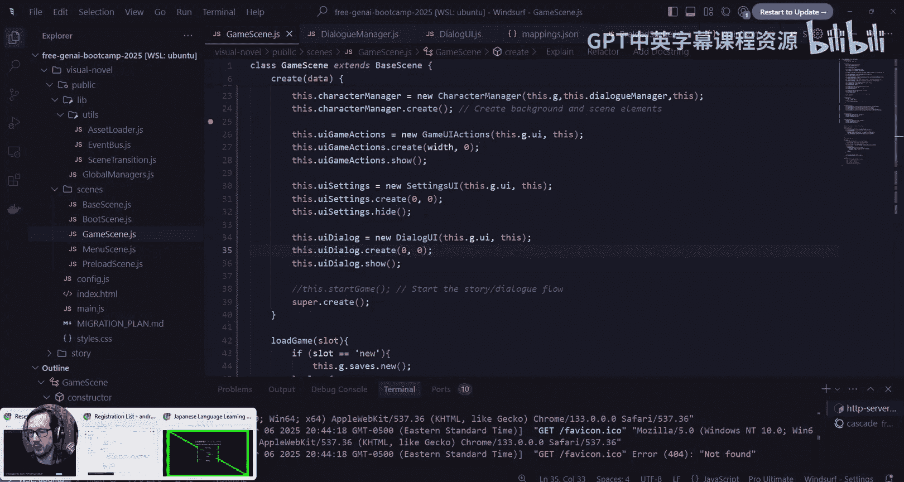

As we were changing， quite a few things。

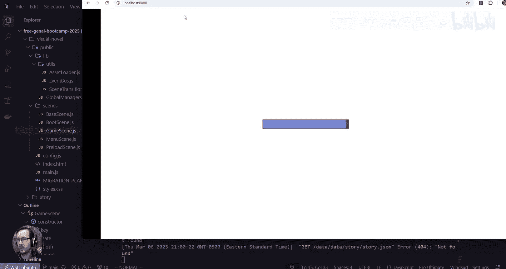

So go over to here and no errors so far， which is good。Got our music， which is fine。

 Background manager is not defined。 It should be， but if it's not。

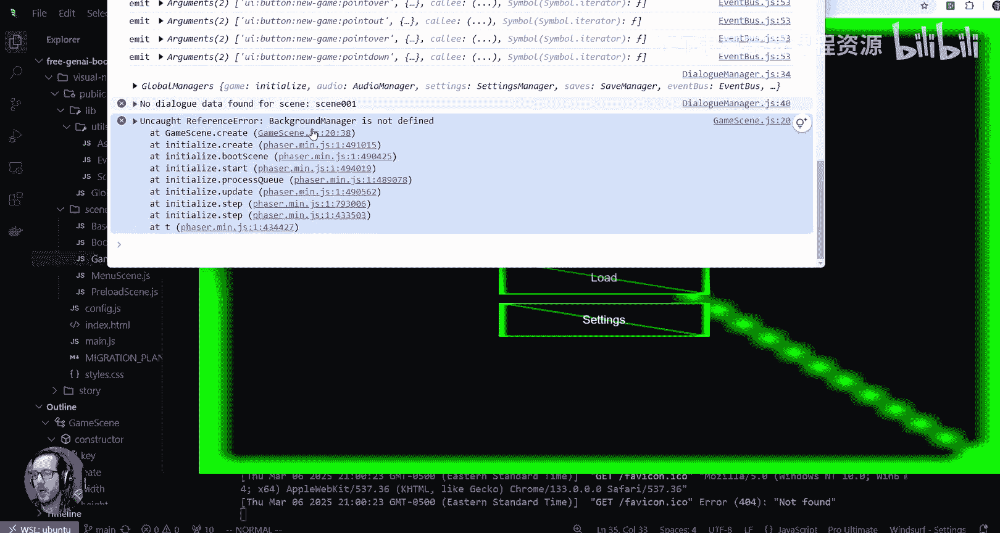

I mean， it was working fine before， right， We didn't change anything in the background manager。

 so that shouldn't be an issue。

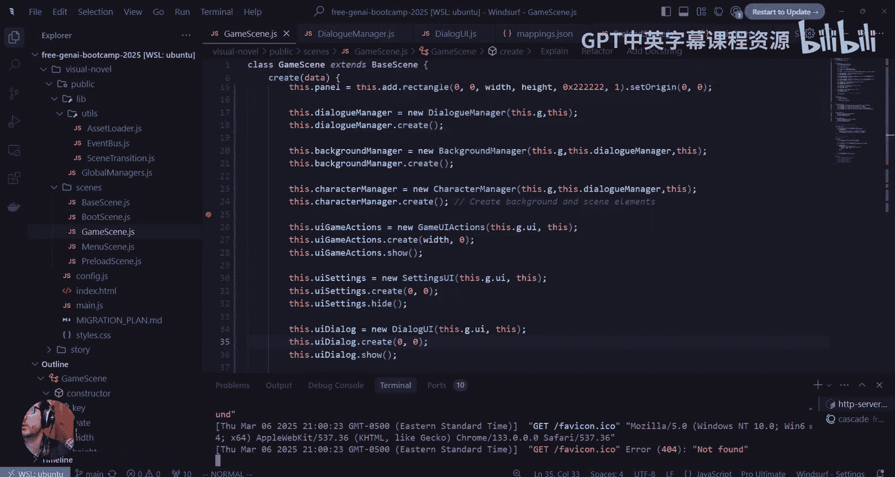

We know that when something else breaks， sometimes there is a misleading problem。

And so it says background manager are undefined in the game scene。

 no dialogue data found for scene 0，02。Seene 2，2，0，1。 This is happening in the dialogue manager。

 Let's go make our way over there。 Let's solve that problem first before we look at anything else。

 And so what it's doing is it's trying to load in the data over here and it's saying it can't find it。

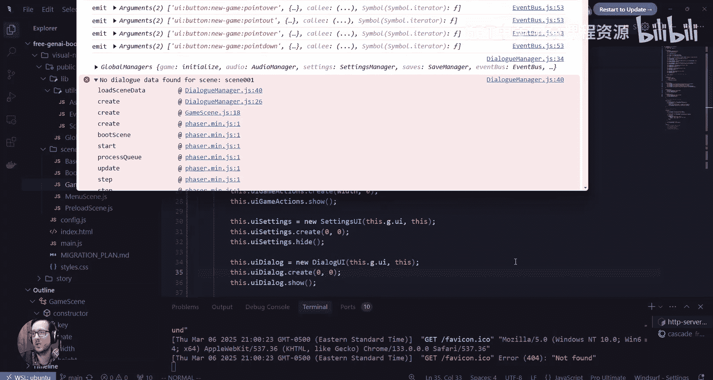

Which I'm not sure as to why。

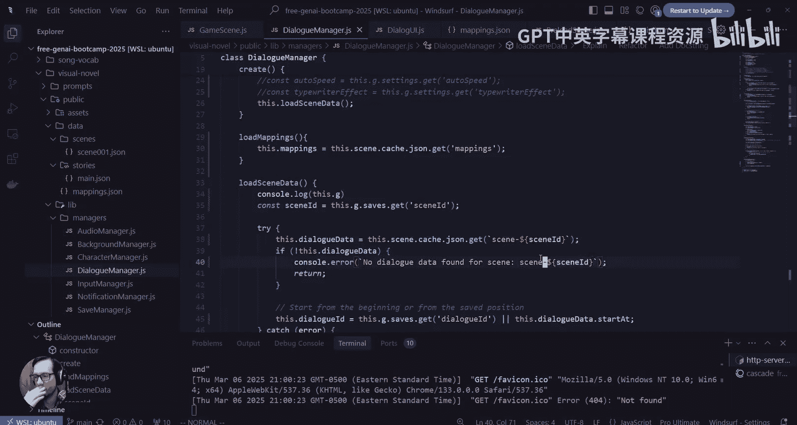

But maybe it's the name of the key， so the key here。Is。

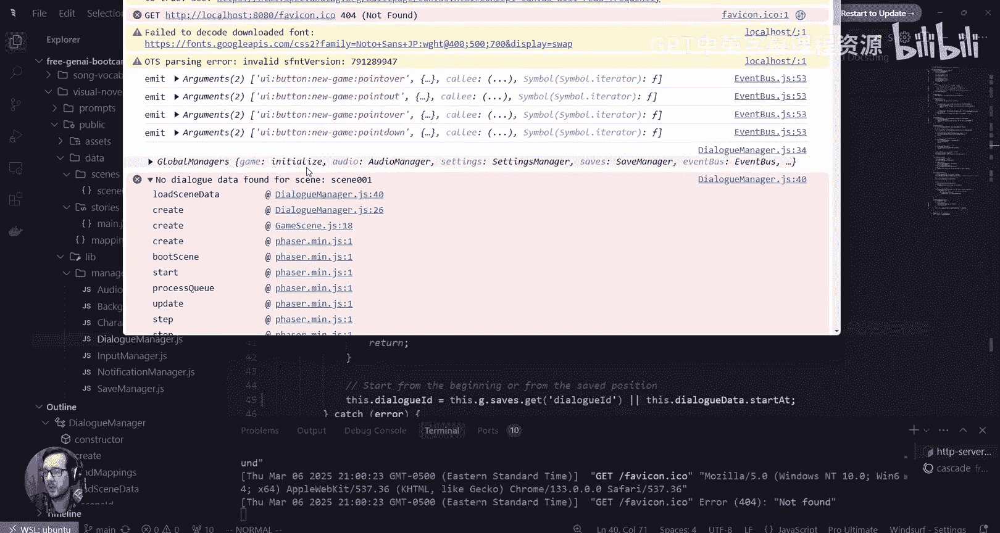

Where is it。Secene 001， right and so this needs to be in our preload。

So we'll make our way over to preload， let's make sure that our preload is correct。

Looks like the same key to me。Well， that would' scene 001， but I want it scene hyphen scene 0，01。

 as that is what I've said it as。So we'll go back over to here。

 we'll go back over to our dialogueg manager。 I want to be very clear that we know what the key is。

 let's just say a constant key， let'll just say。Kashki。And then this way， it'll just be y。

 that's what I want。This way then it'll match exactly what we expect it to be。

And if we don't know what's going on here， we just say console log。Log this dot scene。Douck cash。

Jason， I'm not sure how we can get and I just wonder if I could just do that and see at least what's on that there。

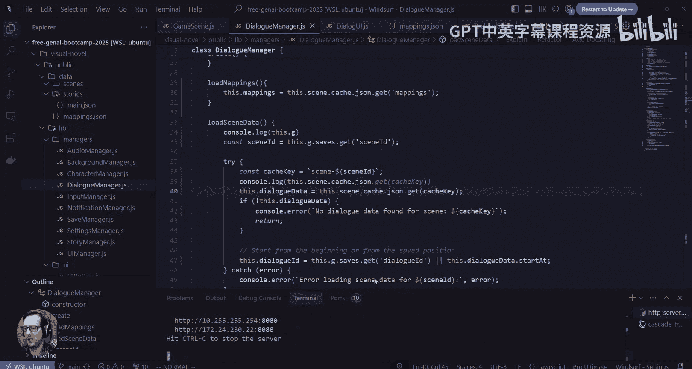

As I can't really tell， it's being loaded or not being loaded at this time。

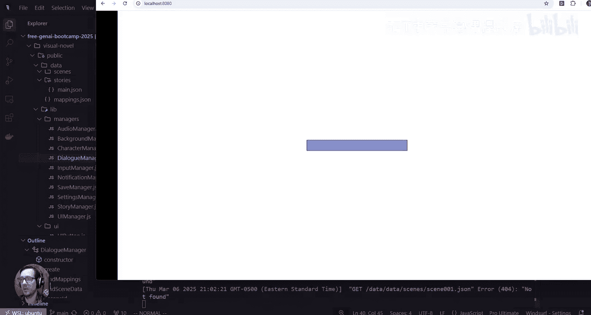

And we go over to here， we bring this on down here。 I'm going to scroll on up and。

We still have all these problems 404 not found data data。Okay， so let's go back over to our。Preload。

 as it seems to be prefixing the data here。 So we don't need to do data to data。 It's just this。

And maybe that has to do with our asset loader。Because we create our own asset loader， right？Yeah。

 we did， and so it's probably。Prefixing it with。Data。

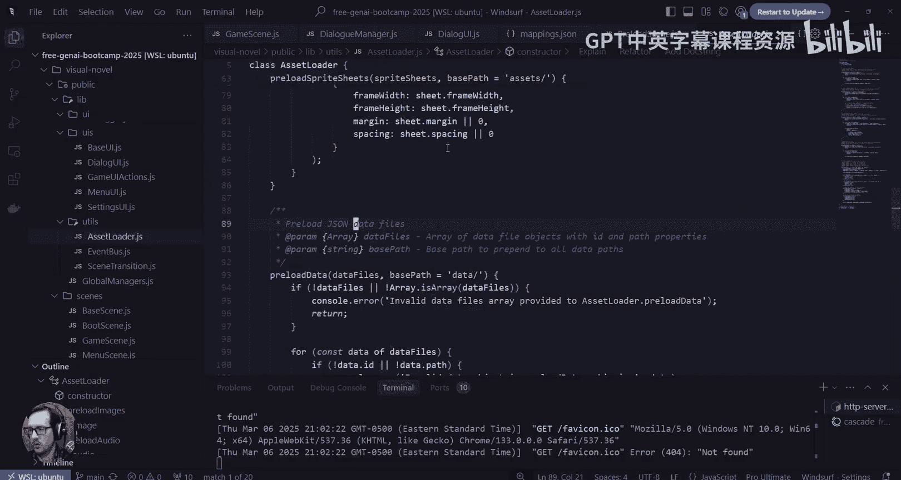

It is right there， so that was our problem。 we don't need to specify data。We'll go back over to here。

 we'll reload this here。

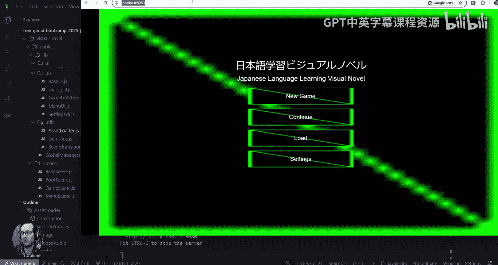

And hopefully， that air is gone。 So that error is now gone。 It looks like it is loading。 Well。

 at least at not this stage， but over here， maybe。And。We are checking carefully。

 There's a lot of stuff going on， but we're carefully checking to see if there is an issue。

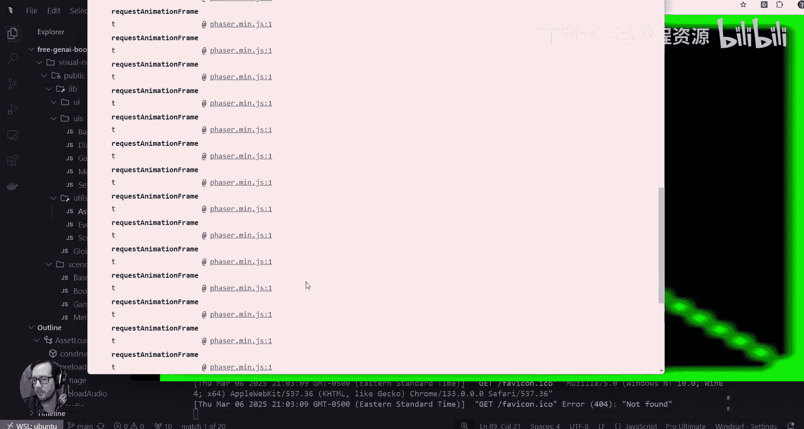

With it， I don't see it。 So there's something it doesn't like about the background manager。

 I cannot tell what it doesn't like。But it says it's not defined right here。

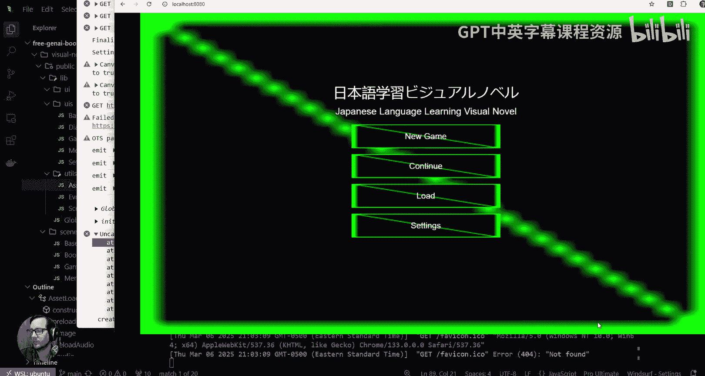

Let's go over and take a look at our background manager， it was working before。

I think it was working before unless we never tried it in this case。 Oh。

 it says character manager here。 Let's go fix that。

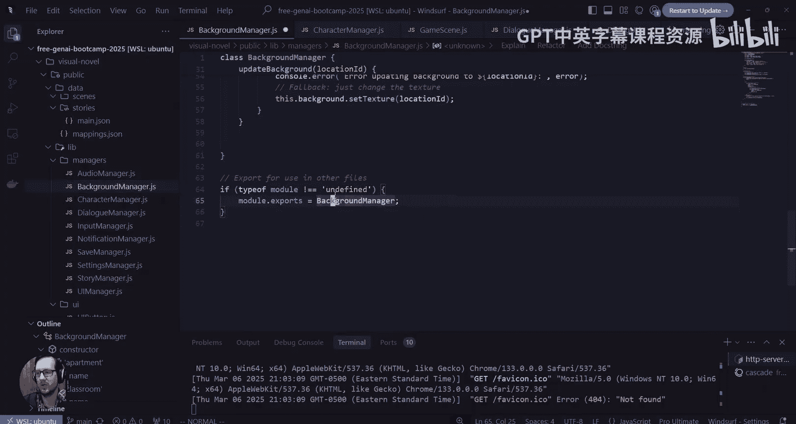

I'm not sure if that's our problem。As some things need to be import， some things don't。

 I don't know what needs to be important， not。

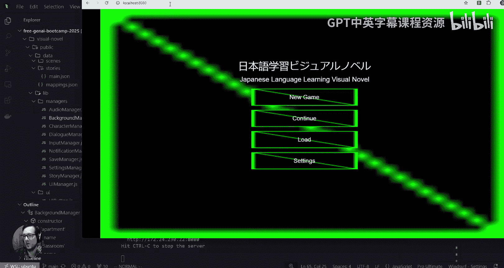

And we are still。Have this problem。 So this is going to be。The LLM's chance to try to help us out。

 so I'm going to go over here。And that， let's see if we can figure it out， okay。Alright。

 so let's go take a look here saying like， I don't have them in there。

 I'm really surprised theyre not in there as， oh， it looks like。

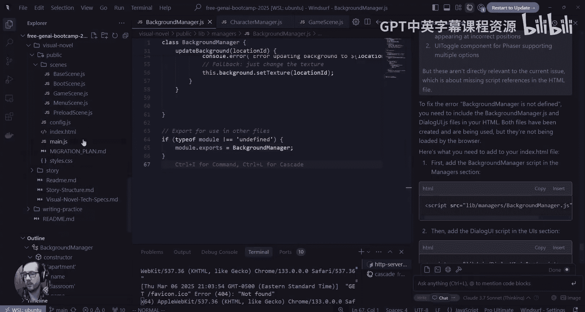

It isn't there， okay well。That's definitely a reason why。

 But I would I really cowore that that was included。 Sa thing with a dialogue U U I。

 that should have been included。 It's not a new thing， but maybe that was never included。

 I don't know。 So we'll go here。 and I guess we'll just include that。

 And so that's not what we wanted。No。😔，Dialogue， I don't know where you're getting this background U I。

 That's not even a thing。 So now those are in there。 So that is good。

 We're gonna go ahead and stop and start that and we allow get us around that problem Again。

 Don't know how。

Those weren't included earlier。 We'll go ahead and hit new game。

 We'll take a look and see what our error is now。 Dio U I is not defined。 We have included it。

 did we not。Dialogue Ui。Right here。Dla U I。Oh， it's spelled differently。Okay， so which way is it spt？

 We gotta go over to。Our game。Seen over here。We are spelling it this way。And for some reason。

 it chose， I mean， like， yes， I'm Canadian。 So this makes more sense for spelling。

 But we're gonna go with the the， the other kind of spelling。WithThe other kind of spelling。

 we'll go ahead and give this a nice refresh here。 and we're gonna go ahead and hit new game。

 We'll go take a look here。😊。

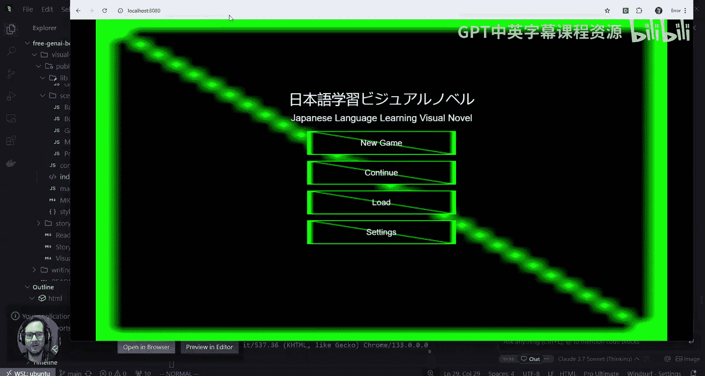

嗯。

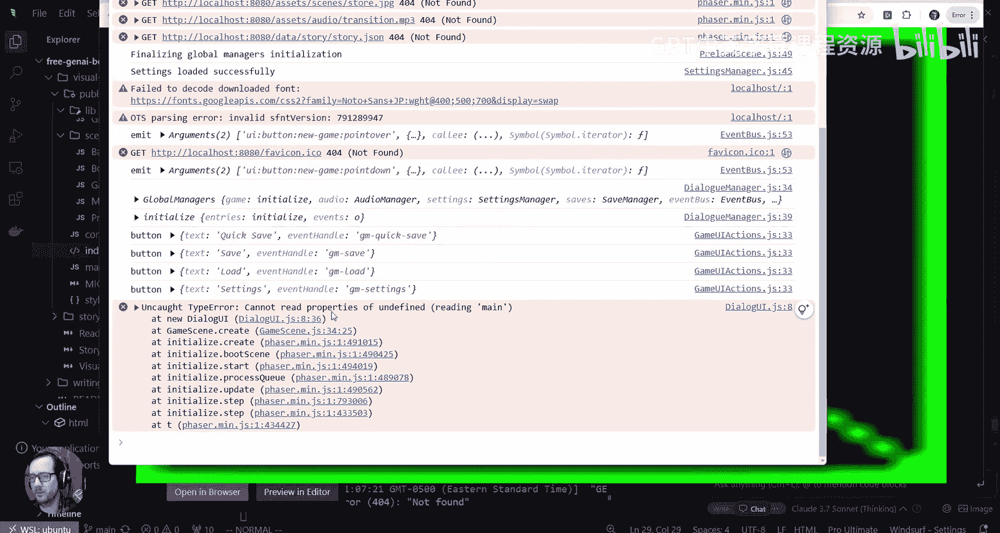

Cannot read main。 So now we're getting this on on that。 So we're starting to get somewhere here。

 We're going make our way over to our， our dialogue。

 U I back at the top here doesn't know what scene is。 scenes right here。 It's right in front of you。

 But I think the thing is that。I'm not sure if our dialogue UI takes， it probably does。

But this would be called Globals manager。婆宝。Managers， there you go。

Maybe that'll fix our problem there。Okay， I don't have to we' restart every time， just force a habit。

 We'll go here， We'll click new， We'll go back。There is not a show function。 We'll go back over here。

 iss this extending？This should extends。This should extend。The it's not doing it today。

We'll just split this over here and bring it in。 Sometimes it's working。

 sometimes it's not I don't know why。 it's just kind of。

There we go now it decides to auto to complete。So。Yeah， with game UI actions。

 this one brings in the UIM manager actually。That actually makes more sense。Do I am manager。

That's actually what I want to bring in here。And。There we go。

 because that's really what we're going to be doing is we're going to be working with those interfaces。

 those UIs。嗯。So。Now if we start to top that， we can take a look here。

Kind of just guide our way through it。Must call superconstructor class to arrive for this。

You just will not give me a break here， will you？We don't have supersin in here， that's why。

There we go， we'll go back over to here。Give that a refresh。Try that again。 Okay， great。

 So now were starting to get somewhere。 The set origin needs to be fixed here。 Like。

 we have a nice little tiny border here。 So that's fine。 We'll go back over to here。

 I need to look for that border or for this here。 Say this dialogue。😊，I should just autocomplete。

 even that's not even。Dialog box and we'll say set origin。0，0。

🎼That'll make our lives a little bit easier。 I don't know， like。

 am I running out of credits or just not deciding to do it anymore。 I don't know anymore。

 So now we have our our box。 now， I want that at the bottom of the screen。

 I do want margin around our stuff， so。

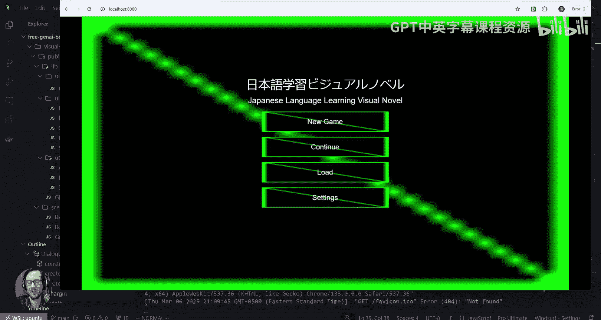

We want this to go to the bottom of the screen， so we have our X and our Y。Or why is。

There I would probably set actually the origin。 So we have0， I probably do0 and one here。

 and then that way I can just set it from the bottom like that way。

 and I can also just minus from the width。 So if we go here and just say constant。Coned。

X for y equals。No， it'd be like this dot y minus margin so that we are getting the good margin here。

 so we'll go ahead and do that。And that way， it's going to end up。Where we wanted to go。No。

 I don't want that。 I want why。Right， and sure， you can have a comm on there if you want that。

 And so we need to now bring in that entire height into that。

 So we'll go back over to our game scene。And in here。

 we're just going to go ahead and give it the height， the dot height， I guess。So what it is。Yeah。

 it's over here， it's actually just height。And so I would hope that that would bring that to the bottom of the screen into to the position that we would like。

 We'll go ahead and give that a nice refresher。There we go。 Looking good。

 This is supposed to be over a little bit more。 That totally makes sense because it needs to。

It needs a little bit of a push that we'll go back over to our dialogue manager。

 not our dialogue manager， our dialogue U I。 And so we need to bring over the。

This by saying this dot x。Plus margin， and that will get us into the center that we want。

Didn't do it。Did not do it， I think because we need to replace that there。 There we go。

And we'll go back over to here， up into here。 We'll give this us a nice refresh。Okay。

 so now we have this centered。Which is nice。 I want。The Japanese text to flow through this。

 I'd probably make the box actually a bit bigger。 I think that's a little bit small because I probably want large font。

 I like larger font to be honest， So I might put a 300 on this here。Okay。

 we'll give this a nice refresh here。 I actually， don't mind some of the choices it's making， like。

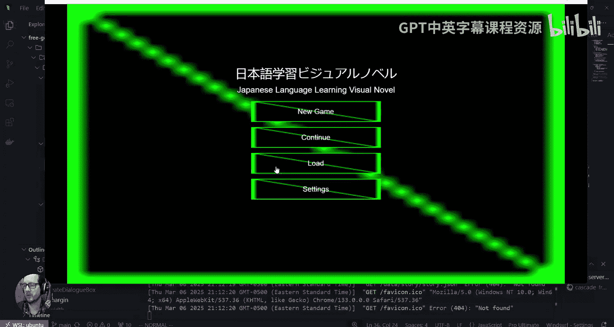

The fact that this is transparent is totally fine by me。

It'd be cool to control the transparency of this box。

 That could be a setting that we might want to do。 but right now again。

 we're just trying to keep it simple。 We have buttons up here。

 Sometimes they put buttons here on the right hand side， but that's totally fine。 This stuff here。

 I'm not sure even want that to jump out some way， I'm not sure， but anyway。Also。

 other thing is like， we don't say exactly where we are。 That might be something that we want。

 might want to specify is like where we are， what time it is， stuff like that。 But right now。

 were trying to just load in the text， Okay， so。We also have the name box like who's speaking。

 So that's probably something that we want to have。 This looks probably very similar。

To they one here， so'll just go here and say this。Dot namebox。Okay， and。

I'm just trying to think about this because now we're kind of getting the custom code kind of。

We don't need a margin， but we do need to place this relative to the dialog box。Right， and。

You probably want to know where this dialog box is。I'm not sure if we can get the X。

 We can probably get the X and Y of the dialog box that I'm thinking about it。 So this one here。

I'm not sure if this will work， but we'll say dialog box。Can we get its x like this x。

And why I'm not sure if that's how we do it or ready able to go position do y。I'm not sure。

But let's just assume that we can。I would probably you。

 set the constant x to it and the constant y to it， this would get this not name box at origin 00。

Right， and then we would start with it here。So I just say x and Y like that。

And we just want to see where that box kind of appears。 This one here is a rectangle。

 This one is actually。An image。Why does this one look so much nicer than the other one。

 Because the dialog box just says add image dialog box。 Oh， you know。

 maybe we artificially created one in the preload。 I'm not sure， but that's fine。

 We'll go ahead and get this nice refresh。😊，This was really interesting because like。

 I didn't make that graphic， but it's clearly loading it in， I must have come in the preload。

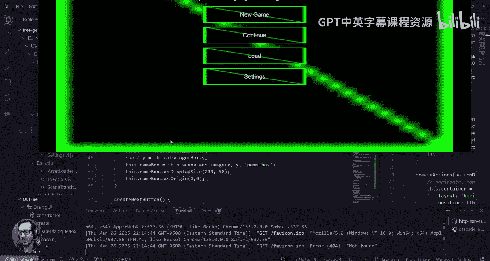

And so I don't see there， maybe because we didn't load it in。So go ahead and we'll do that。

And we'll go up here and we'll give this nice refresh。And it's down here below。

 So you'll notice that it's actually doing it from the corner of this one for where its origin is。

 So to get this really where we want it to be， I will have to fiddle with it a bit。

 So we'll have to go here and say why。plus。Or minus this do dialog box height。

 And that will actually get into the correct location。Initially， anyway。

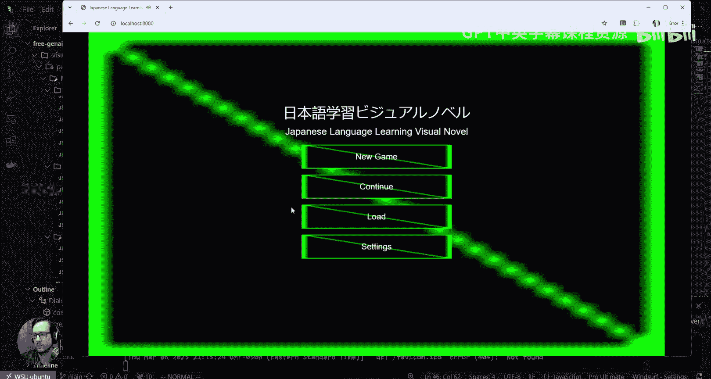

So we'll go here。 and now it's kind of centered in here。 I thought that it'd be。Pyra。

 it's in a better position than it was before。But we have the why。

Right so we didn't have the Y was showing us where it was Heights 300 here。So what's going on here。

 Why is it doing that？ Let's try to take this out again for a second。And we do this。

It goes right to the bottom corner， right？It does perfectly to the bottom corner。 So you think。

 again， if this is a 300 height， we just -300 and we get to where we want to be。

 So I'm going to go try this -300。 I'm manually doing it right now because they don't trust the actual height。

 for some reason。And now we're in the correct location。

 so why is the height not actually the height that we expect it to be？

Right because we set the display size。嗯。So is it like？Size。So I don't understand。

 maybe there's some about images we need to look up， so let's go over here。It will say phaser。

Pser images。 Far image。Let's take a look at what properties we have， that's what I'm trying to find。

It's like deprecated class image， what do you talking， but I'm using it right now。

Maybe because it's the old phaser， but。嗯mm。😊，So I'm looking for here。Is the property for its height。

Display originin X。The horizontal display origin of the object， because we have X。

 but then there might be origin X that we want actually want display with display height。

 Let's try this。

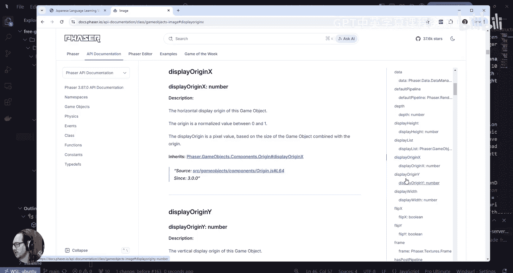

So I'm going to go here and we'll say display height。Height and see if that fixes it。

 But if we actually just need the display origin X。

 that actually might be better because then we don't even have to do any kind of math to get the origin that we want。

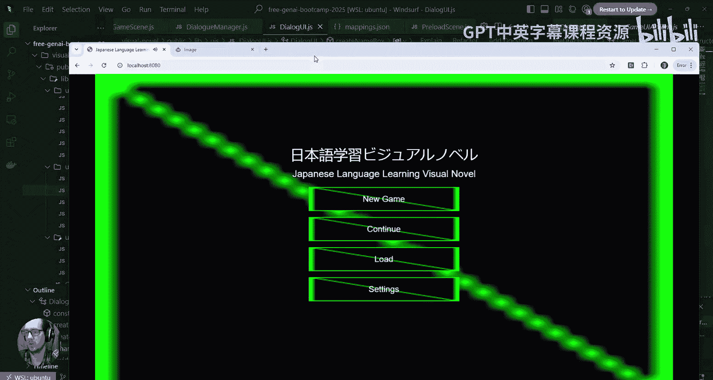

So go here new， yeah， okay， so now I'm thinking。Maybe I can just go here and say display origin。

Display。Orin。Y， and then display origin X， like actually where it is， not， not the actual。Wait。

 wouldn't the origin be the origin， though？No， it's up here。Yeah， I don't know。

I guess I had it write the first time， whatever it was working over here。

 I thought I was being clever。But we'll go ahead and just change this back like this。

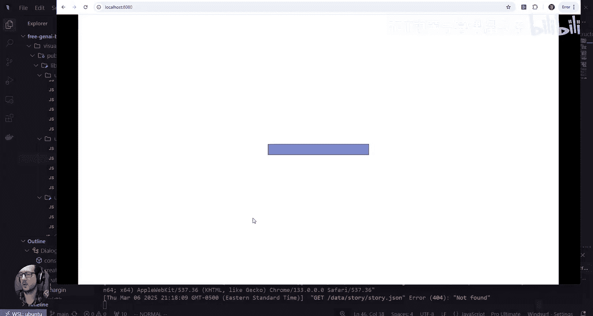

And now we are in the correct location now it's fine that it's here。

 I'd probably kind of offset it a bit and put it up like this。But I'm just trying to think here。嗯。

Justs a constant height， and this will be 50。And so in here， we'll put this as the height。

And so I'm going to go here and just say minus height as well。Divide by two， I guess， maybe。

So it kind of sits there a bit。 and then maybe。Plus， 32。Here。

And then it'll just kind of sit in a nice little off area there。There we go。

 that's kind of what I wanted。It doesn't look at center， but I think it actually is。 Okay。

 and I probably make the name a little bit larger here。 We'll give it。Constant width of 400。

With here。And so that will double the width for names that are a little bit longer as I'm not sure exactly how we're representing those names。

 The idea is that the name， that's the name box there。

 And so now we want to get the name actually into there。 So we need to， we create the name box。Uhhum。

We actually need a display。A name in it， right， So we have this name box and then this dot name text。

At tax， yep。嗯哼。😊，嗯m。😊，The other thing is like we have the UI label， so we could use that as well。

 I'm not sure if we do need to use it。But that is something that we could do。Here we have it。 Yeah。

 it's centering into it。 So it actually understands what I'm trying to do here。

 And we'll just put Alex so that we know what actual text we have for now。

And we'll give this nice refresh here。

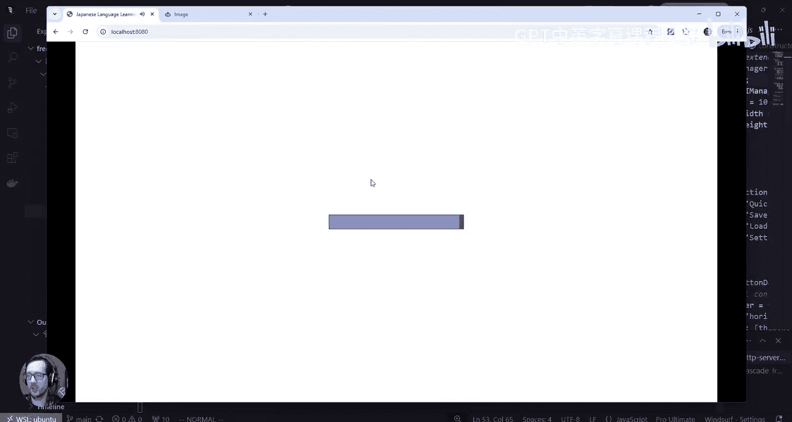

And we have Alex in the box， which is fine。 Fo's a little bit too small for my eyes。

 So we'll go ahead and increase that there。 But you could see how we'd have to like play around to get the font to really work。

😊，I'm not sure if I'll have time for that， but now we actually have the name here。Still too small。

 I want larger font。 I want big， big font。 Let's go 32。Okay， so we have Alex。

You can see the font becomes a bit tricky here。 Do you have to really work in the math here to get the display to look good？

Right， there we go。 And so now the next thing I want is I want that the actual text to appear here。

 but we need to load in Alex's name， right？ So how's it going do that。That's a good question。

 because。We should really be loading in the name。Via the update function。

 and we haven't really been using the update function whatsoever。So let's go over to our game scene。

And we have register Vs， load state， start state， update。 And so an update。

We would probably want to update like this dot UI。Dialogue U。

 that's definitely one we want to update。 And so this。Should have an update function right。

 and so in the update here。We want to update the text。 I'm going go up here and say this。We'll have。

This dot name。Text。And。Wherever that is here， which is here。Where's Alex。It's gonna be。

The dot name text。Actually， we just live it blank。And then in the actual update。It should be。

Be kinda， yeah。 But I mean， the only thing is that。We。Our dialogue manager， we brought it in， right？

I mean， that is the way we can access it。There's no reason we can't do it that way。

But I would probably just bring it in as D。It doesn't really matter， it'll still work this way。

 but we need to go to our actual dialogueo manager and take a look at what we actually have in here。

So。We obviously love the node。We've got a bunch of junk in here that is probably going to go。

So much stuff that I don't think is going to stay here， lots of stuff with typing effects。嗯。

Lots and lots and lots of junk， lots and lots and lots of junk。

I'm trying to find like the character name。 I thought the character name was in here， character name。

 character。Oh， we're in dialogue U I that's I'm getting confused。

 We're not actually the dialogue manager。 There we go。 Okay， so， I mean。

 there's still a lot of junk in this one， too。 but we've got to get speaker's name。

So this would be the mapping of the character。But the problem with this， like， yes。

 it's mapping the name， but it's still missing the actual。呃。The speaker I。

Right so where's the speaker ID coming from， we're actually setting it here。

 and I think that instead of setting the speaker ID this way。We should be。Getting the speaker right。

 So I go， like， get。Speaker name。Speaakker ID from dial node。That's what we need to do。

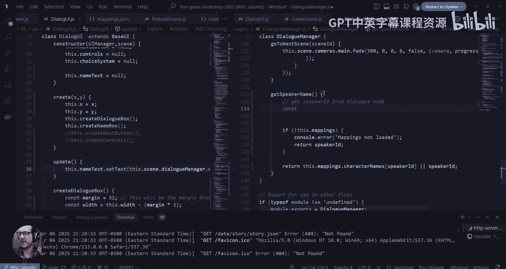

嗯。Assuming that's actually how that works， let's go take a look at our data structure and our scene。

In here we have。Speaker Alex，'s not called Sp I。 It's just called Spea。Right， and。

Maybe we should be calling it speakerea ID。Right。Speaker D， yep。No it's here。

 it's not like showing the speaker I in this， which is kind of annoying。The other thing is like。

 we don't show the， oh， we have a speaker ID D player。 Yeah， we have that here。 No in here。

 we don't see。I mean， these are our choices。 So our choices are always us， right。

 so we don't actually have to specify that。So in here， if we have speaker ID dialog node。That's fine。

 if the。If speaker I。Equals。Player。Then we'll return player， right because we need to do that。Yeah。

 yeah， fix that， please thank you。If it does have mapping， it is gonna kind of mess that up。

 But the speaker I D should help get the name that way。 And So that will be the way that we grab it。

 We're gonna go back over to our。Was it preload， no， not preload？Our dialogue UI。

 which is over here for some reason。And in our update function。We can。Get the speaker name， right。

 So that would be the way that we set that text。 So hopefully， that just works。

 That'd be really nice if it does。😊，It's crazy because early where we had a prototype， right。

 like it clearly worked， but you know， it doesn't mean the code's any good。Let's take a look。

 what's its problem。USpeaker can't get speaker because we change it to speaker ID。

To make it more consistent， yeah， there we go。 we'll choose that speaker ID。

And our codes now out of date， like our original prompt document。

 which we'll have to fix at some point here。 We'll give this nice refresh。

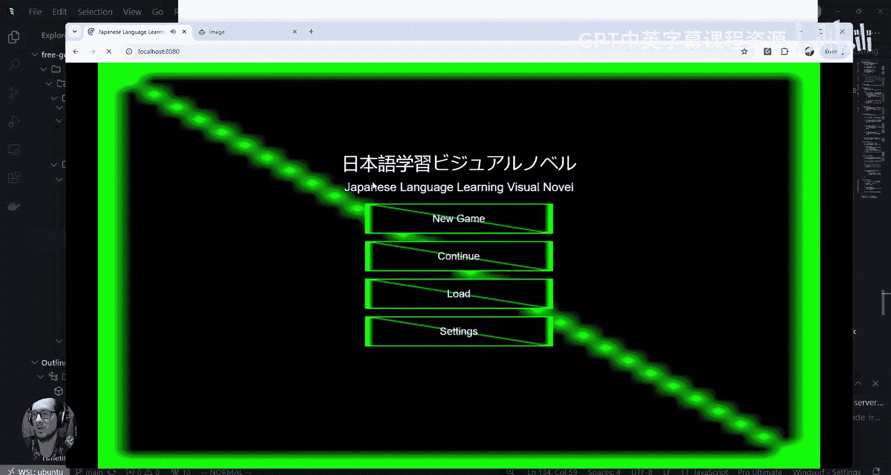

And I'll go back here， we'll make a new one。We'll go down below。Speaker I。Dialog node， speaker I。

Well， I think the node。Let's take a look at the node， then， because。

The note at this point should be loaded， right， so if we go here it's a console log。

This dialogue node， we should have something set here， right？So well give us a refresh here。

Do we get anything back？

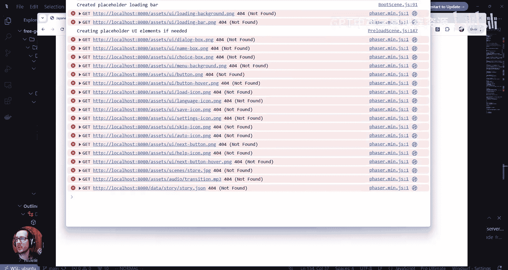

We go here。And at this point， it's null。 So I thought it got set。

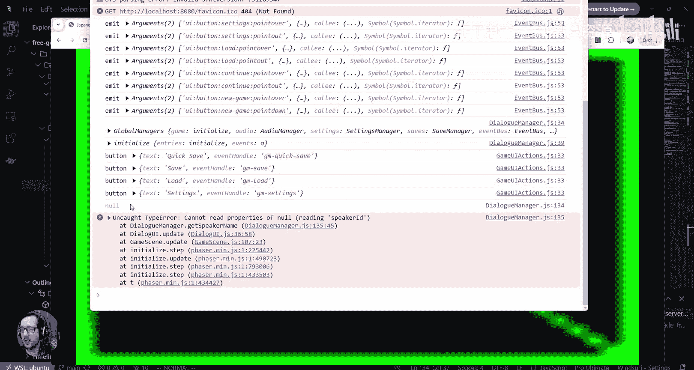

Maybe because it hasn't loaded it yet。Dialoggue data。Start dialogue。So， here。It is getting。

I call this like load。Dialogue。Noode。And。We have this， I'd say list low dialogue node。

 because that's the two things that should probably do right off the bat。Maybe。

We'll give this a nice refresh here。

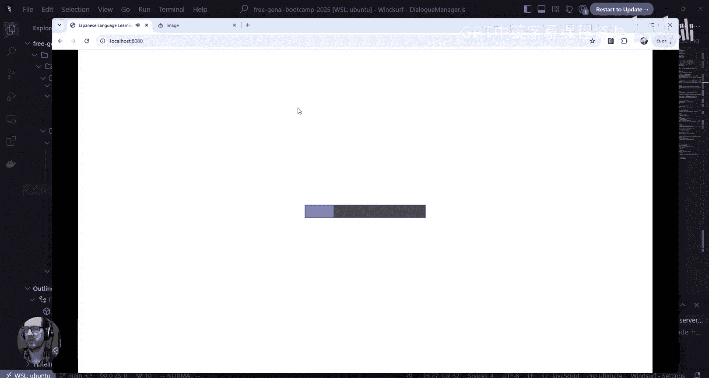

We'll click new， we'll take a look here。And not figure out speakerea ID。

Still showing undefined at this point in time so。

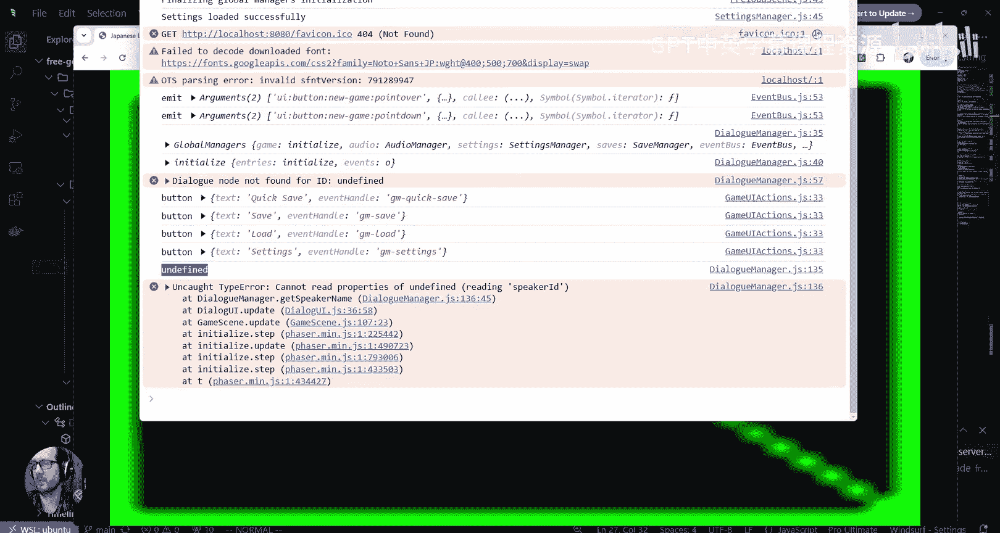

Until the games actually loaded。We should actually see if it's loaded here。

 so we'll go back here and。

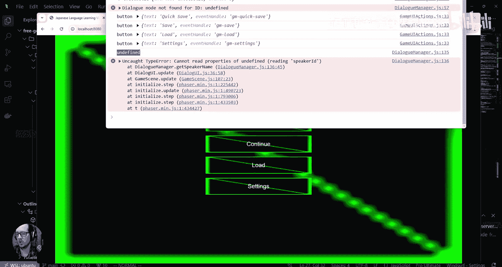

We need to fix the condition here where's our fing code。

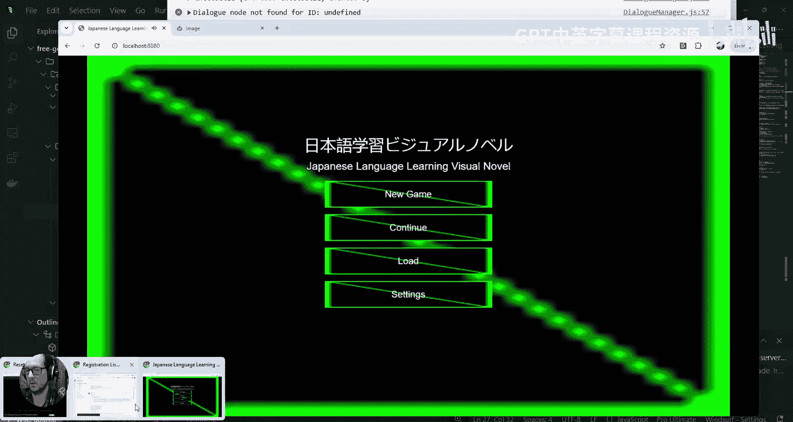

Maybe we'll have like it is loaded。So is loaded。Yeah， checks if the dialogue。Is loaded for rendering。

Because if it hasn't done that yet， there's no point in actually setting anything because it's going to have an issue with that right。

 And so if we go back over to here。嗯。And here we'll just say if。Ptheses， this do seen。

Dialogue manager。Come on。 You can do it。Dialogue manager。Is loaded。

Then it's flying to go ahead and do this， if it's not， then we don't really want this occurring。

 right？So that's a bit of a thought there。So we'll go back over to here。It was a nice refresh here。嗯。

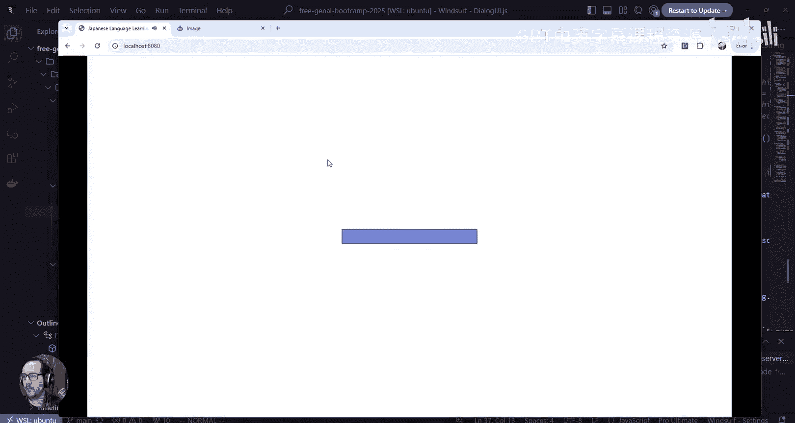

And we'll click new。 And so now no errors is now we don't see。

We don't see any text here but says dialo no not found unidentified ID。

 so it's having an issue with the ID that's being used in the dialog ID。In the low dialg node。

 So let's go back over here。 it would be nice if we actually showed errors on screen so that when we know there's a problem we can do that。

 I'm not going to do that obviously right now is I'm just don't want a blue nuer scope here。

 but I'm going look for。The dialogue I。Well， did it actually print out and tell us what it was。

 because that would actually help。In here。诶。Unfined the ideas is null。Well。

 how does that help us if there's no dialogueog I D， this is in low dialog node。So， load。Yeah。

 we're the manager here。And in here， this do dialg data dialog IDd is getting it from right here。

 dialog data that starts at。嗯哼。Is it maybe named differently。

 We have this issue of like dialogue being named two different ways。

 We might have to fix the consistency of the code。 So it's less of an issue。 But if we go into our。

Where we saw our data。Where is it。The save， the save manager， the save manager in here。

 it's called dialogue。Oh my goodness， what a pain just so inconsistent with this stuff， right？Um。

 I mean， it's my fault， right because like I'm not somewhere here。

 the name it like here it's all O U E and the other one's O。So that's a bit of a problem。

 but I don't want to rip that out right now。 I will。

 I will fix itca I can't deal with that long term， but we'll go over here And here it says says can't find dialogue I D 1。

So let's go back over to our code and take a look at what we have here。

 because we are setting it as one here。 If we go into our scene data， the dialogue is called 0，0，0。

 right， So it's not0。 like it's not one。 It's it's。0，0， zero， right， so we'll go ahead and do that。

A new game always loads the new game south there。 So That's totally fine。

 We'll go ahead and we'll say new game。 and should now show 0，0，0。😊，It。

I don't think it's airing out now。 I mean， you still have all these things that don't exist。

 these buttons that don't exist， but。We aren't getting。That problem anymore。H interesting。Okay。

 so I'm going to just switch to sitting here。So I've just trying to think。Hao。Do we。Get。

This thing to work， right？All right， just give me a second here。I'm just starting to think here。

Faiil to download the font too， we also don't have the no of Sansaw， which is fine。

 there'll be something else we have to try to solve。Okay， so。It must be loading the dialog ID now。

And I mean， update must be getting called。 Up gets called on every single frame。Like it's pretty。

 it's usually pretty。Pretty aggressive about updating that stuff。So let's go over。To dialogue U why。

And here， like， if it's loaded。 So all I can think of is its not calling this， right。

 So we'll say console E， E E。We might also want to just grab the speaker name here like this。

So you constant dame。And I mean， hopefully what we'll see is it's going to be like being tried to be called like so many times。

But we won't know until we do it right， so we'll go ahead and do this here。

And we'll go back over to here。 We'll give us a nice refresh。And。Yeah， it's not， it's not triggering。

 so it makes me think that our is loaded， It's not working。And I mean。

 that must be checking on every frame， so we'll go over。To our dialogue manager。

We have our is loaded function is loaded。So here says dialog data and this dialogueog node and mappings。

So I'm gonna go here console log。 we'll hold on。 We'll just do this。Counsil log。Sorry。

So this should be being called like a bunch of times， but it clearly is returning false， right？

So here。Here we go， yep， the last one's null， the last one's null， that's our problem。

So I'm not sure why that is， but that's fine。The last one is mappings。Mappings is not eh。

This stop mappings， did we not actually set it， maybe just set it as a constant， no it's right there。

We didn't load it。 Okay， we'll say this dot load mappings， that's probably our problem。

I don't think we'd load it anywhere else， right， no we don't， so I just kind of forgot to load it。

So we go back over to here， we'll give this a refresh。We'll go to new game。 Now our player is set。

 that's good。 We can see this is calling a bunch。 We don't want all those calls。

 It's going to kind of smoke us out here if we keep doing that。

 So we will go ahead and just delete this here。And go back here， give us a refresh。

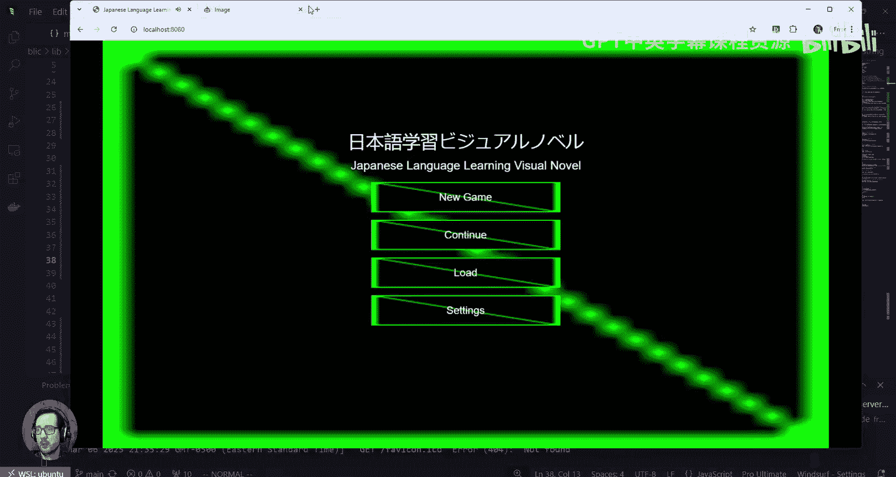

Very， very nice Play is now being shown。 I mean， we're the player。But it depends on who is talking。

 but it's assuming that in this case， the player is talking。 I that really what's happening here。

So if we go over。And we look at our scene here。The speaker is this， you wake up in a room。

And what's kind of interesting is like there is maybe the player talking。

 but there's also like in your head kind of talking right。

 but I think the thing is is that this is kind of from the perspective of the narrator right？

And's kind of describing what's happening in the scene。

 I suppose I'd have to play a couple of these games and take a look。

 But I'm pretty certain that you don't。 It doesn't ever like narrate to you。

 It's always you talking in your head， right？ So maybe the first initiative here is actually Alex saying good morning。

Well that's totally fine。 So now the next thing we need to do is present the actual text that is the next challenge here。

And so we'll go back over to our' just it's almost an hour just get just to get that little amount of code in there。

 but we're going to go back over to our dialogueo UI， wherever that is。Our dialogue you high。

Where's are you， I。Here it is。 and I just want to get the text printing on here。

 so we will figure that out next。We have createate next button。 That's a different story。

 Cate controls。We have a lot of controls in here。Toggle language， opening eye。 Like。

 this is stuff that would occur。 Like we have auto modes， get mode。

 I'm not sure how to do those right now。 So'm to go ahead and delete those out here and say anything with create controls。

Notifications is cool， but notifications。Is something that wouldn't show up in the dialogue U I。

 This would probably be like a global system that we would just have， right。

And so I think that this notification thing would show up somewhere else。

I think what we would do for this， I think that's closing right， create next button。

 We do need a next button， but we would probably want to use our our actual UI to do that。

 So you can see we have a lot of busy code here that's going on。

Create dial text what we're trying to get to， this notification should really go into the notifications UI。

Notifications， U I， J S， if， if we need notifications， I wasn't really thinking about adding those。

 We'll go ahead and do that。 Let's say notifications U I extend the base。Sure， yep。I。

 it's getting it all going。 And I'm just trying to get it to the end here。 There we go， and。No。

 that's not how we do it if。啊。啊。There we go。 And so now we have a skeleton for notifications， U I。

We want to carry this code over the certifications。Over to this。

 because this is really what will happen is， is we will use this。

And we will trigger the notifications when we need it， right， So here creates a notification。

 It's weird because it adds it。 So this is more like， So show notification。

 but it's more like add notification。Or like， create notification。

This will go here into this do createate notification。Right， and。Herear this between it like。

And this would be animate。So it say animate。And so here， what I would do is cut this here like this。

And so this would really be what we want this to do。

But right now we're not going to load we're not even gonna load that into our game right now。

 I'm just kind of moving out of the way。 And so now we're focused on this， this code here。

 we do need a next button。 I kind of prefer having a very specific next button that you click as opposed to just clicking the entire screen because when we have to choose choices and I't want us to get mixed up between that kind of stuff。

 And so this next button is not implementing our correct implementation here。

 So I'm gonna to go here and just say like this dot。G dot。No， you I am， sorry， you I am。Create field。

Kind of。It's like it doesn't know what it's supposed to do here。

I'm gonna open up another one just so that sometimes I think like， if I open another window。

 it kind of helps it out。 I'm not really sure if that's the case。But in here。

 we are creating basically a button。Meennu you probably better。

So we go here and we have create field odds input type， so we go here input type。There we go。

There we go。 That's a lot better。 We do have a event handle here。 That's not actually how it works。

It doesn't do that。It does need to have， well hold on。 No， no， that's not See， it's。

 it's doing really dumb stuff。 I think it maybe because it's not， I don't know。 It's like。

 I don't know what， why it's being so stupid。I have no idea。

But this here is going to be just giving the full name that's not correct。

Because it's going to already give an UI button next point down so like this。

 So this will be dialogue next。We're so inconsistent with this dialogue thing。

 I'm gonna try to use the G， O U E， I guess。We'll try to fix it at some point you're like。

 this one's called DL， Yeah， and then even in here。呃。No， I guess it's fine there。 That's fine。So。

 now。We have that， obviously。The other thing that we got to figure out。

 But like here it's trying to set the position。Based on whatever this is， I don't care about that。

 We have point over next hover。The thing really is this click part， it does play the sound there。

 which is fine， but that's not how we want to work。Here it's triggering the typing。

Which says like advance the typing or。Do that。 So I'm not exactly sure what I want to do with that right now。

 So I'm just going take this completely out as this is not how I want it to。Exactly work。

 We're gonna say this up button。 we haven't been adding it to our register and stuff like that。

 when we， we will do at some point here。 But right now， it's， it's not much of a concern。

And so I want to get this dialg next button onto the screen。

 it probably is going to display just not where I want it to go。

 It's going to be up here in the top left the corner， maybe， or the page will crash we'll see。

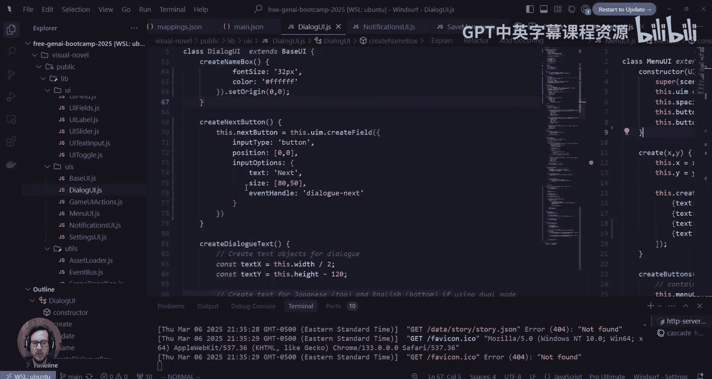

And I don't even see the button， so it's not even appearing anywhere。嗯。

And we should probably register it anyway， so we'll go here and say this。Where's our register no。

 that's not what we want。Wheres our register？Register element， yeah。This register El？

This's not next button， because we're not。We're not adding it to the menu container。

 so we'll just put it there， maybe that will make it appear。We still don't see it。

It's a little bit frustrating。Oh， maybe because we never created it。That's probably why。

Create next button。 there we go。 We don't have controls here right now， believe that alone。

I do not know why it's doing that and take that out。Thiss a nice refresh here。New game。

And we'll go over here， take a look。Oh these smokes are getting lost stuff here。

 That's under the get speaker Da。 So I guess we still have a little bit of code still there。

 I thought we got rid of that。And the dialog manager。Where are you dialogueog Manager， here we are。

And we'll go ahead we' say Cons log。Take that one out。We do not need that one。I don't want that one。

We don't want that one。 Okay， that will help us see what we're doing。 So go back over here。

 We'll give this some refresh。And we'll click next。Okay， and so I don't see our button。

 I don't see the errors。But I don't see our button on the screen right， So where is our next button。

 we need that next button。 I don't know if we put any text in that next button， did we。

Take look here。It's just a button。Input type button position 0，0 type it says next。

 so it has text input。And。Oh， we never created it。 I thought we added it。

 Maybe I added it somewhere else。So now I'm kind of wondering。

 unless I just deleted it up by accident， we do need to create the text dial。

 but I'll come after this one here。

So， do this。

Next， we now have our next button， I want it to appear down in the bottom right corner。

Or we could also put it down here as well。Or I could put it beside the name。

 I'm not sure as to where we want to put it。🎼Mhm。Yeah I'm just thinking about I keep realizing my head's kind of over here。

 sorry， and now I'm too low or too high。There we go。

So we need to move that button to a more appropriate place。

And I'm not saying it's gonna be the best spot。 But for now， I'm just gonna go ahead and put it into。

The side here， right。So to get it over here， I'm going to go ahead and set the origin on the。

Next button to be。Can I set the origin on it？And it says that。I don't know if we can do that， though。

Can we set origin on these fields， I don't think so。Do we make like a set origin function？No。

 so we can't really move that around unless we wanted to build that in there and I don't want to do that right now。

So what I'm going to do。I just position it manually？Not very fun way to do it。But we'll go here。

 and we'll just say。嗯。Maybe I'll just take what it's given us and we'll just see where it goes。

 Maybe I'll like it。 Maybe I' won't， we'll see。Can't even see it。Pointless。

 we'll go back over to here。 So here I have the dial box。Plus， the dialogueg width minus-80。I mean。

 theory it sounded good， like here it says dialogue X。Right， so that be this。And then， dialogue with。

in- 80。Yeah， and then we have dialogueg Y。Which is here。M theod like heights would be up here。Mus 50。

 so it should be actually up here in the top right corner。So I'm not sure about that。

 but I'm going to put a zero here just so I can see what's going on。

And we will just kind of walk way through walk ourselves through this here。

I don't see the button at all。We can put a 0，0 here。 Let's just see if there is something else。 Like。

 did it take out the code and for it to render。Our button's back。And。

We'll just kind of again step through this。Okay， so now it's aligned with this。

And then we'taking this here。

Oh， it's over here， okay， good。So now we'll go back over to here。We'll try dialogue why， I guess。

Now it's down here。So like I'm doing anything magical here。

 I'm doing exactly what I thought it was supposed to do。And we'll do height here minus 50。

 we'll take off this for now。

Maybe I just didn't see the button before， I don't know。

Yeah， I just。It's not here anymore。Maybe it's the math logic， so if we have。

 let's go take a look at that again。Keep forgetting， you know which。Icon I need。

 so I'm going to just drag these over here so my life a little bit easier and。It's doing a plus。

 It's supposed to minus that that's the problem。 There we go。

And same thing with that one that probably supposed to minus as well。

 I didn't't exactly want 50 on that， but that's fine。Well give that a check here。Good enough。

 I actually want it in the bottom right corner， probably。嗯哼。

So we probably just get rid of this part here and then this is going to put it more an appropriate spot that we would like it to be in。

Um， like maybe I could bring back that click， but right now I just， I don't know。

 I want a physical button and I have less problems。And where is it here？This since this's 50，50。

 Im gonna say 100。It it almost looks like it's centering it， I'm not sure why。

Maybe those buttons are still centering。 I don't know。 So anyway， it's over here。 It's close enough。

 And so we now have that。 The next thing is to bring in that display text。

 So that should be pretty simple。🎼U。And so we'll go here， we want to create our dialogueo next。

 so we'll go up to this。So be this。Create。Dialog text。We don't need controls。

I don't know why you keep showing that。 We do have choices， which we want。And。We have this here。

So it really depends on what it wants if it's dual or whatever。

Right now all I want to do is display Japanese text。Because the thing is。

 is that like if we're having the text， we want to have the text。Below the other text， or we want to。

There's just different ways we can control the text， right。

 And so some games they actually put the text completely somewhere else。

 And then the Japanese there or some might put it right under the text。

 But I would think that we want to put everything。Below each other。嗯。

Create the text for the character name。 We already， we already have that。 We don't need that。So。

 we don't need that。呃。Or actually do we because if it's the character name。

 wouldn't it have to say the character's name？But wouldn't we just put that in the text as per usual one second。

 Give me， give me a moment。 Actually， wait， no， basically， the。

 the bubble at the top is the person that's speaking。 So we don't really need。

We don't really need another thing for that。 so that doesn't make any sense what I'm saying， eh。

So what I'm thinking here is。Yeah， we don't need this。 This makess no sense。 We already have that。

In our text field box。Here is talking about create text for the dialogueog Ob， text X， X， Y。

 the X and y really needs to be aligned with。The dialog box。Cot yeah。

 it's kind of what we want here why。Dialog box。 But the thing is that this one has to。

Minus this dot dialog box height。Display。No， not that one， sorry。That one's fine。It's this one here。

 This one would have minus this dialog box。Display height。And。32， I guess。Actually。

 it'd be like plus 32 as we wanted to be in the interior。

 and so that would be the first setting where we would have this and we go down here and fix that。嗯。

We have this。It's going like this dot scene do Japanese text。

 I'm not sure why it's putting it on scene like that， but we actually want to say Japanese text。

 English text like this。 That makes a lot more sense。 If we go to the top here。

We don't have controls。They'll say this Japanese text。We don't even really need to set those。

Sometimes it has to be explicit。 If we used a type script language。

 then that stuff I have to be explicitly there。 I find for video games when you're working with a team。

Typescript is really， really good。 But anyway， the point is is that now we have these two here。

 It's setting origin is 00。 That's wrong。 We want to have it 0 or 0。0。5 but 00。

 That's probably why originally when we were we saw the typewriting fact。

 it started out kind of centered and weird was because it set the origins as that。

But now those are there， so that's really good。These only get rendered， if。They need to be shown。

 I guess。So we're going to go down to the update function， wherever that is here， update， update。

 update， update， update。so we， yeah， we need to update the。I wasn't thinking of that。

 I was thinking more like。updatedate。Japanese text。嗯哼。

Here we have like if the game setting language is this。That's。

 it's not games seeing game setting languages it's pull up old stuff that doesn't exist。

It's because of this here。嗯。We。It's not that It's this dot C dot G dot saves。Or settings。Dot get。

Language。And if it is Japanese。我。If it's this。Then it will do that， right。

 So that's what it's actually looking for。 Very， very verbo。

 what we're doing here is saying this do scene doesn's making sense。 It's just this do。This here。嗯哼。

Dialog manager settings。嗯。嗯哼。😊，So。Yeah， those are wrong， so go ahead and fix that。Sorry。

And so now this should be a little bit more manageable。 Be nice that that text shows up。

 The only thing is like， will it wrap the text， I guess if we define the width， Oh。

 it has word wrap on it。 There you go。 But the width is going to be really the。With of the things。

 and we'll go here and say constant width。 This will be this dot dialg box。With minus- 64。

Really should bring in the margin of whatever that is， the margin。So the margin is that。

And I might just go here and just say like this dot margin。Is 32。

So wherever we are using margin here， we can just do that， and say this。This。

And so there's another spot where we are using this where we are creating that text。For the dialogue。

嗯。Where it is here， So we have margin。Yeah， this margin times 2。

And I'm gonna go here and do padding as well。Justll stop padding equals 32 minus。

 We'll just do it up like that。Marjin。And then we have this padding dot2。

So that will get us the size that we actually want this to be。And then we can say， with。

Like that there。Same thing here。It the width there。

 so that makes it really clear what it needs to set as the width。

I'd also updated those settings there， which is good。We have x's and y's in here for the add text。

This。So based in the dialog box， I think that that should work。

The only thing is that if we have Japanese end。English， one has to be one under the other。

Re right now。They're the same。 They have the same y value， which doesn't make sense。

Because one would have to be under the other。And it would have to know the length of the other text。

 They'd have to type at the same time。 This is why like the typing effect， I'm not sure if it is。

Very effective or not。Especially for language learning。

 if it shows up like each word at a time as they say it or it highlights as they say it。

 that might be a little bit more interesting。 but right now we don't have that。

 So I'm gonna go back over here。 We'll give this a nice refresh。

And so it has a problem with language。

I I tend to type that word wrong all the time。 It's just game setting still。

 I thought we got rid of that。Where is this in。🎼Dialogue， Ui。

I don't know where he keeps getting that game settings from。

So we need to find this game settings thing。It's not， oh， you know， this files not saved。 that's why。

 okay。So go back over to here， whoops。Go back over to here。

We'll give this a nice refresh here。🎼Able hit new。We still have an error。

 Let's go take a look here and this is set text is undefined for property。

 This is on the Japanese text is's showing scene again the stupid scene thing。

 I don't know G White did that。

So we go over here and look for scene。Dot。Sn dot text。That one's fine。Those don't matter。

That doesn't matter。Maybe send the update function。Yeah， it's still doing that。 There we go。

 So that was probably the one that was lingering。Here it says get Japanese text， get English text。

 We don't have those implemented， so I'm probably just going go over there and just do that right now。

If we can find the dialog manager here， wherever that is。We'll get the。Get Japanese text。

It is really not doing anything anymore for us。

We have get Japanese text。Get。English。Text。It's not exactly that for the text。

 we'll have to go and take a look at the actual structure。And we have Japanese in English， right。

 So really， for the dialogue note， it's simply just English。And Japanese， That easy。

So I'm going to go back over to here。

Mmhmm。😊，Get Japanese text。

Let's say it's undefined。 Maybe we didn't save the file。No， I think we did。The Texas name correctly。

 it's definitely there。So well go back here and's going to stop and start it。

Maybe this node here it having issues with that， I'm not sure。Well go back over。Here。Mmhmm。😊。

This dialogue about undefined on the dial maybe maybe because it's the way it's calling dialogue manager。

 I kind of want to go and guess， in this scene dialogue manager。 I mean， that is what it's called。

I'd rather just pass it in， like this dialogue manager。Dialogue。Manager， and say， this dot D equals。

Dialogue manager， that way， I'll have less of a headache working with this。

And then we'll go back into our game scene。And in here， yeah。

 I'm just going to do that dialogueg manager passing there， which is up here。

 so it definitely does exist。 We'll go back into our dialogue U I。And。It'll be yeah， just D now。So。

 here。This can just be D。That's fine。It's really doing dumb stuff。 I really think that。

It's not being smart anymore。 It's just， I ran out of credits。 and I mean。

 it's like it's doing something， but it's not doing something that I actually want， right。So。

I mean like， yeah， I don't need that change yet， oops。Ho he smokes， what is it doing？Okay。

 but I don't want to say， like， there's no more Japanese text there definitely is。All right。

 so we now have our Japanese sacks。There is obviously a little bit of work that needs to be done to fix the level of tax。

 what's interesting is that the English is actually appearing right below the Japanese。

Which is pretty good， I'm going to go back over to Winsurf here。And。

The text needs a little bit of help。So we'll go here。And。We have y minus-30。Y plus 3， okay。

 so it actually is adjusting it relative to the y position。

But the thing is is that we don't want minus 30 plus 30， it should just be minus minus， right。If we。

 but the thing is like， if one doesn't appear， it's not going to be additive， right。

 which is kind of silly。 So here we would have， it's like。We'll just say offset y， so say let。

Offset y be equal to y。 and then here。This one is going to be。Offset why。Right， we don't need to。

Do anything further with that here， we should really。Add the padding。That is the dialogue test。

 We do the width padding here。But we didn't do it here。 I mean， we technically did do it there。

 Id probably just。Times it by  two， even though it's not necessarily what we're actually doing in the same sense。

 it's the same kind of padding。 But I'm gonna do that anyway。 Well， that's the dial X。Oh， sorry。

 No dialogue I should say that。 This be this stop margin。 That makes sense。

 And then here I'll do this stop padding times 2， which is not really true。

 but we'll just do that anyway。And。We have offset y。 And then here。

 if this exists will say offset y plus， yeah， like whatever it is。 Now。

 that's not necessarily accurate because it's actually supposed to take the height。Of。The tax field。

Right， so here it would actually be， I don't know if we can do this。

 We'll say this not Japanese text。Display height right， and so then that becomes its actual offset。

The only thing is like， there's that plus the padding， right， So that plus the padding。

 and that should put it in its correct location， assuming that that's what it does。

 So we'll go back over to here。

Okay， and now we have our tax perfectly aligned。So we are getting pretty close。Up to something。

 the only challenge here is like we have this text here， which is great。

 but you can see like the English translation is longer than the Japanese text。And so you know。

 is this good as a language learner I don't know， like a lot of them like try to show it and then maybe you like read it or it shows the translation another way。

 I think that like when you have visual novels they're usually designed to be enjoyed。

 they're not a language learning experience， so they're not trying to optimize the presentation of the dual translation。

But I think that if I was to do the dualod translation here。

 maybe I would make the Japanese sex larger and then if you hover over the words， it would show it。

 the original implementation was actually trying to do that。And if I needed the full translation。

 maybe there's something that I could like hover or click or something to see that translation。So。

I think that's fine。 I don't think I would do dual text the way that it's being displayed here。

But anyway， it is a interesting start， right and。I'm just going to continue forward with this。

 but we're going to stop the video here as we've hit a checkpoint。So yeah， again。

 not sure if I'll do that typing text because if we bring in audio， right？

The typing text isn't going to really work。Because then when it plays out。

 it's not going to match the text， which would be kind of annoying。

 It'd be cool if it like highlight the text as it went or something like that。

 but we'll see what we'll have to figure out we are getting some fonts in here。

 so it's interesting say Google font didnt loadeded， but it clearly did。But yeah。

 just looking at this English font， I don't really like it。

 the weight or like or like the English text and I'm really like that it's there。 I would。Yeah。

 I would have to think about that。Like where to put it， but anyway。

Thanks for joining the stream or video， I'll see in the next one， okay， Co。

