# ExamPro《生成式AI训练营｜Free GenAI Bootcamp》中英字幕（deepseek - P67：-67-Visual Novel DialogueNode Next.zh_en - GPT中英字幕课程资源 - BV1SFEWzLEab

Hey， Bo Amers， we are back and continuing on with our implementation of this game。

 and so I've had more time to think about actually how I want the text to appear。

I've seen a really good one。 There's a。Chrome extension I have where I really like the way it works in terms of how it displays the information。

But that might be a lot of work to do。Well， it really depends like I still think that breaking down the words individually would be really。

 really useful。If it plays it back， the only thing is that when we use different kinds of sources that playback audio what data payload does it return and that's what I don't know so like if we use something like it transcribed it'll actually tell us where all the words are and so if I wanted to I can make it so it highlights each word as we go through it。

And so that would be quite interesting， but for now all I want to do is I just want to focus on the transitions of these scenes and stuff like that。

 because once we get that out of the way and maybe some decision making in place and the story branching。

 then we got to really do our AI stuff or put in the extra layer of whatever it is so whether it's getting the audio downloading it and making sure we have the timestamps or animating the backgrounds or whatever it is that we need to do right。

We can do that。 So let's work through this here first。 And we obviously have our。

 our next button here， which doesn't do anything。 We have our tax and so we want to help this progress to the next part with the next button。

 So I'm going go over here， and I'm looking for。Our next button。

 our next button is in this interface， is interface is under interface is the reason I'm talking。

 So nondescriptive is I'm trying to remember what we were doing， even though it was just yesterday。

 And so we have our game UI actions， which are those actions that appear across the top。

 but I need the dialogue Ui， which I'm actually already in。 And so in here there is that next button。

 And so if we go down below here the the handle is dial next。

 I got to really settle on whether this gonna be G UE or G here you can see it's name that。

 So I don't know。 I probably would rather have the shorter name， but。

We might have to do some major things to fix that。Or， I mean， we could ask this here。

 I probably should update my windsurf before we get started here。 Okay， All right， so we started。

 And I guess we can go to the view changes log。 we want to see changes that are there。

 I guess I haven't been really ever checking this。 But here it says windsurf previews contain certain routes。

 Cascade shortcuts。 There were some issues that we're having with that。

 So that kind of make sense that we have。

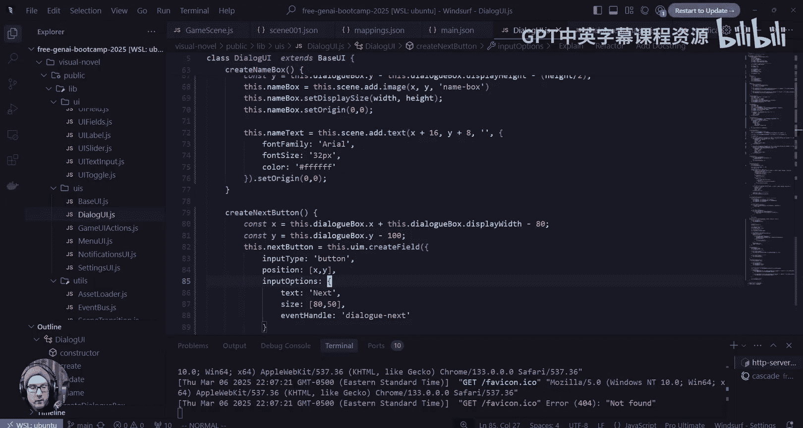

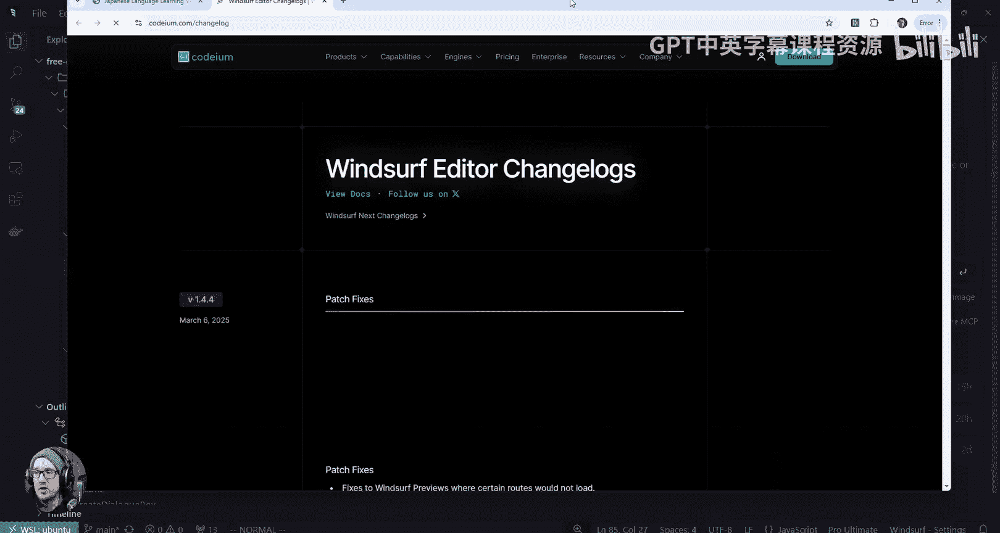

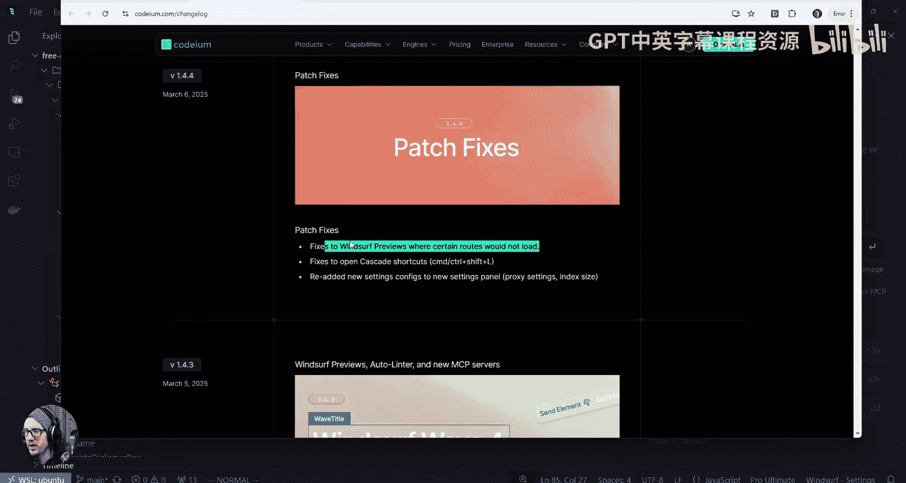

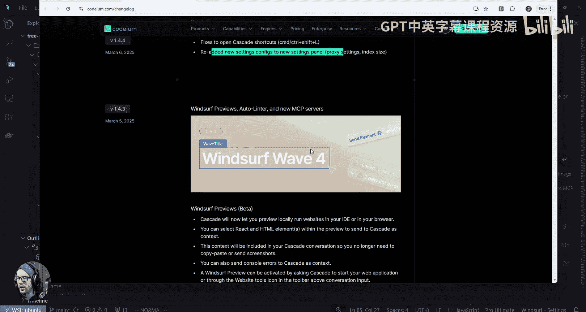

What's the stuff that's here， So we Cascade will now preview preview locally run websites in your ID in your browser。

 I'm not sure how to do that。 You can select reactact H elements within the preview to send cascade as context so that's interesting the thing is we're not doing react so that's not going help us the context will include cascade conversation so right now for what we're doing that's not going help too much because we are working in phaseer but it is interesting that we can do we also have MCP。

 all sorts of things that are loaded into this platform， but anyway。

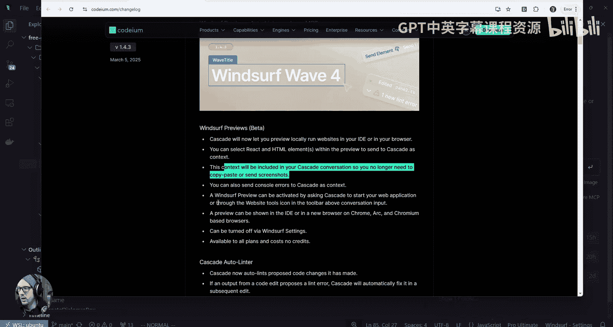

I'm going go ahead and get to it here。 So we have dialogue next， and then we want to register that。

 which is fine。 That's already happening。 But we need to actually react to what's happening there。

 And I think that know where we should be putting these events is in the scene。

 So anytime we have stuff， we should be putting them the scene。 we already are doing that。

 But we need to put in that next progression of this do dialogue next， which is perfect。

 And so here it's doing that for this do dialogue next。😊。

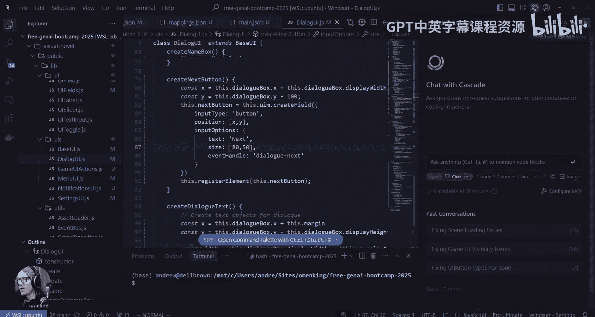

Dialogue。Next。Like this。Okay。And so， we want to progress。The dialogue to the next step， right。

 So if that's the case。嗯。You know what does that， right？So I thought we already oh。

 it's already trying to fill that in the next part here but。We have our。Dialog manager。

 it seems like our dialogue manager would be the one that progresses it next。 Yeah， so next dialogue。

 right， So yeah， I guess that's what it would do。 It just literally we call the next on the dialogue manager。

 And so we'll go over here。 Do we even have a next yet。Manager， we have dialogue。

 dialogue is just so inconsistent with the naming。And so here we have next dialogue。

 it says advanced dialogue。 Is that even in here。So we have advanced dialogue， next dialogue。

 So which which do we want to call it next to advanced。Because it's the same thing， right。

 next dialogue。We also called the wrong thing。 So this is actually advanced dialogue。Advance。

I don't think we have to even write the word advanced dialogue。

 it's pretty clear what is's going on here， advance。So advance to move forward， right？

If we look into here。If this dialogue is complete or this is the choosing option， then return。

I'm not sure about those。 I'm gonna just take that over for now。

 Get the current node for the dialogue。 We have。The current node already， because。We have it up here。

 The dialogue data is here， and we have the dialogueg I D， right， So that's not Well。

 we have the dialogue node。This contains。Contains all data for the current scene。

Should really be called scene data， right， dialogue data？Yeah， that's not what it is。

 it's really seen data。But that's fine。 so this contains all the data， all the dialogue。

Data for the current scene。Right。This is the current scene。

I'm just kind of organizing this so I can see for myself what's going on here。

 but we'll take thetyping effect out of here， this is the current dialogue right。

 this is the current dialogue node。Contains the character names and IDs， right。

We use the scene ID to get the correct。That's not actually true。 This。

 This is actually used to load the scene in。 But for the dialogue data。

 we use the dialogue I D to get the node， right， So here， right， we can go here and say like。

 so dialogue。Data。V the dialogue。I D。Is gonna is going to equal our dialogue node， right， So that's。

So， seen。Right， so that。That should make sense there。

 So the idea is that the dialogue idea is what is progressing next。Okay。

 so we need to go look at our data structure over here on the left hand side。Sorry。

I will go into scenes 0，01。 So we're here right now and then it says default next I。

 So what we're looking for is whether there is a default next I。 So here。

We already know what our node is because our node。Is this。Dialogue node。Right， and so from this。

We have to check default。Next I。 So if it has it， it's interesting。

 we have like underscores and then title case， and I'm all over the place here。

 it doesn't matter that much。And then we have a bunch of other stuff。

 So I'm going to ignore all this other stuff because it's just kind of getting way。

 But the idea is that we want this。Next one to be the dialogue I D。And then this dot dialogue node。

We want this to be。This。Dot。Dialogue。Data。Dialogue noted And so that would advance to the next step。

 right。So that's what we would need。 There's obviously more going on here。 So get the current data。

 so。This is advanced。Based on default。Next ID。So really it should check like first。

 like do we have a default next ID and if we do what we should do because we have to down below here choices right。

 if there's choices it goes to the next ID right？And so there's a bit of a logic that's following here。

 you know， these ones here， next next， they're going to the same thing， we're specifying them twice。

 but they could go to other places。So， you know， here it could be that。

If there is a default I goes there and these ones go to other paths。

 I don't know why I did it this way， as that's not exactly how I'd like it to work。

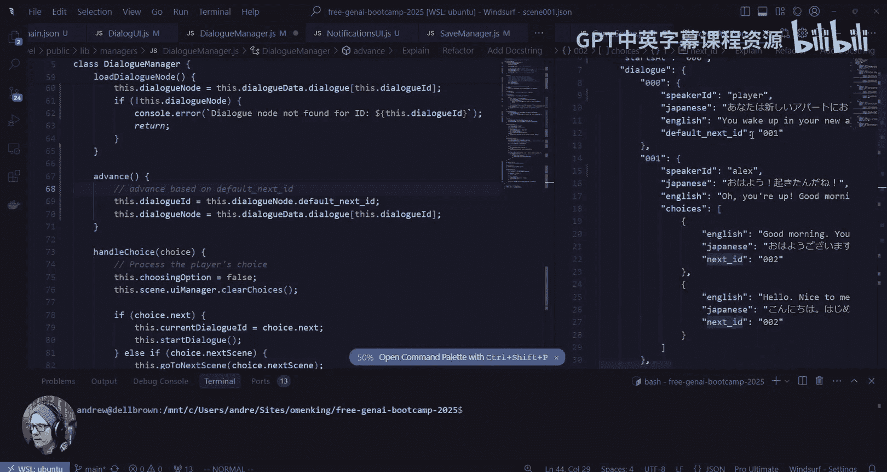

but we will， I don't think that's how we define the logic。

 let's go over and take a look at our documentation。And see what we thought we wanted it to do。

So we go to Story structure MD。Right， and so we have here。Choices next I D， Next I。

Next scene ID down below here。I mean， we don't have to tell whats seemed to go to next because it's supposed to know that based on whatever。

 but it depends because if there's branching， that could kind of affect it， right？

So we have default next I， and then we have choices there。 I thought I had another one here。

 like we have default next I。Choices。English， Japanese response。Right。And here。

It would just go to the next one。 So yeah， I think that the logic here is。

Go back over to here to our dialogueog manager， the way we wanted to actually work for advancing。

If go to next scene。 That's not。We have advanced， so the idea here is that ignore that here so。First。

 check if there are choices。Right。And then once we check if there's choices。

And I don't want this here。If there are。The thing is like， if， if we're advancing， we might be。

Because the next button is specifically passing it to the action that is occurring， right。

 And so we could be very explicit about what action is actually happening。 So in here。

 we could literally say like action， right？ So the action is what is it doing。

 And then the value is something else， which could be null。RightAnd so here。

 this can make it a little bit more clear。And。If we go back over to our game scene here。

 now I can just say next， so this is just saying do the next thing， right？

So if we're doing the next thing， then this is just going to advance the next thing。 So if。Action。

Is next。Then we just want to advance it。Advanced， based on the。This one here， right。

 so we'll go here。There we go。Now， if the action is choice。Action is choice。

 and this is where we're going to have something a little bit different。

So the idea is that if you choose。Based on choice here。 So here we would select the dialogue。

The value here is the， in this case， the value here is the。It's not the。Dialogue Id。

 because I don't know if we define choices， did we。 Let's go take a look here。

I we go back over to our story structure。We don't define which one it is。 It's just position， right。

 So value in this case。The choice is a boan， is an integer。Is an integer here because。Here。

It would be。just say constant choice or， constant choice。This is going to be the dialogue ID。Choices。

Value， because that's what it is。Okay， so that's how we get。That there。We are assuming the choice。Is。

An integer， okay？And so we get that back。And if it has。A next I。 So then we check So we say if。

Choice。It's a bit tricky here because。We have what they say。Your choice， you click the choice， right？

 And then if there's a response， we need to show the response， right， So you know， if there'。

 so we'll just say like， if there's a response， if there is。We need to show it。If we are advancing。

From response。Let's check for next ID。Otherwise， fall back。To default next I D。 Okay。

 so we also have to define what actions we have。 So we have the next action。 So that means。

We're advancing， right？Mhm。😊，We have response。We have choice， maybe。

I'm not sure I'm just trying to think about this logically， right because。

If you have that next button， if you press that next button， the next thing that you need to see。

Is that now， but we could check earlier on to see what comes next。

 but I think really what we should be doing is determining the state that we want to set it to。So。

There's another thing that we need to consider， which is when we're in a node。

A node has to have a node state。Right。So well go back here。Noode state。

When a current dialogue node is set， it has a state。Okay， so we have。嗯。I mean， there is a choice。

But the thing is， is that the。Like the choice is implicit， right。

 so the idea is that we are presented with text。It's the current person speaker， so who's speaking。

 it's the speaker。Its response。Current speaker。Respons。It just say speaker response。

 So there's those two elements， right。Because you're going to see that speaker text。

 youre going to see that response。What do think about like， okay， I'm a speaker。 And so I'm。

 I'm going to advance， and I'm advancing to。The next thing and the next thing could be the response。

And the response can go back to a speaker。So I think that's the two that we have， maybe。Anyway。

 we'll just keep working through this and try to figure it out。

So we're in the dialogue manager right now， and I'm just going to go and close out these here on the side so that I can split this and go all the way top。

 And I think that we need here this dialogue。State is null， right？So that's the first thing。

When we first load。Our dialogue and set our dialogue node。 We also have to set the dialogue state。

And this is， I don't know why I' showing and give any parentheses here。

And so we go to dialogue state。Yeah。Oh my goodness， it's so hard to write it over here。

 but I'm going to go just scrolled on down here。See how the editor gets in the way constantly it's very frustrating。

 but the point is is that we need to set the state to something。And when you come into。One。

 it's going to be the speaker right， we don't care who the speaker is。

 if it's me or them because that's inside the node， it and identifies who it is。But right now we are。

On the top level of the node， we can also think of it another way where it's just like。

 what does the node look like and what step are we in inside of it。

 But I'm gonna call it the speaker step anyway。So。If we are advancing， our action is next， right。

And our current state。Is。嗯。Speaker。Right。We need to check。

Whether there's a response because response。Go back over to our example code here。

This is here our story structure， right？So speaker default speaker choices。

I think we have choices here and we have response。 I don't show it here。

 but this is choices with a response embedded。 The thing is that if we have a response。

 we don't need to embed it directly because the next thing is going to be the response， right。

So it's only in choices where we're going to have that。

 So the only thing we ever have to check on when we're doing a next is if it's a choice。

So if we're next。The next action is only going to occur。If we see it or not。

 but the thing is if we see that there are choices， we're going to then render them out， right？

This is tricky， A， but let's just focus on our next action because this one is pretty straightforward。

So I'm gonna just focus on that one。 and I'm going to go and make sure our app is running。

 It's probably is running。 But if it's not， we'll go ahead and make sure it is。

So we're gonna go into visual novels member。 I restarted the the app here。Right。

 so now I'm going to go back over。To here， give us a nice refresh。And we'll go into our new game。

 I can take my hat off now it's starting to warm up。O。We'll click next see if anything happens。🎼And。

I mean， it did omit。🎼But we didn't see any kind of change occur。 So let's go in and make sure that。

Something is actually happening here。 So I'm going to call console log advance。Advance。Say arguments。

 right。And then I want to go into。Game。Seecen here， where is it？And I want to。

Check here because this is supposed to but get called， right。Now。

 this is no way that's the correct name。 It really is U I button dialg next point down。

 That is the actual name of what it's supposed to be。 So we'll go ahead and fix that there。

And so now we have that。Dialogue next。 I'm not we have next dialogue or dialogue next。

 whatever it doesn't matter。 so now this actually should call it because we didn't have that before。

So， we'll go ahead and。We will。Check that out。So give us a nice hard refresh here。We'll hit new。Next。

 we get an error perfect。 It says property undefined。Reading advance。

 probably because the advance is not set correctly here。嗯。

The the advance here is going this dialog manager， it can't do it that way。

It has doesn't have context， so we have to do Ev。ce dialog manager and that's how it's going to access the dialog manager。

If that's what it's called here， it is good， we're going to go back over to here。

We'll give this a nice refresh here。We'll click new。And now we'll click next。 And look。

 it went to next one， Ohio Caaias。Ohio， I said ohはよございます。 But says Ohio okay。😊，🎼おきたん起きたんだだね起きたんだね。

And the next one fails because I don't know。Okay， get the Japanese text。

 Maybe the next one doesn't actually exist there。 I'm gonna give us a nice refresh here。

 It'd be cool if we could somehow visually see what was happening in our story in a lot of video game engines。

 they'll actually build on a debugger so you can exactly see what's going on。

 And I could see that I could see having like a conversation tree on the right hand side and visualizing exactly where we are for debugging purposes。

 But。😊。

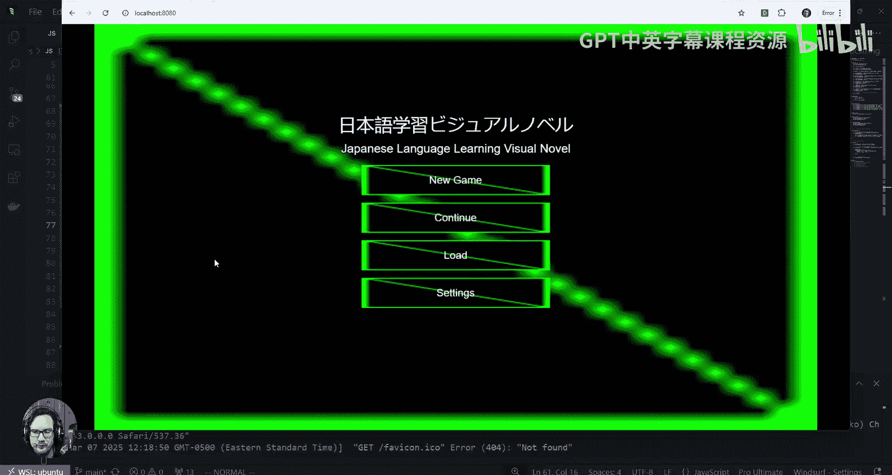

For now， it doesn't matter。I'm going to go ahead do a new game so you wake up your new apartment。

 the moonlight here will click next， so that is good and then we hit next and here it doesn't want to work so let's go take a look at our data to see why that might be。

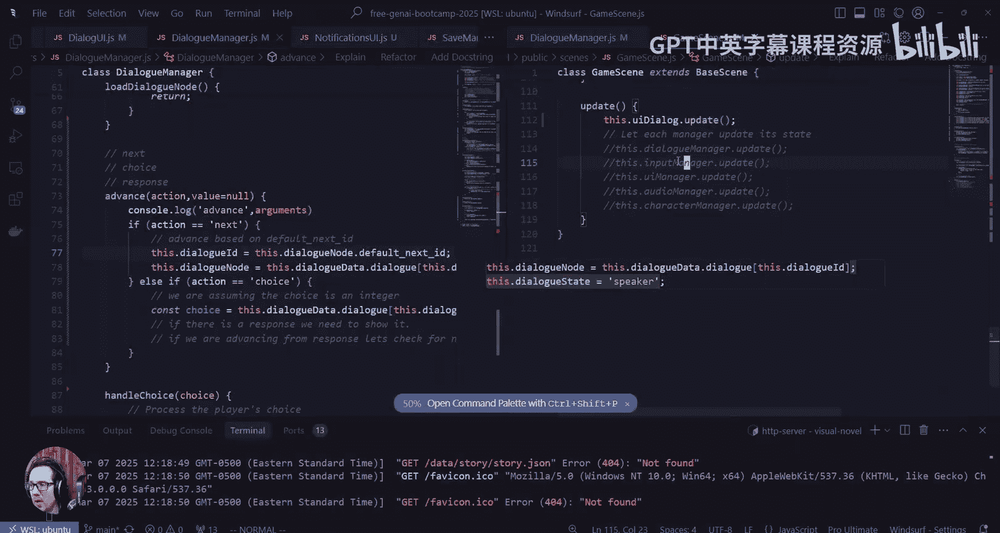

So I'm going to go back over。To our， our thing， it's kind of cool。

 Finally getting something kind of working。 We have 0，0，0，1。 And so here。😊，We see。

We see that this played， and then that was the next one， right。 So here we have speaker。

 Japanese English。And then we have Japanese English。 So I'm not sure what the problem is。

 is's clearly here。Right， but we go over to here。It says cannot not read property， get Japanese text。

So suggesting that this node。Has no。Current text。 So I would say that wherever， I mean。

 this gets called。On every call I think， so I think it's like every time it tries to do text。

 it tries to do that。So I'm gonna just go ahead and I'm gonna to put a break on this。

 I haven'vet been doing that， but you can just put brakes on stuff。

 and that allows you to look at stuff。 I don't like doing brakes too often like that because it can be kind of a headache。

 But that way， I don't have to like， put a console log in。And so。

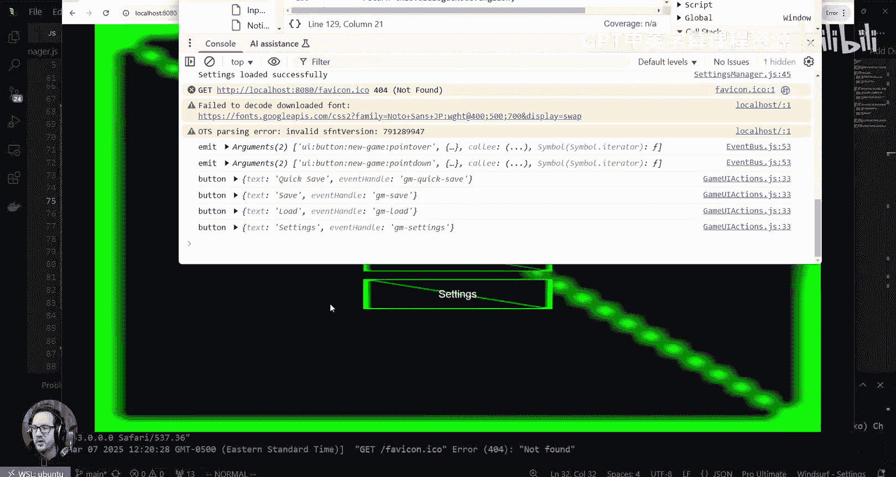

Notice that the brake has stopped。So here， now that we have the break。

 we have the context in here and I can actually go and debug it。So， I can say。This dialogue node。

And then we can see like this is the node that we're on right now。 So that's what it is。

 We will let it advance。

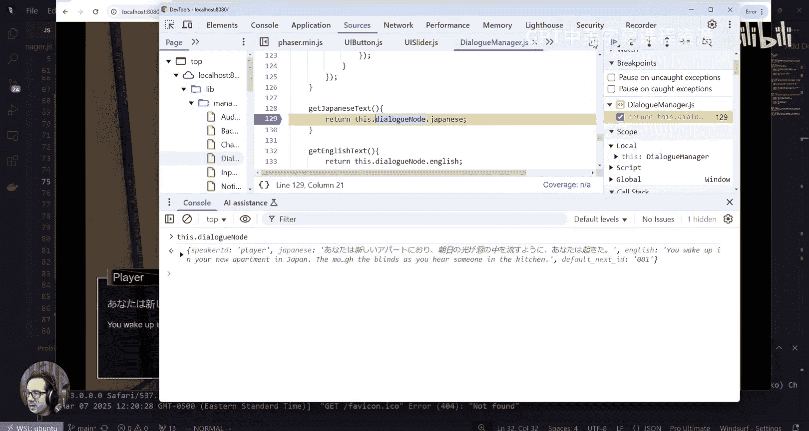

Okay。But notice like every frame is going to call that， which is kind of a headache。

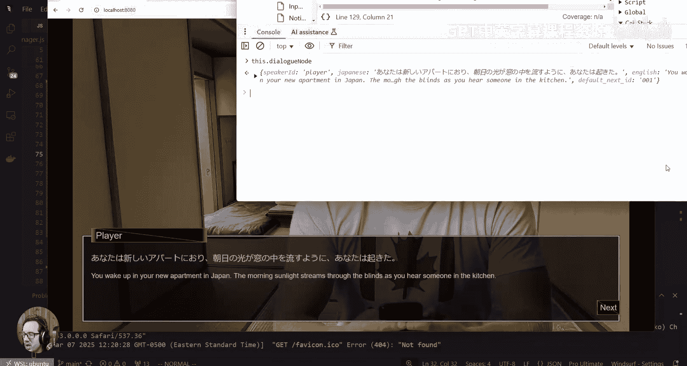

So， I have no way。Of advancing it， right。 And so that's not going to work because it's just looping too fast。

 I'm going to take that break off。 I just clicked it， just click on and off to take the break off。

 See like that。 And so we'll just give us a refresh here， because that's not going to work for us。😊。

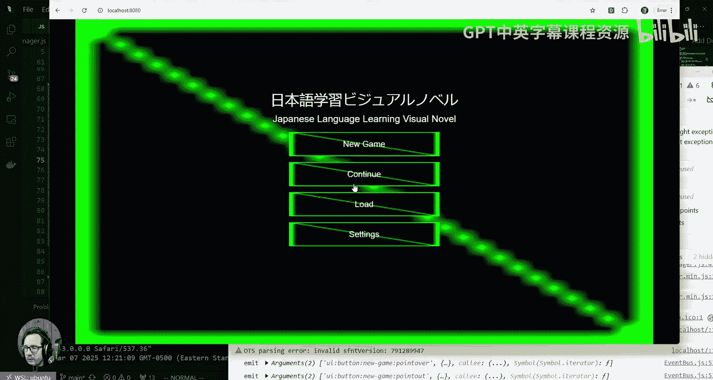

嗯。So clearly， there's an issue。

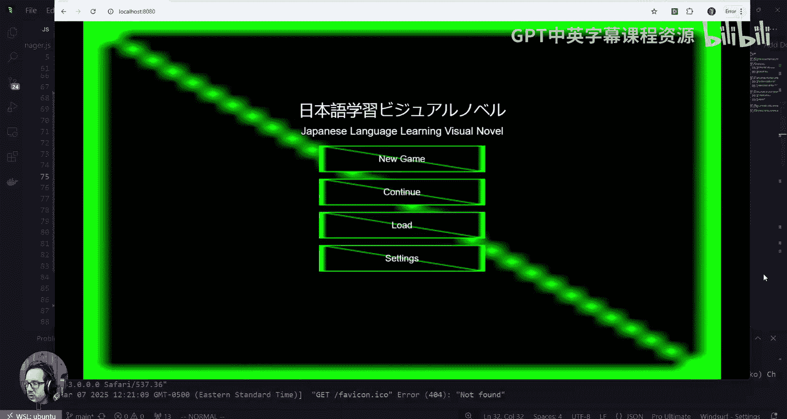

When it changes out the node。So when we advance it should go to the next node， the default next ID。

 so maybe there's an issue with the default next ID， we go here， default next ID， good。

 the next one doesn't have one， right， it has next IDs and there's no default next ID。

 so if there's no default next ID it should really error out here because that is something that has to exist for this to work。

So we'll go here and before we actually even set it here。We should set a temporarily dialogueg ID。

No dial， I D。Will equal。I guess we can。 We can do it this way if we wanted。

 I just didn't want to make it super verbose。 So we say if。This dialogue node。

The audio completion is terrible， I think again， it's because I've used up all my usage。

Let me take a look here。U。Previ user prompt flows。Pre and flow credits。

I'm gonna go ahead and just close that out there。 So we have here。 Yeah， the default next I D。

 And so it should throw if it's not there。Okay， so。Check。If dialogue。If have default next ID D。Exist。

 if not， throw an error。Right， so here。If it doesn't exist。It should throw it there。

That's where we will get that。And yeah， it should return and not do anything else。 If it does exist。

 it's going to proceed forward。 So the next thing is like。That's if there are no choices。

 but if there are choices， that is something that's going to matter。

And the next one does have choices， but we don't render those out because we're always showing that next button。

 no matter what。So we should only show in the next button if there actually are other ones here。

 but this thing is good to have in here。 so we're going to go。Back over to our dialog U I here。

 And it's only supposed to show the next button。In certain cases and so。The way we can do that is。嗯。

We could say， like。Is next。So， here。I mean， technically， yes， the dialogue speaker has to be that。

But it actually has to be more specifically return。This。Dot dialogue。Data。Choices。Length is zero。

 so if there are no choices。Then the only logical。Choice to is to advance。The dialogue， right。

 because what else could there be， right， that's all there could be。

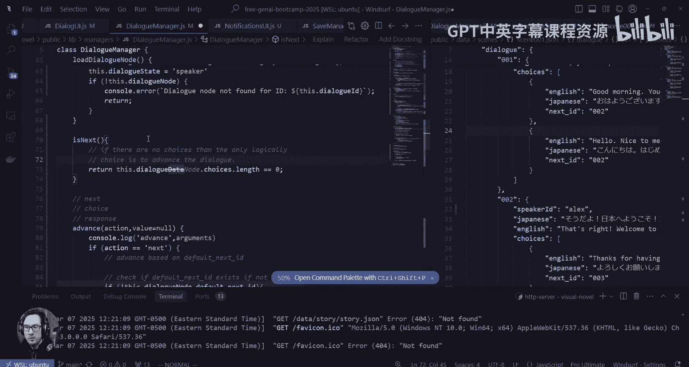

So。We will go。Back to our dialogue， U I。Which I hope that we last time made it a bit easier to have the dot we do we have D。

And so we're looking for where the next button is rendered。

 So where we want to change that is in our update。ve been we should really be using our update here。

So。If。This D is next。They will do this。And。I mean， I guess the other thing is we could say if if is choices。

 right， So if choices。Is greater than 0。So。If there are choices。

 because then we always just just show the default by default， Right， So we say if choices。Else。

 then do next。And so， here。It says show next button。

 but like we should have direct access to this button if we find it here。

We have name box Next button。 It is assigned to this dot next button。

So we want to manipulate this button to show or to hide。So， then we'll say。This do next。Button。

And we'll say。It says visible on there， but that's not what I wanted to。 I want to set visible。

To false。Otherwise， we want to set it to true。Right， let's go take a look。Yeah， that's right。

 Let's go take a look at what this returns， because this returns should return a the crate field。

 right。So we go into our U I field。Mhm。Set position， we actually already have it。

 so it's already here。So that's perfect， we don't have to do anything， we are in good shape here。

So just close all these tabs out。Give me a second here。Alright， what were we doing， I forget。

 I forget I paused。 There was a reason I paused， but。嗯。😊，I was going to look up something， I guess。

I think so。I know we're working on the update function。 I don't know how I forgot what I was doing。

 We're not going to do the typing effect。 I don' I don't want the typing effect。

 So I'm getting this out of here。 It's not I know games have it。

 but I don't think it's going to work for me。And。Here， I don't。 This is it doing choices。

 It's not going to work for me。Best choice stuff here。 It's all old code。

 It's not going to work for me either。 We don't need this。We don't need to clear choices either。

Create dialogue text。That we live alone， yep， that we leave alone。

But Lisa will get some cleanup here so now。Come on our update at the bottom so it's easier to find。

 but。Anyway。Set visible， false， set true， so this should already work， right？We should go。

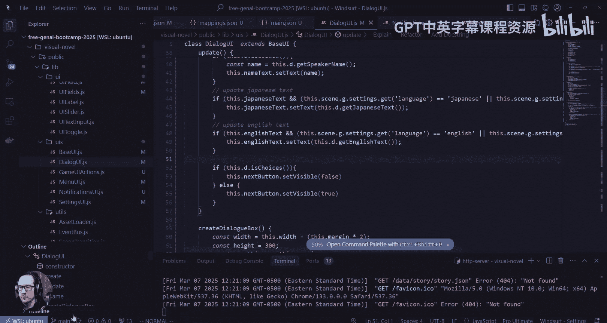

Take a look here， give us a nice refresh here。And we'll say new game。

Says undefined property of length。 So it's having a bit of an issue here with the dialogue manager for is choices。

 which is fine。 We will。

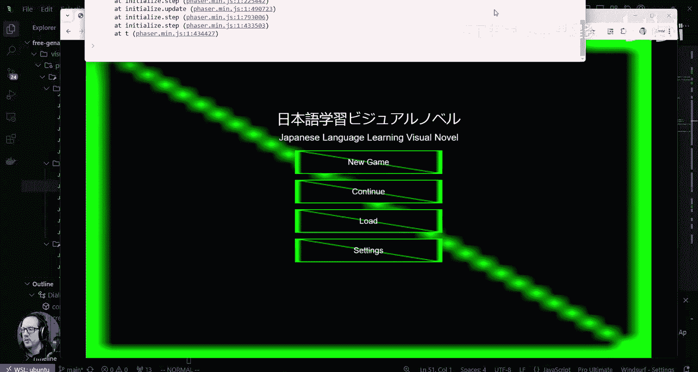

Go back here。 I didn't think that was the correct check。

 but I feel like it would give a bit more to it， but。Didn't complain。Dialogue manager。

 dialogue manager， so in here。We do have this dialogue node。WithThe question like， if there are。

 yeah， that's what we need， if there are choices and if so， is it greater than that number。

 and that should resolve that issue possibly。

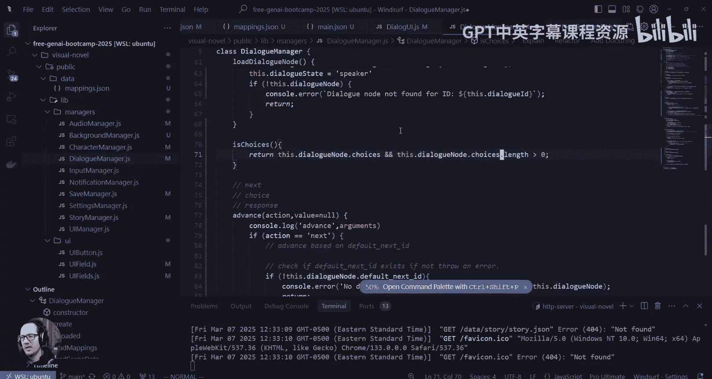

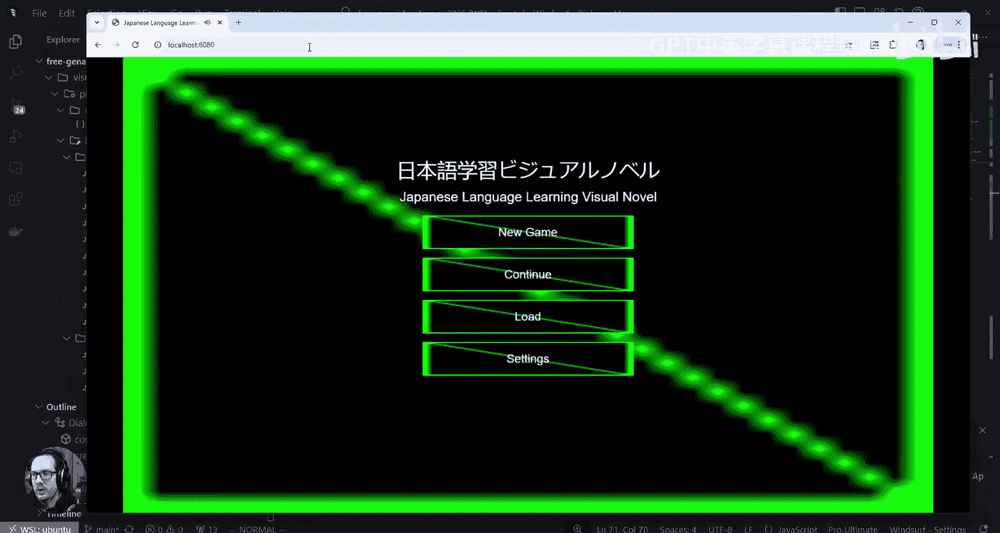

Do this a nice refresh。 so what we're hoping for is not to see on the next one， the button。

 And so now we can't advance it and cause a problem， right。

So now what we need to do is actually show our choices。嗯。Yeah。The the other thing is that， you know。

 again， I saw this other interface that I kind of preferred and I almost think that like not having the big box here could result in a better dialogue system。

 but for now we're going to stick with it， the only challenge though is that if we have four choices。

 how do we have room for those four choices？Right， because it has to push this text up。

 And so our box now needs to fit the size of what it is。

 So I'm all I'm very tempted to get rid of our actual box。 And if we do get rid of our box。

I think that our lives might be a little bit easier because that we don't have to。

Try to manage the size and everything like that。 So I just said I wasn't going to do it。

 but actually I'm going to do it And what I would like is I'd like it so that behind these texts that there is like a dark gray area and then the idea is that if we have options we can kind of push them up。

And show them as buttons。Yeah，'s what I'm thinking because I don't want to have to resize this field based on the size。

 right？So what arem going to do？Is I'm going to go back to our dialogue U I and the thing that I'm gonna to get rid of。

Is the actual dialog box here。Take a look here。 The other one looks pretty nice， though。

It looks like its like a light gradient。But。Anyway， sorry， I'm getting too nostalgic for the box。

But I'm going to go ahead。 I'm not going to completely get rid of it。

 but I'm just going to say get rid of this like that， right？ And so now when we go here。

 we'll just have。

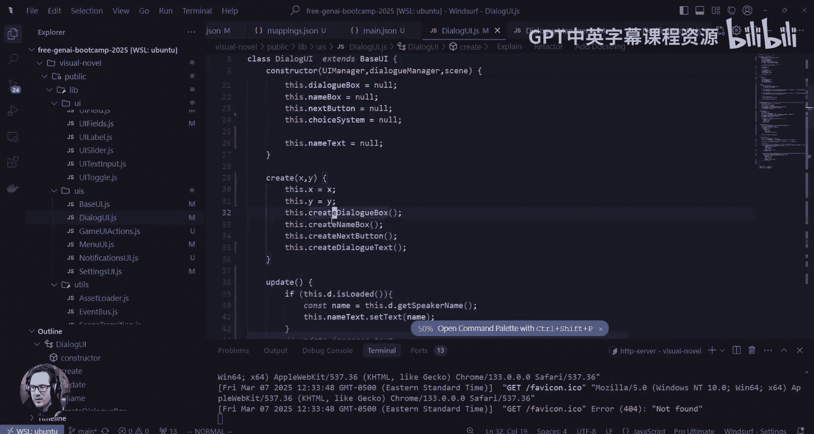

Oh， it's complaining about X。

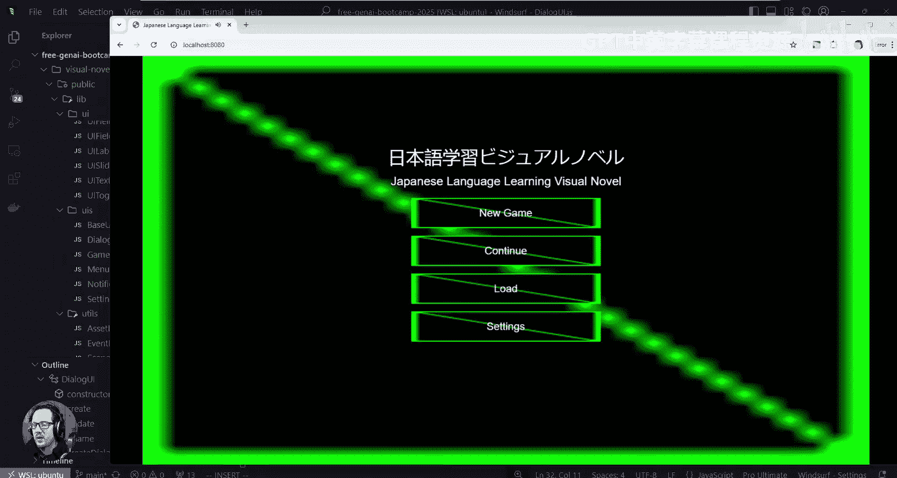

Because the other ones are are reliant on that box。 That's probably why。 Yeah， yeah， yeah。 Okay。

 So it's not as simple as taking the box out。 So before we take the box out。

 just in case I regret taking the box out， I'm gonna go ahead。

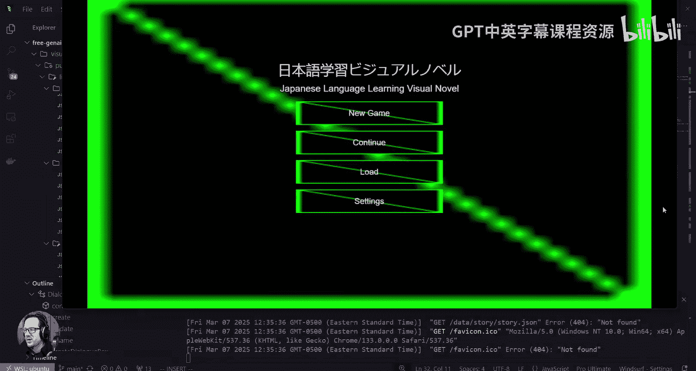

And。Update our code as is and just say， you know， more， more work in progress。

Let add all of it to the party here。And so what I'm thinking， yeah， add more。

Please just add it in there。 So what I'm thinking here is。I need to。Yeah， I。

 I really tie things to this darn box。I don't want to be tied to the box。

So we're just going to rip it out。 So I'm going to go here and get rid of this。

We'll keep the name box for now， I'm going to get rid of this， I don't want it。

And so now we don't have the dialog box。So the idea now is， instead of。嗯。

Instead of the way that this， I mean， like we have that rumor， we， we have that fields Ui component。

 which is basically a way of gathering things and a list either horizontal vertically。

 That's actually perfect for this because then we can stack them all together。 So instead of that。

 what I would like to do is create， I guess that。 And so I'm gonna go here。 And we' just say。

 you know， create fields container to contain the。😊，Dialogue。

We can call a dialog box with the dialog。 So we have fields container here。

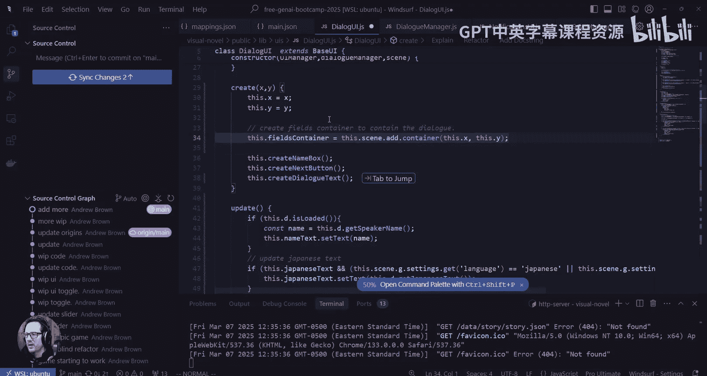

This scenes that's not it。It's being really dumb， I think that again。

 maybe amount of credits or something， but for some reason the intelligence hast really dropped down。

 I don't know why it's getting really really annoying so we'll go over to here to game you my actions。

And。In here。This dot。Whatever reason crate fields， four fields。

 like the other ones aren't necessarily fields per se。 But I think we can add whatever we want to it。

 right， Let's go take a look here。And see。Create fields。Create fields。嗯。Fields U I。Instructor fields。

I mean， a field has to have specific things， so。We have update positions。

 I'm just trying to see if it expects it to be a field。Set position。Yeah， it does。

 I don't think there's anything wrong with that。 We'll just have to wrap everything as fields。

 which is totally fine。 I think that will be， that will work out perfectly fine here。

 So the idea is that we have our fields。 We want them to be vertical。 The origin here。 This is 1，0。😊。

That's for right alignment。 I want 0，1。And that way， it will push this to the bottom of the screen。

TheThe only thing is that would everything be relative to it or？I don't know。 Im gonna leave it 0。

0 for now。 I leave it 0，0 for now。 And here it says this。

 but I'm actually gonna to hard code it to be 0，0， just for now。

As I'm going to try to adjust and fix this， and I actually want to put all of our stuff into our fields container。

 So we do register the element， which is good。And so we have a name box。You know， the question is。

 do we want the name box to show up there because now？Now that we have。Now that we we have。

 if we're going to stack text， we could actually have conversations that go back and forth if we really wanted to。

嗯。Which might be more natural， but。I'm trying to decide here what the best approach is。嗯m。😊。

I'm thinking about it。So I think what I would want to do， we have the next box， but I think that。

What would be better instead of having that is actually just to put it in the front of the text。m。

So like it's， you know， whatever it is， and then it follows with the next name。

The only challenge with that is。Yeah， maybe we could just put it to the left of the name。Now。

 maybe we will have the next box。Maybe we will still have that。

Or what we could do is just always put our name above whatever the field is。

 So instead of having the name box here， it's really part of。That field or component。So over here。

 we have components。 And I think I might actually make something that's called like。

Specifically for our dialogue。A you going to make a component for it。So go here。And。

I'm going to call it a message bubble， I'm actually just going to use a message style of stuff here。

And we're going to go here。 I will say UI messages extends。 That's correct。Extends。

U I fields constructor， if type， yup， you got it， you got it。 That's good。

 And so I think this is what I really want to do is that。I need to represent。

3 things in the dialogue box。 so the。The U I。Message。Is the following。It's a message bubble。

That is colored。Differently。That can have its color set。It has。A label for who the speaker is。

 It has a text。嚟波。Who the speaker is。It has。Text for Japanese dialogue。

 It has text for English dialogue。Right， so those are the things that we need to have here as the next button so that we don't need that。

 No。 So these are the things that we need to render within it。What do we need an update on that？But。

嗯。We need to set a few things here。 So we're going to say this。Dot Japanese。Texas Nll， English。

 Texas allll。Name is null。You don't need name box。But we do need to create the bubble。

 so this dot create bubble。Will be the first thing。 Cate name， Japanese text， English text， right。

 So that makes sense。We'll go down here。So we have create bubble function。We'll have our come on。

 You can do it， create text name。 There we go。Japanese text。 And so now we have all these things。

 So now we go back over to our dialogue U I。We're basically treating it like a phone conversation。

 but phone conversations might be a little bit different。 We have our name box here。

And so there's a lot of logic here， but weird what we want to do is grab out this text here。

So I'm going to go ahead and grab out this text。And we are going to。Paste it in here， right， so now。

We have our text。So that is one thing。 Its like display size and a bunch of other stuff。 name box。

 That's kind of for like the bubble itself。 So we can go here and kind of。So add image。

I don't know if I want to add an image， but I don't have anything else right now。

 so I'm going to just， I guess do that。Oh sorry， so this was supposed to be the bubble。

And then we'll go here，'ll say create。But this has to be actually the size of what the possible bubble will be。

 And this will be。This stop bubble。The background image of the bubble。Right， that's what that is。

 I'm not sure why。Yeah， it's supposed to be a commentt。 There we go。Bubble， right。

 And so now we have。保不。Message bubble。The size will have to get set after the fact。 And so。This dot。

 resize。宝宝。So let's say resize bubble。Resize， we'll say， auto resize the bubble。Based on the。

Contents。Of tax， we need to resize。The bubble， right。So we have arteryy size of the bubble。

 that's something that we'll have to do。We should probably have like this dot max width。And we can。

 for now。It's fine。Constant width equals。Xin dot。Cameras main width， right， So we have that。

 So then the idea is that， you know， maybe we， we only want like it to be two thirds of it， so。

Or maybe just half for now。 I'm not sure what we want， but we'll make it half。

 And so now we obviously have to resize it based on that stuff。

 We need to go ahead and create all those things going back over to here。

 now we can get rid of our dialog box。So we can get rid of this。It's like all that work。

 And Andrews just ripping it out。 That's true。 I'm just gonna rip it out now， and。

We have all this Japanese tax， but really we just need to create。 we'll go over here， so we need。

If Japanese text get seen。If D is loaded。啊。Get speaker name， set text。That's fine。

But these are setting these based on the options that are。It's setting an audit。

 but we have to kind of create。I guess the dialogue elements。So down here is create dialogue。

 So this is our create dialogue stuff。 I'm going to just grab this out of here for now。

We don't need to do this offset thing because it's automatically actually going to do that when we use it。

So we'll go ahead。 I'm just going to cut this out of here。 Cu this out of here。Paste it into here。

And then for this， I'm going to cut this out of here。A going to。Paste it in manually， I know Aaron。

 they placed it in there for me， but I don't need it to do that for me。

And so this stuff doesn't really matter anymore， so we'll go ahead and pull this out。

Next button's fine。 Where it is。So instead of dialog box and name。

 the choice system will take that up for name name text doesn't matter what we actually have is。

Dialogue bubbles。So I need to go make sure I bring this into。Our main index HTML。

 we're going our UI components。It's not having today。Doesn't want to help me here today， U I。

What do we call it。U I message。到9月。Okay， so that is now set， but we need to go in here。And we don't。

 we don't want those in there。 we don't。But we need to think about what elements we need because。

You know， now we have a way of。You can have like a message from somebody， then you make a choice。

And then it shows a response。Or， you know， do we show a bit of a history And it's kind of like a rolling history。

 And that way， we don't actually ever have to completely clear out the screen。

I think that would be kind of interesting， having like maybe a rolling dialogue。So。

I think that's what I want to do， I want to have like a rolling dialogue because that way then it never kind of over over builds up where we can kind of limit the amount of text that shows up on the screen。

Okay， and so that's what I'm thinking now， like a rolling dialogue。

But I guess my thought is that if we have rolling dialogue， we need， we do have the container in。

We were making a here， right， So this is not just the fields container。

 This specifically is the message。Messages container。Messages container。

 So can just rename that to messages container。 And so that's gonna have a certain amount that we can have at any given time。

 We don't have a namebox anymore， right， We are not creating that stuff anymore。 The next button。

 Yeah， it still can be there。 I'm just not exactly sure we want to put it yet。

 But the idea is that the next， the message container is going to。Contain a few options。

 So we have a U I message， which is specifically for。A message。 And then if we want a choice。

 we might want to display that optionally， right， So that might be something that we're thinking about。

So the very least， we need to get it our first message。And。That will be what we'll need for。

 so I'm going to go here and say this。Dot。Message。Crame， we're adding it to our container， right。

 So we have our first message。The thing is， is that if we have messages。We have this stop messages。

Right。I'm just thinking about this here。We have our messages here and。Messages。Yeah。

 I'm not sure I'm just going to stick with one for now。

 but the idea is that we have a message and we need to update the message to be what the current thing is。

Right， and so we might want to say like what is the current message？This dot current。Message。

I'm not sure about that， but anyway， I'， I'm just going to leave it as message for now。

And so this thing has to get updated。AndSo here we have is updated。

And I think I would probably rather just load it in one go。 So we say this stop message。

Update like that。And then in here， I'd rather provide it options if we need it。 So here， whoops。

It's been a bit goody here， but we'll say if。Messages， whatever。Then here we would have name is name。

 Japanese text， Japanese text， English text is English text。As we can see it here。

 we can even do this like this dot D dot get。Speaker name like that。So， it's set。That way， I mean。

 it really should only set those if it does exist。 And so maybe what I would do here is just put like aris。

That's what I like to call a Tris。 constantant a Tris。And then we say a Tris get speakerea name。

And then instead of doing this， we'll pass it in like this。Right，And so then only if， if we have it。

 should we do it。 Now， this is not exactly doing what we're asking for。

 I'm going to go bring it up here。And so we'll bring this in and indent it。I need this too。

Only add a Tris dot。Japanese text。Say， a tris。Equals this。Only if it exists， right？Same thing here。

Okay， so now。I'm not sure if our if ourFL statement is a little bit overly complicated here。

 Let's take a look here。 which says if Japanese or dual。I kind of feel like if it was dualed。

 and do both。There might be like a neater way to do this。And Im。

 I'm going to try to do that if it just stops trying to write on me here。 So I want to go here。

 We don't need Japanese sex like that。 It's like， if the scene is Japanese。Then do that。

Can we do a switch case， switch。So case。I don't remember it's not helping me here。

 Let's go find out if there's a switch case in javascript。 I always forget。 You think I would know。

 but I do not Japanese or Japanese jascript switch case， right， So it's a Japanese urge。

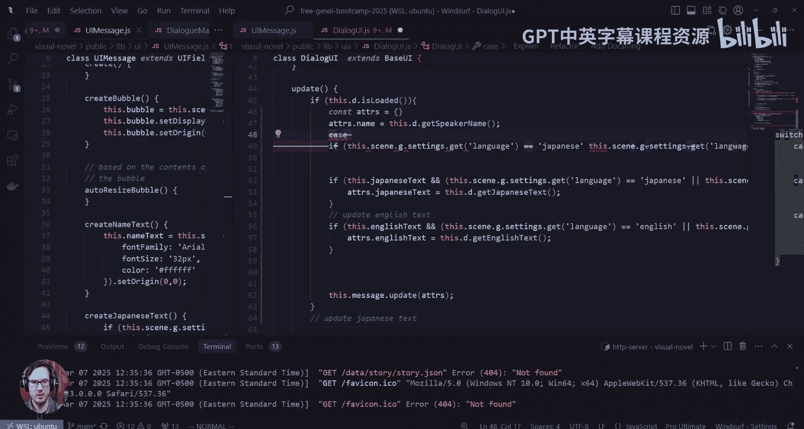

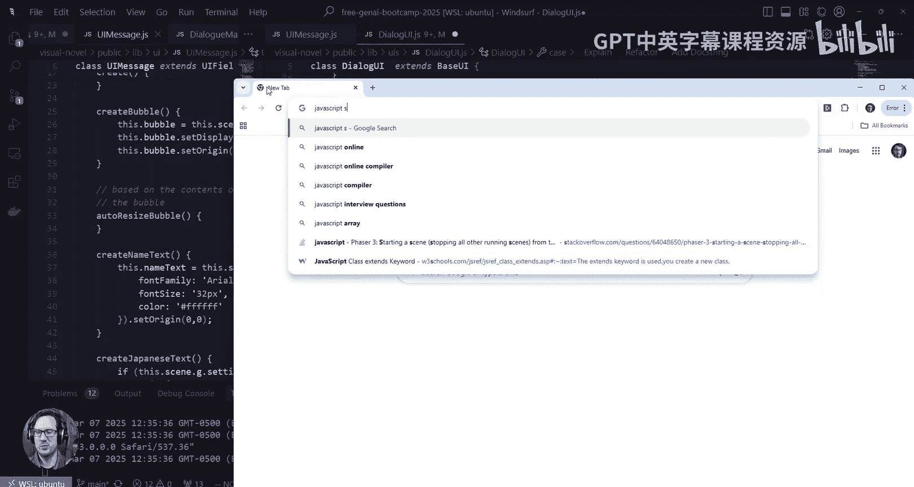

And just keep saying Japanese here。 It's switch case， whatever， whatever。

 So that's what the syntax is。 We'll go here。 I'm gonna say switch。

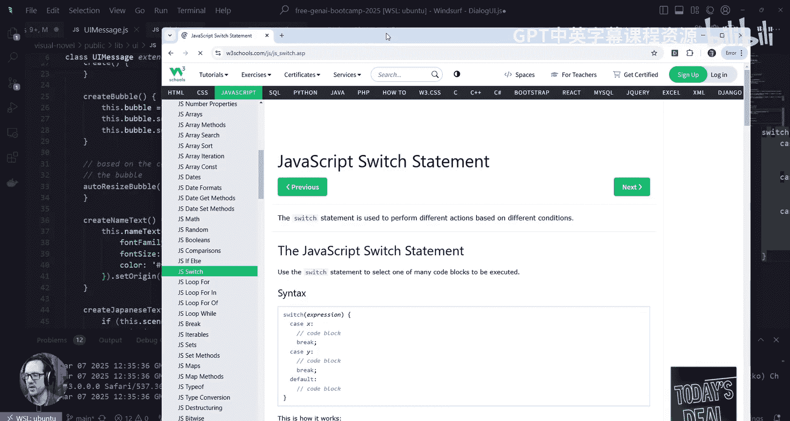

And we'll have the expression。 This will be this dot scene dot G dot settings dot get language。

 And now we yeah， we can have this case， and then we can have。That's right， exactly。Very good。

Take this one out here。English。A Tris。Break。Case stool。And then we have default， which is。

 it should raise an error。 if there's not one there， it should raise an error。

 that's what it should do。 The this is supposed to close there on the end。 there we go。

The case here is kind of complaining， I'm not sure why。

Maybe because the the one here is missing like here， There we go。Sure。

 it's the one that's telling me how to code here， but here I'd raise an error， so raise error。Right。

 so that should raise an error here。 And then we can get rid of。This and so now。

Based on those options， it looks more verbose， but it's just more clear right。

 whatever it's going to do， it's going to set those text and so now based on that，It will。

It will get that for us there。So now we have that message being updated down below here it says if is choices then showed if not。

 show the next button。That is true。But we will go over to here。And。The the thing that we want。Is to。

What is it that we want to do？We want to make sure we put data validation for when we actually update this。

So somewhere here we have an update， right， we don't have an update， but we will add one。

And we'll say Tris。I to say， validate。Maybe these are options。Validate options。 There we go。Normally。

 when we create a message， we like have to configure exactly what it is。 But for this。

 we don't need to define what it is upfront because we don't know what it's going to be。

 We're not going to continuously create these things。 We want to have some defined words。

 Other ones are static， right， They don't change。 So here we have。Yeah。

 it's setting the taxes doing that kind of stuff there， which is fine。

I guess we don't really need to validate it the same way。 Like this seems fine。

 Maybe we'll it alone because this actually is working fine。 So if the options exist。

 then set the Japanese text， if the English one is there， set the English text。

 but it's not just that， it's whether it should show it or not。 right， Because if it's not there。

 we don't show it。 So we say this Japanese text。Is visible。Right， if it's not。Else。

Then set it to false， right？Same thing with this one， if it's not there。We will set it to falls。

The other thing is that I probably just as a precaution。

 I'd probably just clear this out that way we don't end up like let's say it gets shown for whatever reason。

 it doesn't end up showing something we don't want to actually see。

 And so now here it's going to update those， it's setting the text name here， which is fine。

So that's good。嗯。Okay， and then after that， we should resize the auto button right。

 So then say this would be like this dot auto resize bubble。 Okay。

 so this is the stuff that should go through The auto resize button has to take into account。

 the dimensions of these other things。I'm not sure if there's a way to set the max width。

On the actual text field here， so if we go back down to these ones。YouIt's using notto sands。

 which is fine， word wrap， which is fine， we have a width， but is there a way to do max width。

 I don't know？Right， and。The name here， this less of an issue。

But we do have to think about the positioning of。These elements。Relative to where they are。

Max width is this， that's fine， half of that。And so。

Here we create the be when we set the display size right now when we first created。

 I would probably just set it as 00。Just， you know， make it。Make it small。For now。Make it。

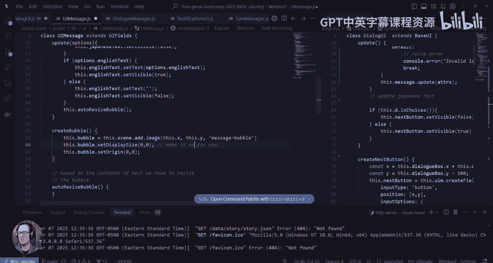

Invisible fordity There we go。 That is what we're doing。 This auto resize has to just say set it。

 but that's not。Based on the content。 So， you know， check the size of check the greatest。

Size of English。You know， whether we need to know like whether the text is visible or not。

 So whether the text is visible or not， you know， if the Japanese text is visible。Let's get it with。

Okay。诶。We don't have to do that。 And then we have， if this is with， and we have that。

 we're not actually setting the width that way。 So just a constant。Japanese with， there we go。

And then we have English width。Here。And so then the idea is that we are setting the width this way。

 So we're saying， okay， which is the maximum width that we have here。And that's going to set。

What our width should be here。 So now we know what our width is。The other thing is like。

 what the height should be。 So we'll go here and we'll just say constant height。Equals 0。

And then if it's here， we're going to add it。That's right， whoops。If it is there。

 we're going to add it。 if it is there， we're going to add it as well。 we'll need some constant。

 We'll have the oops。We need to have the gap， constant gap。Equals maybe 16 pixels。 There we go。

So we're doing that plus the gap， because there's no case where we'd ever not show the target Japanese language。

 We' would never have just English。Right， so that that whole option of like English， Japanese。

 it should， It really should just be dual or Japanese， right。

 You're either doing it purely without the， the other stuff or you have it in there。 It's not。

 we're not gonna split hairs on that。 So now that we have the width。

The width is going to set the width of it， but then the height obviously is calculated there as well。

 so we will swap that out here like that。Okay， so now this will go to the size of it。

 It's not padding it。 Does that's another issue is like putting padding around the bubble。

 But for now， we're just trying to get it generally to fit in the bubble。

 The other thing that's not in here is the actual。Is the actual。Name。 But for now。

 let's just see what we get。 This is gonna be all over the place。 I just wantan to see if it。

 it makes the bubble。All， let's just work the right problems here。

 we'll give this a nice refresh here。

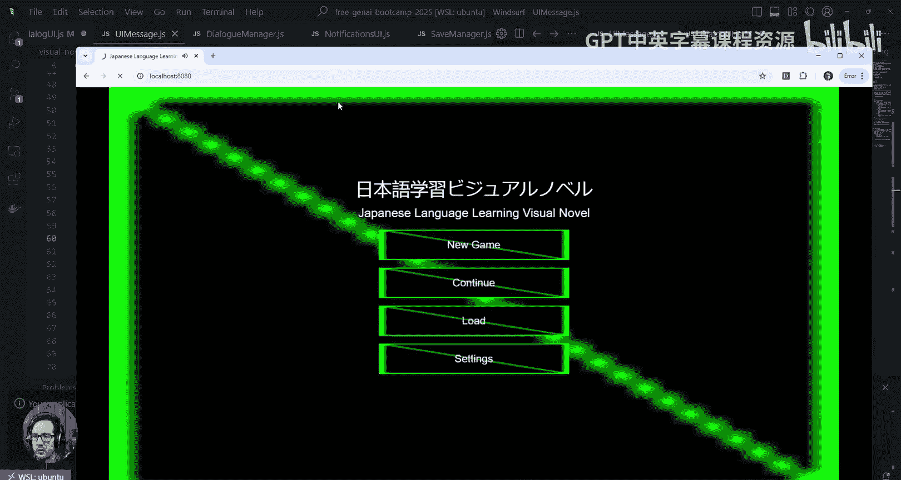

And as I click new and it doesn't work， it's fine。Position is required for our UI message。

 so it has to have。

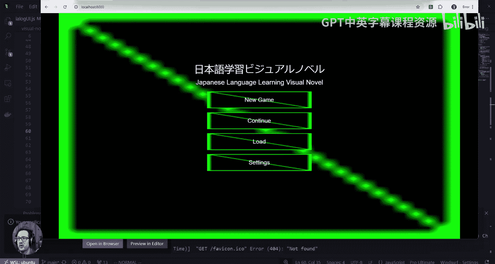

A position。嗯。And that makes sense。 So wherever we did our crate field。Createfield。

In the dialogue UI here， which we didn't say， by the way。This does have a position。

But for the UI message， this is not correct。At least it's not correct。

We don't create UI messages directly。 We actually do a create field， right？

 So we're going to go over。

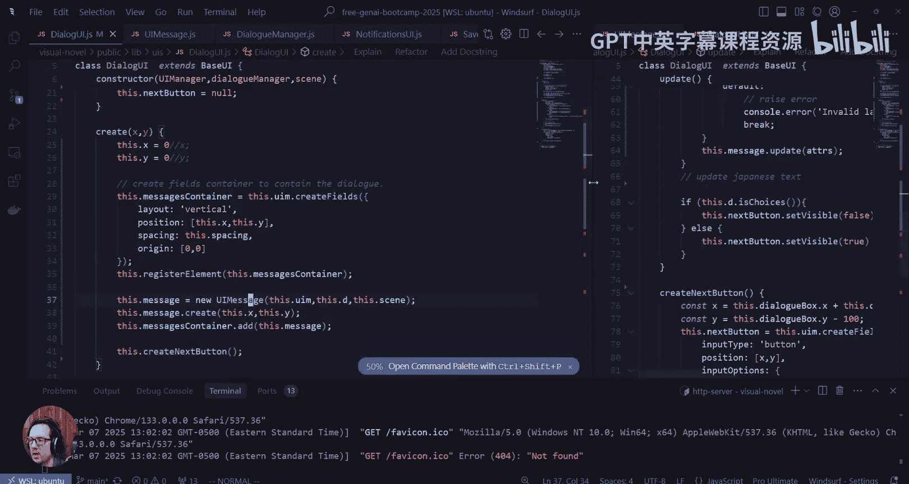

To our createate field， we're calling everything basically a field， but it's not。

 that's not really true。But I'm not going to change the names here， and so I'm going to go here。Case。

Why isn't Bu in here， by the way。Shouldn't button be in here。 Se the larger default basic。

 I'm not sure about that， but I want to go in here and handle the create in input component， right。

 So this is actually what we want。And so here we want to have case。Y messagess。

This will create a new UI message passing in the UI options。

 If there are any UI options for this field， there aren't really any UI options。

That we need to really set。Because this is again a dynamic component。

 so we have to change it based on what is being updated and so there's no need to really do that。

But we need to go back to our dialogue UI messsenger here。

 And so here we're not supposed to make a message。 What we're supposed to do is create the field。

So go back here we'll say， yeah， this dot field input message position。And input options。

 we don't have anything for that。Leave it blank。You know， we don't， we don't set。Options for it。

For a message on create。And so it adds it to the message container。So。

We have this dot x and this dot Y。 the it doesn't need。The position。 So we're going to set at 0。

0 because it's going to get set。The container。Willll override。The settings。The position。

 So we don't need to set it， which is nice。 While we're here。

 we might as well add our create next button to here because that is something that should be added here。

 So instead of registering the element this way， we'll go here and added this dot container messages。

We'll add it that way。The only trick， though， is that when we have our message like our container。

 we're going to want to keep that on the bottom constantly。

But we'll have to figure out a trick to that to reorganize it somehow。

But at the very least right now we have a message and then that thing that followss after it。

 And so now we don't even have to set these positions because this is just going to be 0。

0 right we don't have to do any crazy math。 so the container will override the position。

 so we don't have to do anything for that。Okay。So hopefully， I don't know if you need spacing here。

 but hopefully that will。Resolve some of our issues here， are're going to go back over to here。

 and we'll give this nice refresh。

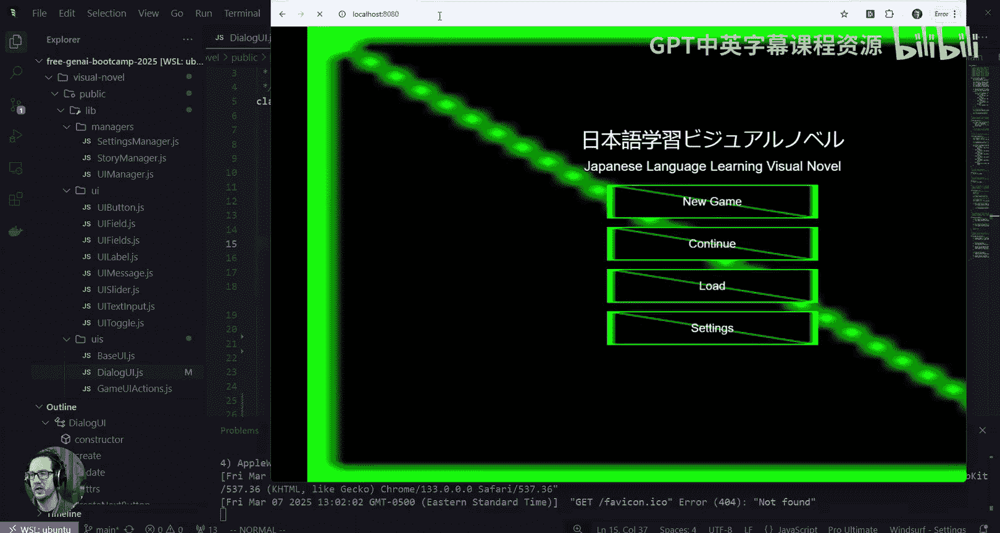

And。I'll go new game。

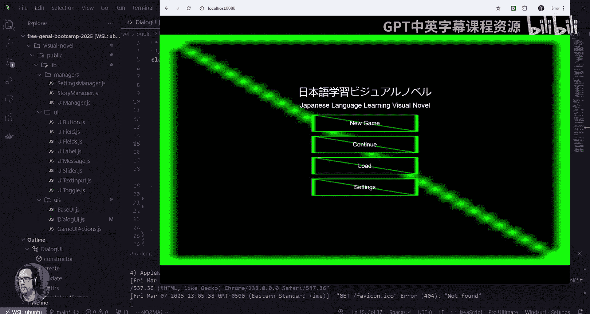

It says，Cannot read UIs camera main， so can't get that in the UI message。嗯。嗯m。😊，And I'm not sure why。

 because the scene is being passed into it unless it's not。

We can go back over here and take a look at that crate。In the dialogue UI。Over here。

And so we go to our。Create field。Right， we aren't passing it here。

 but it should get indirectly passed to it when it creates it。

 because over here is where they said it。 We have the scenes getting set。嗯。

It doesn't show the U I am in here。But the U IM， I think。

 gets passed through thecause when we extend it， we've extended the thing。

 That's where it actually passes it in。 So I do believe up here。

 we do have U IM and seeing causeuse U I fields bring it in here despite it setting it here and not showing it。

I believe that it does set it。Ca the other ones have to do it， right？ No。

 the other ones just have seen。So that's probably our problem。

 We're bringing in the U IM and it doesn't actually need it。

And that's because it's extending the wrong thing， supposed to be UI field。

And so we'll go back to here， does this one need it， to super audit？No。

 it does have a validate options， but we don't have any options to validate。

 So'll take that out there。 and that will resolve that issue there as it probably was not getting the right kind of object or just getting a null object that wasn't being set。

So we go here， we still probably get that error。

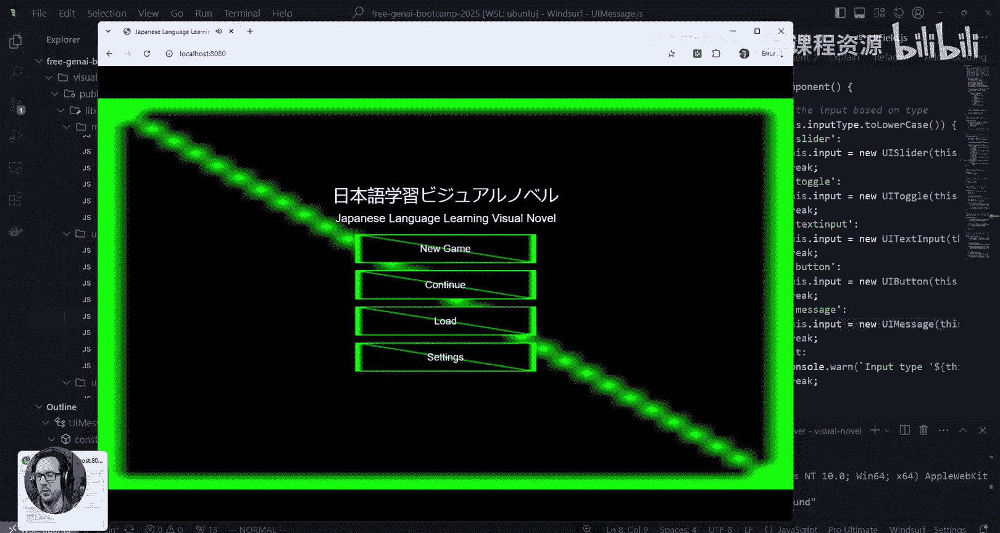

It says must call super constructor derived of class before calling this。

 So I'm going to go back and take a look at these other ones。

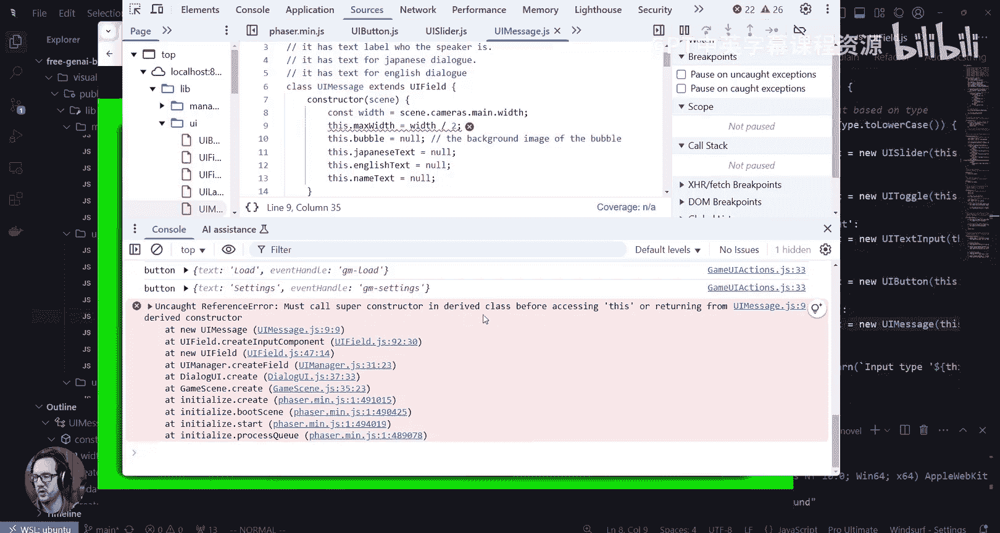

Actually， these other ones don't extend field。Okay， we don't actually even extend anything。

 I thought we had to。 So I'll just take that out there。Ppparently we don't do that， which is fine。

And I'll go back over to here。 I thought there is like common things that we had to set like set message or set visible。

 So we might actually want to create a base， but it's not really necessary with the small amount of components we have。

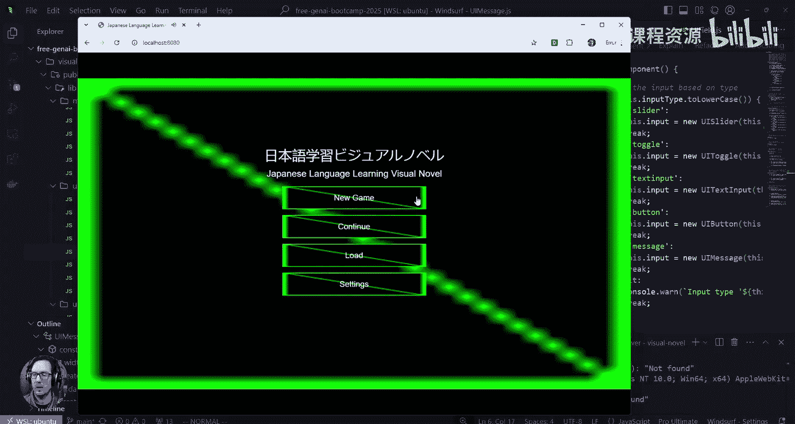

We go over to here， we see that we have message container add is not a function。

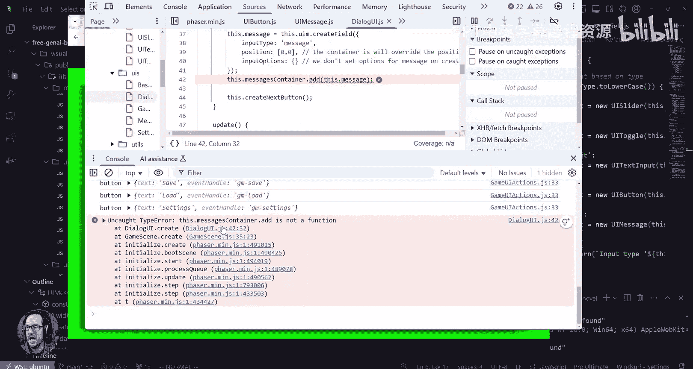

It's really getting frustrating because it's really making up stuff。

 and it's wasting my time when it does that。So again。

 I think it's just because I've used enough stuff and it's complaining。

So we are going to go back to our UI。Label。The dialogue， the UI dialogue， wherever that is。Dialog UI。

 and here's doing messages add。Which is not。Correct。And。I'm looking for。The U I fields。

 So in the U I fields， it has， it's called ad field。 That's what I thought it was。There it goes。

 So now it has it。 Let's go see if there's another one that's wrong here。 This is ad field。

And then we'll go back over to here。It's a nice refresh here。

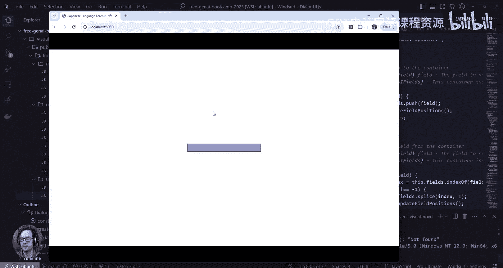

Look click new， still not advancing， which is fine。 This dot message update is not a function。

 So saying that the crate field returned。

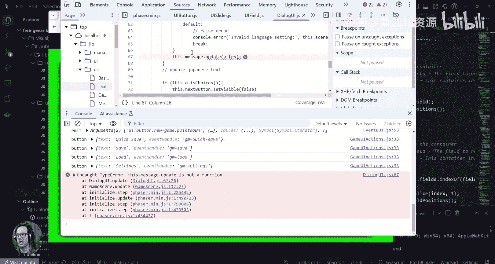

Doesn't have an update。We going to the UI field here。It can create a label which we don't need。

 create input component。Return input。 Re label。Set position。 Se visibility。Validate options。

So for this， I need to， I mean， the set visibility is nice that it has that。

 but we need to access the input。 So go back over to here and。Where it actually does that update。

In our dialogue UI。Sorry。We're updating the underlying input that we've created。We call it input。

 but really， it's just whatever the field component is。So， you know， video games， again。

 they're so hard to make that you have more flexibility the way you name stuff。

 and you can always worry about making them cleaner later on。 We're gonna go back over to here。

 We have set text is not as null。

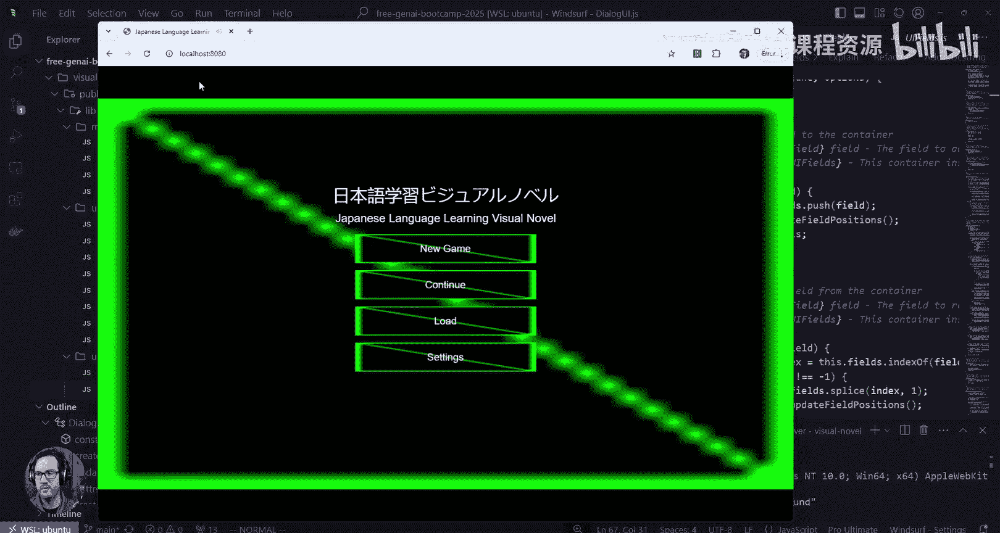

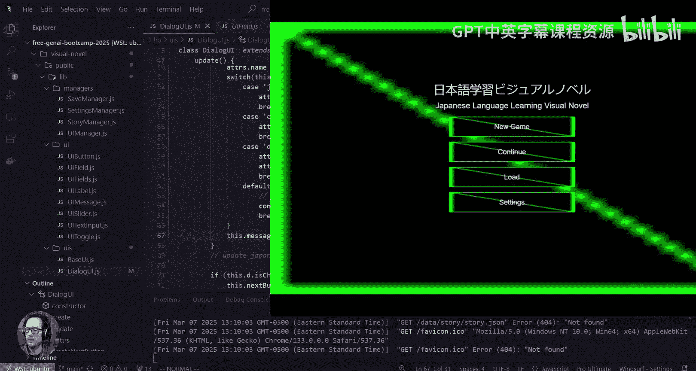

So we'll go over to our UI messages。Are you a message。And we have name text。Okay， and so this update。

 I mean， the creation have occurred。Before anything else， this create should have already happened。

Let's look at our other ones。 Do they have a create call， They have create label。

 This is happening in here。 It's not， there's not like a separate create function。Yeah。

 so it seems like whatever I need actually has to occur in。The constructor here。

 So I'm going to go here and just say create。We don't need to。Set these values。

I'm trying to think about this for a second because I will hold on。This is not our problem。

 Were supposed to go back to our UI message here。Yeah， so here。Yeah， we'll call create like that。

 There we go。 Okay， so that's what was missing。 We'll go back over to here。

 We'll give this a refresh， right， We'll take a look。

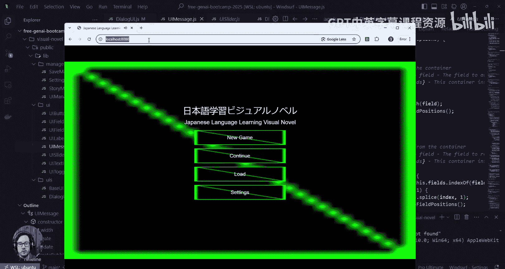

We'll click new， we get an error， we go back over to here。Reading ads。

 still trying to do this darn ad thing。

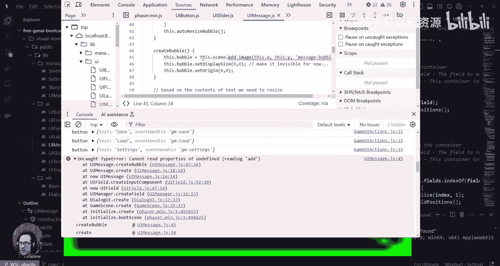

This do scene do whatever， that's because our scene is right here。We should just set our scene。

 this dot scene。I think the other ones do that， right， Do they not， they do。

 I'm not sure why this one didn't do it。And so we can just this dot see here set our max width。

 We'll go back over to here。 see it's very tedious。

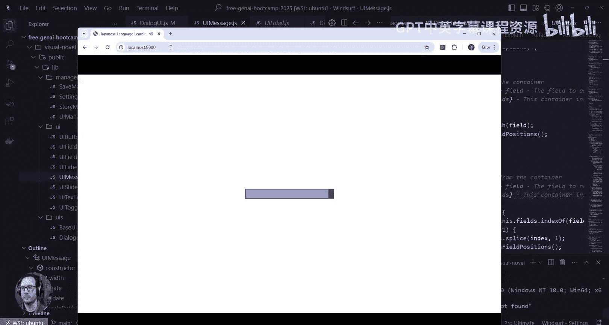

Still not working。X is not defined here in the Cate name text。 Let's go to our create name text。'。

 We're trying to kind of ignore those for now， but we are going to have to fix those。

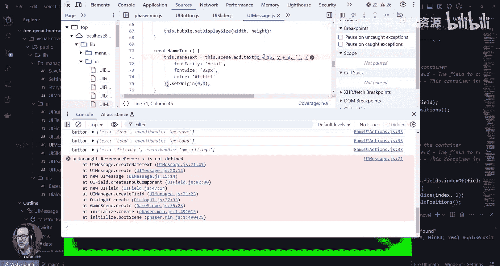

So there is a this and an X X and a Y here。 We don't have it set up here。

When we bring in our options。Right， when we bring in our options。

 that should be setting up something， but we're not validating our options in any way here。

 So let's go back over to this one。 Let's take a look at what they have。

Because this one has an options X and Y， right， It has a height and width。嗯。So。

I guess my question is like， what does that look like if we go into our menu UI。

 so do we need to set that in our options， even though they get overridden。So we have size。

 We have position。Right。So maybe we do actually have some options that are being passed。Hm。

I'm thinking about this for a second。So if we go into our UI field。

 just because I kind of forget how it works。Input options are here。

 So just past the input options here。We have input X and input Y。 and it adds it to the position。

 Okay， so we do actually have a position， and we do need to validate that。

 And so that is something that we， even though we don't set it， it is It is going to pass it along。

And so we do need to still validate our options。So we'll go back over to here。And before this。

 we need to validate our options。And here。It's actually options。Position zero position y， right？

I'm going to go down below here I'll just say validate options。We want to bring in those positions。

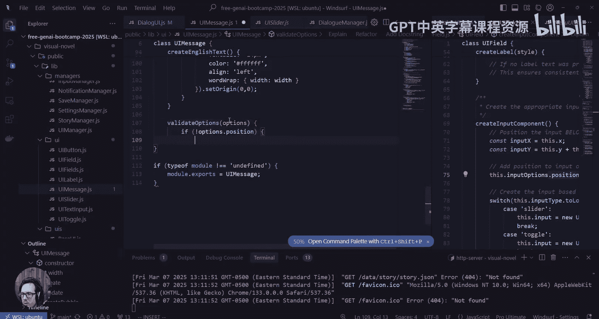

ItsAgain， it's really working slow， I don't know what's going on here。I think it might just be。

 I've used too much。They've cut me off。And so we have this part for position， right？

So go ahead and I'm just going to。Paces in like that。 I'm gonna switch to standing。 I cannot。

it any longer。 so we will move to standing， but we're starting to。

Get closer to getting this element rendered out。Once we have this element rendered out。

We then have to deal with the rolling changes。RightBut all we need is message， choices， next message。

 and keep rolling the conversation。Until it ends here。

But at least I'm glad I know what UI I actually do want to have。嗯。Because that other one。

 I didn't know what to do。 I'm going just to turn the lights off here。

 they're blinding me when I'm standing。I realize we're an hour in here。But， you know。

 if we don't have， I don't know， like if we try to do the other way， just。

 I had to code it this completely other way。 And I feel like， you know。

 it might have taken the same amount of time or whatever to get it to work。

 So I don't really feel like this is a detour just trying to figure out what we actually need。

 It's gonna be the same or just a little bit more work。So we now have the position being validate。

 let's go back over to here。Now was there problem？Options is not defined。Here， I do believe， yeah。

 we have options， it doesn't get passed in here， so we'll go up to the top here。Again。

 I think that if we had Typecr， Typecr would be throwing these errors a lot faster and being like。

 hey， you don't even have that， that's not going to work， right。

 we'd have other time we'd waste our time on， but that would speed it up。

 And so I think that if I was to take this game a bit more seriously。

 I'd probably convert it over to Typescript。嗯。

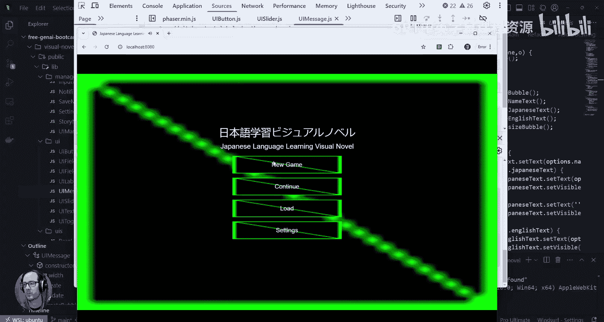

So we'll go back over here。 X is not defined。 Still that darn createate text thing here。

 So we'll go down below。 We'll take a look at our create text。 So now we have this。

We have a this dot X in the S Y。So we have this dot X。K know this stop why。

And so I would say that where we want our why to set is we want it to be be offset by the name。

 So it was like， we have name and then。It's either that or we have the name above it。 Like。

 what what did message bubbles look like， So instant message。呃。Conversation format。So I mean。

 we see the bubbles this way。And they have the name above it， right？So， again。

 we don't have to make it exactly like that。 But maybe that's what we' will do。

'll just have the name， and then it'll be under it。 And that'll make it a lot easier。

 So then we have our。K kindd of interesting because inside of this。

 we can also create a container for those elements。 And then we don't have to manage them。

 So maybe should we do that。 I mean， this is just a bunch of labels。We have。

Because UI label is a field。But then you have UI field， UI field specifically is containing text。

Where UI label is just。A label with a very specific styling on it。

So this is where I would probably want to use another fields within it。

I really should have called UI fields like UI container because that really is what it is。

But I'm going to go， maybe inside the UI message， I'll actually create another one。

Because I'm just starting to think like if we have a container inside of a container。

 can the container manage its position from that？But again。

 it's just not having to manage the the spacing and stuff。

 That's the part that I don't really want to do。So I think that's what I'm going to do。

 I'm going to have UI fields within of this。But first， I just want to make sure there's no errors。

Because I'm really tempted to go back and change UI fields to be UI containers before we proceed here because the names are getting really confusing right and so。

I'm going to go ahead back over to here。And I just want to see if maybe it works now。

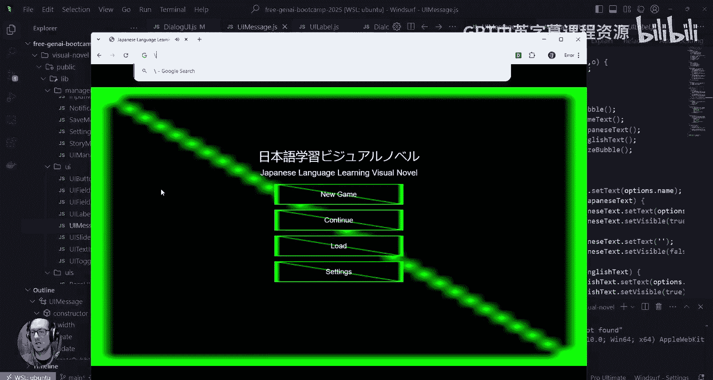

Probably still more errors。Yeah。So we here X does not defined Japanese tax， y。

 I figured that was going to happen next。So I can just close that out there。

And so here we have this dot x dot y。 We're just going to go this dot x dot y for now。

 this dot x dot y。 And then for this， we'll have this dot x dot y。

 And this isn't going to really work as well， expect I'll take that out that doesn makes sense。

 showing the create text is not。I mean， like we， we still want the element。

 whether it's like whether we use it or not as a different story。

 but we still want that element in there。 Same thing with here。

 because we can just toggle it on or off if it's visible or not。

 And that's whether we should show it or not， right。So we have that， we have our options。

 and so this should not throw errors。And then we'll go back over to here， get this nice refresh here。

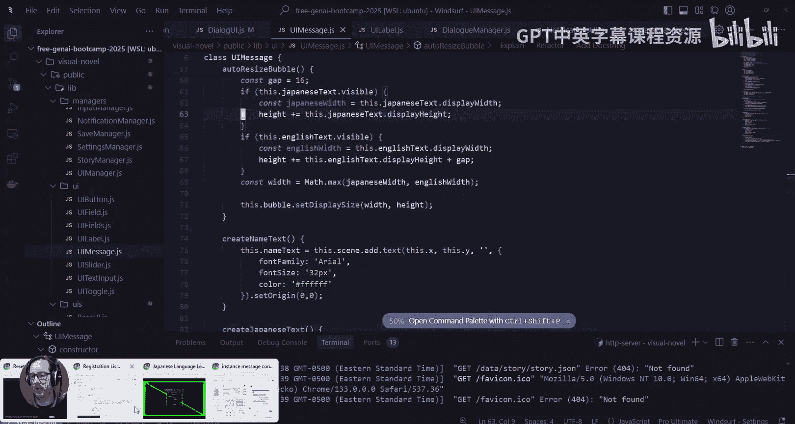

And we'll say new game。

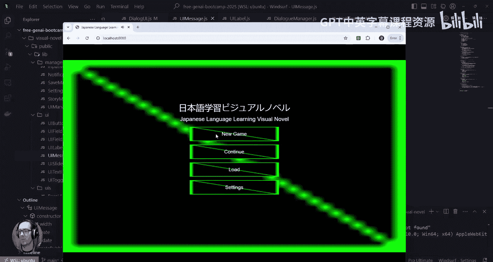

You still have an error。With is not defined。 I thought we got rid of it。The with。

Wouldd probably be the max width， so we'll just set it for that for now， the max width。Square。

 it's just listen to me sometimes here。 And so that will resolve that issue there。

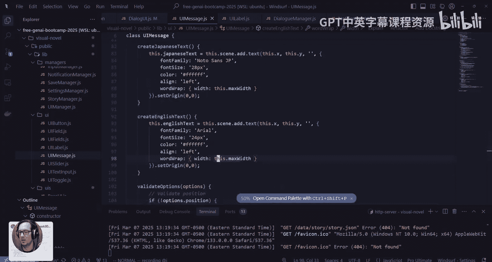

G this nice refresh。Say new。

What's our error now， Al just like， keep this in the， in the， the thing。

cause we're seeing error so often。

It's a little bit annoying， though when it's like this。

We're seeing errors so often。 It's almost like I as we keep it。 Keep it around here。

 assignmentign to constraint， constant variable auto resize。It's a little bit hard to。

See what's going on， I guess。We got rid of the break point。So it's here。哈哈。So right now。

 it maybe doesn't know what the height is。

We'll have to look up a phase element for that。 So phase text。

Because we need to get its height， right？And so on the right hand side here， I'm looking for it。

 We have display height right here。 So here is the value that takes into account， the scale factor。

So。It's calculating based on。嗯。We don't need max width in there because it's going to be one or the other。

 right？But it seems like if the height is always set or the width is always set。

 it would always be the width you'd expect it to be。But that's specifically for that。

 I'm looking for with。嗯。I'm not sure why I try to cross that out， that's kind of annoying。

I don't know why it's trying to do that。Maybe we have to say， like。Const Japanese with0。Oh。

 maybe cause it's， I don't know。 We'll say let。I know I was saying an issue with constant。

 maybe that actually was a problem。So we'll go back over to， let's we' close this out here。

We'll go back over to here。

Mmhm。😊。

And we'll give this a nice refresh here。This a Japanese sex display height。Oh， constant。 again。

 this is our issue with our constant。 It's supposed to be lead up here。

Change that to let。gap up here。And then we'll go back over into here。

Cool， so now。We have this thing。 and it looks like a mess。 But the point is like， see。

 the box size is the right size。 It is doing its best to match the size。

 These are not falling under each other。 And so that's。Part of our issue， which is less of an issue。

 But the other thing is like we have this UI fields。

 There's no reason we can't give the UI fields a background as well， like the container。

So I think what I want to do is do a little bit more work on the container now we have。

The outside container， the inside container， but it'd be nice if we can have containers within the containers。

 we can have UI labels that we can actually assign the text with。

 And if we get those elements to work， then we can then position it at the bottom and then we have our kind of flow here if we hit next it should still work。

 Yeah because the next one even though we can't read it。 So I'll see you。😊，Here in the next。

 I actually kind of like it up here in the top left corner， I know like the games played down here。

 but。It's kind of easier to read up here， but anyway， we'll stop it here。And we will。

Continue to rework this system， okay？