# ExamPro《生成式AI训练营｜Free GenAI Bootcamp》中英字幕（deepseek - P68：-68-Visual Novel Adding UIItem.zh_en - GPT中英字幕课程资源 - BV1SFEWzLEab

Hey， boot campers， we are back and we are focusing on trying to get this thing to flow a little bit better。

 And I need to spend a little bit more time on my containers。 So here on the lefthand side。

 we have our UI message， which is fine。 But I want a container within a container。

 And I also want to be able to set a background on a container。

 So the other thing is I want to rename fields Ui fields to UI containers because I don't like this name anymore。

 And we're just going to do a find and replace alls see if we can do that first。

 So we'll say replace files if it says UI。😊，Fields。Right。

 I want to change this over to U I container。Because that naming is going to make a whole lot more sense here。

 replace all， replace all， Okay， so that's all now changed。 This needs to be renamed。

Doess it actually gonna let me rename today。Okay， why it's letting me today。 I don't know。

 But that was， that was one that we had to change。 It should be changed to other places。

 And so nothing should break。 That should be enough to fix that problem。

 Let's go ahead and take a look and see if that is the case。Please don't break。 Please don't break。

 Please don't break。 Still works perfect。 Okay， so now what I'm going to do is I'm going to go over here and。

We will give nice refresh here。 We did do a lot of in the dialogue， but we'll go here and say。

 rename UI fields to UI container。 So that's what that component now does。

 It manages things within a container。😊，Okay， we need to do a little bit more with our our UI field。

 So I want to go back over to our dialogue here， and we have these components。

 but I want to have a UI container within a UI container， right， so we have。嗯。Sorry。

 think of this for a second。Well， going back to our app for a second。

This shows up right under that one， so the container sense of those two are working。

 why they're so close together is a different story。

OhBecause there's more than one thing here and I think that's why it's going to confuse it's probably the calculation of the size of the field is a bit tricky right。

 but I'm going to go back over to here and we have our dial UI right and in here I want to actually have a container within the messages。

Not here here in the UI message here。 So I'm going to go up to here and instead like to create the bubble。

 this is actually going to be the container。So I'm going to go here and just say。嗯。

Create UI container。For to hold。All messages here。And so we'll go ahead。This will be this。Bubble。

I' can ignore this part for now， this bubble。Create。How do we do it？ It's like it doesn't。 can't。

 can't think anymore。 Maybe we just have too much code。 I don't know。And yeah。

 we have messages container like this way， so we'll go over here for a second。So， here we have。No。

 I want this。 U I am。You I am。Create。Container。That's another thing we need to fix is get rid of this createate fields thing。

 So I'm gonna go first， and it'll just do another replace and find。 So I have create fields。Right。

 we'll search for that。And。Sure what's going on here。Oh， you know what， it's not just searching。

 it's not just searching this repo searching across everything。 Oh， that could be a big。

 big problem for me。Oh， boy。 I should have really been paying to close attention here。

 but we will go here and。I want to just do the。What folder is this。I don't think we busted anything。

 but that was quite the dangerous action we do before， So visual oops。Create fields。Sa， visual。Novel。

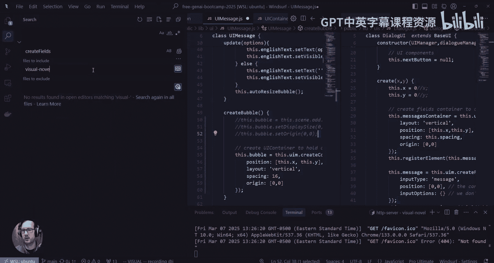

Here。I'm not sure why it has all these here。What the hecks going on here？

What the heck is going on here？I don't know what's going on。 Hold on， hold on， hold on， hold on。

 hold on， holdd on。 What is going on。

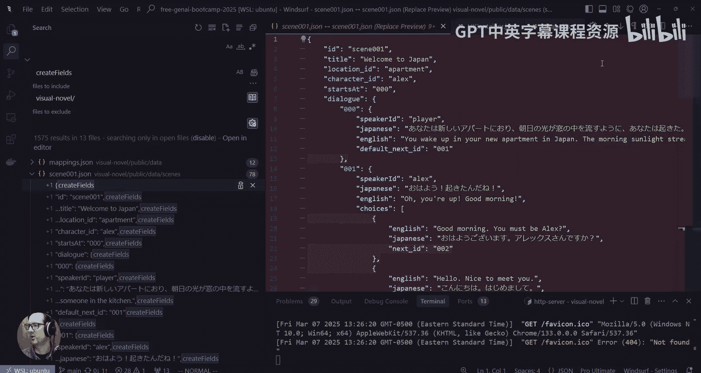

Why is it trying to get rid of this。What I don't understand。I'm got to close this completely out。

 I don't know what Winurf's doing。That finding replace， seems like it's making a mess of things。Okay。

 so now I'm going to go and try this again， find and replace and files。

 I don't want get out of cascade。 I don't want anything else changed here for a second。

There's even that many instances。But I'm going to go here and say replacing files。

 it we willll say here。Oh， you know what。 It' was trying to replace every little thing with that。

 That's so silly。Oh， what did my last commit do， then let me just check my last commit。

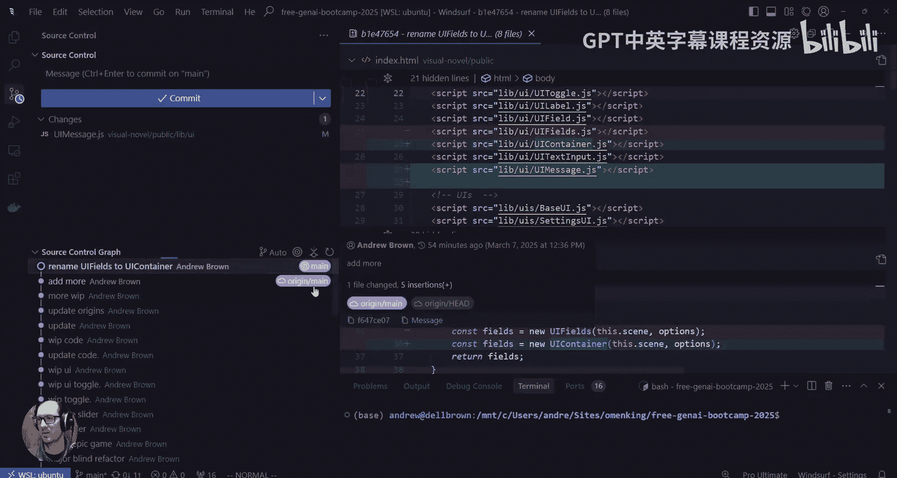

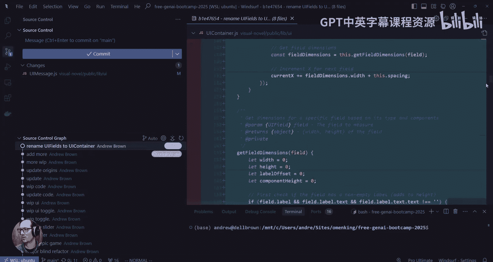

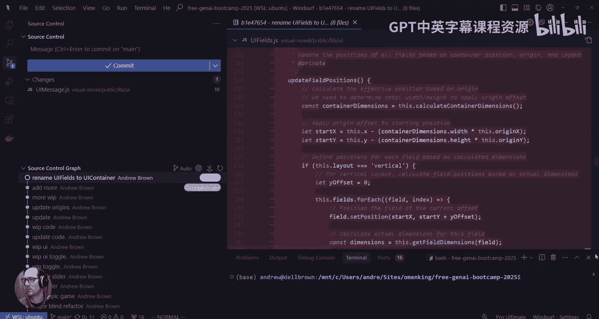

I didn't do anything dirty。I don't， I don't like visual visual studio code， to be honest。 I。

 I like Macfem。 And so these problems here are specific to Mac code。 But we'll go， we'll go here。

 and I'm gonna try this again。

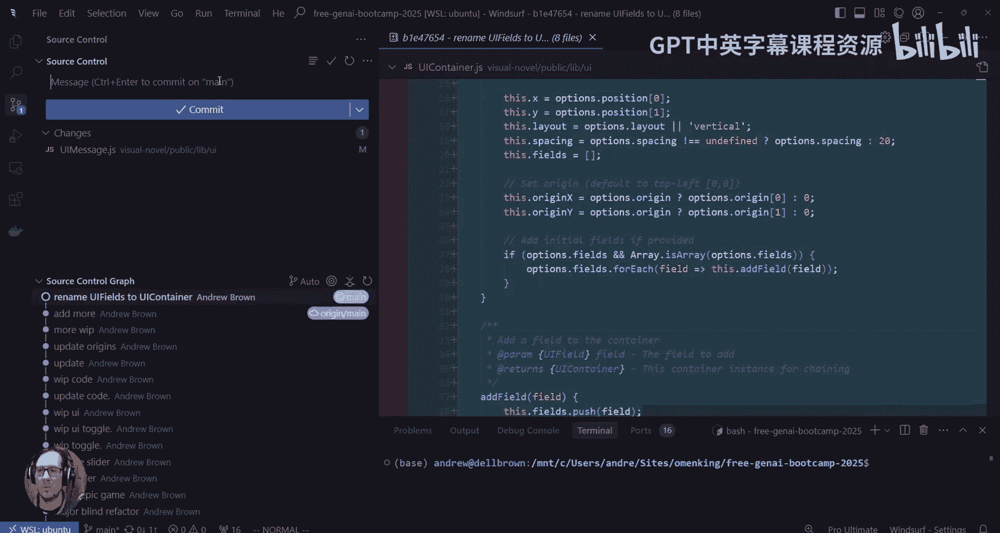

Replaceacing files is because I had it in like blank here and then replace with that。

 That was the reason why。 So we want create files and we want this to be create container。

And then here I'm going just give it an asterisk here。Like that。Can it look for them。I mean。

 there is a cray fields。There we go， and it's all happening in the visual novel anyway。

 so this is not a major issue， so I'll go ahead and'll just replace that。Replace， replace， replace。

 replace all。 Yes， please replace them， and we'll go back over into our our thing here。And， I mean。

 we were creating the container here。 But since we did our other renaming， I wan to go into the。

You I message it here。 And I just wantna quickly。Ignore the bubble for now I'm just going to go ahead and comment to out for now。

I just don't want any problems， well we can go down to the create bubble， I guess。

I just comment this out for a second and bring this back。

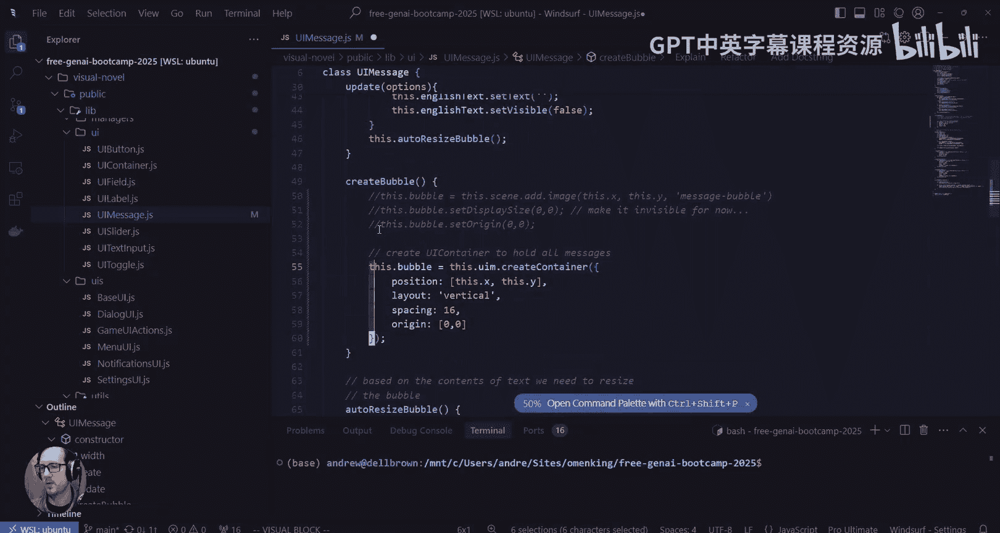

And then we'll just make sure that nothing's broken。好。🎼Oh， why is it， Why is it so， What's going on。

 What's so hard to load here today， Hey， loaded， Everything's fine。 Okay， great。

 So we'll go back over to here and we just did a major renaming of the。😊。

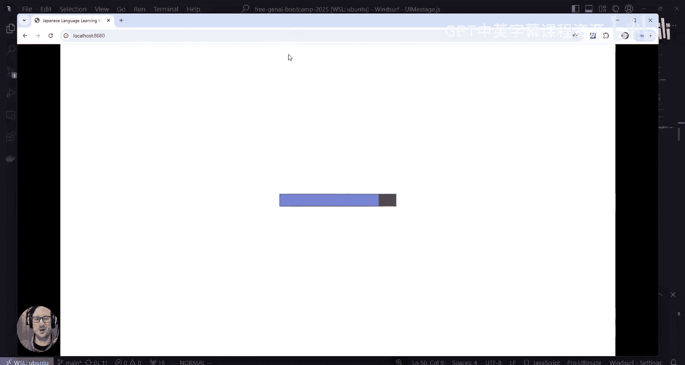

Of that。 So we'll just say change UI fields。To UI container， I almost feel like while we're here。

 we might as well try to fix the issue with the。Dialogue because that's named crazy everywhere。

 So I'm going to go in replacing files。And we'll say dialogue。Right， dialogue。

And maybe just change it to dialogue。Because if I have to do the other way。

 it's gonna be quite the headache。嗯。Now here you can see that it's picking up stuff。

For outside side of this， which I don't like。 So I need to figured this stupid thing out。And。

If we go here， it's just visual novel， right， So if we go back to replace。No， edit replacement files。

I want to say visual novel。Okay， so now it should be only able to replace things here。So with this。

 we need to also match case。Match case， there we go。 And so this way。

We get everything to be named at。

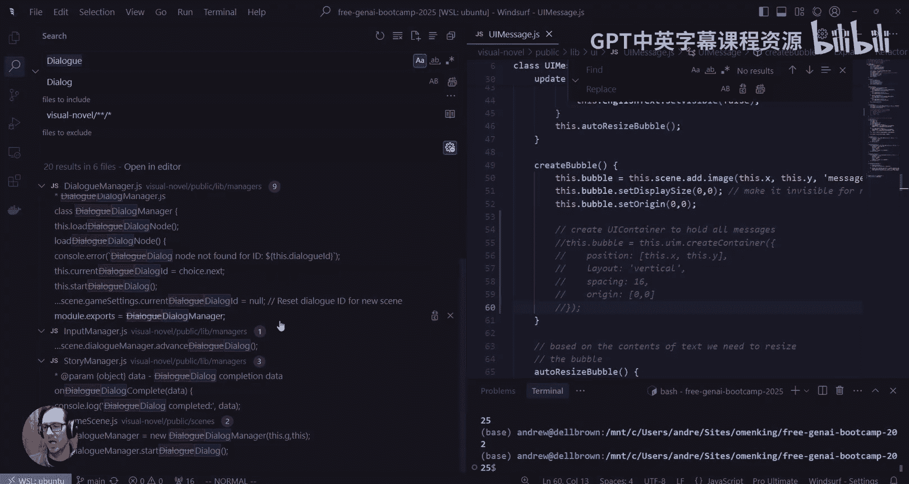

Yeah， what's the， is there a difference dialogue， dialogue versus dialogue？Prefers this one。

 It's the， it's this is the， the Canadian way to do it。

 And then the American way is uses both spellings， but probably in the other way。

 So I'm gonna switch it over to the shorter one， becauseuse it's just probably it's just easier to write。

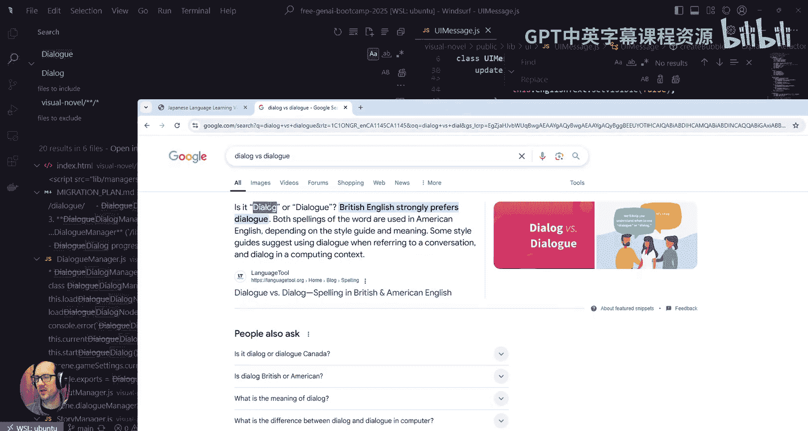

It's not correct for my where I live， but we'll go ahead and we'll do that。 We'll say replace。

 We'll also do lowercase as well。It will say replace。Okay。

 and the other thing is that the files should also be that， so we'll go here and we'll say rename。

And we'll just call this dialogue instead， the same thing with our U I here。

 But I think that the other U I was already。Called that right。

 and so now I'm hoping with that big old renaming。We did quite a few changes here。

 I don't know what happened to our server when we restarted it， but I'll go here into visual novel。

I don't think we needed a new tab to do that。 That was our tab。 We'll do H P server。

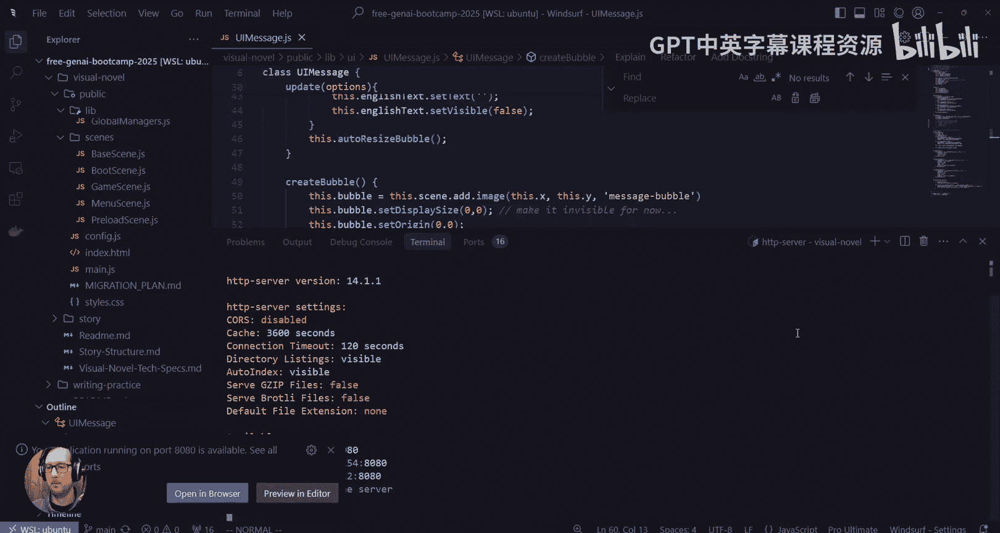

And we'll make sure that this still works as expected， right， So I'm going go look for that here。

Here。Please just work， please just work。Everything's fine， okay， great。

 so just to make sure that everything's great。

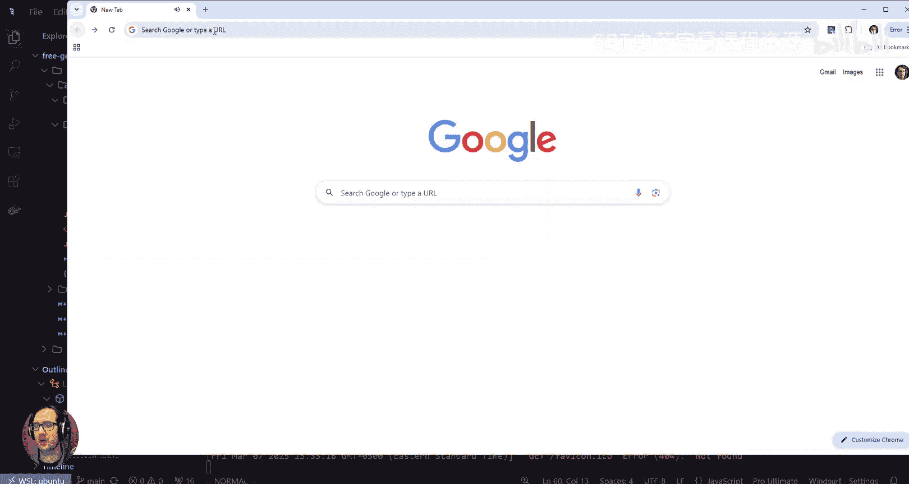

I'm going to make sure inspectors open when I do this。

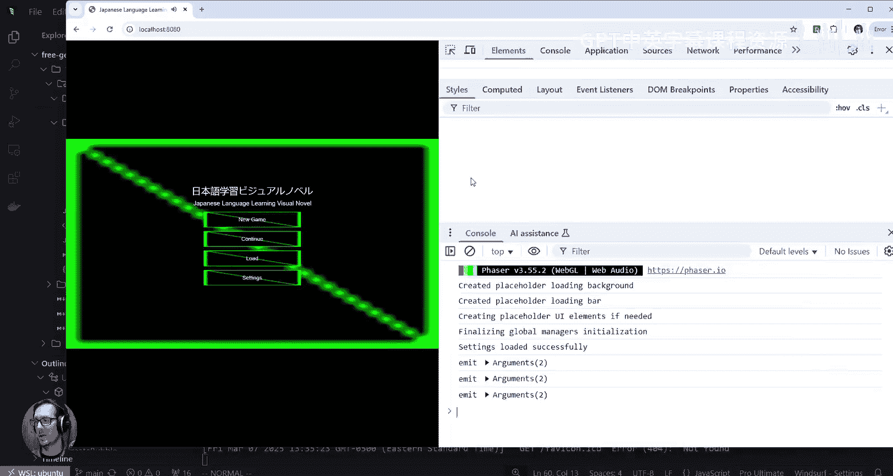

Everything's fine。 Okay， great。 So we just did a major renaming。So we'll go here and。Yeah， so fix。

Dialogue naming to now。🎼I'll be dialogue because I don't want to have that problem later down the road as we grow the code base。

 So it'll be quite the headache。 And I just want this to be easy。 I'll sing those changes Good。

 And so now we're back over to here where I've creating the message bubble。

 So I want to definitely create。A container here。 I'm just going to take that out like that。

 I don't need to call bubble container。If it wants to be called bubble container。

 I guess if it really wants to be called that， I don't care， I guess。But up here。We took that out。

Right now， the container does not have an image。 I'm not exactly sure how we should set up that image。

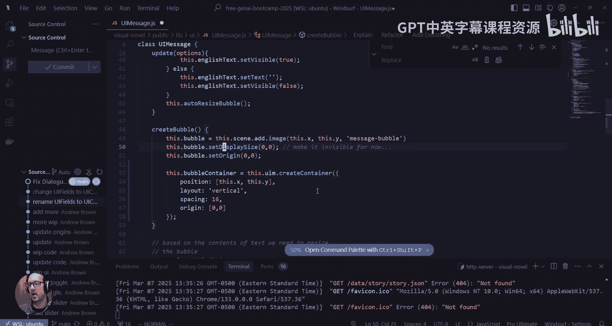

Because I'm not really sure， like。We say phaser。Container images。

Don't tell me it has a game object that's already container， is added。We've made our own。

 maybe there was have been mud already here。For render by default， it's removing the display not。

 that's not what I mean。 So like， you know， menu。Images。Pser3， like， how would we do menus。

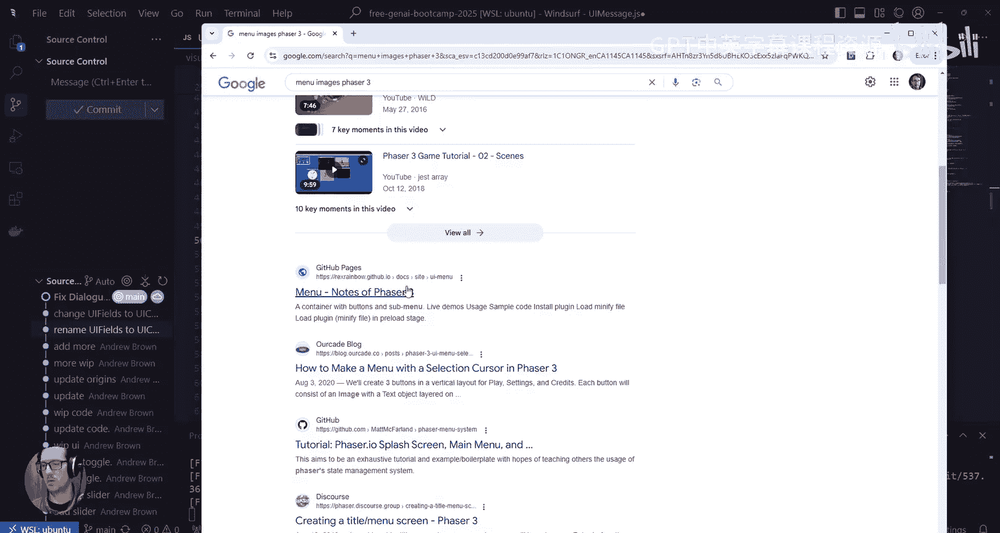

Right。

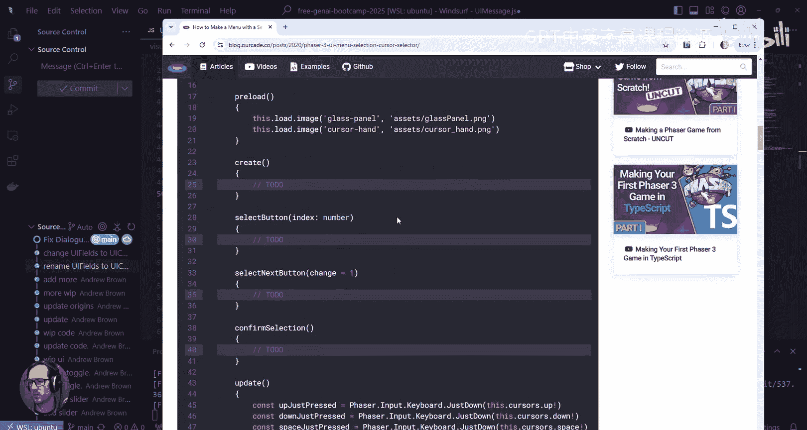

Creating menu buttons。Not the buttons。

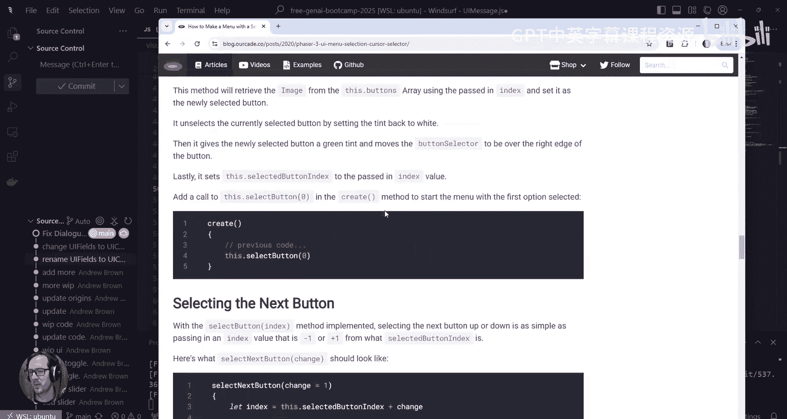

Not to select。Menu panels。Images。It will say like stretch。

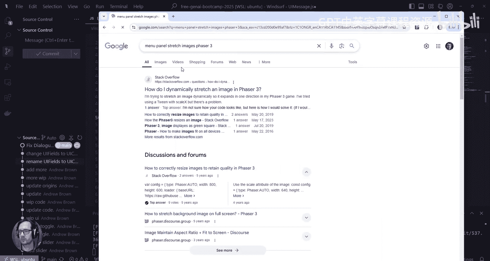

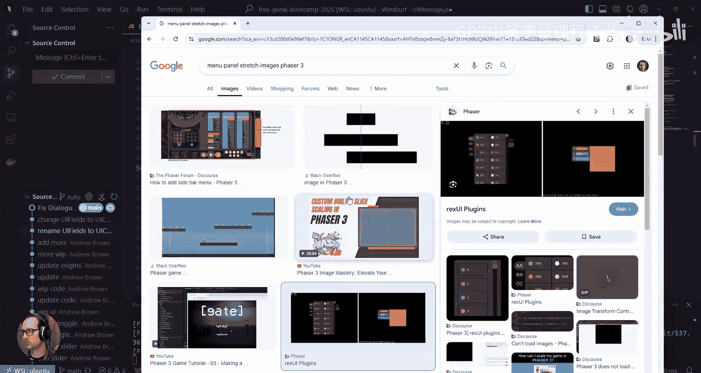

Mh。

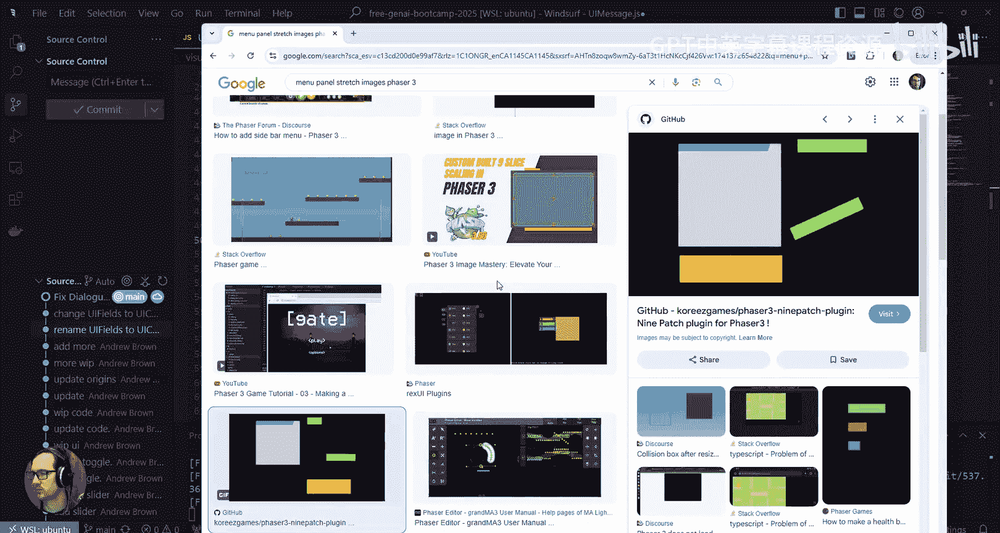

So I think the thing is like， if you have it， because you can't like。You know。

 phaseer three images repeat。I think that already automatically does that， but like。

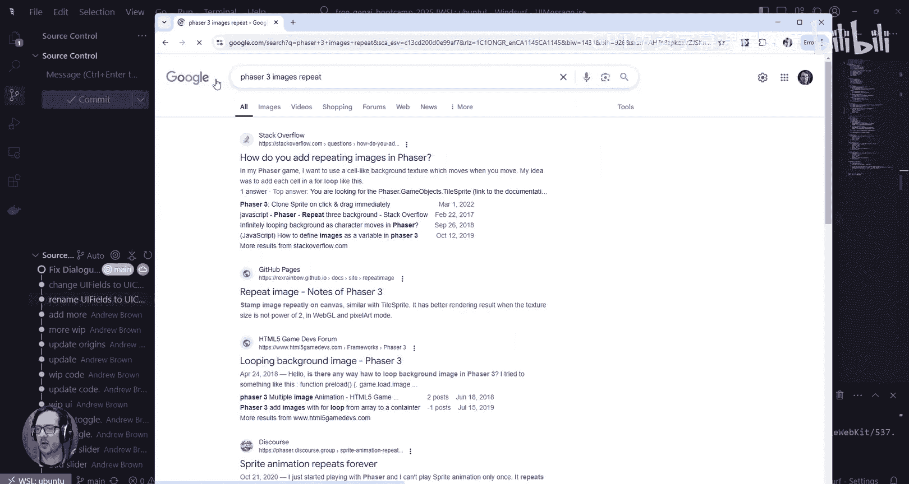

Theres going to be some kind of strategy。 Like right now， we're just going to make it an image。

 and we're just gonna stretch it to size。 That's not the correct way to do it because we need to actually tackle that those visual stuff in some way。

 But know for now， I'm not gonna go too deep into it because it can get really complicated。

 So we're just gonna pretend that when we set an image。

 that's what we're doing here right now with the container。We， we aren't setting a background on it。

 So that's something that I would like to。Do and they get built into the container。

So go over to our UI container。Mmh。😊，And。I'm just trying to think about how to do this， right。

Because it takes an options。Right。And this one's flat because it's not input options。

 it's not treated the same way。But here we have like layout vertical spacing origin。 And， you know。

 here it would be like background， maybe just like background image。And we would just do this。

Like that。I guess， we'd have to。Be more specific on how we would do that， because like。

 if we don't have the width and height， how do we know。What it's supposed to be， right？

So we might be like hard coding。 That's very very specific。Way it needs to work。 we could also。

Have another class that extends our UI container？So it's like UI menu。

And then it actually has a menu as opposed to something else。

 So maybe that's what we should be doing。 We should be calling this U I menu。

So I'm going to go here and make a new one called UY menu。I'd be confused with menu's UI。So。

UI menu extends。UI container。So this is。Extends。UI container to have a background。Okay。

 so that's going to be the key difference here。I'm sure why there's no JS on that。There we go。

And so that's actually what we want to create。There's not a container， but create a menu。And then。

 you we have our menu options。And so in here。Roet background image right like that。

 And so that would make a little bit more sense。 We need to go ahead and import。That there。

 So we'll go into our UI container， wherever that is or wherever components are。You I menu。

You also call it UI panel。 So it's less confusing， maybe panel。UI panel。

 I'm gonna call it that instead， because then it'll be less confusing for the other one。

 And it's a more generic name。 So go here and just say U I panel。We'll say yeah。

 U I panel will rename that there。 Okay， so now it basically does the same thing as U I container。

But it takes a few extra options。 So we'll go into our UI container here and。

We are we have our constructor and our scene options。 That's going to be the same。

 The key difference， though， is that this is also going to have a background on it。

And that has to be managed separately。 So let's just say， like。You have， create。Background。

Great background。So， here。It says panel background。

 but really we're bringing in the options for that so。Opts。And then we have。Options。Background image。

I will just say， validate。Pael options。Then down here willll say。

Because we don't want to have the same one here。 It has to be validate panel options。

 so it doesn't have an issue a conflict with the other women don't wantan to override the the。

 the bottom line。So if there's an image it should be there。The other thing is that this is actually。

This is actually on like options dot。Panel options。So we go back over to here。

 this says menu options， but it actually has to be panel options。And then we'll go back over to here。

 So that's panel options， which is fine。And then， yeah， we're gonna pass it to the background here。

 And then that there we have the actual image。 So it says like set display size 0，0， set origin 0，0。

 So it's not really。Figuring out what size it should be right now。

 but that's something we can worry about a little bit later。

 I'm just going to set it to 100100 for now so that it has some shape so we can actually kind of see what's going on there。

The X and Y is going to be the same thing as the actual whatever set for this panel。

 So that's totally defined。 And so now we actually have a way of having a panel。

 There's a little bit more that we want， like padding， things like that。

 But we'll worry about that here in a little bit。 as we just want to make sure that this starts to work as expected。

 So we have our UI create menu here。 So that's part of it。

Let's just make sure that it doesn't throw any errors， I guess。

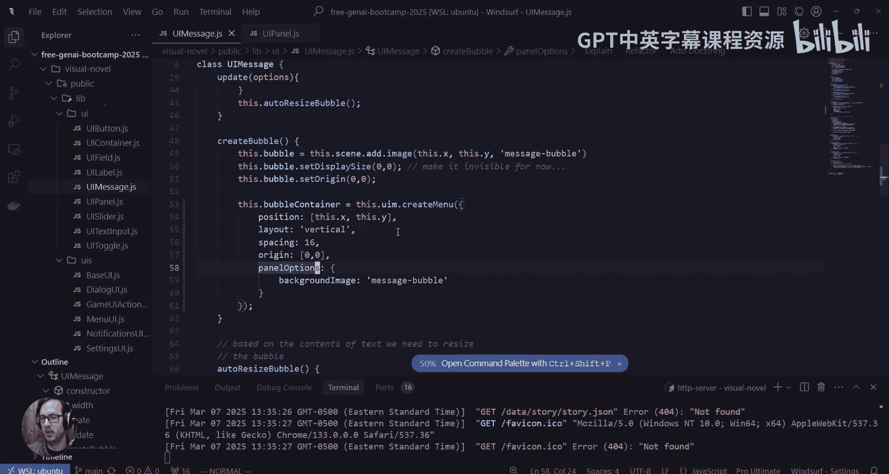

Before we proceed for it， we're not going to be able to see anything right now。

We do have UI messagessage create menu， I thought we rename that， so let's go back over to here。

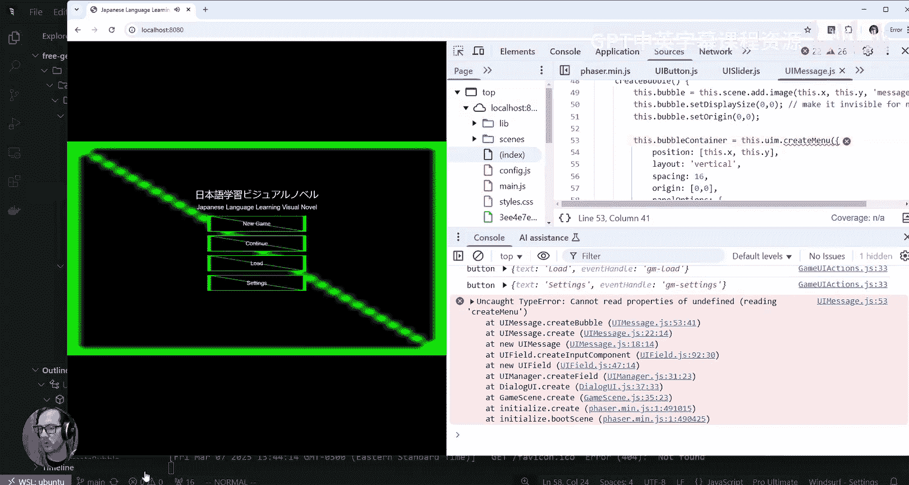

It's create panel now， create panel。And we need to go into our。U I am。

Our manager for that where that is here。啊。And we have create container。

 but we're gonna want create panel， right， Very similar。 But， you know。

 one has a backer and one doesn't。

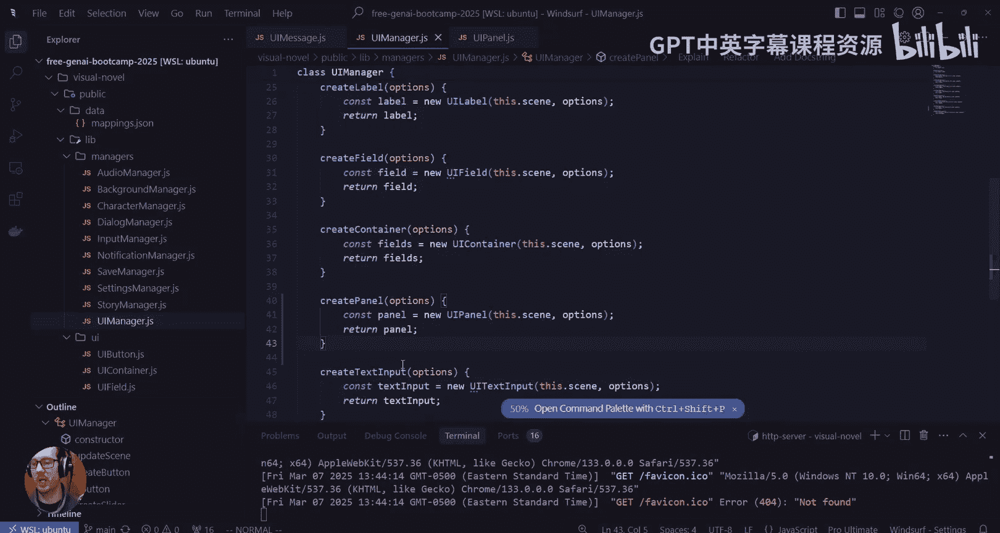

Give us a nice refresh here。

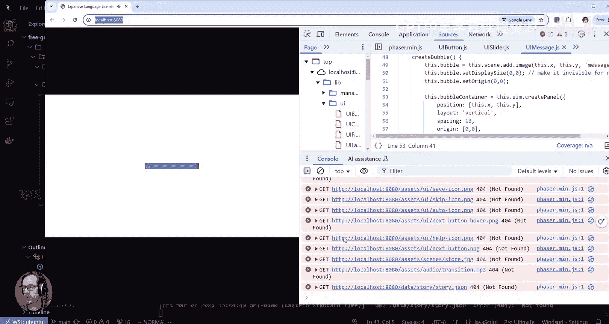

We'll hit new。Create panel。Unfined， did we not save that。 I thought we did。

 I'm going to drag this all the way here to the left。 so I't to keep looking for it。

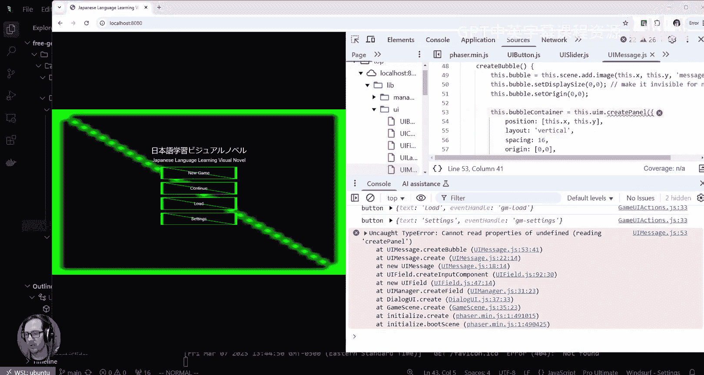

I did save it。 U I manager， create panel。Over to here。Is it in our actual index HTML？

UI panel is here。啊。Back over to here， Cpe panel is here。

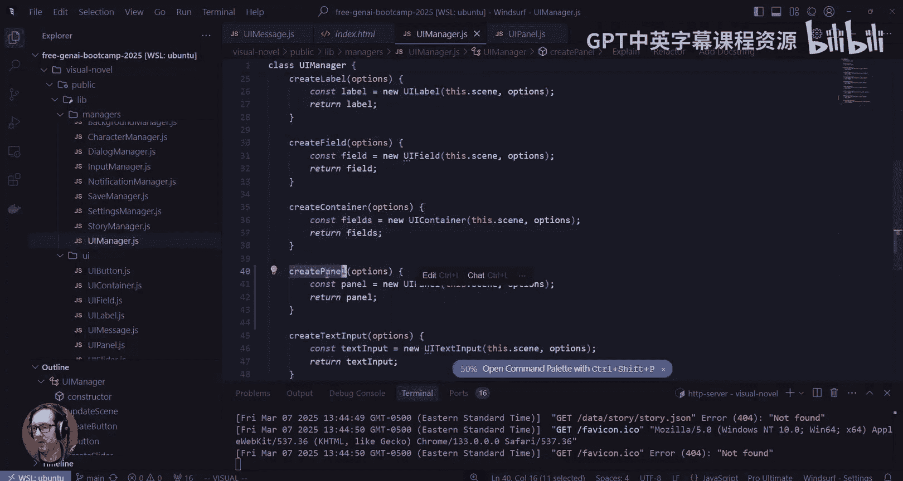

We go back over to here。So that makes me think UIM doesn't exist。

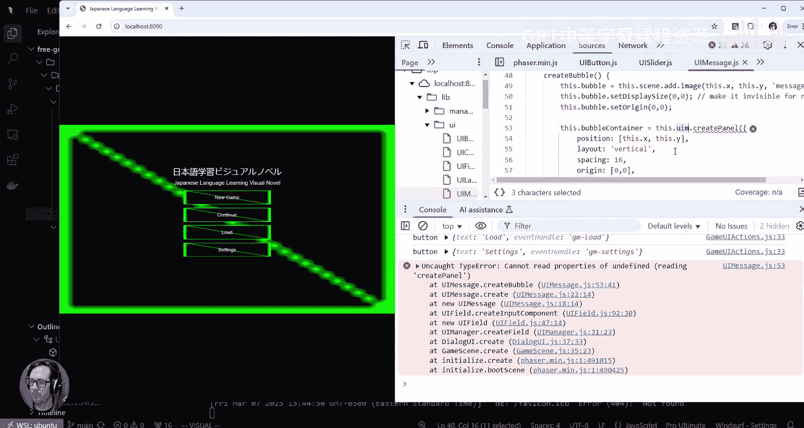

Or it's set wrong。

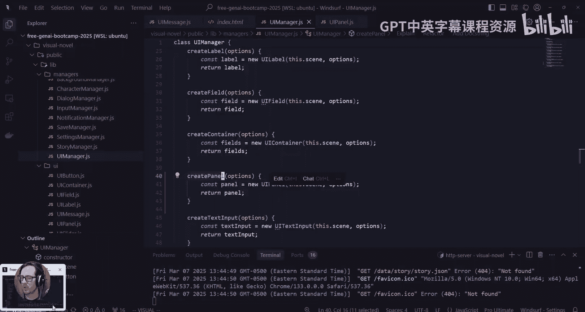

We'll go back to here。Close that out so I can just see what's going on a little bit better。Okay。

 I just try to make my life a little bit easier by reducing some of my tabs over here。There we go。

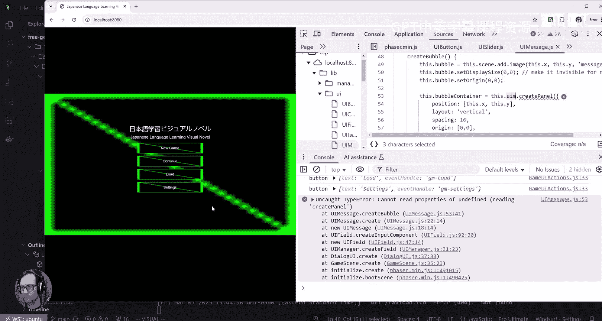

What's going on here， the UI message。Has seen in options， right， It doesn't have in here。

The ability just to go what we did there。 So I think that's our problem， the way we're calling it。

And did you buy message。So we don't need this anymore。But this is not here。

 it probably would be like this dot scene。Dot。Gi dot。Yuai。Come on。Autocomp， like。

 you can't autocomp anything anymore。 It's very frustrating。 So we'll go down to our globals manager。

 and it's called U I。 Okay， it's just called U I。 So we'll go here。Let's close this one out。

 so And this one's is called G UI C panel。 And so we'll create the panel that way instead。

 I'm gonna go turn my heat off。 It's warm enough in here。All right， so yeah。

 we're creating our panel。And。嗯。Now we're creating our panel。

 And so the next thing we need to do is add everything to those panel。 Now。

 this one should get registered probably with the scene。嗯。Because that's normally what we do， right。

 when we have a something， we register it so that it can be managed。I'm not worried about right now。

 maybe we'll worry about that when it actually becomes a problem。But normally we would register。

 here's like trying to set it visible or not， it's obviously going to be visible。嗯。

There's the auto resize bubble。So that would change the bubble size， the bubble container size。

Which might be like resize。Okay。But we don't need to resize it because it should inherently already know how to resize it based on the elements that're there。

Right， so here， this is kind of do the exact same thing that our thing already does。

 So we're gonna take that completely out。 We don't even need that anymore。We still need these。

 but these are now this and I actually want these to be labels instead。

 so instead we'll go here and this will be this dot name name text and this will be this dot scene dot G do uI createate label and that's what we're going to do instead I do want to provide options I'm not sure if we even provide let us set those options here。

Can we do that？And。Validate style， if provided。So what does it mean by style？I I like， I didn't。

 I didn't set that。 So maybe it， oh， right here。 Okay， so we can set it。 This would be style。嗯。

But I believe it's input options here。Input options， lesss because we are creating it this way。

 And so。It's a bit confusing because we have create field， right。

 And so field specifically has a label in it。 And so we don't want to label in a label， right。嗯。

But the thing is， is that。If we have。That it just has to have very specific things in it。

So says create label。Create input component。Get input， get label， set position。

 So it might need set position and set visible。 So really。

 I think we can just work with the crate label directly， directly。 And in here， it says options。But。

I don't think that's actually how it has to work。Because we need to set the position， that's true。

So we're down to our validated options。 So we need to set the text。 That's true。So so that is blank。

We need to set the position， that's correct too。And then we can provide it a style if we want。

AndSo that's something that we do want to do。 so we'll go here and provide style。

 So those are the only options we have to provide here。And so this is for the createate text name。

 so we'll do that。And we don't need to set its origin。 The origin should already be set to 0，0。

 Let's go take a look here。I mean， this one's saying 0，0，0。5。

Which I don't think that's actually what we wanted to have。嗯。Interesting。

Why is it said to that because？We use labels and other stuff。

So I don't think I'd want that to be like that。 I want that actually be 0。 I'm not sure why it's 0。5。

 Oh， Oh， like left a line but centered vertically。 Okay， that's fine。 Actually，0。5 is fine。

That is actually totally fine。 And it's not going to affect it in any way， to be honest。

 it doesn't really matter。 I mean， it would matter if it's multi textext lines， though。Because then。

 yeah， maybe we would want to do it 0，0。 I don't think it'll affect anything， but we'll say left。

 Yeah， Soll just we'll do that。 And I think that's what we really want to occur there。

 And I don't think it'll affect anything in a bad way。 So now we have this one here。

 and we do want you add it to the bubble container。This says next text。 It's actually name。Name text。

But I can't see what I'm doing。 And so it's making it a bit hard for us to say this。Bubble container。

And it's，'s we have add field， maybe we should have called it add something more generic like instead of add field like add item。

So I'm going to go and look for this， and we're going to go ahead and just say replace。

Replaceing files。And we'll say add field。And I'm actually going to change it to add item。Okay。

 and we'll go ahead and we will do a mass replace here。So， now。It's more generic， right。

 So we have a item。 I don't think they'll break anything。 I think that was pretty straightforward。

But we need to now go over to here and do the same thing for our Japanese text。So， this one。I mean。

 we have a position like this， but we just set it to 0，0 because it's going to get overridden anyway。

 They're going to change it。 They're going to update the position。Right， the question is。

 does our our Yeah， does our UI label actually allow us to set position。We go in here。It does。

 So we are totally fine with that。 We don't need to go figure that out。 So we have this one here。

This one's going to be very similar， I'm going to go ahead and just copy this over here so our lives are a little bit easier。

And I'm just going to change this out， so it's Japanese text。And then we want。

 we don't need left to line here。We're going to grab this。

 We might actually want to set whether it has word wrap on it or not。

Because that's something that we will want to do。So I will put that in there。

And we need to pass that actually along to the other one。 But before we do that。

 I'm just going to go and just finish this first。 what we have here。

make our lives a little bit easier。By having this done already。And so we'll grab。These options here。

Put them in here like that。And。We will。this one。This will get change， too。English text， yep。

This didn't get changed I willll say this to English text。We'll go up to this one。

 and change this to Japanese text。There we go。 But we need to bring in this word wrap option because we need that。

 So we'll go over to UI label。 And so U I label， it should have an option for setting。

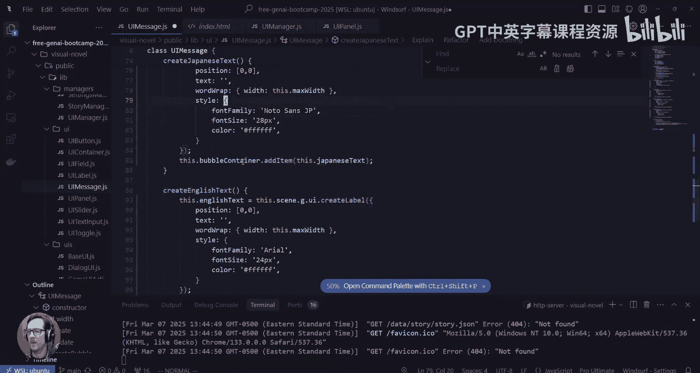

The word wrap here， if it needs it。嗯。And I'm just trying to think of how we would do that because it's already providing the values here。

So。I just wonder if we can give it a null word wrap here， so。Okay， I'll just try here。

 we'll say this dot word wrap。Equals options dot word wrap。 If it has it， right， If it doesn't。

 I don't think it matters。I don't know。What it expects if it doesn't have it。

 but I'm going to go ahead and just try to do it this way and see if it works。

I'm not gonna put anything on the end。 I don'm gonna put anything there。And so， in here。

We have this outward wrap。Which seems to appear。As I think the third option may be。

I'm gonna go take a look at the。The Japanese or not the Japanese， the phaseaser3 text。

 And let's see what order that actually takes it in。I'm looking for a word wrap。Word wrap。

Lyine grows longer than its horizontal line。 consecutive space。

 I you know that it had this advanced war algorithm that wraps words as line grows longer。

Then it horizontal line。Okay， I don't know what that is。

 so I'm going to ignore that for a basic word wrap。啊。Apparently。

 we can set word wraps after the fact。I'm not sure。If we really need to worry about that right now。

Let's go back over to here again。It was a little bit hard to read， to be honest。

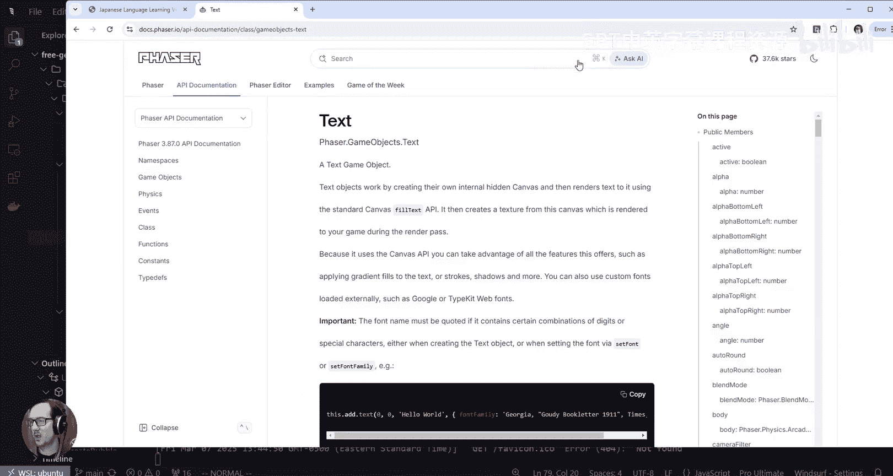

Because I was thinking that we set it in here。Maybe the word wrap has never worked。

 but these are public methods， so we have advanced word wraps。

 so advancing rapping algorithm that rap will wrap words as the line grows longer。

Then it's horizontal bounds。Conected spaces will be collapsed and replaced with a single space。

Lines will be trimmed of white space before processing， I don't need that processing part。

Basic word wrap。So greedy wrapping algorithm that wraps words as the line grows longer than its horizontal line。

 so we have a function called basic word wrap， so we can set up word wrap if we need it。嗯。Right now。

 it says text， the text to perform word wrap detection against and then word wrap with。 So here。

Here it's suggesting word wrap right， And so I feel like this is something we'd have to call on it。

 So maybe we're going back over to here， we're not going to do word wrap in here。

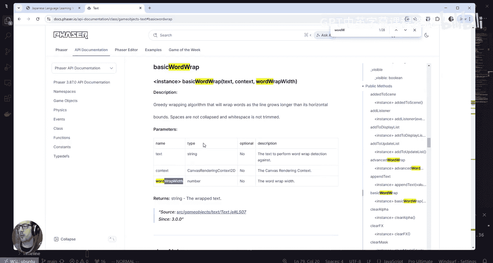

That doesn't mean we can't do word wrap。 It just means that we're not doing it here。

 we're going to call that function when we need it。 We haven't seen any word wrapping yet。

 so we don't really know what that would be like。But I'm going to take out the word wrap here and let's just make our lives simple for now。

We have And notice the Japanese font and the other ones different sizes， which is a bit silly。

 so we'll go ahead and just make them the same for now。

 or we make them large so that we can see them both very clearly。

 seems silly that the Japanese text would be smaller。 Well hold on。 This is the name。

 And this actually depends if the name is in English or Japanese。

I would think that since this is a language immersion。

 you always want to use Japanese as the target text， but for now， we are going to leave that alone。

 okay。So I'm just thinking about this right now。So。We have。Those added now， right。

 So those are now added 0，0，0，0，0，0。 That's good， right， That's great and all。 But the thing is。

 is that this U I message。mI don't think it's treated the same way as the other one because we don't have a set position。

 right？So that's one thing we're going to need in here。 We're going to need a set position function。

of word。Set position。And then here we can see setting the bubble container set position。 Okay。

 so it does do that。 Now， does the the container itself allow you to set position。

 So we go into here。We have add item， remove item， get fields set position。 So it has it as well。

 So here we now have the chain of stuff that we need。

 I was expecting that to be a little bit more work。 But， I mean， we'll know when we start running it。

 but it feels like it now should do what we want it to do。

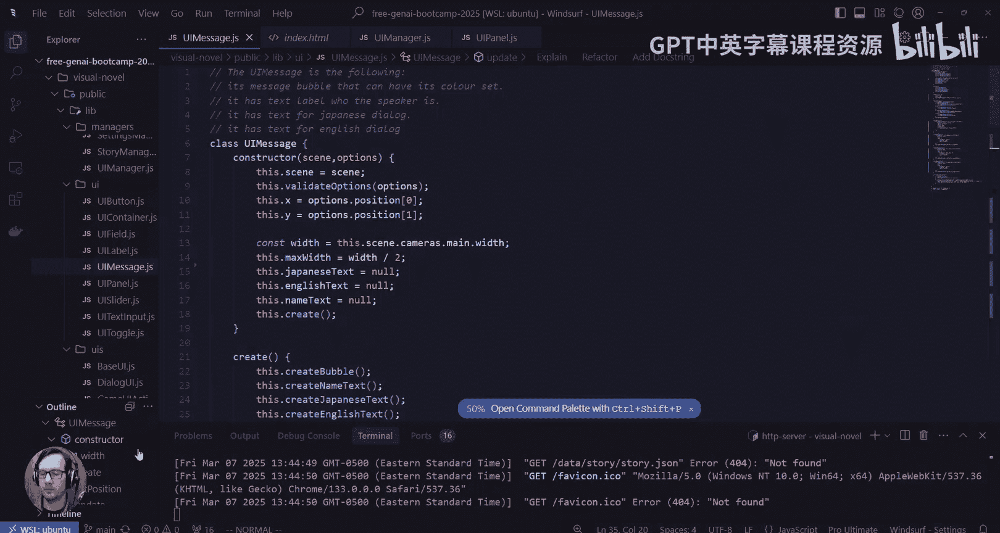

Minus whatever errors going to throw us in a second here。

 So we'll go back over to here and we'll give it a refresh。And no hair is on this screen。

 That's nice。 We go the next one says UI panel validate panel options is not defined。

 validate panel options is not defined。 It doesn't have a this on it。 Again。

 TypeScr would be really useful here。

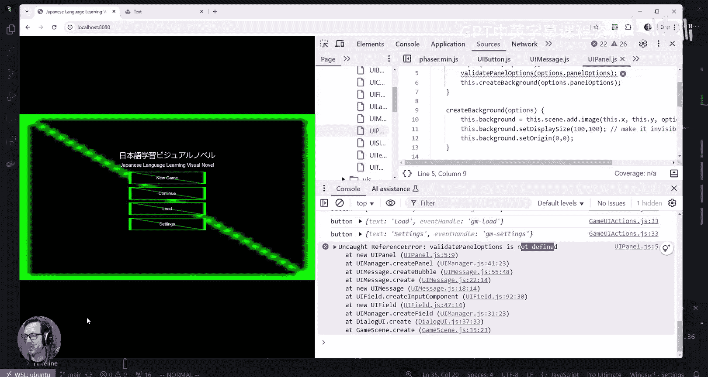

Panel options， not defined。UnderWUI messages， validate options。Oh， panel， panel， panel。

We have this here。And we'll go ahead and we'll say， y， there this。 There we go。

 And then we go back over to here。

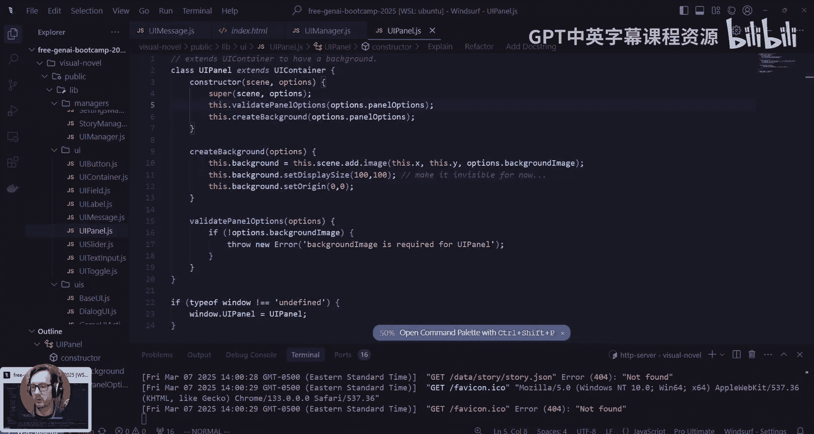

To here we got this nice refresh here。And we click new。Auto resize bubble is not a function。

 so that's not a function， which is fine。 We'll go back over to our UI message。

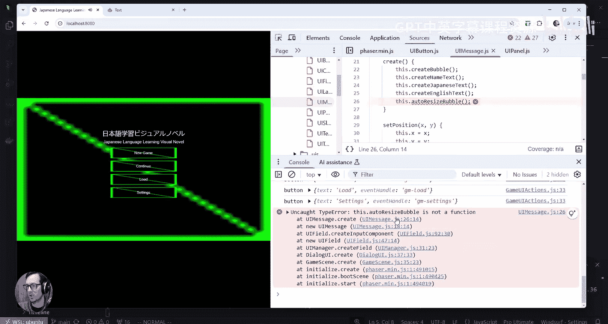

The thing is is that we don't need to do this anymore because it's just going to happen or it should happen。

 we might have to call an update to do that， but。In theory， it's supposed to do that。

But we'll probably have to add an update function to our container to get that to work。

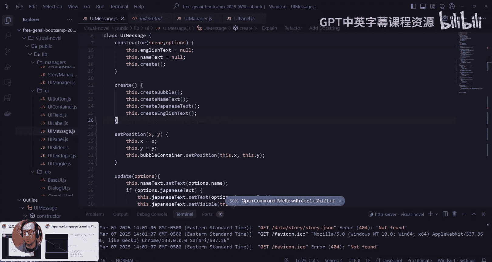

So now we are here， we'll give it a new。Auto resize bubble。 I thought we got rid of that。

 I guess it's in another spot in the update。 so we'll go back over to here and。

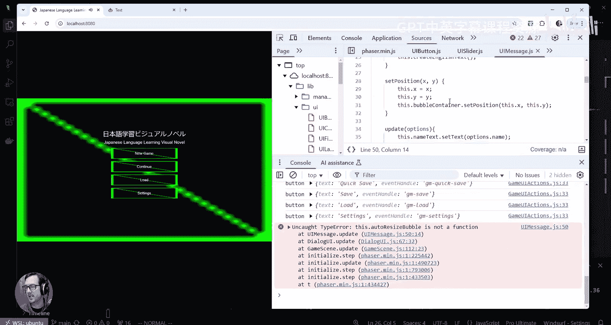

We do not want that。But if we go down to our actual。You eyes in our。Dialogue you eyes。

 I think it's calling it here， right。

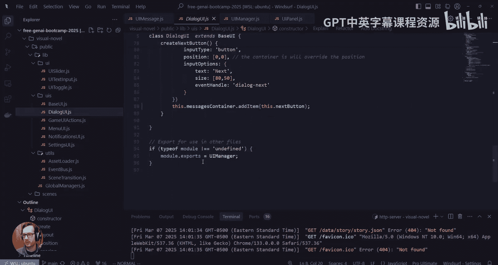

Is it not resize， is it not here。Where was it being， Where was it being called In our U I message。

 I thought it wasn't in there。 I thought， we took it out。

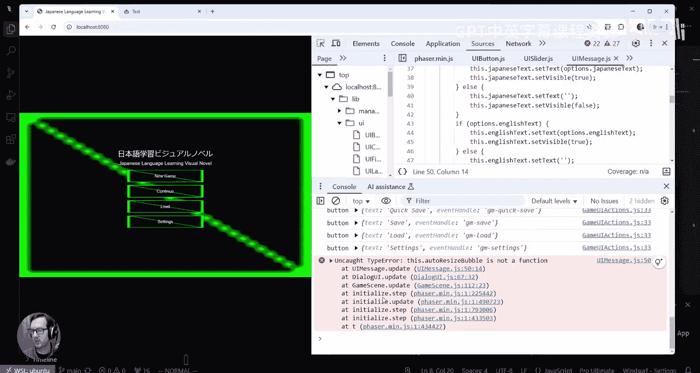

UI message。Resize。So that doesn't mean that we don't want to resize it， but。

Like here we might actually call an update on the actual。So， to do。Update， resize。Upd bubble。

Bubble menu。Bubble panel。 and maybe7 calling a container。

 we should actually call it bubble panel oops。So instead of this bubble。Can they recall bubble panel？

Pael。Panel， because that's what it is。 And then we'll be less confused about what it is that it's updating。

 right。嗯。So go back over to here。 give us a nice refresh。Into here。And so good。

 so now we don't have any errors so far， is good。Our neck still works， which is good。

But if you notice， like see that the text， like says Alex。Oh， you're good。

 So it is layering it correctly， right， The image background obviously is not the correct fit。

 but we know that we need to resize the image。Based on that， right。

 so in our container we need to know。What it's actual with is and stuff like that。

 so that's our next little challenge here。So I hope it's not too hard。

 We'll go into our UI container。 And so my question is like in the UI container， how do we know。

What it's width and height supposed to be？Like we've added the item， we're removing the item。

 we're getting fields， we're setting positions， which is fine。

 we're figuring out how to set up spacing， we're setting up visible update field positions。

 so update positions of all fields based on the container position， origin and layout。

So calculate the effective position of origin。 So this thing is going through。

 and this is what's setting the order and positions for all the stuff。Get field dimensions。

Good dimensions for a specific field based on its type and component。So it's saying field。

 but really what it means is item in this。As we're still using the word field within this。

 This is fields item。 So I'm going to try to do a master place of fields and call it items in this page。

 So let's see if we can get away with that。 So'll say find in， find in this file。😊。

I want to replace it。 And we have field in here， and we'll call this。呃。Lowercase。Match case。

We're going to call this items instead， so this will be item。And we'll do a mass。Replace here。

 And so now it's called items。 We still have some reference to field， U I field。

It's probably somewhere here， let's see field。Right， but the rate doesn't have to be a UI field。

 It just has to be。That there， right， So we have UI field。嗯。😊，Okay。

So we still have like update field positions， right。

 so and this I'm going to just change this to from instead update field position we call update。Item。

Positions。Positions， it's really important to， if you can。

 when you're especially in a smaller project to rename stuff so that it's less confusing。

As your code basease grows。We have get field item。嗯嗯。😊，So I would say， yeah。

 I want this to be get item at。Right， and so。Now we're kind of getting the weeds here。Remove item。

Get items。Get item dimensions。Get item dimensions。Get item dimensions。

There are some things that are external to this where this can mess things up。Get。Item dimensions。嗯m。

😊，There you go。 Now， we still have UI fields， and there， there can be calls external to this。

 Let's just make sure nothing breaks。Hopefully this doesn't haunt us this change。

 but it can be a bit tricky to rename things。

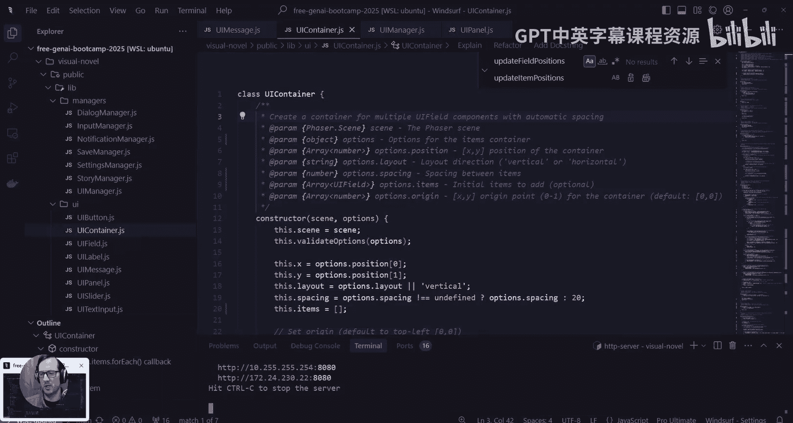

But again， try to do it as early as you can so that you have less pain。

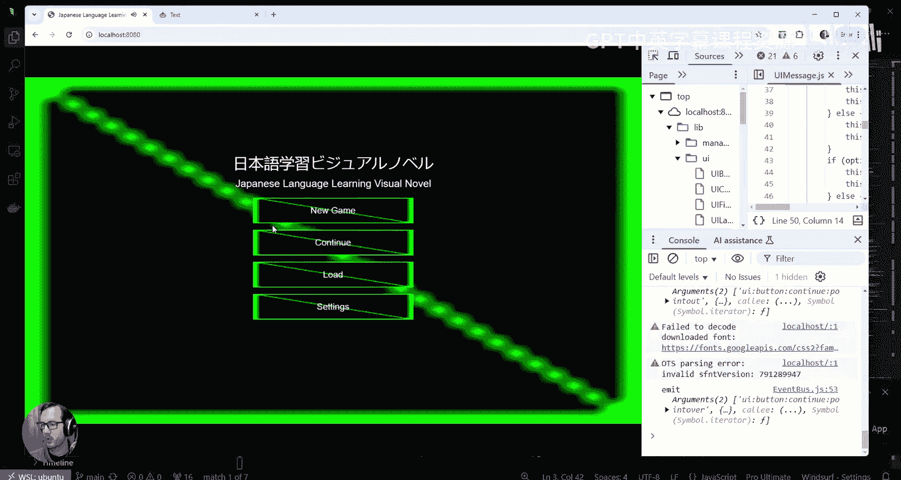

So go in here and no problem so far， no problem so far。

 So maybe those external ones like add item remove item， we haven't really used them yet。

 And so we just did another renaming。嗯哼。😊，So we have a UI panel。Logic and renaming。Fields。

To items in the U I container。Okay， so now。We know， we like， again， we could have like a U I item。

 but we're not we're not doing that， Okay， so。At least I don't think we should have that。 So now。

Okay， we have our UI container。 What I'm trying to accomplish is getting the background to be the right size。

 And so we need to recalculate。The dimensions of the menu background。

 This makes more sense for the menu， as opposed to the container。It depends if we need。

It depends if we need to know the top and the bottom of it， right， so like。

When we look at this thing here。We don't set a width or height on this， right？

So this is where I think we want to。Get the width and height。 So we'll go get。Get dimensions。

 get container dimensions。Dimenssions。Do we even have that calculate already？Oh。

 we already have that。 calculate the total dimensions of the container based on the items in the layout。

 So we already have that apparently， and returns it with a height。 Okay。

 so we already have this function。Then we already have a way of setting setting the actual。Mnu size。

 right？So if we go back over to our UI panel here， wherever that is。Then we can just say like。嗯。

Resize。Pael。Right， and， I mean， there could be， like， they could be like auto， like auto size。

Autit resize panel。And then in here， we already have this， so we say this I calculate container。

Dimenssions。This up， Yeah， there we go。 So we have that。 We just need it referenced this one time。

 We don't have to like store it on the object here。 because every time we do this。

 it'll actually have to call it every time。 And so now we can just then resize the background。

 So we so， oh， yeah， it just was doing it right there a second ago。

 This up background and then resize it based on those dimensions。

 So we have the width and the height。 And so that should。In theory。

 assuming that calculated container dimensions is correct， we'll put that to be the right size。

 Now we need to call this somewhere。 and so this has to go back to wherever we were trying to do that last update。

 and I mean， we have our manager here。Which is fine。 But I think it's our。UI message in our。

 if there's an update function here， we need in our update function， here it is。

 So here we'll do this do bubble panel。And it's not update item positions。 It's auto resize。

The panel， assuming that it actually listened to the name that we had there for the panel。Right。

 so we'll just split this again。And I'm gonna bring this over here。 So autoy size panel。 There we go。

 So hopefully that just works。 That works。 That's great。

 Let's not taking account padding and other things that we might want there。 But if this。

 at least this green， weird green box fills that box， then we are in good shape。😊，And it does。

 well at least it does it for the the height。Right。Withth is a different story so。Why is the width。

🎼Not correct。 We do not know why。 The other thing is I thought we set that background as 0。

 Maybe we said it as 1010 early on just so that we had an idea of what it was。

 So I'm going go back over to our UI panel， and I want to shrink it back down to zero。

 I don't want to see it right off the bat and then we'll go back over to here。

 I want to see if there's any kind of like flicker or problem when it works here。

 I don't think there is。 No just instantly appears。 And so that's good。

 The only thing is that our next button is not appearing in the correct location。

 So that's a little bit unusual。 maybe because it's not taking in fact what the final calculation of the other container is。

 that's probably what it is。 it probably doesn't know what it is and that's where it's having a bit of a challenge because that next button should appear under it。

 So we can go two ways we can tackle why the next button is not underneath。

 or we can tackle why the width is not containing the entire width。

 Maybe we'll do the next button first。 because that might be a bit easier。To solve or maybe not。

 I don't know。 So if we go back into our UI container。嗯。And remember。

 there's a container inside of a container。 Well we have a container with a panel inside of it。

 right？ And so the panel。Like， we need to figure out how to set the next position based on the the。

 the one being under being a panel， right so。If we go here。

Get dimensions for a specific item based on its type and component。

Right and so here it says item do input type。The thing is the item。

It's not an input type it could be like an item type instead of an input type， but we called it that。

嗯。So I'm just trying to decide here。嗯。😊，What we want to。Do about this。I'm just thinking about it。

Because when we create a field。That's for dynamically creating a bunch for a specific target field。

But here， you know， we aren't setting any kind of input type and that input type。

 we are getting that information because it's wrapped within the UI field。

I think that stores its type， right？We have label type， input type right here， input type。

So maybe what we need。Is a UI item and things extend a UI item and it sets what type it is。

Because that would help it out。 But that means that these types should。

Be set to be something very specific。So we're not customizing them and saying， oh。

 you're this and that。 So I think we we need to do to fix this is the item type。

 Does't think we're gonna make。 We'll say U I item。JS。And I guess we'll go ahead and make this。

So say a class U I item， constructor validate options， U I item will go down here。

 and that is now defined。 So what do I want in my U I item。

 It does talk about like positions and validation stuff。 But we want to be able to set a。

Like an internal type of what it is。So something that it has to set。Is it's tight。 Now。

 I don't know how we would do that because I know the other one， like for the super， it sets it。

The configuration for it。But in the constructor， we need to know， yeah。

 we need to know what type it is。know what type it is。 So let me think about this for a second。

So if we go over to these other ones like UI panel。And this one here。

 these all almost have scene options， scene options， scene options， scene options， scene options。

 scene options， scene options， scene options， scene options， scene options。

 So I guess my question is like， does the constructor have to have the same underlying one that also has。

 Because this one here， we just need to know what its item type is。We just want to know item type。

So we can say this dot item type is item type。 That's all we need at this point in time。 right。

 That's all we want。 That's all we need。 And so my thought is like， if we extend。

 let's say U I button。If we go and say this extends。UI item， then we can set。The super to be that。

 right， And then that way， we， we know that it's always that type。

 And that's what I'm thinking that we can do， because I don't think the constructs have to be the same。

I don't know， but that's what I think。 Anyway， We'll go over to UI toggle here。

 We'll do the same thing。This one's going extendu my item。We'll go down here。This will be a toggle。

 There we go。 We go to our text input， same thing。We do UI item here。 We go here。We extend。

 We do that。 We go to our slider。Here we do that。We go here。We do that。 Okay， great。

 We go to UI panel。UI panel， it extends a container。Right。And it can be used as an item。

So here I would probably manually set it。 So Id just say like this。

 because we're not gonna to extend it。 We'll just say this dot item type， this dot item type。Equals。

UI panel。We'll say panel。 actually， panel here。 Sa panel。 Okay， mean so we have that one set。

We can also do that for here， even though it's not necessarily extending it。

This dot item type equals container。 You know， we don't extend。 Well， I mean， we could extend it。

We could extend this one， we just say super panel。And then up here， this one can be like extends。

Item， UI item。Right， and so。Wch right colouring it weird。 Is that fine。 Yeah， it is fine。

 And so in this particular one， we just don't extend the。For this， because， you know， like we。

We have to manually set it。I don't even know we need to really set it as a panel because it is basically a container。

Right， so I'm not sure。If there's really anything special that we have to do about that。Yeah。

 I'm not sure about that。 I'm gonna leave it alone because I don't know if we really need to find something as a panel to distinguish it that as that。

 because as long as you can get its dimensions。 that's all that really matters， right。

 So go over to UI slider here。 So we have super slider。 That sounds really cool。 Sa super slider。

 We'll do UI message。 It should extend as well。 should all extend these from items。😊。

I really hope this UI item thing works out I don't have to roll it back。

 that'd be really frustrating if I have to do that UI item。And we'll say， super。Message。

And then we'll do UI label。UI item。Super。Item。Over our label。And UI item。

 we don't have to do anything for because it already is what it is。 We go into field。 U I field is。

So the thing with this one is that。It is a field， that's true。

The challenge here is that the field contains within it， some kind of input or item， right？

And so here it's a bit trickier。 So we have to say， extends。UI item。And technically， this is a field。

 it is super。Field。But inside of it， it contains。Let's do button before we move on here just a second。

 Oh， this one is very extended perfect。 But this one contains the item。 So right now。

 we called input type。嗯。Which is fine。 But it's really not input type。 It's really about。The actual。

Item that's stored。Like， this comes in as an option， right。

 The input type of what you what you want it to be。 That's fine， right， That's fine。

 But then we have input type here， and it sets it。I mean， that's fine。

 I think the thing is that we just need to reference。嗯。The the item type from the item itself， right。

 So if we go back now to our container， we did a lot of stuff there。

And we go into here what I'm looking for。Is a way to。Calculate。To update the positions。Well。

 it's not than that， it's not just update positions， but it's like。

 figure out what height to set this thing as。Because here it depends on what it is。

Get item dimensions。 That was the thing that we were looking into， get item dimensions。

And so we'll go here。Get item dimensions， right， and so we have item。

And this one's a little bit complex。 like I was hoping we wouldn't have to touch this， but。

It might not be too bad， it just looks really complicated。

But we have with height label offset if it's a field component and component height。

 it says component height， but it really is item height at this point。Component height。

 I'm not sure what it refers to。 So maybe we'll just leave it alone for a second。

 So first check to see if the item has a non empty label。Well， the thing is， is that if， if it is。

 first we need to figure out， is it actually a field or not。Because it's a field。

RightThen it's going to have a little bit extra stuff in it。I guess the other question is， like。

 why is the dimensions being handled by this when you could have the field itself turn back and say。

 hey， this is my actual height， right？ Like， why is this calculating it。

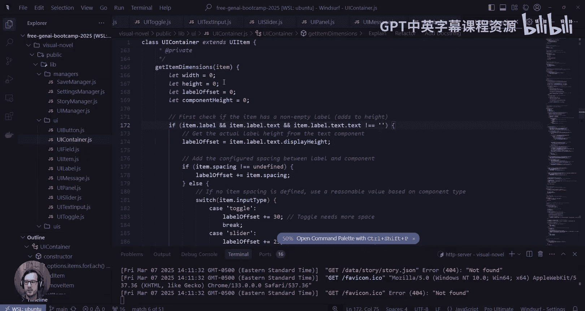

So here is this toggle slider， label offset， label offset， slider needs more moderation space。

 default needs more space， this logic feels more like it belongs in the actual field itself。Okay。

 so yeah， I really didn't want to have to touch this。

 but this is where this became now harder than the other one， maybe。Okay， so here we need to solve。

Is we need to。We need to basically step through this whole calculation thing and。啊。Yeah。

 that's gonna be a pain。 So I'm gonna stop the video herecause we're already an hour in surprisingly。

 and we'll continue on in the next one， okay。Well， before I do， I'll just commit whatever I have。 No。

 I actually won't because I don't know if this will break anything， and I might want to roll it back。

 Let's take a look at what we've actually changed。And so this is adding the UI item components。

 so we'll be back in the next video。