# ExamPro《生成式AI训练营｜Free GenAI Bootcamp》中英字幕（deepseek - P69：-69-Visual Novel Fix Crazy Positioning.zh_en - GPT中英字幕课程资源 - BV1SFEWzLEab

We are back and were now going to tackle this big gross piece of code。

 And so most of the stuff that we have been doing that our LM had produced for us were're basically having to again。

 walk through it all I don't know。 Like I can't imagine。

 I really can't imagine trying to figure out how to define these up front and making sure the code is good。

 without basically stepping through it anyway。 So it was nice to get a very quick prototype。

 but clearly you still have to walk through all your code no matter what except when like our go lay app when I made it in the beginning one。

 that one was pretty good and was pretty pretty standardized。 but for video games。

 obviously the way we walk through this is completely different。

 So this thing here gets the item dimensions。😊，Right。

 so get dimensions for a specific item based on its type and components。

 The responsibility of calculating the items。Really should be。

It should really be the responsibility of the item itself。Right， so these items should implement。

That there， so we go to get items here。Say， get。Dimenssions。Right。And then we'll go here to say。

You know， raise error。If called。Method not implemented yet so。You know， this should be implemented。

By each item， right， And so now we're saying， okay。

 the responsibility to figure out the height is really on the item itself and not within this big gross function that was coded because I can't even。

 I can't even make sense of what's going on here。 Like， there's a lot of stuff that's here。

But what we want to know is just definitively what is the size of each item？And。

Does get item dimensions。Get dimensions for a specific item based on its its own type。

 But here it says get them item dimensions， and they have item。So if it's that， then really。

 it should be like， it should just be like item dot， whatever item get dimensions。So here。

 where we calling this get dimensions here， just there， is this the only place？

It looks like a few places。We need to calculate the container dimensions。Which by the way。

 that's a big mess as well。But， just here。It really should be。Item。Get dimensions。

That's what it should be。We'll go to the next one。Get item dimensions。Same thing here。

Same thing here。

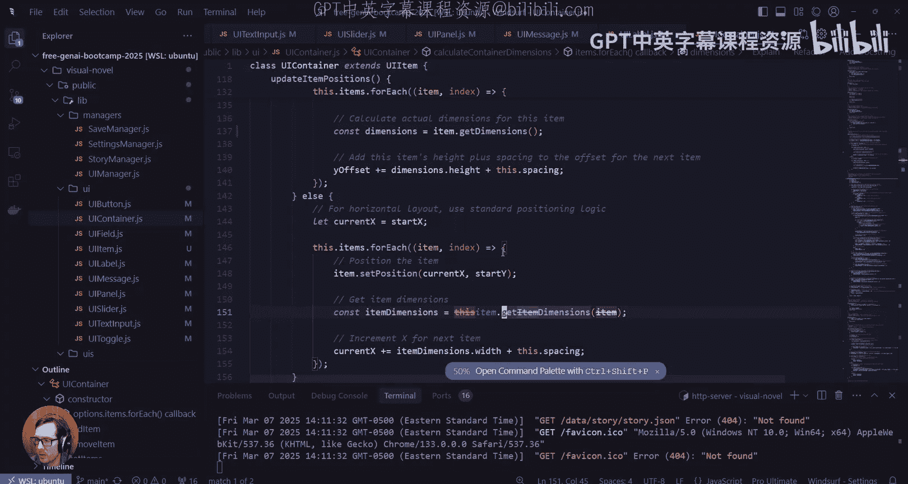

Same thing here。 That's how it should work。 So this big gross function here。

 we got to deal with it somehow。 And it really depends on what we are working with。

 So if it's a button。Right， we need to implement。That function。Get dimensions。

What would be the width and height， I probably that， to be honest。

Let's go take a look and see what it does for this。 Do we have one for button in here。

If it's a button。Okay， if it's a button。It's not as simple as get the dimensions here。

 but if the item is a button。And the item input component is an image。Input component。

 I'm not sure why it does that， but okay。Item input image display with otherwise it's zero。

 Otherwise it's this。Okay， and so we'll go here。 I I said the question is like， if it's not visible。

Should this set it as whatever， Because if it's not visible。

 I feel like it would need to do that as well。 So I'm going to go here and just say like。To do。

If the item is not visible。Should this return0，0， Like， what should it do。What should happen。

In this case。And so we'll make that an issue for later。But here。This is what。

 this is how it should figure it out。 Ca that's all there is。 So that one is figured out。

 So if we have a button， that one is。Soved。Right。Let's move on to that one was easy。

 Let's move on to another1。 I'm gonna copy this one for now，cause this one was easy， Pasy。

What might be another easy one， Label might be a very easy one to do， too。 So we'll go here。

And I'm going to go here， and we're going to。Pase this in。 So now we have get dimensions。

 This one's different。Because it's label text。嗯。I think that's what it is。

 It's just display with display height，2。Because we went to images earlier， right？

And we took a look here。Display with。Right， display height。

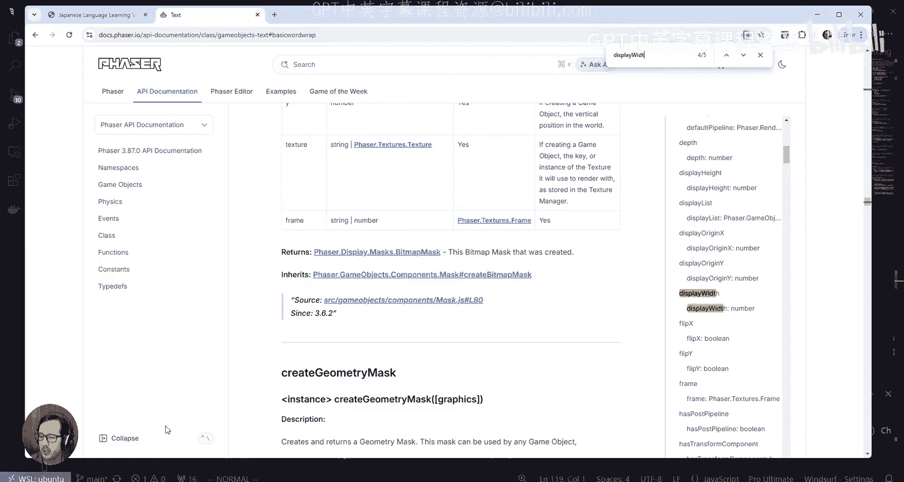

That's all it is。 So that will make it really easy for labels。 Does Where is labels in here。

 So first check if the item has a non labels。 This is actually checking if it has a non label。

 It's a problem。Input component， if it's a toggle， I think when this was implemented。

 there wasn't a thing for fields。Right， so it's not going appear here in the code。Okay， so that one。

Disold。We'll go to our next one。Our next one here。With button。label。Message that's complicated。

 We'll come back to that in a bit here。 UI panel。 that's the same thing as UI container， but that。

We will figure that out here。 It actually just calls。Get container dimensions。Right， in fact。

 we could actually just call it get dimensions instead of get container dimensions。

 and that would make a lot more sense。So in here we have get container dimensions。

Container dimensions， it must be in here， right。Or did we only do it on the men on the one above it。

So calculate container dimensions。 This one here is actually going be。Get dimensions。Get dimensions。

 And that way， that code will be more uniform。 And so now we've just finished this one and that one。

 assuming that this interior code is correct， as we are changing。Things。

 but this one looks pretty straightforward。 I don't see anything here thatca it's using to get dimensions in here。

 So if that one's correct， it should be5。 But this one's gonna be get dimensions。

I'm not sure why it's doing this is declared， but it's never read that makes sense we use this in the dialogue UI I believe。

 and so in here we have the calculate message here it's in the update I believe。嗯。No。

 maybe it's in the menu in here and the update in the menu。I know we use it somewhere。呃他。

We had an update in here， we don't。No， it's wherever this is being used。

Which is in the dialogue you so， oh， I'm in the menus。 that's why I'm in the wrong place。

Is there an update in this？嗯。No， it must be in。UI message， right？HereWell， we have auto resize panel。

 which makes sense。Which is in the panel。And so if we go into the panel。This is。

Called in the get dimensions。 So here it's actually just get dimensions。Let's just get dimensions。

 There we go。 So that will。Fix that thing。 And so that one actually was pretty darn easy。 So far。

 anyway， it's not a private function。 So let's fix that Justing where it says it's private and not private。

 So U I labels is done。We haven't done fields， slider text input。Take a look at text input。

Text input should be as simple as this one as well because。It's based on the background， right？

So go ahead and grab this。 I don't know if we have to factor in the border。I don't think so。 No。

 I don't think so。 So we'll go here， and then this one should be really， really simple。So go here。

 We'll just paste it in here like this。 boom。 And so now we have this one， but this one's not text。

 It's gonna be the background， I believe。It's it just background。 It's called background。

 That's right。So go here and this is going to be。Background。Background， easy， right。

 So that's how it's going to calculate。That one， U I slider。One thing I didn't realize is like。

 we could have also a vertical slider。 But right now， they're just horizontal。

 I'm not sure I would want a vertical one， but Verll。It's horizontal。 And the question is， like。

 what calculates。The the overall dimension。 So I， we didn't write any of this。

 I didn't even touch any of this here。 We have this that seen input drag。

 So it's interesting that the drag happens over here。 the scene input。

It seems like that would kind of mess up some of our tracking。But anyway。

 that's fine validate options。Get handle X。Slide the slider value programmatically， get set position。

 set visibility。 So we need to。I'm not sure how we are going to calculate this。也这两0几。But this one's。

 is it the track， Is that what it is。I think now。Cause they kind of cheated。

 They made it so that the track was exactly the right size。In line with it， so。You know， right now。

 So like right now。Right now， if the track is the same size。Same size， size， height。If the。

Handle remains within the track， Then the track size。Is accurate。

If we choose to update this so you can change the handle。Size。

 this needs that we need to update this code logic。 Okay， and right now， I think it's within it。

 So that's totally fine。 So that one was also really easy。Based on the current things。Toggle。

Can we switch， I think it's always horizontal， right， There's no vertical for this， right， Vert。 No。

 there's not， which interesting because we could create a vertical。 Yeah。

 I think of these these things that go， oh， we can do that。 But I think that this thing， again。

 is actually， this one's probably gonna be easy， too。😊，So we'll go ahead and we'll copy this。

We'll go over to here。Yeah， go down here。And yeah， we're gonna paste this in here like this。

 This one is reliant on。Backgrounds， but。We don't have like an overall background。

 they're all separated out right now， which I don't really like， but that's just how it is。

And so we need to calculate。The entire width。We don't have that right now。So how does it manage this。

 becauseuse again， we didn't code this。 We'd let it code it。 So it has an array of backgrounds。

Does this add spacing anywhere here， we also have spacing， right。

We have total but calculate the dimensions。 And so here it says this value。We have pill height。

 and then we have total width。Okay， so it actually。Pill with total heights。

 It looks like it's already calculated for us。 We have pill height total width。 It's not dynamic。

So we have。To with。譬系。Right， and so。Right now， the values， right now， the。The pills。Are not dynamic。

So if we change this in the future。We need to update this logic。Okay， so so far again。

 that one was easy again it's horizontal， but now we're going to get into a harder area I imagine。

 So we have this one was solve， this one solve use Ilir solve panel is already solved because of container UI message we have not touched yet。

 that has a container in it。So I guess for that one， we would actually get the。

Size of the container or the menu。 That's actually how we get it。 So that one actually is easy。

Because then we can go here， I we say get dimensions。And if we go down here。

 this one's just going to be。嗯。Bubble panel。It's actually not going be this。

 It's gonna be this bubble panel。Get dimensions。And then we'll return that because that is。

What it will be now。Yeah， so that's exactly， that's exactly what it is。So， that one。Also is easy。

The U I feel， I don't we tell U I label we did。 U I item doesn't have anything。

 We don't do anything for that。And so now we're on to the last one， which is U I feel。

 So this is the one that's supposed to give us a hard time， right。

And the reason why this is hard is because it's dependent。On what we are using。 So we got to go here。

And I'm hoping that now instead of calling input， it's called。Is so called input。Input。

This dot input， is that what we still calling it this dot input。Yeah， we are signing an input here。

 So here now， instead of having this， we go。Constant。Dimenssions。We have input dimensions。

And then we have label。Label dimensions， right， So we have those things， two things there。

And then here， we're going to have width。And then， we have height。So， for this。Get max。

Masask dot max， it's not， why is it not completing？But we'll go here， and this will be width。

 and this will be height， right， So this will be width。 This will be height。嗯。And so。

And there's a spacing for this， too， right， spacing。Y， spa。So width is going to be spacing。 Oh， no。

 that's on the height。 That's on the height。 So we have spacing plus。Label dimensions。Height。Plus。

 input dimension height。 So it has that。Okay， this one with is a bit different because it's going to take the max of one or the other。

 right， The other thing that we have to consider is like。

 it doesn't factor in whether the label is shown or not。

 And this is where we're talking about visibility of things。Which。We're now thinking about。

So that is another layer that we have to solve or fix。Should we do it now。

 should we do it later when it actually is a problem， it will be a problem at some point。

 it's just like， do I want to do that now？Also here， like。

 we have different types of spacing for that。 I'm not even sure if that's even necessary anymore。

 as that was more。 So the fact that。I don't know。 It was just confused about what it was doing。

 It wasn't coding it in a very intelligent way。 So might be able to pa that down。 But for now。

 this should work。Suming our code is correct。嗯。And so now all of those are solved。

🎼I don't think there's anything else we have to do because we already had the code in place to do the calculations。

 So this might actually be all the code that we have needed。

 But let's go take a look and see what breaks because we made a lot of changes。

 It's very dangerous to make。 Not dangerous， but it's difficult to make that many changes。

 We haven't done the word wrap。 but we'll figure that out as we go here。

 We'll give a nice refresh here。 and we have some breaking， which is not bad。

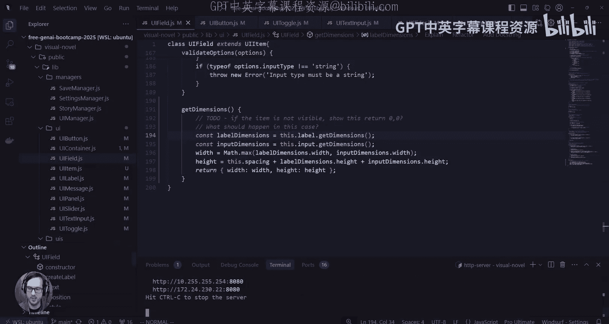

And here it says UI container is not defined。

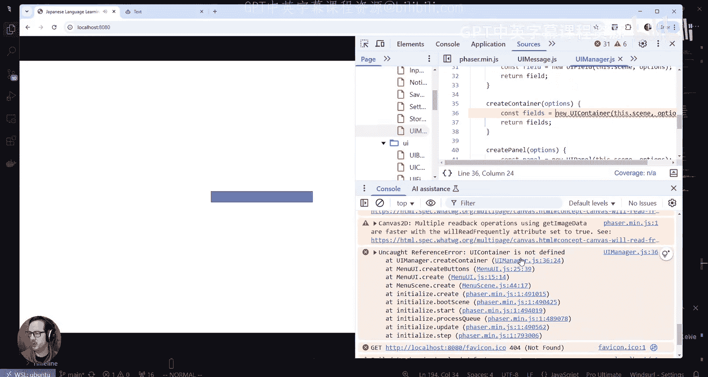

The why container is not defined。

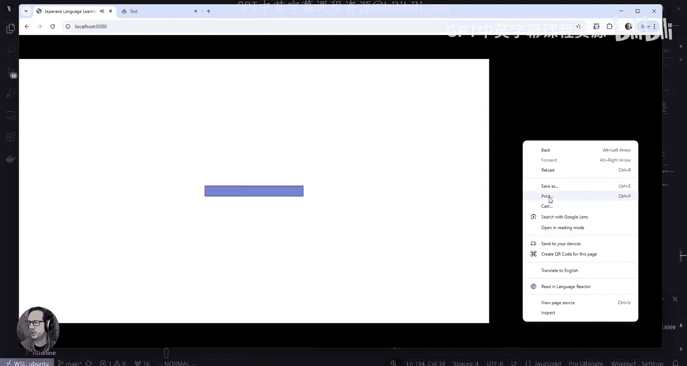

Fair enough。We love that generic error， UI container is not something's not defined。

We' going to our UI manager and says that it's not defined U container。

 That normally means that there is some kind of problem with something。

 So we're going to go over back over to here。

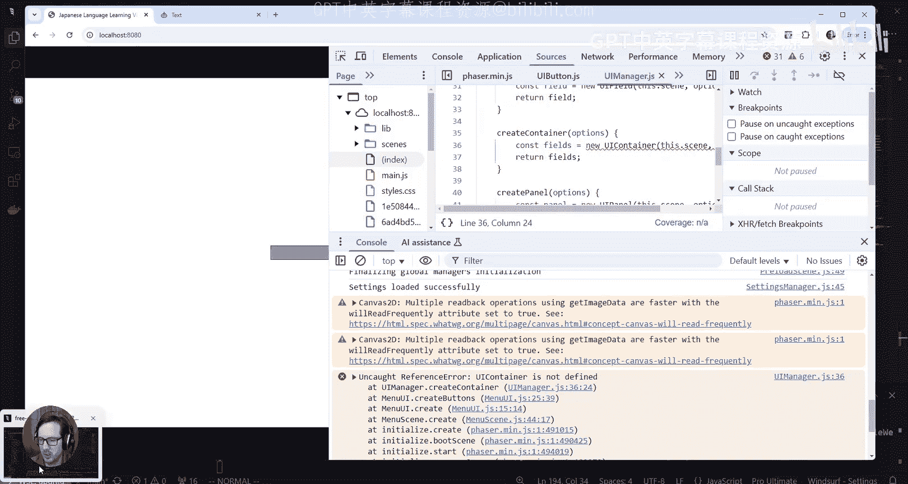

We we normally have this problem when we forget to include something。

 but I believe that we added UI item into this， right？Actually， we don't have it in here。

 We haven't used it yet。UI item。 We actually haven't tested U I item yet。 Wow。

 I guess before we did those calculations， but we needed it to do the calculations。

 But I guess we really have a lot to work through here now。

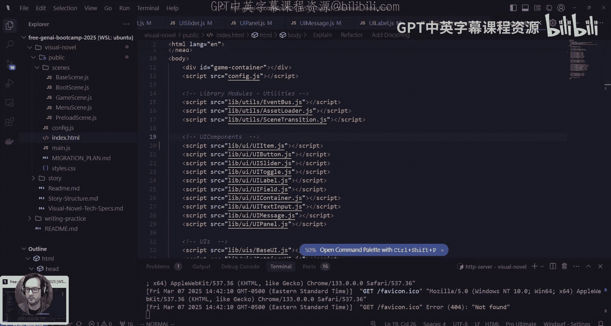

So we'll go back over to our code here。 We'll give it a refresh。 Now that's included。

 so that should be less of an issue。And it's loading。Do our containers start to find。

UI container is not defined。And again， this is a generic error。 It's not helpful in what it's saying。

 there's a different problem。T this。Right， and so that's what we need to think about what is。

 what could it be。

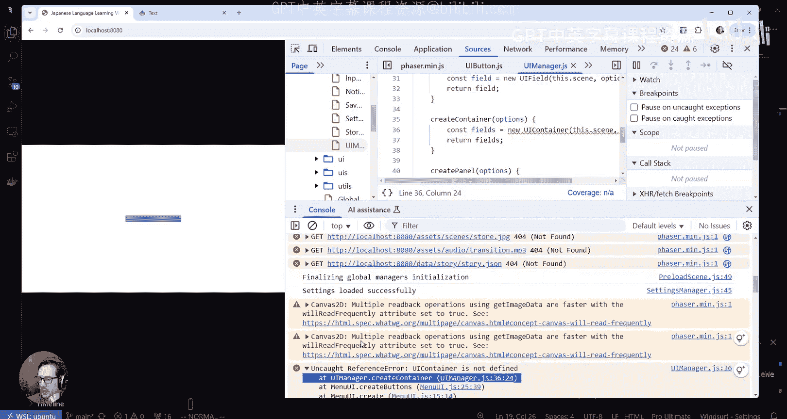

Because here's all of our changes here。Right， and so here we have index H L。 So we've added the U I。

There we have super here。I think we tested super and it was fine， right， Or maybe we didn't。 panel。

Field。UI Adam class， and we must have nodded of because if this is here and we didn't even put it into our HTML。

 we clearly did not test that。We have UI label。It's not like a lot of changes。

 I don't think there's anything blaringly wrong。But we do have that super panel thing。Right。

Let's go take a look at UI item again。UI item， UI item。 So that is fine。UI container extends UI item。

 we'll go back over to our index HTML。Over to here， we're looking， we have U I item。

 container is way， way down here。 It's a non problem one here。 We don't have U I panel in here。

 Do we， We do。 I'm going to put them together。 So it's a little bit more organized。

 I know messages uses panel。 So that one will come afterwards。嗯。Field comes later。

 items should be all the way up here。Label is a very primitive one。

 So I'll put it over there just so we have less issues。 So I'm not sure what its problem is。

 I would think that maybe it doesn't like U I item。So I'm gonna go。

 and we're gonna go into the U I item。 Let's do a debug。 Let's make sure that works。

 Ca I guess we never tested this Con log。UI item。I will put its item type here， right。Okay。

 and maybe it's just the way we're extending it。 So maybe our the way we define that is the problem。

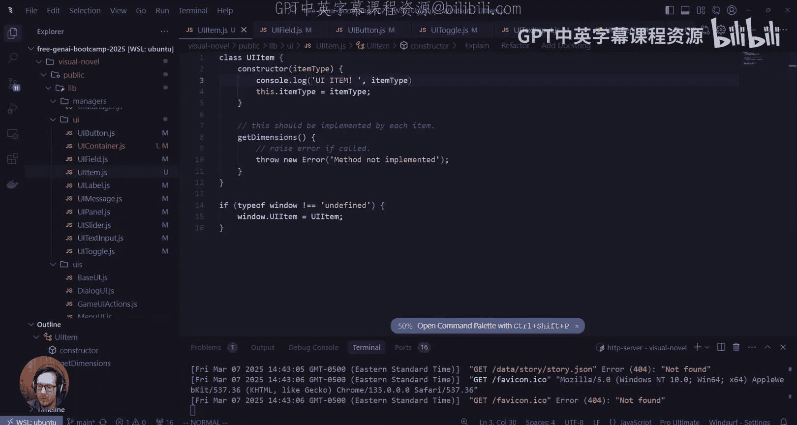

Because if it's not matching the signature， that could be the other issue here。

D like containers is not defined。Create container。

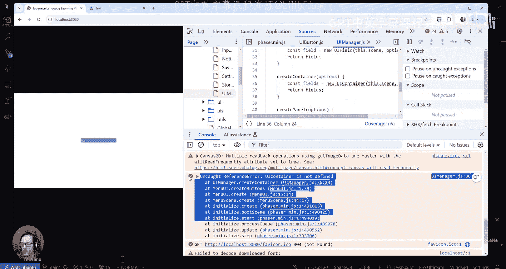

Okay， I just kinda feel like I don't have anything left in windsurfcause I've used it so much。

 We'll go ahead and here to say this。 You know， do you think it has anything to do。

With the new class extends。And how constructor works。For UI item。

Because that's all it can really be at this point， right？Oh， imagine we get this working。

 all this's gonna be so nice。 things will just flow and be beautiful and amazing and。😊。

I'll help you debug this issue， the issue seems to be that the UI container definition is defined in the scope where it's being used as the UI manager。

 that's not the problem。I'm telling it what to look at。

But it appears the container class is not imported。Okay， I don't think that's the problem， right。

 So we go over to container。 Let's go take a look here。So this one has。

 oh does UI container not have one？It doesn't。 I We can give it one if it wants it。

 But like some of them have it， some of them don't。You know，' I don't think that's the problem。

You know， I， you know， I don't think。That's the problem， focus。

On the constructor and how extends works when the signature of the construct constructor is different。

Okay， that's， I'm telling you what to do。嗯哼。😊，Let's look at the constructor UI to understand the inherentance pattern that's going on here。

So all these components correctly calling super within their respective。 However。

 there might be two issues。 The constructor might not be properly running all the way through。

 The global export is missing the U I container， and possibly other。

Things since other UI components are working， but containers not。

 let's check if there's a difference with that。 It just will not leave me alone about that。

 Let me analyze the issue here。诶。嗯哼嗯哼嗯哼。Missing export script or loading order。

 the UI container file might not be loaded before the UI manager。It is。Okay。

 after examining the code， I can see that the constructor pattern across UI components are consistent。

啊哈。😊，With extend class， you must call super in the derived Conor before you can use this。

Each of the UI components is correctly calling Super， which is a specific item， however。

 the UI container is not defined， suggests JavaScriptscript engine can't find the UI container class。

Since the constructor pattern looks correct， it just will not leave me alone about this。 Look。

 if it wants that， I'll go put it in all of them。 I just don't know why like I don't remember removing it。

 but I'm gonna to go here and make sure that it's in all of them。

 and then can it can stop complaining about it。So we' got one for a button。

 we apparently don't have one for button， so we'll do that。

Maybe the problem is that some of them have and some of them don't。

 I don't know why we even need it at all。 I don't feel like we should。嗯。But。

We will go ahead and set them anyway。

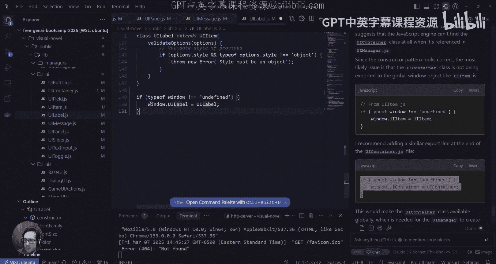

Okay， it's very easy to get them all in here。This one seems to be missing a curly brace。

 I maybe that was their problem。Right， because maybe at the bottom here。

 when we defined our get dimensions， it took off a curly， that's probably what it was。

That's almost certainly what it was。 But we'll go in all these ones and add them。

 even though we don't need them。 We'll go add them in here。 Okay。

 so now we'll go back and take a look here。 I'm going just stop and start。 It's been a while。

 re name so many things。 So I'm gonna to go over to here。

 and we're gonna give this a nice refresh here。Let's see what we get。Please， please， please， please。

 please， your is not defined。

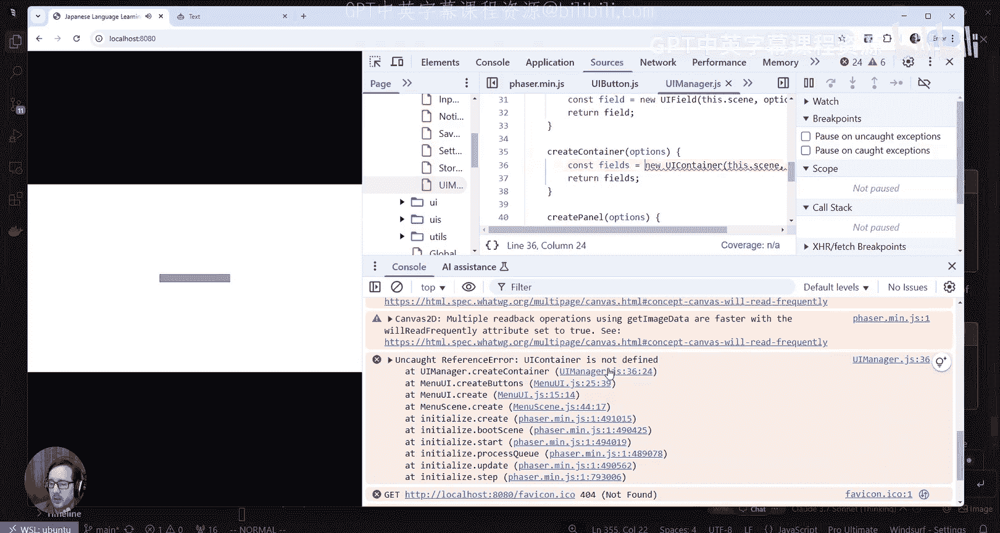

Oh， look， I， no， I， I added in that thing you asked me to。 I added it to all the U I。

 So U I components。So there's less of an issue。

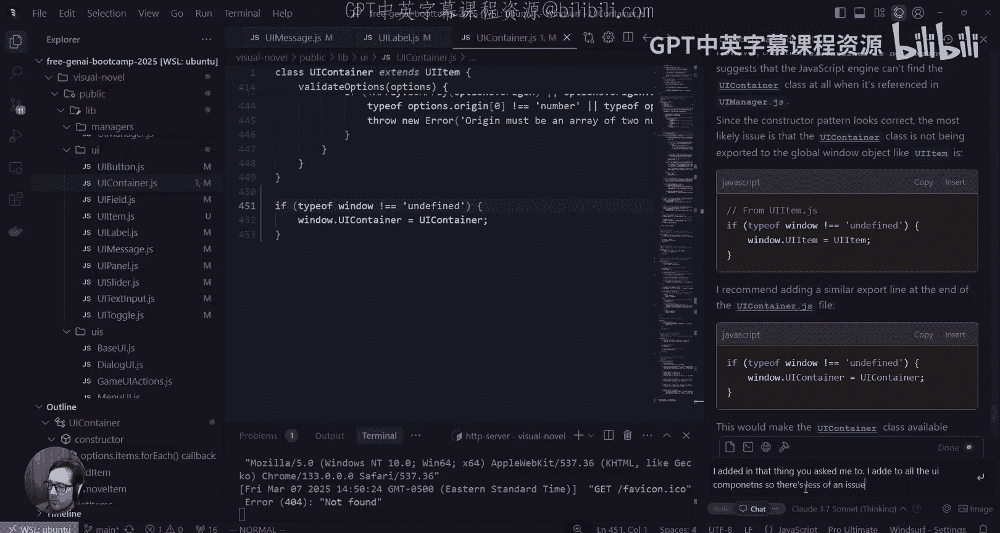

Right， I。And if we go here， we have window dot u UI container。

Like you wouldn't necessarily want to export that to globals like that， container UI。You I。Oh。

 interesting。 It's not there。It's not there。Why is it not there。

 There must be a reason why it's not there。 Let's Go back over here。

 Is there maybe another one that's called this。

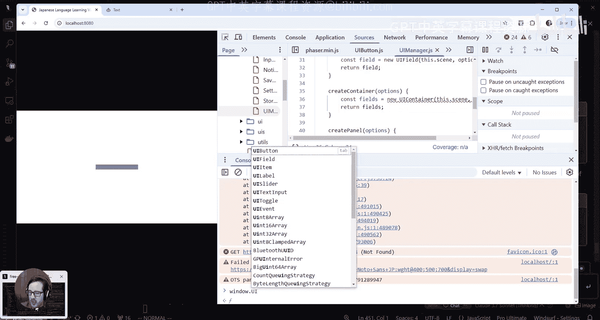

So like we have UI container here， right， UI container。Panels called panel， right。

 It's not called container。 It is。All the way down the ground。

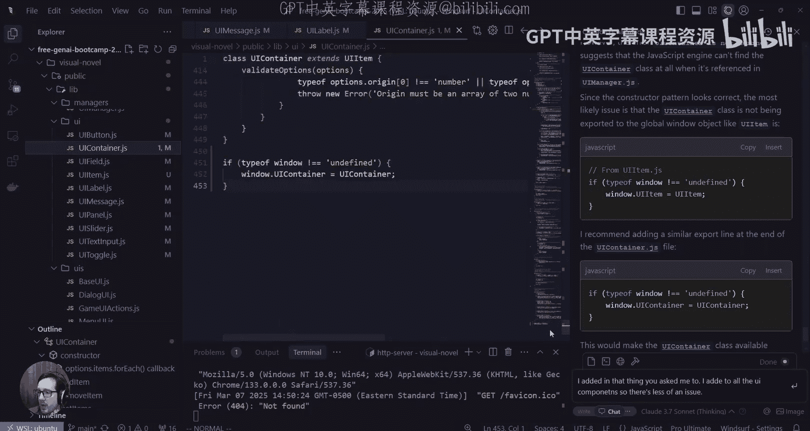

UI container。Sry this again here。Refresh。Window。UI container。 There must be a syntax here。

Let's go take a look here。Extends。Get dimensions， that's fine。That's fine， yep。Oh right。

 we' were working on that big old gross class， and we probably didn't rip it out completely。

 That's a problem。That's their problem。 The wherever that is， the get dimensions thing。

Because we wanted to see if there was more that we had to do with this。

If we can't determine the dimensions， use a reasonable defaults， total height equals whatever。

 whatever。I mean， this is its own gi dimensions。That's not related to the other one。

 We ripped out the other one。嗯。Okay， I， I think I thought I was singing with the other one。

 the the big get item dimensions。But we obviously have been making major changes here。Yes。

 let's get item dimensions here。 I thought I just got rid of that。Did we not？

Let's let's go over here， I can't see what I'm doing。We'll bring this up here。This is still in here。

 Okay， I think it's this thing。嗯。I don't think we need this at all。Get item dimensions。

Good dimensions for specific one。 Yeah， because we've already replaced this whole thing。

 I don't know， like all this does all this crazy stuff。 We don't。

 I don't think we don't even need this anymore。 This whole darn thing can go away。Right。

 and you know， if there' something I think it would be that， right。

 I think that was probably a problem。If there was a problem in there。

 we definitely ruin a bunch of code。And so here， you know。

 we're looking for we're saying window dot UI components， UI UI container， and now shows up。

 so that's good。 we go up here， calculate container dimensions is now gone。It is。

And that's under update item position。 So now， so that was their problem。

 There was probably like a syntax error。Update or calculate what's called calculate。

Container dimensions。This is now just。Get dimensions。Kit dimensions。 That's all it is。嗯。

So that's a lot easier。We'll go back over to here。I mean， this seems like a lot of work。

 but honestly in the the big boot camp， we did。So much debugging like this for hours。

 So it's not not a big deal。 We are going to go here and we have width is not defined。

It is not defined。 You are absolutely right。 That is in the UI field。 So we'll go over to UI field。

 I really wish I， my control T control P command worked in here。It might probably would。

 I just haven't put any time into it。 It's here that the problem is con and cons like that。

 that will resolve that issue there。We will go back over to here。This game's like 100% UI。

🎼There we go。 There we go。 There we go。 So now we can start seeing stuff。 We have this U I item here。

 I want to take that off。 That is a bit of a mess。And you might say， Andrew。That looks awful， but I'。

 I'm thinking that looks fine。So let's go here。

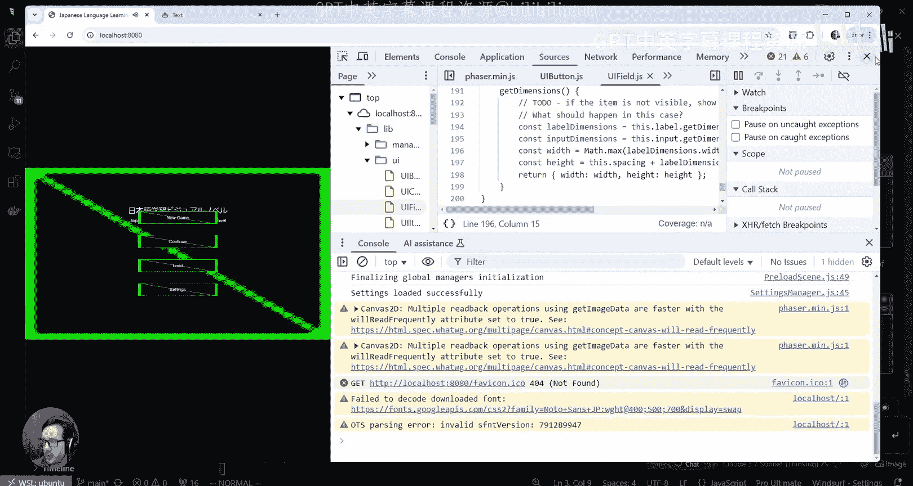

The real space out here。

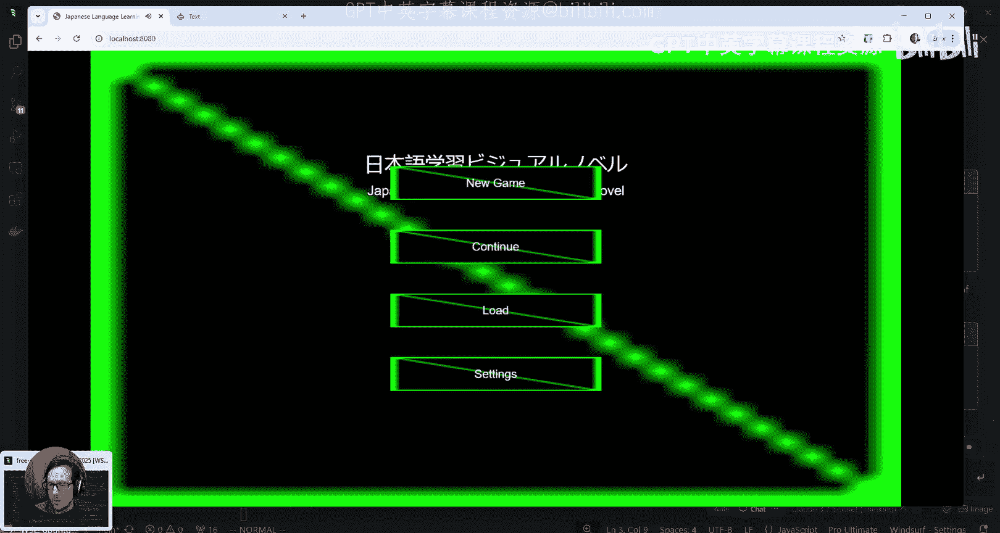

Let's go take a look at the logic for the containers， for spacing。Here we have update item positions。

 So this thing is responsible for setting the positions of them， right。

 We have our container dimensions。 calculate the the effective positions based on the origin。

We need to determine the total width and height apply first this thing here， the get width。

 the get dimensions。Is not useful， because。In order to。Set the positions。Then we would resize it。

 right。So this order does not make sense。Because， you know。

 we don't know where the things are going to be positioned。

 which is going to affect the dimensions of it。 So it's really bizarre that they chose to do it this way。

 And maybe that explains why the code was such a mess to begin with。

So update item positions gets called somewhere， obviously， gets called down here in the set layout。

Right。嗯。So。And this said layout occurs when。When do we call this that layout？What do we call that？

Where do we call that？Who calls that。Is it clear they're getting called somewhere。Set layout。

find it find。 Let's find us。Se layout。This doesn't look like it gets called at all。Okay。

 this this is interesting。So we have this big thing here。It's going to set the positions。

 but it doesn't seem to be called at all。 set spacing， updated positions。

 It is called over here in set spacing。And then when we set the position， it gets called here。But。

This set layout。Layout must be vertical or horizontal。

So I guess this is just kind of like a helper function to change the layout。 if you want to later on。

 I don't know why we would do that ever， but I guess it's fine if they want to have that there。

 And it's just saying what the layout is。But we've never used that yet。Now。

 that still means that this get dimensions is still in play。 This update item dimensions。

 and it's getting called in a few quite a few places， actually， Where does they get called first。

 When we add an item， it updates the item positions， that makes sense。 When we remove an item。

 it updates the item positions。 That makes sense。 When we set a position。

 So set the position of the container， Then we have to update the position of all of our children。

 when we set spacing， then we have to update them。 That will totally makes sense。

 when we set the visibility of something。It doesn't do anything。

 So that probably is something we need to do。 But anyway， we're now here。

 And so we understand where this is getting called everywhere。 The question is is like。

 I I got to switch back to standing， sorry。I'm always going up and down and up and down here。

 but the thing is， is that we cannot get the dimensions。Prior。To doing this up。

 because these dimensions are going to be wrong。Right。We want to。

Like we need to know where its initial position is。

Which we can get because that is set as the x and y， right？But we cannot， at this time。Tell it。

The start X start Y。 So here it's saying apply the original offset。To the starting position。

I don't know about that。And here we have code， it's not even that complicated。

But we have one for laying out horizontal and vertical。嗯。

And I would probably be more explicit here and I'd say like Elif。

I prefer that because then we can exactly see what's going on， but anyway so。Yeah。

 we need to rethink the way this thing is working。 So if we're vertical。

We're starting wherever this position is。The other thing is that it really depends on your origin as well。

 so like see origin X origin Y， I don't know what origin X origin Y is though。

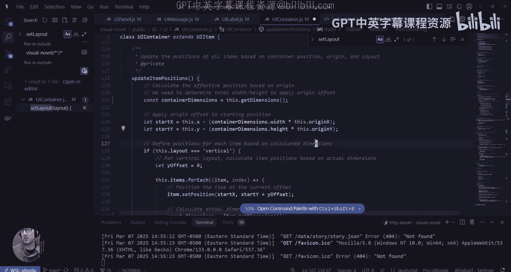

好。Okay， so we'll go here like， what is。

X versus origin X in phaser。 like， I don't know what the difference。Paser has origin 0。

0 in the upper corner where position X coordinates go to the right。 position Y go down。 However。

 Or origin is a mathematical Carcisian or coordination system is the center of the screen where。Okay。

 so what are you trying to get at here。0， zero， right。So what what's the difference？

Just simplify it for me here， Game objects。

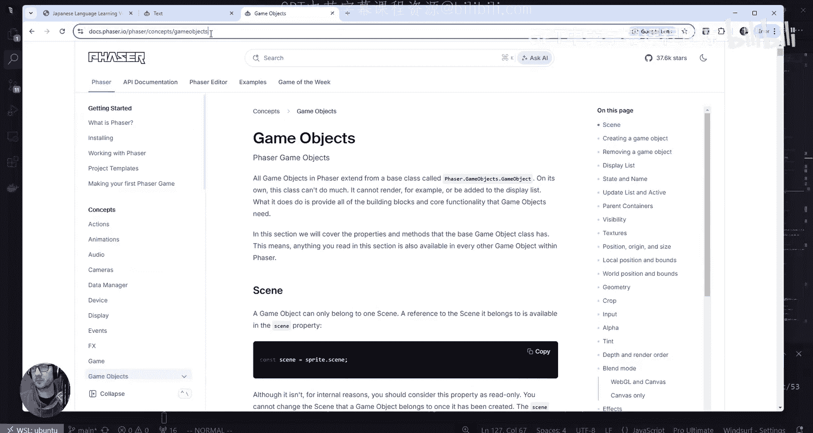

I'm going to go over here and ask。嗯。What what is the difference。Between。X and。

Dot origin X and phaser。Like what is the difference between those things， I don't know。

 my head's cut off， I'm apoizing here for that。We just look this up a bit here， there we go。

We get a nice big explanation here。 So X represents the absolute X coordinate position in of a game object in the game world。

 It defines where the object is placed horizontally。 Its raw position。

 Orin X represents the horizontal position of the game object。

It's value between01 that determines which part of the object。Okay， so。The horizontal origin point。

Okay。How would it know that。If。Okay， so how would origin。X be calculated。For we'll hold on。

 I this going on the。Soys this。orin X， right？How would he even get that？It's setting it up here。

 set the origin。 Okay， so because I was going to say this is not a game object。

 So we'd have this would have been defined by us， right， so。What I'm thinking here is that， yes。

 we get the， we can get the container of dimensions， but not at this point in time。

 this makes no sense。So I'm going to go ahead and comment that out we need to start off by setting up where things get constructed so if we have a list。

 right？And there' are three items。We would build it from the top left corner。

Of where it's positioned。But the thing is， is that if the origin was set to something else。Right。

 so let's say origin was 0，1，1 being wise on the bottom。 So build from the bottom。

Then when we add it to the thing， then everything should be appear above origin so that when we position the objects。

 it will move accordingly to that。So basically， we'll have to do an update after the fact。 so。

 but the only way to do that is we need to have the container dimensions in order to do that。

 And that's why they're doing that。 But they're doing this in some really weird。Order。

 so when the this layout。We have。How about these are separate functions not like there's not much going on in here。

 but we have for vertical calculate item positions based on actual dimensions。For horizontal layout。

 use standard positioning logic。What are you talking about。

 We actually use actual dimensions for everything。 So let's take that out here for a moment。

 And so here we have the Y offset。And we need to iterate through each item。

And here it's saying position the item。At the current offset。Start Xstar Y。

So we can go here and we can say let。Start x。Start why。We would never have to change。

This X to anything else， because this would always be that we don't have to do that。

 We're only manipulating the y here。And so really， we have a Y offset。This is this dot y offset。

 this dot y。Which is where we are right now。So， here。This is going to be this do why。or sorry。

 this not why offset， so set that position。And this says calculate the actual dimension for the item。

Add the item plus the height space to the offsett。Which is exactly what we wanted to do。Right。

 so we'll do this。 I'm just going to put these comments here on the end。 We don't need them really。

 It's very straightforward on what this is doing。And so， now， we have。A function， right。

 So it's going through。 It's iterating through。 That's very clear of what it's doing。

 This thing here， we'll call it X offset。And this one would have the same thing because it's going to be the exact same process。

We don't even I don't know why we have for each index。

 I guess index just can be there if we want there。And so I'm just taping。

 I'm assuming this is just gonna do we need。 And so here it's just doing the exact same thing。

 It's just spacing it the other way。Right same thing is just swapping out the values in reverse。

This does not take an account。The actual。Offset of origin。

So this is always going to be the top left corner。 So if we say the origin is zero down bottom。

 then we're going to have some issues here。 But with the thing is that we could still do this。

 but we'd have to temporarily store。These numbers or we'd have to run through them again and offset them or because like until we actually calculate this。

And know exactly where things are and then know what the height is after this。

 because we would only get the height after this， then we'd run through it again with its actual。

 we'd reset them， and then they would be in the correct position。Yeah， so， you know， to do。

 put this to do here。To do take in account。Offset。And iterate again。So this is where， you know。

 we might want to refactor these into their own。These into their own functions here。

 like vertical offset and stuff like that。 so we might go here and just say。Vertical。

Update item positions。I only need one underscore here。

 and so I'd go here and just cut sell like this。And same thing with this one we'll say horizontal。

Item positions。And then I will go ahead and cut the cell like this。

And I'm just prepping it for that an eventual step here。

 And then we would just go here and we call vertical。But and then same thing with this one。

Ororizontal， the only thing is that we want to feed in。What the initial offset is。

So here we would just say like offset。We go here and this would be this dot y。

 and this would be this dot x as our initial offset， and so here this is going to be y offset。

And this is gonna be。X offset。Okay。So， now。嗯。You know， we are， we are getting something we want。

 So doing this because we're gonna probably end up having to call this again twice when we。

 when we do this over here to take in account the offset。

 So it'll position it one time and then position it again。 Is there a better way to do it。

 I don't know。 I'm not， I'm not like a super programmer so。

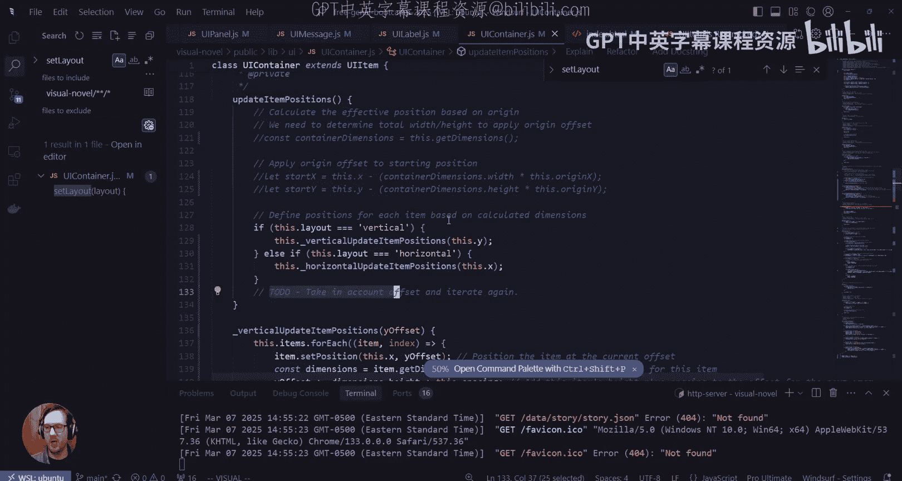

Or not a super， I'm， I'm a super programmer， but I'm not a super computer algorithm like I'm not graded algorithms。

 Okay， I'm， I'm good enough to get things done， but I didn't do compci。

 So compai folks that you got stuff on top of me here。😊。

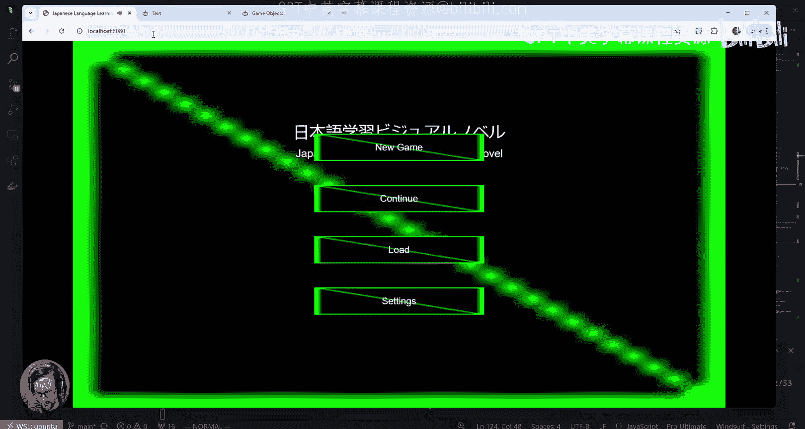

So here we still see things that things are rendering fine。 Nothing's breaking。

 This was rendering really， really good。 but the space here is still a little bit insane。

 That doesn't mean that there's anything wrong。 It just might be that the spacing here value is larger than we think it is。

 So what I'm thinking here is， let's go take a look at the menu。

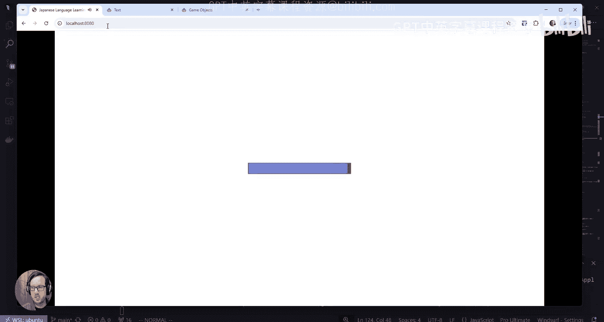

Here， menu U I。 let's go take a look at what we actually set as our space。 So spacing here is 20。

That doesn't seem very large。Right， so I'm not sure why it's doing that。

 We'll go ahead and give us a tab。Did that reduce the size at all is try spacing one？

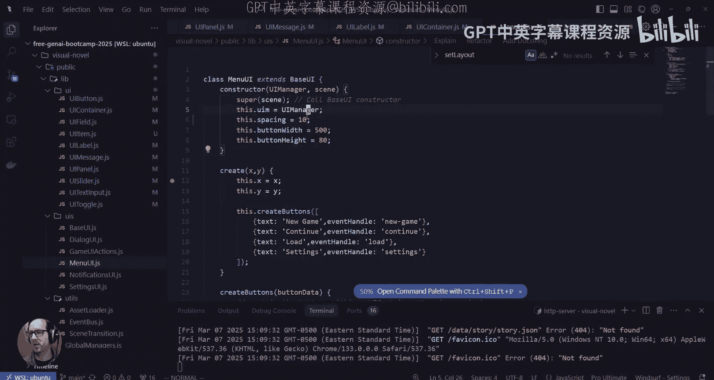

🎼You are here。

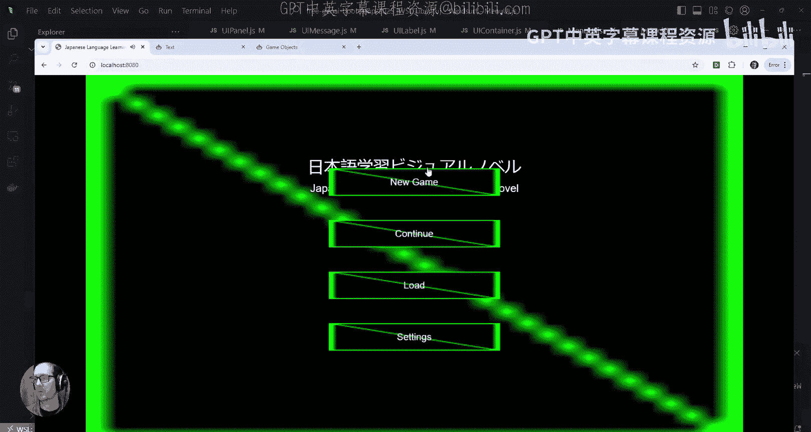

The other thing iss just make sure inspector is open when we're doing this just so that we are sure that is doing what we're expecting to do。

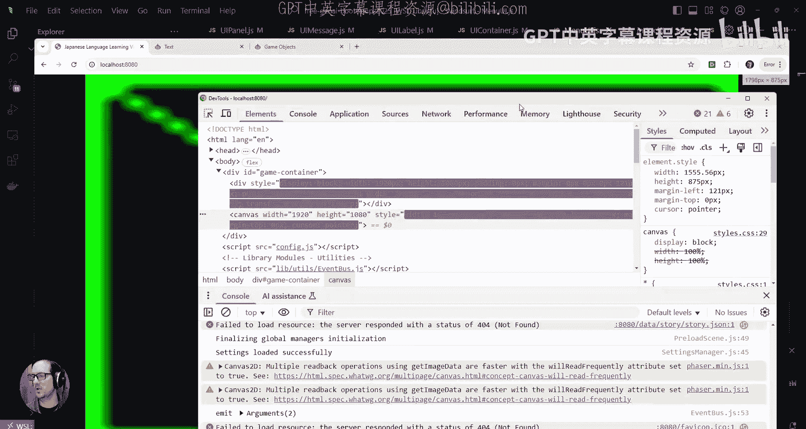

Okay。

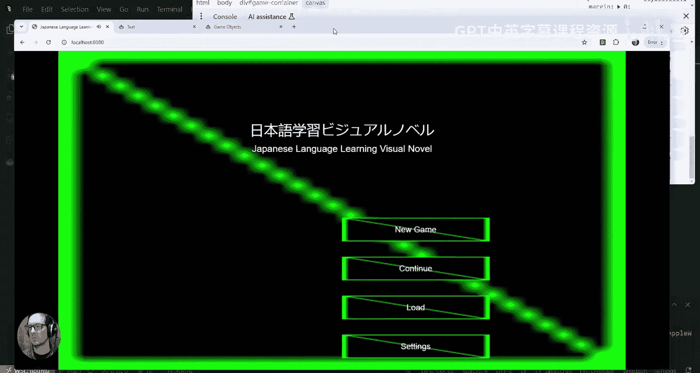

Oh， now jumped into a completely different spot。 That's interesting。

 But it's not taking account origin， right， because we said that origin is like it's going to go here to here。

 And so if we set origin 0，0 or sorry，0。5 to 0。5 here， we'd have to。Reposition this again twice。

 But what I'm concerned about is this space here， like why is it not respecting the spacing because we have spacing one here。

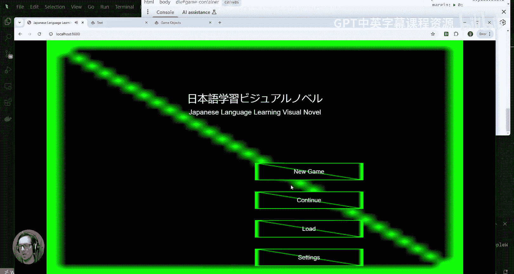

A deposit it's actually being fed into here。Here， I have origin 0，0。

 and we have spacing spacing right here。 So we have one。 and I want to go back over to the container。

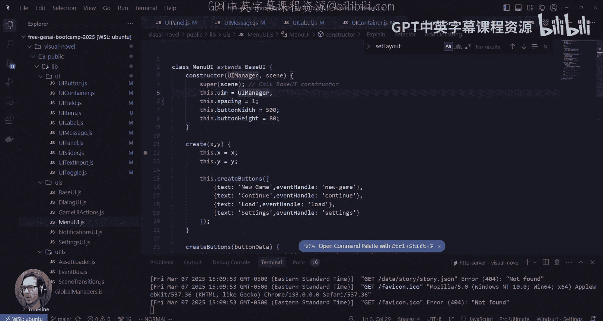

嗯哼。😊，And there is a default spacing， I don't want that。

 I wonder if it's actually using that right now。That might explain what's going on here。No。

 it's just not taking any spacing into effect whatsoever。Interesting。

Because it's not like the code here is complicated。Well， now it's not right。

 as we really simplified it。And so if we go down。To hear into our vertical item positions。Right。

 so we have dimensions height。Right。This starts spacing。So all I can think of is like。

 maybe the issue isn't that。 It's like what is the button size。Look go the buttons here。

So we have buttons here。And we have。Here。The button， the button is set based on these positions。

It's sized based on the sizes provided， right？嗯哼。😊，So this shouldn't be a problem， the Texas Center。

 that's fine， we don't care about that。All you can think of is like maybe it's the display height。

 like what if we try just height， like what do we get if we do that？🎼Interesting。

 See I thought it would have been display height。

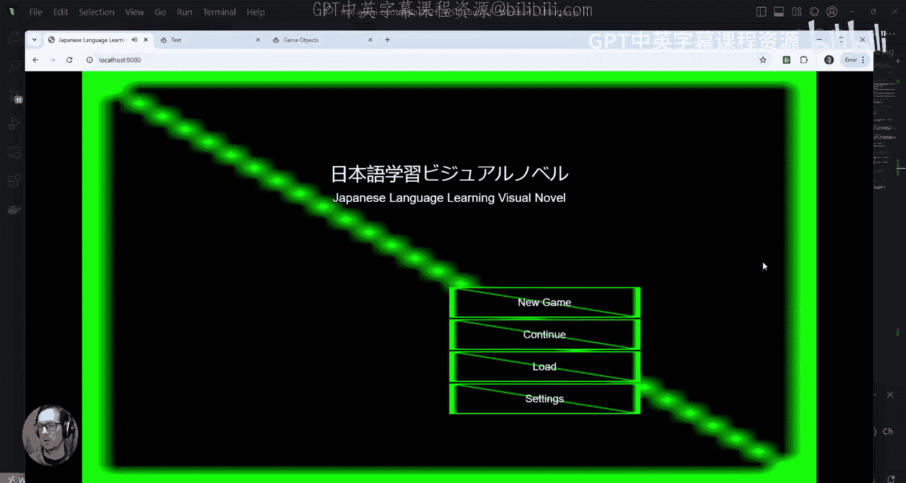

All right。We'll just switch it over。 So that kind of explains that problem there。

 I'm really confused。Height versus display height。Per 3。I don't know special functions。

 but there's no extra calculations。

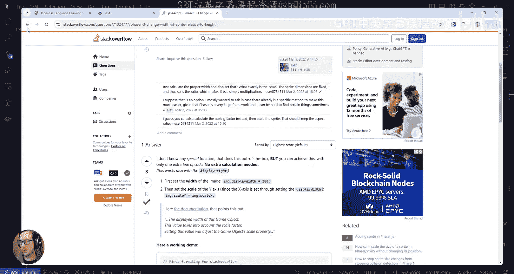

So， let's go see if。Height versus。Display height。In。Pser。Three， what's the difference？Okay。

 so represents the original native height of the game object texture and remains constant unless you explicitly change the texture。

 not affected by scaling operations for images， represents the actual rendered height of the game object on the screen。

 changes when you scale the object using set scale or set display size。

Reflects the player actually sees calculated display with display size。

 We have set display size or set scale。嗯。So here we're doing set display size， though。

So I don't think this description is accurate， but。I'm not sure why it's trying to get rid of that。

 But anyway， the point is that we fix it。 I'm not sure why it's doing whatever it is。

 It's beyond me at this point right now， but we'll go back over to our menu I。

 and we'll give it a little bit more spacing here。And we'll go back over to here。

 But at least we know。Our code。Is now in almost good shape here。

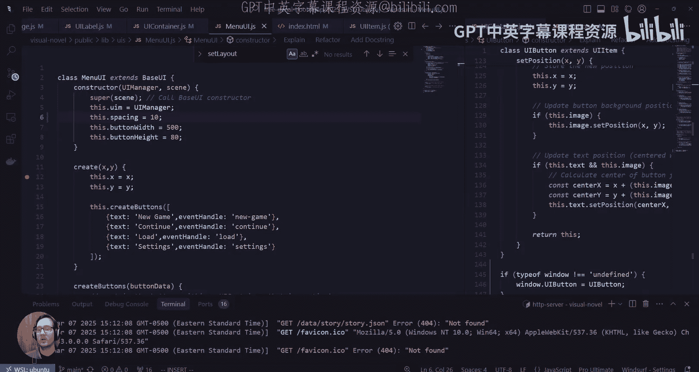

We。

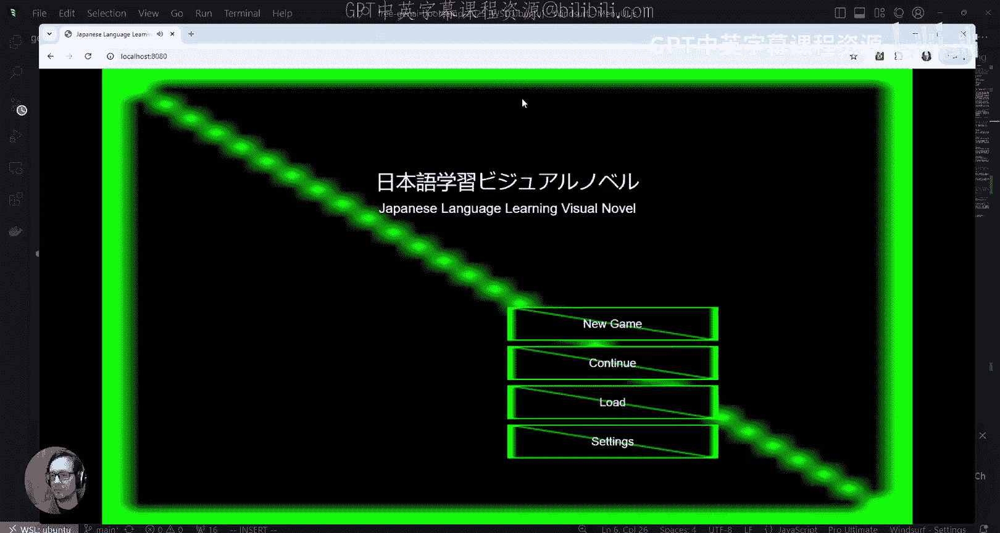

We don't have it centering on origin， so that's something I'd like to fix。

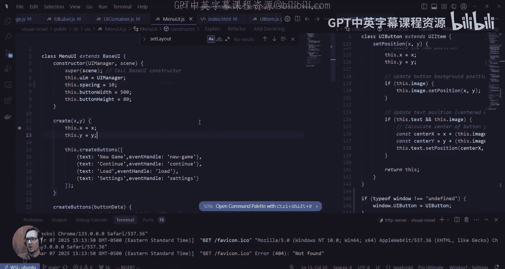

That shouldn't be too hard as we did take the time。To refactor these things out。

So here it knows what its positions are， right？

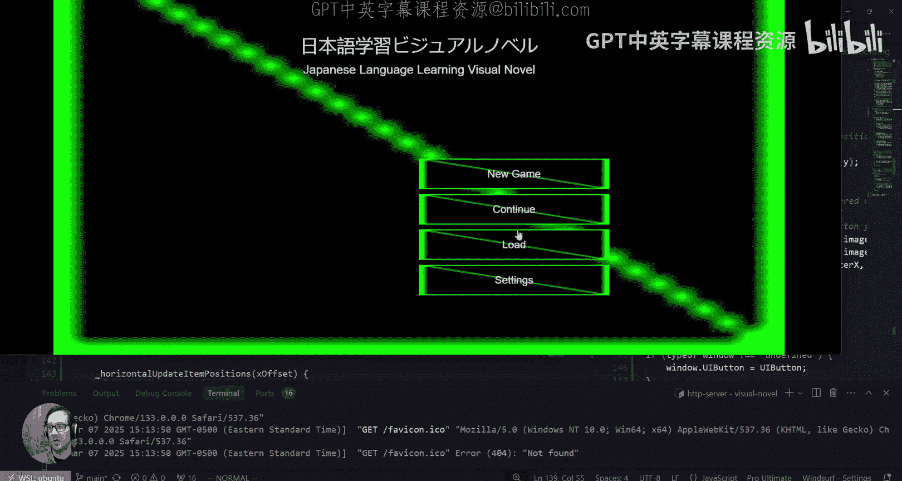

So now all we need to do is we need to go and iterate through the objects。Okay， and we need to。

Apply the offset of the origin。Okay， so。When we iterate through the objects， we set the positions。

 we get the dimensions of the objects。But I feel like we could also try to get the positions of the objects as well。

So whenever we even have that as a function， let's go take a look。

If you got to feel like here should get dimensions， we should have。Set position。

We should have set position。We should have gap position。So these are methods I'd like。

Probably probablyably does as well， I'm not going to ignore that for now。

But these are the ones that I stop it。 Stop it。 Stop it。 There we go。 These are the ones that I'm。

 I'm kind of concerned about。 So we go here。 So I'm wondering， let's go look at set position。

We have that， do we have gap position。I guess we just checked by going here in the outline here。

Because if we can get the position， we don't have that。If we can get the position。

Then that's going to help us out。Get position。The aesthetic thought why， Oh yeah。

 that's all it really is， isn't it。That's all it really is。

 Do we need to even have a get position then， Because all these objects will have an X and Y。

 So we don't need to do that， okay。That makes sense。 So then here。And this will be like。

 we'll just do this again， so this will be vertical update offset item position。By origin。Okay。

 and so。Here。I'm just trying to think about this for a second， because。

I did this because I thought we'd have to call these again another time because we'd have to iterate through it and reset the position。

 So here， if we have the y offset。 But the problem with this is that we actually have to set it both on the Y and the X。

 It's not just a single position。 So really， it's update items。The slide should be update items。

Update items based on the vertical position。So let's take a look at what we have here。It's not that。

 right， so we'll do this。And so after this， we have to do。This dot update。Items on this。

 And so this is actually going to be based on the coordinates。 So before we didn't。

Need the dimensions。 Now we do need the dimensions。I me just go here， and。Grab this here like this。

So， here。I mean， we don't really need to do it that way。 We just bring it in here like this。

But the idea here is that。We need to get the container's dimensions， right？

Because then we know this is how we can figure out where its actual origin is。

Because they have origin X and origin Y。 And so really， this will actually be the real。

 the real X and the real y。 So we'd have this would be this would actually be X。

 This would actually be Y。 So we have container dimensions with with times the origin X。

So if you time something by zero。And then you minus it， then you'd get the exposition。

 and same thing would lie。 I' assuming that calculation is correct。

 I'd have to think about a little bit more。 But the point is。

 is that now we're getting the updated position。Right？But the thing is， is that we just。

 we don't need to do that。 We just need to add or change based on the existing one。 So sure。

 that's the thing。 But we really just want the difference of what it is。

So we don't even need to set a new one， we just need the x and the y based on those new values。

 and so this will be the new offset。So this would be offset X。And this will be offset y。

Why in this selection should just be equals， because now we know exactly how much if we're adding or removing from something。

 right， No， and I don't need that。 So we have， if we have the width， right。

 and we're time in by the origin。Then we， let's say it's， let's say we are。

Like think about the height， the height。 If we've put one times the height。

 then we are minus completely from the height to get the place that we want。

 If we are saying the origin is one。Then we are going to minus to move everything relative that。

 So I think actually， we just minus both of them from it。So here what we need to do。

Should stop doing that。I don't need to do that。 We need to iterate through the objects。

 I'm just going to take this off here。Item get dimensions。 Why do we get the dimensions， Oh。

 to figure out the next offset， But we don't need to figure out the next offset。 We just need to。

Change the offset of the current position。And it's kind of close。 But really。

 what it's going to do is we need item。Like this。Item， we're actually going minus both of them。

Because that should then。Put these。Into。The correct location。At least that's what I think。

So that's my best guess。Okay， and we'll go back over to here。

And hopefully I just wish that goes center， that'd be so nice if that just goes center。

 we' give us a nice， hard refresh air。

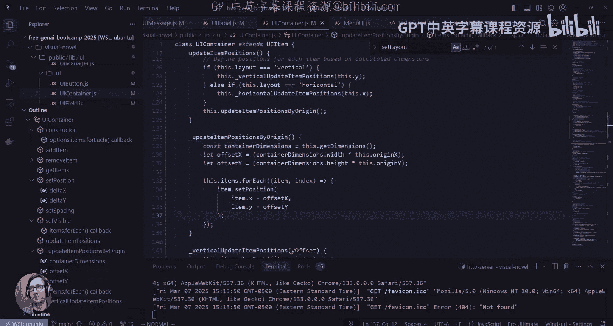

We'll go back over to here。What's a problem？Update item origin is not a function。 Sure， sure， sure。

 Well， to be fair， it looks like I probably forgot to put the underscore。

 I'm just doing thatcause it's an internal function。

 It's something I don't ever want anybody to call。I don't know what it did there。

 It's really trying to change my code。 Please don't change my code。

 I did not ask you to change my code。 Okay， we'll go over to here。And we'll give this a refresh。

We go back to our inspector。Not a function。 Okay， I think it changed my code again。 So we'll go here。

Right。I'm not even going to let you change it。 I'm going to change it myself。

 and I go back over to here。

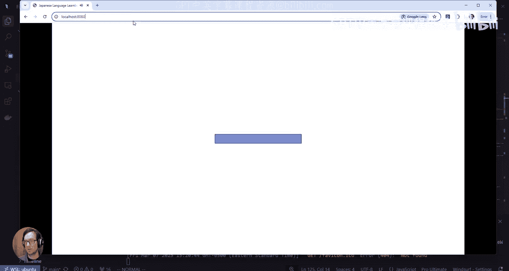

Okay， so something definitely changed。I think。Right， something changed。

The easiest way to know is for us to fiddle with this a bit because I want this to go center。

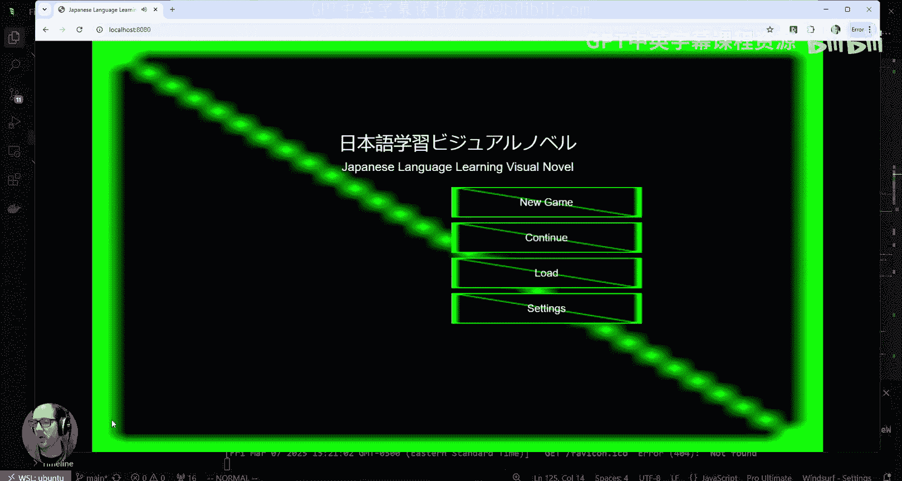

So go back over to here。嗯。So let's just think about this for a second。I have a with。

And if I want to make it， if I want to make the origin。To the right。Right， that is where。It's tricky。

 right， So if I have the offset of X。嗯。Give me a second。 a pause here。 And let me think about it。

 It'll be back in just a moment。 Allright， so let's go to visual here and see if it helps。

So we know that we want the menu to be center in screen。

 And so the way we calculate that is like we first need to say where we want the container to be。

 So we go， what's the width and height， We cut it in half。 And we know that this is the point。

That we feed into it to say here this， well， didn't I mean make that line green。

 We'll go back or black， but we'll go back over to here， right？ And so we know that。The position。

That we sat。The X and y for the container is here right here， right。Now。

 when we're first doing that first render。It's going to render everything here。

Because it's going from the X and y of this position。Right。

And the reason we can't do that initially first is because if we try to put it here。

This the centering only works when we know what the width and height are， which we don't。

So we have to render it first in positions here。So we know that the origin for the object。

So here it's rendering here in the top of corner， but we actually need it to start over here。

In the oops。In the center。Right， so if we， if we get the width and we say。

 what's the width and we say times divided the origin。 So 0。5， they'll get us。This value here。

 same thing for the height。 If we figure out the height and say this。

 we're going to get those values。 And so that's going to be those two offset values。

 And so in theory， if we were to minus it。We might it here。 This would push the objects up like this。

 Hol on。So it would take the objects， and would push them out to here。

 I'm going to see if I can get another square here so we can get a better visual for this。

We have this and we have it here and we minus it to minus it， right？That's half the size and that。

 then it should end up in theory in the correct location。

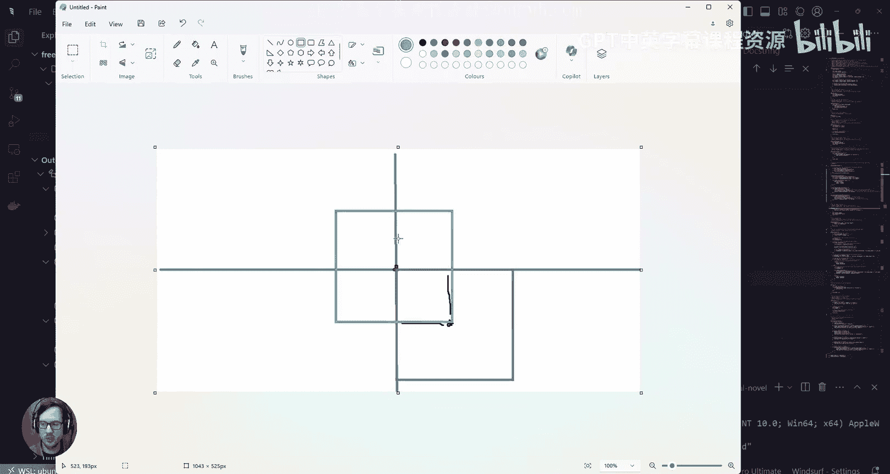

So that's what I'm thinking。LetWe go back over to here。Right， we have update item positions。

 We say get us the container dimensions。 What's are with times of by the origin X times it by the origin offset y。

So sorry， origin Y。 So now we have our real offset that we want them for here when we want to set the position。

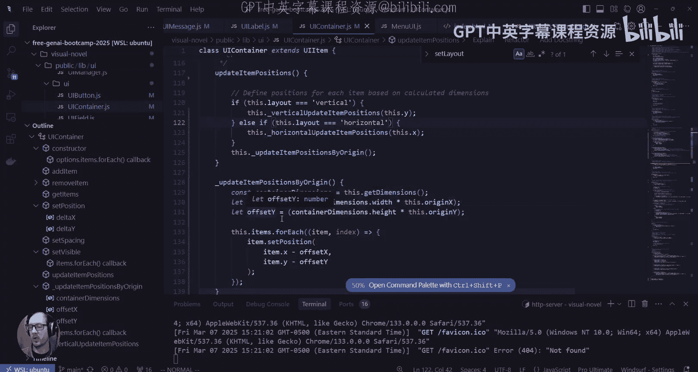

We know that position starts in the top left corner if you go this way， if you add here。

 it goes to the right， if you add， it goes down。Right， so when we are。

 if we are here and we want to go back this way to the left， we need to minus it。

 but if we want to go back up， which is the reverse， we have to add it。

 but we're hitting we're actually doing minus on the y， I believe， instead of a plus。

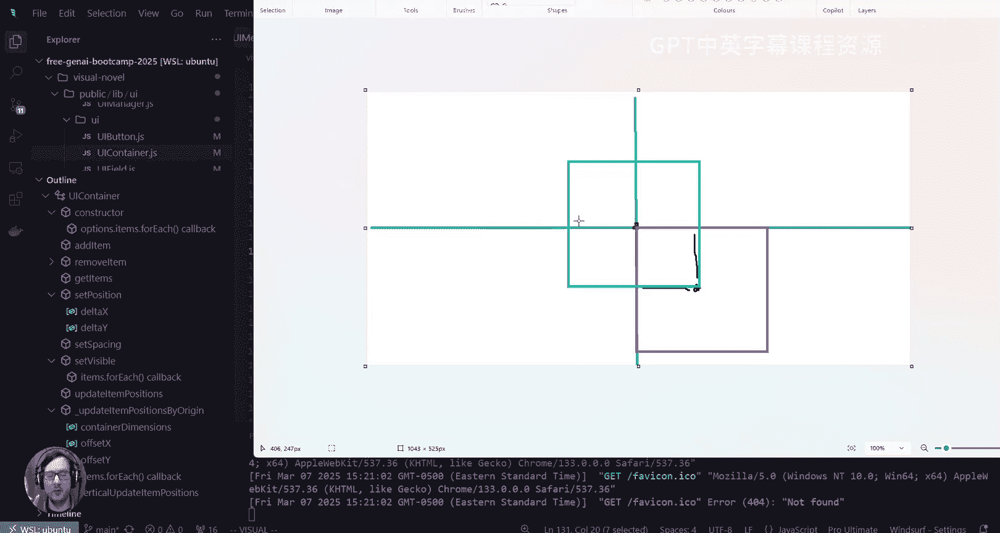

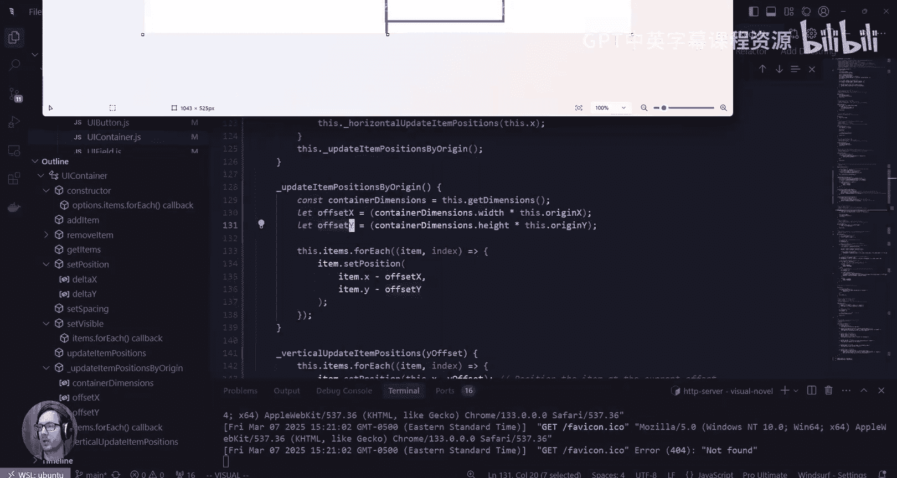

Because。Well， let me think about that for a second。No， no， no， no， so if we go up， right。

 like this is like let's say this is 100 and100。And we want to go back。

 We actually have to minus and minus this way。 Yeah， so stepping back in both directions is minus。

 So it makes my implementation look correct。 So that looks correct。

 And so this will only work if the container dimensions is correct。

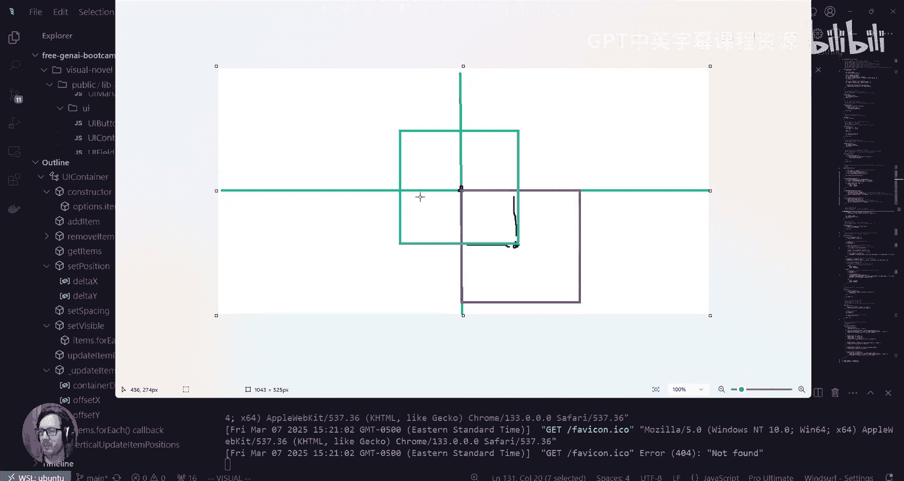

So we'll go back over to here。Andto here let me give this a refresh。

But this is not positioning where we want it to be。It looks like。Looks like the x is the problem。

 right， so the x is still right on that line now if we were to take this out for a second here。

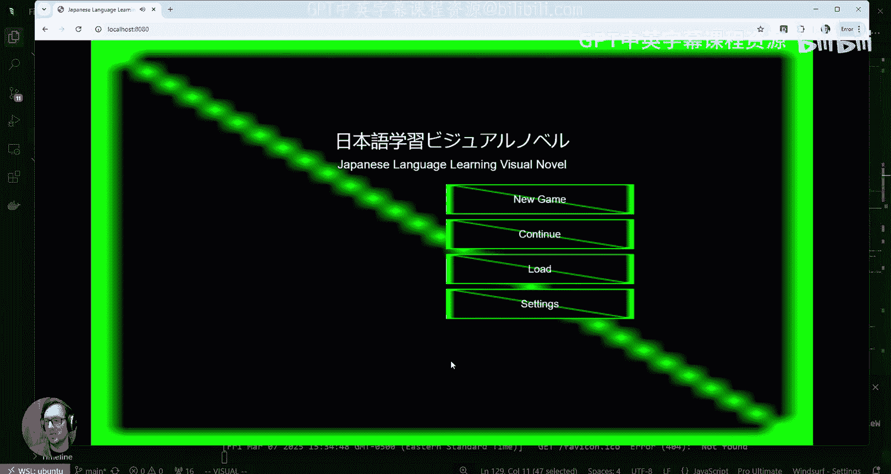

Okay。And we were to go back over to here。

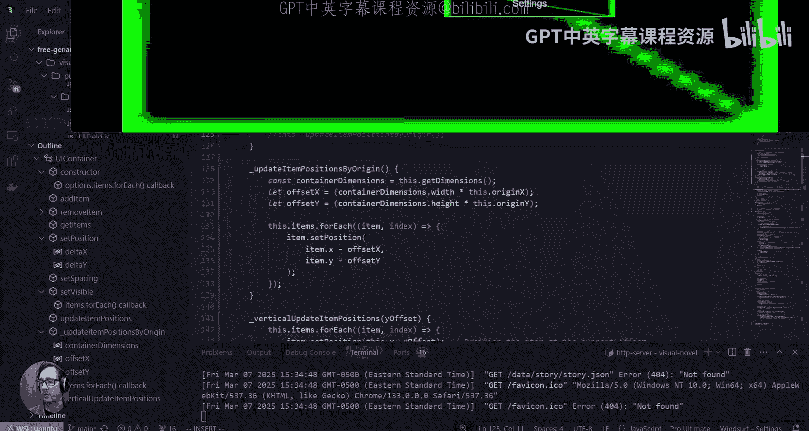

Right and refresh this。 What do we get， So now it's in the correct position。

 So now we want the this to be center center right of the origin。

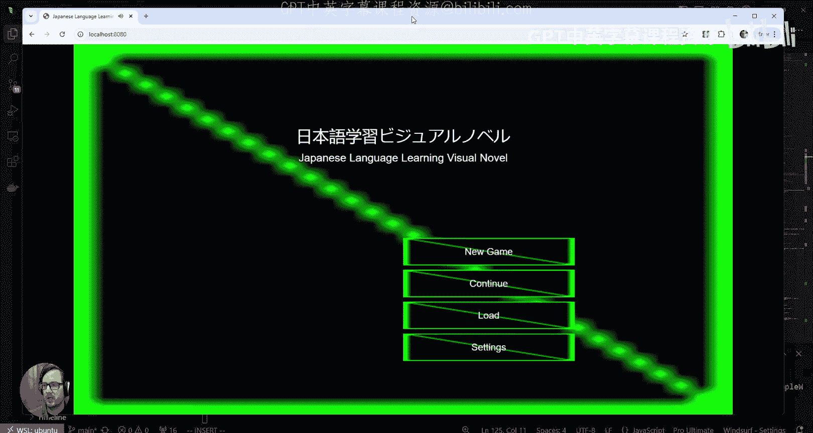

So we'll go back over to here。Right。And。🎼It looks like the Y is okay， but its the X is the problem。

 So the question is like， it could be the dimensions。

 but it also could just be whatever the origin is。 Let's make sure our origins are correct before we do anything else。

 because maybe our origins aren't what we think they are。 So to go over to menu U I。

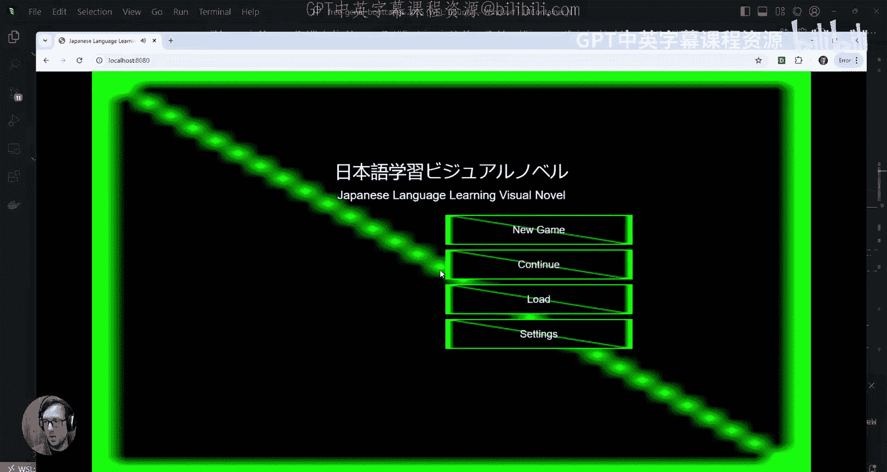

We define this， it's 0。5 and 0。5， so these are the origins that are being set at this time。So to me。

 that means that those are not the problem， those are correctly set as what we expect them to be。

And so if we go back over to our container， what it makes me think is that the。

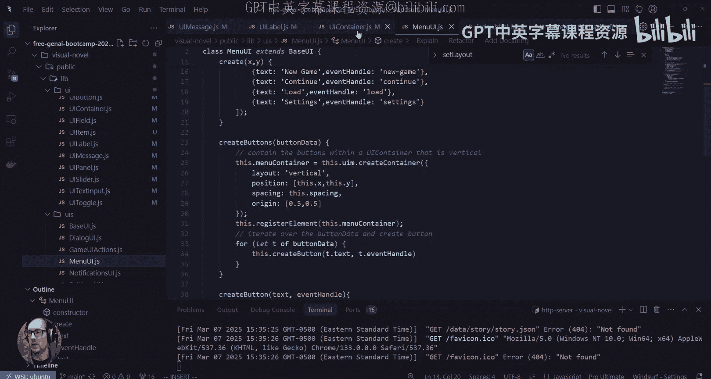

X being calculated。The X being calculated is wrong。Sorry not that not there。

 but go back all the way down to here。 Yeah， width origin X。

 So it makes me think the width is a problem。And maybe the width is actually returning back zero。

Right， that's probably my guess here， so I'm going to do a console log here。

That's going to probably updated a bunch， container dimensions。

And here I want to say container dimensions with。Well， and there's only one container in the scene。

 So it's only going print this out when we load it at the beginning here。

 So go ahead and we'll give this a refresh here。

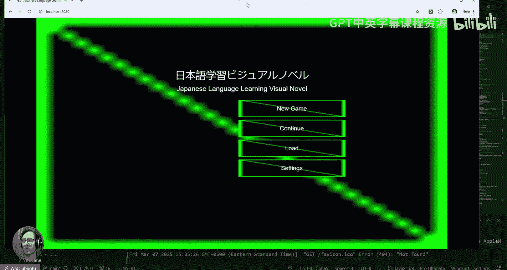

I want to inspect this。

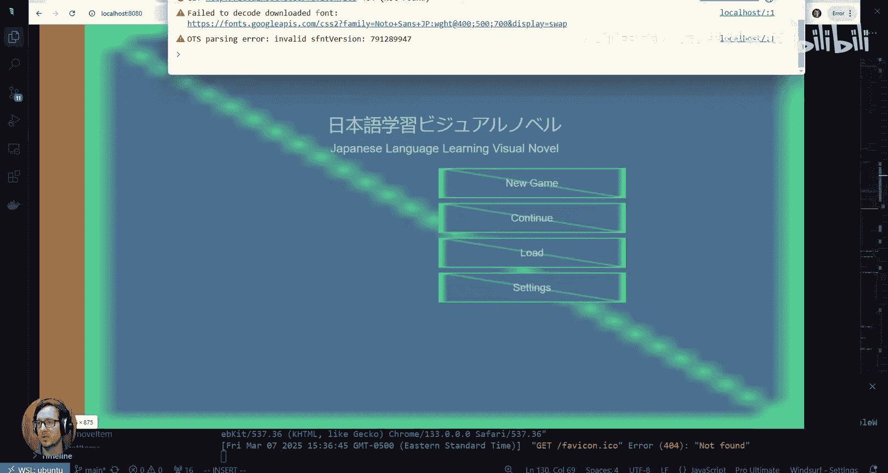

Here we have container dimensions 32，280，280，280，32，84。 We have a few different ones。

 I'm not sure why because those other scenes should not be loaded or created。

 and there's only we'll hold on。 There's actually containers in our settings page， right。

So that could be what's confusing us here。

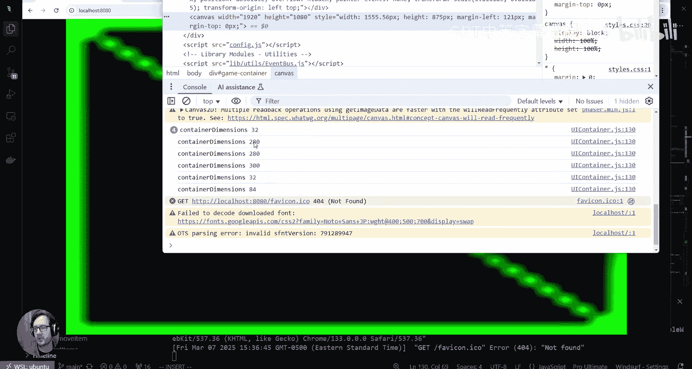

So maybe as a a quick fix here， we'll go over to here， I just need to disable。

Some of the codes that we're a little bit more focused here in our menu。

 so let's go to our menu screen。And in here， I have UI settings。

 and I'm just going hide that for now。Do we use it somewhere else？Only when we call it。So for now。

 I'm just going to。Do this do UI settings。Nll， and I'm going to go ahead and just comment this out for now。

Hopefully it'll let me do that because I need to get clarity in what's going on with our debugging here because I can't see what's going on。

So we'll go ahead and we'll give this a nice refresh。

🎼Alright， And so now we can see。

The only thing emitted is this thing， this 32 here。

There's no way that this is 32。Right that's not the actual width。 And so that makes me think。

That the calculation。For the UI container， its width is not correct。

So we need to go up and take a look at the get dimensions function。

So I believe that's how we are calculating here in the container right。

 so you have this get dimensions。And on here we have get dimensions， so we have width。Z， height zero。

 total height， total max width。 So you have max width here。

And we have the max width of whatever set in this thing。Which， I'm not even sure。What that is。

 max width a zero here。So for each item， get back the max width。

And then it continuously feeds it in and sets it as that thing。But here it says dimensions width。

It's getting dimensions of each of the items。So there must be an item greater than 32。

 There's no way that there're only just 32。 so let's go ahead and'll do console log。Dimenssions。With。

I'll put I I on this so that we can see。What's going on here for vertical layouts accumulate the total heights。

That's interesting。 It's actually doing it within the item loop here。Why is it do it here。

 which is kind of interesting？So maybe we need to well， there's way more going on here。

So maybe we need to carefully read what's going on in this get dimensions for our UI container because clearly。

 this is not correct。 So we have used base dimensions of no items。 So here。

 if there are no items and it's 0，0， that totally makes sense。

 get attempt to get the actual dimensions from the items。 So we have max width。Total height。

 it's where it's like max width， total height， it's more just like total height and total width or or we'll say max height here。

 so this is a little bit less confusing。And so now it says examine each item to get the dimensions where possible。

So if we couldn't determine the dimensions， use reasonable defaults。

 calculated total dimensions based on layout。This is this is complicated。

 I I don't understand what it's doing here。 So I'm going to。

 I'm going to go ahead and just blast this all away because this is just a big mess of code that we do not need。

This is not that complicated。This is going to be total width and max height and max width。 Okay。

 so now。What we want to do。So Max width is a little bit different because it， well， first of all。

 depends if we're displaying this horizontally or vertically， right， Do we have those options。

 I think we do to display things horizontally vertically。

 So we have to determine the difference between those two。

 So I'm gonna just take all this that like we want the loop。 I'll keep this loop in here。

But the layout it depends if the layout is， is this。Or if the layout。It's horizontal。

 we're going to do two different things。Right， so。In either case。

 we are going to iterate through the objects。Right。

 I'm just take this out of here because it's freak confusing。 And so I want to grab this。

 and we're gonna focus on vertical first。Right， so for vertical。啊哈。

We need to iterate through all the items。We have dimensions， items get dimensions。Okay。

 and so for that。We are getting。That there， but we also have spacing， I believe。

 let's go see if spacing is defined here。It is。 There is a spacing， right？ So we'll go back to our。

Get dimensions here。And this is just an accumulation， it should be really straightforward to do this。

So we will。We have dimensions。For this。And this is for the height。

We'll take this out here for a second。But we'll have。Here we need to have our。

Just trying to think about this for a second here。Max with max height。The just a second here。

 The max， the max height is starting at 0。 And so here we're gonna do dimensions。

 It will say max height。In fact， you just call this height。 We don't have to call this max anything。

 It just be width and height。 We don't need to complicate the wording here。 And so down below。

 I'm just gonna change this to that。Okay， so then we have this items for each item's dimensions。

 whatever it will say height equals。Height plus dimensions。Plus， height plus spacing。

 The only problem with this is that if it does this。

 it's always going to add a spacing and even have a gap at the at the end， which I don't want。

Because the last one doesn't need。That one there。 So we need to make sure it only shows it。

If it is the last one。Right。Or what we could do。 Yeah。

 it should only be if it's the like the last one。 So here we'll go and we'll say height。

Equals height plus whatever。So if not the last item。Addd spacing。 Yeah addd spacing。 And so here。

We don't have the index。Index， there we go。啊。There we go， So now。That won't do that。 Okay。

 and it's still， it's trying to do the other one here。 I'm not ready for it。

 so it can just wait a second。 And so that's going to get us the correct height for the width。

 It's a bit different。 So for the width。We need to figure out what the maximum one is。 So for width。

 it's going to equal math dot max。With dimensions with。Really， and so now we'll do the other one。

 This one's just in the reverse direction。 So here， instead of doing height， it's doing width。

 and then for the width， it's adding it that way and the height， it's doing it that way。Right。

 so that is the way we do it。 One thing that we didn't describe is like。If you do have items。

 this is again， enough， this is more complicated when we're getting horizontal stuff， but like。

 do we align them in different directions， but I'm not going do that and don't care。

And so this would be our updated calculation， so now we know exactly what's going on here。

 and so that code that seemed really complicated， really complex， which just garbage code。Right。

 and all we did was just try to turn our brains off and then we ended up with garbage。 So again。

 seems like AI really good for prototypes， terrible for end products。

 You still have to walk through all the code。 We'll go ahead and give us a refresh。

 So we'll go ahead and do that。 and you know， this is not necessarily giving us the result we want just yet。

 But we will go back over to here and take a look at our code。

And so what I want to know is， is our dimensions。Now， better or correct。I mean。

 at least by this logic， it should。Produce a better result， but we'll go over back to our menu UI。

And we are looking for in here。When you see maybe。Where was this。This is a UI container。 We are。

This is our U I menu， I believe， U I menu under U Is menu U I here， right， So under here。Oh， no， no。

 no。 This is a UI container because this is all about us trying to figure out the offset， right。

 So we'll split this here。 So we now have our new get dimensions。

 So in here we call get dimensions somewhere， right。

And we'll go next and next and next。 And so here we have our update item positions by origin。

 this is the thing that we are having trouble with and we're trying to calculate the container dimensions。

 This should actually be here。If we if we check and it's still saying 32。

 I can't believe that it's still 32 because we've gone through all that trouble to fix it。

So let's go back over to here， unless it's not calling the correct function。

 will give us a nice hard refresh here。And it's still doing that。

So that makes me think it it's still freaking 32， make sure we' just refresh that while it's open。

Yeah， and still giving us that 32， where the heck is that 32 coming from？🎼Well。

 we know it's coming from the get dimensions， right， Let's go back over to。Our windsurf。

And so here in the update item position， we get the dimensions and the dimensions are， whatever。

 whatever， I want to see what the full dimensions are because I'm really confused at this point。

So why it's doing that， Its nice refresher。

Keep closing that by accident here。 And so we have 32，83，32，176，32，2269，32。

362， why are these changing as we go here？嗯。I guess。They're all 32。Now。

 I don't know about these other ones， because。How many components do we have on this page？ We have 4。

1，2，3，4， And it shows this 1，2，3，4。 So we go back over to here。Update item positions in origin。

This is not even us iterating through objects。 This is just us calling， update item positions。Right。

What does it think this is？That's a good question。 What is this， Is it container。

Because that's what I'm confused about。We go over here。And here it says UI container。

And so we're getting back those things here。 If we drop it down here， this is 9，60。960 by 540。

 that's fine。This's this one96 by5，40， same object every time。But how can it be？

Different height each time， unless it's iteratively qualityly and updated each time。

Maybe because when it sets the position， it actually calculates it each time。

Let's go back over to here for a second。 Do we have like， it's not like a weird loop per se。

 but if we go back over to our code。

Every time we do this， we set a position， right？Every time we iterate through this。

We are setting a position， so it has to do that four times over。Okay。So what I'm thinking here。

Is that when we call an item。Lets a look at U I item。Like， it doesn't have that there。

 Let's go look at button button。Get dimensions。Sat position。No， so it's not。

Doing anything weird here， it's not like it's calling set position on its container at all。

But how is it callingant four times， Because we only call this function once。

Let's go ahead and try this， update up those positionss。I understand how it's happening four times。

Does it call it once or four times？It calls it four times。 Okay， How is it calling it four times。

And also like based on this stuff， the last one here，3 again。

 I'm not sure why it's 32 all the way down the road， but we have to go a little bit deeper。

 So update positions gets called a few places。

It gets called when an item is added。Mmhm。😊，Oh， each time we add an item。嗯。

Should we do that at this point in time。Because if we're adding something。

 we need to calculate this stuff at some other point when we update the positions。

 And maybe this is not when we do this。 So I'm going to take this out here。 Like。

 it seems like we should do that， but I'm going to take it out of here。And。

I'm going to set the update position at another place in time， update position。Set position。

So here when we set the position， update all the other positions。

 it seems like that would be the logical thing to do here。Set spacing。

Up do the positions of all items。And another place that we could call this。

 I it'd be really aggressive if we did it there as well。

 because we can call it on the update as well， right。😊，嗯。

But then it would be calling every single frame， so it would be more expensive to do that。

 So maybe that isn't the choice that we should do there。But obviously， as we add each item，1，2，3，4。

 the size of the object is getting larger， right， The height is getting larger。

 So that actually makes sense。But the width isn't changing。So that is an unusual thing。

 So maybe calling it four times isn't a big deal。Because it has to do that。Right， so that's。

 I guess not my concern。 The， the thing that doesn't make sense is。Why is the。With just that value。

 So let's go back to our get dimensions code here。We have with， with， we're doing vertical right now。

 by the way。 So we have height height。And then it's the last one， don't do that。

 Here we have this here， dimensions with。With so we'll go here。 We'll do console log。Item。

Dimenssions。With。Right， so。Clearly， that would be where we might have a problem coming from is actually the button。

 So go ahead and do that。 We give that a refresh here。

And now we have 32，32 32。 so it's the button underneath says UI field。Well， here we have 32。嗯。

See a button underneath that's giving us 32。But we figured out that for the。

Go back over to our UI button here。 We figured out that for our。Dimenssions。

 we had to change this to height because otherwise it was acting weird。

Right and so now it makes me think， okay， do we need to set this as something else？UI button。

Because those options would have the size， the display size would be set here。嗯。

So we'll go back down to set position or get position。I'll change its display width。

And we'll see what we get。

Okay。What is going on？I mean， that's starting to make sense。

 but what I don't understand is like why is the height acting weird？

Because we can't just like have the display height， like one height and one display height， right。

 That doesn't make any sense。 And the other thing is like， I thought that when the scales。

You know， that would change its effects。 Like， obviously， we're， we're getting what we want now。

 but that's not the point。 So I don't think， I think our offset code and everything else is fine。

 It's it's some issue with。With that here。 So I'll change this back to display height。

 even though it was giving us that problem before display height。Okay。And。Back over here。

 We'll refresh this。Maybe the problem isn't the button。Maybe the display height is the correct value。

But there's other elements on this page。 Well， I don't know， not necessarily because。

It's actually just the image that we're accessing here。

So now we are getting pretty close to what the problem is， we go here to image。Size 0， size 1，0，0。

I don't understand。I don't understand。U。We will try to ask chat GBT， But right at this point。

 I don't have a lot of confidence in it。 So here in。WeGo here， find the code。For some reason。

 when I use。Image height。It renders。It gets the correct height。When I use。Image display height。

It's larger than expected。When I use。Image dot display with。It's correct。 But when I use display。

Just image with。It's wrong。What is going on。I don't know if you can even understand what I'm trying to tell it。

 but's like I don't even know what I'm asking。Native original dimensions of the texture。Oh。

The native original dimensions of the texture。The actual rendered dimensions after scaling。Oh， okay。

So normally we would expect an image unsscaled with width and height to be this if an image is scaled。

Then dimensions width is width times scaled x。This is reverse of what should normally happen。

 this is actually a very interesting phase of behavior that can be confusing。

It because phaser handles image textures and scaling and let me answer what's going on。

 So when you see this pattern display with correct with wrong。

 it suggests that your image has been scaled differently in the X and y direction or that the texture frame itself has a different aspect ratio of what you're expecting。

Mixing scaling methods。 So if you use set scale and set display size at different points。

 they can interact in unexpected ways。If your button and texture is using a frame。

For a texture atlas。So when you call set display size， phaseer calculates different scale factors。

Okay， so it seems like because I've been using these basically fake buttons this entire time。

 this is probably why we're getting such a weird result。That's probably our problem。

 so display width height sound like this is actually what it's supposed to be。🎼Okay。

Okay， but like。know， what if I just want to set the width and height。Of the image， Can I do that。

You can directly set image with an height。So the simplest method is to do exact pixel dimensions。

 That's what we did。 This sets both the height and scale of exact pixels。

 If you prefer working with scale factors。But we are using this set display window height。

So if we go up to here， oh， geez。Wouldn't it be the values that are here？So I go here console log。

Option size。And then we go down to here。To the get position。Get dimensions。Consil log。Yeah。

 so like it should。 These should match， right， Should these not match。And they imagine， that's fine。

 But then we have a different problem on our hands。 It's just the graphic itself。So we go here。

 we give a refresh， right。 And here we have。580，580。 So this is， this is absolutely correct。

 I think that maybe。It's not an issue because they're， they're identical， right。

 So there's no way that that's。Incorrect。嗯哼。So now I'm thinking about like。

 what is that image that it's loaded in that it's trying to load in。 So if we go over to。

I'll just check out this console log。Take that one out。 Take that one out。 We need to go over to。

Our boots screen here。And in here， I like， I haven't made any graphics whatsoever。

 We have loading background image， loading B G， loading the bar， stuff like that。嗯。嗯哼。😊。

I'm just trying to think about this for a second。The graphic here， let me think here。

If the texture exists， loading bar。Yeah， so it's not like it's creating anything for us。

 it's just when it doesn't have when it uses that default one right。

 and right now we don't have any button images， we could put a button image in， I suppose。

 and give it the exact dimensions that it needs to be。

And just give that as a test to see what happens here， it's loading them from UI dialog box images。

 I'm not sure if that's actually where I want to load these from。Is that where this should be？

Asset load， let's go take a look at our asset loader。And see。Where this goes to images。

Preload images。In the assets directory。So， we'll make。We do have an assets director。

 I'll make a new file folder here called assets。 and we already have a folder。

 We need a new ones called UI。 And so here we need a button。 So I'm gonna make my first button。

 It's gonna to be a really ugly button。 but I think like my big hang up is that I really wanted my images to be like scalable。

 and we could change the size of the button and stuff like that。

 That would require cutting up the button and doing a lot of work。 But for now。

 I guess we'll just kind of make it work。 And so I'm gonna go over to our menu UI。

 And the buttons right now are 500 by 80。 So I'm gonna open up Photoshop here。😊。

Give me a second here to open it up。And we opened up。 and this is actually our button size。

 This is what it's expected to be。 So I'm going to go here， and I'm going to cheat。

By making a button。 So I'm going to go ahead and just select all this and generate create。

 create video game U I button。With no text on it。Let's see what we get。

 I forgot that we could just do that。We'll see what we get， come on， give me a good button。啊哈。

It'd be good if they were in frame。 They're not。 So we'll ignore this one because this is。

 this is dumb。 And I will try this again。 I'm gonna go down to the generate image over here。Video。

 game button。No text。I don't care， I'm just going to generate it out， let's see what we get。Terrible。

 just awful， can't do it。Doesn't anyone understand what I want？So we'll go here， I mean。

 like it's interesting， there's like some cool effects here but。That's not gonna work for us。

 I'm gonna go here， and I'm just gonna make myself a button by myself。So if we grab this here。

 I'm going to go， I'm going to maybe we'll go like final fancy8 style here。

If people know final fancy， they know what I'm talking about。 It's just gray， grey interfaces。

 So we'll go ahead and give it a bel。Give a nice hard battle here。We don't want it to be soft。

 We want it to be hard， hard， hard， hard。Hard chisel， there we go。And yeah。

 we're now going right back to the days of Final F8 wasnn't my favorite。

 I actually didn't even finish the game， to be honest。😊，Maybe Shala has。

 We'd have to ask Shala about it。And here we can kind of change where we want the shadow。

I don't know。Here we go。 That's an ugly button。 We'll go ahead and we'll just save save as。

 We'll save it to our desktop。 Well， actually， no， we need to save this as a graphics。

 I'll just go ahead and save it。 Export， save as。Save for legacy， and we'll save our P And G。

Into our correct folder， I'm going to save this into the folder。 Just give me a second here。

To find wherever it is， users， Andre because I'm not Andrew on this computer for some weird reason。

Into Omen King， Free Jenny I into the visual novel。Into the actual。

Public directory into the assets into。D U I， and this will be called button。

I think all the assets are going to be P and G。 So I think it knows that already。

We will double check and make sure that's the case。

And so I've saved that button hopefully it's saved into the correct location。

 We'll go take a look here。 but I didn't add a space。

 I couldn't really see what I was doing when I was doing that， so。

It's good， let's go check the preload here。Because maybe' the dimensions are fine。

 It's just that little green box doesn't show us exactly where it was， and we can't rely on it。

But I thought it was because in other places， it looked fine。 We'll give this a nice refresh here。

 First time we're loading in an asset。 Let's see if it works。😊。

There we go， spacing still wrong。Right， spacing is still wrong。

 we can see that the image is loaded in perfectly fine。🎼Mm。Okay， so we'll go here and。

Okay， so here。This is what the buttons look like。Notice the spacing。Is giant。I know if I change。

I know if I change。Come on， don't do that， don't do that to me here。If I change this。

To this dot image height it fixes it。It will fix it， but。That doesn't make sense。

Like I shouldn't have to do that。

Because I can't just have the width one way and the height， the other way， Right， So here it says。

Look at the image described， I can see there is a big space between it fixes。

 but they don't understand why the buttons are being created with a specific size。However。

 the get dimensions method is returning the display height of the image when the container is positioning items it's using these dimensions to calculate spacing。

 For some reason， display height is much larger。SoThe actual visual height we're seeing。 No。

 it's not。Oh， yeah。 maybe it is。 Yeah， yeah。 The scpancy between height and display height suggests one thing。

 The button images might be scaled up using the display， the set display settings。

 but the texture itself。Has padding and transparency space。

Since using height instead of display height fixes the issue。

 it seems the texture's original dimensions represents the visual space。The button evens up。

 I can see the spacing issue in your screenshot。啊哈。The visual appearance abundances off。

 often has padding and transparency around it。 There is none。

 The real issues that your button texture likely has transparent。 No， it doesn't。 It doesn't。

I made the blood myself。There is no padding。O。The user report says the user confirms there's no padding in the button that this is definitely unusual since height is the native original texture height。

And scaled based on the display screen。Okay， well， let's just try this。Withth and height。

 because now we actually have the graphic in。 And so if this is the case， wouldn't that need it。

 Also， do we even need this display set， display size。 Let's take that out。🎼Okay。

 maybe I gotta start putting graphics in the game， and that'll fix my problems。Okay。

 so notice here now we don't like these are out of here。

 We don't even have display size in here and the other one in here。

This is now set to， oh， this is still display height and width。

 so'll change these back to width and height。Okay， so now we'll refresh it。

Okay。So very interesting。We are。

🎼I can just make sure I can right click this， make sure this is correct。

Interesting。So。All I could think of is like the container space。Is it different？This is crazy。 Well。

 go back over。 I really want to solve this as it is like all we need to get this thing to work and。😊。

We need to go into our menu scene， I guess， and take a look at the spacing for。This thing here。

At textex， add text， show， image， menu item， create menu item， menu item is this thing over here。

Mu item UI menu。You eyes。Maybe I need a better different name for that stuff。 But anyway。

 because these are like more like internal components or whatever。 So in here。

 we have spacing somewhere in here。Create buttons， menu container， this stop spacing。

This is the value for spacing right here。Right， we're going to give it a one。

Right， like I'm growing crazy here。So that's now set to one。We're going to go into UI container。

 which is the thing that actually sets。The spacing update item positions vertical。Right。So， here。

Container dimensions， this container dimensions。No， that's not it。 It's the one before it。Here。

This stopped spacing。Consul log。Dimenssions。Height。This thought spacing。This should be the thing。

That tells us what's going on， right， Because if the spacings one。

 the height is something else and we'll know we know that we what the value of the height' is supposed to be。

 So we'll go ahead and get this nice refresher。

We go here。And。嗯。1，31，1，1，31，1，1，31，1，131，1。 It's saying 1，31。Right so the spacing is correct。

 the spacing is correct， it's the height thing that's coming back here。So。

Now what I want to know here， we got item。I'm not sure where this other one's getting called this UI field UI container。

 this is up here somewhere else。S get rid to the other ones， I'm less confused here can console log。

It was。That one。What's this。 Get dimensions。Take that out here for a second。嗯。

And we'll give this a refresh。

Now we're getting closer because the number here。Where is this coming from， Cons log item。 Oh。

 that's what we just said。 item height， whatever。 So here we have item。31311， the height is not 131。

It's not。We know it's not 1，31。It's， it's 80 because that's what it is。 It's 80。

So it's， but it's returning back here。 We do get dimensions。 It's returning back that number。But。

We know in the UI button here。That this should return height of whatever。 So like。

 what's the height here。 So we go here， Con log。GD。What's the height of this freakricking image？

We'll go back over to here。And this is 80。1，31， and this one's 80。 That seems like a mismatch here。

 We'll go back over here for a second。

So this one's clearly 80。And then back over into our container here。

 we're getting get dimensions on an item。But the item that we're getting the dimensions on is the field。

Lets see here。 Yeah， it's the field。So， oh， it's the entire field。

 And because the field is taking account the label， it's that extra thing。

cause remember I said earlier， like， if we have a label， we should， whether we should hide it or not。

And so， that's the problem。We figured it out。 It's because of that。

 it's that freakricking hidden label。 Okay， cool。 So now we know what it is。😊，And like display。

 I guess this height was fine if we， if we use the set scale thing and we were scaling it。

 So I'm not sure maybe we should be switching it back to display height display with。 I I don't know。

 But anyway， I'm gonna go back over。That kind of makes sense because the original one was smaller。

 And so it was kind of fixing it in indirectly。 So our real problem is the fact that on the field。

 it doesn't actually hide things when they're not visible or not。

 So let's go back over to our U I field here。 I'm excited to know that we fix it。

 But it was freak hard to figure out。 So we got to go to our get dimensions here。 And the thing is。

 is that if something's not visible， It should not add to it。 right。

 So we have this dot label get dimensions。😊，I think that。Here。

We only want to add the height if dimensions is greater than 0， so。If we have the height。So， if。

Laable dimensions height is greater than is equal to 0。It actually has to be。

If it's greater than zero。Then we want to add it。Right， if not。

 don't add it because then there's no height to be added。Right。And so go here。

So if there is no label。Then there is no gap between the two。Right。

 so that would be the problem there。 But then we have to go back to our U I label here。

And we we said like if if it's not displayed， it shouldn't return anything， right？

So now we know that this is actually caught up a little sooner than we we thought。

 but we have our height and our width。Right， so as it says display， height， display width。And so。

 we have this。Maybe， maybe what we should do is just， you know， if。

How do we know if it's visible or not visible？Can we get visible， How do we know if it's visible。

I guess it's just like， if it's visible or not。 So we'll go back to the here。

I would say this label text。Visible。Is equal to false。Then we want to return back。

Return with height zero， right？Gs we gonna to update all those fricking functions。

 The only the question is like， do we stick with the display with the display height。

 I don't know if we actually change。The size here。But I guess we'll leave it alone for that right now。

 is I don't think it's hurting anything， but we'll have to figure out that might be another problem we have。

So now we're having more natural spacing， right， Now we set the spacing as one。

Right， so that doesn't look like one spacing。 We go over here， it says 105 right。

 It's supposed to just be 80。

So it's still not respecting what we told it to do。But。I guess the question is like。

 is it still rendering the label， is the label visible or not？That's what I want to know。

 So we'll go back over to here and say， like console log。呃。Not visible。Right。

 and we'll go back over to here， get us a refresh。

And。

I don't say anything calling it not visible， right？So。

Let's go back over to this for a second， we'll say。Counsul log。This dot label text。

Visible。Can we even get that value that way？

TSo it's saying it's actually visible right now that we have not hidden it。The， the thing is。

 is that when we create the field。RightIf there's no label text， it's supposed to set it as false。

Does it do that anywhere？Create the label text。If there is no text that was provided。

Well still position the input at the label's Y spacing。This insers。

If I don't know if that makes any sense。 But what it's saying there， it doesn't matter。 But if。

 if there's no label， I mean， we still render the label if it's not there。 But the thing is， is that。

If there is no text and the visibility is actually none。 So it says。

 well go here like this dot label text。If the label text。Is not visible。I mean。

 this is only on the time of creation， right？The question is like， do you want to have？

A label or do you not want to have a label， because I'm just trying to from it programmatically。

 Like， if later on， we decide that we want to have a label。 We don't want to set it right away。

I don't know。 Maybe we should be setting this。 This is kind of hacky。

 but we'll just do this that labeled dot set visible。It falls， if。If this。Lbel tax is blank。

If the label text。Is blank or null， then let's hide the label。Okay。

 and then we'll go here and say end， or it's nu right。

 So that way that might resolve our issue for our space。 And we'll go back over to here。

And we'll do this。 We'll give us a nice refresh。And now we have perfect spacing。

 We also have a button in， which I wasn't trying to put buttons in。

 I was trying to avoid to put buttons in as much as I can here。 I guess we'll go back。

 And now that we have an ugly button， I'll go ahead and give it some color here。 But that's now our。

 our button for the site for the thing。😊。

And I'm just trying to see， like， is， is this even doing anything， Oh， there we go。So， you know。

 maybe。I'll just do that and there'll be button Huer。Save a copy here。

Save a web here。I'll be button Hu， I guess。I'm saving that off screen button。However， I was。

 I didn't even want to put in graphics。 I wanted to try to avoid that as much as I can。 I mean。

 at some point， but。

🎼This stuff can be really finicky there we go， now we have our buttons。 The text is hard to read。

 but whatever， I don't care。There we go。 The other thing is that。If other ones are not visible。

 then it's not going to return zero and some of those things will have gaps。

 but I feel like that stuff is less of an issue。Let's see if we can see this。

 Let's see if this would work horizontally。 It should work。

Let's go to our menu UI here。And let's just change it to horizontal for fun horizontal。There we go。

We're just all we're ever doing is working on labels here looks great， perfect。

We'll go back over to this。We'll change this back to vertical。

I really would have liked to had more controls over the buttons， but it's fine。

 Let's bring back in our settings page。 There is some console logs in here。

 I wantan to get out of here。

Council log。But yeah， there's no way around it。 You just have to know your project inside and out to make it work the way you want it to work。

 There's just no way around it。Okay， so there's that。 we'll go back over to our main menu here。

A menu scene and。I know this video is almost two hours， but， you know。

 I might go into the two hour mark here， which is not。

A big deal at this point。 But I want to go take a look at our settings， see how our settings look。

Our settings， these buttons are fine。 These ones are spaced really， really weird。You know。

 why is that is the question so。I mean， like the labels and the stuff underneath are five。

 but then you can see in other spots here。

Things are a bit unusual， so let's go take a look at what the spacing is for our settings。And you。

 we have giant spacing。Probably to， probably to try to compensate。 So real， like。

 it is really producing real junk code， like super， super junk code。

🎼Okay， and we go to settings。

Yeah， now it all works fine。I think 16 is a good number here。 Let go back to our main menu。嗯。I mean。

 it's good like， I mean， it's not fun to dig that deep， but when you get things working， it's just。

 it's just so， yeah。I don't know who's gonna watch all these videos to be honest。

 if you're watching these videos， congratulations， you could build a visual novel game， go sell it。

 go put it on steam when this is done， make money where I'm not making money， but it's just。

 it's unbelievable how far， how far we're going with this， this is like。

 I wasn't supposed to go this far with this project。😊，It's just that I just wanted to work。

 I wanted to actually use it， so。Sorry， it's gonna be in the boot camp。 and it shouldn't。

 It really shouldn't be。 It shouldn't be this length。

Maybe if we get to the AI part， it'll be interesting。

So here， yeah， we get canceled down here and so this stuff is working fine。Ugly， ugly， ugly。

 these buttons are terrible， hard to read。Only thing here is like the text here is。

Overlapping here for this field， I'm not sure why。It might be doing something through why is it doing that？

So that's the only one that we're having a problem with。Let's go take a look at the field。

I don't think there's any like special code in here anymore。We do have spacings here， right。

 So set larger default spacings for components that need more spacing。

 There are no ones that need a larger spacing。This should just be whatever the default spacing is。

So we really shouldn't be changing this for different sizes。 We'll just say like here。

 this would be like this dot spacing equals 30， right， or whatever we want it to be12。We do not need。

The defaults 25。 We do not need different spacings。Here we can override the spacing if we want。

We can also just say 12 here if we don't have one， I guess。Or yeah， if the spacing is not undefined。

Otherwise。So set of 12， right， so we'll come back here， take a look at what that looks like。

Okay。So， you know， the question is is like why are they overlapping。

 there's a logical reason as to why because obviously this button is correct。

Let's take a look at the input because we shouldn't have to do crazy logic like that。

 createreate the label， set visibility。 So if the label， Texas， blanker and all then。

 let's hide the label。 And it does that。 So you'd think that that would have propagated。

And would have helped。 Oh， no， no。 We just added to that。 That's， that's what we did。

So we go down here。 That's fine。 That's fine。 set position。 That's fine。

 I'm just looking for any kind of weird。Thing that the code might have put in here。

Get dimensions to do if not visible， should return 00。Yeah， it should。But right now。

 we're going to ignore that。嗯。Let's go look at the UI text input。

 So we're basically touching all possible code that we can， and。S to figure go here。 so I have0，0。

 border， border。Fill0，0。 That's fine。Left line， that's fine， that's fine。Pointter down。

 those are fine。Cursor Tween。It actually works， which is kind of cool and that's fine。

Maybe it's because we're using width， display， width and height。 Let's just do width and height。

As we know before， that was causing us problems， right？What happens if we do that。No。

 it's still overlapping。Yeah， I don't know why because the image and the background is just like the other ones。

 like the rectangles。

Right， if we go to background， there's nothing special there that's going on that it should。

Affect it。Focus， blur。Set value， get value， set position。嗯。Validated options。I mean。

 there is this here。Delta。😔，Position text within the padding。 That's text。 That's cursor。

 But here it just sets the position。 It's not doing anything special。

Why do we even have the Delta X Y， Do we even use those， We don't。 They're not。Yeah。

 there's no reason for those that don't do anything。It's yeah。

 it' sending the update positions for that。 That's fine。

We have to go up to where the background actually gets defined in here。

I believe it's just a rectangle like right there。 that's right。So。

You knowWhy would that be a problem？

It's literally a rectangle。The only thing I could think of is that maybe there's that border on there。

 I can barely see that border。Yeah。

Let's go back to our UI field。The UI field only works。If the label dimension has height。

 it does have height。Right。

Alright， just give me a second。 Okay， I'm gonna pause and and speed through this。All right。

 so what I did。

As I went over here， I said， can you print out to me。

The label height and the input height of the fields。 And so here we see。BG volume，40，30。Language。

1240。The label heights， why wouldn't they all be the same because they're all the same font right。

 if we go over to here these all language player name， they should all be the same。

This one's 20。 So something is setting them differently。 I don't know what it is。

 I'm going to go investigate。 Maybe they're individually being set somewhere。

 but I'm going to go try to hunt that down。 Okay， because they all should be 40，40。

40 or whatever the the consistent value for them。 back in just a moment。

Alright， so printing those out， it was saying that。You know， maybe they are set differently。So。

I mean， in here， the spacing is different。 We don't need to change the spacing label。

 It actually should just be the default of whatever it is。 but I mean。

 that still wouldn't be enough for the problem because the label height should not change。

So we can go ahead and remove that from each of these， right， so we can go here。

 this is the create label， C text input。And we can go down the volume slide or same thing。

 we'll take up the spacing because the spacing should not matter now， we'll go down to this one here。

And the language toggle doesn't have it， which is fine。As space between pills。

 that's totally different。 that's a different thing。We have great actions， those don't matter。So。

 you know we've changed， I think some of them， so let's go take a look here。

🎼It doesn't make sense， though， because they should all， again， their' labels。

 We're not changing the font。 They're using whatever the default font is。

 They shouldn't change anything。 We go here。 And now they're all acting consistently perfect， but。

The question still is is like， why is？

Why is it not calculating the label height correctly？

So now we're over here and now the label height is 12 across the board。

 so that's better because they're now all consistent。Again。

 I'm not sure how spacing was increasing their height。

As it shouldn't。But we can go to the U I label here。 There's nothing。 It shouldn't be there， right。

 So all I can think of is like spacing for the field。

 So maybe there's some kind of weird spacing code in here。So it was spacing。Spaccing。

 so set it 1212 is our default spacing， which is fine。 I we can have that。

 but that's not the label height。 It's setting the label height as the spacing。Which makes no sense。

Create input component。Okay。Hold on。 let's go back up to this。Position the input below the label。

Okay， so we have input X。This。Plus y plus spacing。That doesn't make sense。 Does that make sense。

 Cre input component。 Well， maybe after。HMaybe this is our problem。

 This is some kind of weird logic here so。First， let's take a look。

 so the first thing that happens is we create the label。Right， the label gets created。

That makes sense。 That's totally fine。 Then we go here， and then we are creating the component。

 The component position needs to be below。Where this is， right， So if there is the x doesn't matter。

 but if there's a y。Here's why。We don't use the why of the thing and then add spacing。

 We need to add the。We need to add the。The actual。You know， the actual label height。

Because that's going to then put it into the correct place。So I'm not sure why it does it that way。

 Let's take a look here。 So yeah， input y。And then input options position。

 And then it goes and it creates it。 So here I would。Go， and I would say， I mean。

 is why that is right。 But then you'd also have。Get dimension site like that， yeah。

We can do it that way， sure。If we go up to here， it's creating the UI label here， which is fine。

 Yeah， that's fine。And so that's what it should do。 Now。

 I'm not sure that will actually fix our problem as we were still getting back 12 is a weird number。

 But let's take a look and see what we get。

So now we don't get anything。 And so my question here is， like。

At this point in here， what value is it returning？Is the label actually what we think it is so we'll go ahead and we'll say console log。

 assuming there's nothing else that's kind of weird here。And I want to go label height。

Just say label height。Right， and so。

We， I hope it just doesn't make it 12。 That'd be really annoying， or 0。We'll go here。

And the label height is 0。 So the label height has nothing。 It's just zero across the board and。

I mean， when we create these labels here。Does the label actually have text at this point？

 So one thing we can do is we can to do like this we say this dot label text。N， na， na， nah。

 this all label text。Do we actually have any label text that is here right now at this point in time？

We go here。And。

We have label height，0。 Let's go here settings。 one second here。

Libel height。It it just says 0。 Oh， here we have sorry， label height player name 26， label height 0。

I'm not sure why there's some that are zero these buttons down here， right， So these ones。

 this one has a height of 26。 This one has a height 26， This one has a height of 26。 Okay。

 so it's 26。

Then whatever that number is， and then that thing。 Okay， so if we go back over to here。

Right。You know， that would be。Heres setting the correct position。Okay。

 but that's one place that we set。The spacing for this。嗯。

The other part of it is is that there is a set position right here。

 so I'm wondering if that has anything to do with it。

So we go down here and it says set position and here it says position it below the label with the spacing。

So there that I would just say， like， that's not exactly what we'd want it to be。

So I'm going to go here and just say like。Get。inputput。Position。Get input position。And here we have。

嗯。I don't know。 We， I mean， we could just copy twice， but like。

 because it's in more than like get position， why。You know， here， I just want the position Y of it。

 So here it says return this plus label， whatever， whatever， whatever。 We go down to here。

 It's now this one here。 We go over to this one here。about， you update it No， doesn't want to。

We'll go ahead and do that。And so this one's setting the position a little bit differently。

 that assumes that that gets called after the fact。Why gets called after the fact， I don't know。

 Well， because it's in a's because it's in a container。 So it's going iterate through it。

 And so those two are wrong。 Then that would make sense why it's not setting it properly。

 Let's go that back and take a look here。Settings。Better。 so now we see we got background volume。

 the spacing。 So the individual labels are fine， but it looks like the height calculation is incorrect for the actual field。

 So now we have a slightly different problem， right。

So now we' got a field， all this is painful， but it just this is what it takes。 this is now correct。

I think we need a double underscorescrre。 I dont why I made a double underscorescr I think it was an accident。

Doesn't really matter， but I'm going to just make it just a single。

Because double actually usually means something in jascript， not that I know anymore。

 But at one point， it did。 So the problem now is get the dimensions。Right。

 so if the item is not visible， should this return 0，0。 Yeah， absolutely， right。

 But here we have label dimensions， input dimensions。If the width is whatever。

Choose the greater width of。The lip lip。 That's fine。If there is no label。

There is no gap that absolutely makes sense。If the height dimension is zero。

Then we go here and we have height， label height plus input height。Get the， oh。

 but that would overrite it， right， That wouldn't be additive。 That would overrite。

 that would overrite it， right， We're not adding the height back to it。And actually in here。

 this says label height equals spacing， that doesn't make sense either。

This is supposed to be actually。Height。This say height is 0。 let height be 0。

This is totally messed up。 This is not even close to being right。 So we have let height is 0。

 And then this is just height plus that。 And then now we actually have the proper calculation。

 Probably people are staring to be going to， Andrew， you don't know you're looking at。

I don't know because folks aren't telling me I can't。Not blaming you folks。

 but I'm just saying like I can't see what I can't see right and obviously the you know like JI doesn't really work like a pair programmer doesn't go like hand or did you notice that's kind of weird as you're programming。

 it doesn't say anything。We'll go back over to here。

And we'll go click this。And now we're getting the height that we want。

 The spacing here is a little bit funny。 I mean， the spacing between this is what this is like 12。

 and that's 16。 If we go back here， that's 16 here。 we go here。 So maybe the spacing， I mean。

 it's looking correct now， but the spacing in that settings is a little bit small。

 but I think we just solved it completely。

We had to step through every single piece of this code。 There's nothing that we did not touch it。

 The spacing here is 16。 We'll make it 32。 Seems like it should be 32 here， whatever。

Okay， now we get nice spacing。Go back here。Yeah， I dont think there might be like a tiny little issue。

 but right now I can't， I can't pinpoint it， but like。

 if that was 12 before and this is 16 or maybe that isn't 16。

 maybe that's 32 and there is no problem here。

呃。Thiss in the menu you I。It's 16。 So we're to believe that this is 16 spacing， right。

 And then we go in here。 we're supposed to believe that this is 32 spacing。Ah。

See what I'm getting at， there is still something that's off。I don't know what it is。

But the point is is that it works。So maybe we just call it good enough for now。

 but if there is a problem。

Right， it's going to be non the set position， it's going to probably be in the get dimensions part。

So we have the height。If it's greater than zero， then add it to the height， the spacing， right？

You know what it is。 Yeah， there it is。 I found it。 I found it。 Do folks see my problem already。

It's a。I mean， another way we can fix this is we can just take this up here like this。So left。

 there it is。 It wasn't actually adding it， so。No， no， no， that was fine。

I dont know it's mucking myself around here。 And so this， this is our fix。

That's what we were missing。 Now we're going to have like a big gap between these here。 Yeah， we do。

 But there we go。 So now we' fixed it。You know， let's go in into the new game。

Perfect spacing now， it's perfect even this width is perfect， I didn't do anything for that did we？

I guess we solved it as we were working on it。 like I guess like we're gonna to do that separately。

 but we solved it， which is great。 These buttons are giant。

 but now they're this very specific fixed size。 so we would have to do a bit more work like we could make it so that we can change them to whatever size we want。

 The way I would do it is I just create all the individual images and then we can stretch them or whatever do whatever we want with them。

😊，But yeah， there we go。Ill tell you。으哼으哼으哼으哼。Anyway， I hope that was fun for you。

 that was painful for me。But the point is now we have our messages。 And we， if we want。

 we could probably put that on the bottom now。Right， be super easy because our offsets correct。

 Let's just try that as our last thing。I promise that， like， if it doesn't work。

 we'll just stop the video here。 But I wanna see if we go into our。😊。

Where are we going in into our game scene， But that's not。Yeah， it's a game scene。Yeah。

 and we go into our UI dialogue， it does already give the height in here。

 and so then we go into our UI dialogue。No， yeah， it is this one。 Okay。

 And so it's supposed to bring in the X and Y， but we told it not to。

 So we're going to go ahead and bring back the X and y here。

 And then here we're going to say to the bottom， right， And so that should build it up， right。

 And So now I'm hoping that this now disappears on the bottom of the screen。

There's no padding or whatever。

And it does， the only thing that didn't carry over was the actual background。

 but this went down to the ground。And I think that has to do with the panel， so the panel setting。

Remember， we coded it separately from the containers。

 I know I said I would stop the video immediately， but I'm just gonna throw to fix this one little thing。

 It must be super easy， right， I can't make this video go to2 minutes，2 hours and 30 minutes。

 But I'm going try here to go to wherever the panel is U I panel。 And when we create this background。

 And we auto to resize it。 that's fine。 But we' are not changing the position of this anywhere。

 We do the display size， whatever， whatever。 And so this thing is being managed separately outside of it。

 So we need to go into our UI container。😊，And this has a set position。

 and so we still need to do that， but we also need to just kind of wrap this。

 so let's just say set position。Then we want to call the super on this。Super X， Y。

But we also have to， like it does a delta here， and this doesn't even better。Right， so X， Y。Yeah。

 the Delta doesn't do anything。 Return this。 I guess I don't know if we need to return the position。

 but we can。Like， why would we return。Why we return anything。

 I don't want to change it because it's already been doing that。In case that actually does something。

 which I don't think it does。Yeah， I don't think that does anything。So here， get out of here。

 The only thing we need to set is the backgrounds。 we say this。Dot background。Set position X and Y。嗯。

The only thing is that。This set position here。I'm trying to think about it for a second。

Update on in position， because we set the X and Y here。Right。But it has an offset。

So maybe what we do is we set it here。Because it's going to pass there。

 and then it might manipulate the numbers or something。 Well。

 let's go take a look and see what we get。 I， I think there's might a little a little bit more to it than that。

 But'll go here for a second。 New game。There is out UI panel， not defined find。 U I panel。

 not defined。 What did I break。

I don't know that it broke， I broke something。I could have just committed the code。

 I could have just been done here。 I mean it's going to take out this here for a second。

 Let's just do that。 I don't know what that will do。So that fix the problem。🎼啊，so。Yeah。

 and all the stuff's still the top there， I was trying to call it super here。

 so I think it's because it's supposed to be super dot set position。Set position。 That's what it is。

 It doesn't like you call super anywhere else。 I don't need to return this。

 I don't know I keep thinking I want that。 So we go here to the new game。And there we go。

 So I thought I would have to do a little bit more。 I mean。

 I did put it on the after like afterwards。 So hopefully that it does whatever manipulation has to do。

 But there it works。 So there you go， folks。 Well， the only thing is that， you know， that's right。

 Yeah， everything's right。So yeah， we did it。These buttons are giant giants。But yeah。

 I'll see you the next one， okay， Co。