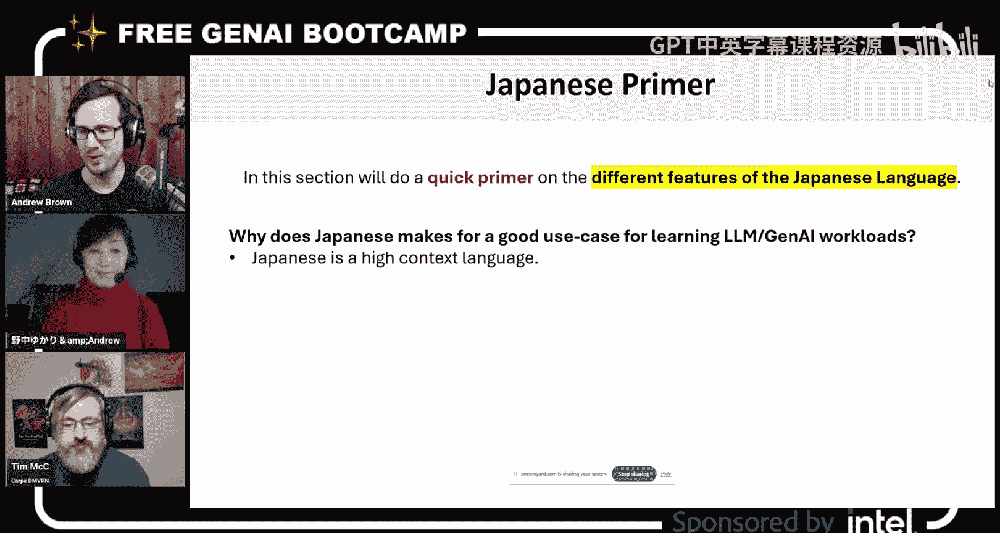
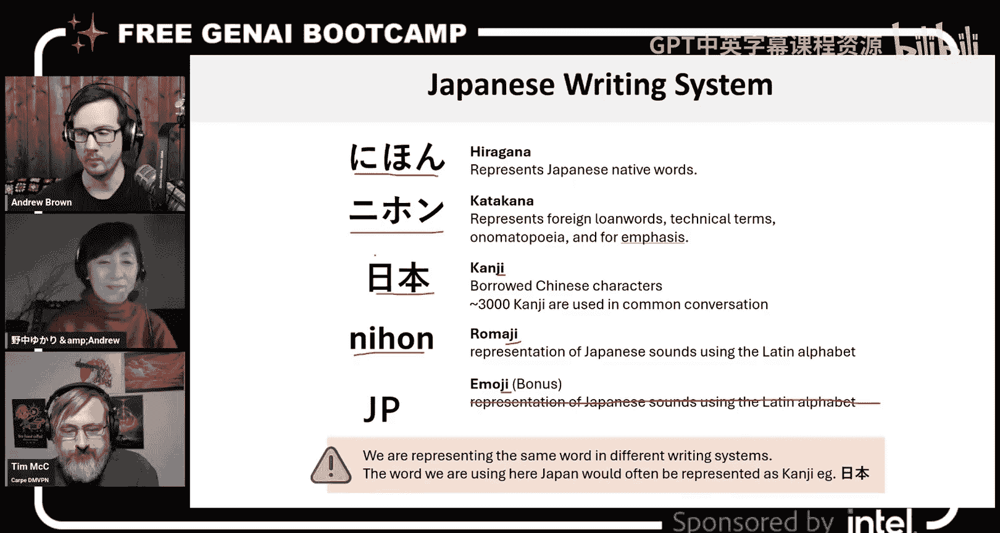
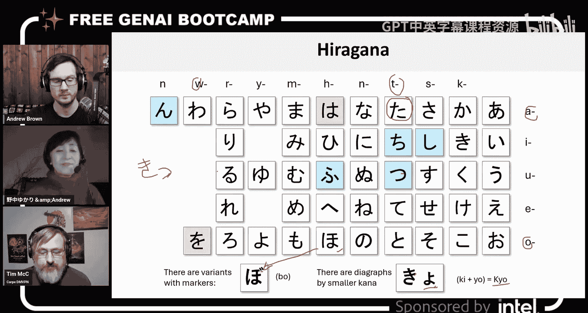
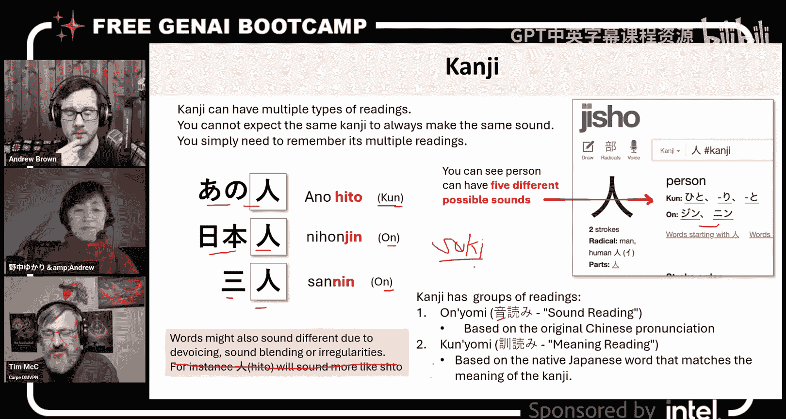
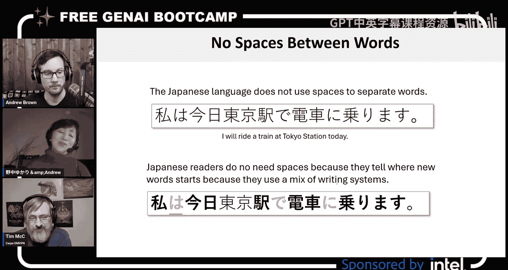
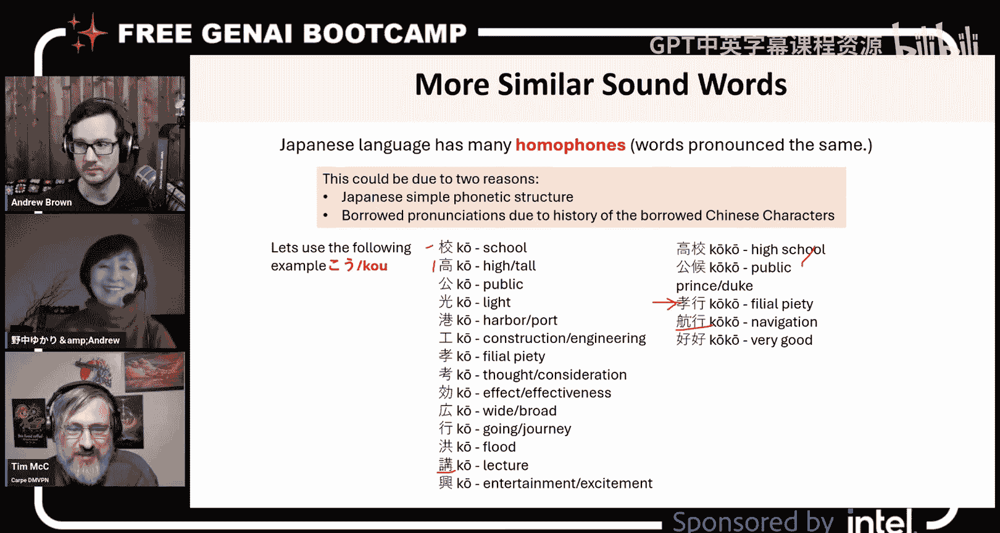
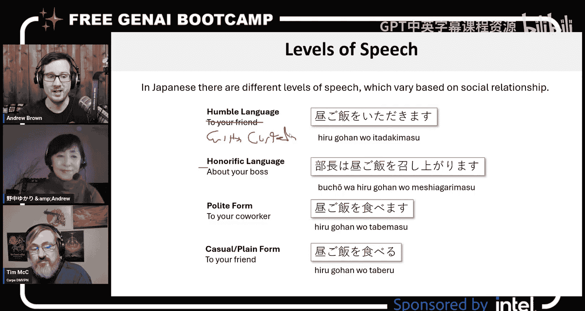

# ExamPro《生成式AI训练营｜Free GenAI Bootcamp》中英字幕（deepseek - P6：-06-Japanese Language Primer GenAI Bootcamp.zh_en - GPT中英字幕课程资源 - BV1SFEWzLEab

Hey this is Andrew Brown and welcome to the Free Jennyi boot camp。

 this is a very special recording or session because we are going to be learning the basics or basically getting a primer in the Japanese language since that is the target language that I've chosen for this boot camp and I have two people to really help me out here and so I want to bring them to stage so we have resensi this is my Japanese language teacher and also Tim who is a guest instructor in the boot camp also studying Japanese and I think also your Japanese teacher。

this this is also my this is also my Japanese teacher yes and you can see Tim is trying to work his words into Japanese I can barely work my words into English right now but we'll work through this here but anyway I figure what we could do is we could introduce resi because for those that are reading the materials for the boot camp you probably know at this point that the use case for a boot campamp is for a Japanese language learning school and resse has been operating a Japanese language learning school or English language learning school and also Japanese for a good amount of time and so it'd be great to talk to her a bit about that so what I'm going to do is go ahead and share my screen and first maybe we have some questions for resi so resens。

😊，はいう。Or。はい， add down。So just asking it a little bit about your background。

 how long have you been a language teacher for？えっとね、三十年以上です。三十年。三十年わかりますか3そうです。はい。

And what made you want to become a language， a language teacher？はい、いい質問ですね。あのね、えっと英語がとっても好きなんです。

絵はとても好きです。アライ。Well， that's good you， you guys。H， so and in your your time as a language teacher。

 how many students have you taught？I can count， but I would say more than 1000 singing。Wow。😮。

Okay mean and so I know that you yeah， you have an in person language language school in Japan。

 but I think something that's also really interesting is that you also have a cafe。😊。

So， I understand the language school， but what made you also want to open a cafe？

あのね、やっぱりあの集まる場所が欲しかったんですね。😮，Anルリーわかった？わかりましたねわかりませんテムさんわかってますごださい。😊。

She wanted a place for people to gather。Yeah， that's perfect Japanese。😊，Yeah。

 so I really wanted to have one place people can get together and then have fun so so yeah I could see how having a cafe with a language school or very close to it would probably make for very good learning immersion because then now you have this scenario to which people can work and also it looks like there's also really good food and so I would imagine that students that are well fed or anyone that's well fed probably probably learn language a lot faster。

Maybe learning languages， English， you know， have to have you know lots of energy。

 so you have to eat a lot。😊，Well I appreciate for your introduction there。

 I want to bring up our slides so I've prepared quite a few slides here and the whoops one of my other screens is showing the wrong screen here just a moment I'm going to go ahead and pull this up and it is showing backwards here but just give me one moment to fix this and we will there we go we have it now on the correct screen so you know the goal of this video is that I want to provide a a quick primer on the different features of the Japanese language and I think that Japanese the specific language makes for a very good use case for language learning there's a few reasons why Japanese is a high context language。

And my click has stopped working， but just a moment here。

Ohpe， and now PowerPoint has closed， that's okay， I'll be back in just a moment。

Okay， we are back yeahep just a few technical issues there。

 but luckily not as bad as the technical issue we had last week for those who don't know。

 this is kind of behind the scenes things， but we actually had recorded this prior and it was like like I would say lighting in a bottle was like the perfect the perfect video and then I found at the end of the video I had not press the record button but this time I am paying more close attention but anyway as I was saying know I think Japanese makes for a very good use case for for learning LLMs and Geni workloads because Japanese is a high context language it has multiple writing systems which we will look at here in just a moment and I think that it is there is work that has to be done to get good output or performance when you want Japanese output because of all the features of the language if anyone has ever used something like Google translate to to ask it to translate into Japanese to English or vice versa。

You would find that the results can be very far off and there's good reasons for that which we'll talk about in this section here。

 but let's jump into the different types of Japanese writing systems and so the first we have is Hiragana and this represents I believe native words in Japan or Japanese sorry we have Kaacana which I think represents foreign loan words or technical terms or onomaapia I don't know what an On map is I cannot remember what an on mapia。

オノマトピアは。Okay， you're okay you have the same thing that that a word but is that a word that is it sounds like it is its it's a yes。

 that's right that's right like pingbong or smack or crack or you know like the comic book thing you know have。

that was interesting was that it seemed like there was more Japanese if that is true did使います。

I've heard Japan has the。Second country。 Second country where has Onobvatopia。Oh， really。

 the first country is Korea。Oh Japan is the second in the world。

TheThe third writing system here is Kanji and so I think that these are characters that are borrowed from the original Chinese writing system。

 maybe through the history of Japan， I think that they had adopted the Chinese characters for whatever reason and I think in my research there is about 3000 kanji that are used in common conversation but there's definitely more Kanji I don't know if it's like 20。

030000 maybe around that number I'm not sure is that what is that Yeah yeah I think so and I think Jo Yoanji I think 3000 is about what everybody's expected to be and Joe Yoanji is basically the standardization of these are the ones that we expect everybody to generally know。

Yes， true correct in school days elementary students has have to learn 5000 wow elementary elementary Okay。

 six years well I think if I had to be able to like to write them my mine's probably like Nissan Nissan Kanji Tim how many how many kanji do you know man。

 I don't know， I have to go look it's a few hundred but yeah， I think maybe in six years。

 I don't even think it in six years I'll make it to 500 so the elementary school kids got me。

I would say Gia has already known more than 1000。I don't know about that can read you can write right yeah I can't write at you can read so yeah I think I think as you learn you find out it's really interesting that you can recognize them but not necessarily write them I always find that very unusual that I can recognize more than I can I can write but obviously those are just different disciplines another writing system is ramaji this is the representation of Japanese sounds using the Latin alphabet。

 so it would be literally if somebody in English would try to spell out how it sounds which is really interesting the next one here is a bit tongue in cheek I actually did not fix it but it's emoji so there it should be showing the Japanese flag but emoji is the representation of oh says oh you know what I just noticed that's a mistake。

But we'll just pretend that it doesn't exist there by crossing it out that's how we fix things on the fly here but what it should say is that emojis are are graphical representations of expressions or whos emotionally like that orji。

So what I found really interesting in that research is that I did not know。

 but Oroji is actually a Japanese word if you notice there's a bit of a trend we see G G and G。

 I don't know what the G means in that context of those things but I do recognize that pattern and it's really interesting to see that it was of Japanese origin。

 I'm not sure in the Japanese language or if it's used heavily in daily use would you say Rean or recent say that it'sojis are used quite often or probably the same as we do or emojis mostly among you know younger us of course if you are in Xin you cannot use it in the document I always wonder if there might be a greater adoption because Kanji or I'm not sure if it's pictographs but the idea that。

single character representations and it seems like emoji would fit very well into these other writing systems。

 but the only time I see them often use is when I'm watching if I'm on YouTube it's a Japanese video。

 they like to use them as separators very often which I think is kind of interesting but here we have the five writing systems and I'm actually kind of interesting about Romaji because that's clearly in English spelling and I would imagine that when you are using a keyboard。

 this is what I learned is that when you're using a keyboard you will type it in Romaji and then it will write the characters is that the same for people in Japan or do they literally have a keyboard with all the kanji on them like how would it all fit on their keyboard。

We have the exactly same as your keyboard。 So that's why we need to know how to。

How to type in raw Magji。 That's why raw magicji is taught when。

Elementary students students turn to the fifth grade or fourth or fifth， they have to know。

 they have to learn how to read role magic。嗯。So it seems like they're already getting exposed at least to the I guess like to the English the English alphabet。

 I guess it's an alphabet used by many countries， but it's really interesting to hear that they they actually learn that and but would you say that most people that are growing up now can can also write very proficiently in Kanji or are people be more reliant on keyboards to write Kanji well。

 actually recently you know Kanji is very difficult for youngsters children to read and to write because they have got already they have got used to you know。

 lots of，You know， typing stuff and then you can just test the Google， you can many things so。

So it's kind of difficult it's kind of one of the like education Japanese education or like predictive text right like when'm type when I use my phone to text in Japanese like the kanji will pop up kanji popup suggestion you know so I don't have to even finish writing word have theanji let's take a closer look at some of these writing systems and before we move on there yeah so yeah we are representing the same oh yeah。

 I forgot to mention this where those that are looking the screen what I tried to do is I tried to take the same word in representing all the five writing systems and if you you probably can tell what the word is here。

 Nihon but this word I believe means Japan like the country of Japan and so this would be the Heagona representation。

 the Kaaa representation the kanji representation in the Romaji and I would think that that the kanji form is what's commonly used。

So and I think that some words can be represented kanji but sometimes they also can be represented in Hea so you know you just learn that as you go well let's take a look at Hegana so this is the Hegana could we say alphabet and what you'll see here on the Ray hand side is the vowels same as English AI UEO but probably pronouncednoce a bit differently and then the cross we have these letters here and the way it works is that if you want to make a certain sound and let's say we want to make this sound here which is T A which would make top then this would be the character that we would utilize there are a few exceptions and that's why I have some things highlighted a bit differently so see where we have H and A you would expect this to make the sound but there are cases where this will actually be w or over here we have whoa W and O and there are some cases where this will actually be pronounced oh so there are。

Exceptions， and then there are some characters that are just a little bit different。

 So like here we have T and I， you might think this is。T， but this actually is。C and so you know。

 just like with every language， there are some variants with with these things there are also more sounds。

 if you add these markers and so down below here， we can see there are two little ticks that would transform the sound。

 So if we had here hope。Or sorry down below here we have ho which is here it would actually now turn into bo okay so that increases the amount of sounds that we have there's also these things called digraphs which I believe the idea here is it taking tu kanji and they are making a new kind of blended sound and so this would be key and this would be yo but together it would make k kill okay。

And I don't have it represented here， but sometimes there are little honic characters that represent breaks in sound and I can't remember which one it is。

 maybe it's the suit， is it Sue that if it's written really small that it will represent？

Like the pause yeah the pause is it is it a little one。

 little suit it is So so that's that's kind of an interesting feature there then we have catacana you'll notice that it has the same letters across the top and the same vows down below So if we wanted to do hot this is what this is what it would look like if we wanted to do top this is what would look like and then is down here so you can see that there I think there's some catacana characters that are rarely ever spoken I can't remember which ones maybe maybe it's。

 I don't see row very often do either of you can you give you think of any any specific catacana characters that that don't appear often。

I。W。😮，Yeah， well， I think it's the one you almost never see in absolutely， yeah。

So I just remember for my learning that there was maybe I was thinking grow but maybe it was whooe。

 but I I remember learning some of these and never seeing them and then I started forgetting them going what is it then I realized they rarely they rarely appeared I'm sure there's some cases where they appear it so we talked about kanji a bit earlier but let's talk about how would you be able to read them so if you have a word like this and you don't know how to read it。

There is a there is a helpful thing in the Japanese language system that they can add called Fergana and this is when they provide you the Hegana above or to the side of the kanji character so that you are able to read it and so here we have U Bq I think it's U Bq。

Oh， so is it oh， you， Yo being Q， what did I say， you being Q？

I think I might have been thinking about hospital I can't remember to hospital but so I know this is post office this one I've practiced quite a bit but if you did know the character sometimes that is used as a helpful way of reading it I also learned that folks that like manga these are those basically comic books in Japan that they'll often put the Fury Ga in there I don't think for all manga books is that the case is it is it used everywhere or is it just certain types of books for like depending on the target that they're trying to reach。

I think every countryanji has Fa because manga is very， you know， popular。

 even even for youngest or like four years old or five years old， if elementary school kids。

 You know， they are like a primary school。 So they't know how to read Kanji。 And then no Feriga。

 That's why every countryji has itsiga。 every。So so yeah I could imagine this because very useful I'm not sure if this also extends to like general advertisements for stores or things like that but I could see in manga that kind of makes sense there but let's talk a little bit more about kanji so kanji can have multiple types of readings and this I think is one of the largest challenges with kanji so you cannot expect the same kanji to always make the same sound and you simply need to remember it multiple readings so there's a website called G show which I believe means dictionary and here we have a kanji and if you think really hard that kanji looks like a person okay except maybe they have their arms in their pockets。

And they're very， you， they're obviously a very thin person， but。You know that looks like a person。

 and so that's the kanji that represents person， but if you look to the right of it。

 it shows that there are five different ways to pronounce that kanji based on the context that it's being utilized in and so I have a few examples of where the context or the word changes in its use case so I'm just going to show all three so we have Aohito Nihjan and Sanin okay and so the first one Aohito I think that means that person over there。

Yeah， okay good and then we have Nihon Jin which means a Japanese person and Sananin which are three people。

 but it's really interesting that there is some variation there Kanji is grouped into two types of readings we have the onymi reading and the kunyomi reading now the way I originally understood this is that one said it was the Chinese way of pronouncing and the Japanese way pronouncecing。

 but then when I learned the word this specific character I learned that that means sound and so that makes more sense that it means sound reading so since these characters come originally from Chinese characters text what came over with them I believe is their Chinese pronunciation and so I guess intermingling with the languages there are cases where you're using the Chinese sound or then you're using like the native Japanese sound for it and so they call them on and Kun。

And so on is I guess would be the Chinese original one here and then kunun would be here so is there any kind of strategy to know like。

What like if you saw this kanji？And you had to guess what the reading was。

 is there any kind of strategy to figure it out or you really do have to just memorize all the cases because there's too many variants。

For using on Yomi， you to place another kji before or behind that kji or after that。Thats。

So it's kind of combine word like Ni Hongjing。 You see the Ni other two countries in front of。

Jin the first one is Hito。 The Kji is only individual and a webひganana。

Different kanji together Okay I see so so so because here we have Hea and then a single kanji then it's it's going to be the kon reading and then here we see kanji and then kanji and kanji kanji that it's own and then it's between the two I guess it helps if there's only one then you're then you're it's going to be a lot easier and that is that is a consistent rule that for the most part that。

That you'll be probably right or there's exceptions for the most part。

 but there's always exceptions heat those out though and like there's lots of there's even kanji next to kanji and both have kunyon me reading but but they sense is absolutely right。

 I think for the most part， you can assume the only me reading with kanji and kanji interestingly a kanji by itself with nothing is usually the kun me reading Oh okay interesting usually of course sometimes okay and so I think I didn't choose a good example because I mistake here。

 but sometimes the words might also sound different due to devoicing So there are words in Japanese where maybe because they're said so often it's just more efficient to drop certain sounds or there's another reason but it's not this one I don't know why I thought it was this one but we'll just go ahead and cross it out but a very simple example would might be to like right so to like is。

If we were to spell it on Ramaji would be suki but we dropped the was it the U right and then becomes ski so this is really interesting that as you're learning the language you'll learn that certain certain things are dropped but they're not always dropped like I notice that if the speaker is speaking slowly sometimes they're pronounced I'm not sure in the case of this word。

 but again I imagine it must just be for keeping the flow of the language for these specific things。

嗯嗯嗯嗯嗯。And in music， they'll do it sometimes too like to keep the beat keep the mora of the music or to rhyme with something。

 they'll do it there too， just like we do with English， right？

So let's talk you said Mora， which is great because this leads into what is aa so A Kaa character represents a specific syllable or morera a unit of sound and hereraa or cataa characters probably should have an S on this can represent try to write that there can represent a Kaa but a kanji cannot and so let's take a look at the Japanese words Haji Haji Hajite which means for the first time let's hope that it means that as no one's proof my stuff here so we're just going to hope that I've gotten these things right and so here we have it as how you'd expect to see it where we have a kanji and then we have it followed up with two hiraa characters and so if you were to make the sound for this kanji this would be Haji in in this case and so when when looking at this way this way we wouldn't count this as aa but we count this as one ka to ka。

And this would have。Two Moras， but it wouldn't be considered a kna Okay at least that's how I understand it。

 But if we were to write this out in completely in Hiraa。

 then it would have four knaas and that would have exactly one Mora per sound So one thing I'm kind of wondering is that is there like what like how often when we're looking at kanji will it make like a single sound or two sounds and like what's the maximum of sounds could you expect a kanji to make。

嗯。🤢，唉。So you mean one Okay， how many sound I'm mean he for one country， yes。I's see。 I mean， yeah。

 that's good that's a very difficult question。 never thought。 Okay， let's see like Ju can exam。

 That's just one。 that's two kanji， right， two kanji， but one， but one， by would， yeah。

 so you can can means four kilogans。😊，Is that right， Yeah， that's right I think I think that's right。

 Yeah， maybe so so you， what I've noticed is that it seems like it's one or two and I've never I've never seen three or anything beyond that no I've never I can't but this is me asking like a question just because I don't know and it just I just kind of wondered like if there are more but that's really interesting because I would say for Joyoji like basic basic mostly as you And said like one or twoganasji but you know you said there's so many kanji。

Even for me can answer can't read。 So thatji， that kind of Kji has I would say more than。2，3 or，4，5。

It' very advanced maybe， but in our daily lives， we never use it。

So okay so that's that's good to know that it's either one or two the in the most common kanji that are utilized。

 but yeah maybe there are some exceptions I know there's I'm I'm not sure if either have you've seen that but there's like a video floating around it but like the most difficult kanji to write and it's really really complicated but but I can't imagine that happens very often so that looks like a picture right 200 strokes or yeah yeah。

So so yeah， in summary here， you know both would have four mores。

 but four units of sound like Haji Mete another really interesting feature of Japanese。

 this is really interesting to me is that the Japanese language does not use spaces to separate words。

 not really unusual if you if you study the history of European languages because they also did not use。

Spaces like I was watching a video the other day about a Latin like and they didn't use spaces。

 but Japanese does not use spaces， but surprisingly without spaces you can get by pretty easily because of the writing systems so here we have an example of something here so we have Wawa Kyo kyo right Kyo Wawa kyo Tokyo Tokyo I know that's train station but I never remember how to say train station Tokyoki Eki Eki de Norias so today I go to the Tokyo train station。

I guess I'm riding the train Yeah noma is to ride so I will ride I will ride a train at Tokyo station today so Japanese readersers do not need spaces because they can tell where new words start because the use of the mixed writing system so here I've highlighted it and you can see that there are particles which we'll talk about here in just a moment。

 but also you know when you start to learn that you know the words are either made up of multiple kanjis or it's like a kanji followed by Hea or its just Hea you start to see where those natural break and words occur so surprisingly that works。

That works really， really well。Yeah， I also appreciate how with the particles you can rearrange most of the sentence without changing its meaning as long as the particle。

 as long as the particles still stick to the same words， you can rearrange it。

But but I would but recent say is there any case like this this always works pretty well。

 like there's never been a case where it's been difficult to figure out where one word starts or one word ends。

Yeah。Well， mostly you have said correctly。 But I would say like a， you know。

 particles is like pink pot。N， that's the most， you know， struggles。

 biggest struggles for learning from different countries。 So for the beginners， I would say。

 you don't have to worry about particles。 See， like what skip cure today。 Tokyo I， Sip， D， Skip。

 notma。 then。嗯。😊，Still， your partner can understand what you really want to say。

 even though without articles， right， So， and then。Do have gradually， you know， you know。

 learn what kind of mean particles are in Japanese language。

 And one is you mostly like self or subject topic。 That is like mostly a place。And then you can。

 you know， continue to。Complete the right Japanese sentence well let's take a look a closer look at particles because they're they're very interesting and they tell you a lot about the sentence so Japanese uses particles to show relationships between words and here we have a bunch of particles I don't think this is an exhaustive list to be honest this is what I know。

And there's obviously more than this I know a little bit more than this but but these ones these ones I definitely know right I don't always use them correctly but but as Reesensse said is that sometimes you can oit them and people still understand what you mean and would I imagine that maybe in casual or natural conversation it's already assumed what was coming next and so people just omit them and so I almost it's almost like cheating。

 but sometimes I will just omit the particle because I don't know what it is and I'm hoping they'll fill it in on the other side so we're bringing back our previous sentence or no this is a different sentence actually different sentence and so here we have Watahi so Watahi means。

I， and I don't think we talk about this， but there's actually a lot of ways to say I。

 I I don't know why， but I just know that there are is there is there any reason as to why there are so many ways of saying I？

Actually， we in our daily conversation， we keep eye because。はは。You know。😊。

English has always we need subject， right， Yeah， but we， our Japanese need natural conversation。 We。

 we omit I because everybody knows。😊，You are talking you， you are talking about you。

や this sentence sounds for me full I usually say友達と講演犬の写真を撮ってみたいね more natural。Isn't there。

sn't there a nuance there where if you specifically include Waashi。

 then you are actually calling extra attention to me？Right。

 instead of ottting so it's interesting with the nuance there nuances means I really emphasize me this is about me so but that's good because then I don't have to choose a word to say I but I think you know usually for those that are for probably you stick with it's probably normal for that。

 but I know there are different ones which I'm sure if I can remember I would tell them right now but we work on to the next word we have so toe is marking the word friend to be I'm with my friend so I the topic I'm with my friend the next work Kohen I think it's cohen Kohen so'm with my friend and we're at the park so that's what it's meaning in this casenu no so Inu that is a dog so this one。

little bit special because the no particle is making a possessive marker and it actually has a relationship with the word that's going to follow so it's kind of like connecting if I get my pen tool out here wherever it is it's connecting this word in this word at least that's the way I think of it and so I believe the next word isinhis so when we say this it's not dogs but it's now photos of dogs or you of the dog really it's of a dog just like photos of the dog but it's not like Andrews Andrew's photo or dogs photo it's not like that's not truly possessive it's not possessed by the dog but in this case it's of dogs photos so it's not exactly what I say it is and then we have want to take a photo this is really interesting that in Japanese I know say it will be very specific verbs for actions that we might not have in English I know one is like something to do with an umbrella so it's like there's a very specific verb about using an umbrella or something。

You either know what I might be talking about but。Okay， but anyway， this one here， that's okay。

 I just， I just encountered it one time。 Maybe it's not a common thinking news。

 kind think yeah I you can lend someone Okay， To and。

 There are two ways different thing different thing means this person has never has never taken the photo of dog times。

😊，Definite， you know。This person's experience before or not。 So talk to me。

 this will be his first time。so the verb I looked up。

 which means verb to use or hold an umbrella is sasu I have actually heard that before I don't remember it I don't know that's common is that a common verb that is used like like is it is a Japanese verb that says it's a verb to hold an umbrella see the problem is is that if you don't have a Japanese language teacher chair like in person Japanese language chair and you're using LLs and other I don't know if they're giving me obscure words problem or you go to show and you're like oh what does this mean and you type it in and you go talk to your teacher and they're like I've never heard this word in my life're。

I assumeOh for sure， for sure，1 Okay， so I know this word， it means want to take a photo。

 but I have no idea I really should have this would have been a perfect opportunity to use for Ugana I didn't。

 but。Tim， do you know what this？so To means to take a photo in this case so this is conjugated to like thete form like I forget what they call it some progressive progressive I guess and then with Me adds that nuanced like Ray was saying I've never done it so somethingte meu means I'm going to try something I've never tried before it's an extra addition。

I feel that I should have known this one would be toe because and we'll talk about this in just a moment how there are some words that have the same sound but different kanji and mean different things but I know to take is to To do so I'm not surprised that this is toe but we have tote Me and this last particle here is a very special one becauses not it's not affecting the word beside it it's affecting the whole sentence and so this one here it says seeks agreement or confirmation from the listener and we actually have such a particle in in Canadian English and it's where you end a sentence with a do you use it how do you use one put one put to put to the test to do it that that's a bit harder but you know'd be like are you going to be coming to the store with me a。

Like you just throw an A on the end of it。 like use it like you choose quite a bit。

 but you just say like right or yeah or something like that。 Yeah so so yeah。

 if you want to sound Canadian， you just throw a's on the end of your sentences just like na'd be A depending on how you inflect it can mean different things。

 just like how we again， we're not talking about Canadian speech， but just the words sorry。

 we have so many ways like we say sorry， but there's so many ways we can convey that those two things。

 So those two things are common features in my version of English。 Yeah。

 we said that words can sound similar。 So Japanese language has many homophones。

 these are words that are pronounced the same。 And so there's reasons why this could be。

 So the Japanese simple phonetic structure there was a lot of like a lot of letters there。

 but I believe that the Japanese language compared to other languages like English have fewer sounds。

 And so if you're gonna have fewer sounds you're gonna。

Probably have more overlapping sounds for words and then as we saw earlier with Kanji being borrowed from the Chinese character set that we're also bringing in Chinese sounds that could be utilized and so there we could have more overlap and so that' that's my theory I'm not sure if it's true but I'm trying to reason something here but one example here is the word Ko Ko and。

Here's all the ones we have。 So my question is， is this actually true？Yes， it is。 exactly for sure。

 for sure。 Yeah， I can read these。 So yes， they are correct。

 and we obviously have we're repeated and we have other variants as well。

 but like the interesting thing is that you can distinguish them based on the kanji。

 So the kanji is gonna kind of tell you Like I know this one as tall because I think of this is a tall person like theyre really tall person with a tall hat on but the thing is is like how would you know in speech like because you don't have kanji no one's showing you the kanji when you're talking。

 So how would you know it means it means you know like we're talking about you know。

 this is actually a lecture。 Like how would we even know in context。That's a good question。

 Andrew So。 So have you ever heard Japanese language is called listening language。 No。

 actually I haven't。 No you haven't never heard。 No， but I could understand。

 Yeah sorry when we were child， you know， mothers or teachers always told me， told us。😊。

You need to be a good listener。Just stay and relax， and listen。😊，And of the speech。

Then this means we need to think over listening to others speech or talking。

 And because there are so many。Same sounds， same pronunciations。 from the context。

 we need to think what they are really。So so so really it's just you have to understand the context so you know if you're talking about if you're at school and you're doing something in school then they likely when co is being used it's lectured and so you're looking around at the other things there and I would imagine this is probably an extreme example of homophones I can't imagine every words like this right it's not it's just as this is an extreme example right that there are other ones that have probably as many but this is I mean Cole is very common she is very common's there's definitely certain sounds that are more common I think what do you think what do you think Christten says this。

Normal or。诶。Is this a like is this a common like like are there words that have as many homos as this one or is this a more extreme case？

If。If it's so difficult to understand to cat， if you use。Many co soundss in one speech。 we， we。

Try to use kunymi then onymi。 Oh， yeah， that's why we have two different ways。 For example。

 you see Coco， the right side，1，2，3，4 lines here。 This is Co， Okay， this means。What did you say。

 navigation， Coco， No， from the bottom， the third Coco。

This meansilial I don't know what that mean family respect thing especially for your parents it's a phrase it's difficult to catch we try to I imagine over time you just end up using other words that are going to work with it because they're not going okay so that makes sense that's really interesting but you know I'm pretty sure English has homophones of course red red red and we seem to navigate it okay so you know it's probably much less hard for people that speak a language all day that's a good one。

Let's talk about sentence construction so I think sentence construction is a lot more complex than what we're showing here。

 but I think this is the key thing to take away， which is the Japanese sentence structure is subject object verb。

Whereas English is subject verb object， what do we mean when we say that so imagine we have the sentence I want to try taking pictures of dogs at the park with my friend。

 remember earlier to the sentence it wasn't in this order and it was it almost feels like it's backwards we have Latahinu no and so I highlighted here which is the verb want to take try to take taking pictures it's all the way at the end of the sentence where this one is over here just as it indicates here or the subject which their subject and topic but we'll just call it subject for now they're here generally at the start so we hear we have our subject and then our object is actually marked here so we know exactly where our object is and it doesn't exactly fit in the English one for our translation so this is a literal translation it be a little bit different but that that's really interesting。

so I drove Jerusalem arrows there， but one thing I wanted to talk about which we didn't talk about particles earlier is that the power of particles is that if if a word is beside of particles。

 you have more flexibility to move those words around in the sentence whereas in English we don't have those and so I think that's why we have to say all the words like in English we don't think about this。

 but we are actually saying everything whereas in Japanese。

You don't need to say everything because and you can change the order of things is that is that right Yes。

 that's absolutely correct。For example， if I say私は。ああ、写真を撮ってみたい。And you say， that's it。 That's。

 that's complete， you know。Thats the perfect sentence私写真を撮ってみたい。

 But you may ask me more details where or。Which kind of picture or with food you can ask later。

 So first， I don't have to。Put many informations in one sentence。Yeah。

 some of these can be swapped and some of them actually can't right so like Toma Kohen we can swap those you could be Wahiwa Kohene Toma。

 but like Iino noin that has to stay where it is because you're specifically saying I'm taking a picture of a dog right so some of these some of these can move some of these can't it depends on the what the particle is what's what it's tied to one thing I found really interesting was that you can make a whole sentence with a single verb。

Whereas in English， you wouldn't be able to get away with that， that'd be very unusual， right？

But I but I guess I guess and I think those that are watching here should really appreciate the Japanese language because the language can get very efficient because you have the ability to move words around if things are already known there are like you can just drop the words completely and so it really it's like the refactoring that's a programming term to reduce to shrink but you can see it's a very efficient language so I think that's really interesting but I could see why Google translate really struggles。

With Japanese too much oitted too much left out for it to make any sense of it。

 So but this might be our last feature of the language I want to cover。

 if there's another slide after this I have no idea。 but if we do we'll go beyond on the next slide。

 but this is another layer to add。 So imagine you learned all2。

3000 kanji and and you can handle different words in different context。

 and you know how to use all the particles in different ways。 now you got to handle levels of speech。

 So in Japanese there are different levels of speech which vary based on social relationship。

 we have casual we have p form。 we have the honorific language。 and then we have the humble language。

 and so this is the same sentence。 I tried to get a sentence and tried to move it through the different levels。

 I don't know if I did well with this or not。😊，But why is there different levels of speech？

Because in our culture， we have inside and outside。 That's very important。呃。In a longer history。

 we need to respect other outside people and。A older people。So。As you， as soon as you find， oh。

 he is outside people like。If you are business chain and then your client is outside from your place。

🤢，So， you should。Show your respect to him。In， you need to use。U which one the second one。

 the second one honor the honorific language， honorific language Okay， Yeah。

 and then for for Charlie inside person like your family members， your friend or。😊，Your coworkers。

 too client。 You need to be humble。Yeah， I think you actually made a mistake there。 Andrew， Oh。

 I did wear on your humble language。 you wouldn't use that with your friend。

 you would definitely use that with a client。 Which one up at the top where his humble language you would use that with a customer Oh。

 sorry， yes， and so one of my comment mistakes but yeah with customer will just customer right best I can but yeah there we go that probably says customer friend means like so so depending on whether whether it's yeah。

 so if if they're outside your social circle， then the more likely you'll go up the chain here in conversation now you know if I went to Japan and you know I was to go to a hotel or restaurant would I be encountering what level of of speech would they be using humble language with me。

You know， if you are。Not sure which one would be perfect for you。 I would say politeite foam is okay。

 foam can cover everything。Yeah， but they'll use humble language to you okay they'll yeah for them but you wouldn't but you wouldn't use it back to them right because that would be very odd or。

Okay， and is there any other factors that take into place like age or because I know I think in the Korean language age is a huge factor。

 like do people really want to know people's age so they can determine the what language to use or it's basically just social circles。

Yeah， older， for elderly people， we usually use。Respect and one right I see Yeah， yeah。 Yeah。

 that's why we， we Japanese people really。You know， more about。How old you are。 How old am I。

That's why you know we always think about oh she must be older than I so I should be you know very polite for her that makes why yeah and so I mean that's all the features I wanted to cover the languages there's more to it than just this but this I think is a good primer and again I think the reason it's a good use case is that if Google Translate can't do it then you can imagine that the tools we're using the LLMs the things that you can type to they do an okay job but they're again not perfect and I think we're more likely to run into issues which is what we want in the boot camp we want to have a challenge and so for those that are watching if you can try to stick with the Japanese language please do so if you have any interest in learning the Japanese language and you're looking for a Japanese language teacher res are you open to teach。

Any friends of ours？Thank you I was still there but but you know I would just say that you know like the whole purpose of language learning is the end goal is to actually talk to people for real and I think it's really important that folks invest their time talking to real people because if you're talking to AI or you're trying to learn by reference then that might not translate over or if you want to get to your goal faster。

 I still think that in person learning is very effective now I do use AI in between lessons and it does help to some degrees but I'm often bringing the stuff to resens and the things that look like like it's like。

 oh you chose to use very difficult words here or words that do not fit because very clear that AI is very far away already it's not ready to act like a real human。

But yeah I appreciate your folks help getting us through this primer and for those that are watching。

 I hope you are not just excited about learning Jennyi but more about the Japanese language and so we'll just say goodbye to our guests and we'll just clear the stage here and we will see everybody here in the next video okay Chao Chao。

