# ExamPro《生成式AI训练营｜Free GenAI Bootcamp》中英字幕（deepseek - P71：-71-Free GenAI Bootcamp - Week 4.zh_en - GPT中英字幕课程资源 - BV1SFEWzLEab

Hey everyone， it's Andrewgie Brown and welcome to the free Jenny I boot camp。

 I'm just gonna get up one slide here and then I'm gonna introduce to you are or our guest instructor are going introduce themselves here。

 but I'll just get my screen up here nice and quick as per usual which I think is this screen here there we go and so I just want to remind folks that if you're de or hearing impaired the best way to watch this live stream is on LinkedIn and if you're on YouTube we' drop the LinkedIn link in the description drop the LinkedIn link in the YouTube description we'll do our best to follow videos with providing captioning I'm not sure how well we can do this this week because I actually don't have Baco in my ear。

 it's just me running the show but luckily I have a really good guest instructors this week to help me out Trevor do you want to go ahead and give yourself an introduction you're sure happy to do it and hello everyone thanks for stopping by I see all in the chat there so nice to see you and meet you Trevor Spers I am a。

Content creator you can catch me on YouTube and LinkedIn and my day job I am a solutions architect at Amazon Web services and I spent a lot of time working with customers and other engineers and architects on this GI stuff I've been fortunate to like get to work on a few deployments that have gotten into production at scale in the real world so excited to talk through some。

Some details on Nova models today， a little bit of bedrock stuff and and then of course。

 like I don't know if you got into this with the chat yet。

 Andrew or the folks of the learners yet Andrew but Cla 37 dropped this week so that's that's some kind of new hotness that could be worth spending a little time on I mean that's something that we might even want to talk about I also gave G 4。

5 ago as well So I'm a big fan of Winsurf so I end up using these models quite a bit but I'm going to go and bring my screen back up on the screen here we're going to proceed through our weekly slides here and then Trevor is going to be driving here today。

 I'm going to be hanging out I'm just gonna be vibe in and so I just want to go ahead and thank our sponsors for those in know Intel is one of our sponsors check out the virtual booth take a look at OPA AIcs which will be featured more so next week I think maybe this week as well but more so next week and Open Vieno next week as well as。

Be very fun to do some optimization there to workque and remember folks if you want me to review your developer profile and make sure you fill the torque profile I am working every other day to try to do as much grading and as much reviews as possible if you have yet to see one from me do not worry it will get it will get done especially especially after our last week because I have all this time to focus on grading and get caught up so for those who have've gotten grading good for you for those who are waiting I apologize and we were getting through it code rait so hopefully folks gave coderabbit a try last week and try to generate out a summary that's something that you could try to use in your homework if you want to try to determine what good summary might be so I'd be very interested if people were to drop in their PR I don't think I put in the homework submissions to put that there but if you do try to drop in the the PR for your code rabbit there and I would love to look at them directly and see if it actually is a cool way that I could just read it and that might save you some。

Time writing as as a test there， oh Shala's here as well， hey Shaa。

 sorry love Shala in the in the the green room here， Shala， how are you doing？I'm good I'm good。

 how is there be I think you know I think most people are here but for those who are not。

 I think they're still they're stuck in stuck in OPA world I think I would describe last week probably as our week of hell but there's always going to be a hard week right and so and so I think I'm going to balance it out a little bit and make these next two weeks easier and funner and more availability for folks to do stuff which we'll talk about here in just a moment So this week。

 I mean like this is kind of our week where we are working with a lot of different kinds of we're kind of like rolling up a lot of our experience together and' be able to build whatever whatever it is that we want and so for these last two weeks I mean the next next week is very enterprise production stuff focused but I want that to also just be light because I want to give people more time to kind of build something fun and so that could be building a visual novel building a text adventure mud you could build a flashcard。

System where a generated's an image for the word that you need to see， something fun。

 something that's immersive keyword is immersive， and I don't know if I spell the word immersive right that really looks wrong E Muray。

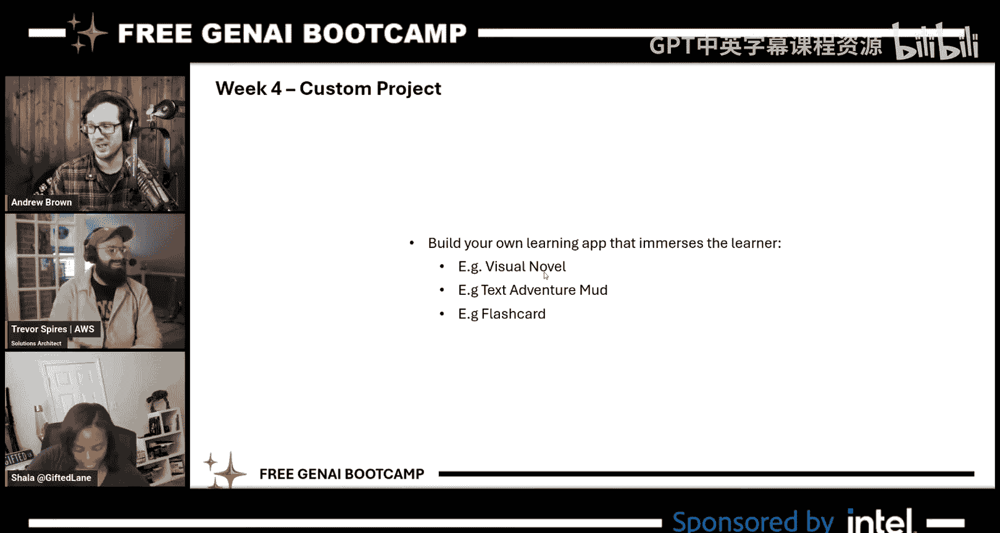

I don't think that's right， but I think there's supposed to be a V in there yeah。

 maybe it's hard to say， but I can say that that's Tokiona， I don't know。

 but yeah just wondering boot campers， how are you doing how would you describe the difficulty of last week from zero to 10 if we can get a score here in the comments。

 I'd love to know how hard how hard it was for you zero for super easyZ 10 for just way way way past what you'd like to do on a regular basis？

And so we got a 10。See if you weren't another 10， another 10， another 10。 Okay， great。

 So I'm hoping I'm hoping that the next couple weeks here are more a 20 a 22。

 So I'm hoping the next few weeks are， again， gonna give you a bit more flexibility to catch up or。

 or work on something more fun。 Show your creativity。 Philippe gave it a 1。01， which is。

 which is good。 Well， Philippe has done really good work with Tokiona。

 So that's I'm really excited to to look at that later on。 But yeah，10。 So that's that's expected。

 right， So hopefully that the upcoming weeks here are 5 a5 score here。 But Trevor。

 what do you got for us today。😊，Oh we got some we got some good stuff for folks today we were going to dig into like almost I would call it like like a workflow or a pipeline of of passing different data through models so we're going to explore some visual models and then I'm going to showcase so you know image generation models I'm going to showcase how a lot of customers are using。

Understanding models or like LLms kind of traditional multimodal models to understand images and process images。

And then we'll have some fun animating the images， making it， making it run around to do some。

 do some cool stuff。 And Sha， is that an like a a jet black A T and T in the back there。

 What they called the， What are the walkers called the Star Wars Walkers。😊，I was like what yeah。

 is it A A0 A A， what did I say I don't know AT and yeah。

 that's what I was serious saying that AT and I didn't know I didn't know they came I didn't know they came in different different codings eh。

 so I mean that's pretty cool， but。😊，Are you big Star worth fan or I am so that I have like a ton of Star Wars Lego sets and then from' laughing at the comments and what's funny is this is like virtual of my old streamer setup because I tore it down。

I I was going say your set looks a little bit different。 Oh， okay， I was。

 I was tripping out because it's at like a slight angle。 And and I was like， I was like。

 how are you straight and everything is shifted 15 degrees。You about look。

 I think Charlotte lives on a hill， right exactly。So， butum。

 and what as those swords in the corner as well， Yeah， I'm glad somebody said it because I'm like。

 what are you chop with those things？So giant lo and lamp。 Yeah， so I do。 Wait， is that a giant。

 How big is that lava。 I'm not， I thought maybe it was like a small one。

 But now I'm thinking about perspective， it's like half the size of the。 So yeah， so I am what am I。

 I'm 4，10， So it's about half my height shopping down the haters， That's right。

 what what's the what's， what， what， why and when for the swords。😊，Okay。

 so I've been collecting them ever Okay， first off， I did martial art so let's start there。

 I did MM yeah， so and so I did MMmaA for a while and I've just always I don't know I'm just always like swords and my parents will like go out and like hey。

 do you like this one and everybody like buy it And so I started collecting Quitans and stuff like that and。

😊，Yeah， I mean， I don't know， I like them so don't mess with Shala。Also have the daggers too。

 but the daggers were like on the shelf。Incredible， just incredible。All right， okay。

 that's a segue for Trevor to share his screen。😊，That sounds good folks I I'll I'm gonna start by I'll start pulling on my screen。

 I'll show you something that I built for you all to kind of walk you through some of these different concepts and we'll we'll bounce around today。

 It'll it'll be a nice， a nice cash vibe。 But actually， you know what， Andrew。

 I'm thinking before I jump right into。😊，What I built， you said it and。

And I would love to talk to you and hear your thoughts on some of the new models that dropped dropped this week。

 I've been and I'm kind of curious how when you so like you mentioned 45。

 I've been playing a lot with Cla 37 I saw some folks in the chat had some comment about both models I kind of wonder like I have my patterns of what I do in a new model comes out and how I want to play with it and explore it。

 kind of curious what you do whenever a new one comes out and you want to learn about it。

 Well the key thing that's important to understand is like like what your patterns tell about whether that model's good or bad for you because first like I use Windsurf for people probably I use Winsurf for as my AI coding assistant and Cla 3。

7 and then G 4。5 and so when I switched over to Cla 3。

7 what I found out was that it was a lot more aggressive at。

Take just changing things and going in different directions and dumping code everywhere so it could do more but more of what I didn't want And so I had to step back the code a lot saying like hey。

 no， no no take this get rid of what you're doing right go back a step and so you know the way I have been prompting building apps is I'm taking a waterfall approach because my background is。

Building building apps for startups as fast as possible so literally make a dock and then just go hammered out and so that approach wasn't working well with 3。

7 as it was just making a mess of things whereas G 4。

5 when I would prompt it it would step through each step like it would go like okay these are the things I have to do wouldn't tell me always all the steps but it felt like a logical stop of where know like you're repair programming like what should we do next like should we go there and so it wasn't going into anything to the end but it wasn't making me undo things and so that was more of like how you should work with a pair programmer but I thought you know maybe I don't like 3。

7 but then when I was using it for something else I was using it for extracting a vocabulary from a large amount of text it was so phenomenal at that task whereas before when I had to take like let's say a movie like a Japanese movie and each line had a transcript and I want to convert to structure JN output and extract。

All the little pieces of stuff if you gave it too much。

 it would start just grouping like things together。

 but the new one it was just it was just killing it right so like I can't say that 3。

7 is bad it's just that it needs like I now really appreciate it because it basically cut out a lot of the stuff I used to have to orchestrate so like I built this transcript thing I'll have to show it to folks yeah in the boot camp but I built this thing out that when lineford line to build our vocabulary but I had to like take the iterate through each line and then feed it to another LM and then another one to evaluate like to evaluate it and report it but now I just use the one one thing and it cuts all that stuff out so neither good or bad just different sorry yes Tvt yeah no totally absolutely I think for me whenever the first thing actually if you throw my screen if you I'll show folks oh sure this has become the pattern that I I go down like the first time a model your option and this is like this is just the one that I use I don't know that I actually have done。

No research on how these folks do their benchmarking and stuff I just know that when I when one drops what I basically want to see these three metrics like at some I want to see some analysis of like what is the general intelligence is a tricky one but speed and price are always like I find pretty trustworthy intelligence different because as you pointed out different tasks。

 different models are better and worse at right so like a great intelligence benchmark doesn't necessarily immediately be good at your task but I find that this like the reason I want to look at these three metrics when a new model drops is because it gives me a sense of like what the model is good for and what it' what I think。

We might where I think we might want to apply it。 Why is24。5 so expensive。 Yeah， Well。

 this is it's a little pricey and it's not the fastest right。

 it's about they say it's about twice as by this benchmark about twice as slow as37 and yeah I think when if I'm not mistaken when they launched45。

 they even said like this is not a frontier model， meaning like it probably is not going to be in the critical path for like a realtime application。

 although you use it for coding you find the experience like I found it faster than cloud 3。7。

 but is the reason this is the reason why it's because it wasn't trying like if I said here's a big tech spec because I have a few base projects that I always will try to rebuild and test to get a baseline of how these things work and it's the L portal folks So we use at the la portal text specs I'm running through those there And so when I give it to Clade。

 I'm waiting around， it's doing more work it's going through the whole flow。

 But the thing was because。GPG4。5 stops and then says let's do next I could actually get through it faster so maybe like from a like I don't know what like token like a token per second speed it is maybe it is slower but in terms of productivity I mean it's like a little slower I was moving faster but from what I can see it's actually like it's not like so substantial like for what you would expect from a coding assistant in terms of like the output tokens per second and the other thing is I feel like I don't know if you've talked about this with the students or this is something that I've been learning a lot about is like。

The speed and this is this is an interesting metric。

 this is being measured in output tokens per second。

 but really what you usually care about is not output tokens per second。

 you usually care about time to first token。Right， at least at least if you're reading a response because if as long as the first token comes within a second or two like。

All that really matters after that is is it generating text faster than the average human can read and most models are pretty good at that I think but surprisingly you know I keep going back to cloud 3。

5 just because I have so much domain knowledge built into it but there are times I'll switch out out to them there's one that we have this is for another live stream Google Google's flash I haven't used too much of it yet so we'll see it says it's the fastest I don't know I'm really still surprised how fast the Nova models are Nova pro I can't remember they're all pro is pro the pro Nova know the pro there's pro so I'll actually pop into bedrock as we're talking about it so folks can see this is where if you were going to access and Amazon Nova model as of today Amazon bedrock is the place to run Nova models so within Nova there is today pro which is like。

Pro is what you might refer to as like the Nova G4 class model in terms of like it's comparable in intelligence to G40。

 but where where it tends to shine light was really I don't know it's it's really hard to sell So I've seen a lot I've done a lot of benchmarking on both of these and they're for like an overwhelming majority of simple tasks like light perform as well as pro and so it is one of the I think that's another thing that's happening right now that's happening across model providers is like as models get smarter and smarter and smarter like can like many applications can just get bumped you can crank it down from pro to light or from light to micro and save mostly to save on speed it's less about cost more about speed boot campers's question have you used 3。

7 G4。5 has anyone played around with Nova Pro yet just want to see here drop in the comments Sha have you been playing with any new models or you've been playing any。

Videオ games。I haven't been doing video games either won't no。

I've been playing mortal combat mortal Com 11 lately。 Yeah。

 I missed Ron I got back one there and I played that online a lot。

 my favorite character is the Joker and Malina I haven't played the latest like I have I think mortal combat 10 and stuff like that。

 I used to go with do I remember his name K Lao， who's the who's the one with the hat that you throw Yeah。

 yeah， yeah， who is it I'm saying I's， I think so let me see let I know who you're talking about。😊。

Kung Laow， you nailed it， I think， really， assuming this is the guy to。 Oh yeah， I'm if I。

 if I get a little bit of time to prep， I'm pretty good。 I'm pretty good。 the other。

 the other fight I really like is from the 90s。 and it's for Superintendo and 64 killer instinct。

 So the doing those probos are really， really fun。 Yeah， but。😊，Man。

 I guess I guess if people haven't used models。 What's your favorite。

 What's your favorite fighter for mortal combat That isn't I I I I actually quite like the parallel of comparing models as like as like video game fighters Well well。

 you know who did that right banjo it reinvent banjo literally made Oh right。

 he did like a mother They played street fighterer。 Is that what it was Well。

 it wasn't street fighterer was like characters they generated out。😊，And the and like。

 and you had to prompt the models it was， yeah， it was， it was。

 it was one of the most impressive demos I've ever seen。 It was really cool。 Yeah， yeah。

 AI has definitely raised the demo landscape for sure。😊，Um。

Cool well folks I'll show you I built a little something for you in preparation for today's lesson class。

 I don't know I don't know how you refer to them this week this Saturday I'm gonna walk you all through it real quick and we probably spend a lot of today's session talking about some of the concepts behind what I built and something that I think could be interesting I like to anytime I'm doing any sort of teaching I like to keep a whiteboard up because one thing that I'm starting to see just as I'm working in the field is like a demo like this is a relatively simplistic demo but what I see is like customers or organizations and you use a great example Andrew of Winsurf right awesome IDde incredible experience and that's actually probably a。

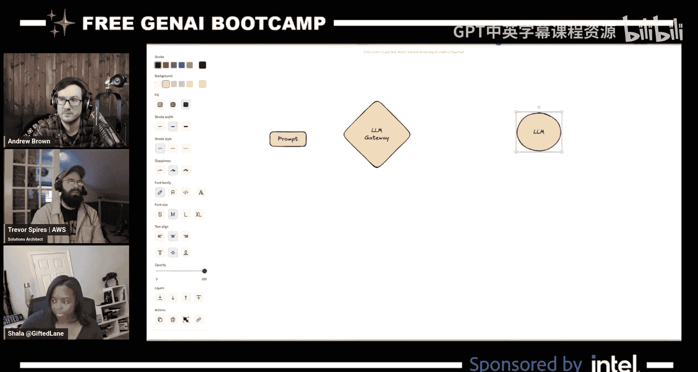

Behind the UI that's probably a very complex AI app that's hitting many different types of models for many different tasks and so one thing that I have been spending a lot of time on with folks is really not just how do you call how do you develop on top of a foundation model。

 but how do you build a complex app like let' let's call it a coding assistant agent or like some other system where you actually are running multiple LLMs behind the scenes you know where you might where you might have a single user experience that's actually hitting you know。

A Nova model， a cloud model， and a。Open AI model just based on what's flowing into the app。

 so that's something that。

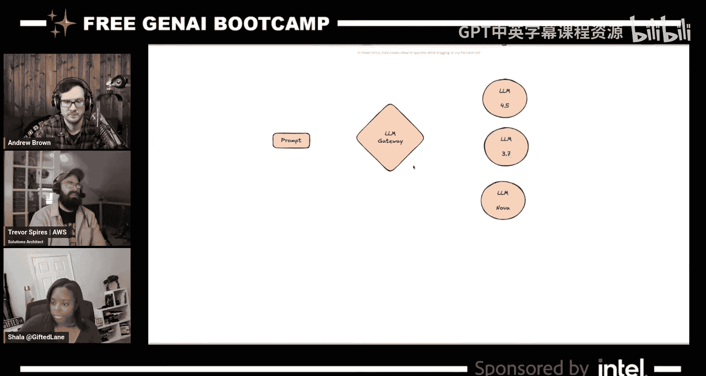

I'll dig into after， of course， I show you the demo in chat。

This is where I'm going to need some help actually。

 because this is a pretty wide open demo I'm going to start by using the Amazon Nova。Canvas model。

 so the Nova Canvas model is an image model。 So text image model。

 it could also be imaged image you can input an image and have it adjust that image。

 And I would love for somebody to give me some some ideas of what image we should start generating Mortal character。

 How does it do people， Can it do people or is it not allowed to you know。

 I actually not really people actually haven't tried to see like could you create Michael Jordan or something。

 So I'm open to try anything haven't tried some image So some image models like give you a tab。

 it just won't do it because they don't want to infringe Yeah like obviously obviously one social platform will let you do anybody anything。

 but I'm not sure how that works。 But yeah， like if it doesn't work。 that's fine。

' will'll figure out the limitations but it wouldn't be if it couldn't it wouldn't be unusual Yeah I have a sense that it it probably doesn't because one like one thing in I like this is probably not very important。

Folks that are learning like on an individual level。

 but folks that are learning and applying this in the real world。

 like one interesting benefit of the NOva class of models is they have really one of the strongest legal indnification policies of any LLM meaning that like you are if you were to roll it into a production app and it did generate some copywritten image or copywritten text。

 Amazon take liability for any any following legal action which which is an interesting benefit it's not uncommon for model providers to do it。

 but the extent to which you're covered with N Nova models has been the cameraers you heard it。

 try to get yourself a payday thats right and I don't mean like I don't mean the candy bar that I like to eat。

 but I mean like a real payday from AWS to counteract this configuration of your high A bill。

All right， I guess I thought a Scorpio because we were talking through I actually haven't tried something so abstract。

 soll see we'll see what it comes back with， but I'm gonna start folks by just inputting I've created a little form here to put a prompt in to just generate a base image now when it comes to image models like something that' that's interesting and you all might see is like you could like I could make this be like a wide open box where I'm free form typing in text but when you think about the way that an image model is trained。

 so let me me back up the way you prompt a model any model if you're optimizing those prompts the best optimization of a prompt is to get the prompt as close to。

TheThe prompt the model was trained on because models are trained on a series generally of like a prompt and a response or in the case of images some prompt in an image。

 but in the case of images the prompt is actually just a caption right you know like when you train a model on an image it's not going to have an image and say like generate a walking cat the image is going to have a lot of different attributes cat outside sidewalk etc right and so that's why you'll see that's kind of reflected in the prompt form that I have in place because I kind of want to restrict the user to do a welldesigned prompt by by making sure you can only input things that the model is expecting as an input for for the image generation。

😡，Okay so we have Scorpio outer space action position Yeah。

 I actually I'm kind of I'll go back to like probably a dog guess I guess the point is that those are required well no hey we've got a Scorpiion that's actually pretty good The only thing that's required is subject in environment right so those are those are two things that you'll want to have in every Nova canvas prompt but everything else is optional like but you can control you know lighting camera position you can add like some kind of art form style to it as well。

I didn't know this at output。I don't know， this looks like more of like a cr dadddy to me。

That's that's what I was going to say that looks like a crawfish like it's a crawfish that。😊。

I don't know， it came into contact with some kind of chemicals because that tail part， yeah。

 that tail。That looks， it looks like the other claw， right， That's right。 Yeah， it L。

 that's claw ended up on the tail。 Wait， you know， L L these models are notoriously bad at。 Do you。

 do you folks like， do you folks li eating a bucket a crayfisher。

I you know I lived in Mississippi for a little while when I was in the military。

 I did some training down there and there was a lot of like Cajun food is like right on the corner of Louisiana and I definitely I had some nice crawfish boils I didn't I didn't mind it I don't seek it out you know it's one of those foods it's like it's nice but it's almost so much work to eat it that the satisfaction of the food itself is is lost and the effort it takes to extract a little bit of a little tiny bit of meat。

Yeah， there's a， yeah， there's a， I can't。 I'm trying to think what else is like that。

 But I guess it's pretty much shellfish or almost always like that。I guess so， Yeah， I guess so。So。

 so folks， I think I'm going to rerun it and I'm going run it because one interesting thing and this is actually。

 I think it's useful to know this like like I don't view this as like good or bad。

 I view it as like something engineers need to be aware of when they're using the models is like。😡。

Shela pointed out some imperfections in this and we all were making a joke this looks like crawfish right the reality is the quality of image that's output from one of these models is informed by two things like yes the prompt that you generate in the specificity of that but equally as important like what was the image trained on right or sorry what was the model trained on what type of images my guess my gut instinct based on this is that it probably wasn't trained on a massive excess of scorpion or maybe if Ive made it scorpion but one thing I know about the internet and about public domain images is that there are a lot of cats and there are a lot of dogs I was going say like they're gonna to say a lot of clip art。

So we're going to go， we're going to go I'm I'm personally a dog person， so I am going to do a。

 I'm going to do a German shepherd。And I want to I want to extend the prompt a little bit and show you all some of the impact of these different these different positions and different。

Different actions you can take。 but I want to， I want to， I want a German shepherd。

 I want a German shepherd in。The Swiss Alps。We'll see how that goes， He's going to be running。

It's going to be nighttime。And the camera position is going to be。I don't know camera position。

 I'm not much of a cinematographer Well is this is also just like standard camera position。

 that it's so hard to come up with you need like basically a prop generator just to help you figure out camera positions to be honest cinemaography100% because because there's probably like I'm sure if I looked at the dock it would say it would have a best practice of what the actual camera positions variables are I'm sure high up is not a camera position。

 I'm sure they have more technical names in that let me how about this aerial shot call it a high angle high angle。

 I like that high angle and I'm gonna leave the style and everything else as well。

 although you all I don't know how much you all have been dealing with the。Image generation models。

 but another important concept。 And this is a concept across all models is this idea of a negative prong。

 Have you spoken with them about that in the past。 I really know I don't think we really have we generated any images in this boot camp yet。

 I don't know Im sure。 Oh my gosh， I think this is I think this is the moment we we do that。

 All right， amazing。 Well in in the world of images like you might。

As you all are seeing because the prompt syntax is just a little bit different than an LLM where you're just gonna put in a big blob of text with this you're gonna put in kind of some very specific attributes of a caption a potential caption for your image and so a negative prompt is basically when you need to forcibly exclude certain things from the image so so you might want to make like even though I say no cat yeah I might want to make sure there's no cats and I'm trying to think of something that would be or build like maybe like it's in the Swiss Albs but I don't want there to be any little Swiss huts so I'd say no cats and no buildings。

Right， and an interesting thing about the negative prompt and the way that at least I've designed it here is Im just putting in the raw negative prompt。

 by the way and so。If you're ever playing with these and you see weird behavior just know there is there is such thing as a double negative prompt so if I would actually say if if I would say no cats and buildings there would there would likely be cats and buildings in the image whereas if I say cats and buildings that's saying please do not give many cats and buildings boot campers Trevor does have the link publicly available I'm not sure how easy to be for folks to because you have the es account credentials probably hooked up to it。

But it will be made available afterwards， as I will。As per usual be following up with videos yes。

 yes I from the code base sorry absolutely I I'll make sure that there' there's a github link。

 a public Github link available I found a few other terms There's a thing called an upshot why don't we try an upshot out there I like it Upshot let's go。

I love a German Shepherd。 Do you have pet Andrew， I got doxins， Oh， how many doins you got too。

But they never get too because when one barks， the other one never stops， it's just back and forth。

 it's we had we had a bunch growing out of doxins and can this do doxins。

I'm sure it can if I can figure out if I can spell Doxin。D A A， D A， we got any Germans in the house。

 Can we， How do we spell doxins， We do。 We'd have Germans in the house。

 I know it's spelled way different than it sounds。Somebody give me we need help in the comments here。

Let's see it。 Let's see if the， the model can box hunt。Docs hunt。

 I'm trying to figure it the models like oh other is D CH。Yeah， D A C， H， S， H， U N D， Al right。

 copy past of that D A C， H。IOkay， so wait hold up， how bad， how far off was I？D A， H， I。

 I actually think that my， I was think I was only one letter off。That's that was pretty close。 Oh no。

 there's an extra egg there two Do not dashhound。 I don't know why people call dashhound。

 but there's nothing not even where I grew up we called them weaner dogs Oh yeah I didn't know。

 I didn't know they were called I got， I got a weer dog and a sausage dog， yeah。

Oh was what I'm a little chubby？Yeah， and those one's a little bit too skinny。

There we can we can we make it a bit fatter and make it brown and tan let's see yeah。

 let's let's just go ahead brown I dont want to be I don't want to be mean and call it fat so I'm I'm going call it overweight overweight brown overweight you also put brown and brown and tan in there as the overweight the coat。

Brown， tan say， or you can say thick。 Oh， hey， okay， hold about T H I D。

 that might get too ri I I don't know if I want to see a thick thick。Let's see。I'm'm。

 I'm going to be very impressed。It doesn't matter if this is demonetized。

 They already have the sponsor money， so。Give me a thick doxin。Come on。

 I can't even see if it's thick or not。Give me a side angle， please。All right。

 ready to go over andweight。

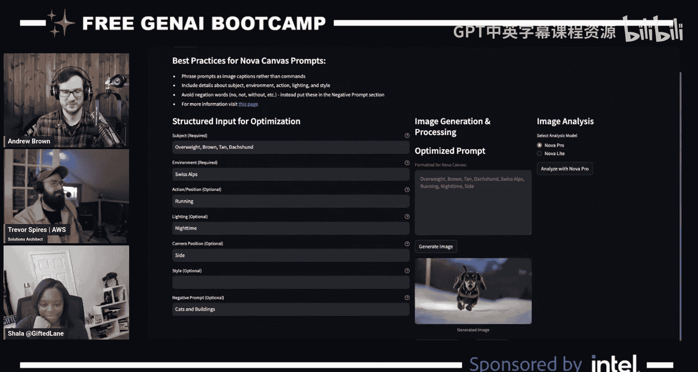

Lane。Might want to try a downshot， It might be easier to see downshot。Okay， wow， are you。

 you know camera angles， u no， I just looked it up。

One one question we did have I'm curious to is if you click on the question mark for camera position。

 does it give us some examples or no， I mean I can I could I know I'm sorry so Travor did you give us I think Traor you code of this right I did code this and this is this is this is what you got for for descriptions or I didn't I didn't overdo it on the descriptions folks okay。

Anyho， All right， we got a doxin， though， which I'm， which I'm down with。 Well。

 I think I'm gonna leave it on the doxin for now。 Does this look like any of your pups。

Which one doesn' it really kind of not really not right I not really no the face is not right。

 It's not quite right。 The ears are a little little big。 I say whoever trained this model。

 they were like German shepherds， the German I'm going back to German Shepherd。

 that's what I got up in my house。All right and then and then I'm going to animate it in a second。

 but while it's animating， I want to talk folks through well actually。

 if there's any questions why ask some people saying like maybe why shot， long shot long shot。

 why shop， let's， let's give it a try。

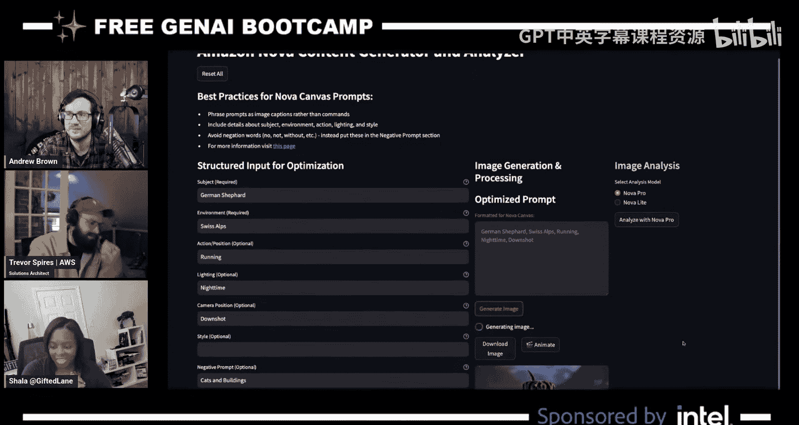

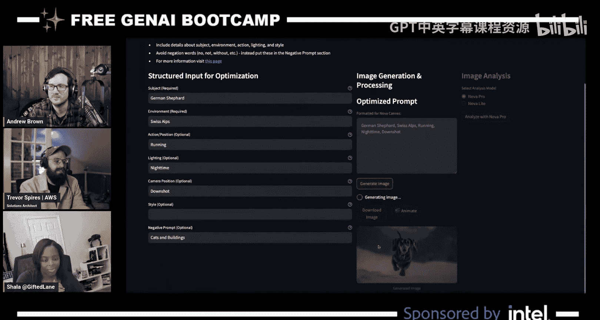

Now I was one of the projects I was trying to make for the boot camp was I was trying to make a like kind of like a children's book for language learning。

 This is one way of learning which is you have a series of images and then you have some basic text underneath it and it's great at reading so the idea is to slowly immerse you into a language reading level that you can handle but what I was using what's the midjoney it was having a hard time with some of them where it's like if I had like let's say dogs and sheep and pigs would it would start merging the sheep and pigs together and I can never get it to not merge them together it was very frustrating but yeah I mean this is kind of what I was I was touching on this earlier is like。

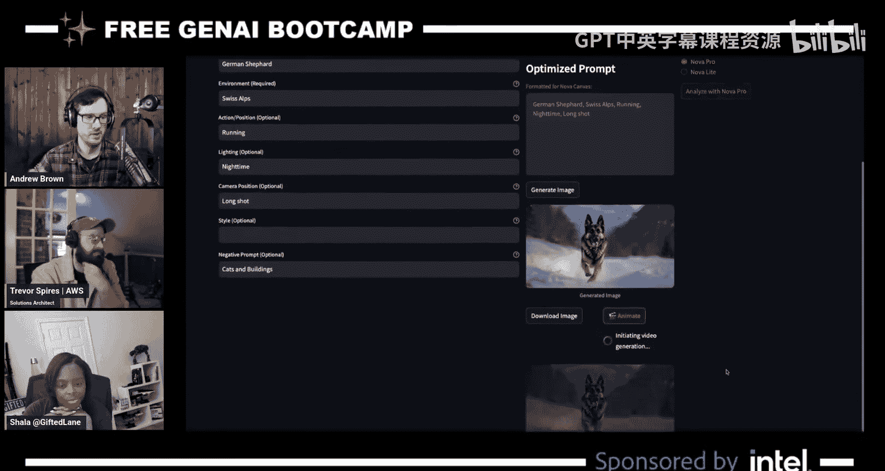

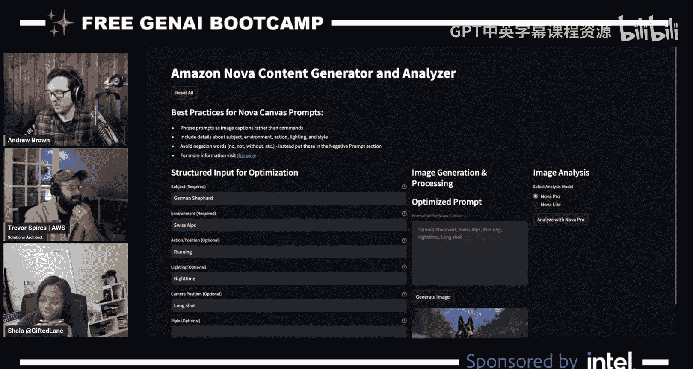

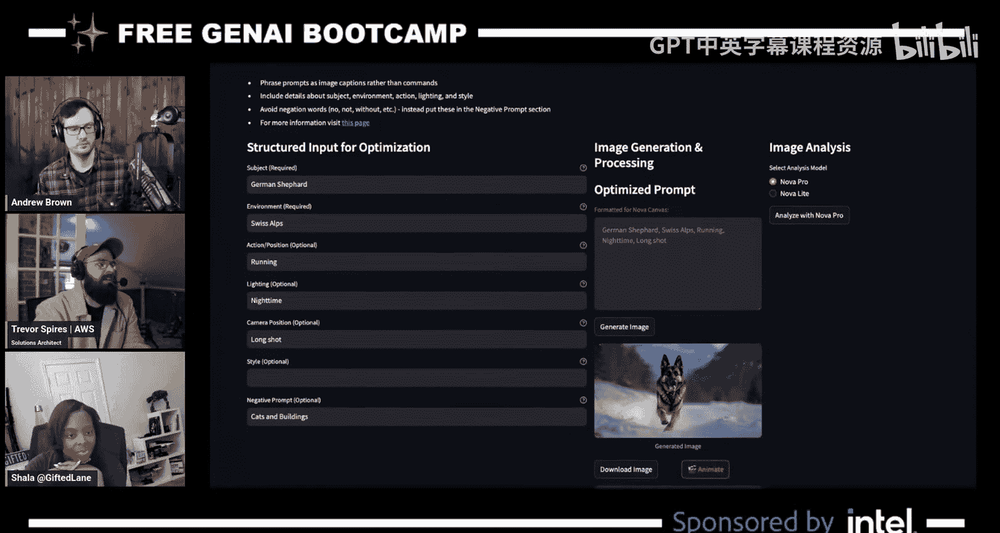

Image models are are a great example of like。Like so like let let's think of three different image models。

 we might have Nova canvasvas。W what's the really popular one stable diffusion？

It's like a really popular Yeah， sample diffusion。 and then what's the open eye1 called Dolly Dolly。

 Thank you So like D， D， like Dolly， like the the artist。

Oh close because it's not spellt like the name because thats legal for legal reasons， D L Ellie。

 there you go， there we go， but but there's a period and I'm just kidding。Lve me alone。

 leave me alone， all right。So like it's a really interesting point。

 right because like different models， especially image models， like they're so with a text model。

 it's like you actually kind of have to do some like automated testing oftentimes or you're kind of getting the vibe of the model with an image model it's very visceral of like if I have three image models generated German shepherd。

 I'm probably gonna have a preference for which style or like which one's better at the specific type of image I want to generate And so what a lot of customers that are using。

 And when I say a lot of customers， I think when I think of image models I think a lot about。😊。

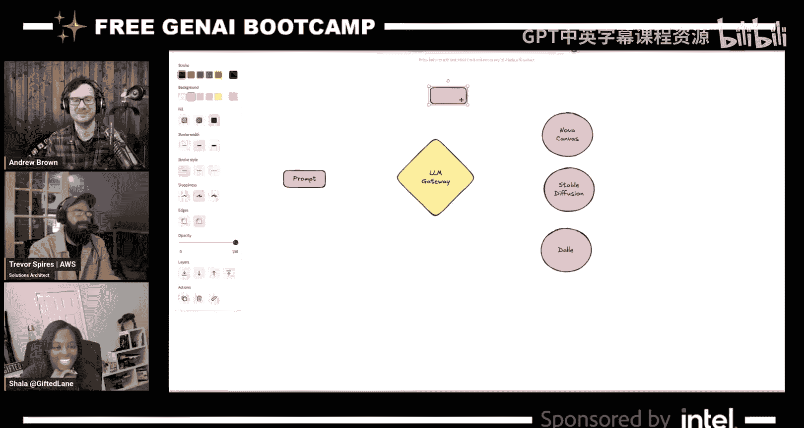

Like retail， I think a lot about marketing， like advertising。

 those are the sort of Abu would have optimized their model for that use case probably so in fact。

 we can go back and see that'd be interesting to make it like a shopping like we can't it but that seems like a good reasoning as if Abus wanted or Amazon wanted to align it for their thing and you might imagine they have a lot of training data for that as well because all the products exactly that's a really interesting really interesting idea let's see what like I want to buy hand soap That's actually that's really interesting because you're thinking about it the right way in terms of like what was the training data set and I bet yeah it like this is like a super photoreistic image of hand soap where the do was like a little bit cartoonish and so you're probably I don't know what the models are trained on companies don't share their trading dataset sets publicly but。

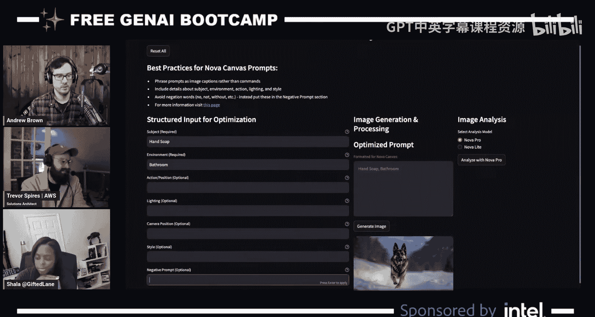

You could probably infer that as long as it's within an acceptable use policy that it was they did use some of the retail images。

 And I bet other other products might have similar outputs What's something。

 what's something you bought on Amazon recently that I I recently purchased T I mean。

 I can just go check on my Amazon let's go find out I was gonna go find out and tell you two seconds I bought like cabinet liner a cabinet liner。

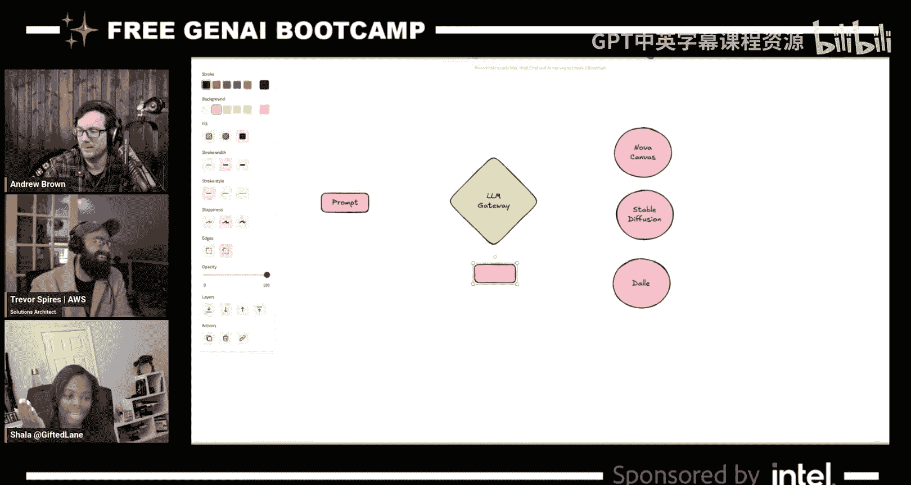

I know parking a fer fermentation cr， a four liter jar I'm trying to make more kimchi Okay I really eat it because it's well I can't eat the spicy stuff。

 but I still keep making it， but like I guess sauerkraut， if you will， but fermentation cr。Okay。

 that seems too obscure though I like the no parking sign and I'm going to put it on a on a wooden fence。

Just because I don't even want to try to like like I've already made such a spelling conundrum u trying to spell doxs and I don't want to keep embarrassing myself here。

Can we use a brand in the prompt， I'm going to guess probably not if you do craft peanut butter。

Let's try it， Cr peanut butter， yeah。I'm not sure if Canadians are allowed to buy that craft with a K。

Thank you， sir。 Yeah， I don't know I don't know if I've ever seen crap peanut butter in the I'm hitting the wrongs I think it might be made in the states where it's hard to say Kra used to be a can company and then it's I don't know。

 Hes bought it and or was Heins a Canadian company and that was bought by America。 I don't know。 Wow。

 Yeah， I mean， crap， I mean， there's like craft cheese instead don't get craft peanut butter？

 I've never seen that in my life， Sorry what do you get Giff moms like you choose Peter Pan Peter Pan。

 What's Peter Pan Peter Pan Justins is like Yeah， American peanut butter folks in this stream。

 Do you get peanut butter where you live。

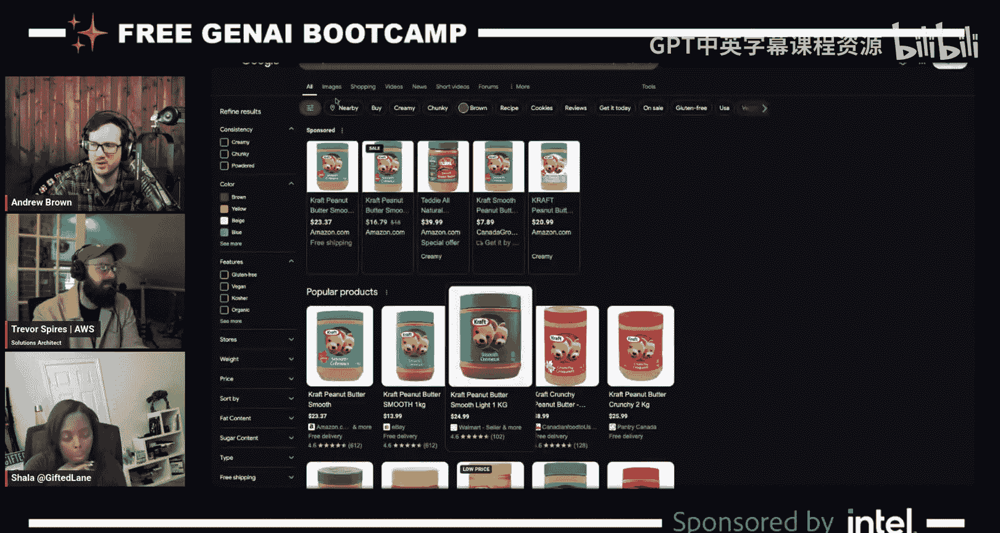

Because peanut butter is not everywhere， like why I lived in Spain？No peanut butter。

 where was it really， that's so sad because peanut butter is。It's just one of the steals。

 are European friends， do you have peanut butter？I mean like every day。

 like almost every day I have a peanut butter sandwich for lunch。 But you know what I do。

 which is a bit unusual is I will put I'll put tabasco sauce in it。 peanut butter andco sauce。 Well。

 why not ever had peanut sat like like Thai， it's spicy peanut butter。

 you can put you can do that for your lunch。 I do I do quite a few odd things。 That's nice。

's give that a try。 No， I mean now that you're mentioning it Yeah。

 I've had like some nice Thai food that was like a little peanut and spice。

 But like when when you say peanut butter andasco I didn't register I mean。

 like it's three things it's like if you want to make a sat。

 It's just peanut like peanut peanut butter， something sweet some something spicy right。

 but another weird thing I do is like Iatme on the morning oatmi is a Japanese way to oatmeal。

 But I sometimes I put kimchi in it or I put a tea bag in it or I put grated grated parmean。😊。

Regano or whatever。 So yeah， who wants to come over for breakfast at my place。 I'll give it a shot。

 I'll give it a shot。 So I mean it did generate crunchy crunchy the stream is saying that's actually what I have。

 I always get crunchy。 sorry No I'm with you。 I I'm a crunchy peanut butter person myself。

 But I mean what's interesting is they definitely like they definitely have the essence of the craft logo。

 it's not exactly the craft logo， that's actually really good because normally logos like tax and logos are awful。

 but I'm actually surprised it was even able to first of all， put all the right letters in there。

 And then the second part was actually， it kind of has the shape， which is very impressive。😊。

We'll do one more while we're waiting but but yeah， I mean， I think the the point of of this kind of。

Its like。tangangj that we're going on can't spell giff are you kidding me you've lost me a cheese is that like different models are good at generating different things and so what a lot of organizations will do that are building an like an application that has a that needs to generate a very diverse set of images is they'll have。

It's called different things I've heard it called there's a component that people will put in inside like as a logical step inside of their app。

 I've heard it called an LLM gateway， I've also heard it called a model router。Yeah。

 all routes is the term I normally hear。 Yeah， and， and it's， it's a really。

It's it's a fairly simple idea of like if I have a prompt， like whatever， whatevers in that。Pro。

 let's say this time this time I wanted to generate some peanut butter。

And maybe Nova is really good at peanut butter。But Dolly is really good at humans。

Right then based on the prompt in this case， I could have some logic or even sometimes a smaller LLM running inside the gateway that will route a prompt to whichever model it thinks is going to be best for that given use case so if I have a prompt that says peanut butter maybe I would send it to Nova because I believe it's better at that class of object。

 but if the prompt said。😡，Some type of human being we might send it to Dolly because we we ran benchmarks and saw it it was better at I haven't I haven't used it in bedrock。

 but I believe they have a model router， don't they there there is a model router feature in bedrock like not necessarily works this way。

 but I think like it will it will choose the most appropriate text based Yeah。

 text based there's two there's two today and one thing I don't know because I've only dealt with I've only personally built on custom model routers Yeah。

 let's let's take in here and take a look what I'm always curious of is what。Yeah。

 so like what here's the interesting about this is that it will， yeah， that' you nailed it。

 The anthropic router routes to anthropic models where I bet the meta router is the same。

 And like and that's okay。 but like generally speaking。

 like what I've seen the pattern that customers are looking for are routers that can route between different families of models you get different capabilities not necessarily。

 I mean， of course， of course， if you want to save save money then staying with the same family going down a level makes sense。

 But if you're looking for mixed capabilities to get maximum creativity of your output those are two different means of routing exactly I see exactly。

 I mean， but but I guess one really here's here's a really cool use case for let's let's say for example。

 I'll go back for like just the anthropic router。 So like anthropic like in most providers these days。

 especially when it comes to their text and understanding or like general intelligence models。

 they tend to drop them in like。Stets of three and four as people started to see。

 And so what's really nice about like something like the anthropic router is if you're using like。

 let's say， and I could have the parameters wrong， right。

 but let's say Anthropic has three models with different sets of parameters。

 So let's say they have an 80 billion。 actually it's probably way bigger than 80。

 Let's call like a 500 billion parameter model called that's opus。

 let's say sonnet is 20 billion again。 I don't think it have I was looking up how much it takes to run a 7 billion parameter model。

 And it's like I was it like 300 T flops It was just it's insaneps。

 It was just insane if you want to do it at home， right。You know。

 you need either a 50 I think I was looking it up I was talking to the taboo campers but like obviously Intels your sponsor so if you had if you had a gaudy processor you you could do it。

 I think I was look at the cost wouldn' I'm not sure if it was like $5 or $20，000 for it。

 but then when you went over to the Nvidia side it was like 50，000。

70000 so it's like you either go the Intel side but then you don't know what level of support you have for models but you know exactly what model you want you can run it or you pay a lot more and you get you can run any kind of model but it's really freaking expensive。

Yeah， definitely， I think I think we're gonna to see that continue to and it's it's cost as part of it。

 I guess cost is driven by supply and demand and there's just so much demand for the NviDdia chips right now that they can the price for those versus like probably the Intel chips I Amazon released something called trainingium2 at reinvent that's really I think I've been asked them I'm like how do I like how do I work with these and they're like there's a long time though not a long time I mean like not like years and years like not 10 years but they've been here for a few years Yeah well mean you use them and it's basically like there's just it's very similar to like running Nvidia clusters。

 but instead of using coa there's an SD called neuron it's like very similar syntax syntactically to couda but what a lot of customers will do is they'll basically because you can it's most easy to find training and orchestration code for Nvidia integrated with their。

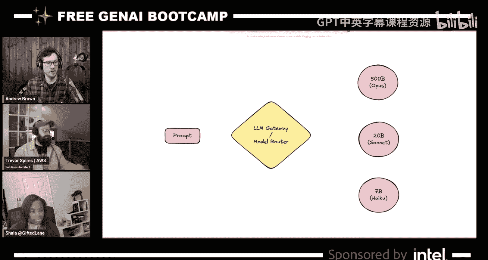

AI SDDks and so a lot of people will like translate that into neuron。

 but it's basically if you want to use infrarentia or trirannium you really have to start by learning the neuron kit unless of course you're using it。

Like within bedrock because within bedrocks it just mean the fact that the models you don't have to worry about it like it's abstracted from you right like you're not thinking about it。

 but I know like a lot of the nova models and some of the cloud models are run on those on those chips I'm thinking with these AI accelerators though it's like because it's not it's not it's not like a GP。

 it's an MP right so there has to be some kind of model conversion and I'm guessing probably with tritanium and inar I have them in slides and I say I'm right in there but I'm guessing that they are just cost saving right like A like these AI accelerator is all about cost saving versus well it's actually been it's a great thing I think what initially and this was pre reinvent 2024 Yes。

 the story for inferentia training was completely focused on price performance and frankly a lot of it is actually not just price performance because you can think of price。

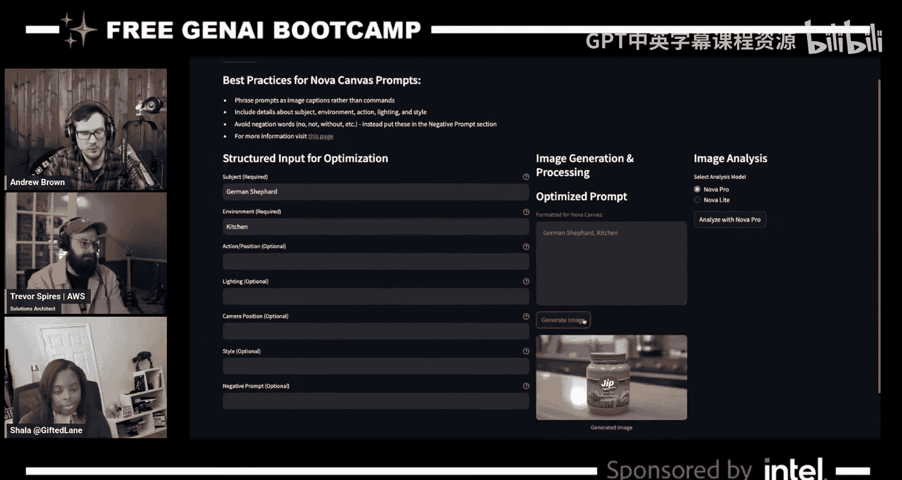

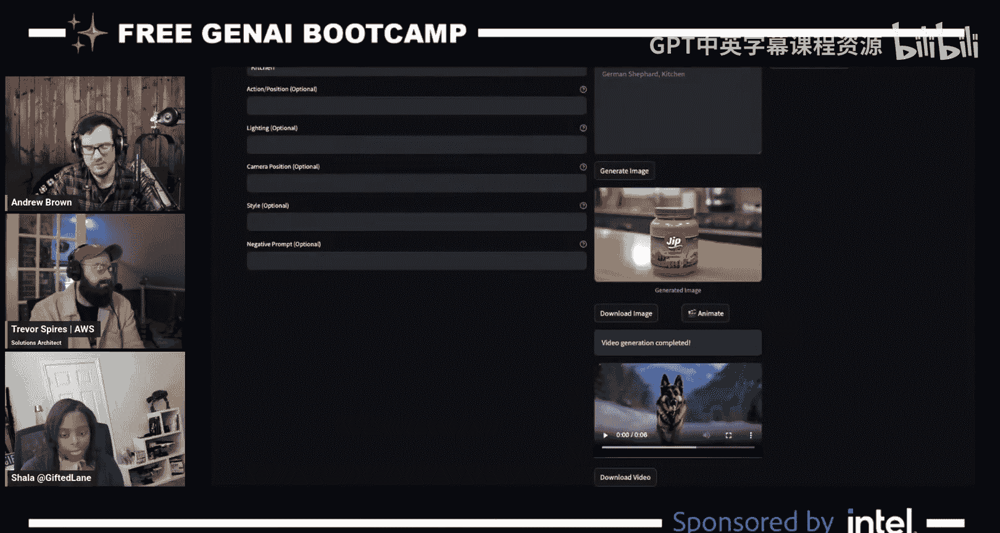

Performance as like。Almost one to one with energy consumption right so there it's not just price。

 it's also energy。 And a lot of people know that the the generally speaking GPs are pretty power hungry devices。

 and then this is a piece that I'll say like。What what the the way the。

AWS positions trainingium and this is like kind of deeper in the science than I personally have gone is like I guess there's something about when you're training or running big inference clusters that they point out it's not necessarily the size of the chip that matters it's the size of the instance or the machine that's plugged into a various number of chips And as I understand the trainium nodes themselves are just like capable of much larger instance sizes and so you can get more flops on them than a lot of comparable node types a lot of words time like VRA and stuff like that So a lot of the times like you have like you have shared memory you have the actual memory that is right beside like right beside the chip and so you have to hold it all all within memory right and then you also have to hold the prompt in memory as well but anyway just fun to talk about always trying to get more deeper onto the hardware side to understand like if you did want to run it what is feasible。

People need to get， I think， like going forward like。Like myself， I bet maybe you're the same。

 like I started with Jenny I， I would describe myself as more like like initially as like an AI developer where like you're just kind of learning how to prompt how to use tools。

 how to string AI systems together。 But with the drop of specifically。

 with the drop of the deepse model， the industry is is is much more。

Companies in the industry is starting to consider because Deepseq was apparently trained on such a light budget otherly supposedly you know you who I guess I don't know what the most authoritative source on that is I was really I was just on on the Intel podcast talking about deepse because the thing was is that really is that is that they' were talking about the cost of training being significantly cheaper and so it turns out it wasn't right they actually did train them on a fleet of GPUs but where it can save money supposedly is on the inference side right so like even if you're not retraining it or if you do have to train high cost now the cost of inference is low。

 you don't need as many GPUs to run Well that's right the cost of inference and then specifically though it was for some of the models。

 the training technique that they。

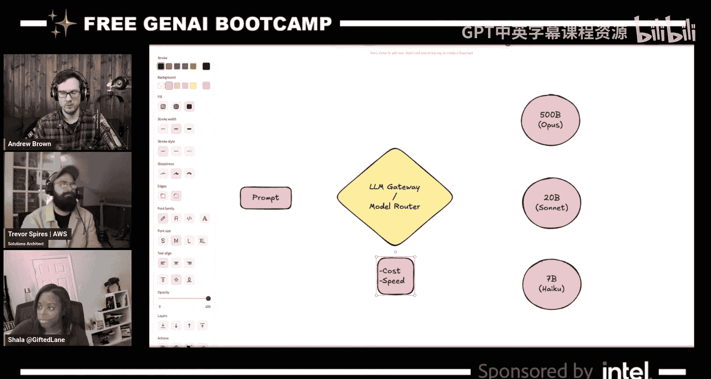

UsedWhi is now like like a generally available technique， the technique is called distillation。

 which is basically where you're able to like so if you think about it's not a new technique trevor it says that they they I think they they kind of paved way for it and people saw that they did right we'll call it a newly popularized technique that's the wordre I think that distillation was supported on on bedrock as a reinvent and I think other like like you've been able to do it like selfhoed for a while。

 but take a model like cloud 35 right。

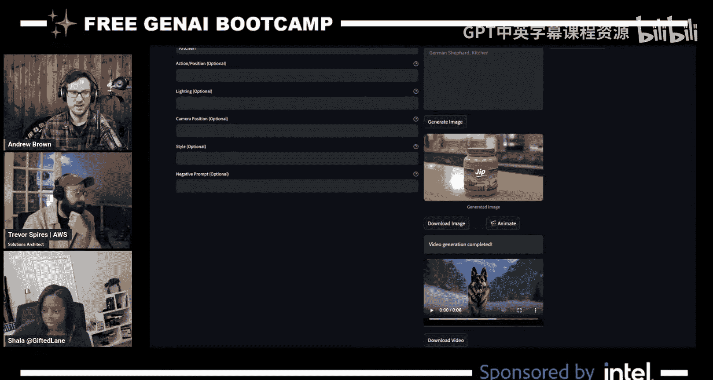

It's a general purpose model So it's it's really good at like a lot of things like you won't say you wouldn't say it's really good at everything。

 but it's really good at like most things you expect an LM to be good at But with distillation and like some small tweaks to the models themselves you can take a model like like imagine like here's here's the best way I can describe it is like imagine the models are like like let's go back to street fighter or like some combat game where like you have different stat sliders and let's imagine that here is that was bad the demo's exactly what it's demo that's amazing So like let's say like there's。

actually let's say I'll make it more in industry focused so like let's say that 37 is really good at medical legal and finance things like so let let's say you start with Claude just a base model and it's really good at these three tasks but like let's say I'm a medical company and I don't actually care if the model' is good at legal or finance with distillation effectively you can like this is a。

Oversimplification， but I could go to the model and say like do a small retraining job。

 make it like actually make it worse at legal and finance。

 but make it significantly better at medical type things simply by running distillation。

 which is which you can really automate a lot of and the other big the other big benefit of distillation is that。

What we see a lot of customers able to do is after distilling a model it's like let's let's say you in theory you' were gonna distill opus you could actually generally do like higher level tasks on smaller models meaning that you can really chop your latency down significantly without having a tradeoff on the actual reasoning or intelligence capabilities So distillation I think distillation all this back to what you said of like skilling up on kind of like the hardware and infrastructure side of AI I think distillation is how a lot of people will start to get more familiar with that because it's such it's so much easier to distill a model than it is to train or fine tunena model I think this will be a lot of folks first introduction to actually running some sort of training job on an Lm Tv is making me do distillation next week now。

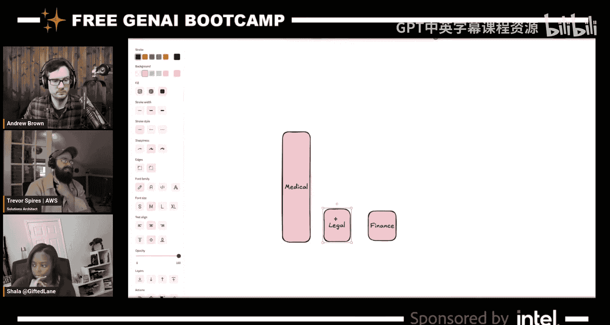

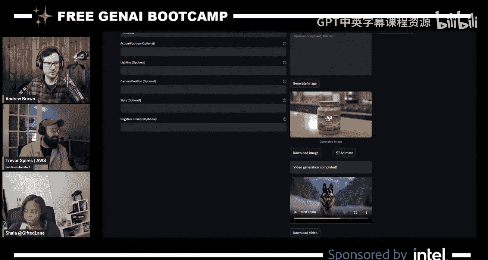

it's cool It's gonna the demand for it， sorry No do it do it do some distillation and a distillation job is not so expensive to run either which is which is nice where a fine tuning job can really can add out pretty quickly well it also depends on what kind of fine tuning job but anyway in Canada there's a an old PSA back in the late 90s early 90s and it was about the house hippo do you know about the house hippo I don't I've never heard of the house hippo never heard of house hippos No and so it's it's a very Andre you us a lot today。

Looks dont know much about Canada， Nick you can tell me you don't know who Pocaoo is the house hippo that's it's a real。

 it's a real PSA that played all the time and the idea was talking about this house hippo that lives in your house。

And it's basically talking about it and the end of it it tries to say like， hey。

 don't believe everything you see on TV but the takeaway of all those kids are like I want a house hippo so you can see there like there's a house Hpo there on the Wikipedia page and it's it's really tiny your kitchen pushing trash away。

So you know about house Superosshala？No， but now I'm like the kids。 I want a house it。

 but I it's kind of cute。 What about What about Pocaoo， You know， Pocaoo， too， right， No。

 Pooo I knew because you showed it to us。😊，The third one there， Pocaoo from the Poa do door。

 there's a that was like we have our I'm not sure what they have。

 What's the public Pbs in the states in Canada ours was called TVO and so Pocaoo was there to teach all the kids every week but there's there's a unlicensed version of Pocaoo called Tokeroo you can kind of guess what tokuoo I have the idea we were legalizing something in Canada。

 Tokuoo here TV was not happy about that congrats on that by the way。

 So I don't know about house hippos but' I'm a big consumer of Tiktok and I'm kind of up on this it's a little niche but there's this guy and he makes these little singing videos and he's got this little guy called Dpo the hippo and Dpo the hippos like a wrapping hippo and he's pretty pretty lit I would check him out but that's what your house hippo made me think of I mean it looks just like just looks like a dressed up house hippo to me but。

Yeah， it's just it is just addressed up house hippo with a tied eye。Okay， folks。

 we got sidetracked here for a little bit。 Can you， you see the full screen dog right now， Yep。

 al right， cool Ca because it messed up my share screen。 Listen， while we were chatting there。

 I just what another thing I did with that with one of those dog images I wanted to show the the books here is。

I passed the image into a video generation model right so with a video we were buying people time here that's what we were doing Yeah you know it's a five it's a five minute demo or something like that。

Okay， here we go。 So you can see I got， I got my little German shepherd。

And he's just trot trotting along， don't realize I can't even tell， yeah， oh my God， this is。

 is this a real German shepherd right now， folks？Look at look at the surprises me the end of Homeward bound。

I like it he's walking off the screen too。Anyway， the point is。

 actually I don't know what the point is， I just got to be cool to add a button to do that。

 I think that' that's actually the point know I got an image I may as well。

 I wonder if I animate the peanut butter。 what it'll do Yeah。

 go for it in my what I was doing Jennifer for senior years in my to a few weeks ago I took old old timey photos and animated them and I kept running to issues where the prompt would do really ridiculous thing。

 So first I was like all right， there's there's an old timey like shop with a car。

 make the car drive off and the car the first thing it did just like drove backwards like straight off the next time it drove there was like it drove but there's nobody in the car there what I it was just kept it was very funny。

 but you have to be very particular about your directions for video prompting。 that's for sure。

 Yeah so it sounded like it gave you like a ghost riding the whip car what I'm hearing。

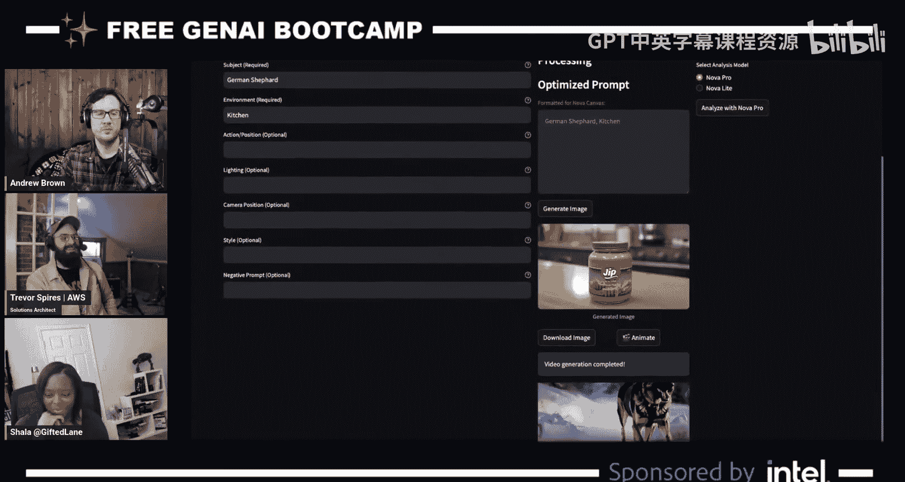

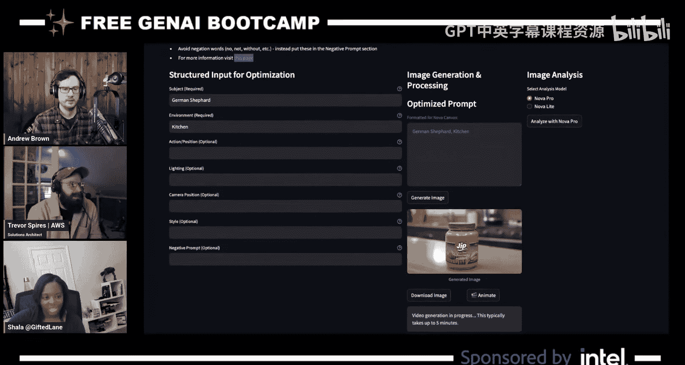

I oh no， it's all good。I was going to say when we share the code out。

 it'll actually even though my my descriptions aren't so good underneath the question marks。

 I just remembered that we。

cross linked it to instructions。 So if you all， if you all are trying to。

Optimize your prompt there you go， that was that a stock photo generated？Yeah。Whoa。

 that's really good。 Yeah， can we try that。 Yeah， I mean， if if I， I haven't tried good prompting。

 right， So like let' let's， let's actually the reason the reason why is because I want to see if I can make a visual novel。

 right， like the visual novel video game Sure， and so I have to try to generate a person。

 And so if if if if that literally that works。Assuming we get the prompt right， you know。

 I I'm just going to it there doesn't mean it will work as expected。

 but I find it's not it's not specific with this， but I find like sometimes it takes a lot of prompts get what you want with any model Yeah yeah it's why like midjoney always gives you four images right is because like the likelihood of the first one being exactly what you want is pretty low videos even more so like if people I'm sure people know this by now。

 but if you see like on Twitter a video that seems very impressive they probably made like100 videos to get that one like seriously。

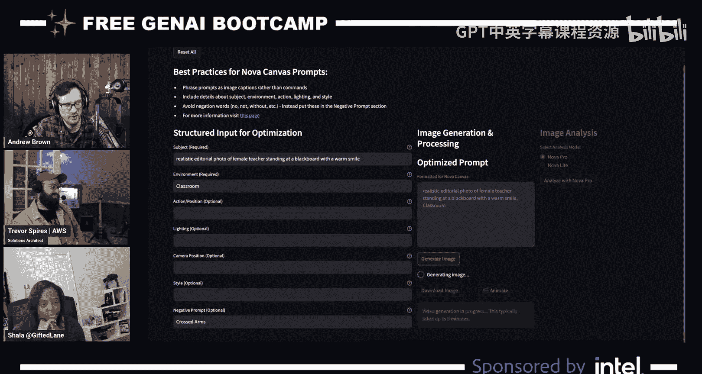

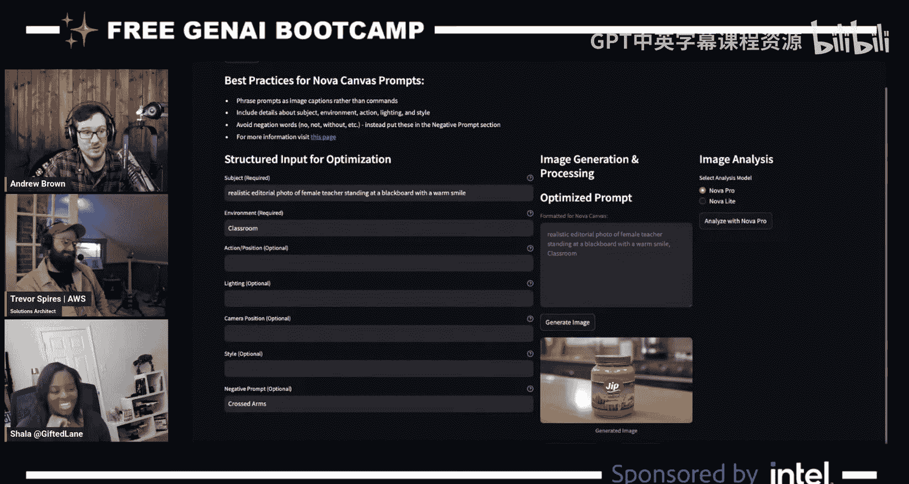

I think think I have thought prompting， I have a bug in my app。

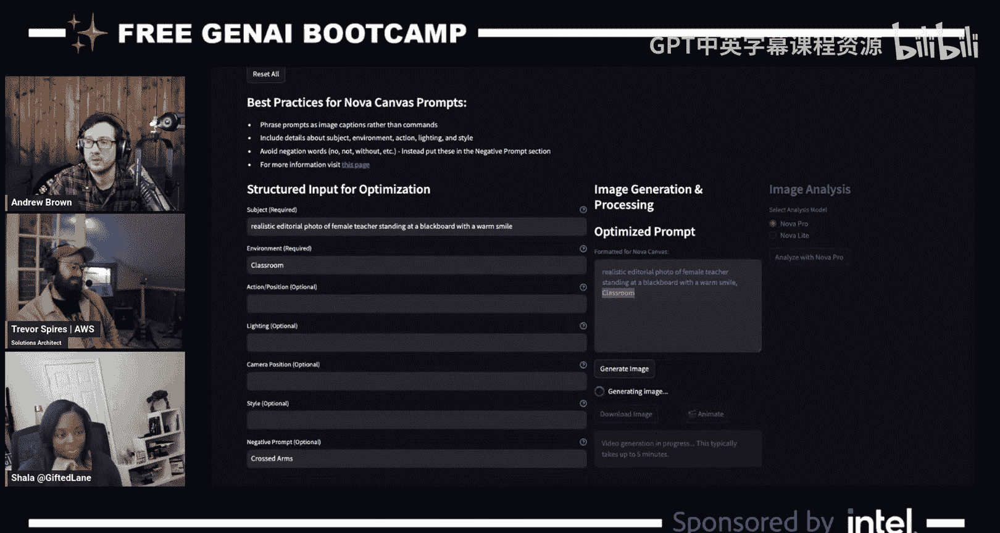

We fix it。I get the if it's generating the video， it's like going to lock the here we go。

A Zepein flying in New York skies That sounds like man the high castle kind of stuff there。

 Well actually that' would probably be， that'd be World War I。 that wouldn't make sense。

 big big challenge is getting a whole series of consistency images for the same character model for model consistency I can probably show that off if I have time。

 but there's a way to do that with control net in locally with cofy UI as I've been investing quite a bit of time the reason I was looking at that was for specifically this。

 but that looks really good the only problem is like as as Philippe has pointed out is consistency might be a challenge where like this will generate an image。

 but it doesn't there's no control net behind this thing there's no pose like pose model behind so you have to you have to accept the limitations for this managed service really。

 really good Well， I mean there are a few things you can do to control like to give you more control and like slightly more deterministic images and like I think one is like I think probably what。

Describ， which is like some system of checks。 So like if you think about it， like in fact。

 if you think about。Once once an image is generated， like of course。

 one option is to immediately return it to the user。

 another option would be to put that image into an LLM or like a multimodal text model。😡。

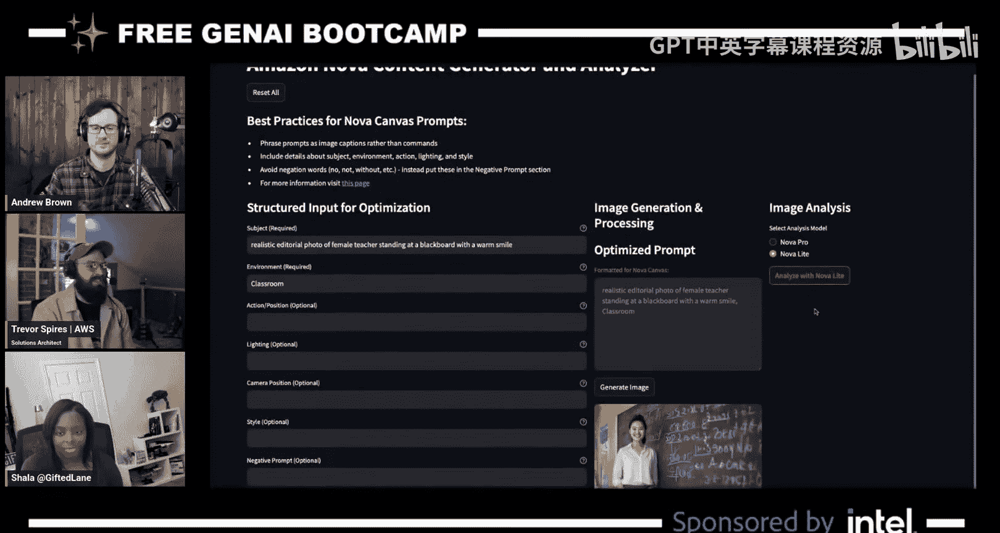

And。Since a multimodal model can analyze an image， I have seen instances where to make sure that you're getting a consistent set of images。

 you generate the image and then before returning it to the user you analyze the image with another model and validate that it meets some requirements that you have and then you can retry the generation that' that's one way to add some controllability another option is like because this is an image model like I'm putting in only text。

 but some image models allow you to put in other images and that that can that kind of grounds the future images you generate to a certain style or a certain。

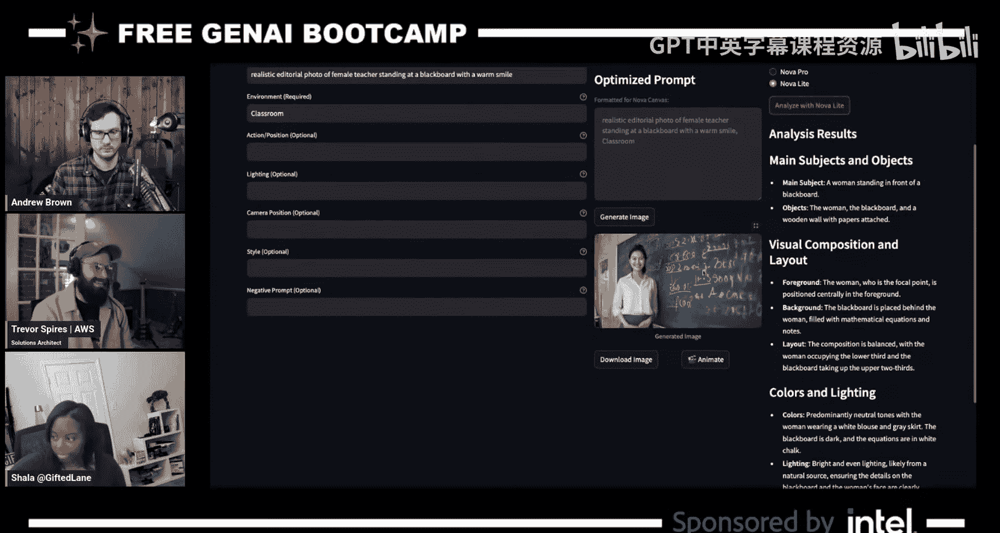

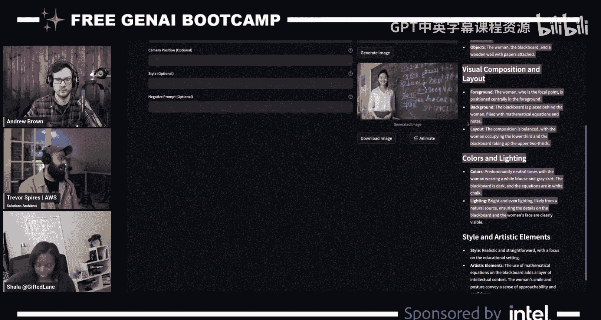

our artwork， I guess， but for character consistency like character consistency is a very。

 very specific thing。 and I would I would say I would not be surprised if it wasn't able to consistently generate character but generally a scene right I think that or some I'm just saying yeah there's probably some variation in terms of or limitations as to what it can do。

 but even for the use case that I want to use for this。

 This is fine because if I'm doing an immersion app， I just generate them out。

 I's kind of not have the person or another another scenario and it's totally fine。 let me you know。

 you know what we could try something to kind of test this out the image， the image feature。 Yeah。

 like I even though I don't have it in my code， we're going folks I can I'm just going turn on the image model and what here's what I want to know is like let's say let's say we're happy with like were you taking a cartoon character or realistic character you know what I was gonna do I tried。

Did do anime， but it's so hard to generate anime images off of that But if you want to try， you can。

 but we could go with realistic if it's just more consistent'll try for learning immersion for learning immersion。

 it could just be realistic doesn't have to be say pro hands Yeah。

 don't show the hands because number one thing is like just don't show hands and everything will be easy no hands。

 no spaghetti and and you're gonna you're gonna make some progress All right I kind of like this I'm I'm gonna see if this is like this seems like a simple enough animated picture somebody that I' you wrote animated What if you put anime。

Oh， anime， Okay， let's see。With a E。Oh， cheese。安那么。And we can even try。

 we can even put like comma manga。All rightLet me see， let me see what it。

 let me see how it does animate just as a starting point。This is okay， I that's okay， yeah。

 that's okay， yeah， that's actually better than I like。I've seen better。

 but I'm just saying that's pretty good considering。 Yeah， and I didn't try to optimize it。

 although it did give me hands， even though I told it not to。 If you。

 can you put like comma man manga， Yeah yeah， manga。A on the on the manga。

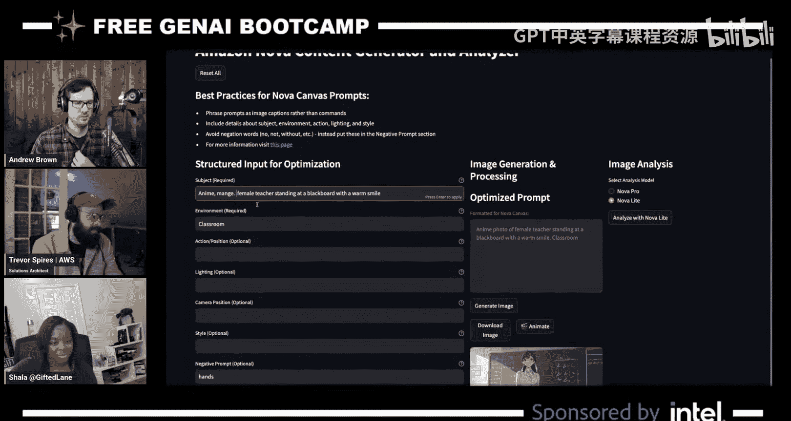

There we go。嗯嗯 응 응 응 응。

Sharla wants some swords in there， doesn't she，I was also going to say for animate ones。

 I have had good experience with using Photoshops。Oh those yeah， they do great N， actually。

 the generator。😊，Well， I got， I pay for it So I could give it a try。 yeah。

 like a lot of my LinkedIn articless。 And you see like a anime cover photo。

 Its Photoshop generation like the like the firefly thing or No photoshop Well， it could be。

 but it's just like build right inside of Photoshop now where you could just generate images based on the prompt。

 I'm opening Photoshop right now， we're gonna see if we could put this to the test one second here。

 So I'm gonna go Trevor， can you just generate me like a background。😊。

Let me try my app my app has my app is failing me all of a sudden here。

 I don't know if I've got a space in one of these， give me a second。Because I'm thinking like。

 maybe I can just for fun。See if I can generate a person here， I'm going to make a what it。Oh。

 interesting， okay， I see， I'm getting blocked by content filter now。because the person's in there。

 maybe， but I was able to generate some people before。 I wonder what it is。

 I wonder what it is maybe just take out the word anime because， you know， like anime， like。

 you know anime it it can， it can go a little yeah anime can go anime can go odd， odd way。 So。

 you know， maybe they're thinking you're trying to make it it's very， it's very possible actually。

 No， I wonder what it could also be that I'm getting rate limited now because I generated so many。

 Let me take a look。😊，I'll come back to it， but I do I think I did download one of these images so i'll at least pull that one up here Well while you're doing that I'm going to I'm going to take over while you're fixing that up and I'm going to go for grab a background here setting here so I'm going to just shrink here。

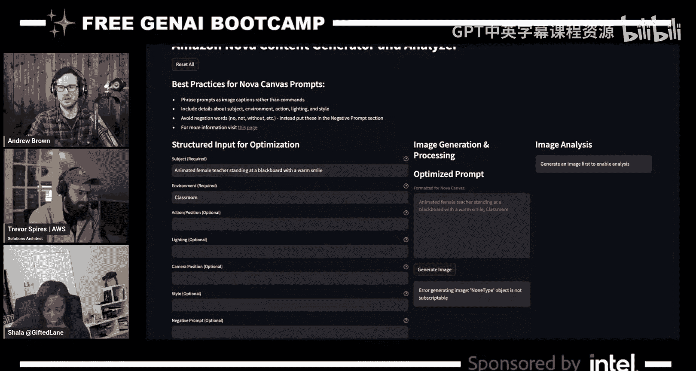

Oops， sorry here。 S here。 And I'm gonna go and share my screen if that's okay。 folks。

 can you see my screen， I think you can。 And so what I'm looking for some kind of setting like a background。

 I guess I could try to generate one out。 I'm not sure how well Photoshop does backgrounds。

 but I'm gonna try and say generate fill here。 I'm gonna say classroom classroom。😊。

Classroom。Background。You can generate in new ways to generate yes。

I know that that's why I'm doing it， but we'll see how that does I know first I'm just trying to get the background in the next thing will add a character and see how well it works。

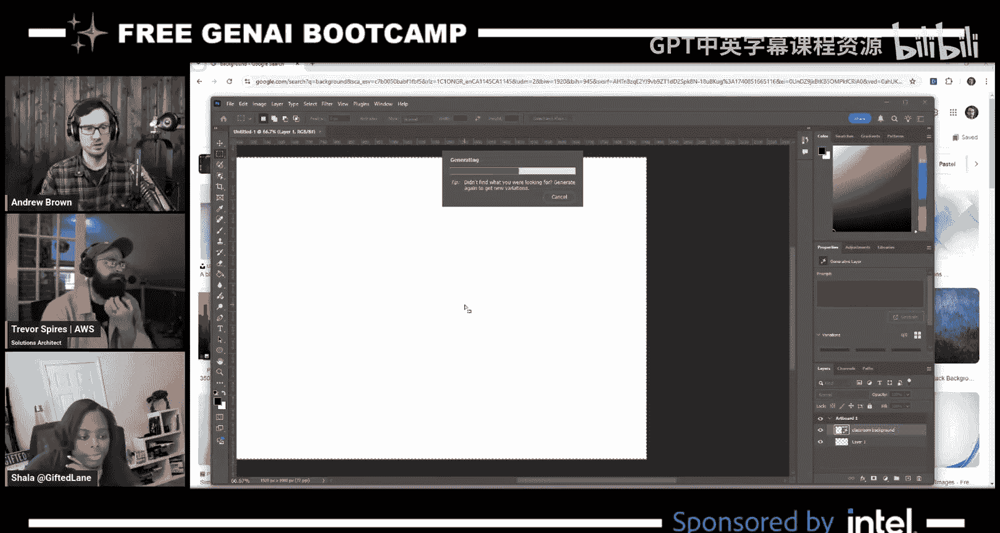

Yeah， and then thing。Oh sorry and then I'm trying to think depending on how it popped up for you。

 there's a way where you can give it， tell it what style you want to use and so like it has like an anime style or other different styles。

And that's how I get it to work really well。Give me a prompt when I can't think of a prompt。

 I just ask it for something here。呃。Oh， that's way too much。 But I'm gonna try it anyway。

 When you say these styles， you mean like in the prompt， that's what you do。 Yeah。

 it's like in the click on the three dots， you know， were you a tight。

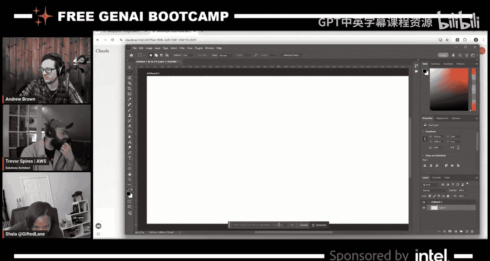

Yeah， the three dots over there。 Sure， I'm just gonna grab this one more time here。 Yeah， and I mean。

 this one has way too much information in it， but I'm gonna paste it in here anyway。

 and let's click the three dots。

Let's see where is it yours looks a little bit different from my yeah go ahead and regenerate I'll try this here。

 let's see what we got。But the only problem with this is like， even if it works。

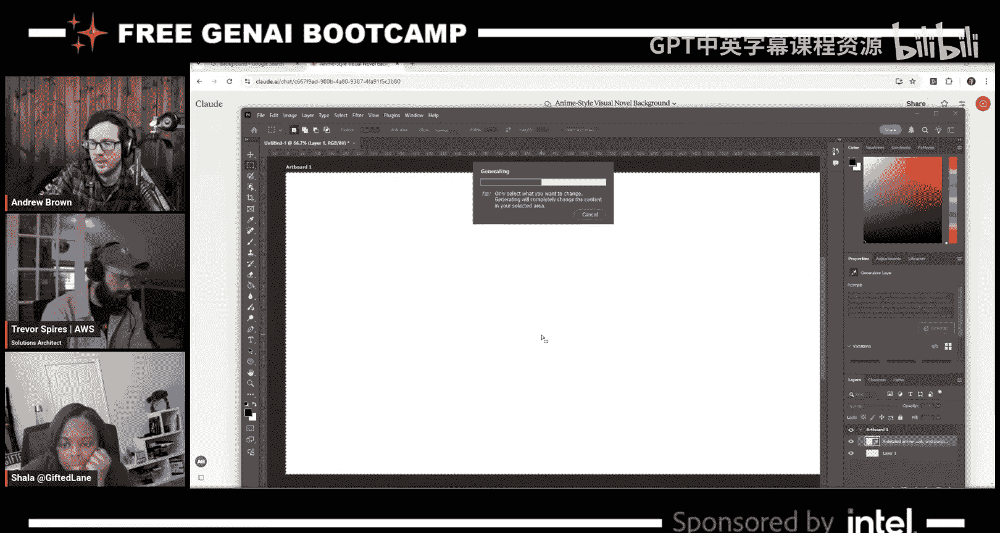

You know， if I want to programmatically do it that I can， Oh that's pretty good。 I that a class。

 that's fine。 that looks， that looks okay。 So now what I'm going to do， I'm going to go over here。😊。

And I want to generate a person so like， what would you do as an anime prompt if we had a person here？

Like what do you normally write， Shala？I'm thinking for there， I'm thinking more of a K drama。

I'm trying to think I don't know like a anA character， you know， with sorts like， you know。

 they're looking over the city about to go fight something I'm going to I'm going to go back over to here I'm going to go say you know。

 can you now write me prompt the image prompt？To generate the person that would appear。Conl。

Not the exclude background in the prompt。Since this。Person will be on。Another layer。Obviously。

 and I a， and yes， people are probably watching me like， why am I spelling all these things wrong。

 I just don't care， High school girl。Got to be careful when we're generally out to can we make it a guy？

Sorry folks these prompts are dangerous so I got I gotta unfortunately I think I think actually Gloria had had made a really good it was last year a post about like how these models are biased in terms of their generation and so some of these things can be you know highly sexualized when shouldn't be so I'm just doing that because you know there's going to go online and don't have trouble with it I'm sure Photoshops should be fine but who knows what kind of guard drillils they put in these things。

PPhotoshops for editing everything， folks so。I've actually never tried to do any risk aid prompts in here。

 that's okay， at least we got more than one option， right？诶。Yeah。

How was you you get better than this， Like， you get better， right， Yeah， I do。

 Let me see if I can find one。😊，Of a modern visual novel。 I think。

 I think I think it's like a literal， a literal novel。 That's what I think the problem is。

 So if I go back over to here。You like sorry， make it less of visual novel and more of anime。

 you literally have a prompt that makes it look like a book， right？

Let's see we can kind of help it here。And so I'll try this one more time。Again。

 this is just no I don't know if mean say this is optimal I don't even know what's optimal this just seems too crazy for the prompt to be good this requires a lot of playing around with and if you don't have the patience and does always turn no good。

 we'll try this one more time here。Ninja was sword in hand ready for revenge。I be we could do that。

 I'm not sure what would I get if I did that， but。It seems like a good prompt。嗯。There we go。

I guess this is the best thing I get。 just don't have any eyes Like I guess I kinda do。 But。

 you know， I'm saying like， it's not bad。 Like， I could still make a game with this。

 but it would seem like the prompt that came out of what do you call it Nova。

 I actually liked more than this one， but it's still okay。 It's just I don't， but you know。

 I can go in here。 I I can do more edits。 It's just more work。 I'd be like， you know， like。

Make the eyes more animate， right？You know， give it actual anime eyes。

And then I shared you got a private link， yeah， I shared a private link and that is an image that I created in Photoshop first try。

And because I love Hanime so。So it's not the tool， it's the person writing the prompt and clearly。

Clearly， I need you all's help。But you got to save those。This feels like this here。

 this feels like what do you call cr？Is sailor no， I'm thinking thinking like speed Rar。Yeah。

 I can see that。Those are nice， those are nice。But it's， I mean， that。

 that's starting to kind of look like close to yours。 but I mean。

 the prompt you got was how many the first you said first shot。

You you got to share your prompts here。Okay can。 literally， I want to say。What did。

 what prompt did I use for that， I think it was just something like looking at it， I was like。

You know what I told。I told it， yeah， it was like N girl like standing in like a futuristic server room with some brand new secret weapon and that's what spit out。

😊，Sorry， say it one we talking but you said mango animate it？No， I didn't even put anime。 it's I。

 I don't see it on yours， but there's a way where you can tell it to use the style。Oh。

 I think I know what I want you to do。If you can on Photoshop。

 I want you to like close this and we're gonna open up a new window or you can keep it because I don't want you to lose it Oh I don't but if you could we'll just say this real quick Okay。

 I'll say this to the cloud in one second here。So by the way， the card。

 the card here I use accommodation combination of mid journey and Photoshop to generate out it took a lot of work there。

 we'll go ahead and say let's visual the only problem again with this is that this is only one time I can't continuously use it and there's no API so I want to be able to programmatically do it。

 but anyway， what can we do here。Okay， so close like。That， yeah， so， you know。

 bring up the window where like， if you're gonna start something new， Okay， yes， and go to go to art。

 maybe。😊，I wonder， have you updated your Photoshop like I have been updated。

 Let's go find it upgrade cloud Okay， because yeah， it looks different for mine everyone。

 just get your Photoshop subscription if you want to follow obviously photos expensive。

 but we're just trying to show the capabilities of it。 That's all just because。😊。

Say I don't even have Photoshop installed， are you crazy， it's right here。That's my problem。

 I don't have Photoshop installed。 So I don't know。 What version do you have， Like I go here。

 And this is going be the latest。 So sometimes it does open the wrong version。So。

I have Photoshop 2025。 So I'm going to close this out。 I'm going to go Photoshop again。No。

 that's vote 2025， but apparently I don't have it installed。

That was weird。Okay， then go to。Try art and illustration。 Well。

 there's also this option under here if you go to。Where is it here， if we select here， there is a。

There's a thing called。Filters， and we have like the neuro filters。

I think I might see it now when you're dinner， oh， it went away。The generate was at the bottom。

 but now oh， so before you even click it， there's off yeah， like what's that button modify selection。

 invert selection， Cate mask， fill selection， createate adjustment。Generate fill。Yeah。

 because there's a way where I'm able to select style and that's how I get it to do anime without me even telling really Adobe anime style generate。

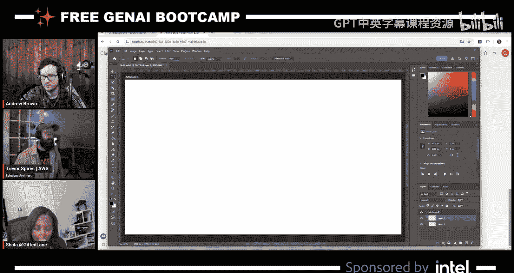

Why don't I get it？

Let me open up mine all right。And oh yeah， if let me go back here for a second here。

 I lost the window， where's our streamy here？And oh， sorry， so Trevor， how you luck？Oh yes， well。

 I mean some luck I I also got sidetracked， but the app was back。

 the app's not dead anymore and I and I took somebody。

 somebody had a prompt from the chat about Aninja and I decided to put that in there and not half bad。

 not half bad， but no you know what I actually was mistaken on something I was I was mentioning earlier。

 I thought。

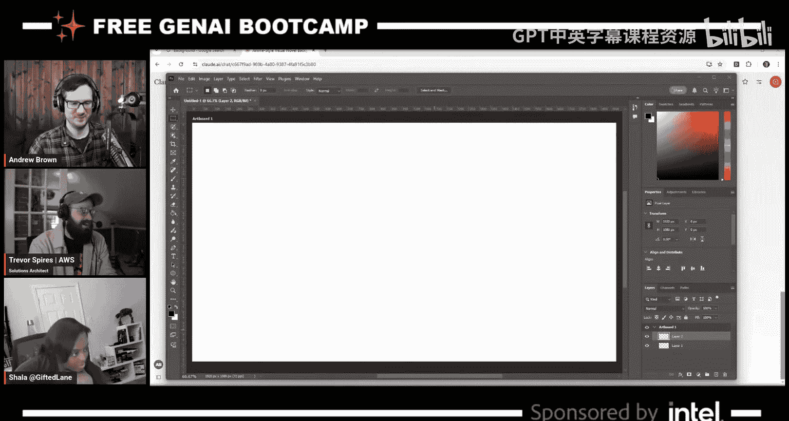

You know that we could use。And I did some research and I'll tell folks what I learned。

 I thought that what we could do。Is use。Ca I'd seen this attribute before。

 but I'd never actually used it， something called a conditioning image。

 and I actually thought the conditioning image was like a grounding image to say like make the image similar to this。

 but then I read the dock and it actually turns out the conditioning image is just。呃。

The the same like layout and composition not the same subject of the image so to your point like at least at least as far as I can tell with this particular model。

 you could animate an image with like the real model， but unlike。😡，What is it like， I I。

 I'm pretty sure on。What is the one that's in discord midjoney that you can have an input image to kind of ground the ground the art based on。

 Well I do have midjo。 So like which I don't know the thing is midjoney has changed and they now have like another tier And so I don't know if like like I'll show here。

 I'm not sure if everything is normal here but see I was trying to generate this。

 So this is me trying to generate questions。 And then this is I was talking about where I said I was trying to make a book like a children's book I'm not sharing the screen you are not over here。

 I'm in midjoney right So you can do it in Discord， but you can do it here as well。

 but you can see like I said chicken and pigs detailed ballpoint pen from an animal group white background blue ink drawing now poses real animals。

 I just like would not stop trying to put。Things together like， what is that， What is this？

Like this is without the dog right， so I was just trying to like there would be a dog with like a dog supposed to be looking after chickens chickens and pigs。

 right， but then it's just like what is this？So， but， yeah， I mean， like， I think here。

 you can put a source image。 So if we go， I'm gonna think of an anime that I like。 I really like。😊。

I'm not like I'm not like huge an anime， but there's some very particular ones that I like like legendgens of the Galactic heroesro。

 I love this thing and it has over 100 episodes。 It's really boring and really dry。

 There's no what is called Suns。 What's this Sunari it's a stereotypical character。

 Buabers were talking about it。 But if we go here。 I'm just trying to see if I can find maybe an image like this one。

 So here's an example of the original style from the 80s。

 It has its own little unique look that I like to it。😊，So many people say it's ugly。

 but I kind of got used to it so I'm going to go feed in that there and I'm just curious if it can even even do what we think it can do here so we go back over to here。

And I'll pull this up。And we will drop in source image。Drop in the source image here。And。嗯。

OrWhether if that was enough for me to do it， we'll say a man in a classroom teaching the class behind standing in front of a blackboard。

Terrible prompt。Let's see if it picks it up easily。

What's weird is like when it generates it out is it actually is generating。

 but I got to go back here and then。Oh， do not。What's it doing generating zero of one， here it goes。

And as you see， it did perfect style transfer。So I don't know。

 I'm not sure I'm not sure what I have to do to get it to work， but yeah。

 there's something that might be able to do it。Might be too hard for me。Oh， Charlotte。

 did you ever find that option？I did Okay， you want to try it again so you think you can guide me through it real quick。

 I think so okay。

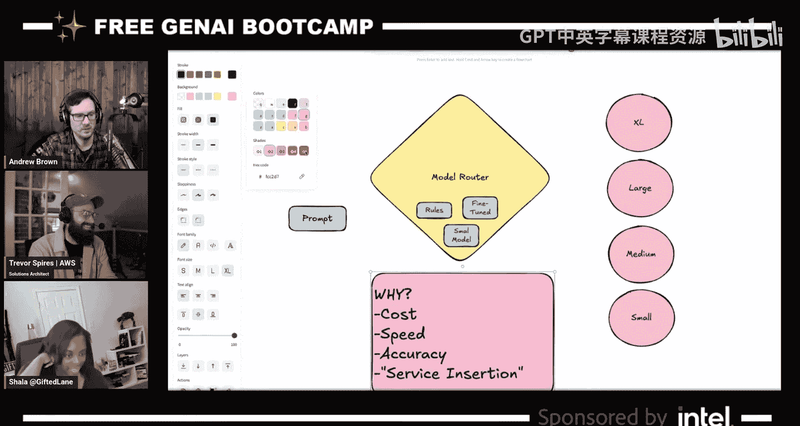

Okay， so at the bottom of your toolbar on the left where it has all the tools at the very bottom。

 click that what's that。And then we're mean this。 Yes， so go to style， I think or go to effects。

 is effects。😊，But you also have that。And then enemy， that's what I like at the top。 that's what I do。

And then I just put my words up there and that's how I got that image all right and then still okay。

 well I'll just try for fun real quick we'll say。😊，Does it what generates based on the the selection。

 right， not the whole thing。 So I'm going to go here， just。

 I'll go back to my original file here that we just had this one。

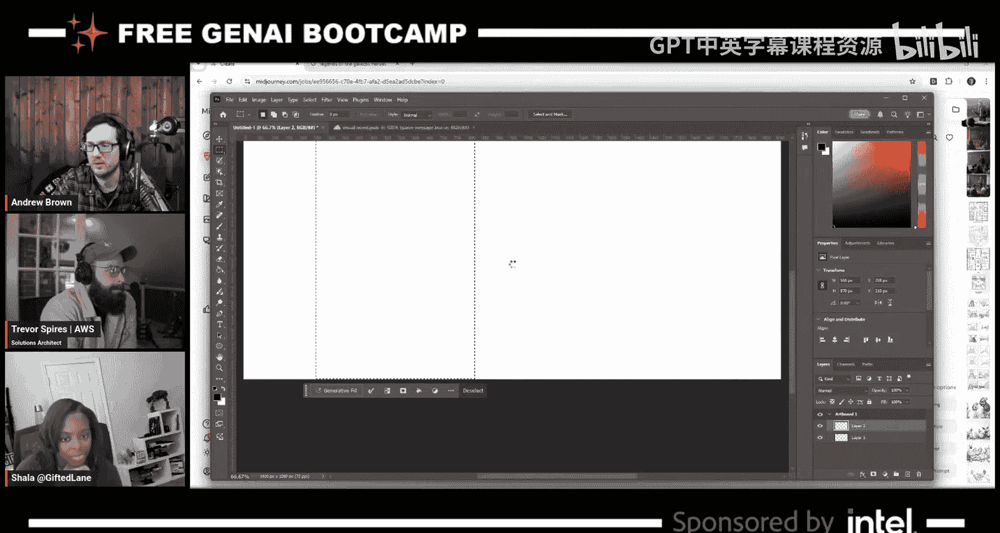

And we'll get out our ugly interface here。😀。I was going put this in a folder then hide it。

 And so wait does it generate does it change the background too I told it not not to。

 but it generated out the background around it， which is bizarre。

 So I'm going to go here and we'll make a new layer。😊，And we'll drag this out like this。

We will go oops， we'll go here I'm going to。Grab this， I'm going to go back to our clo prompt here。

Wherever it was， I think it was here。And we have this， right。

 So I want to grab some of this up because we don't need all a teenage boy of loads with distinct hair。

Has spiky elements。 He's wearing a black uniform and angle。 So this is the description of it。

 And then here is trying to describe how it's supposed to look， right。

 So I'm just going to grab this part here only。 I'm going go back over to here。

 We're going to drop it on in。😊，And it says art photo。

 I'm not sure that I'd never click I leave an unchecked no。

 I just click on anime I'm doing what you're doing and then it just does the things。We'll go ahead。

 I might have made this person too tall， but we'll see here in a second。

 I wonder if you'll incorporate the background as it does this。Andgie。

 you don't have to use Discord to make images， but you still。

 you still can use Discord it's up to oh， I see， okay， thiss time about mid journey。

You know what I think I actually prefer it in Discord because I'm so used to using it there now that I might go back there it took over the whole screen which what you say what do you say transparent background but yeah and there you go though I mean the results are definitely better right and we have more options。

 but I don't understand。Why didn't generate in that area， let we go here。We'll do this one more time。

 I'll try I'll try art this time， we'll say anime。And， oh， you can give it a reference image。

I'll bring in my I'll bring in that one second here， we'll bring in on my desktop。

Legends of the Galactics heroeses。Okay， confirm， yes， I have rights to use it， of course。

I don't know what it said， but I sue。Look， I'm looking for that payday from Adobe。Yeah。

Make an LM app to just try to。Nope， but I mean， still， like， it looks good。 It's just。

I'm not sure about that one， but well， that's these awesome things down here。Yeah，没有。诶。So yeah。

 what I haven't tried doing is how you're doing it where it just does it like in the little selection because I'm usually just trying to like make a quick over photo for like a article I think what I'd have to do is you'd have to first create the size that you want like this and then generate in there and then bring it over but anyway we'll go back to Trevor here we kind of like got quick part into the Photoshops I have something no boot camper can use。

I mean， it's I think it was interesting to see like I actually have never used those features of Photoshop I've just seen like the demos on YouTube so it was actually nice to see them in in real time and like no that people actually use them。

 it's not just like a demo at an Adobe conference or whatever。But yeah it's just。

 but but anyway it does the thing is like I want to be able to do this programmatically so yeah I kind of wonder like you know。

 can I generate background separately in Nova like obviously we can but the background separately in the person separately and then how would they integrate them together but let's take a look at that image that you generated out here。

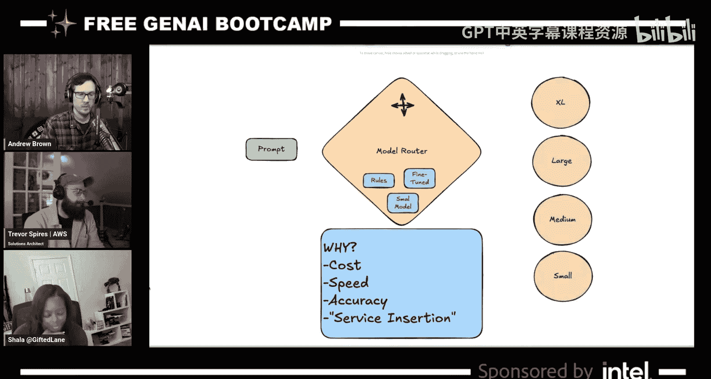

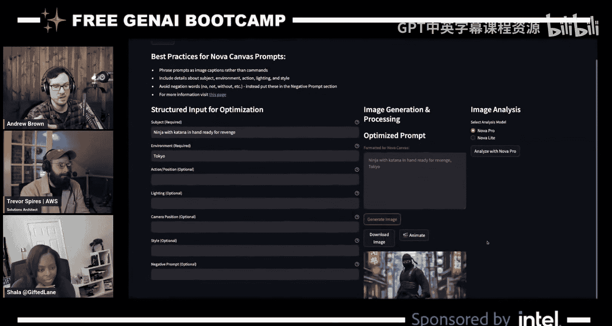

Well， I like it's very cinematic。Yeah， it's not， it's not bad。 It's not bad。

 I'm just taking taking stuff from the from the chat。 but I think。

 and I actually definitely want to see that animated。 if it doesn't swing the sword。

 I'm gonna be mad， I'll be real mad。

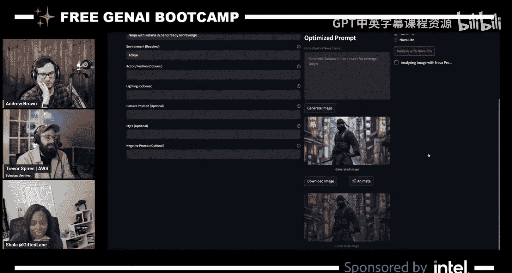

Um， one thing that we were touching on a little bit ago that I wanted to pop back to is。

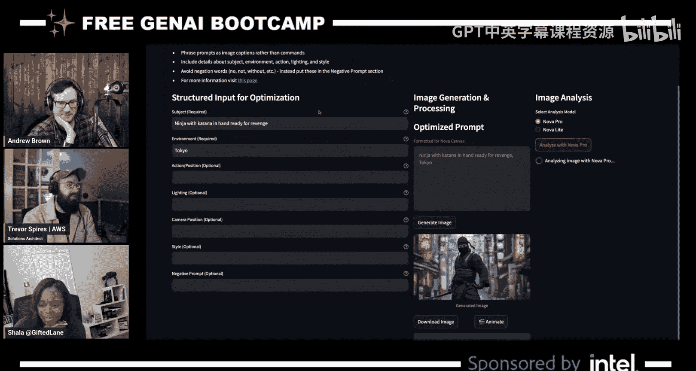

The use of like yeah， like while this is generating image and we spend a lot of time on images。

 like certainly that's a that's a an interesting function that you can do a lot of creative work with。

 especially， but an area that is。Adjacent to these image generation models are and something that I've seen。

Get real rapid widespread adoption across enterprise customers is using。

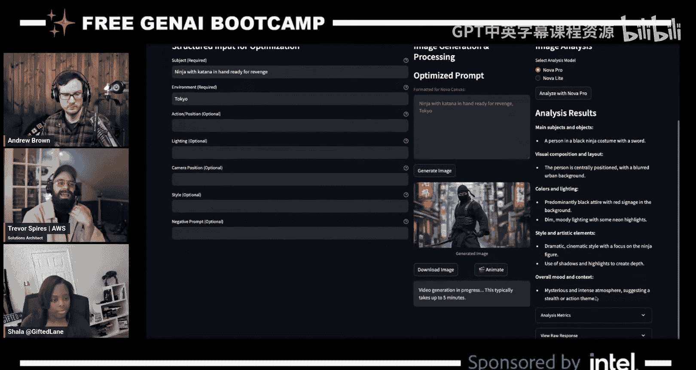

诶。Nova Pro and Nova light and Nova microcro actually， which I don't have a selector for here。

 specifically because of a few attributes of the models I'll share in a minute to do image analysis or image processing。

 which is like a。😡。

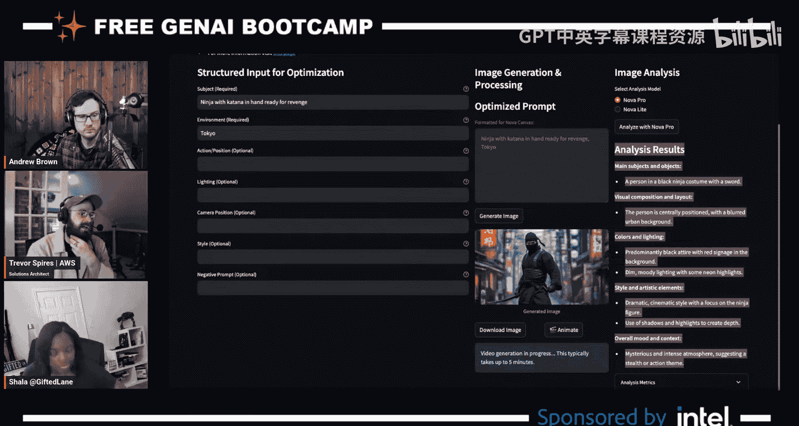

Prior to foundation models where， for example， you can and I'll just make it simple for folks。

 you know， you can go in pass in so sorry the comments are ninja playing fruit Ninja game Okay。

 all right。

I don't say you have to do that。 but I'm just say like， it's。It's fine。Alright。

 I'm gonna upload quickly one of the images that we've been playing with so far。

Think it they started with a G， here we go。And I'm just having， I'm keeping it simple。 Oh， actually。

 I'll add one thing， Ex this image， return。In JSON format。

This model isn't always perfect at returning in JSON format， but we'll see if it will。

And I passed in， by the way。This image from earlier， the one， well， actually。

 I created this one while we were chatting， but one of the。Animated teacher images and okay。

 so you could like this is not so difficult to to understand and process， right。

 but as you're as I put an image in and ask it to analyze it， I can get。

Attributs of that image in a very specific format that can be used upstream。 And like。

 I would say a really common。 like there's a few ways that customers will use this data。U。😊。

A common way I've seen it use this to do like image search because all of this now becomes metadata that I can use to create some search system。

 I've also seen it used quite a bit when it comes to。Like if youre a， if you're a company， so like。

Folks have probably signed up for an app， maybe maybe it's like a financial services app or like some medical thing where you need to upload an image of your driver's license I've seen organizations use。

Image models like this to extract data from drivers' licenses and validate that the information matches what you put into the website or do some like customer onboarding。

 So I always like to highlight this because maybe maybe to some people this is obvious。

 but to me the。Once I saw a model returning attributes of an image in JSON。

 it clicked in my mind all of the potential images for language models outside of text generation that are related to really just understanding the images specifically in the world around us。

Did that with comprehend。 Yeah， that's right。 Mike， So like previously。

 we would do it with comprehend。 I think generally the LLMs。

 I think I haven't seen direct benchmarks， but they've gotten really good to the point where I don't。

 I I don't see folks using I'm not using comprehend as much。

 And then if I go back to something we were discussing earlier。

The benchmarks probably one of the biggest strengths of these N Nova models is the price performance and so if you think about a document processing use case like it can be a it can be quite an expensive endeavor if you're analyzing like large numbers of images at once and so having a small model or a cost effective model for these sort of things can be quite nice。

That's an actual lab in AWS verifying a license that's cool if you have the lab shared in the chat Mike so folks can check it out。

 but。U， yeah， verifying a driver's license or u even creating a data just a data set from a corpus of images。

And he's not going to swing the sword。 What a shame。 We got a， we got a sword jiggle。At least。

Coms going on with the hand， though， but。Yeah， what's he got in that hand Oh yeah。

 something there towards the end。He pulled out gay， flight of hand。 Yeah。

 it was like a slight of hand magic trick with the fingers。😊，Yeah，ve I've had it。

Tons and tons and not specifically with this， but like just video generation getting to do anything that I want them to do anything like anything。

It's been incredibly hard， especially if you go try to do 2D anime。

 I was trying to make an anime intro along with the the thing for the boot camp and just like。

Nearly impossible。 And I I went like there are ways of doing it， but it's just like。

 it's so hard to get the results that you want。 You might as just pay someone to draw the frames and。

Get what you want here but。I don't think， I don't think this model was trained on fruit and ninja。

We gave it ninja playing the fruit Ninja game， so。Confirm not trained on fruit and ninja data。 But。

 you know， I think， I think when you start mixing things together， that's that's where you get like。

 you know what the pigs and the the pigs and the。

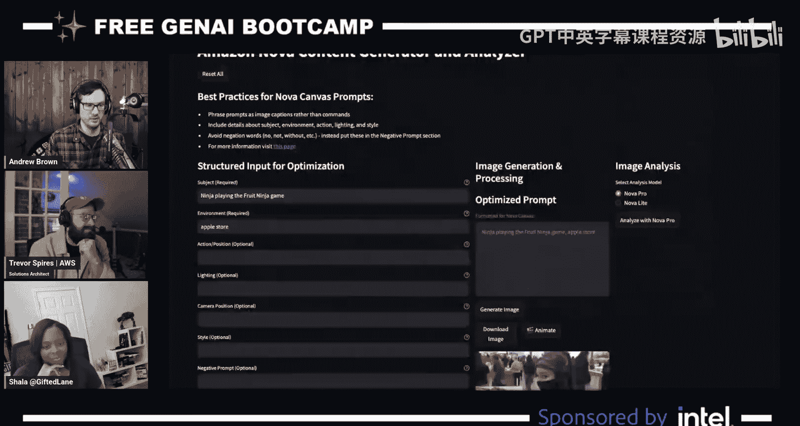

The sheep or whatever and the duck， yeah。

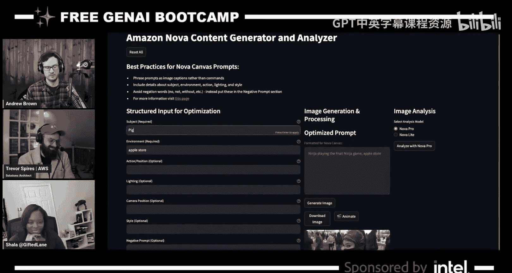

But if there's like a single thing， pigs in a blanket。Pigs literally in a blanket。

Okay。😊，No， it's fine。 those are really tasty。 I really like， there's something in England。 they have。

 it's it's， it's like a sausage that's， that's like that what they call those。😊。

It's not pigs in a blanket cause that's a hot sauce roll。 Sausage rolls。 I love， love。

 love sausage rolls。 love sausage rolls。 Can we get a just because I'm hungry。

 Can we get an image of the sauceusages roll here and see what we get， I'm hungry， too。

 I'm gonna eat right after this。😊，mI'm going to eat right after after class Q&A and then right after the the Spanish after class Q&A and then right after I record a bunch of videos。

Maybe because I'm trying to put all these things in an Apple store。

 I don't got pay days payday bars beside me this this boot camp。

Could' couldn't order on this time， the two got too expensive for summers and some some reason the bars got more expensive。

Yeah， you're rocking these。 This is your I like pay I just like， I like， well， it's an American bar。

 right I got to order it in， but I like I like I like nuts nuts。 Yeah， yeah。

 we think about a babe Ruth。 those are classes。 Well those are really good。 Yeah。

 we don't get those up here。 So those when I go to the states， I' get a payday and a babe Ruth。

 But my the bar that I eat up here in Canada。 my wife thinks theyre terrible。 I love them。

 They're called eatmores。😊。

Eat mos。Yeah， I love those and so it's like oh it's like a it looks pretty dense， Yeah， I like them。

Cy Yeah， yeah。 they're really。 I mean， I like them anyway。 So they're， I can't， I can't make them。

 There's no way to replicate them。 but that's， that's probably my favorite。I really like pay days。

 but if I had to eat something else thatd be eat more， those are really， really good。

 And they're very cheap in Canada， too， surprisinglypriingly， like compared to other bars。

 you get a snickers or Mars。 It's like2， two times the cost。 these things they're really cheap。

 Woer bars are really cheap in Canada。 cheap but they're really good。 Have ever had a Wo bar。😊，No。

 they're teaching me so much they're so good they're they're incredible， they're really， really good。

 I mean， it sounds German， It must be a German candy， it's a Canadian bar。

But's it's definitely wonderful Yeah， but like like in the Canadian market right， so yeah， yeah。

 yeah， they might have a European wine under a different name， I'm not sure the war is economic。

 yeah。Yeah， Jessica knows that I'm， I'm alluding to here。 Yeah。

 Eber looks like a chocolate fudge with the nuts。 It kind of is like a chocolate fu。 I don't。

 I wouldn't say it's exactly that， but it's。😊，It's it's something like that。 Dos is Wounder bar。

 Yeah， basically probably what they say in the ad。 It looks like the cruncher from the UK crunchy from the UK。

 Can we see like we're not even we're just look at a bar or chocolate bar stuff That is not a sauceus well whole the exterior crust looks correct。

 it looks I mean kind it looks like a little say like very flaky and but the insides a hot dog。

 that'd be like an American。 that would be like American salad it is like interesting。 I mean。

 I would like to try something like this because it is an interesting mix of like low and high food in my mind。

 it's like a beautiful crust。 It looks very well maintained。

 but then it's just got a hot dog on the inside you pull out from like the grocery store。

 the six pack of francs。 people are asking about Canadian chocolate bars that they're like the American chocolate bars I think what they're alluding to is that it was hershey they're putting was it。

😊，Few tin or something。's， it's like a preservative in the chocolate bar。

 And so people from Europe describes American chocolate bars chocolate tasting a bit of like throw up because it has like that acidic。

 like if you ever had the taste that throw up in the back of your your throat。 it's a bit acidic。

 right， And so we wouldn't know like we wouldn't， we wouldn't associate with that。 But yes。

 Canada actually has。😊，American style chocolate but also European style chocolate so it's kind of a mix。

 but we like both right there's no we wouldn't even we wouldn't ever say taste it tastes sour or or throw up。

 but oh they say use chocolate has has a waxy taste that's because they use it' cheaper ingredients。

But I mean， Canada has the same problem， right， but for stuff， but it depends on your part， right。

 there's all sorts of kinds of stuff there but。All right， while we're going down this path。

 like I one of my favorite stories about chocolate is the story and I saw but I saw this in like a documentary somewhere。

 but it's the story of how Hershey created milk chocolate and。😊。

As I'm going to tell you the story and I also have it pulled up here in in the from the words of Nova pro itself。

 but the the story that I understand is that like。Wait， what was Hershey's first name？

Milton Milton Mr。 Milton was like visited Europe and went to like Switzerland and like tried European chocolate and was like wow like this is really very interesting。

 but he had this obsession with like because because America and especially at that point in time milk in America was like being produced so massively in Pennsylvania where they were founded he had this obsession with like replacing a lot of the ingredients with milk and therefore creating what's now known as like milk chocolate but to me what。

I like about the story is just the。The the man's obsession with like wanting to incorporate a lot of milk into his chocolate recipe for for I don't know what real reason other than。

ItSos kind of like it sounds kind of interesting。And yeah， in the chat。

 it's the butric acid that I was talking about that gives it that different taste and but anyway。

 yeah Canada and the States where we don't really notice it as tasting different but。Yeah。

 I know it's the the chocolate the chocolate history is really interesting。

 I'm trying to think what else like I can of remember like craft is really interesting as well craft。

😊，Craft， I can't remember with the thing about craft。

 but there was something really interesting about the history of craft but people might not know but craft dinner is very popular in Canada。

 you have the states right Cr dinner Ka， I feel like I've heard of it before。

 but macaroni and cheese Oh yeah I know ma craft macaroni cheese but like up here we call it k Oh yeah。

 like definitely the like this is not how it's branded here Ours looks like this Yeah。

 they don't we just call it craft dinner K because it's real Canadian it's just like why do they call it's just like such it's like how do these nuances happen of。

It's the same thing but well because of cheese and you call it KB well originally it was marketed in Canada right and so I think anyway。

 well anyway， I don't know， we could actually all lemon， we could just tell us there。

 but yeah Canada Canadians consume see them the most crap during in the world that's pretty much true。

We eat a lock craft dinner so anyone if you come up here to the church。

 trevor we I'll make you some real real good Katie and some butter butter by Kaie you eat straight Kaie or you putting some meat in there like you j it up with like some chives。

 I'm always doing things to my food。But I don't know， I mean。

 I know I usually leave it like I like to have it on a burger。A， I like it on a burger。

 but no we don't， we don't overdo the crap dinner here I might get trouble people do catchch up。

 I don't do catch up on my back I could do a little I did that when I was younger。

 but yeah so I like catchetch up or no ketchup crap dinner。Like catch up on the mac and cheese， yes。

No， no， you know what， but to be fair it's not something that I tried before like I could taste it and maybe it works I don't know Oh it's not for me though so。

😊，But some people did it's like it's like it's like catchchup on an omelet right， you know。

 like when they I haven't never had that but I don't really eat omelets。

 but you know like there's the stereot stereotypical Japanese omelet where they like cut it and it like opens up and they put catchchup on I just the catchetchup part always is the thing that really。

Turns turns it off for me is like anything you put among go if it's friryes okay。

 but so so I guess in Korea too。Oh they do the the yeah they'll have like what they call it like an egg roll where they literally take a bunch of eggs like you would kind of cook it on the stall。

 but you like roll it into a bunch of layers and then you'll put like some ketchup on there also know I have people friends that put ketchup on spaghetti and。

😊，I kind of look at those things I mean， I guess they're I guess they're both tomatoes right。

 so they are did they use sauce or did they just replace sauce with ketchup？

They replaced the sauce sweet ketchup and I'm just like， you know， do your thing。All right。

 so so so Trevor you're an essay so let's think about like I want to build a visual novel video game okay and so you know what like what do we have to consider when building that so I know like I need the background I need the foreground of the person well I guess to back up the visual novel video game like like you want like you mean like controlling a visual novel like you want to have a character that walks through a visual novel world like like a Pokemon game type thing so visual novel is a very specific type of game I don' I think it probably emerges from Japan and I think that the the original like the core the core theme is it's normally a dating sim So it's like imagine a game that doesn't have much gameplay but you might make some choices and it's basically mostly text in a box that you read sometimes's a voice acted ands there's different backgrounds Yeah there。

And then the foreground there is like a fixed amount of graphics to represent the people right Yeah and is it like it's like a multiple choice game or something where like you have like different paths to go down Basically it's like oh I'm in Japan now and I'm going to this high school and I got to go to class after I go to class I run into this person and they talk to me do I go with them or like it's like it's like choose your own adventure visual right that's what it is so you know。

 like from that aspect， there's obviously audio generation that we can do there's if we want to there's video there's the foreground there's the background image but I guess my thought is like if you have to generate these background separately like yeah the thing it's just trial and error so I think like there's there's a few things like that I'm thinking。

From like if I'm thinking about designing something like that。

 it's like like you can definitely focus like there's there I don't know the answer。

 but I'm sure there is a pretty reasonable solution to figuring out the continuity of images across across the app what what's interesting what I'm thinking when you describe the use cases is like how dynamic do you want it to be because like what one thing that like the one path you could go is you could kind of program you could program in all of the like basically have the game and then dynamically generate the images or you could like start the game with like。

A large model generating the storyline and like all the potential paths like some like hey。

 I would like you to generate whatever the type of game is called and give it some complex description of like the number of different steps and path that you want it to generate and then almost like dynamically generate the past that's what game into my I I guess this' is the technical uncertainty of like how good can feasibly generate the images because like the thing is like if it's gonna generate it's gonna to be garbola right like maybe it does the story well。

 but the images have inconsistency like how do you make it feasible like okay maybe I can't generate out things maybe I can generate out and have a review step to then assemble a visual novel then I publish for people to be able to utilize or if the graphics are approved like there's an approval stage then it knows what graphics are approved that it can work with to generate a story because it's a matter of like what kind of consistency can get out with my images right Yeah yeah I mean。

quwise like approval like I approve that this image is I can work with this image right and then they could describe what the image is and then then it could make a story based on those images like maybe that would be a better approach based on where the technology is Well even saw with me and in i'm tweaking a bunch to try to get the results Yeah well so I do think that like something a similar like what you're talking about of like selecting the well selecting the base image like yeah like there will probably be some like some upfront path where you're given a few different options and you pick the one that you like and the example of like yougene anime images I don't know which models but I'm。

Almost certain some models and if and if the base model doesn't do it， there's some like。

APpiI providers that allow you to do it where you can send in the approved image as like the grounding image for the rest of for the rest of the session or the rest of the well even what Nova was like even if it's not genuine consistent characters like even if I just have one character in one pose if I can just remove them from that background and then swap at the background with folks that's huge right or maybe my limitation is all I can work with is person in scene right and that's fine too right that could be totally fine you know what I'm saying or again。

 the end of the goal is to do a language immersion So the scenario should be really really small like imagine you go up to a post office and there's just someone standing there and it's just having basic conversation So you might only have three shots like one where I at my mailbox。

Right， one was's in my mailbox。2 at the at the counter。

 and that's it right Like that's your three shots right and the whole stories around those three generated images that are approved。

 So maybe maybe it could be， you know， again， I'm just talking to to boot campers think about scope like。

You know， start small and say okay what what can I work in my limitations and that And then if I can get beyond that scope。

 move to the next step。 And the reason I'm saying that is because there's a series of videos that are following this。

 I'll have to upload them， but the JP mud that might be working on with Tim we made the scope so large and I reduce it again And then I almost felt like I should reduce it again。

 And so maybe trying to work the least amount of limitations from there and expanding might be a better approach with these tools as it becomes very complex and challenging but I don't know this is just kind of what I'm trying to talk through and figure out what I can do sorry sorry。

Yeah know， it's it's an interesting， it's an interesting problem I I I will say these for for me personally。

 I've seen these models applied less in production like I see many more foundation models in like Lms deployed in production where like。

I'm I'm aware of all the little nuances and tricks to make to kind of sculp them to my to my will in this case like that's it is like an interesting Well。

 I've never I've never seen anyone use images like in production to dynamically generate images because the consistency is all over the place like well I shouldn't say nobody does it because there's obviously like character AI or or these companion applications right like like they have character consistency。

 but that's a very and they're probably they're using I'm sure a pretty sophisticated set of of guardrails right or like some some pretty strict control and that that is again。

 probably something as simple as like。taking the image and passing it into a text model to make sure that it's not that it's compliant。

 but the consistency problem， though that I actually am curious how how you solve the consistency problem I now I just kind of wonder if boot campers are going to try to make a an AI girlfriend boyfriend that teaches you you text that teaches you like。

But anyway folks you think about like creative ideas that you can use this stuff for to make an immersion application and think about the limitations that you have to work with them Yeah。

 another thing like Mikes time about like how most game engines handle dynamic scene content Brian who made the bootc song you'll hear at the end that we always hear at the end of our streams here we were actually working on a game together in unity that is a language learning game and so we were using I think windsurf and Clade to generate out game code and we tried doing 3D objects but it didn't work out exactly there but my point is that I built a lot of apps I haven't shown you and I think what I might do this week because I might just record a bunch of these incomplete apps to show you maybe I'll make the source code available as well to show you all the things that you could do because I literally have like 15-20 apps we haven't seen。

RightIt's just I made one today I made one this morning so like this morning I wanted to I was like trying to remember these really hard Japanese characters and I wanted to have example sentences like five example sentences so I built an app that lets me put a word in and say make X amount of sentences and the hard part of it was getting the free on a little characters appear the Japanese text and then yesterday I made another new app。

Right so I'm using onki to study， and I wanted to be able to mass tag my my my flashcards。

 And so I found an existing。Plug in that allows you to mass select things and I had to figure out a way to integrate an LLM because you can't you can't just put in any kind of library。

 you have to literally I had to literally tell it to write HTP requests to open AI in order to integrate it into this plugin and so it's just really interesting the use cases。

 but literally I have like 1520 apps so I'd love to run through it and show folks there。

 so I'll try to do that this week。Bot campers grading is up。

 I actually put it up literally minutes before this stream so those want to submit for OPA。

 you can if you are a bit late， I totally understand this last week was very， very difficult。

 just taking a look here at the comments。 So I see I can see if 2D sprite where you could have an animation in a single sprite sheet like different parts in a walking sequence。

 I've never had good generation for pixelix art。 I think midjoourney can kind of do that。

 but it's not it's not really really good at that。 So like if I go over to here I know folks can't see my screen I'll bring it up here in a second so we went over to here and said say sprite sprite sheet for ninja ninja 8 bits。

8 bit character。They might not do a good very good do a very good job。

 I know that Photoshops get a bit better。 that。 Let's see， take a look and see what we can get。

But does anyone have any interesting ideas of immersion applications， I'm just curious。

 like the point in Ven click was a really good idea。To say point and adventure。Click。嗯。

Game from the 90s。 So these are like。Kind of like this。

 And the nice thing about this is that the artwork doesn't have to look good。

 If this has to look fun。 Like this is really old。 I remember this is like 80s， basically。

 but or late 80s， early 90s。 Here's an example。 But you can take a graphic。

 And then you can stylize it after you bring it into Photoshop。 So like， see this image here。

 there's probably like an open source model that can do this as well。 But they have like filters。

 I can find it here。😊，Unless people find a way to get photosshopped somehow。

 I'm not sure how people do that but。If we go here and skip the tour。

Does it have like stylization here after have to download styles？

I thought maybe they might have one for like Pix S Lain here， but maybe they don't。

 let's see if I can do this here。Re an evil， yeah， yeah，'s that'd be interesting there。

 but I'll go back over to here for a second， it actually worked okay。That actually looks pretty， wow。

 that's actually pretty okay。 I was actually surprised with that。 There was another scenario。

 There's actually another game I really like from the 90s。 It's， it's like an escape from Titanic。😊。

It's probably the most boring game ever。嗯。Escape from Titanic。 So it's a game。It's like Titanic。

Tititaic travel back in time。This us gay from Titanic。It a's a point there it is。Oh boy。

 Do I love this game。 It's so weird how much I love games that are awful from 30 years ago。

This game was really fun because basically it's the future and and when for some reason you're really upset about the Titanic and so somehow in the past。

 our past people figure how to travel back in time to the Titanic and to solve like a murder mystery or something before it sinks and it just happens to take place at night when everyone's sleeping so that they didn't have to have all these characters in the game。

But there are a few characters， but the way they have the characters is they have human looking characters that are pixelated and they talk really weird with real voice acting。

And if I have a chance maybe able to shoot a bit of a video of it because it's just so interesting and weird。

 but I really love this game through the games that you folks like way back then that were kind of weird。

I don't know if it was super weird， but I just as as we're like waxing noalic about video games。

 I I know there was one on， I think it might have been super Nintendo might have been NS where you're you're like a male boy and you're like throwing newspapers in mailboxes。

 I love I love paper boy paper Yeah， did you ever did anyone ever play mind maze。For Encarta。

So imagine imagine， imagine all you have is in Carton 95， there's a game built in。

 it's just truevi game。This is a fun one I was actually going make this as a game in before all this I could do it now。

 but like before that when Lms weret very good I was trying to add this to my ex platform as a way to learn through certifications。

 but to be like this would be really fun to make this kind of style where I could do that or I could do this as a style rockstar ate my hamster I've never heard of that。

What is that， is that appropriate or？I mean， it seems like a video game。

I've never even heard of this。 This is， is this a new game that is in an older style。 No， this is。

 this is not new。 This is 1988。 I've never even heard of this one。 This looks really good。88。Like。

 is that。Was that like Stevie Wonder like it looks like Stevie Wonder like and Michael Jackson？

WhatDange creatures in in Carac dangerous creatures I'm not sure remember remember that one I remember remind me it depends on what year it was you know another game I really liked back then was。

😊，And Carta， oh， I remember this。 Yeah yeah， I remember this， but I remember this actually， this。

 this is like the earliest game I remember playing a lot as a kid was。Harm in San Diego。So。

 and I'm talking like the Dos version。So I'm not rare， like dos version。

I'm not sure if anyone ever played this Carmen San Diego。Love that game。

 but all these are good for language immersion。 So I'm just trying to give people ideas of possible possible things that they could try to make for their because remember you have this upcoming weekend next week So giving you generous amounts of time to try to have fun right so go try to build something fun and again。

 we're just gonna continue on and I'm gonna be building stuff， but again， it's not perspective。

 I'm building the JP mud， you can watch the videos。

 you don't have to build the JP mud right I'm gonna follow this up and build a visual novel。

 you can build one if you want， you don't have to just try to try to open the door here typing of the dead that sounds really fun I did make that that one typing game that I made。

 but it's not exactly the same。You know， the the ones that fall from here。

 but this one's interesting that is so clever you you type， you typed to shoot right， Tina tuna。

I'm glad no one's giving me anything I can't not not show on screen here， Tina tuna。Is this a game？

It seems like maybe just like a drag queen。H。People aren't helping here they're they're just trying to get me in trouble here in Cariff with Patrick Stewart Intro yeah so there's a lot of types of games I think that you can make that are immersive so I would like to hear folks ideas we're gonna have afterclass  Qing here in a few minutes and I hope people come up and just share some of the ideas that they might have I'd love to hear about it also just get an idea how homework is going greatly appreciate Trevor coming out here and and showing us image generation and some video generation folks if you want to it's expensive but if you want to do video generation you absolutely can and if you can get to work Oregon trail that's a good one too Oh yeah yeah the one we had in Canada that was really popular。

Was cross country Canada， I don't know if you have this in the， cross country Canada。

But this is this is the one that all Canadians know。

 And so the idea is you pick up stuff from a location。

 you have to drop it off in other cities and you can pick up a hitchhiker on the way。

 you got to go to diner and eat food the diner you have to sleep in your cab sleep in a thing surprisingly but this is was the context like where did most people play this game because because for me okay that's what I wanted to know Oregon trail was like I don't know I don't know why they had us playing video games like I' is it are these arguably educational games I guess Canadian geography Yeah geography Yeah or like I like number mus number Munchers I was thinking like how do you make number muns for language learning like you know if there's like maybe specific。

If you're learning like conji or whatever， maybe it tells you like crunch all the the the the K line ones or whatever road rash。

 I've never played road rash for usual。And so we go over to here。Roadr is a good one。Well。

 what is it It's just a racing gamer Yeah， so you're racing on bikes。

 but you get to hit people with chains and factss and stuff to knock them off their bike Now how does that work into language learning we're just having too much fun going down nostalgia lane here but yeah。

 boot campers So I'll see you in office hours here again Trevor appreciate your time Shala as always and you have to show us the swords next time pull them out for real and any parting words for our our boot campers Trevor。

Any parting words？2。Like how long can I let the silence go before somebody you arrest me I was thinking maybe you're waiting for the prop to come back No I was like reading the chat looking for inspiration no inspiration happened Godspe folks here's my words my words of inspiration is like most of the people that are really good at GenI like just started learning it in like the last 12 months so like congrats for like digging in now while it's while it's like this is like an emerging field and like genuinely if you get the foundations under you on this one like assuming that the curve keeps on curvevin。

position yourself quite well。 So good luck you all。 And thanks for having me on， Andrew。 And。

 and one last thing I'll say to boot campers is that， you know， if。

 if you don't know what to do for that， you could always try to make a music video for the boot camp theme song。

 generate some images。😊，oldld style here。 but anyway， yeah， thanks everyone here。

 and of course I'll get up the boot camp theme song queued up here。

 It's a bit hard I's just me here today， so usually Baco's work in the background here。

 but I'm going to go ahead。😊，And find it here， we're going to drop the song。

In the longs Z mat pop starts， hint and Farm de a share as I in sand wax the last Al wide。

These found flu causally fighting in。Fs of vis and all Na parts be one that I alien in friends from distance on。

Sherry joy has a luck week bro。Aid the hum of the shs。

 the glance swift jewels do so fromnder thenly cast Mcweidows a tree loged over favorvolless intotes。

🎼Hey you and Emma that dance life to。Together we sway strongs in our eyes across Galousice wide。

 not halt skies left echo of the empty Is。😊，A clip by she and a million and rye。

 a across assumedumed the first a sky。🎼Could your sandwich pe suffice。

To break the bearing it is now the ice。Once Toize us often by its smile co we gently ex for just a little one and with dirty lights in this humbleble place。

How mighty problemss since then they time the space。In its lung， not what was the lobby。

Fight even we side by side，2 be young stars we。🎼Com。🎼You fallen peace with now home。🎼The clip spot。

🎼请我问身。What do you know toar silk Sky for you with some。Suffies to break the variousies melty eyess。

