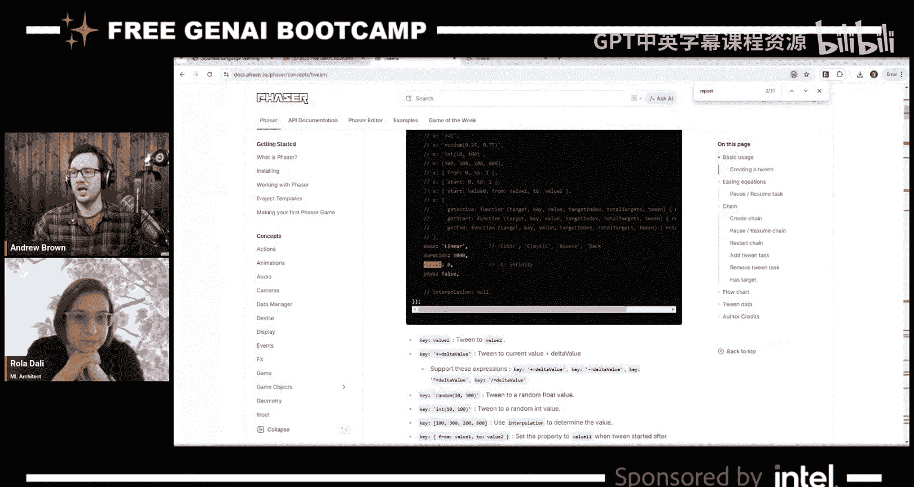
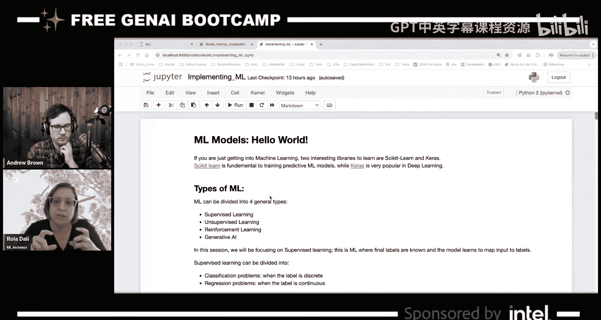
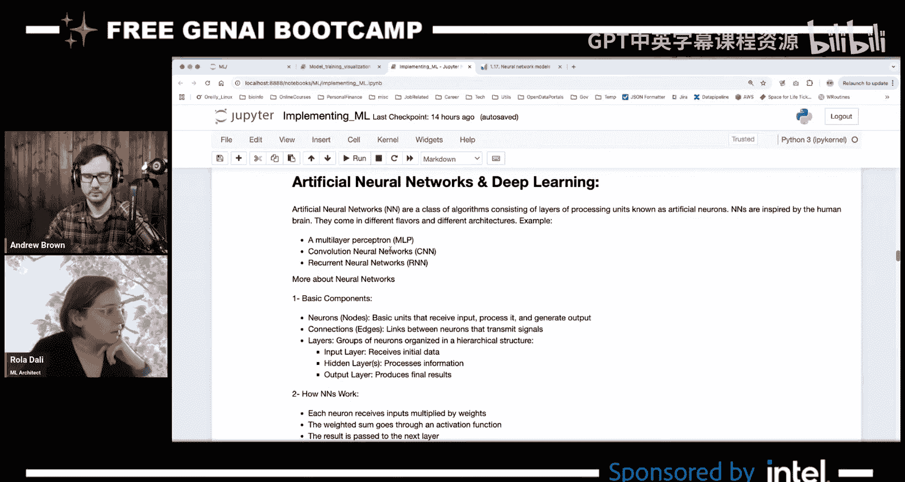
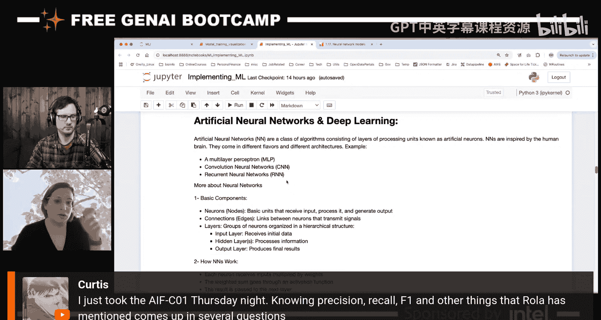
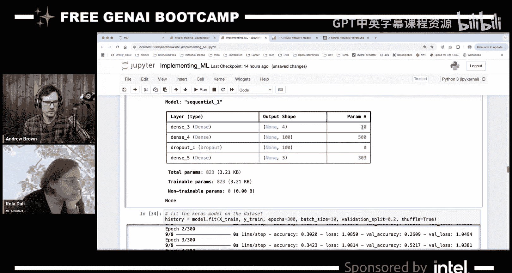
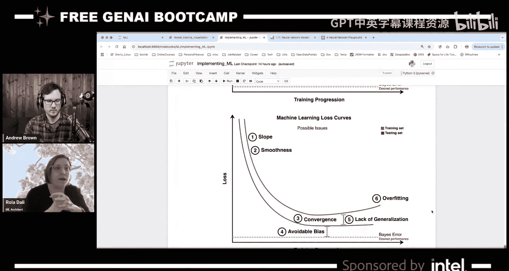
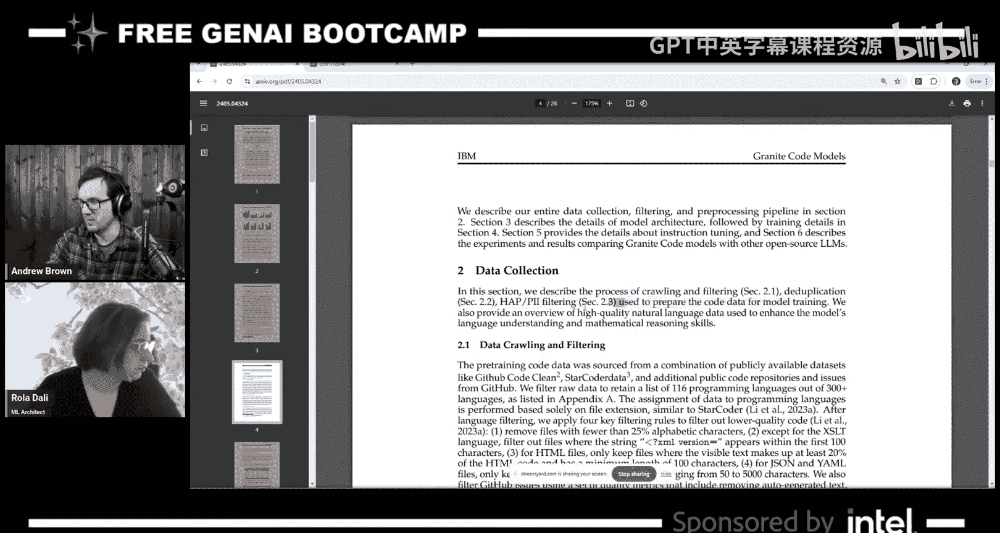
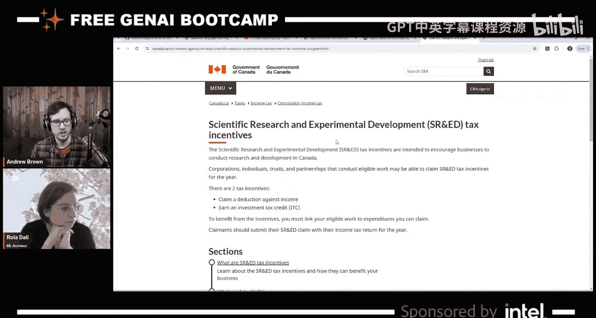
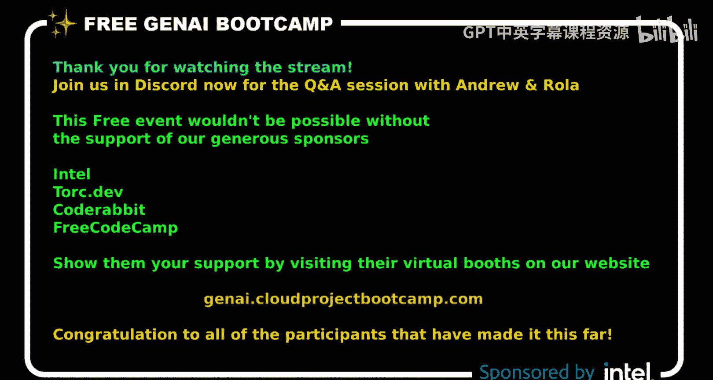

# ExamPro《生成式AI训练营｜Free GenAI Bootcamp》中英字幕（deepseek - P72：-72-Free GenAI Bootcamp - Week 5.zh_en - GPT中英字幕课程资源 - BV1SFEWzLEab

I need to just remind folks that if you're deaf or hearing impaired。

 the best way to watch this live stream is on the LinkedIn， if you're on YouTube。

 we'll drop the LinkedIn link in the description， we'll do our best to follow up videos provide captioning and we'll hand it over to our guest instructor to introduce themselves Roa welcome back and I think I just saw that your course just dropped on freecodecamp and can you tell me a little bit like that course and why did you make it？

So that course has the basics of ML and for a non technicalchnical person this came as a result actually of this boot camp so when we had our first session people really felt that there was a layer that's missing of maybe fundamental knowledge and so we put that together on a Sunday and put it out and it I've got really good feedback on that so that's great it's really interesting it was literally literally the next day you made that course we send it a freeco camp and just now at the end of the boot camp and you made at the beginning of the boot camp it's getting published but it's actually perfect timing because now you're going to show us some morem stuff fundamental stuff and we can also reference to that course as well but we will jump into it after we get through our usual slides here so I'm going to bring our slides back on up and as always going to thank our sponsors thank Intel Intel has been very generous community community sponsor they really gave me free。

in to do what I wanted。 I might have donePA OPA a little bit too much。

 but for those that made it through， you've gained some very serious skills。

 Im hoping to use the AIC this week with open whisperhi I spent this entire week working on my visual novel game and doing grading and so I wanted to get that into a particular place that we could show off those skills thanks to Torque for those that have you yet to do so go make your torque profile because I'm going to be going through and providing reviews on your profiles here and I'm hoping that you try to bring in what you've learned into this boot camp so that I can go in and look at that and say。

 oh maybe you can just it this way that way to think about how you can take the skills you' learned here and transfer them over to here I do also want to point out that the reason I really want to roll it here again was that I wanted to make sure we could checkbox a bunch of skills that when we talked to Ken calls and he said that there's people that there's two two。

Brannches of AI engineer those who make AI like Rola and those who use AI。

 which we call applied applied AI and so even if you are trying to go for the applied role you still need to demonstrate those skills because the way hiring works right now so they might say。

 hey， do you know how to use Cur but in reality they might not have you actually do much with that at all and so Ro is going to help us check those boxes there code Rabbit of course another sponsor there hopefully folks have tried giving this a go and using it as a way for me to provide grading or sorry provide review because it does do a really good summary so curious to see if anybody use code Rabbit I'd like to hear that in the chat right now if folks could tell us there so that might be interesting we are on our final week what is the theme of this week I mean like it was supposed to be like production En Z stuff here and I guess we are kind of looking at heavier stuff。

But what I want to do is make sure we're adding ML fundamental skills。

 things that I was not able to cover。In the Jenny essentials。

 and so we had like building a neural network working with something like Kis or SKt。

Which I think role is going to show us today， understanding， supervised learning。

 understanding how ML models work。We have Cyril who's gonna come in with quantization， pruning。

 fine tuning， distilling。 He made a bunch of smaller examples to just kind of show。

 I think was those four things。 right now， he's actually moving from Cameroon to Canada。

 He's moving to London， Ontario another another tech person coming into Canada here。

 So I know he's in the midst of traveling。 So I'm gonna wait for those videos。

 but I saw what he had really， really， really interesting。

 but that is that I'm just gonna read the comments here quickly here， Gings and welcome back Roa。

 Everyone's excited for Roa to be back here。 I use code Rabbit。 I get the value for enterprise。

 not really for individuals。 I have a lot of nitpic。 And yeah， if you have them share them with me。

 I'd I'd love to know， but I get it from an enterprise。 or I mean like from a being a CT。

 I think I would enjoy it because。😊，You know， people don't always write good PRs。

 And I want to see that information there。 But what we'll do is we will go over to roll。

 Well actually， before we go roll a screen， I want to just say a couple things。

 So folks might thought that this week was really light。 where's all Aws videos。 We don't see them。

 Well， I've been making videos every single day， multiples videos per day。

 I just I was making so many videos， I didn't have time to put them in the platform。

 So if you weren't paying attention to YouTube playlist， you'll see video， video， video， video。

 video， video， video， video， video， video， video video。 Y， y， that's all the visual novel。

 I don't know many hours are there。 But there's a lot。

 So if you thought that I wasn't doing anything。 I was actually doing quite a bit。

 And if you're looking looking here， actually just。😊。

For fun， we'll take a look at there's music playing。

 I don't think you'll be able to hear the music and I hope don't。It'sI think it's taking over your。

Mike， we can't hear you can you hear me now， oh sorry， so anyway。

 when I click in there it it loads it up here， but as you can see here。

Right I have I have a little a little game that we have here and I got to a certain point so that we can start using OpenWhi。

 you'll see there's a play button here and I'm hoping that there's some way that I can synthetically createate the words in Japanese and then also deconstruct the words for each time code and then play that back So that's something that will be interesting we'll see then I'll try to accomplish this week trying to get to use the IPC use local compute or use manage compute as well however you want to solve that and so that will be really interesting there but that's all I really wanted to show on this side I'm going to pass it over to Roa to share her screen and we are going to jump right into it boot campers how are you doing are you all caught up is anyone still working on O or OPia or OPA hover want to pronounce it is anyone working on their custom projects and if you are what are you building or is anyone trying to build。

Thevis novel game or something else I'd like to hear in the comments here。W。

What is with the fake Canada flag。 Oh， you know what。

 I didn't even notice it's a little bit covered up but you can see here the flags a little bit distorted。

 So I didn't even notice that in the people can't see it right now because we're looking to roll the screen but the character and the thing they had a Canadian flag on their shirt and I guess the flag was distort I never notice people are working through OPA。

 that sounds really good。 I think a lot of people are just behind。

 I can tell you a lot of people are catching up， but don't worry we got two weeks two weeks additional to catch up。

 Joseph says they're building a similar visual novel game while also finishing OPA。

 I love that people are really really working through OPA。 by the way。

 we actually have on the Spanish the Spanish stream this week Ezekiel from Intel and you know what he's the person I talked to specifically for Opa。

 I don't know why I don't have him on the English side because because they used to to over here。

 that's my fault。 but maybe I could ask himself in the Spanish section and folks can come over there at the three。

And we can try to ask them questions in Spanish about OPA but anyway。

 let's go let's focus our attention here to roll a screen。

 I'm gonna to make a little bit larger for myself here and we have a notebook open by the way。

 this code these notebooks right now if you want to run them right now they are accessible in the Github Ex Pro free Gen bootc 2025 Baco is in my ear so Baco if you can drop that link in the chat for folks to the main Github Ex pro repo there if people want to get them running。

 you'd have to somehow bring them into code lab but the point is is that you can and I don't think this stuff in these notebooks are compute intensive are they roll this is this is very basic stuff that well run on any computer cool so hand over to you what what is the first thing we're doing I see a hello world which I'm really excited about it's a hello world of Ml models so we're gonna do today is we're going to just really look at two very simple examples。

Of just training your own model these are very simple there's two really popular libraries in the machine learning world if you're building models。

 predictive ML models， the psyic learn is one people should learn how to use it。

It covers a lot of really good techniques it has。Functions to and modules to help you with cleaning data。

 feature engineering， evaluating training and so on and then there's CAS which tends to be more popular on the deep learning side so psyitL can can have some very basic deep learning capabilities but it doesn't go through the depth that KaS does so we'll do one example in psyit learn which is very simple classification problem the point is really not the example itself but to just see the big strokes of things what is it that you need to really do and then you can go in and tweak things and then with CAS will build a small neural net and just train it as well on the same problem。

Okay， okay， so oh sorry before we jump into it because I know morere talking about S kitt。

 and I just brought my screen up really closely because I want to understand because I don't know myself that that here is more capable thansitt so I'm on the S kitt learn website。

 I see things that say classification， regression， clustering， preproces model selection。

 dimensionality reduction。 All fancy fancy terms that sound real fun。

 But I guess my question like is S kit learned is just have a bunch of algorithms that are built into it or libraries that are easy to work with for these common use cases that are more on the statistical side like the data analysis side or like like what am I looking at when I see this stuff。

 So psyit learn is a library that is。

Maybe if I can can I share my screen and I can if I can share my screen。

 I'll take you through the docs。Let me do this again， Okay， perfect so what psychic。

Does is it is a fairly complete library that helps you with a lot of the tasks in ML so to do machine learning you're going to need to clean your data。

 I guess this is also here so you're going to need to prepare your data you select your model。

 you train your model， you validate and evaluate your model and then you do some visualizations a lot of these things are found here in。

In Psychic learn， let me go back actually and say one more thing。

 so machine learning in terms of types is divided in four big big categories， supervised learning。

 unsupervised learning reinforcement learning and generative AI。

And within supervised learning you also have two other classifications but we'll leave that to later Psyic learn tends to be to be good with supervised learning and unsupervised learning okay those are the two categories that it's best at and we can see here that you've got your supervised learning category here and if you open it you've got all the models and all the things you can do then you've got your unsupervised learning if you're doing that and then all of the models and things you can do。

And then you've got your model selection and evaluation set， inspection， visualization data set。

 transformation， loading techniques and so on， so it has quite a few tools to help you throughout the process。

Yeah， sorry， so， so when you say it's good for supervised unsupervised learning。

 are we talking about classical machine learning and not necessarily and so now when we talk about like deep learning neural networks。

 that's where we're looking more curs。Yeah， so deep learning is。

Its it can be classified as it could be supervised learning。

 but it's a very specific set of models so here you see neural own nets it has some you see it it has some。

 but the。If you really want to go deep and custom these make these custom and have a lot more control。

 that's where Kis comes in Okay， so we can do neural networks insyitL。

 but just like if you really want you want all the DLCs， so if people with video games。

 you want Kiz or Pytorch。Yes so actually Ka sits can sit on top of Pytorch you can use Pytorch directly or you can use it through so Cars what Cars is and I think we're jumping a little bit forward here Cur sits on top of Tensorflow not Pytorch it sits on top of three different so we're going move here to the section so Cars has three backends it's a wrapper when it started it used to sit there was a library called Tan here that started at UDM from Benjiossla。

And so what Ka does is it's a wrapper around these more fundamental libraries and the libraries are changing so before Tianana was in here now it's deprecated they moved it they added jacks in there and so it kind of gives you a high。

Level interface to deal with these lowlel libraries just makes life a little easier。

 I guess my question about that is that I thought Kiez was made by Google as a layer on top of Tensorflow to compete with Pytorch because it was higher level。

 but I'm seeing now it can be on top of it。 iss Ki is like a separate project or is it a Google Yes。

 Yes， I don't think it's a Google project。 I know that Tensorflowlow is a Google library。

 Pytorch is a fair metafaair library。 you're right in that people find Pytorrch a little bit easier to deal with and debug。

 And so Kis。But Ka always sat on top of both， so it's just a way to give you that high level。嗯。

You know interaction。 and then Jackx is also a Google project。

 So Google I've heard of Ja's never touched it。 one interesting thing I just went to the Curs Kiras website that says Kis is now available for jacks Tensor fill Pytorrch and open Vino doesn't matter where I go I see open Vino we haven't done any open Vino yet in the boot camp but at some point we will and I mean that's good because like I learned how to use Curas and I'm afraid that I have to use pytorrch because everyone's like Pytorrch is the Su standard。

 but like all I know is Kira so I like to hear that it's a layer on top of both of them Yes and we'll talk a little bit I think we're jumping a little bit we'll talk a little bit more about this in details but yeah you can use either today Pitorrch is if you look at statistics I look this statistics yesterday Piytorch is about maybe 70% it takes about 70% market share at this point I'm not sure why that is but I mean I guess it's just。

It's snowballed or maybe it was because of Facebook or meta because they built so many open source things in Pytorch。

 I don't know Pytorchches from Meta。 is that right。 Yeah， it' from the I see So okay， cool and yeah。

 yeah， I've always just derail us every two seconds， but that's moving。 So okay。

 we're gonna step back up。 Okay， so four times supervised un superupvisor reinforce learning and gene AI within it used to be the supervised learning was。

Maybe 90% of the market now generative AI takes a huge chunk of that。

 but still supervised learning has a lot of。Value still if we look within supervised learning there's two types there's a classification supervised learning is maybe I should say more than that yeah supervised learning is when you have data that has a label so we do know what the answer should be。

And we give both the data and the answer to the model and it goes in and it fixes the model to understand the input output mapping unsupervised learning is when we don't know what the right answer is and so we give that information to the model and tries to make sense of it so an example is when I was in research we would take cancer patients and cluster them that's a nonsupervised learning technique and what that does is it groups them together in what it thinks is close and then we try to add a layer on top of that in understanding do these groups make sense so it just helps us in creating patterns so in that case there so supervised learning sounds like imagine you have a data and at each image you attach hot dog or not a hot dog that's aon Valley joke right and then unsupervised learning does that mean that it's producing the labels because we don't know what it is so it says hey you give me a bunch of images but these seem all related。

So we're going to put we're going to cluster them together with with our own defined label is that kind of what it's doing unsupervised learning and unsupervised learning it's more about similarity measures so let's say you have。

10000 pictures and you say okay well what's common it'll say okay it'll try to cluster them based on similarity and say oh this is a group and this is a group and this is a group it doesn't know what's in the groups or what's going on but it tells you these things are more similar to each other okay it not like its not like it literally puts a label on it it's just like but but its it doesn't do a label on it it just tries to impose patterns on them。

 this is closer PC is an example clustering KNN these are examples I see yeah it tries to make some sense and sometimes。

The expert themselves has to go and say， well， does that pattern make sense？For whatever I'm doing。

Reinforcement learning is machine learning that solves multi step processes through an agent。

 there's a reward function and a policy and the agent has to figure out how to get to the end through several steps。

And then generative AI is well， generative AI it's AI that creates or generates new content for reinforcement learning there。

 I think that the classic example is like making Mario like making a model play Mario to the end of the game and win。

 so I think that might be a case when we look at gene go。

Games like chess go all that too yeah Yeah for Jen AI。

 I know that we have agents that have to reach a goal， but that's not reinforcement learning。

 is it It's becoming yeah， so reinforcement learning had hit a little bit of a bottleneck。

 but then now with regenerative AI it's it's actually catching up some of these agents are are are using reinforcement learning Yeah Okay。

 I see。Okay sounds good so what we're focusing on today is supervised learning and this particular example i'm using is a classification problem and I'll show you what okay so we talked a little bit about the ML process so when you want to solve an ML problem you first have to understand the problem what is it that I want。

This system to do， what is my output， that's your label and then what is my input。

 what are your an input is a feature， it's columns， there's multiple names。

And I'll give you an example。Once you decide what those are， you take in the data， you clean it up。

Prepare it you you could feature engineers so you can reduce the number of inputs。

 you can make more inputs， you know， and then you choose a modelclass。

 so how what type of algorithm is going to solve this part problem。You train it， you evaluate it。

 and then when you're happy with it， you deploy it and you maintain it and for this particular notebook we're not looking at data preparation but Ive put some more information here about things we actually do。

The only thing we're going to do in thisIS notebook is the data splitting。

And I'll explain why we do that and then we'll do the model selection again。

 these open up and you can see more things。And we'll look at the training process Okay so what we're doing here is we're loading a data many of these m libraries come with with data sets prebuilt in for you to be able to just test them out and this is a really popular data set in m called the IIS data what this is is it looks at flowers so it has。

We can run these as we go。It has about 150 lines of data so these are rows of data and this is what it's looking at。

 this is what the features or inputs are。It's looking at seepL length and sL width。

And then pal length and pedal width so the petals are the actual petals in the sel is the grain thing around right so that's the information in centimeters and then。

What the why is。Is three different flower types。Right we can doesn't matter what the flower types are named。

 but they're labeled  zero1 and two and so the idea is can we given if we know the seepal length and the seal width and the petedal length and the petedal width。

 can we identify the flower？That's the exercise that it's going to and when we say identify the flower of is either zero one or two yeah I mean so the the flower is these are there's names there's labels。

For these， these are very cosa flowers， but ML works with numbers right so the actual name doesn't matter so we encode the name with a label so in this case01 and2。

And then we can， after the exercise is done， you map it back to whatever the real name is。Okay。

 and so we're not doing any processing on this in terms of data because we want to really look at the ML。

 but there's a whole lot of data preprocessing that happens we look at missing data class imbalances feature encoding。

 standardization and normalizations， feature engineering and so on and the hardest part of ML really is usually the data so 90% of the effort in ML is really getting the data ready had we had Kira her background is data and so that's that is exactly what she was saying which was data is a data is the thing data is the thing and when we try when we do ML in consulting we try not to promise anything because I can run the exact same model。

On two companies data and I get good results with one and not with the other because it depends on how much noise is in the data。

 how well did you collect your data， how clean is it how you know all of that so data is the thing have you heard the garbage in garbage out sort of。

If you don't have good data it's。You're not going to get too far。Okay。

 so what I'm going to do here so i've got my data i've done the 90% prep for example spent about months to clean it up or what not and then what i'm doing here is i'm splitting it up okay so i'm importing this to split it up and the reason we split it up is。

We want。We want the model to learn a pattern。And we want to be able to evaluate it on data it hasn't seen at all。

To make sure that it really generalizes it learn that pattern and not that it memorized the data that it's already seen。

And so what we're doing here is we're dividing this data。Sorry。

 and to 75% going to the train and 25% going to the test。

Sometimes you've got to split into train validation and test and the way the reason you do that is you optimize hyper your parameters on the train test。

 the train validation， and then you can use the other one to。嗯。

Optimize your hypoparmeter now since I'm not doing that。

 I'm just going to do train and test here just to show you。

And then I'm choosing the model class as logistic regressionion， so now like I said up here。

 supervised learning can be two different major classes if what we are trying to predict is discrete。

Then it's a classification problem and there's a set of models that fit that that are within that class and if it's continuous then it's a regression problem and so as you see here these are discrete so 012 there's no 1。

1 there's no 2。3， these are discrete and so this is a classification problem。

And so i'm choosing logistic regression to solve this so i'm just going to import this model class and I'm just going to initialize initiate this model So when we talk about regression I always think of a line right and you have a continuous line you're predicting something towards the line says this this is a log logistic one does that mean that it's like。

It's like a little S no， so a linear regression is an actual line where the data falls on that line。

 a logistic regression is a line， but that that splits the space okay。So it's a divider line。

 it's not up。嗯。It's not a line that is the actual function， it's a divider line。Okay。

 so we've started this and then what I'm going to do here in and this is a really nice thing in ML is that most libraries are now using the same。

Noormenclature， when you want to train that model， you use model do fit and then when you want to predict you use model do predict and this is true you're going to see this is true across。

嗯。I could learn it's true across Cars and it's true across many。

 many different ML libraries Okay so what I'm going to do here is I'm going to take this model that I initialized and I'm just going to give it the train These are the features and then these are the labels right X is denotes the inputs and then y denotes the actual labels and I'm going to give it these things and I'm going to。

Have it run and now it。嗯。After it learns I could use it to predict。And then here。I can use these。

From the metrics module in SKar and I can look at accuracy scores and confusion matrix and so on so I covered confusion matrix in my Jen essentials but I'm going to be honest I was confused I hope confusedric I'm so glad that you have this in front of us because you're probably put a lot better than I ever did and I can barely remember what I even said but I guess we're getting the point of like evaluating the results。

right so what we did is we've got these three Las right zero one and two these are what the real answers are and then the model went ahead learned something and it predicted zero1 and two and what this does is it give you a visualization across all classes what the model thinks versus what really happens so here are the true Las okay。

And and here are the predicted labels and in an ideal model and a perfect model。

 everything would lie on the diagonal， so if it's a zero and it predicted a zero。

 if it's a one it predicted a one if it's a zero， so everything would be on the diagonal。

 that's a good model。Once you have these side things， these are not， these are errors。

And so you can see here that it did a fairly good job and that the bulk of information is really on the diagonal it does a really good job。

 There are some toolss that it thinks are one so the reason why the diagonal is good is just tell me if i'm clear about this right now so like we see zero and zero right so zero one is the label so the true the true value that it actually supposed to be the label data that says this actually is a zero and the prediction if it's zero that it actually got it correct both the predictions correct so if that if we get。

Good numbers on the on the diagonal so 0，0，1，1，2，2。

 then that means our model perfect at predict right， exactly and everything on the side is an error。

And this is really cool because it allows you to see what it's making mistakes over I mean these are three but you can imagine it can get bigger and sometimes it makes errors very specifically。

 so it only makes mistakes between two classes then you know they're very close there's something else you need to do to t them apart。

 for example， so this is a good visualization of how well the model is doing but also what kind of errors is it making。

Okay。And so this here is a model that has a 92% accuracy， and so it's doing fairly well we could do。

Better， but you know this is the for the for the sake of this exercise that's what you need this is the point is that you can。

You get your data set， you split it， you choose your model class， you initiate your model。

 you model do fit， you model that predict and then。You evaluate now again。

 this is super simplified there's a lot of little details that go in。

 but as a as a rule of thumb that's the overall process and there we're checking for accuracy score I know that from the computer matrix there's like values that that can be like that could be produced that then say like this is accuracy this is。

I don't know that ones precision precision and recall and stuff like that when you are when you're looking evaluating all do you look at all of them or do you generally just start with accuracy like which is the one like it depends on it depends on the task itself so accuracy is and what your what the client needs or what the task needs so accuracy is looking at how many did it get right。

Overall， now if you and that's usually a fairly decent metric， but if you think of a。

System where there's a huge class imbalance， let's say， cancer in a population。Let's say 90。

 most people don't get cancer and very few people do。And so if the model predicts no cancer。

 it'll have a fairly decent accuracy off the bat without doing anything。

 and so in a model imbalance system， the model can kind of rig that particular metric by choosing the higher class and so in a class imbalance if you don't fix the class imbalance。

 accuracy is not a good metric， then you go into precision and recall。And then it becomes， well。

 what do I care about？Is the model making an error？

A huge issue or is it missing something a huge issue， so for example。

 if somebody comes in for a cancer diagnosis。And you predict cancer， you've given them a scare。

If it's not true， but if you don't if you predict no cancer and they do have cancer then you've shortened their life right because then it becomes a higher stage by the time you figure it out and so as a person as a as an。

Practitioner you decide what that balance is of do I want to not miss anything versus do I want to only get things i'm super accurate of and that's where choosing different metrics comes in Okay so so does that mean this the accuracy is not good in that case because if most like the majority of people don't have cancer it would be it'd be very easy for it to be accurate right because of that so then does that mean you bring in a different metric like like precision or you're just。

Or you have to just like change your data so that it's more about no you bring in different metrics so you bring in metrics that accommodate for that so you can run precision or recall or there's something called the harmonic mean which is the F1 score which kind of combines them in a mathematical equation and so that gives you a good balance。

The two Trisam had a question here earlier Roa mentioned feature engineering which for a long time was manual。

 I'm curious her thoughts on current approaches such as feature tools or autoML what does Roa typically use do you like autoM or so I don't I tend to be very I use a lot of AWS if it' it's not super native to AWS AutoMl tends to be nice in helping you。

Autommate a lot of things。Especially with hyperparameter。啊。嗯。Estimates and so on but。

What do I tend to do I tend to。I don't know that I'm doing as much feature engineering these days as much as feature selection because we have so much data。

 so much data when when did we use to do feature engineering is when you didn't have a lot of complexity of data and you thought okay。

 well if I multipplied this column by that column that's an interesting thing or if I do this other。

Thing I do actually do some feature engineering and that sometimes I aggregate results。

Or I create different versions of something， but in general。

 I find myself doing a lot more feature selection these days than feature engineering just because the data is huge。

For AutoMl， I haven't really found one that I like， I mean。

 by the point that I learned the system of AutoMl， I just felt that I should have just not used it to begin with and just implement my own。

 but I'm not sure your feelings about art with Automl。

 I did like the Automl that AWS had prior and the new one is different。

 And so maybe I'm just biased to what I'd liked before， but I have a feeling that really。

 you don't need autoMl。 You can just you know what I mean。

 it's trivial for you compared to using these tools that put extra layers。I mean。

 when you're searching a feature space right there's a lot of different。

 they say ML training and development is more in art than a science right it's you learn a lot as with experience as to what to try and what not to try。

 but there are things like AutoM and automated systems just help you。

Kd of cover a lot more space a lot faster and that's sometimes useful you do have to know what you're looking at and things like that and when you do these experiments it's very important you're very organizing what you do and how you do it you have to understand we keep very good logs and now today most ML platforms have experimentation logs or that you can keep track of and so you need to understand everything you've done。

 how you've done it what the metrics that came out so that you know what directions of change are helping you。

嗯。Okay， so it sounds tools are a lot more robust。 And again， it seems。

 it seems that Autom is not necessarily something you have to do， but。

It sounds like no matter what you do， there's certain things you want to have and you're saying that more of that stuff is around here。

 there's a there's a proliferation of tooling you can use whatever you're comfortable if you really need to understand what the full process is and where you as a person are not comfortable。

 then you pick up a tool that can。Potentially support you there saying interesting I myself immersed in A of us mainly because I'm wrapping up the A of us AI searchs。

 Tri watchup for sageMaker wrangler sagemakerr Can canvas wranglers is in canvas I'm gonna tell you that was the only time I ever got overbuil in a very long time and8 of us knows it us knows it's a spend trap so if you do get overspen they'll give you the money back but just fix it A of us is I don't know it's going on there。

 but I mean I like sageMaker but canvas is more than once more than once we got caught and we know what we're doing but anyway we'll continue beyond the confusion matrix here Okay sounds good so so again。

 the training model the model training here is that you you get your data ready you choose your model class instantiate that model you train it you use it to predict and again these are you're gonna。

These three lines across different libraries， they're using kind of the same system。Okay。

 so we've got an artificial neural network here solving the same problem， okay。

 and so just to talk a little bit about neural networks。

 they're class of algorithms and they're very a very powerful class of algorithms that consists of layers of processing called artificial neurons and those were by a large part inspired by the human brain。

And they come in different flavors and architectures and a lot of the generative AI in general transformers are complex neural networks。

 right so these things are very， very powerful。嗯。They have the basic components of a neural network is are the actual neurons so these are nodes。

 these are the basic processing units then there's the connections between them so you can decide how to connect these things whether every neuron connects to every other neuron and so on and then you've got layers so the first one。

It's called the input layer， the last ones called output the output layer and everything in between is called the hidden layer。

And the way they work is。The neurons receive the input。

Multiply by weights and then that it's summed across a layer and then it goes through an activation function。

And then the result repeats， and then the results are passed to the next level。And then。

It goes through until you get the prediction at the very end。Okay。

Let me show you so we talked a little bit about Kas so KaS 3。

0 again like we said the backends can be you can choose Tensorflow Pytorch or jackX they do have two different modes of working with CAs if you use the sequential model that supports。

A linear stack of neurons， so this is a。Just a feed forward neuron network with every neuron connected to every other neuron。

And if you use the modelto class， then you have a lot more。

Control over how you want to build that thing。 I should say neural networks come in a lot of different flavors。

 a multi layer perceptroron， for example， is a。Is a simple vanilla neural net where layers are connected to each other。

 there's no backflow。A convolutional neural net is where the input is two dimensional。

 so if you want to make a picture to。Process pictures。

 the input is two dimensional and one way people used to do it is to dissolve the two dimensions into a single dimension vector。

 but then what you do is you you。You lose the information of how information is connected into 2D and so convolutional neural networks take that two dimensional image in which has really revolutionized image processing and computer vision recurrent neural networks or neural networks where there's flow back of material。

 so there is。

A memory that or a history understanding of history before transformers came up。

Different variations of reinforcement neural networks were how we did NLP and sequence。

Based information， but the issue with RNNs is that they are they're linear。

 you can't distribute them and transformers have just because they're distributed and can be paralyzed。

 have just really revolutionized that space so。But the point is that artificial neural networks can come in very different flavors and they can have different architectures。

 it's all I know how to do is sequential。that's all I can do。 I won't touch anything else。 I can't。

 I'm not's that's my only skill is sequential， but。Okay。

 so what you do is you can we're going to create a sequential one as well because it's a simpler one and then you can layer on put layers on。

 a dense layer is a fully connected layer。A convolutional one and a max 2D pooling are part of the convolutional network。

 this is when you have 2D inputs and the dropout layer is a layer for regularization and what this does is。

It turns off。Neurons at different places and what this does it makes the learning more robust。

It's kind of like chaos engineering in a sense where you kind of turn off different things。

 but you still expect it to do well， this is how they do pruning。No， okay。

 no pruning is when you you reduce the number of neurons after you train it。

 this is more within the training， they kind of turn off different layers。

 which means that there's no reliance on a single processing unit。

 it just distributes the learning and does。Better balanced learning okay。Yeah。

 and then you can flatten it if you have more than one dimension and you can do。

AndlessTms which again are are related to RNANs Okay so what we're doing here is we're going to do a sequential the model is sequential this is again the simpler form we're going to import the dense layer and the dropout layer and we're going to import this two categorical which what it does is help us has。

changenge。嗯。Categories categorical text into mathematical coding and so what we're doing here is。

I'm normalizing the data。The neural networks are very sensitive to normalizations and the scale of data。

 so if we go back here。What you're going to see is that the data is at a different scale so this is at a very different scale than this。

 this is a lot larger and that tends to throw some things off so what we do is we try to make them at the same scale zero to one or minus one to1 or whatever it is that we want。

 but the idea is to have them fairly similar in their ranges。

And we can do that through different techniques， but what I'm doing here just for simplicity is I'm dividing each column by its max。

Sorry。So here what I'm doing is I'm dividing every column by X max and what that's going to do is going to just。

嗯。Kind of put them all at the same scale and I'm again doing the splitting。

And then I'm going to change。The y into a categorical， this is a what what we call a one encoding。

 which is a vector of instead of being a number， it's an array of。呃。It's just encoded in that rate。

Okay， and so this is the model we've got a sequential， we started with a sequential。

The API which means it's going to connect every layer to every other layer quite densely and then we add this dense layer with four this dense layer with 100 we do a dropout of 20 which is about 20% and then a dense of three and then we compile the model so this is going to build the model is the density like for the first I'm trying to remember when I actually had to build models or work with someone that was a data scientist to build models but I remember they' reading some kind of logic about the first the first layer in the last layer the first is it four because we have four inputs or three in an input or yeah so the first is controlled by how many things you put in and then the last is how many things you want out Okay and then in between they just have to。

It's not as big a deal and sequential because it's one layer， but in things like convolutional。

 you really need to understand。What every layer is outputting to become a layer to those second Why does it become 100 in the middle？

I just because I put it there Okay， you I I could no you could change these numbers I could I could but I'm just saying like how does four become 100？

They take， let me show you something。

So this is a really good visualization of this and so what happens here。

Is this is the input so we have four okay so let's so this one we have four inputs and then they come into here and what ends up happening is it's still taking every input let me just make it a little。

Okay， so we've got these two， and if we add another hidden layer here。If we have only two。

 then each one gets information from every other neuron。What is changing is the weights。

 it's going to learn these weights now if I add more。No， not this， not this。

 I want to add I want a this。Everyone gets input from every other from every layer too。

 right I have three here， I three here， but again， it'll change the weights of those。

So each of those hundred that you see are going to get input from each of the four。Okay。

But the weights are different。When it's going to learn yes。

 it's going to initialize the each one has its own weight。

 each connection is its own way to see these are differentize them differently and then it's going to learn different values for these so if x1 goes to the next layer let's say that's the 10000 layer whatever the weight of each of each one is different for each neurons so that it has variance for each node that's learning。

Yeah， so they're initialized at random and then they're learned Okay。

 so the more the more the smarter the model。Yes， okay。Yeah。

 the more layers you have and the more neurons per layer then there's more capacity to learn Okay now the learning depends on the data and how long you run it and all of the hyperparameter。

 but yes， there's more capacity to encode information okay okay。

So we get back here Okay， so I compiled this Yes， I did compile this。

 This is what the model looks like and you can see this becomes 823 total parameters and then we're going to fit it。

 so again it's the same so you go back there for a second so we have 823 parameters and so。

That is parameters are the model weights that are produced so we go back up to our in the code there。

 sorry in our code to the actual layers， we have 4103 and so I guess the idea is that you have four and four four has to connect all to the other ones then at least youd have 100 20300400 connections we have 400 plus 4 plus3 so we have 407 how much did it say there were down below3800 so obviously there's some other other part that are missing there。

 but I can kind of see how it's getting to 800 I got to 400 half amount so I'm obviously to double it somehow there but okay that makes sense Yeah。

 but it tells you right it tells you theres yeah， it tells you how many where the parameters are divided。

Okay， so four， and because they're all interconnected with each other， right， they go。

 They're all interconnected the same layer。 Is that what's going on there。 That's why there's 20。No。

Three times。5。

I'm not sure what it's doing here。Well， anyway， but this is the first layer and I think yeah it's it's four times five so it's usually maybe it's four plus the bias because there's always a bias term。

 which we're not talking about here。

Which。But I'm just saying there's obviously connections that I'm not considering here。

 but generally the point is is that if we want to see the numbers。

 we can see how it's connecting through those the layers there as it's shown there in the table right I'm not to worry about how it perfectly calculates it。

 but just generally generally seen just trying to visualize okay。

 there's a lot of connections right and this is an 800 parameter model like we saw with generative AI。

 these models are at the 1。8 trillion。The number beside it is at the size of the data， so 3。

21 that we are storing， so that's like the model weights collectively。

I think so because it hasn't seen data yet， this is where it sees data。

This is just the I think the size of the parameters themselves。Okay， that makes sense okay， yep。

 Okay， and so here we're doing a model fit and so you take your x and your Y， you tell her how many。

Runs， these are epochs are the training cycles it needs to do。

The validation display is 20% and reshuffle and so what it does here。

I it starts by initiating them at random the weights and it gets an accuracy of 25% okay。

 and then so what it does is it adjusts and then you see it's going to get better and better and better okay。

 but what's actually happening like how would we visualize this process of improvements？

So I have an example for I had done this for。The course and I don't。

It's hard to visualize a four dimensional thing because you can't really plot it。

I have an example for。A lot linear regression。嗯。This is an example of predicting a line。

And it's a very simple example in that this is Celsius to Fahrenheit。

 so it has Celsius and is predicting Fahrenheit。And what happens in machine learning is you initialize your weights。

You do your predictions。Then you calculate an error。

 so how far off are these predictions from what you want them to be？

You calculate your gradient so the adjustments and then you rec calculate your weights based on that right and so what this does。

And then you keep doing that cycle until you get better， so if I run this。Again。

 this is just a fair just so you know， this file is in the the example pro code repo that Baco had shared out there。

 It's in so anybody that wants to follow as you absolutely can sorry， Yeah。

 so this is I'm running this。 I'm fitting I'm fitting this model and then I can look at this。

 So what ends up happening here。Is it starts， this is the first iteration and I'm only running it for 10 iterations。

 this is just to show you what's really going on the first run， this is the actual data in blue。

This is data and Celsius converted to Fahrenheit plus。A number of noise just， so it's not a line。

And then it starts at random it starts totally at random and it's totally off So here it would get these right and then everything else wrong Okay and this is the calculated cost it calculates like an error rate of costs in this case。

 it could be。You can decide whether you want to optimize a positive metric or reduce a negative metric。

 but here this is the error okay and so it goes in and it it。

It does some adjustments and now that calculate costs that's the error so it's going down and it knows it on the right track okay right。

 so now it's going down and then it does it again and it's going down again and you can see it's going down again。

To the point where。It starts to。Do a fairly decent job and this is only 10 runs， right so。

But this is a fairly simple thing as well， but you can see that the point is for it to reduce the error and by the 10 run it does a fairly decent job Now I guess my question is like would folks normally try to run this till zero or is there a point where you shouldn't do that No it wouldn't run to zero and I'll show you when we look at the error curves what we're actually looking at okay。

Because okay so what happened here is fairly similar except it's a different。

 it's not as easy to visualize as here， but what happened is it did the same thing。

 it started at random， made some guesses， corrected some error adjusted and did this all again until I told it to go to 300 you can do smarter techniques like autotops and things like that。

But okay， so at the end， we're here， I'm just going to plot。

This learning curve and you can see that it started as。お。Yeah。

 it's interesting as we were going through there， accuracy was better in some areas than others。

 but I guess it's more than just accuracy that it cares about。You haven't you tell it。

 you give it an objective function that it's just looking at， I'm looking at accuracy。

 but we're usually looking at a loss it's looking at at a loss function I you okay so this is what we're looking okay so this is the error okay the one we were looking at but we go back up just for a second there the one that's plotting for accuracy is that to say that when it gets to that point and that flattens out that it's。

It's it's good at that point and anything beyond that is not improving accuracy because it's just right the top right yeah。

 so I'm going to go through these in detail， but yes。

 so this is so it's very important when you run machine learning to look at these curves that happen through。

The training and so what we're looking at here。This is a loss curve。

 and we're looking at this error that it calculated across the epochs， this is its learning cycles。

Okay， and we can see that it went down it went down it went down and then at some point it stabilized the other thing we can see is that there's the train and then there's the validation so this is data that it was working with and then this is data that's never seen Okay now what do we look for in these functions so model loss is that's describes the how wrong the model prediction is。

in this case this is an error yeah so there's what's called an objective function in these cases it's usually a function called cross entropy depends on so the objective function changes by the task type there's different ones but the idea is they're all telling you they're all optimizing performance in some way。

Okay， so regardless of what it is。Um it's either going to look like this if it should look like this if you're reducing if it's something that needs to go down or it's going to look like this。

 if it's something that needs to be optimized okay。

 and and for model loss that when when the lines close together， that's good。Right。

 so what we're looking for in these are several things okay so we're looking at the first thing we're looking at。

 let me make this a little smaller so we can。Okay， so what we're looking for in the loss curves is one what is the slope the slope tells you if there's learning so the fact that it goes down。

 we're looking at loss across training time。The fact that it's going down means there's some learning that's happening right it's doing better if the loss looks like this。

 then you have a problem， this is just not learning。😡，So if the slope is not there。

Then there's something that's an issue。That model could have bias。

 meaning it's just not capable of learning that particular task or something is set up。Wrong。

So the slope matters。The other thing we look at is the smoothness of the curve is the learning steady。

 so if it's learning fairly well or if it's jumpy because if it's jumpy that also can tell you that there are issues with the learning。

 either the learning rate is too large or the batch size is not right or data is not wellshled there's a lot of little things that can tell us what is happening but we want it to be smooth。

We want it to be fairly smooth Yeah not it doesn't have to be like this。

 but it can be jumping but like shouldn't if you were put if you wanted a good tobogg and ride。

 it's like you want it to be like that right because as you don't want it to be this because when you're not going anywhere if you got a bunch of bumps that might also not be a great if it's like this then this is not good right if it's okay you can smoothies out by looking at specific parameters and these things kind of show us for somebody who is in Ml you can by looking at different parts of the loss curve you can tell what parameter kind of needs to be tweaked to have this work so one other thing we look is cons convergence means exactly what you said is is it flattened out。

Did it reach？The best learning potential it can for this particular task now this if it's something like this。

 it means that it still might be going down here so you wouldn't do it or if it cuts off here then you're not you have to increase the length of the learning it hasn't learned yet。

If it converges， does this mean your most optimal solution， no it doesn't。

 there's something called global minima versus local minima in training and I don't want to get too much into that。

 but it means that it did the best it can with this particular run because if it tries for。

Let's say 15 cycles and it doesn't do any better than maybe， but if you initialize and do it again。

 it might overall do a better job but anyway we look for convergences is the training is the learning complete？

We look at avoidable bias， avoidable bias， if you know what that task。嗯。

How that task is completed by somebody who knows how to do it。

 let's say by a human or by another system。This is used as。

A proxy for the best performance or the desired performance or the possible performance because something else did this。

 right？And so we look at how far this is， how far the model is doing thing from the other system that's doing it better。

 the human or another model or whatever it is。If this is too big。

 then maybe this is not the right model class or this is not the right conditions if it's if it's fairly close。

 then you know you're in good shape okay。We also look at lack of generalization。

 like you said in the previous one， we've got two and what this is telling me is this is data it Cs。

 right， the trainings data it Cs or it's working with and validations data never sees until it's finished。

And if these are fairly close， then it's generalizing fairly well。

 meaning that it's doing a good job。If these are very far。

 then what it means is that it's memorizing， it's not generalizing very well。

 it's doing something to the training data that's not applying to the validation data now that could be the model or it could be just that the data is not wellshuffled and well divided there could be different reasons but it is something to really。

To pay attention to in these loss curves。We also look at overfitting。

 so overfitting is when it starts to memorize the data。So it's doing， it's doing。

 it's flattened out or it's doing。Less and then at some point the loss error on the test set starts to go up。

 that means it's starting to memorize the training data I see。

And so you see an upward trend in the test data。And so these are some of the things that we look at in the。

Los curves， so slope， smoothness， conversions of way double bias。

 lack a generalization and overfitting among other things。Interesting。

 so I guess my question is like。For training models like we have a very simple model here。

 but you know like what's what's the uplift to train something that's harder。

 like a convol convolutional neural network or something that's closer to not necessarily what JAI does。

 but these more complex systems and like what kind of resource does does it take to run those models like I'm trying because I'm trying to figure out it's like what's the what's the gap or chasm in implementing these these deep neural networks versus the generative AI models which are giant。

Like can we do a convolutional neural network ourselves and it it's easy or hard compared to LOMs or you can do a convolutional neural network yourself。

 you can train it， you can there's a lot of convolutional neural networks that are published and then you can download them and train them。

 these things systems a lot of predictive。Today tends to be runable on a local machine just because local machines have gotten a lot better。

As we've seen in other discussions that we've had。Geneenative AI is a two order of magnitude larger it'。

At the same scale。These are at the thousands。Of。Perrameterters。

But neural nets transformers in GenI now is at the。Billions and trillions。Okay。

 and so it's it's what a thousand00 to 10，000 times a thousand0 to a million。Times more。

When you see like a technical paper that talks about an implementation of a model。

 how easy it is to actually go and build out the model in these papers， I mean I mean it depends。

 but do you ever see papers and you say you see that model and go， oh。

 I can go build that and it turns out that you can or are these things like far。

 far from us being able to replicate ourselves， and't I don't mean jetty I particularly I just speak models that we see that are implementing a technical docs。

So it depends， I think， on several things， it depends on how there is not a。

Universal rule on what needs to be in newspaper and that's part of the problem right so they can disclose as much information as they want about the data about the transformations they've done to the data if they don't release the data about the model architecture。

 about the hyperparameter。About the valuations and so on when we were in grad school， Dr。

 Jotppino who's now at Fair， she ran an experiment with us across MiGill and what we did is the exercise was to take a think。

Two to three papers， scientific ML papers and to try to reproduce。

That what they mentioned in the paper and that run and the majority of people could not do it and the the reason is because。

There's no standard on what。嗯。People are supposed to release and again。

 we talked about you talk about。They can decide to go totally open source where they release the data。

 the model， the way it's the process， they can go open model but not release information and they can go close source for certain companies。

 but even the ones that go open source， there's not a template that says for somebody to reproduce this。

 we need your hyperparameters， your data processing so I guess the answer is it depends on how good a job the paper。

People who who wrote the paper did interesting。 I always think about I don't， you don' know what。

 I talk about granite a lot， but I don't seem to ever use it。

 but granite is one where it was made by IBM。 and they always say like it's an open foundation model。

 And so it's a truly open model。 I'll just drop a link here for folks。

 if anybody wants to take a look at it。 And I'm just opening it up here to see like， is it true。

 Like does this model， Does this model actually have all the information that L normally don't have And what are we normally missing from a white paper？

 So let's say we go over to something like。

Isn't deep sea supposed to be they their own paper there， but I'm not sure how detailed it is。

 to be honest。

But we open up， I have the deepse paper open here。Right。

 but I don't think it tells us what data it's trained on here， right So we go into here。

 talks about cold starts， talks about whatever it does。 But if we go over to this one。

 I would hope that this one deepse would or sorry， granite would tell us where like where its data came from。

 So go to here。

And yeah， data collection， first thing it talks about which is nice。

 So we describe the process of crawling filtering， to duplication of use to prepare the collection of data model。

 We also provide overview of high quality data， data crawling filters。

 So it's actually talking about how it's collecting the data。

 The pretraining code with sourced from combination publicly available data sets like Github code clean。

 What's Github code clean。

Let's go take a look at this。GitHub code clean。

I don't even know what it means by that。 star coder data and additional public code repos and issues from GitHub。

 we filter raw data to retain a list of 116 programming languages。

 So it sounds like it's still sourcing data from the internet。

 but at least is telling us where it's getting it from right， which is kind of interesting。

 oh someone says based on what Roa just said， are all models produced with proprietary steps？No。😔。

Now a lot of work in research in academia is open source because these are research that is funded by governments。

 by institutions and taxpayers money， they are supposed to release a lot of information。

 it's just that it's not in a frame there's not a lot of frameworks that。

Enforce what needs to be released。So this one's really interesting that it's focusing a lot more on where the data is coming from。

 and I guess I haven't really seen many papers where they actually talk about that。

 but as you just said that whatever they want to release that is whatever they want to release。

 So there's no， I guess there's no consistent model on that。

 I did not realize that they were just whatever they wanted to do。

There areSo a lot of a lot of so this is an archive which is not peer reviewed， this is just a repo。

 but if it gets published in a peer reviewed scientific journal。

 then there is a peer review process which means two to three people in the field read it and。

Comment on it and criticize it which which would add and often they force people to add more information and so on。

 but if it's not that adds a little bit to the quality of information but if it's not peer reviewed then you can write whatever you want and dump it on archive and these peer review documents are is there like a main repo that you go to do you have to pay to get them or are they held by institutions like schools and then the school is publishing the peerre thing so there are these are journals nature cell。

They're just different ones in different。Domains， but they tend these are journals that do this a lot of it it could be found in pububMed I know a lot of the health ones because my PhD was in health。

Yeah， and so some of it you have to pay for， some of it is open source and free。But yeah。

 you have to be careful， there's a lot of things today that are not peer reviewed just because industry has taken over ML in serious ways。

嗯。Okay， so this website here is just an archive， it's it's not peer review documents。

 it's just stuff， it's just like another place to store documents。

It's scientific information so the peer reviewed， the way it works in research is you're in a lab。

 you get funding from the government or some entity to run a particular research project。

 you run that project， you're ready to publish it， you write a manuscript with all the information and then you submit it to a peer reviewed journal for publication。

The peer review process tends to be very long in that there's three people who have to read it。

 they have to give you the comments on it， they criticize certain things that you potentially did not do ideally or they want other things to validate information and so they bring you back that list of edits。

 you make that edits， you go back， usually they go through two to three cycles。

And then it gets published and that length of time is frustrating for a lot of people。

 there are very important things in research that where people want to claim first bids on patents and so on and so what archives came about。

For you to put in your manuscript when you think it's ready。To kind of shortcut the。

The time it takes in the peer review process so a lot of these end up going through peer review and published in peer review journals。

 but when you put it there it's kind of timestamp that you published this idea at that time and there's another one for medical research called Barch which against the same thing。

 but yeah these are not peer reviewed。嗯。But。They are。Recognized res。Okay。

 so the hug like the Github or the hugging face of， of scientific documents or technical documents。

The Github， Well， in a sense， yeah， it's a holding。So if you look my name。

 if you look at my name in Bio archiveive， for example。嗯。What ends up happening is。

If you don't have the time， so when I finish my PhD。Yeah， so when I'm finished， yeah that paper。

 for example， when I finished my PhD， I did not have time to go through the whole review process for this work。

 but I had put a lot of effort in it and so what I ended up doing just to release it out in the public。

For people to use and potentially make use of， you just release it out。Okay。

 so you can publish there before you have a peer review so that it's accessible to folks okay but the idea is that it's timestamp so at the very least people knew that you had produced that at that time so at the very least it gives you a timestamp of proof of when when you had published that right but for in my case for example I wasn't this paper is still my this is going through publication through my own lab with another student I just wanted it to be released as information in case it's useful for someone right that's what scientific research was about is really to。

Help society in different ways if you will Okay that makes sense Yeah I didn't really know that so that that really does yeah it's not it's not letting us loaded here today。

 but I did not realize the distinction of those I thought when I was here I was like oh I thought these were why I guess they are scientific papers but they are scientific papers in in more in non bio fieldsels so you see here a lot of physics chemistry machine learning all of these fields bio fields tend to go through bioarchives I see。

And so Roa， what's your hot take on quantum computing are you going to get your own or of course。

 absolutely got the you got the freezer space for it or absolutely。But boot campers。

 I made a joke last week， I said that we will run a free quantum computing boot camp。

 but people have to bring their own， it is the type of a refrigerator that cools down the。

 I guess you need like super cooling to cool down whatever it is for quantum computing。

 I don't even know what they can even do with quantum computing right now。

 I assume it's quantum entanglement。That's all I know。 But folks Boabbris。

 What do you know about quantum computing and and do you think it's the future and that we should all go out and start learning quantum computing。

 How would we even learn quantum computing when nobody has access to equipment I shouldn't say that we don't have any access because if you go to AWS you can W Yeah。

 when we were at the Ambassador summit， they gave us a lecture on quantum computing out of all things And I'm like that's interesting。

 I would have never really。嗯。Well， well， it is a service。 You can use any of us。

 And so there's something what's it called Quadbits， qubits， ultraman qubits here， Quadbits， qubits。

 And I know you can do something with them。 But what you can do with them is。Something， I guess。

 so it's very exciting， but also not much asbits， I think are the states。

 I don't think the the service is calledqubits。 Oh sorry， no， I know。

 I know the service is not calledqubits。 Qbits is the I thought it was Yeah it's， it's this it's。😊。

Qud bits， I think they're called quad bits， quantum computing， Nope， that's what it is there。

We pull it up。Cubbits，qubits。 That's what it is。 So it has something to do with this。

And I don't know。 at one point， I did know folks are folks are saying that。

You know my sci-fi dream is an AI computation shift to quantum computing leads to global cooling。

 but I can't imagine that this stuff is coming any。

 anytime soon people are asking about the link to roll this course。

 it's like I think it's the latest course on freecodecamp right now So if we were to go over here let's take a look here YouTube freecodecamp So we go straight over to there。

If we were to go to the Freecode camp。I think。Oh， you're right there， so you're right there？

So I guess they had a couple， no， maybe this is the latest course， let's go to take a look here。

It is not just three days ago。 feels like yesterday to me， but it is right there， folks。

 if you want to get more information， just take a look at the comments here。

 can we work with municipal Valley governments universities to get access to quantum computers absolutely。

 of course， it's they're just giving them away the usage of it。

 I don't even really understand what I didn't really look into it。

 but Microsoft had their new quantum chip And so I'm assuming I didn't really read up on it。

 but I'm assuming that this thing here。

Is this a smaller version of that big thing they used to have like this。

 I don't really know why they're all made out of copper。 I don't know。 I mean， let's say copper。

 whatever it is。 It just looks really， really cool to me。😊，嗯。

I don't think it's a matter of equipment， but a matter of knowledge， I don't know。

 I think it's also a matter of equipment。I think it's both。

 but more so the equipment if you don't have the equipmentt you can't utilize it Roa。

 do you have any interest in any of these like new emerging local hardware computes so I'm not sure if you heard about what' it called the NVDdia was it chips？

And video was the call folks digits？Right， so they have this thing that sits on your desk is's supposed to be like。

Super powerful， I guess， or I think there was the Mac studio that the Mac S is supposed to again have a lot of compute behind it。

 But I guess for you， like youre still stick them with cloud。

 like there's no there's no reason for you at this point to invest in local computer are you thinking about it or。

I mean for me as a consultant， they's still quite most of my clients are on the cloud so that's where most of my job is。

 there has been a prediction from Dr。 Andrew Inng。I think last year and not last year in his Christmas。

 he creates a Christmas And is one of the bigger names in ML and I follow him fairly。

Religiously and he。They write a monthly newsletter in deep learning。 AI。

 but also he creates this annual。Letter of。Summary of what happened the year before and predictions for what the year coming is and I think。

Two years ago， his Christmas in his Christmas predictions， he said that AI on E。

 so AI on phones on smaller devices on local systems， that's going to be huge。

I think the field is catching up right we are starting to see phone models and these models are still fairly big。

But we are seeing。That。There's a lot of things that have to happen for that to work out， right？

For those who don't know， Ros a little bit。は。Roll is a bit sick there， but we'll give her a second。

Yeah， before Roa got on call here， she said she just stuffed up I've actually stuffed up myself I' been stuffed up for a few weeks here well we give Roa there to cough it out there。

 but yeah， I mean these mobile these mobile chips should be back in just a second these mobile chips are kind of getting exciting probably would ask Roa about it is like what kind of compute we're taking a look at because when we look at local。

That's okay， I put you on mute， you're back。Sorry， I have these cough strings sometimes， which。

How long have you been sick for because I've been sick for like three weeks？I've been sick for。

A week now but I feel like I spent。A lot of this year， sick。Yeah， I don't know what it is。

 but it's just been I don't know what it is that makes things linger。

 but it's just it's driving me crazy。 And it's been messing with my voice for for production here。

 So， I mean， boot campers have to struggle with because I have to listen for me for hours。

 but I sound more nasally more stuffed up， unfortunately， Muinonics， I'm not sure what that is。

 But you know， coming back and talking about like local compute， you know。

 like what's exciting is it more like just having these MPs because， you know。

 we talked earlier about like there are smaller models。😊，RightLike obviously LLMs are really large。

 but you， have phones been utilizing more reasonable models that aren't LLMs on these devices and you what kind of things does that unlock on a phone by having these things that can run on neural networks？

Or sorry on MPUs， sorry。So we are saying。There's a lot of value in AI。

 right there's a lot of things that AI can solve。And。嗯。We spend so much time。On our phones。

 I think in terms of looking at devices you use。On a daily basis。

 your phone is probably one of the most。Use device and so。I think the next。

Frontier for ML in general。In terms of like social use is really to get on your most used device。

What are we seeing them for now， I think the most I've seen right now。

It was really about like photo editing and things like that let me get some。🤧。

Well Ro I got some water， but I wanted to go over here and show show open Vino because what they have here is a bunch of notebooks and I think that there's things that are interesting other than just LLMs that we can utilize but if we go over to here people came into my office hours I probably had showed that over here before。

 but I'm really surprised about like all the interesting models that you can run that aren't LLMs and if we go into here I feel like we might be able to find it so if I go here there's just like really really interesting stuff like we have text to speech。

Go to here。Like segmenting stuff。You know， like if you need a segment information and I'm just trying to like trying to paint a picture of like things that you could run on your phone that aren't LLms。

 right？So go back over to here。嗯哼。😊，And by the way。

 like I we already went through Roa's stuff so I've just been talking to her。Oh， you're back。

So sorry about that。 Oh it's okay。 But I mean， for the most part， we we got through your lecture。

 right， the content yeah， I just wanted to show you the reproducibility stuff if you want to see that。

 but。Well， I Ill let your screen back up here when you're ready。Yeah， sure， I mean， I just Googled。嗯。

Dr。 Joel Pino， who。Who is currently at fair？I took。Ml classes with her。mguel University， but she。

 if you go Joab， you know ML， she talks a lot about this this is can you bring launch just a bit there？

都想嘅事啊。Oh there we go， that's good。Yeah， so if you Google that。

 you'll see that she does a lot of lectures on this and she has a paper on it and this is。

The course McGil about what to look for right when you do these things are the models and algorithms。

Presented in a clear way， theoretical claims， data sets， code， experimental results， what is it？That。

We can find in these papers。And so if you're interested in that topic， maybe look at some of Dr。

 Joino's， what was the name of that， what was it called again， the oh ML reproducibility？Yeah。

 reproducibility。Let just take a look here。And see if I can find。The same link。H on here。 Oh。

 here's the checklist。 I just found it。 I'm just dropping here in the YouTube chat for those that also want to take a look here。

 So we have。Mos and algorithms， theoretical claims for all data sets， Okay， so yeah。

 that that's a good start， sorry yep。Yeah， so that's what I would say is it is a topic of discussion。

 it's not a solved problem， it's a topic of discussion。And we did the exercise in 2017 and you see。

 she's been talking about this 2017， 2019， 2022 when there's papers。

It would be really nice if as a society we can decide on。What。

metricss need to be released for something for an ML project to be reproducible and kind of enforce that at least in open source papers that would make life easier。

Yeah， and so like， and that's， yeah， I guess we you were saying there really is no necessarily standard and specifically with machine learning models。

 And I don't know。 Maybe there is confusion about in the open source world。 Like I， I was on the。

Intel podcast last week， for the open source Intel podcast ands。You know。

 that was that was one of the hard challenges was like what is defining open source for models because theres open weights right and there's open source and what does that mean So that is where it's a little bit tricky to fully define it。

 but you know， I would just say that I think we got through through the content here。

 if boot campers want to end early， we absolutely can and make our way over to the afterclass Q and A I really just wanted this to be an informational session I didn't want things to be too intense for boot campers because we are in our last week here and we're trying to allow folks to have more flexibility with trying to build out your final project。

 I'm gonna go back and bring up my screen So I just want to make emphasis on you know what folks can do to even get mine back up here。

 So you know like whatever it is boot campers。A you want to do。啊嘢。It I can't hear you。How about now。

 Yes， Okay， great。 So， you know， whatever it is that that boot camp is what you want to build out。

 you can go want to go build out the game。 You can do that。

 The only thing that I really care about is that you stay within scope of the project。 So remember。

 it's a language learning school。 So if you want to build something that isn't language learning like like specific。

😊，The thing around the app itself， it has to be tied back to the use case in order for me to accept it。

 otherwise I don't know if you're just bringing something from the outside and I'm grading something that is not related to the boot campamp and so's why I needed to be closely tied there if you don't have the time to build some really creative a thing go back and try to shore up things you already have if you want to like you can focus on the execution of the actual end product with integration or you can focus more on domain names like you're building up your domain knowledge what I really care about boot campers is I really care about you showing the domain knowledge that you have gained with your chosen tools if you chose something hard like agent Greek and you've struggled and failed the entire way because you chose a language that just does not have available models that's not a failure it's the information that you had gathered about the technical certainty and domain knowledge around that that is the achievement that I' look at。

kind of ties back to scientific education and scientific shred。 So in Canada。

 we have a thing called shred。 I'm not sure that's what it's built Canada and SRD right and so yeah。

 scientific research and experimental development right And so this is what I'm kind of asking when you're working through this is to think about what it is that you're doing and are you expanding your domain knowledge and what technical uncertainty you have and if you did or did not overcome it So it's not so important for you to be successful in the completion of your applications if you are doing something that is widelyly different from what we're doing。

 if you stick to exactly what I'm doing then there isn't any experimental research that you are doing because the technical certainty is not reddu。

 like the technical certainty is very certain because I'm solving it for you right so you have to show to me the differences of what we're doing。

But there's many ways to get to Red Squa。 I do want to point out that I think boots or sorry。

 yeah bootcas in last office hours。 I couldn't remember how many we had。

 but I remember like first boot camp， we had very few in red Squa。 What was the numbers。

 folks it's like 1020。 I forget， it's been a couple years。

 But the point is is that I think that what I might do is I might have two phases of grading where because I think I need people to catch up。

 Sha that says there's 10。 And probably was just 10。

 So I just want to create more opportunity for folks to get into Red Squa if they can。

 David also saying 10。 So you know we have a two twowe grading period， but I think what I will do。

As I will。Maybe assign whatever it is the number we decide on five or 10，5 now and then five later。

 so there's an opportunity for those that are a little bit behind to catch up and still have an opportunity for Redqua。

 but once Redqua is assigned。 we cannot go back and do that。 but there will be that opportunity。

 I'll talk more about that in the Discord。 as the reason I'm kind of vague about it right now so they don't have my calendar pulled up so I don't want to misspeak about the times。

 but I did set out times in the calendar on the website that we can follow there。

 but I would just say that yeah， we're going continue on and we're going to learn more things this week。

 I want to spend some time using the EIPC。 I want to work with OpenWhis。

 We have that video that Hiromi Eto produced， and that will be a really good use case to utilize open whisperhis on So I definitely want to go ahead and do that。

 But yeah， again， appreciate Roa coming out here for our last instructional week Well it is our last instructional week。

 that boot camp is not over folks。Definitely not for me because there's lots of grading to do for me here Also I know that some folks have not seen their grades yet。

 some actually have， but some haven't but we do have a bug in the system and we have been a bit delayed fixing it we are doing our best to try to fix it as soon as possible so that if if I have graded folks and they haven't seen it they'll see it as immediately as possible I think that I am doing video grading for final review so do expect to see me show up in a video looking through your projects you know for certain that I know what I'm looking at here but yeah again just want to thank Roa for coming out here for the help here we're gonna to end a little bit earlier which is totally fine but we're gonna follow this right after with office or after class Q&A so we'll see folks in the Discord and we'll say five minutes but thank you Roa and I'm sure we'll see you again yeah'll see you I'll see you in the Q&A。

有冇师q你。Cha超。In the longs your laptop starts， hint to Farm de the share edge as I in sand wax the last on wide。

These farm food cause fire in。S of vis and all our pot be one that ever I out。

A8 in friends from distance on。She' I has a lot with bro。Uid the hum of the machiness。

 the glance swift jewels do so sp that thenly cast Mcwiidows a tree。

 watcheddge over favorvolless intotes。Hey you and Emma that dance like to。

🎼Together we sway straws in our eyes across galous wide， not whole two skies left echo in the emptyI。

😊，A clip by ch and a million and rye， a across assumeumed the first a sky。

🎼When your sandwich curl suffice。To break the be to snel P ice。One to eyes us often by its smile。

Cos we gently for just a little while and a with dirty lights in this humble place。

How many probes and send the time the space in its lounge， not what whilst still。

Whatight even she side by side fronty young little stars we。🎼か。

🎼You fall peace with the now and the home。🎼Thelips。🎼这我们世。Trusee you know in the silk sky。

 the you it some which could suffice to break the variousies mouth the arts。

