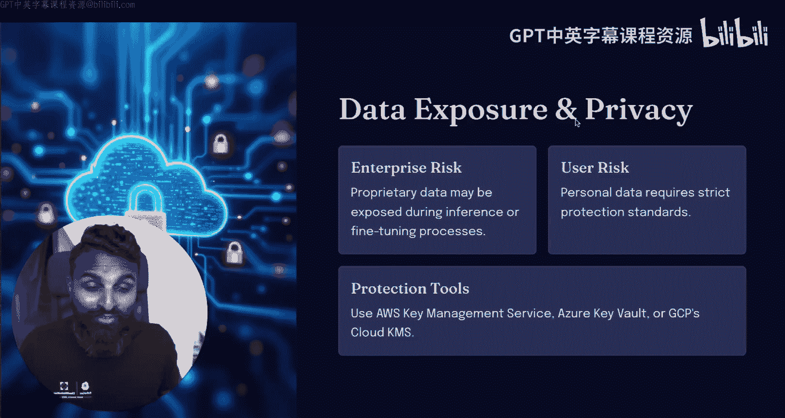
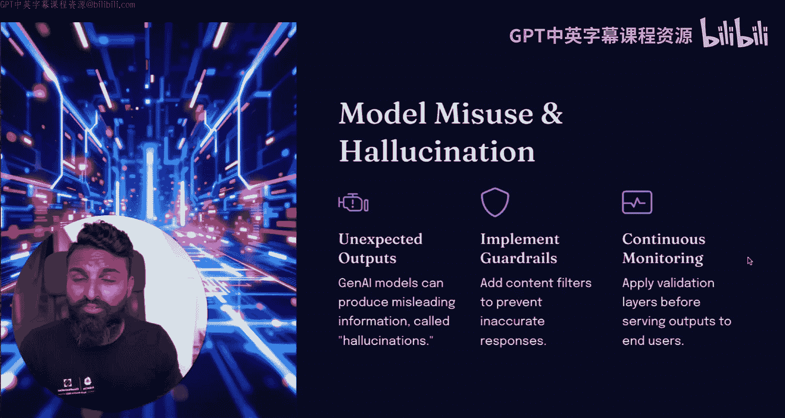
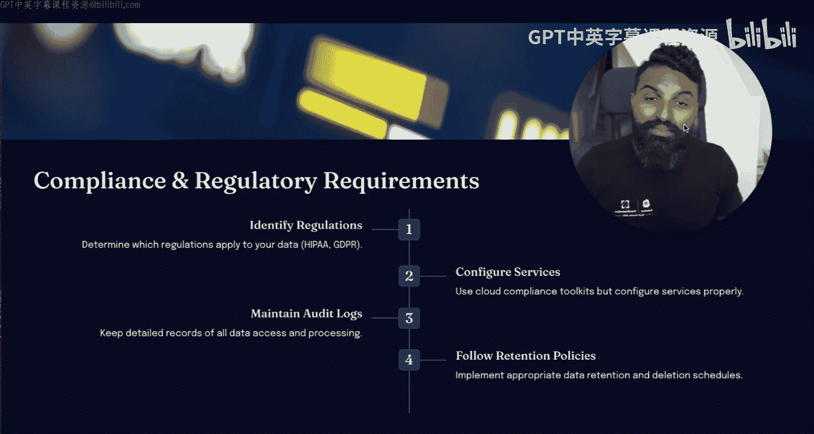
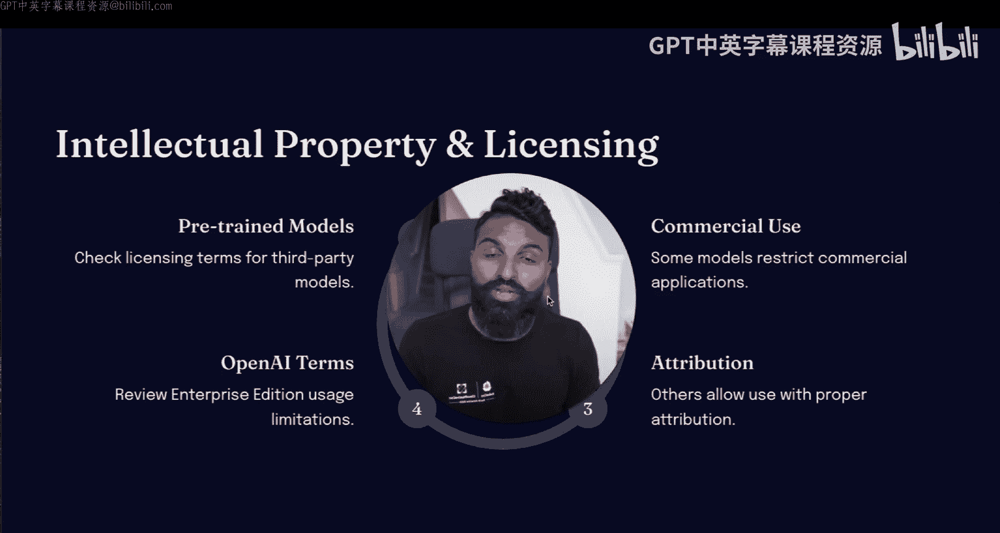
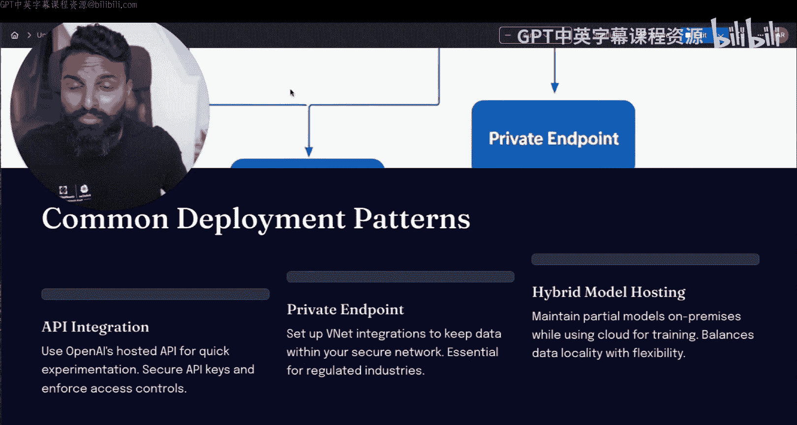

# ExamPro《生成式AI训练营｜Free GenAI Bootcamp》中英字幕（deepseek - P74：-74-The Top AI Risk & Most Common Implementation Patterns.zh_en - GPT中英字幕课程资源 - BV1SFEWzLEab

Today we're talking about the top risk and deployment patterns for gen AI applications on public cloud。

 These are really important if you are looking to secure and understand what gen AI risks may look like in an organization。

 First one， data exposure and privacy data being the fuel that drives AI data exposure is the biggest risk。

 Any organization is looking out therefore whether you're an enterprise or your an individual user in an organization。

 there are protection tools you can deploy， however。

 and L like Deepse have made the privacy conversation even more important。

 especially if you work for an organization that should not be sharing data with a country。

 which in the case of Deepse is China。 So you should be mindful for the privacy policy that is being applied for the L。

 whether it's a free one open source one or something you pay money for where does the privacy look like for that and how can you protect the data that is being put into that L My advice keep all the sensor data away and keep your L as dumb as possible。

 So send instructions， get instruction back but do not share data。

It's practical。 The other risk a lot of people have is a model misuse Now。

 because you are probably using a model like Chad GT Clade or another version on the internet。

 a model misuse could be quite common if you are perhaps using open source version that could be available and downloaded from hugging face。

 You may be using a local version for your own sanity of protection for security。 However。

 that opens the door for hallucination and a lot more if you are not using a popular model。

 which is trained to not have hallucination。 the moment you go down the path of having a model that has not been trained on the latest model。

 like the Chad G of the world， the clouds of the world， and maybe to some extent， G。

 which still can hallucinate here and there。 but the problem with that could be the risk of getting a unexpected output could result in a bad decision being made by the company。

 Now， there are guardrails， you can implement so that models are not misused by continuously monitoring them for any changes。

 but also for monitoring。For online announcement for any vulnerabilities or security vulnerabilities that may have been discovered for the model that you may be using and if it's prone to any hallucination Now being security。

 compliance and regulatory standards are important。

 especially if you work for large organization and especially if you work for an organization where the data that you work with is private in the sense that if it's a Pi or personal identifiable information for example。

 it could be my passport， my driving license， my home address。

 any combination of information that if someone on the internet had。

 they could exactly point out where the studio is in my office and maybe even where my house is。

 that would be considered a breach of compliance and privacy for your customers who you have responsibility for thankfully most people do follow the compliance standards and understand the regulation that you are applicable to when dealing with LLM and the data that you might have to work with GenI that would be the number one step you have to do now after you understand that whether you're HIPAA compliant or GDPR or any other ISO standard。

OrSo2 standard you may be looking at。 Then you can start configuring the services that you use to build your LM。

 but most likely you are using cloud services like Amazon Brock or Azure AI services or Google AI services。

 you probably can consider including some guardrails and cloud compliance checks to know that the services that you're using are compliant And also the data that you're storing or using for your LM model is in the right place where it should be Now it goes without saying you also need to maintain audit logs across your entire system because that's what would be used to identify if something went wrong。

 who did that and how did they work around it Now certain regulatory standards may require you to retain some information or data whether it's an output from your L system or it is。

Or it's perhaps something which is just simple as what data has been put in and what was changed after the input and output was provided。

 that is something you have to work out with as。 well， any regulation standard。 Now， another risk。

 a lot of people have been talking about is the legal risk， which is the intellectual property risk。

 the licensing risk。 I'm sure you've seen a lot of lawsuit being filed against copyright material being used by LM models to train their data。

 if they have been pretrained on a perhaps a copyrighted data。

 or if they are using data which supposed to be for commercial which was not supposed to be for commercial use。

 but now the data has been used for commercial purpose， they could be breach of license。

 you could also be in a breach of license if you're not complying to the terms of the LM provider you may be using Now that you understand the risk。

 some of the common deployment patterns include some kind of an API integration where you have your Gmail slack or any other tool that you have that you've been using in the organization for a long time。

 you use the API capabilities of those。

You make API request to a LLM provider as an input and you get some outback now。

 that is something called an API integration。 Now， if you are perhaps using it on your own application and you're trying to make it AI enabled you probably would use a private endpoint inside your organization's network。

 but it may be talking to an external endpoint or you may have a private locally hosted LM provider that you may be locally hosting in your data center or in your cloud environment to ensure privacy and comp being compliant。

 Now obviously there are a hybrid models as well。 Now most likely using an API integration and a private endpoint as your AI enabled application that is a very common pattern being seen companies these Now when it comes to deployment。

 there are three technical risk to be aware of One is the identity access management。

 who has access to the data that you are providing to the LLM to modify it。

 perhaps the data can be changed who has the responsibility in your cloud provider to be。

To change the model or the AI application or the infrastructure used for the AI。 Now。

 encryption is a huge part of data security， having access to the key and who owns the key。

 it would be a really important question in the world of securing an application that is running that is AI enabled。

 Now， finally， the AI application you have would be hosted inside your data center or in your cloud environment。

 So the configuration of that network。 So no external party can access it and you continuously monitor it for any threats。

 perhaps it may have， perhaps you do regular Pinterest as well。

 and making sure there are no public access available。

 So identity maintaining encryption and retro security would be three pillars you have to look at from a technical risk perspective。

😊，So that's the recap for the top risk and deployment patterns for AI。

 I hope you build safe AI out there。 If you have any questions drop in the comment。 Otherwise。

 I'll see next one。