# ExamPro《生成式AI训练营｜Free GenAI Bootcamp》中英字幕（deepseek - P75：-75-WhisperX Word by Word Transcription Part1.zh_en - GPT中英字幕课程资源 - BV1SFEWzLEab

Hey， folks， it Sand， we're going to continue on and we're going to try to go ahead and use whisper。

 I want to go ahead and make a new repo in here。 I'm going to make a new one called ASR task。Okay。

 and I'm gonna go get an existing repo that I already have。 So just give me a moment there to。

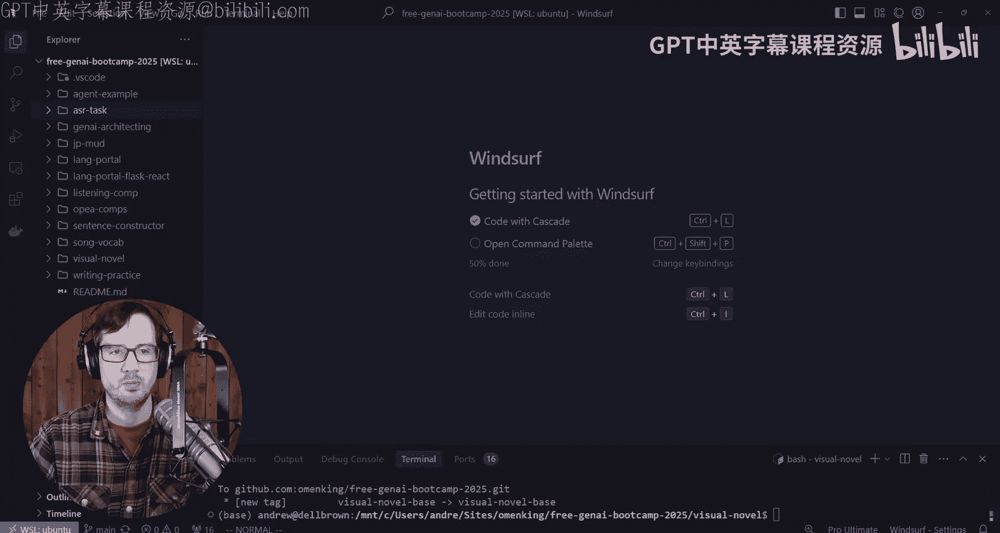

Go it pulled up here。So I'm trying to check my proficiency tests。

 but we're gonna go over to Github exam pro code Jens。 I already have code in here。

 I have OPA A in here that make my life easier to have O basic。O P A dot S H。 No， not OPA A。

 I meant open Vino。I mean， doesn't necessarily be the open V now。

 we're just want to use whisper right now。 I was going to use my AI PC。 I was just having。

A bit of network issues， Nothing wrong with the I PCC， but just issues with my network。

 And so I just want to go and。Get this to。We're here。Okay， so in here， oh。

 that's the free giant boot camp。 I actually want。It's like free。

 it's like the training day stuff training。There it is。 And so in here， I have。

Inter intermediate and into the。This one， I have one with open venno with hugging face， right。

 So if you， if you're using the IPC， you use this version here。

 all it does is add an additional step where it's optimizing it for Intel hardware， which is really。

 really great。 I'm going to just use the hugging face whisper one here。😊。

If I have time and I figure out my networking issue， I will。

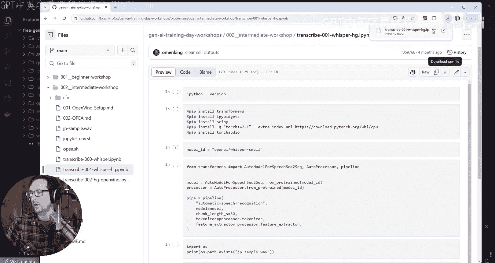

Go back and we'll use Whi as for those who do have an AIC。

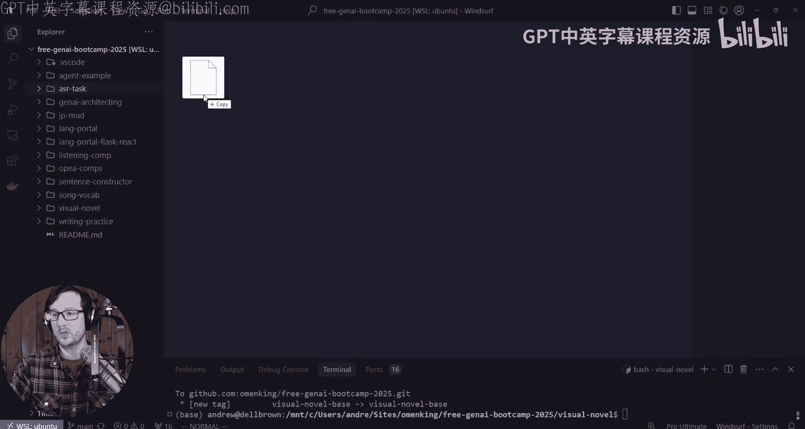

I'd love to follow along there with you。 I'm going to go here and change this out to whisper。

And we'll see if we can get this working here， we need a kernel。So we need to go down here。

 We should already have。We should already have。Yeah， it says base over here。

 So I need to make a new environment。 So I'm gonna go ahead and make requirements read me dot M D。

And I don't always remember how to do that。 But maybe we can kind of cheat here。

 I don't use to do this， but we will try and cheat here and just say like。

Create new condoda environment。Right here， we' can do this。There we go。There we go。

 That's what I wanted。 Wed probably need very specific things installed。

 but I'm gonna go ahead and just try this here。 Well， you know。

 maybe I'll go back because I probably have instructions。

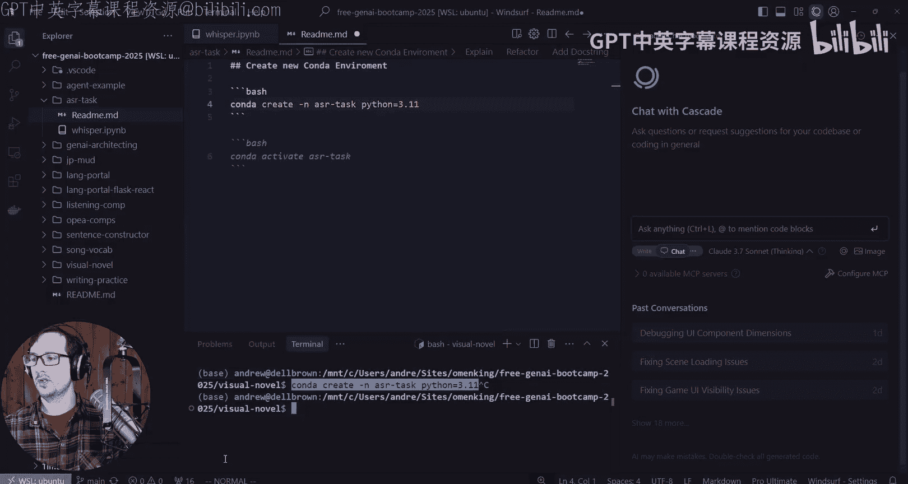

In here。For the open Vino setup。Guper lab。Open Vino， Condeforge。Tensor flows。

 we do do intensor flow there。 But I'm gonna just ignore that， I guess。

 because it's not a whole lot of code。

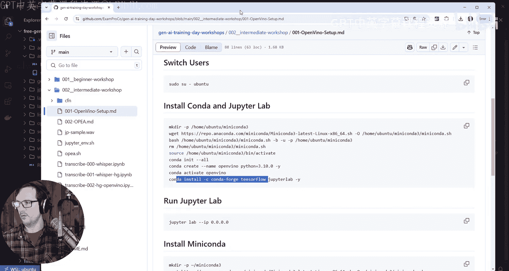

And so I do want to install a new one。 we'll do Python 3。11。 That seems fine by me。

 Make sure I go to the right directory here。 We'll just go ahead and do Conda AR task here。 Python 3。

11。 And so once that's installed， then we can go ahead and run this in isolate。

 We don't need to use hugging face for this。 We could use the base one， which is even simpler。

 which is found in this project here。 But I want to have more for full control。

 if I come back with another video to show off open or open Vino。

 I'm gonna want to go ahead and do that。 Okay， so I'm gonna go here and。😊。

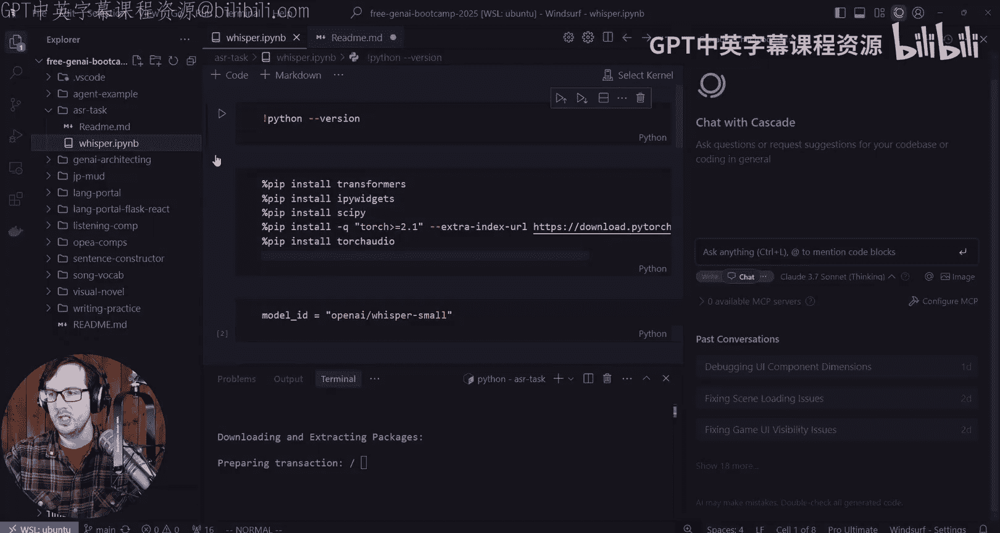

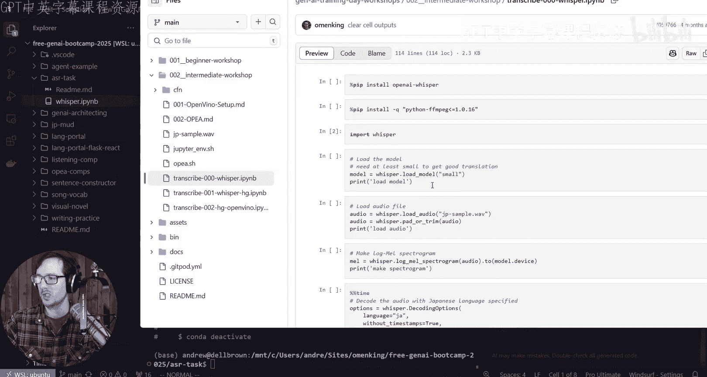

To look here。 so we have Con activate。Environment， sure， I mean， we don't have to activate it here。

 We do need to install iron Python， though， if we want to use that environment。

But I think when we go ahead and we well， okay， what， what about。I also have， like， condoda。

installst。C， condeforge。Iron I P kernel， because it's gonna need that。

 But we need to activate this environment first。We probably should have done it in one line。

 but whatever that's fine inclined to activate。G R here。

 And then I can go ahead and install that because we need I P kernel for that to work。Okay， set up。

Con environment。Or the whisper， IP PY and B。Okay。And we'll just say yes down here。

 We'll go ahead and let that run， run， run。 And then once that is set up， it is set up now。

 we can go back over to here and we will switch out to our kernel here。嗯。So， I mean， it should show。

 This is always a kind of a frustrating thing for me is getting it to show the correct thing。

 But I think it matters how we open the folder。 So I remember， like， I I open it this way。 No。

 it's opening the correct way。Yeah， so that shouldn't be a problem。Install suggest extensions。

 maybe because I'm in windsurf， I've never installed the extensions。 That's why it's not showing up。

Becauseuse I think I normally work in this in VS code or even Jupiter notebooks。

We'll go ahead and get that installed here。Okay， so now。We should be able to choose kernelel。

Python environments。 Here we go。 AR task。 There we go。 we go hand do this。 run it。

 I always do this to make sure we know what exact version we have。 So we have transformers。

 I P widgets， sippi sch， torch audio。 I would think that would also need。

I think it would also need to have。What do you call it。Tenssorflow。

 but I guess we'll find out is we're working through this。 Often you need Tensorflow and pytorch。

Will give us a moment to install。This one's going here too。It'll take a little bit of time。

 Not too long， but we'll be back here in a moment。 Alright， so that's now complete， so。We have that。

And there's different size of models that we can run。

 And so what I found was that small was the smallest one we could handle。

 So I'm gonna go over to open AI whisper for a second， open eye whisper。

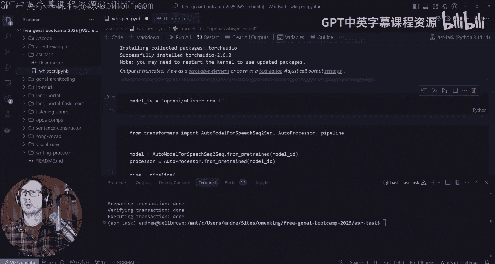

Because I want to show you there's different sizes of models here。

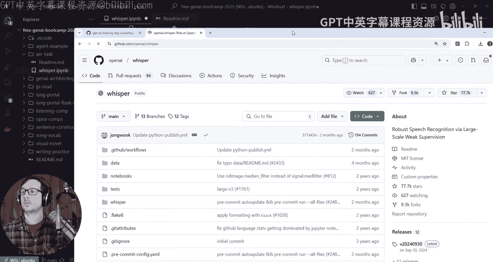

I'll scroll on down。And。We have tiny base， small， medium， large turbo。 So the thing is。

 is that the smaller it is， the faster it is。But the larger it is， the better performs。

In terms of multilingual， it does a lot better。 The larger it is。

 So small was the bare minimum that I needed to get Japanese to properly work If you're doing English it might work perfectly on small。

Notice how much V Ram is required。 Virtual memory。 So2 is fine。5 is pushing it for me。

 I think I don't know if this is a shared memory or the memory that it needs to be so。

 but maybe I can go larger。 I don't know。I don't know turbo as I ever used Trbo。

 but you'll see here it says whisper performance variety of， depending on the tasks below。

The figure below shows a performance breakdown of large version 3。Against those things。

 additional stuff。 And so they're showing you like how they perform。

 So we're going to assume English does really， really well。So I'm looking for English here。

Where is English。English 9。3， a Japanese 10。3。So I don't know exactly how to read this。

 but the point is， is that。Japanese and English pretty， pretty similar。In terms of performance。Okay。

And it's interesting they actually show Japanese as， as the example there。 But again。

 we're using it through hugging face， which is slightly different。

 But let's go back over to here and。

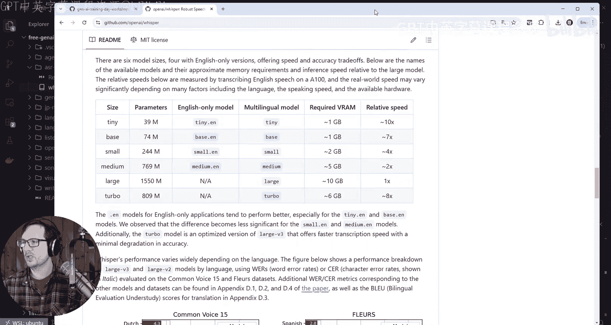

I'm going to just go ahead and download this。 It's going to download the whisper model。We're sorry。

 This doesn't download it yet。 It's going download here in just a moment。

 So here we are setting up a the auto model for speech sequences sequence pipeline。

 We're setting up for AR。 We have a model， et cetera， et cetera。 We're going go ahead。

 and this should download the model， I believe。Yeah。

 I think this is the step where it downloads the model。

I'm not sure why it's complaining about these all of a sudden。

 but maybe because we're in whisper and or sorry in windsurf and not using VS code。

But I know this part works。 So I'm not really worried about it here。

 We're going to need a voice sample。So as the device set to CPU。 We do not want this to be CPU。

 So I'm going to go here and just see if there's a way to switch that out because I do have GPUs。

 How can we， How can we set this to be GPUs。

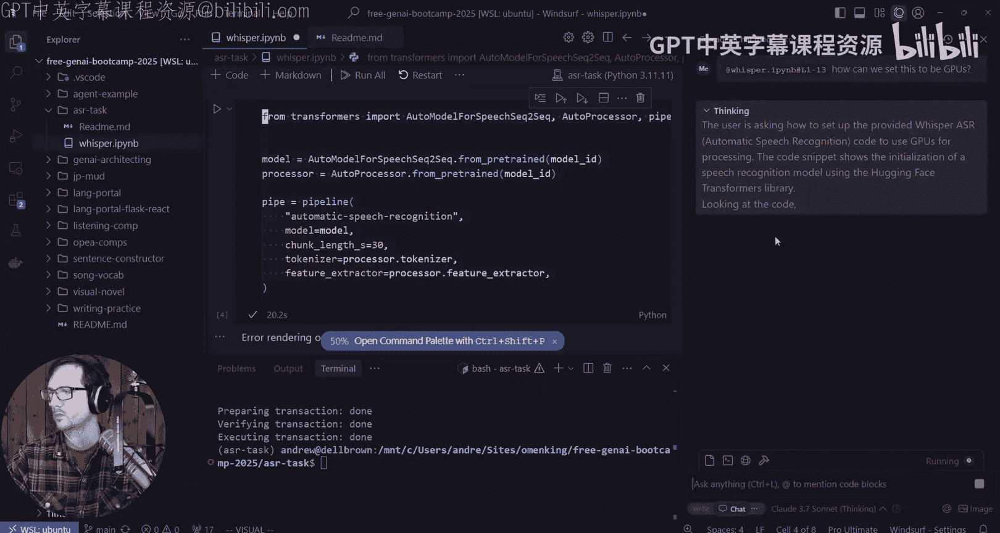

Makech make sure Pytorrches is using a GPU device。Okay， Ill just switch into Si here。

 I've been standing too long。Because， you know， if I bought my， if I buy my A PC。

 then it would technically use CPU， but I want to。Utilize my GPUs where I can， right。

This seems to be a pretrain model。To enable GPUs and hugging faceforms。

 we usually have to to make sure the Pi torch is using a GPU device， explicitly tell the model。

It says here， I show you how to modify the ASR code to do that。

Let me check to see if there's a correct path。Okay， so to enable C GPU P torch based models。

 Check if couda is available。 set the device parameter when loading the model。

 set the device parameter。 So current code is running CPU。Indicated by this line。

 I'll show you how to modify the code GPU。 I apologize for the confusion。

 I can't directly propose edits to the Jupyter notebook， but I can show you what to do。 That's fine。

 You're in chat anyway。 You can't。 I don。 I'm not letting you make direct changes。

 So that is totally fine。Claude。But here。Take a look and see what they're suggesting here。

 So check if a GPU is enabled。 So we'll go。Here。And it has to be after pie torch。

So we' going grab the stuff here。We'll give this a paste。

And what we're trying to do is see if the GPU is available。 if we go up to here。

It seems like we might have installed Pytorrch with the CPU version。

 so it might not even work that way。And this just seems to be hanging。 it's not doing anything。

Is it gonna finish executing what's going on， Why is this so hard。U。Yeah。

 so I'm not exactly sure we'll go back down to here。We'll try this again。Yeah。

 I don't know why it's just hanging here。 We'll go ahead and say print oops。Prut。Hello。

 I wanted to see if it does anything here。It shouldn't hang so bad。

What if we just comment out the other two lines， I'm just doing a sanity check here。

Is there maybe like another one that's hanging， And that's why it's having a hard time。Yeah。

 this is weird。 I gonna interrupt。Clear all outputs so I can see what I'm doing。

Run this one individually。What's going on。This can't even do a print。Very， very unusual。

Cause it should be able to do a freaking print here。Yeah。

 normally what you just do is specify the device down here below。 That's not what you do， but。

Even this is kind of messing up。 I don't。 I don't know what's going on here。 So what I'm gonna do。

 I'm gonna just stop this。Comp close this out。 We're gonna reopen Windsur because that's just kind of weird what's going on there。

And we'll give this another try here。Go ahead run。Thereric， so now it's running no problem。

 it was weird that was hanging there before。 I'm not sure why。

 but we'll go ahead and we'll delete this line out and this line out。 We'll try to run this again。

Name torch is not defined。 So I'm not sure if we should bring in this one here。

 because this looks like the CPU version of it， right。So I'm just gonna wipe that out there。

 I don't really trust that。 I'm gonna go ahead and run this again。

And so I'm hoping that this way we willll sell pie torch， specifically with GPUs。

And so that looks like that's done。🎼I'll ahead restart here。 It suggests that we should do that。

 And now that we've restart， we'll go ahead and press this。Torch is not defined。

 What are you talking about。 It's right here， maybe because we're not importing it。Import torch。

There we go。Using CPU。 So this is the problem where。You know， I'm trying to use CPUs。But。

It's showing GPs。Right。Let's see what it can suggest here。 This is， again。

 the hardest part about this development is getting these things actually worked properly。

 The code is， is for Ka。 if it sets the device to Ka 0， the first GP， otherwise。

 it sets the CPU of the message， then prints when the device is that it sounds like the user wants to force the use of CPUs。

Regardless of the GP S， no， I want to use GPUs。 No， no， no， no， no， I want to use GPUs。

 I'm trying to figure out。Why it's returning CPUs。Dm， dumb sign 3。7。This should use couta available。

No， I do have a co a compatible GPU。Lets go ahead and try this。Above here。

And I'll go ahead and run this。So， chose。Okay， so what maybe I need to do。

I need to redo this environment because it has that CPU1 installed。 and that's not gonna help us。

 So I'm just trying to think about this for a second， like。Like you know， when you install pie torch？

Is it already， does it。Are you support GPUs。If you just run。

 then you'll take a look at the CPU version only oh。Since you're using WSL。

 you need to make sure you have WSL 12 and WSL2 when I do have to install the appropriate energy of drivers and Ptorrch with the coa version that matches your drivers。

ok。Okay， instructions， please。I mean， I already have WSL  too。 I already know that。

WSL hyphen hyphen list， hyphen hyphen verbose。For both here。I guess I can't list when I'm within it。

 but I know that that's what I have here。I don't need to do this。

 I know I already have the Mvi NviDA toolkit installed。 We can go ahead and just do this。

 We can see that we got something here。 This should display the GP information。So we go here。

And in here。We have Kuda version 12。6。We also go down here。And this is going to give us back。Kuta。

 which we have 12 over here， got is 12。6。And so， I mean， the version I have is 12。6。So here。

 it literally just says the do torch like that for the latest version for for 12。 Well， that's good。

 Let's go back over to here。And。I have torch。 It's specifying a very specific version。

 I don't want to do that。I just wan to say， install torch。So we need torch， torch vision， torch。

 audio， install torch。Torch。Vision。Torch vision， torch。Auddeio。Okay。I need to clear out。So you say。

 like。Reset condoda environment。Reset， there we go。Yeah。

 that's what I need to do because we installed the CPU version， and that's not gonna help us out。

At least not right now。 and we'll just say yes， I'll wipe that clean。Yes。And now that's wiped。

 And so we'll go ahead and try this again。 Let's do 3，11。 Usually have best success with 3，10。 But。

 you know， I'm trying to move and be more progressive。 There's 3，12 Python。

 but I have a lot of problems with Python 312。We'll go ahead and say yes here。

And I'm going to go and activate this here。And then I need to install Conda IP IP kernel here。Okay。

 we'll say yes。yes yes yes yes yes。And so now let's install。

 we'll go back over to here and we should still be an ASR。 I's do restart here。

We'll give our Python version。 That's fine。 We have transformers， IP P widgets。

 si pi and these things。 So we'll go ahead and hit enter。And hopefully that installs without issues。

 We'll give it a moment to install。Okay， so now yeah， that's。Installed here。

 Let's go ahead and run this so we can see。 Do we get the correct stuff。 We have torch version Kuda。

 says 12。4。 I'm on 12。6。 Hopefully that's not a problem。 There's still both on the major version。

 So I'm hoping that's not a major issue here。 Let's go run this。

 Make sure and it's now choosing Kuda。 That's perfect。

 I don't know if I have the previous conversation here as。Maybe I do。No。

 I don't because it's wipedwi out here what's over here。 past conversations perfect。And so in here。

That might have been the conversation we just had。It's here。😔。

And so I don't think we'd have to specify the device。 I think it would automatically pick it up。

But let's go ahead and see what happens， so we run this one here。Okay， and we'll run this one here。

 I think this downloads the model。But what we're hoping to see here， okay。

 the device is set to k to 0。 maybe doesn't download the model here。

And so where else could have download It has to download it here。 Yeah， it has to download it here。

But we need some kind of sample audio。So。I'm just thinking about this here。

Ha even said it for specific languages， we don't even have that setting。

I be I do have one that I have from before。So it's in the prior project。And so I'm thinking， well。

 we can actually just use the one that's in here。 So if we go to the visual novel。Into public。

 into assets， into audio。Into dialogue， we have this wake up one， okay？

So I'll go ahead and copy this， and I'll paste it into here。And。So we have this wake up audio clip。

 and that was synthetically generated by。From。Microsoft， AI。Sppeace services。

 which they have really good audio stuff。 But I couldn't get。

 if I could use the managed service to grab the timing timing of the words I do that， but I can't。

I know that for8 of us， they have limited voices， but they perfectly returned back the time codes。

 So it's just really a trade of what you want。 I just wanted a better voice and more voices to utilize。

 especially for this game。 So I need to find a process that that will do that。

 And I think Whisper can do it。So go ahead and we'll run this here。So now。

 so we were just checking the path exists。I'm gonna go here， and maybe just say。File name。

And that way， I don't have to spend so much time。We hope that way of figuring that out here。

File name here like that。

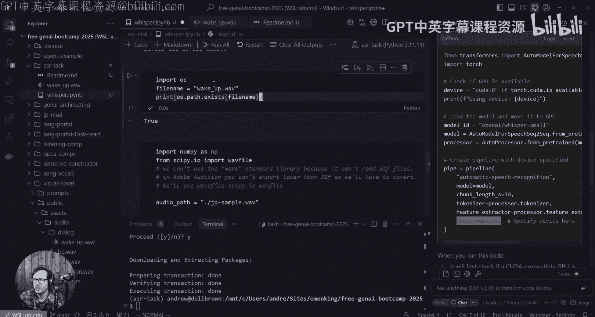

We'll go ahead and run it like this。啊。Does the file name。I don't know why we do it that。

 and then then we have it there。 That's a bit silly。But we'll do file name here。

 We already have the file name。 We don't have to do file name 100 times。

 So we go ahead and we'll just say file name。There is a lot of work to get this to convert。

 So whatever I have for the code here is perfect。 But you'll see like I had issues with like the versioning and stuff like that。

 But this， this should be proper now。 And so now we should be able to transcribe。

 I put this here because if we don't put that in here， it just won't show the time。Well。

 actually does show it here。 But I think in maybe in maybe it's in Jupiter。

 Jupiter doesn't show it there。 So you have to put that in there。

 But I guess we do get the time here。You have passed the transcribe。

 but also have set force decoder IDs， which creates a conflict。

In favor the favor of task transcribed， the tension mask cannot be set but inferted the input because the token is E Oos as a consequence。

 you may have unexpected behaviors。I remember I always get this and I just ignore it。

But you have also set force decoder IDs。I have。 See， this is not。 I'm not setting anything。 It's。

 it's underneath。Right， so。Anyway， let's print it out。 It did this in five seconds。

And there's our perfect decoding， right？Perfect。It's perfect， right。

I don't know what's going on there。 So what I'm gonna do is go to the Internet here。Because I have。

A sample that I know that is reliable。 It's in this intermediate workshop。

 Im go ahead and download it。Cause I just w to first initially get this to work correctly， whoops。

Not there。We'll try this again here。And。

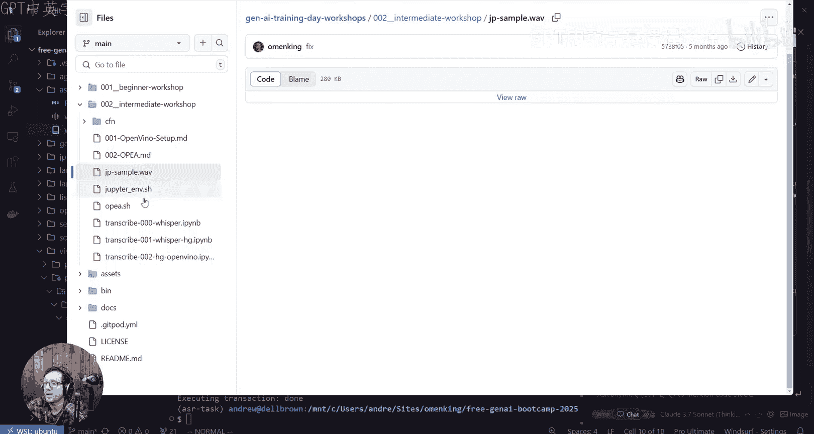

Cause I need to rule out first that it's my audio sample。 You have to get the audio format correct。

 And it's very particular。 It's a big pain in the butt。And so in here。

 I'm going to try the other one that I know that works。But in the other ones。

 I actually use CPUUs to do that。So JP sample。Dot wave。Okay， we'll go ahead and we'll run this here。

And then we'll run this one here。Super， super fast。Well， that just。I think for this。

 I might just merge these together。 so I don't have to keep constantly have these two separate frames here。

Cut。Paste。Cut。Paste， there we go。 And then we'll just delete out this frame here。 That's fine。Well。

 I'll read that again。And then we will run this again。And our output here is garbled nonsense。

What is going on？This is unusual。嗯。H， what could be wrong。

 No is also not throwing the errors we had before。About something， something。Chunk non data。

 not understood， skipping it。Oh， now works。 What the heck。 All I did was run it again。

 Maybe sometimes it doesn't decode properly， Okay， so。We have the decoding。That's accurate。

 Neco Kaias。

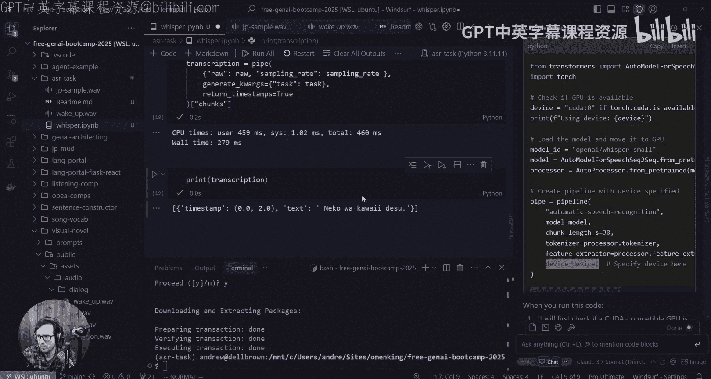

Maybe all'll either to do is run it again。Or maybe it wasn't loading the other file。

 Let's go ahead and try wakeake up now。And we'll go ahead and run this。It's a little bit larger。

 so it's going to take a little bit more time。So doesn't like something about that file。

 So let's go and reveal this。I can't reveal。But I will go into the folder manually。

 and maybe there's something about。The audio file that makes it a problem， right， So we go into here。

 we go into free Gen E I。 We go into visual novel。 We go into our， no， that's not where we're going。

 We're going into the ASR task。And so it makes me think that there's something different。

Show me properties。But this one。

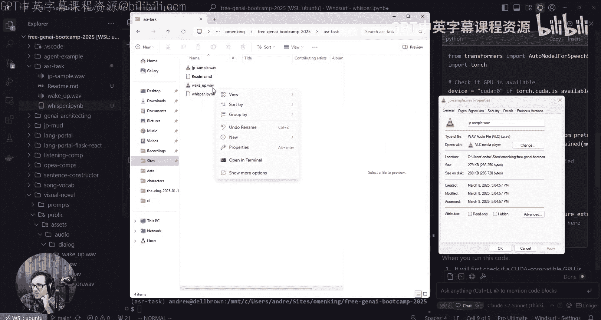

And this one， Okay， so there's something clearly different about these two files。 I mean。

 this one here。That's not it。 I want this file here， sorry。

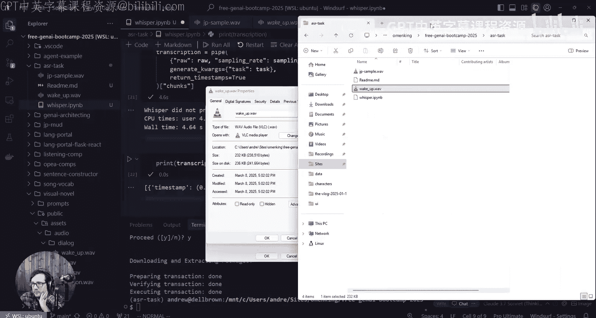

And so there's clearly something different between these two files。

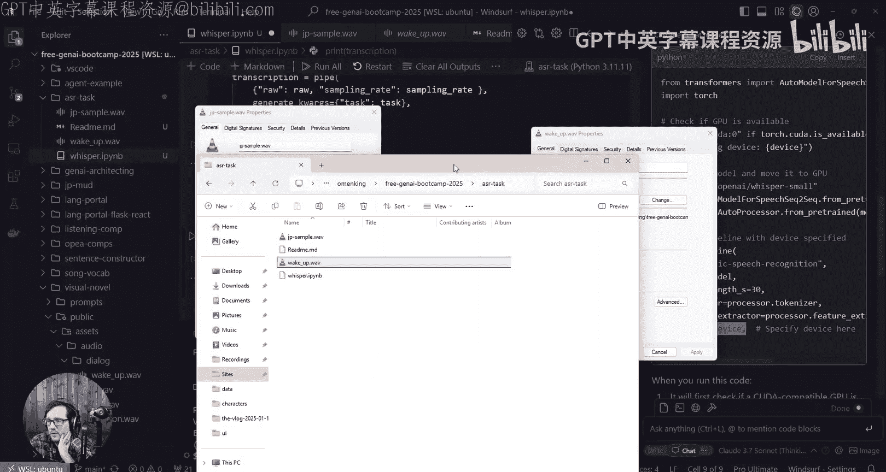

I mean， this what I recorded。My natural voice， this one here is synthetically generated。

But there could be details that are different。 We go the details here。This one here is at 7，87，68 kb。

 This one's at 256 kb。 This one's at 24。This one's at 16 Kz，16， right？

 So there's some key difference here with this stuff。

 It's the I'm thing is maybe I got to convert this one over that， but like。You can't go up， right。

 This one can only be that particular quality。But I need to。Change this here。

 So I'm gonna go take a screenshot here。The wake up。Wave， the wake up wave。Doesn't work。With whisper。

But the。JP sample。对。How can I convert using FFM peg。To match the audio settings。2。JP sample dot wave。

 because that's what I'm thinking that it is。 They're both A AC files。It needs to go up from this。

 sample size needs to go up from 32 bit。Right， so here。Yeah， let's see if we can run this。Right。

 and so we'll go here and just say。Audio format file。And we'll see if this fixes our problem。

I don't know if it will， but there's only one way to find out， right， we's got to run it。

And so I're gonna go into the AR directory here。 I already have a installed， but I don't。

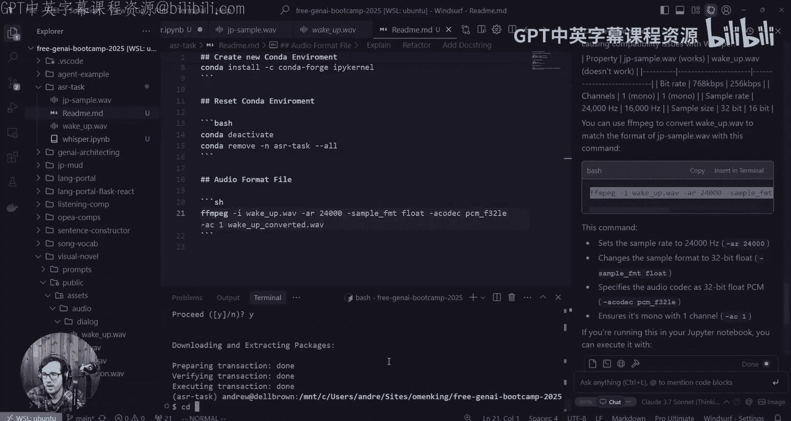

嗯。Did it output。It didn't。 What's the problem。I mean， we do have FFM pig installed。

 I'm go ahead and run this here。 See what it tells me。Well， you gave me the syntax。Okay。

 we'll try this， see if this is any different。Yeah， it's a bit different。 That's fine。

We'll go ahead and try this again。And we will paste it in here。

And so it looks like it converted it over。 Good。 Let's go take a look and see what the options are here。

We will show， and then properties。And we go to details Now it is matching the other one。

 Im gonna go play make sure connection新しいアパートにあなたは新しいアパートにより、朝日の光が窓の。😊。

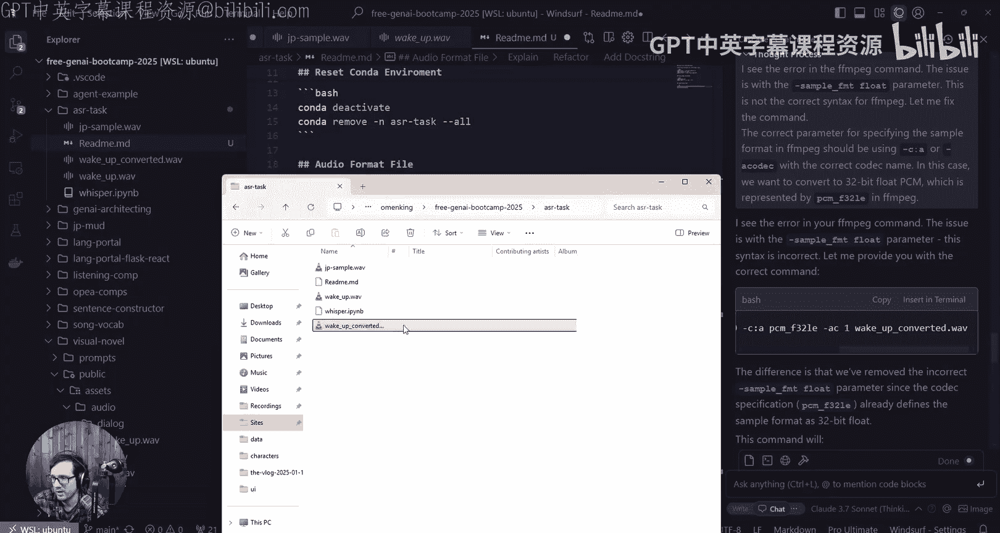

Let's see how loud the other one is here。Neco walk Kai death。 Okay。

 so they're equivalently the same thing。 But now the format is the same。

 So I'm hoping with that conversion。

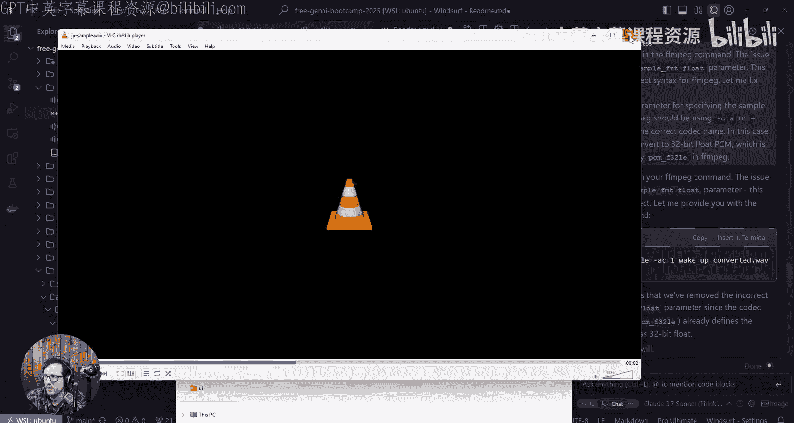

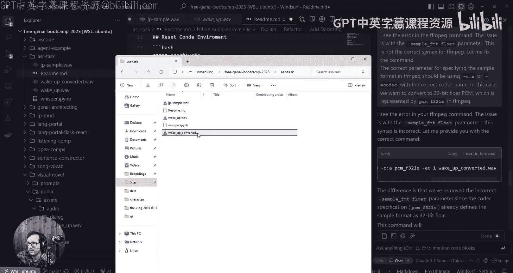

That will fix the problem。Maybe when I created the audio file。

 I could have probably told it what sampling I wanted originally from。Azure。

 but I thought it made a really good choice with Wa originally， but apparently not。 So we'll have to。

See about that。 Now， the next thing we need to do is we need to go back over to here and we're going to go back over to whisper。

 and we need to。Swap out。This here。Actually， I'll just put another one here file name。Like that。

And so this one， we might have less of an issue。 So here's says read the 32bit wave format。

And let's see what it says here。 says we can't use。

Wave Santa format library because it can't read 32 files in Adobe edition you can export lower than 32 so you'll have to convert it。

Using a s P wave。I wonder if I'm like doing useless conversions and maybe the original file was fine。

We'll go ahead and run this here。And we'll run this pipeline again。And I will tryread this。

 And there we go。 So there our format is fixed。Is this a good translation？あなたはあたらしあたしアパート。A 열。啊。

Ata no。Was it cheatot， I don't know if I say that Ga Mado window Nonaka， Oh。

 I'm not sure what that says here。 Yoi Anatki Okita。

 So that looks correct based on the original sentence translation。The only thing is like。

 we're not getting back。Time codes， we're getting this structure back。 And so does whisper。

Return back。 word by word time codes。Can I do that。Here， it says。Well， this says time stamps， right？

But I don't have any of that。 I mean， I have this time stamp， like 0，0，0。84。Right 0 to 00 to 8。4。

So whisperhi can return time science with some nuances default behavior， by default。

 when you set this， as you've done in the whisper， return timet at the chunk level。

 phase or sentences， not individual words。Word level times stampamps to get word by word。

 You need to specify word。 Oh my goodness。 Can I just do that。

 because they said before they couldn't do it。Is this just lying？ Sometimes they'd like to lie to me。

 but we'll go ahead and we'll see what happens here。 That'd be really exciting if it does it。

 So go ahead and do that。😊，And now print it。嗯。😊，I don't think it does that。 When you said its a word。

 did I， I did。The upper format is different instead of just getting chunks， you'll get text。

 chunks and words， text。I don't get that。嗯。Okay， well， let me try this one more time。Just in case。

I'm doing something wrong here。 I don't think I am。Oh， you know what。

 chunks is being returned initially， let's take that part out。Maybe that's why we were confused。

And now let's print this out。Whisper did not predict an ending time stamp。

 which can happen if the Os cut off in the middle of the word。

Also make sure W time stampamp logic processor was used during the generation。I don't know。

 I'm just using hugging face here。 And so here。I mean。Like here。Rebecca， this is。Come on， copy。

 copy the fing content here。 Let me try as it get here。Copy， sell contact， paste it in here。

What is going on， Just paste it， paste it， paste it， paste it， paste it， paste it， paste it。

 paste it， paste it。 It won't paste the cell content。Copy sell outputs。 paste it。Oh my goodness。

 Pae it。 Please just paste it。哦。Oh，We have more than one。 What the hecks going on here。

 What the heck。Delettes， deletes。 I think everybody might been copied each time here。Let's try this。

I now make it。Okay， we'll go next to next line， print。Transscript， there we go。 We'll do that。

Run this。 Run that， okay。Now， we have this。Copy， sell output。I don't know why it's doing that。啊。

Right click。Copy from here， right click。I can't。 I can't copy， paste it out。

 Let me just try anything like text， text field here。no。I can't copy out the contents。

 This is so stupid。啊。Open so I put some text editor there。 We go。

 That's such a dumb way to figure it out。 but we'll go ahead and we'll just do word wrap here and we'll grab it。

Gobe。Paste。No words words。 but it is what I got back。 Well。

 I think it'll know if I just paste it in here。Not the words。To get word level。

 you need to modify the code earlier specified。well， I did do that。嗯哼。嗯。I did make the change。

It didn't give me words。I don't think it knows。 I think it's just making things up。

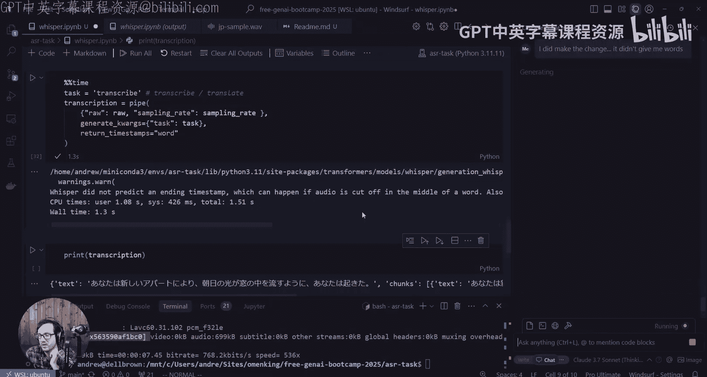

They're using an older version of transformer that doesn't support word level time samps。

 The specific whisper bottle they're using might not support word level timetamps。

 They might be an issue with how they're。 This is what it's guessing， right。

This issue with word level times stampamps can be tricky to get whispered。

 especially for non English languages。 Try a different approach。

 The latest versions of transformers is 427 has improved support for time stampamps。

Here's what we should try。 Let's go and take a look at what version of transformers we're using。

 We're not specifying any specific version here， So it should get the latest。Right in here。嗯哈。

We'll take a look here and see we have。AR model。Chump length， this is identical。This is identical。

 too。

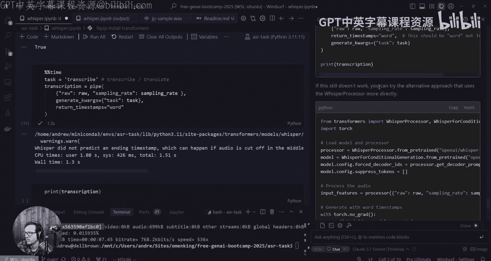

Here they're using the whisper processor much more directly。How， how do you know that。Open whisper。

Supports word by word。Did you check the Internet？Did you check the web。

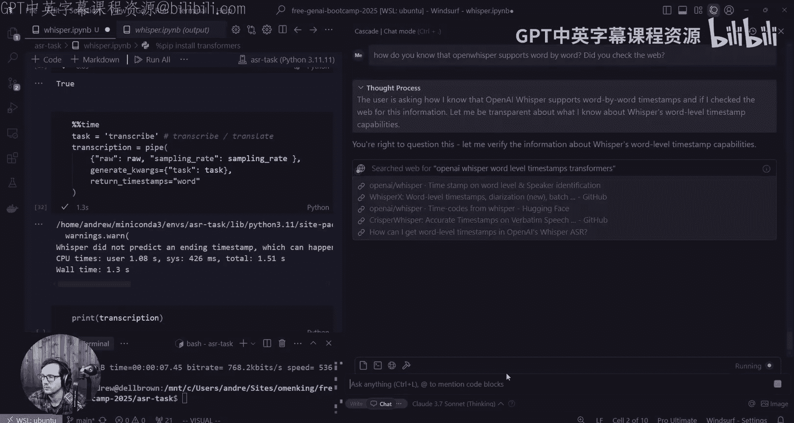

As if it knows， we'll give it a second here。So here it says， like。

 doesn't support word level time stampamps。 The official whisper model and transformer has limited capabilities。

 primary on segment and chunk for word level， there are specialized variants like whisper X。

 a project that refines whisper time samps that force alignments for。Phenenome based ASR models。

 We have CRISPR whisper and advanced variant specifically designed for verbatim transcriptions with word accurate level transcriptions。

 For Japanese specifically， this is even more challenging since the language doesn't use spaces between words。

Okay， but I mean， like， that shouldn't matter because whisper is still taking time and making something audio。

 So using whisper X， implementing a post processing step could do that。

 using a different ASR specifically designed for precision word output。 So let's go take a look。

 I've never heard of whisper X。 There are other models。

But we'll go take a look here and see if we can find something because we need to go off the beatenating path if we want。

 So we have whisper X。That's your oldest is。 So this repo provides ASR。70 times real time V2。

With word level timestamps， that's what we want。Btched inference for 70 times Real time。Okay。

 whisperhis is an ASR model。嗯，哼。😊，But can it support？Can it support。

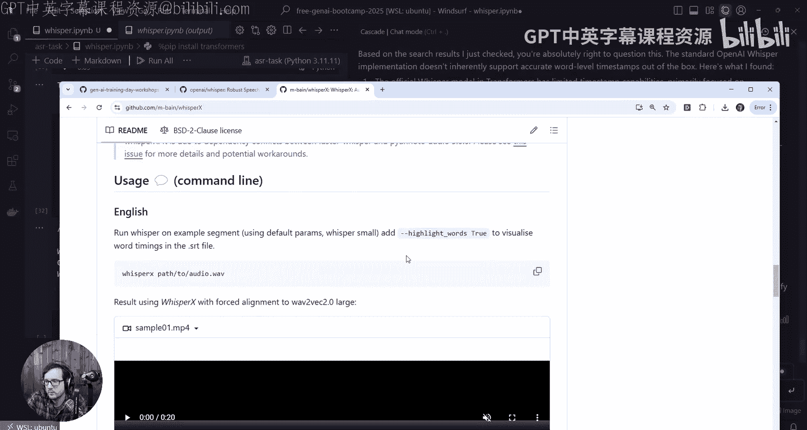

Other languages usage run whisper for a segment here， whisper X。

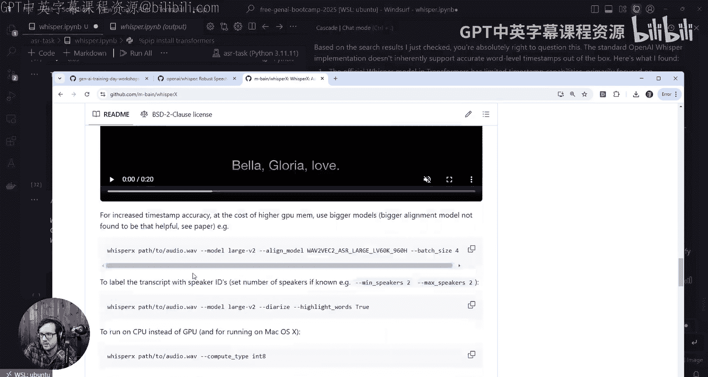

Let's play this back。 so we'll get。No。Oh so here it's saying like， okay， it's selecting。

 that's what we want。

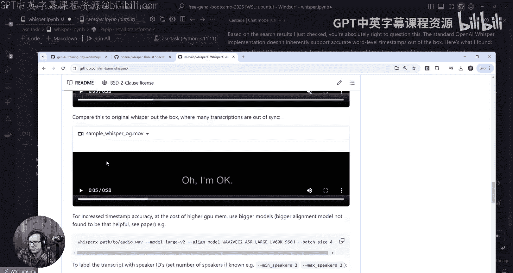

Other languages。So here it says the， the。Banm。It alignment model is lagu specific for test and language。

 These models are automaticallyacly picked from torch， audio， pipelines or hugging phase。

 Just past the code and currently default models provide for English， French。Dutch。Espaniel， Italian。

 anyone doing those language。 You're lucky via torch audio pipelines and many other via hugging phase。

 Please find the list currently supported using the default hugging phase on a line stop high。

 So maybe we can still do it。😊，诶。Okay， so we do have。These are the default alignmentments。For torch。

 which is fine。 But we don't care。 We're using hugging face right now。 It's totally fine。

 We'll go here。 I'm looking for Japanese。Usually Japanese is JP for Japanese。 there it is。

 So it's using this one here， perfect。So maybe we can get it with the Japanese。We'll go over to here。

Here they have Python usage。 I'm trying to figure out how do we use this with hugging face。

Here we have whisper X。 I mean， we could just use whisper X directly， too。 That might be fine。

But here says Wsper X load audio file， transcribe the audio file， load theign model。

 whisperhi X align。But I guess my question is like。If it needs the hugging phase。In other languages。

 let's go take a look at another example for other languages。 Please have Japanese。 You got French。

 You got German。 You got Italian， You got Japanese。 there's Japanese。 There's Japanese。

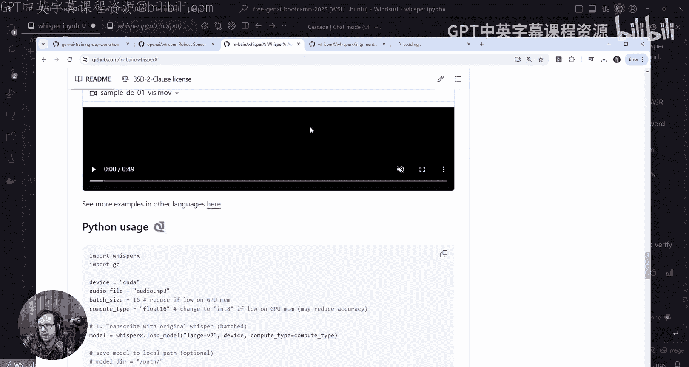

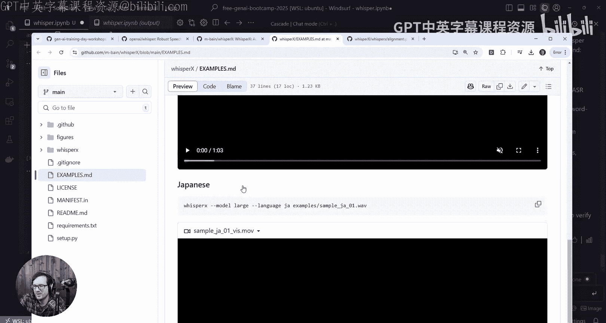

See， look here。経見なん ですけど。やっぱり認識率つかすごくいいのもあるとあの悪いのもあります。で、ま、放送のニュースなんかはやっぱり。

So what I'm trying to figure out， like， is that useful because here， it seems like it's。

Literally doing each character。 Let's take a look here， again。で、これも私の主観というか経験なんですけど。

やっぱり認識率つかすごくいいのもあるとあの悪いのもあります。yeah， so it's not just doing words。 It's literally doing characters。

 But I mean， if that's the best I can get， that's the best I can get because it's either entire chunks of sentences or this。

 So whisper X clearly can work， I if it just installs。

 they don't really need to run through hugging fers or anything。 And if it just works。

 that'd be really cool。😊。

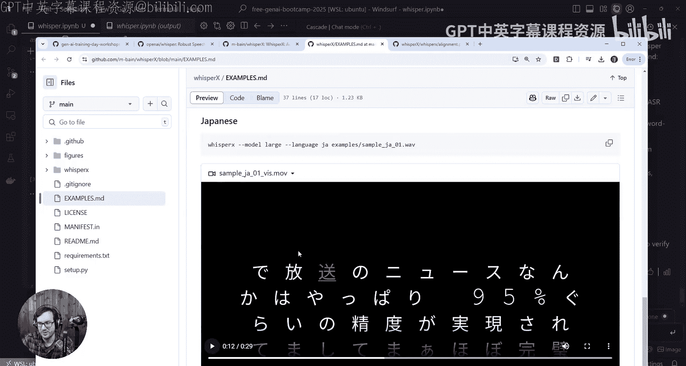

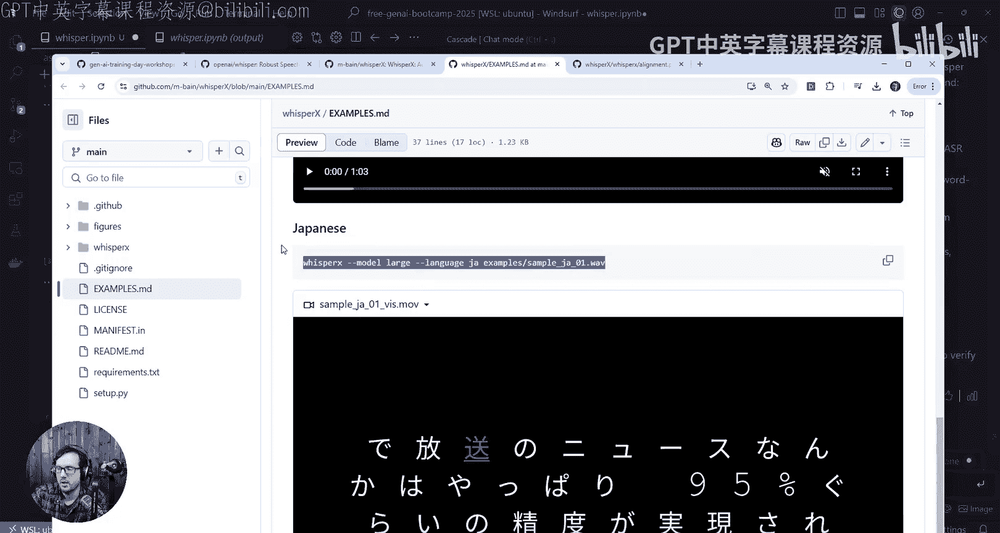

But then how do we install it？Just this Piip and salt whisper X。 really。

 is that all we got to do to use it， Is this whole convoluted thing that I have completely useless。

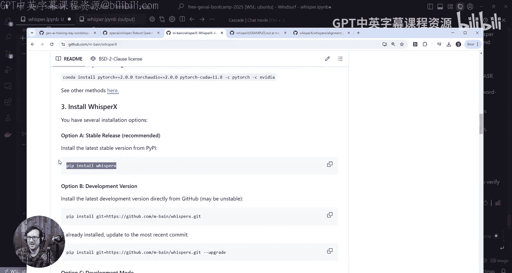

We'll go ahead and do this。I mean， if it works，' I can't complain， right？

We're just doing Piip and saw whisper X。Okay。So it's installing it。

How we would change it on this side， I don't know， but we'll just try to run it manually and see what we get。

 okay。The other question is like， what size is it running， I don't even know。

 because it's not like we're choosing like whisper X small。

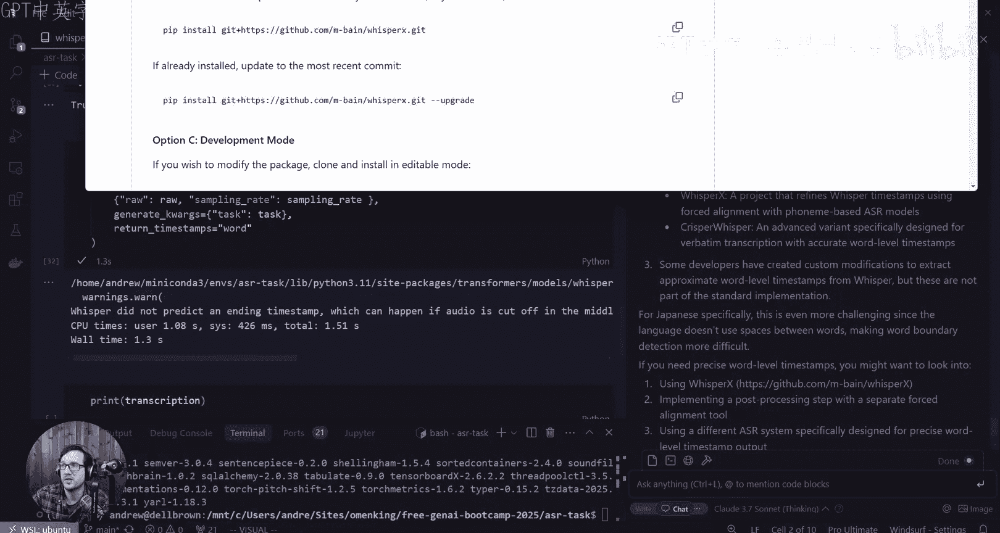

Right， so I think it's just whatever we have is what we rod。So stable release， just do that。

 and then。

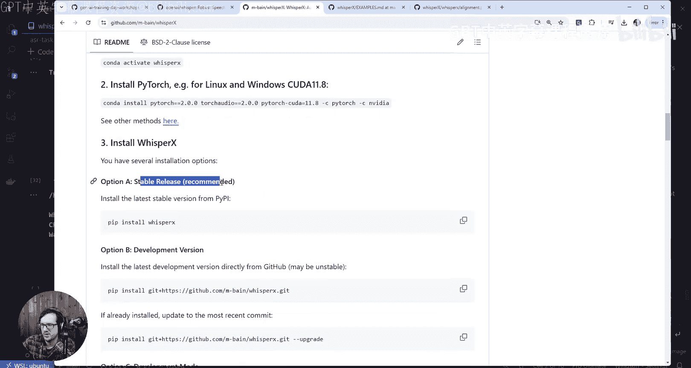

Apparently it can just take an audio file， so I guess we'll just try this here。

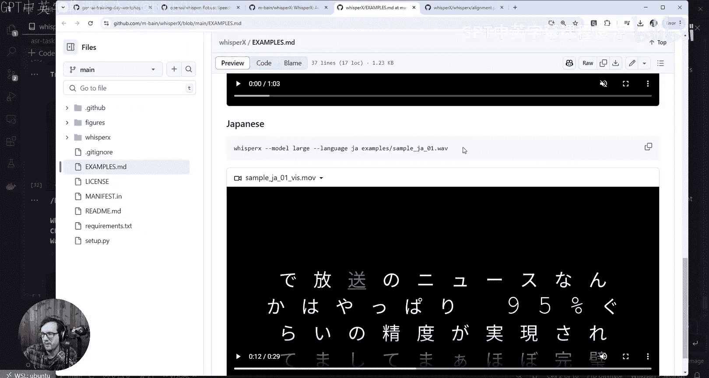

Okay， I'll go over to here， read me。Whisper X。呃。Open whisper。Does not。Word， word by word。

We can use whisper X。So， here。Ppen install。Whisperax。And so we need to bring in our sample。

 We have our converted file。 I'm not sure if it even matters。 It might do the work for us。

 but just in case it doesn't， we'll go ahead and do this。So I'm not sure what the output it will be。

 but we'll give it a try here。So let's go ahead and copy this here。And well， yeah， we know to give。

 give a second here。There we go。Is downloading the model。I think we can， was a task manager。

If we want to see if it's actually using our resources here， where was it here？

Then we can see what happens。Obviously， I'm using GPUs right now for recording。

 so I'm not sure if this will be an issue or conflict。 butll give this a moment to download， okay。

And I didn't notice it， but I didn't see any， anything upt here。 let's go back over to here。

' take a look we have。 So it says， could not。 What can， What can it do。嗯。

So here it downloads the model。嗯哼。😊，Mulch was trained with pi audio 0，0，1。嗯。It can be re with this。

Okay， so it has whatever this problem is。 I'm not sure what the problem is here。 We'll go ahead。

And ask。When trying to， oops。When trying to run。In command line。 So I'm not sure。The problem here。

Is K a specific problem。Come on， let me， let me scroll up。The user is encouraging a missing library。

Requires KUa Library， specifically KUDa Deep neural Network Library。

 which appears to be missing on your system。Alternativelyly。

 since you're working in a notebook environment， you might be have better luck。

Ray whispered directly in Python， rather the command li。Okay。

I guess there's another suggested way to run it。嗯哼。😊，So like， will this work。

With my kuda version of 12。6。Ca that looks like it's an older version of Kuda。

The version numbers needs to de batch。 So for Kuda 12。6， Kuda。

 that specifically supports that for Kuda 12。6， you would need to install compatible kuda versions。

And there' is a way to manage kud versions。And switch between the two。

 I I know there's a way to do it， but we'll go ahead and just do this for a second。

 So here we are on 12， use the Nvi package manager。啊哈。Dvoid system level dependencies。Okay， so。

Maybe that's what we need to do。 We need to just make a new notebook called for whisperhis X。

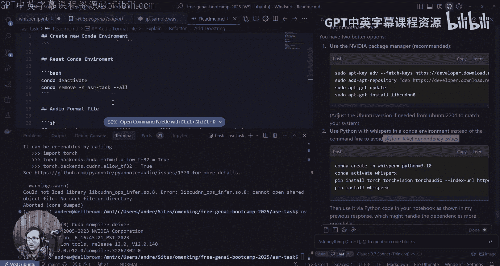

So we'll make a new one here called whisperhis。X dot IP， Y， and B。I P Y and B。And。

I'm going to add a new code block here。This is doing 3。10， which is fine。 We need to install。

Which is our specific version of co， I guess。I mean， if we use the latest， it it works。

 but I guess we can try and do this very specific one。Okay， we're run this here。Its our task for now。

We can always clear it out if there's a problem with that。And then we will do P install here with Bx。

 which is already installed， by the way。And then we'll bring this one down here。

And then says use it via Python。 Okay， well， then how do I do that。 It's all this code here。

So bring this here， paste it in。嗯。we'll try to give this a go。It is using the large model。 Okay。

 I had don't have much experience using the large model， to be honest， I always just use the small。

 but I'm sure I can run the large。 We'll be able to tell with our GP Pus over here in memory usage。

Right， so you see， the memory is。It's okay right now。We'll go back over to here。

And the Colonel Cr executing from the previous call， click here for more information。

It doesn't tell us why， So here。嗯。Okay， so it's not telling us exactly what's wrong。It says here。

I mean， that's not our error， but it could be the same problem， like we can't really tell。嗯。Oh。

 we hear we didn't do this。Like we do have， we do have piewar installed on here。

 But what I'm going to do is I'm going to go back over to here。

 I'm going to deactivate the environment。 I'm gonna to clear everything out again。

 You have to do that quite a bit。And again， just trying to get whisper X to work。

As it clearly can do the job for us。Supposedly， if we can get it to work。So now that we've done that。

 we'll go ahead and try this again，3。3。11。And then we'll do ACR task next。

We'll give it a moment here。This is where I found a bit of a challenge because like if something's built with an older version of ka。

 then you have to manage those versions。嗯可以。And。嗯。Transcribe the whisper， get the time steps。

 So I'm just separate out。This part and this part。As。You exactly see what's going on here。

But I'm thinking， like， if there's a problem here， then it probably is occurring on this line here。

Sa yes。Okay， and so now that's all that's stuff installed。 We'll go ahead and run this。Oh， sorry。

 restart kernelnel， y。I guess we were installing condoda Fors。 That's right。

 So now we can go up here and we go run this and see if it installs without conflicts。

I'm assuming this is our， our correct version， but we didn't torchching the other one fine。

 and we didn't have a problem with it。It doesn't matter if it's Intel hardware or N V hardware or AMD hardware。

 This stuff's always a pain in the butt to get running。There's a lot of things， compatibility。

 things you have to worry about， but you have to learn your hardware your system to solve those problems。

 We'll wait for that to finish downloading here。Alright， so here it says those are installed。

 We'll go ahead and install whispers X now。And I believe it's now installed it installs pretty darn quick。

Go to here。 No， I guess it's still going。 Oh， no it's still installing this。 Okay， great。

 And so now the next cell cell should run。嗯哼。😊，Yeah， it's really exciting if we can get that to work。

 that'd be really cool。And then we run this。 no module named Whisper X。 We talked about just， oh。

 it's still installing。We've got to be patient， I guess。Okay， we'll continue on here。

Hopefully it just works。 with no errors but no errors。啊。Still going。It's still going。

Ball is trained on that。 Then you should use that。 The kernel crashed。

The kernel crash with executing code in the cell or previous cell。

 please review the code in the cell to identify possible causes。

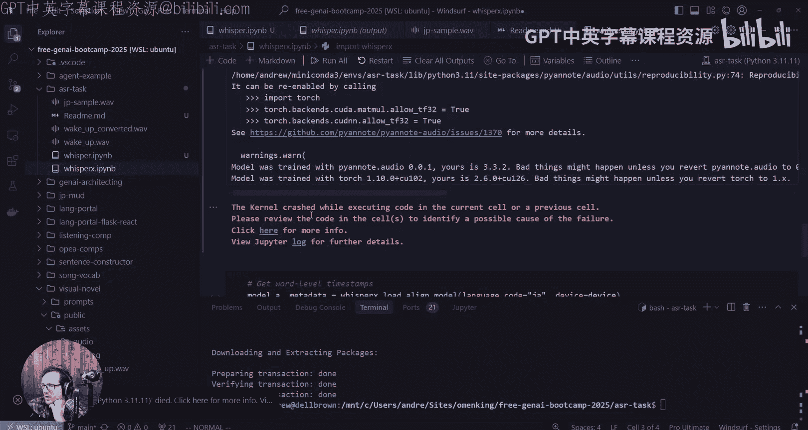

It's kind of annoying because we can't really tell what's going on here with it go to the Jupiter logs down below here。

嗯。Here。Does it explain what the problem is。It doesn't explain why it crashed。

 We don't even know why it crashed。Though there are these very specific versions。That it wants。

 So we'll go back over to here。I remember this is kind of a pain。 What was it that we had to do here。

 We need to go here and say， open。Open this in text。How did we do that last time。啊。It's。

 it's really frustrating trying to copy content out of here。Clear copy， copy cells。嗯。

I'm not sure why I brought this one in here。 this is not even related to this model。

Can I copy this out here， I don't think I can。We had this problem before。Where we can't。 oh。

 maybe it here it is right click。 That's what I have to do。嗯。It didn't even give me all the text。

 Come on， come on。 right click editor right here。 Here it is。 is what I want。 We'll copy this。

 I don't know if this is our problem because like， if the other ones using that co to 8 version。

 we really have to fix our whole computer to co to 8。Which is a nightmare。

The user is showing no warnings about versions， warning indicated about this。I'm here。

Here we can install very specific versions。Hereever is a challenge when using couder 12。6。

 but the mall expects 10 point or the or significant difference of kudter versions。

 a better approach would be used a docker container with the exact environments。That it requires。

That's not a bad idea。Just a second。Alright， so。Here， yeah， we have Whisper X legacy。

 I don't need to do that。 I'm just gonna have in that particular version， but we'll go over to here。

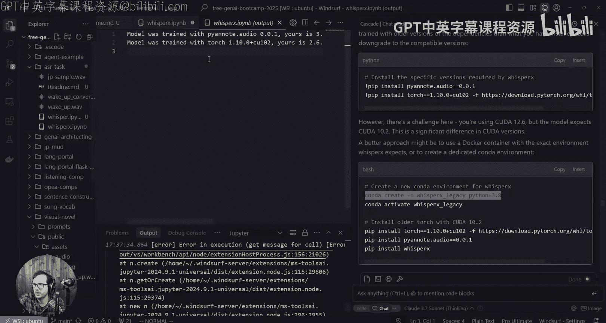

And。It's。It wants Kuta sit。 Like， is there a way。I know there is， but like。

How to manage multiple kuda versions。Frick and couda。Is it possible There is a way。

 There's a tool isn't there。But only， but but a process can use it at a time。

 A GPU can use more than one version at a time using the process。

Toolkit with the Qa tool is the most reference when they're talking about Ca it's the only thing that downloaded and installed。

What a nightmare to get this to work。 I mean， the other thing is it just says to run it in a container。

 right， So here。I mean， like whisper X。Container。If somebody already has it。

 then they'll save us a lot of trouble。嗯哼。😊，It's effectively maintain continuous Docker to GitHub free runner on a weekly basis。

 which is fine Once you have installed Docker De Kuta and the am Windows drivers ensure your docker is running WSL2 it is。

And here。Already prebuilt images and it has different sizes。 Okay， so， you know。

 was it failing because too much memory or whatever。

 But here you can see they actually have different sizes。I need a very specific language。So。

Cobase in these images align with the GitHub submodule。That looks like Japanese to me right there。

 V3 JA。That's probably what I need to。Let's go over to here。It is。 Oh， look at me。

 I found something good。 Let's go ahead and grab this。😊。

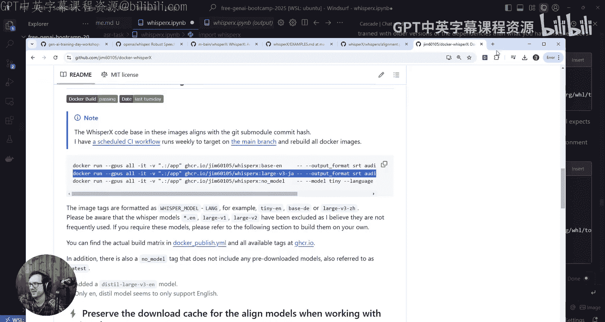

y it works， it works。We'll go back over to here。And so open whisper cannot do。 We can use whisper。

 Whi X is very hard to install because it needs specific。Version of Kuda。有质议。8 and pie torch。

Versions。So。Let's try。Using a docker container， because this will make our lives。A lot easier if。

 if it just works， and I will take it if it just works。 So here we have GPU all。

And I guess we can mount the app directory。 That's fine。I's leave that alone there Here。

 we're taking the audio file。 So this one is the wake up converted。

 So we'll go ahead and rename this here。 copypy this。O。Will it paste。

That's why it's good to know Docker。We have more options available to us here of what we want to do。

 We should have Docker already installed on here。If you don't， you gotta get docker in your machine。

 But this is specifically for WSL。 And there， there it's doing out there。

 So let's go ahead and run it。 So the thing is this container will run once and then stop。

 I'm gonna go ahead and hope this just works。I'm hoping again， it just works。

 but we'll see what happens here。

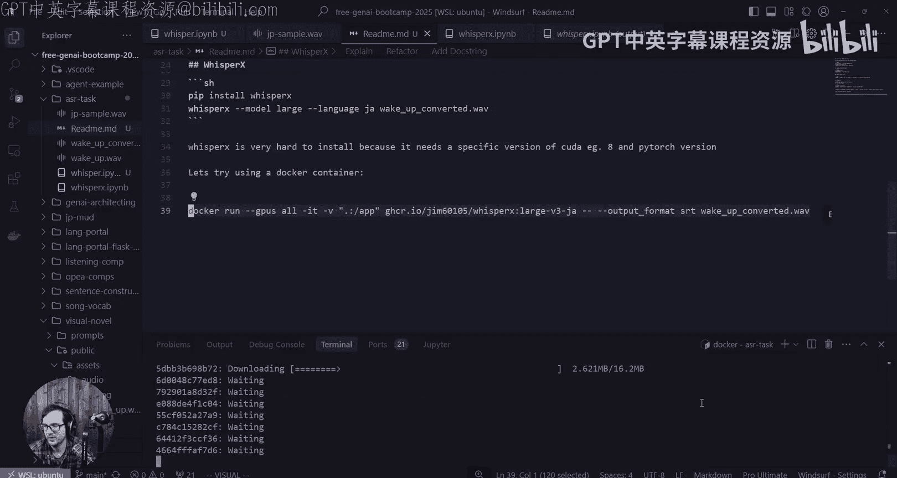

We need to monitor。Uage here。Okay。So I don't know what's going to happen here。But right now。

 if I'm using up half my memory。Which I am。But it says I have 64。

 And so if it only needs like 10 or whatever， it seems like I should have a lot of memory， right。

But we will let this download， and it's going to run as well， so。5 gig G。 That's large。 Yeah。

 I'll be here for a bit。 So I'm just gonna pause。 I'll be back in a bit。Alright。

 so we're pretty close having this thing down it obviously，5 gig thanks。Quite a bit of time， but。

Once it's done， it's going to try to run。And we want to monitor our resources here。

See what's going to happen here。And it is now its just extracting it。 Okay， so now it's downloading。

 it's just extracting the results here。And I wonder if to get this to work。

 I'll really have to stop recording to find out here。 But I guess we'll find out when this runs。

I just hope it doesn't exhaust my resources。 I'm gonna stop the video here before it runs and then and start again just so I can see what's going on。

 okay。

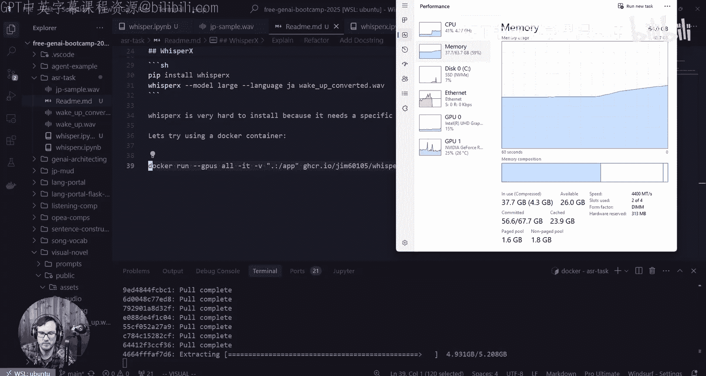