# ExamPro《生成式AI训练营｜Free GenAI Bootcamp》中英字幕（deepseek - P76：-76-WhisperX Word by Word Transcription Part2.zh_en - GPT中英字幕课程资源 - BV1SFEWzLEab

All right， we are back。 I just didn't know if I would lose my video。

 so I just wanted to make sure that I stopped it before it ran。

And here we can see that it's attempting to run。And it read， okay。

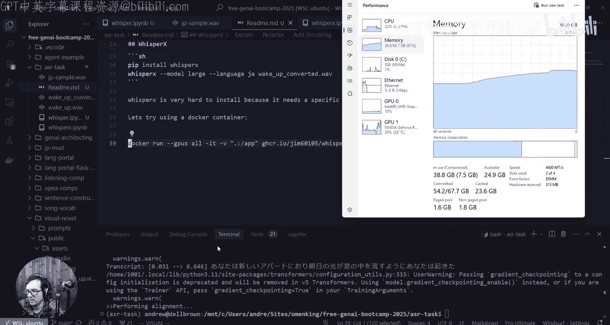

Did it work， I don't know。 So we'll go here， and we actually are getting a transcript back。

It ran really fast。嗯。It's still giving us the error， like not errors。

 but the questionable stuff that I had。But it did come back with a transcription。Which is fine。

 But I need the word by word information rendered against see what happens。Okay。

We do get spikes in GPU， so it definitely is using the GPU。Right。

 memory is definitely a little bit higher here。 not a ton higher， but it's definitely higher。

And here we say。We see our output。Does it output it in any particular place。No。I don't think it does。

Oh， we have S RRT right here。Okay， so I， I think I created this files。 go ahead and delete that。

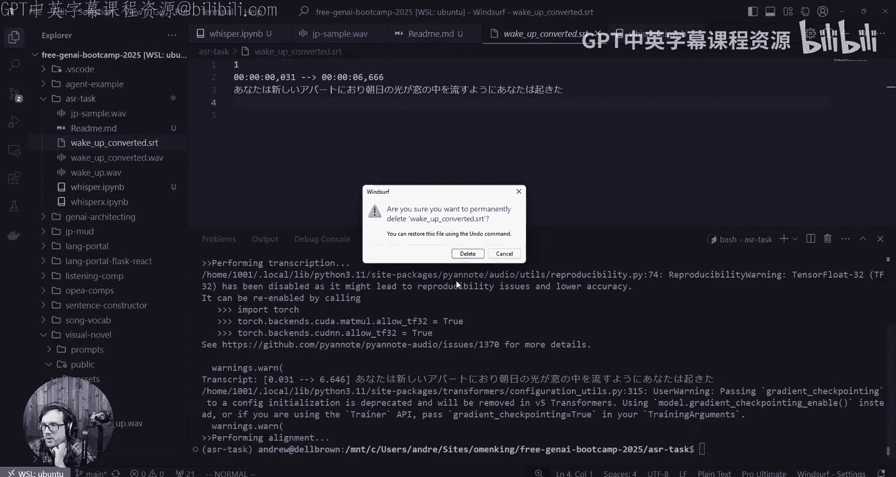

And we'll run that again。 But the only thing is like， oh， it says output format， S RRT。Okay。

 so let's go back over to here and let's take a look at what other outputs we have。Output for about。

Well， what other formats do we have？Because I don't need an SRT， I need it as Jason， right？嗯。So。

I guess we'd have to look at the code to figure it out here。Format。Be nice to know。

What other formats it takes， I mean， if it's just passing these options to whisper X。

 let's go back over here。 Maybe that's the underlying format， right。Of whisperax， I don't know。

Does this have docks anywhere， I don't see docks。So this is what I don't know， like。

 can we get another format here？

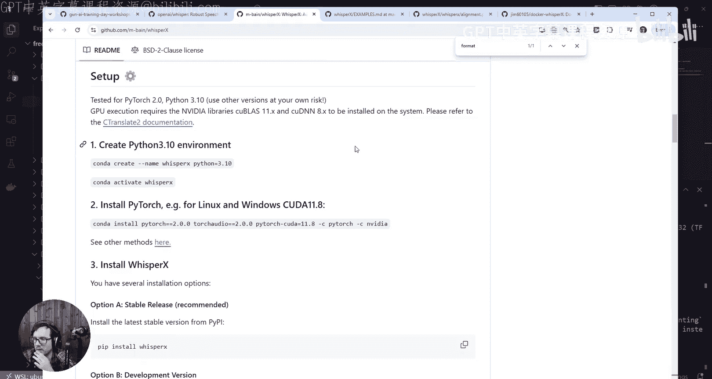

And this one doesn't specify in the output format here。

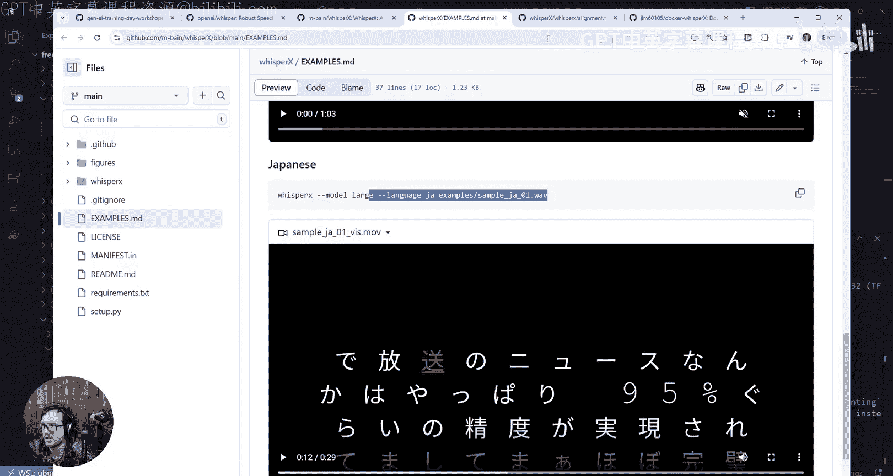

And so I guess we'll just look at the whisperperx code over here and the Docker whisperperex。

I've said periods I can navigate a little bit easier， but clearly， there is something。

We don't know about。 So we'll let this load here。Docker file。Args。

looking through this code here in video。A bunchun of stuff。 A bunch of stuff。A bunch。

 a bunch of stuff in here。 That's for sure。I can't tell if it's passing it directly to it。

You have model language。At sign parentheses。It makes me think that it is passing it straight to whisperax。

So whatever format。It can output。 Yeah， I think it is。 I think it's。Whatever wrist rex will take。

And so now we're in whisperper X。 So my question is like from whisperper X。

 they have examples over here。

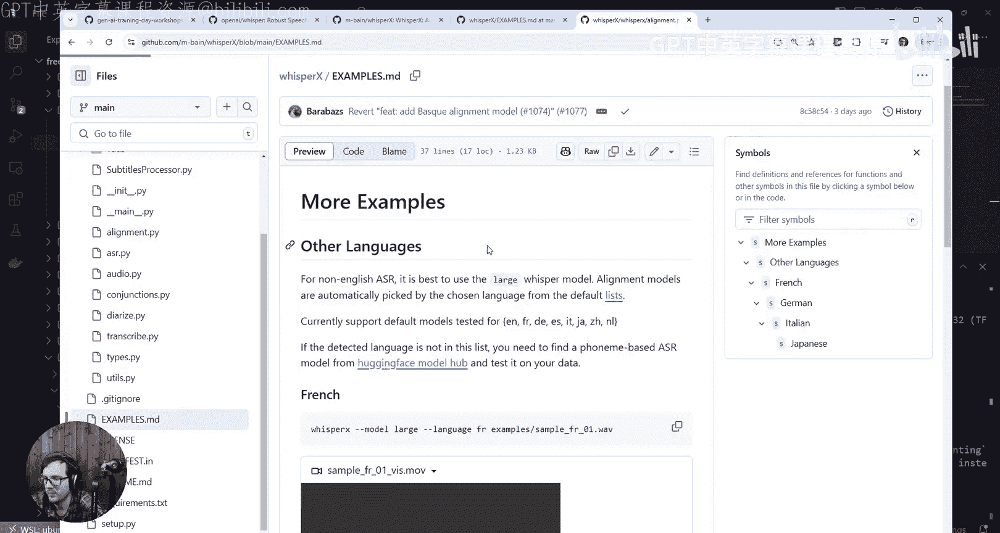

It's not specifying any formats， though。S our。

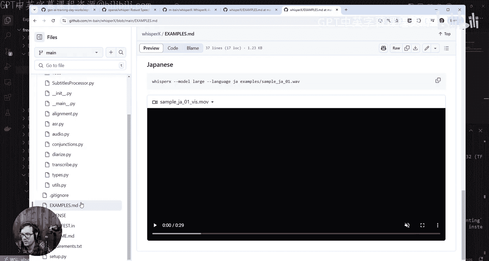

Ittails。I'm looking for format， format， any。Format。Not exactly。Output format， here we go。嗯。嗯。

So here we can see we have T， X，T， VTT， S RT， T S V and Jason。

 So this makes me think that these are the possible outputs。

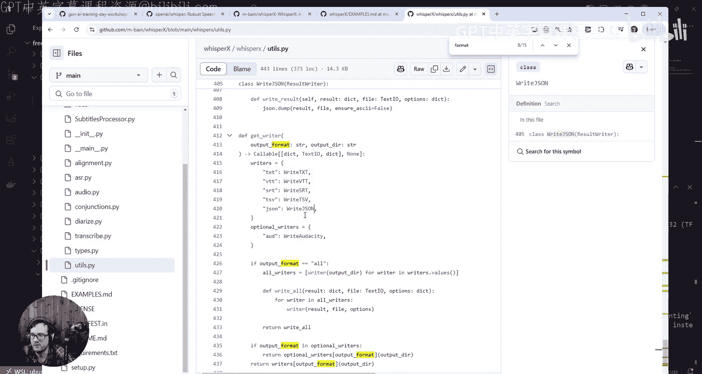

Possible outputs。Right， I'm just open in the code。 That's how we find things， right。

 We just look until we find it。 And so I'm thinking that maybe what I can do。Like SRT is fine。

 but I don't want an SRT。Imagine you're， there's a movie you're watching and you want the S RRT。

 that'd be kind of cool。 I like the idea of a T SV。 But let's go ahead and go Jason。😊，Right。

 so we'll change this over to Jason。And let's go ahead and try this now like this。 Jason。

 let's see if it just takes it。Please give me those time codes。 Please， please， please， please。

 please。I'm not sure what this this part here， maybe it just passes the other outputs there。And。

Here I'm not specifying where that file goes， but I'm going assume we have it。We have start and text。

And we have word。Tah， oh， wait， did it work。 Did it work， Did it work， Did it work， Did it work。

 Did it work， Please， something it worked。Oh yes。Yes， okay， but。

Just because we have that does not mean that it works， so。

What I need to do is I need a way to know that it works by。Representing the text。

So I'm going to make a text spec here。Cause I don't I just need to prototype to know that it works T spec M。

So。Tax back。Business use case。呃。We want to display。 We want to play audio。And show its transcription。

When we play the audio， we want to highlight。The word in the transcription based on the time codes provided in the J file。

Tech files。We have。Wake up converted。And then this one here。 Okay， tech stack。 see what it gives us。

Python whisper X。I mean， we don't need to use whisper X。

 We just need to display it like either as a video or audio。Okay， so use。FFMPg。

To create video with text。And highlight。Text。Okay， so I wonder if we could just do this。

 I just want it to work。So I'm gonna go ahead here， and。

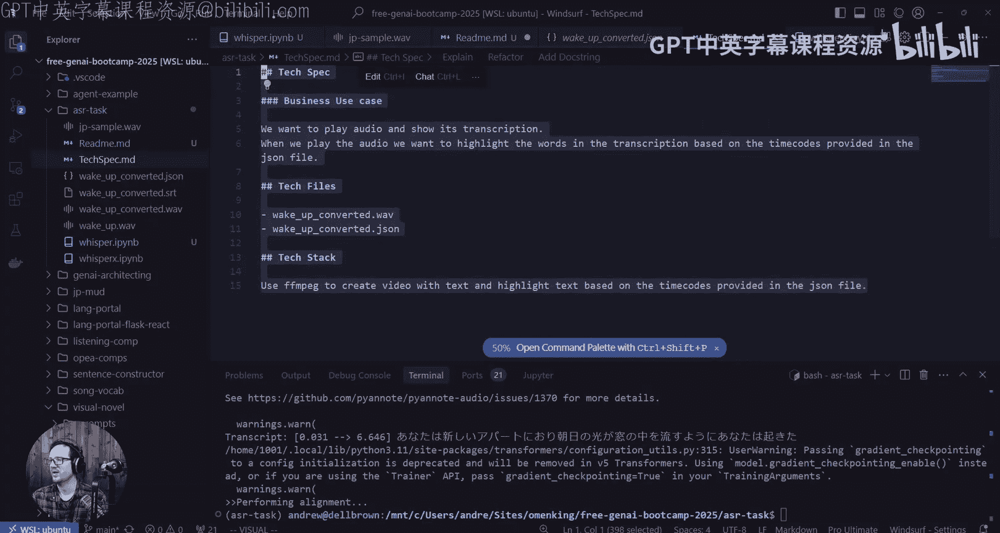

Lettter rip。Okay， so let's， let's implement。this is like karaoke， basically， karaoke text spec。😊。

A Kara， okay， Kara， okay， as， as I'm told that we pronounce it wrong。I mean。

 we pronounce it the way we pronounce it。 But car Kara， okay， Kara， okay。

 would probably be how it's pronouncednoce， Please implement。Please。

 I just want to see that it works。 Obviously， in HTML TL and ja。

 the implementation could be different， especially in phaser。

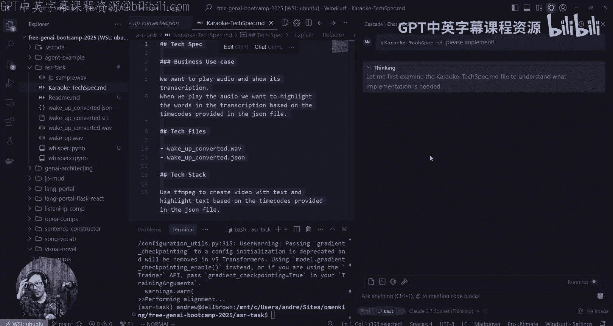

But this would be really exciting。 The only challenge， though， is that it's a breakdown。

These aren't words。These are breakdowns based on characters。 Now， what we could do。Is we could use。

An L M to fix this up， because right now， I was thinking to me like， how would would we fix this。

 becauseuse right now， it's like letter by letter， which is not， which is not what we want。

 Another thing that we could have done is we could just make an H T L page。

 And as it played the the audio it played it back in sync exactly the way。 Let me analyze the task。

 I don't know if I made it too hard by saying F of M peg。Business use case。 Okay， base， okay。

 go here。 So implement a Python script， rejason file time codes， FFM generated video。

 add dynamic text highlighting。 Yeah， exactly right。

 I'm gonna just tell it's like you have right mode， sorry。😊，In this approach。

 I realized there's more direct way to achieve this。 And FFM bake is's an improved version。嗯哼嗯哼狗。I。

 cause I called it karaoke。 now thinks it's karaoke。Oh my God。

 it keeps It keeps trying to make a better implementation。 like， here's one implementation。

 But here's a better one， but here's a better one。 It just like， won't stop。But it be too complex。

It's literally implementing it again and again and again and again and again and again and again。

 just pick away。 If it doesn't another， I' have to stop it here in a second。Final implementation。

 Thank you。 That took forever。So， let's go here。We're going to go here and we'll call this one。Kra。

 okay， it's not karaoke， but I'm gonna call it that because I think it's fun。😊。

And we'll insert it into here。 And so now we have the script。 How do I actually run the script。

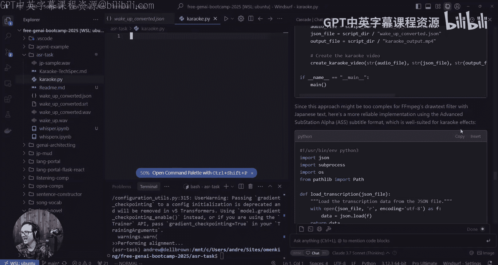

Apparently we just run it on main here， so we'll go ahead here and do Python。

We shouldn't have to install if F M pay。 we already have it。

 Let's go see if there's any required libraries。 Nope， it seems like it's everything that's built in。

嗯。Maybe cool if it just works。And it outputed。Did I open a video。

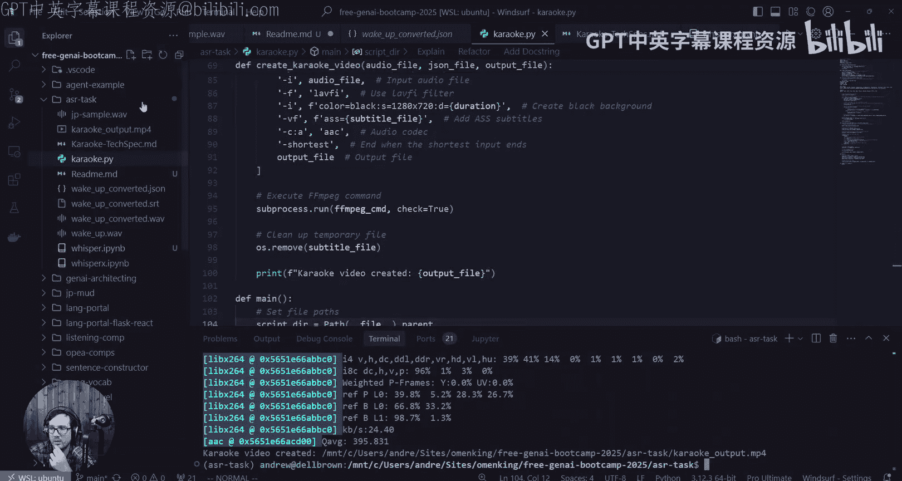

It did。あなたは新しいアパートにより、朝日の光が窓の中を流すように、あなたは起きた。Okay， so。

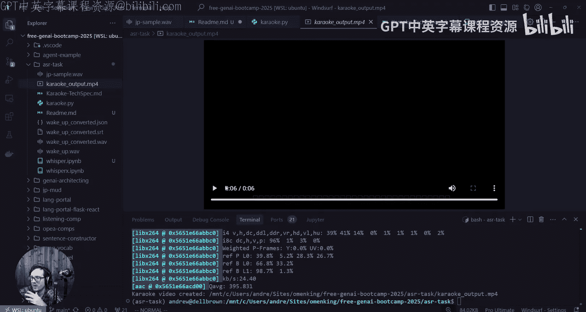

I got to go back here and we'll put it into right mode because it almost worked。

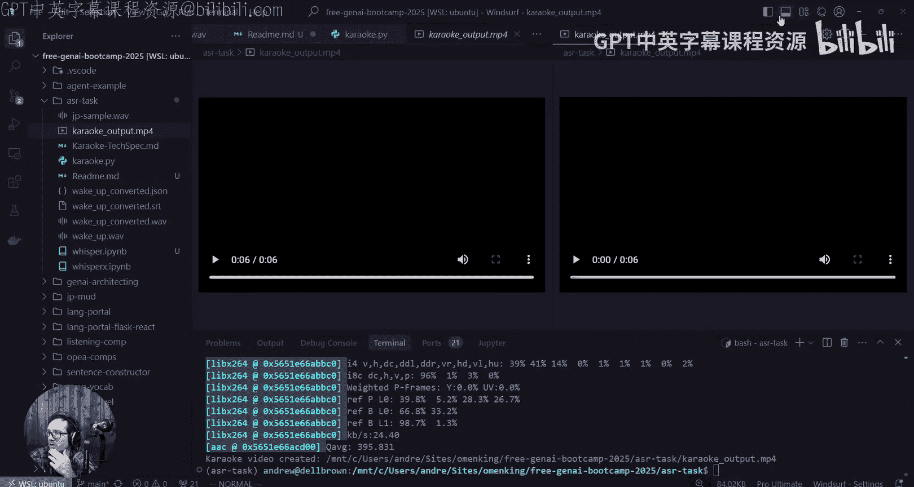

有。It appears to be working， but the characters are boxes。So I think， maybe a。

Encoding problem or the font problem。RightBecause it almost worked。But you know what that means like。

 I could make a a karaoke track or cut it。 Okay for the actual boot camp。 That'd be really funny。

 This is the font issue。 We're using the default a to doesn't support it。 Oh， O。

 it was really that simple to fix。

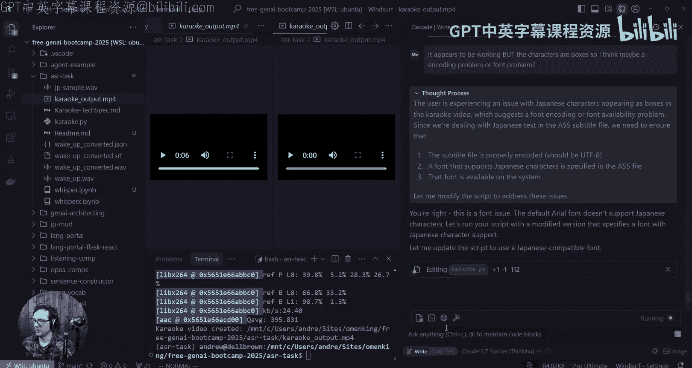

The audio is a little bit loud， so。L for by years it is。🎼And so now here we can run it again。

 I'm just going to delete the output here。 deletelete this。 There we go。

 And we'll go ahead and run this up again。

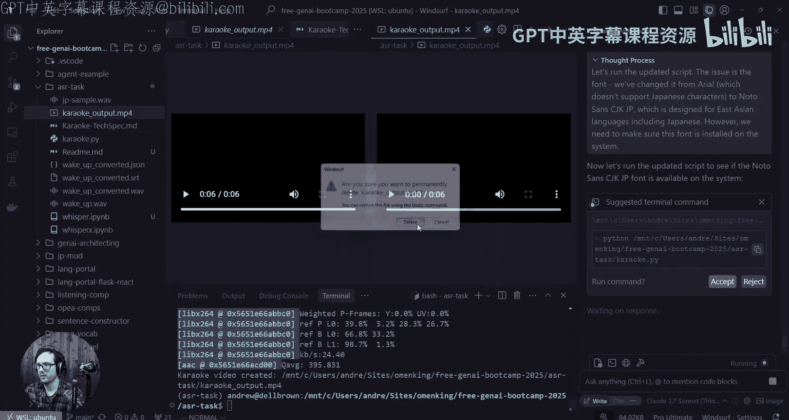

And we will go over， we'll give this a refresh here。あなたは新しいアパートにより、朝日の光が窓の中を流すように、あなたは起きた。

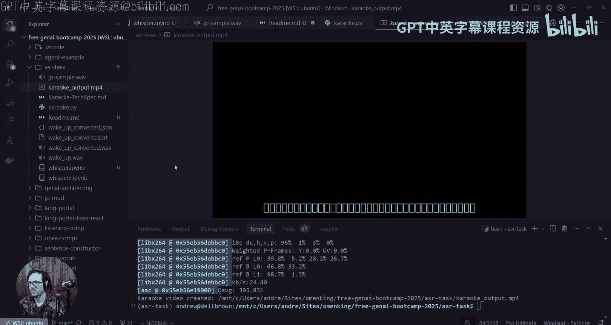

Lookcept the changes here， you know， still having this problem。

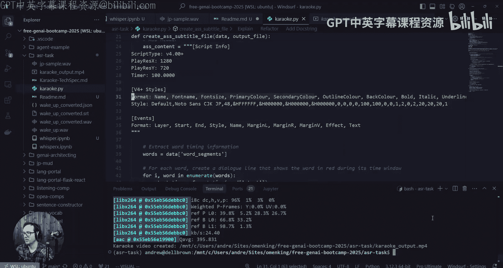

You know。Still having this problem。 I am in WSL 2。 Do I need to load the a font some weird way。

 a font a way。First。Because like， I'm in WSL， how does it know about my fonts。Yeah， yeah。

 There we go。 You yes， you'll need install the fonts。 do I really have to do that first， fine。I yeah。

 okay。 one second。嗯哼。😊，Yeah， Not Sans is， is the Google font that we can use。

 while we'rere working through that。 I'm just gonna make sure I name the recording over here。嗯。Okay。

 so here。We did this。Sure， I'm just gonna run the command。

 I was trying to read what was going to business on the feedback， whatever， whatever。

 I need to fix the the font paths。 Okay， you go do that。It's doinging something。

Now that's updating the carra O， carra O。So that is now accurate。 It's still going here。

 We'll give it a moment here。 Let's run the script and see what happens。 You know。

 I can run it myself。 Thank you very much。We'll go ahead and run this again。

Will far do delete it out here manually？I wish you would cens the text。 but you know。

 first I want to get the results out and then we'll fix that afterwards。 It is putting at the bottom。

 So it's it's totally fine。But I w to go here and， oh， come on。 Let's go up here， maybe。There we go。

 they'll generate it again。And then we'll go back over to here。 We'll give this refresh， sorry。

あなたは新しいアパートにより、朝日の光が窓の中を流すよ。Okay， so it's hard to see。 Can you， can you move the， the font。

Center screen。Because I can't see it because dialogues are covering it。

It looks like there's something there， but I can't。I can't see it， which is frustrating。

So I it move it up。Python karaoke share we'll stop this for a second， Run again。

And I'm not sure if it would overwrite the other one。

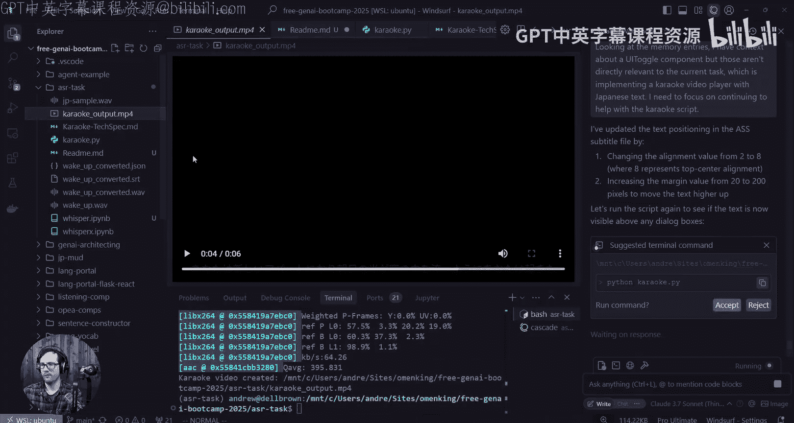

It doesn't look like， Oh， baby did。

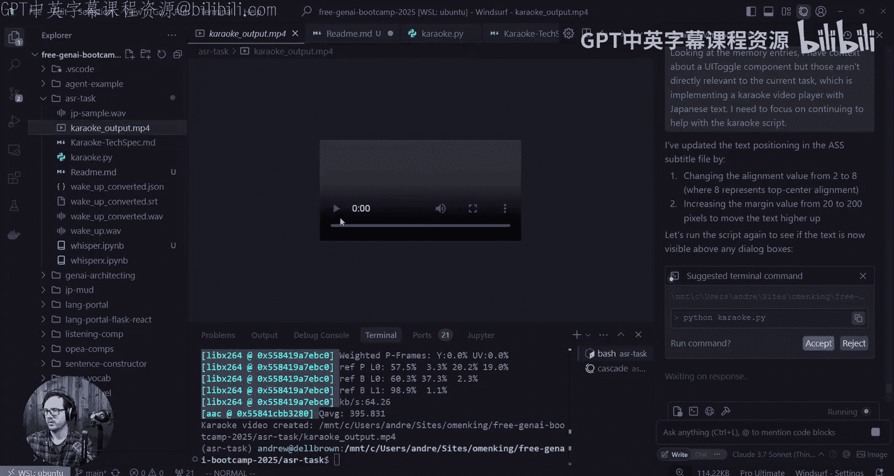

对对。により、朝日の光が窓の中を流すように、あなたは起きた。あなたは新しいアパートにより、朝日の光が窓の中を流すように、あなたは起きた。

あなたは新しいアパートにより、朝日の光が窓の中を流すように、あなたは起きた。See the， the reason it's weird is because here Anata is a single word。

 right？ Anaたは新しいアパートにより。 So this is where we want to adjust it。And so I would go here and。呃。Right。

 like we'll stop this here。 that worked out great so。Wake up， converted。To say file。Wake up。

Converted has character。By character breakdown。However。We want it word。Word by word。For Japanese。

Can you make a new J file and fix it so it selects word by word。You just need to。

Merge characters together to make their words。 I hope it understands what I'm trying to say here， so。

I hope it makes a new file on place。 so here's when merges J into individual words。

 looking at the current J structure， and so we'll go ahead and let it do that。

Gringing a Python script。 Should it make a Python script to do that， I， I don't think。

 I don't think you should make。A Python script。Just fix it， okay。I don't trust that that will work。

Because unless it knows what all the words are， and it's not going to know it。

That's gonna to be an issue。 There could be like another app that we could use to break down this into a proper sentence。

I mean， I guess the other thing is that we could just。Well， we could create a script， I guess。

But I was just hoping that it would do it here。 And I would worry about that later。 Wake up words。

 Jason。So， here。啊。I'm just making sure it still follows the same format。 It looks like it does， yeah。

So anwarahiアtoに。玻ly。😔，其实其实。I say know three大 model no哪个哦。Whatever that word is， Yoi Anatta O Okita。

 Okay， great。 So now we can run this again。 It says， let's run it again。

🎼And it updated the script here， too， as well。 So we'll go ahead and do this。 I mean。

 there's a little bit more work that we'd have to do to automate it。 But obviously。

 we're just doing this to generate out a video file， which is really cool that we can easily do that。

😊，We cancel here for a second？And。あなたは新しいアパートにより、朝日の光が窓の中を流すように、あなたは起きた。

ナイそ did gotあなたは新しいアパートによりあなたは新しいアパートにより、あなたは新しいア。Cause I'm going here and it doesn't look like it's exact。

 Likeあなたは新しいアパートにより朝日の光が窓の中を流 I can't tell it's because I'm watching it here in the player。

 I'm gonna make sure I open this in。😊。

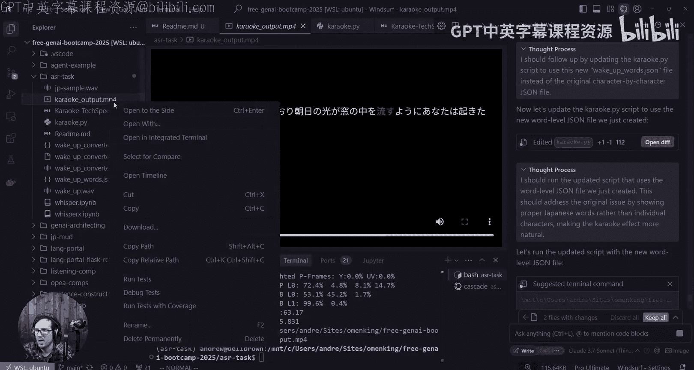

My direct editor here because I don't always trust it， so we'll go over to here。

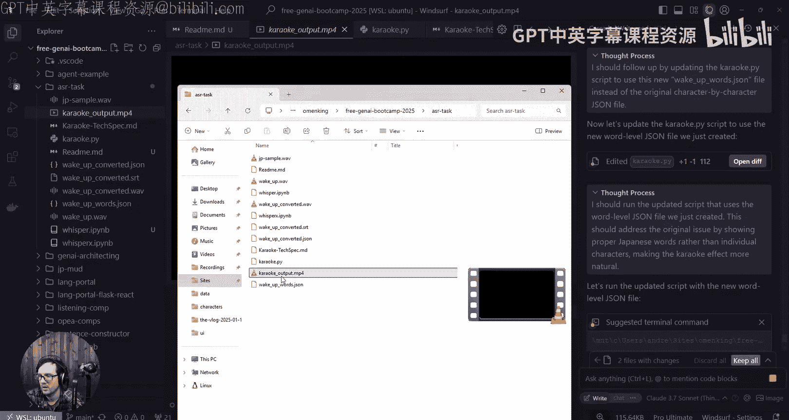

オーでは新しいアパートにより、朝日の光が窓の中を流すように、あなたは起きた。あなたはしいアパートにより、あなたは新しいアートあなたは新しいアパートにあなた。办案。新しいアパートトにより。

朝1均の光が窓の中を流すように、あなたは起きた。It's pretty good。 I would say just like there's a little few parts where it's notあなたは新しいアパートによあなたは。

Cause like this， there's a bit of a delay。新しいアパートにより朝日の光が窓の中を流すようにあなたは起きた。 but it's pretty close。

 but the first few words， I don't know why， but the rest of it is totally fine。

 And so that's pretty cool。😊。

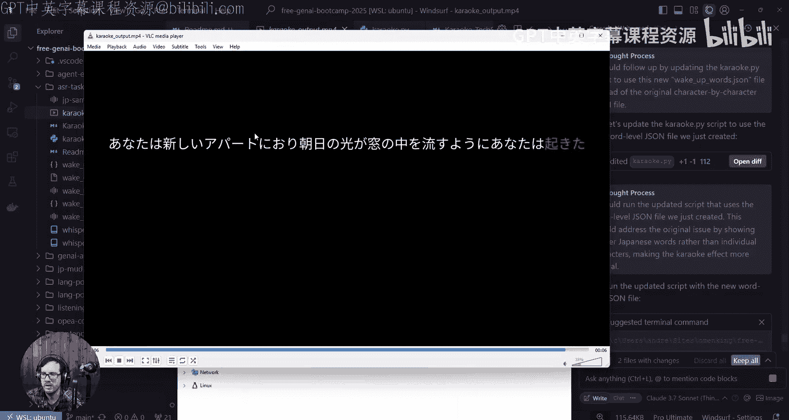

So， yeah， we did it。 Could we use this to。Well， we do have the audio for the。For the boot camp song。

 I'm really tempted to give it a try here。 Let me think about it for a second。Could we convert it。

 is it in the proper format， I don't know。But the other issue is that we're choosing the Japanese model。

 So we'd have to choose one that is specifically for English and then have it produce the lyrics。

 So maybe that is a challenge for some other time。But the point is， is that we achieve this。

 And so that's a big deal。Now。We could use a few other scripts here， too。Help it out， because。

I obviously just said prompted I said do this right。

 but if we had to do this for a bunch of files and I'm building a game right。

 and I have a bunch of files。 I would have to have a little bit of a pipeline to process those like a little agent EarlLL that would take the whisper format and then group them into words。

 but that's not too bad。嗯。So now the next thing is like， how do I implement this in my game。

 as that would be really interesting to do？There's also that video that we have that。

A Hiromi Itto provided。 And it' would be fun to provide the translation。

 which is something that we could possibly do。 That would be a little bit different because we would be transcribing it。

 But the thing is that the words wouldn't match up the same way。 So it wouldn't make sense。

 We wanted to show each word spoken to Japanese。 We could do that。 That would be kind of interesting。

 Let's go ahead and just commit this code here。 So' say successful。😊，Word highlighting。In Japanese。

 I'm really excited about that one that one was a fun one。Okay。🎼And。I mean， you know。

 it wasn't as fun as a solution， but getting it in a container was good enough and I'll see you folks in the next one。

 okay？

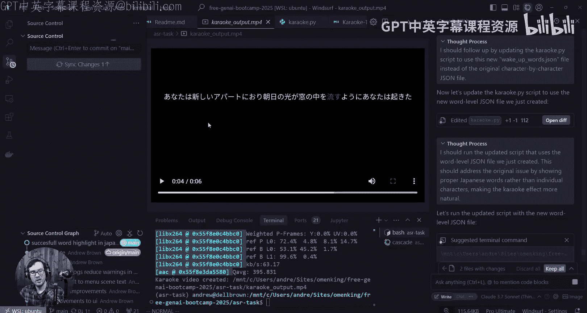