# ExamPro《生成式AI训练营｜Free GenAI Bootcamp》中英字幕（deepseek - P77：-77-WhisperX Match Original Transcription.zh_en - GPT中英字幕课程资源 - BV1SFEWzLEab

Hey， it's Andrew Brown and we are back continuing on learning about things that we can do with LLMs or generativeI specifically the voice in the last video you saw we used whisperhi X and I have this synthetically generated voice from Microsoft Azure AI and so I used it to generate a transcription using whisperhi X。

 we found out that open whisperhis doesn't do word by word。

 we use whisperhi X to find out that it is character by character and then we had to roll up that into the final solution。

 I was just talking to another developer that was asking about okay well this is great and all。

 but imagine that you actually have you are a language school and you want to have this word by word functionality in your application how would you how would it work if you already had your transcriptions like you already have your perfect transcriptions because sometimes these tools that transcribe are not accurate。

Right， they will produce good enough results， but if you've already done the hard work and done that。

 how can you map back that information And so I want to explore and see if there is a way to actually do that and the process that I'm thinking。

 if we go into on the left hand side here， we have ASR task， but if we go into our W X file here。

 I'm just taking a look here， it outputted。

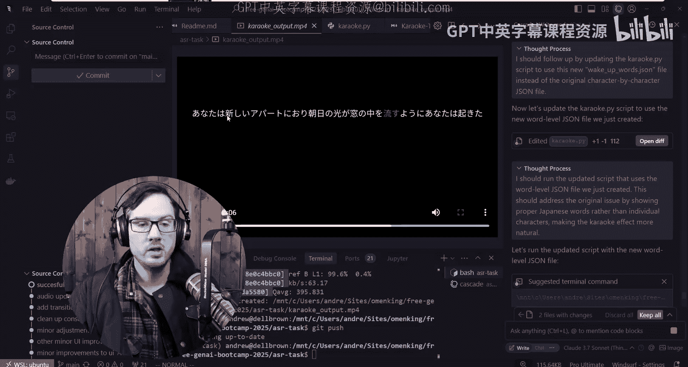

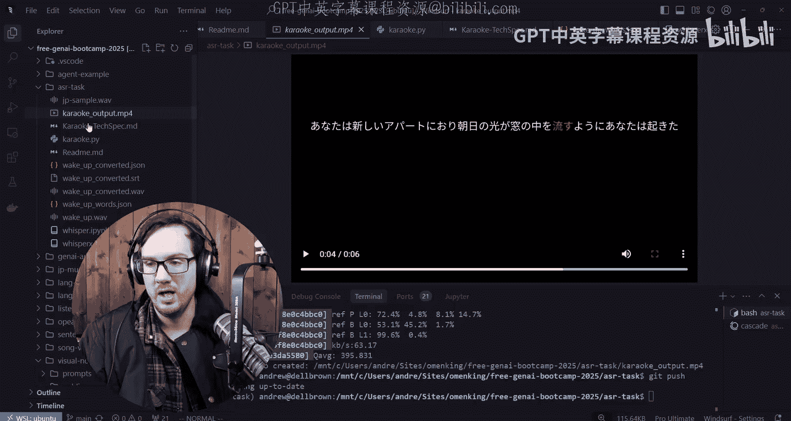

The original file here， which has all the word by word breakdown。

 So here's the sentence that it transcribed and。

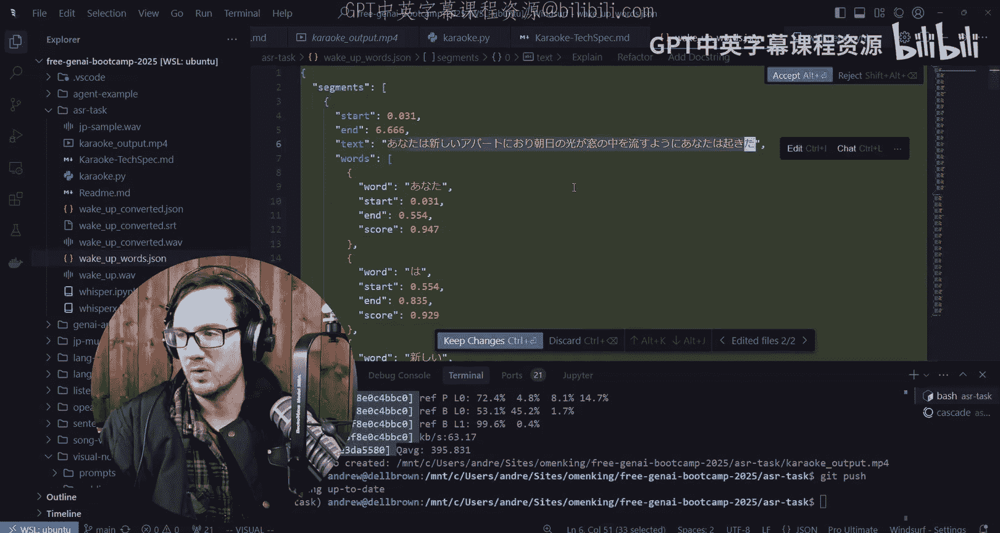

This， I mean， this one has words。 This is our roll up 1， I think actually， this is， our roll up one。

 The original one was。This one， right So this is what the whisper X produce。 each single character。

 And so I'm thinking that if it gets the characters is generally right and you have the transcription。

 an LLM should be able to roll them up because I was able to take this one with an LLM using plot and say。

 hey， go fix this， right？ And so I can't see why I would not be able to do that for something larger。

 if you had the transcription。 Even the characters were different。

 I feel like you could tell it to cross reference it， right。

 So what I want to do is I want to find a video source that we can use that I know has accurate transcriptions。

 So Im gonna to go out to the internet， Just give me a moment here。😊。

Aly have our dev tools open here from before。 but let me go and open up。 You know what。

 I've been really liking this resource。 I've been using something called comprehensible Japanese。

 And I believe they have a YouTube。 And I believe that their their stuff is accurate。

 Anyone who wants to learn Japanese or a language in general。

 I really like this teaching style where they they teach through story immersion。

 So you can literally watch it along。 It's very clear。😊。

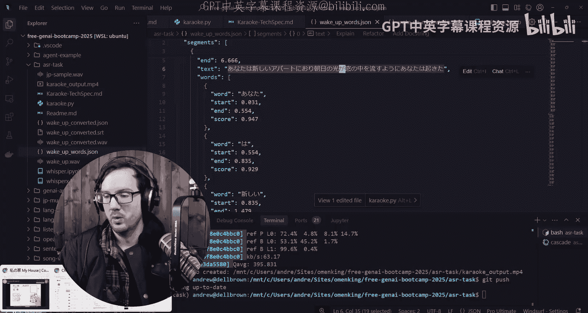

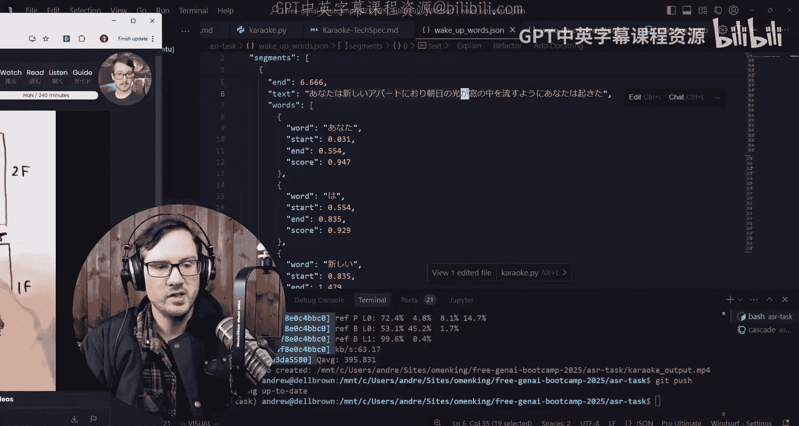

But I believe they have a YouTube。 Let's go down here below to here。

 And I'm just looking for their YouTube here。

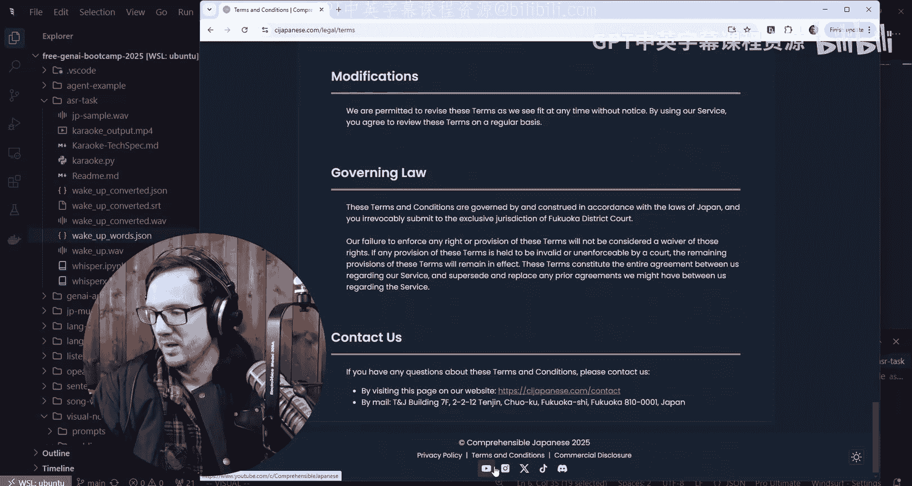

Here it is， okay。And so if we go over to videos here。We have a lot of videos。

 And so I imagine that something that is newer is going to have more accurate transcription。

 So what I'm looking for is a video， because some of these videos have comics in them。😊。

I think that's fine。 I， I kind of want one that's simpler to work through because that I'll be able to check it myself。

I really like these game ones。 These game ones are fun。

 But I'm seeing are there any whiteboarding ones。 I feel like all the whiteboarding ones are behind us。

 So I actually gonna go up to here。 I'm able just take the latest video， which is one day。

 So learn Japanese with a comic father and son。 So I'm gonna go ahead。😊，Yeah。

 there's a lot of learned Japanese resources， but I'm going to go ahead。Right。

And I'm just going to preview this for a second and tell you tell you if I think this is a good source that we can use。

Yeah， it sounds really， really good。 So I think what I will do is I will use this source here。

 And I believe that it already has transcripts。 So we go over to here。 Where is it here。

 And we go to our。Here， we have Japanese English and Japanese。 So we go here。

 and you can see that they have the source ones。 So I know that they've imported these ones because you have auto generated。

 which we don't want。 But we want the Japanese original transcription。

 And so the transcription we go down here is right here。 We go here。

 And here is the entire transcription。 Now， there is that tool that Duan showed us that can pull the transcription and one go。

 So we can utilize that。 And maybe I will do that to pull the transcription。

 But what I'm going do is I'm gonna to make a new folder。 I want to just test this business use case。

 And we'll call this one comprehensible comprehensible Japanese。What's the initialism， I C I J， okay。

And I'm going to make a new readme file here just so that we can make a context here。

I'm gonna bring in this video in particular。 And so we'll say C I J。

 let's talk about the business use case。 So what is the business use case we want。

 So given there is a， or like a language。A language learning port， La learning portal has videos。

 they。I have videos。That provide the transcription。When a user watches the video on the language。

 the learning portal。The user would like to see the words highlighted。As the video is played。

 So that is the use case that we're trying to do。 The other thing is like considerations。

 considerations。So the considerations is this school has already provided。Accurate transcriptions。

 So if we use。A transcription service， E G， open whisper。To produce transcriptions。

We would need to compare those transcriptions with the provided transcriptions or replace them with the accurate one。

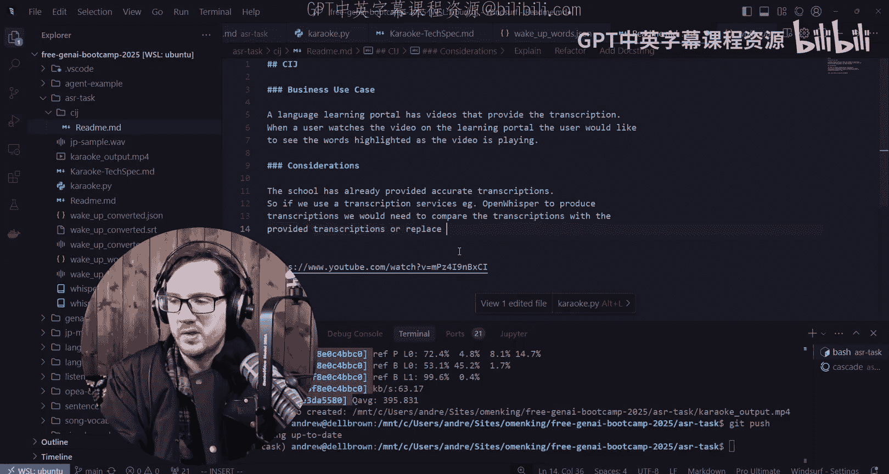

And leaving us with the word by word time codes， right。

 And actually is whisper X that we're going to use because we know this。

 So here's the source video that I want to use。 So the thing is， we need to poll。The transcripts。

 And there is a tool out there that Duan showed us。 I' try to remember what week we did it in。Yeah。

 because。And we definitely used it。 Give me a second to think about it。 You know what。

 I really can't remember。 And we could ask windsurf。

 But I'm gonna tell you right now that I actually ran out the first time I've actually ran out of usage。

 which is really interesting， because I've never ran out of windsurf before。

 But I'm gonna go over to Claude as I do pay for Claude and chat and everything。

 I'm just gonna ask it like， can you give me a Python。😊，The Python library。That runs in the terminal。

 which will pull transcripts from a target。YouTe page。

And I' got to go set myself as away cause I'm getting dinged here。 coming back over to here。

 You can see it's writing a bunch of stuff。 This， this is what Duwana was using。

 So he was using YouTube transcript API。 I thought that it was easier than that。 Like we could just。

 let's go click here。 Yeah， So this is the easiest usage that we can utilize it。

 So I'm gonna go over here。 I'm gonna go add it to our read me here。 So we'll say。

 poll transcriptions。😊。

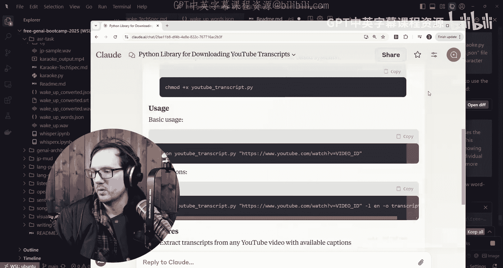

Now， the transcript， like if you are in the， the platform for CIA IJ。

 you can actually download the transcriptions there。 There's no cost to it。 And obviously。

 the transcriptions are available on YouTube。 I'm focusing on videos that are on YouTube because they have private videos and public videos。

 I don't want to。Try to touch any their private videos because， of course， I want them to make money。

 just like I make free content for tech education。 I want folks that， you know。

 do the same are also going to。Be able to do well here。 So we'll go ahead。

 I'm gonna go and do our Pip install here。And then here we want to pull the video。

So this is my source video that I want to pull。Okay。so will婆。Transcriptions。

 we be could probably use that other tool that I use， but I didn't， which is fine。

 And we'll pull the audio。 This way， we'll use。Not at theMPg。 We're going to utilize。 was it YL。Yeah。

 there it is Y YLD， whatever。 And this will dump it as a wave。

 We want it as a wave because wave is the format that we found out worked really well。

 We might also want to be very specific in terms of the audio format we want。

 because when you are using AsR， it has to be wave and you wanted to be a highqu quality wave。

 even if if it wasn't originally that， we want to convert that over。

 So you know if if the folks the developer over CIAj is watching， you know， you want to pull。

 you want to utilize the highest audio source quality you have and specifically in wave so that you get accurate results。

 If you try to do transcriptions with an MP3 or something with a lower whatever you call it。

 you're not going to get as good as results。 But you know if you have your original transcriptions。

 it's not going really matter as much because it's going to overdo that， this one brought in。

 I didn't ask for it to do that， but it brought it in anyway。

 And so here we have the transcriptions that it should pull and this one here。

 I going to look up exactly the format of the。

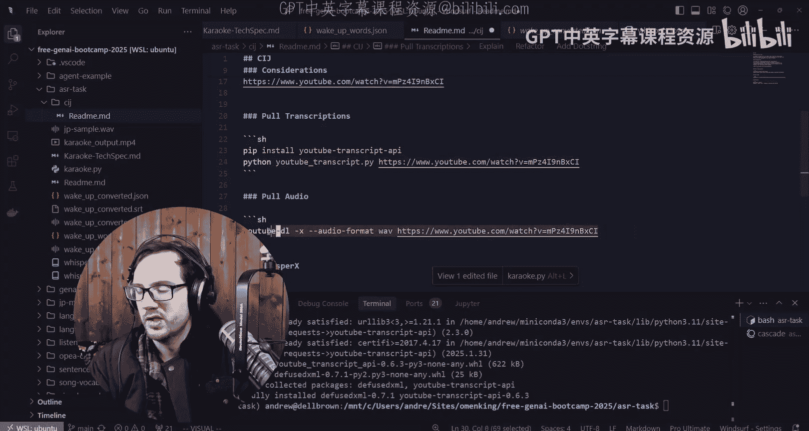

The thing that we want。 I remember I saved it summer here。呃。Oh， maybe it's the same。 Dont know。

 This one。 Yeah， it's over here。 So what we want。Yeah， is this。So，2400。Here， can we。

 I have to specify， like， make it 2400。2400， I'm not sure what it's called。

 I'm gonna to go because of my original source file， which is called JP sample。

 This one here is the right format of what I want。And I just w to know exactly what it is that I need this。

 I had so much trouble。 People didn't see， but I had so much trouble figuring out what the correct audio format to get good results were。

 And now that I have it， I just try to go back to this as much as I can and stick to that implementation。

 By the way， I'm gonna make my head a little bit smaller。 I realize I'm in the way here。

 So I'll go make myself nice and small as per usual。 And we're gonna go into。

 I'm just doing this off screen here。 But we're gonna go into free Gen free Gen I， AR， whatever。

 And then now that I'm in this folder。 I want to open up my JP sample， wherever this is。 Here it is。

 We'll right click it， show more options， properties。 And it is in。It is in。U。Details。

 so what am I looking for， This is a 70，68 kbit。 It's this information here。

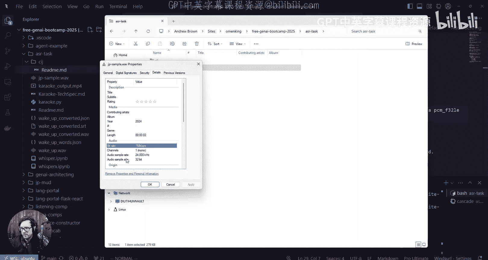

Right， so I want to extract that。 Oh。 can I just copy paste it out， That'd be a lot easier for me。

 I could do that。Can we do that。Nope， so I have to write it out。 So what's the bit rate we want。

 We want bit rate to be 7，6，8 kB。 we want。The audio sample rate。To be 24。0，0，0。Kay。H Z， we want the。

Audio sample size。To be 32 Bs。And then we also want the audio。Yeah， I'll say channels one mono。Okay。

 I don't know if it matters if it's stereo， but let's just make it really simple。

 So now that I have this， I'm gonna copy this over here， and I'm gonna go back to Claude。I。

 I you normally we use windsurf， but I'm out of windsurf surprisingly。 And I don't trust the。

 the interior chat there。 Sometimes it messes up。 So can you。I need these audio settings。

Can this be specified。In the， I don't。 what is YouTube D， L， That's not right。 It's called Y L。Dt。

There it is。 wild DTP。So。To download the audio。As a wave from YouTube。And convert it。Using this tool。

I'm not sure why I did YouTube D， L。 I mean， that might be another tool， but I don't know what it is。

And let's see if we can do it。

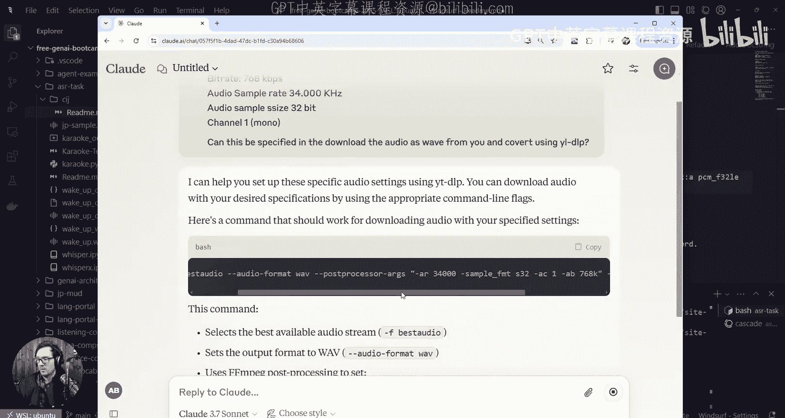

I mean， it's probably using FFM peg underneath。 So if you don't have FF M peg。

 this thing might not work。 FF M peg is really easy to install pseudoo and solve F F M peg。

 But we'll go over to here。Okay。And so， now。Yeah， we can see we'll put that in there。 And so this。

I'd rather keep it the same， I suppose， the same name of the file。That makes it a little bit easier。

嗯。😊，🎼I guess we just hard code it。 Let's go over here。 hard code that name。

 I'm just gonna click through to this。 What's the video call。

This is learn Japanese father and son The comics， so I'll just say。Comic learn。Comic。Learn。

 there we go。 And so that's going get us that there。 I do believe this one is correct。

 So this is less of an issue。Yeah， comic layer and Json， if we can do that， that'd be really nice。

 I'm not sure if it comes out as Json。 I don't really want it as Json。 I just want it as a text。

 But if it works， it works， I guess。And I don't think that's right。 That's not。

 That's not how we use。 Let's go back over to wherever we were just a moment ago。

So I believe Claude had an example for us。Really， I， I feel like there is a way to use this from。

The CI， maybe I could just use it to pull transcripts。Cause I， if I can just use one tool。

 my life's gonna be a lot easier。 Sorry， do on。Okay， now what if I wanted。To pull transcripts。

Could I use the same CI tool。I think I can。Okay skip to download， give us a up。

 We have different formats。I just want text。Can it just do rawex。

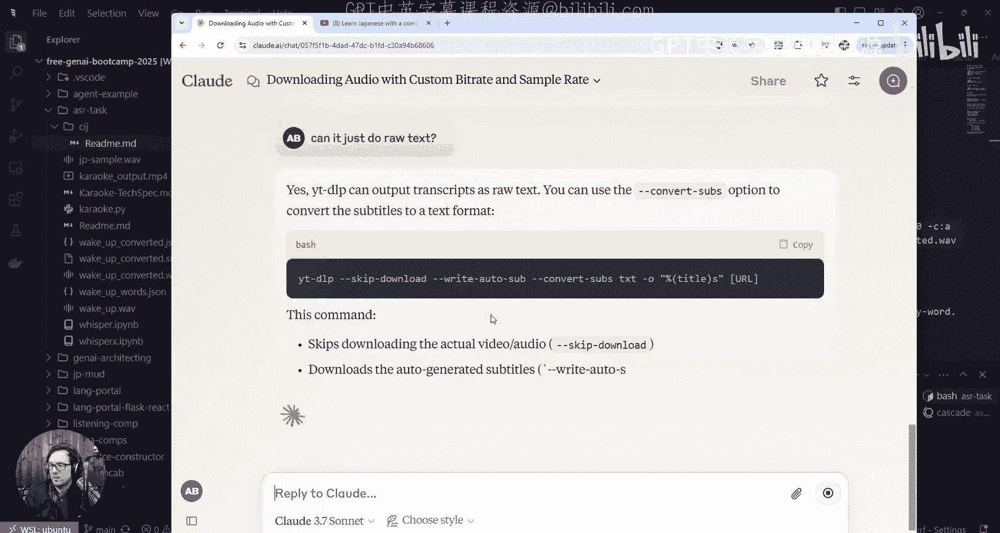

There we go。 Okay， so that's what I want。 We'll go back over to here。

I'm going to pull the transcripts。With this。I'll let it replace that， which is really nice。

 And then hopefully that just works， right， So you need to have wild， wild D TDP。

 I think it's just a Pip install。😊，So right， you know， this would be， you know， Pip install， Y T。DLP。

I'm pretty sure I already have it installed。 if I don't。

 We'll run it againcause I'm always changing my， Oh yeah， I'm in the AR environment。

 So it probably isn't installed。 We'll go ahead and do that。

I already have FFMP installed the machine， but that would be a pseudo snapap FFMPg or pseudo app get installed whatever。

 whatever you using you can look up。 That's pretty easy。So now that we have this。

 I want to see if we can download this。 I'm gonna go into the C I J folder。

 I just want this to output into the current directory。 So things are a little bit easier。

 I'm gonna go ahead and try this far see if it actually dumps it。So here it says this。

 So it seems like a clod lied to me。

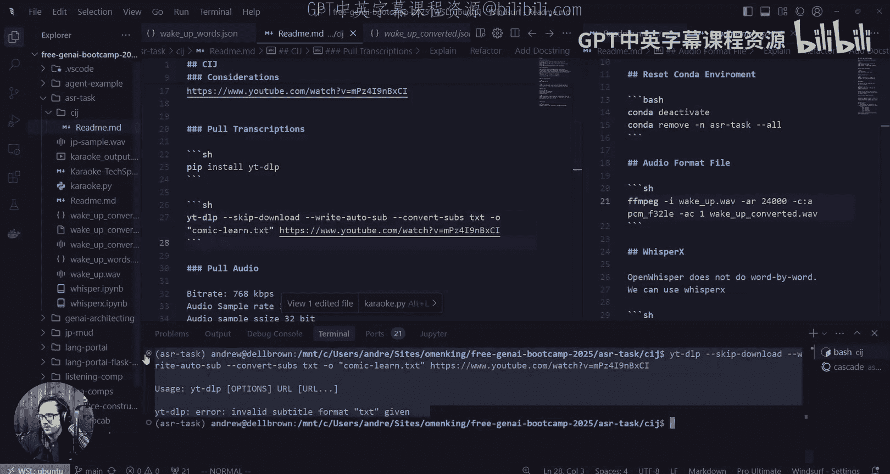

They don't care， but。Mhmm。

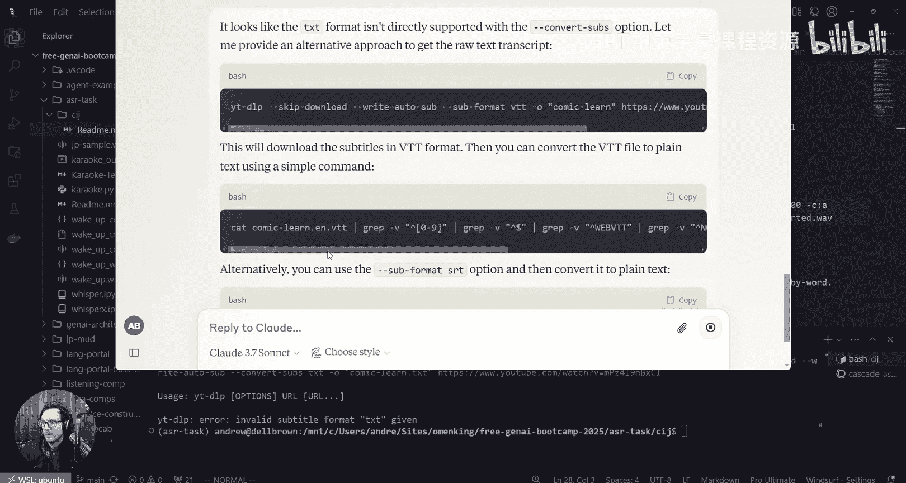

I don't want V T T format。

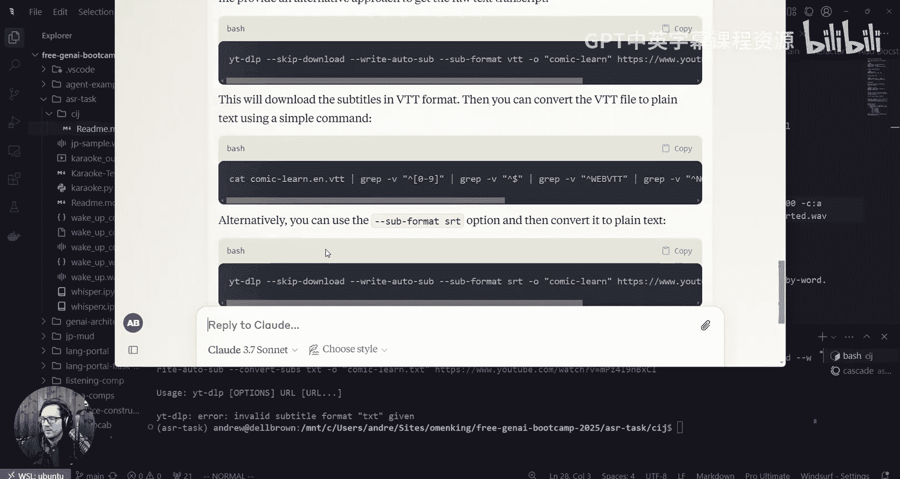

I guess I could do sub format， I suppose we could also just look up the tool。Y LDt。GHub here。

And we'll go here。 We'll take a look and see what we can， actually。Pull。

 so I know some of there's transcripts。Transcripts， subtitles。Subtitle options here。Write subs。

 list subs sub format。Acccess preference。Okay， so it seems like we're going to have to do SRT。

To download， we obviously want Japanese。

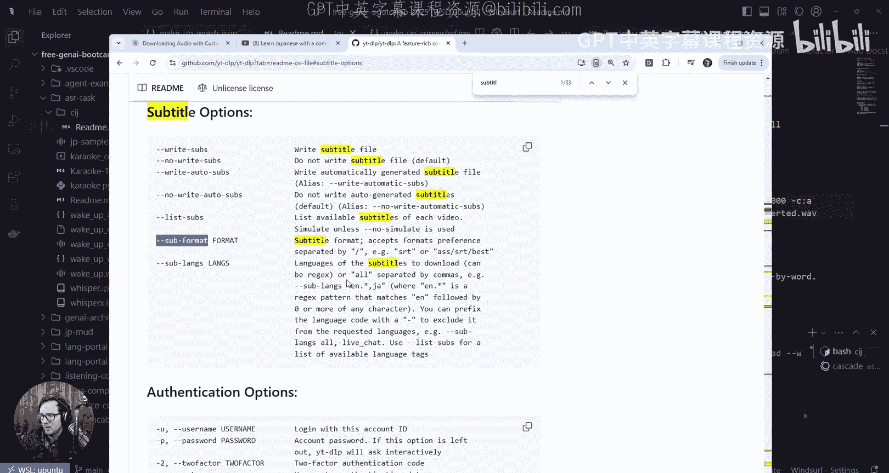

U。So since I don't trust。That converts subs。嗯。

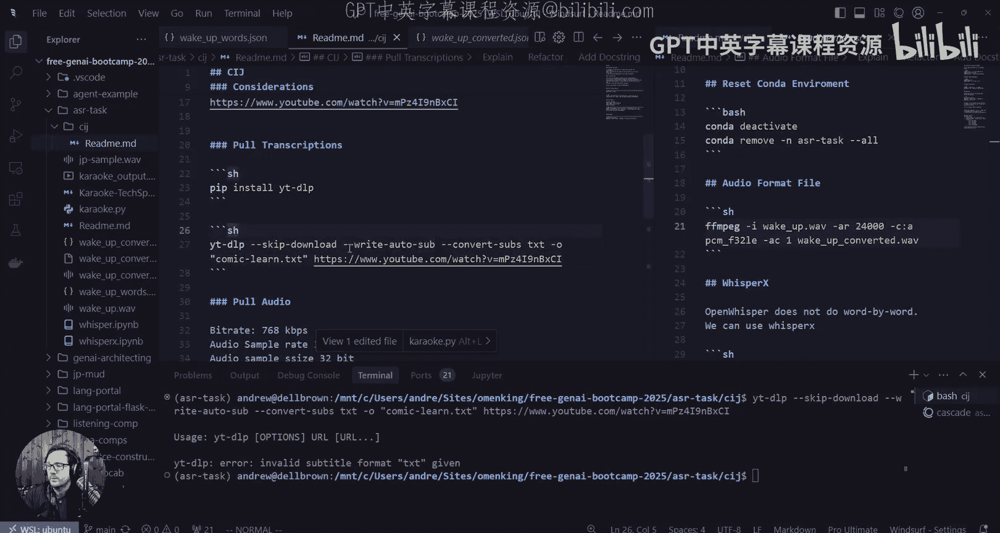

we have right automatically generated subtitle file。Okay， do not write auto generate subtitle file。

 Okay， that's fine。Right， automatically actually generate subtle file。 That's right。

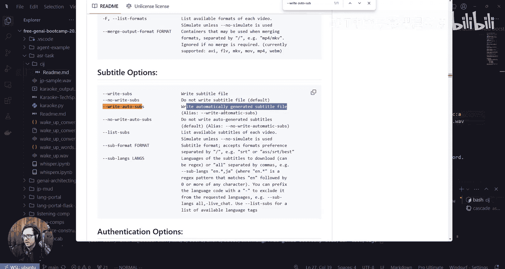

L sub sub format。 There's no， there's no option that says like。Sub， convert subs。

So we'll just go here。 See， it's making things up。 So So it's format。 and we're gonna to say S RRT。嗯。

So we have that。 and it did have another line where we could format it out。

 We'll go ahead and we'll try to run this here。See if this works。Seems like it is downloading them。

 Good。 Let's go take a look here。 The only thing is we didn't specify which language。

 So that because it's there。 It doesn't mean it's gonna pull the correct one。

 We'll give us a nice refresh here。 We have it。 And it's in English。 So that's not what I want。

 I want it in Japanese， And there's Japanese。 There's variance。

 There's Japanese with auto generated and not。 So we should really list the subs first before we do anything else。

 because if we don't。 we might end up something with what we don't want。 So we'll go here。

 say Y T D LP list subs。 And we're gonna put this in here。

 And we'll get a list of what subtitles we actually have before we go ahead and do anything else。

 right， So we'll go aheadops。😊。

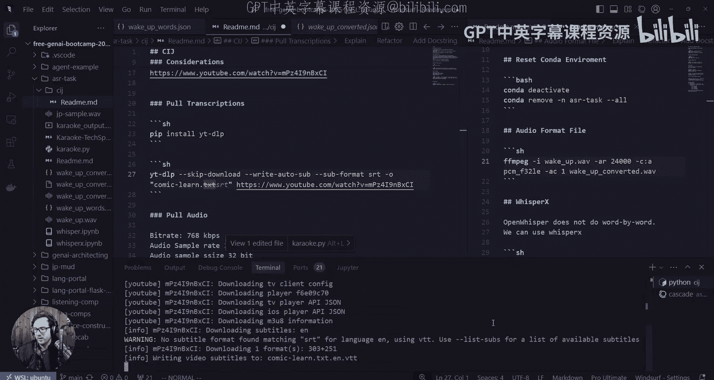

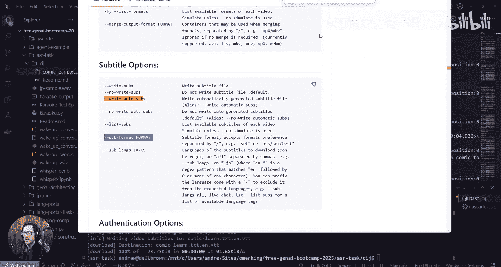

And。Yeah， should it do this like that。 Why， and we'll try this here。

 and we'll see if it I should lists them out。And now we can see what formats we have。Right。

 so we have a bunch， but I want Japanese original。 So see， it says Japanese original。

 That's actually what I want。 So we go over to here and we will specify。That there。

 So the flag here is subls。 This。 So either are showing me here。 It's this， right， sublngs， whatever。

 apparently， we can download more than just the， the Japanese。

 But I just want the Japanese original here so that we know for certain。

 what it is that we have here So we have this sample format。We're over here， Right。

 So we've updated this。 And so now we can grab the original。 I'm gonna go delete this one out。

 This one's completely useless to me。And we'll go ahead。And we'll type in clear here。

 and we'll hit enter。You needed a password。 Why do we need a password。

 type an account password and press enter， So I'll just try that again one second here。

So can we not download it because it's password protected。 That'd be really interesting。

YeahI'm not sure why we give us assets for password。Enter password and press enter。Fixed output name。

 but more than one file to download。嗯。Why would ask for password。

 That's the first time I've ever seen that。 So maybe there's an issue。 So we got hear， maybe like。

Can't pull original Japanese audio without a password。Why， I don't know。

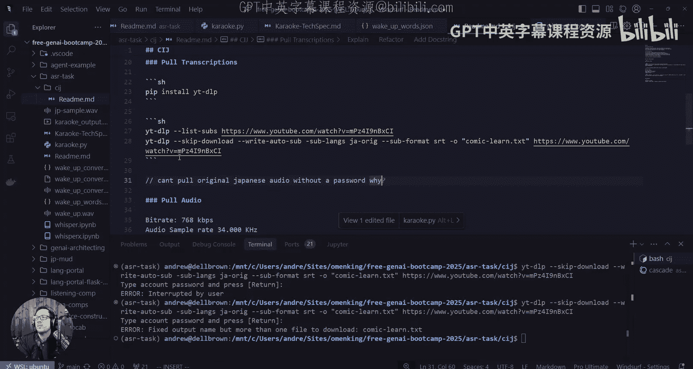

Oh， hold on。 This is right auto subs Here it says。Write automatically generate subtitle files。

 Do not write。I actually don't want auto。 No write ups。 do not write subtitle file。 That seems fine。

 Do not write。Do not write auto sub filele。 So what if I go ahead and try to take this one out here just before we continue on here。

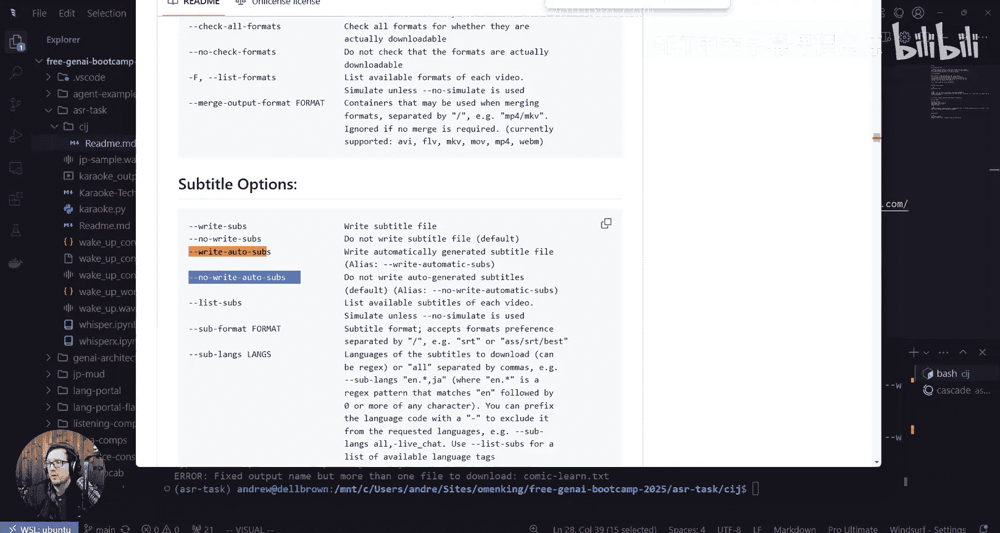

It's not a big deal。 We can still pull it another way， but I was hoping that I could automate that。I。

 I just want them in， in the raw format。 I can get them from the site。

 but I'm just gonna show this way。 Yes， asking me for a password。 So that's fine。 So can't pull。😊。

Without a password， why I'm prompted。I don't know。What。What password it could be？I don't know。

 So that's fine。 It almost feels like it's trying to。Like write it too， as opposed to download it。

 So I'm not really sure because I've never used the subtles for this。

 I'm not really sure what's going on here， but I don't。 Well， we did download the other one。

 so I can't say that it didn't actually do that。But it that's not going to cause us any problems for this。

 this specific test， right， So we'll go over to here。 we want to automate。 That might be a problem。

 but it's not a problem because I'm not trying to automate it on mass right now。

 I'm just trying to test whether my theory of using LMs will work。

 So I'm gonna go back over to transcripts。So here we go more， and we go to show transcripts。And so。

 this is Japanese。Yes， so this is the 1 I want。So， we can go。This is， this is one way of doing it。

 We can go and go all the way down here and grab all the subtles。

 So that is one way that we can grab it。 I'm gonna go back over here。

 We'll call this What we call a file that we wanted to call comic learns。 We'll call comic。

Learned do T XT。 We'll go ahead。 We'll paste in the content here。

 And so now we have our subtitle file。I want to strip out all the numbers here so we can do that Matt。

 whoops。This shouldn't be too hard to do。 We'll just do a mass search and replace。

I don't like doing set mass search replace in。V Sco， I really don't like V Sco in windurf， actually。

 but we will do it anyway because I gotta not complain。

 So here I want to get rid of all those numbers。 So it's very clear where those numbers occur。

 So we have dollar signed， whoops。Maybe he starts with a hat。 where's the little house。

Well it's here。And we got to turn on regular expressions。 Let's do that。And we're say， D。Plus。

Colen D。For slash。Word slash D plus， And I'll do dollar sign to get the end here。

 And I also want to get rid of the new line that way， we will bring them up to the next one。

 I don't have to do anything。 we want to replace that with nothing。 replace all。 And there we go。

 Our subtitle file is nice and clean here。 Okay， so now we have it。

 I don't want to change any of those times。 And so we， we have a source of truth subtitle。

 So this is the transcription。 So this is original。Called original。

O G comic learn just so we don't get confused。 Now， I need to go pull the video。

 So I know this one will work without a problem here。 So we have this。Did we want， we want 2400。

 Why is it say 3400， That must have been a typo。 Let me go double check the audio to make sure that I didn't make a mistake there。

 It's very likely that I did make a mistake。

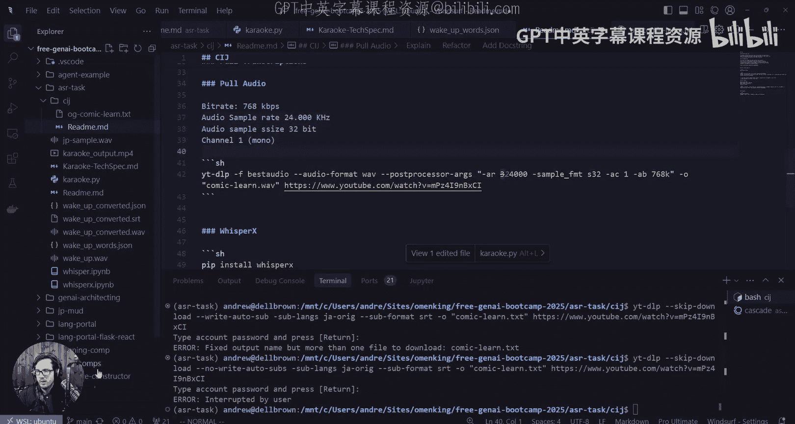

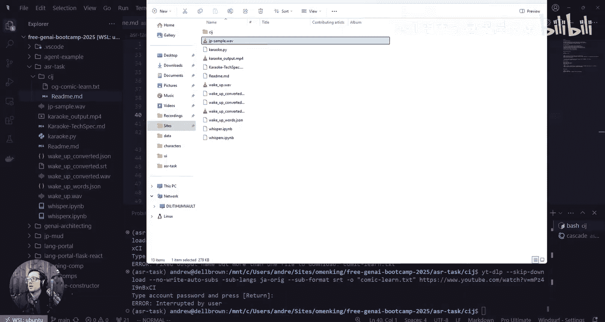

So we'll go back and check this again。Will say properties。 This one is 24 Hz。

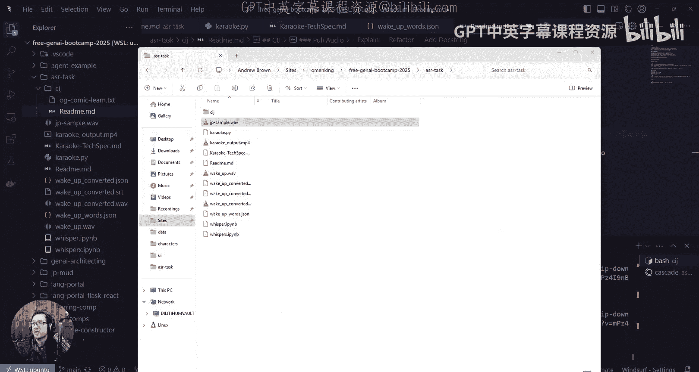

Or whatever we call that K， whatever。KilHz or whatever。 So it's actually 24。 That's easy to fix。

 We'll just switch that out there。 All the other settings。 I want them to be that。

 So we'll go ahead and we'll run that there。 That's going to download it。

 Don't need a password for that。 And it's going going to download just the audio for us。

 So now we have just the audio。😊，Okay， I'm gonna listen to it。皆さんこんにちは今日は intro。また、次回。🎼。Okay， so。

 you know， I don't want those sound effects， but I don't think it's gonna be an issue because I think that the the transcrir should be able to figure it out。

 The other part is like， we can't just cut out the audio there。 We have to deaden it。

 but we can't get rid of it because we can't change the length of the audio because then the time codes won't match the original video So I could open this up in Adobe Aion and clear those out。

 but we'll find out if it's even a problem。 So that'll be our first step to find out。 But anyway。

 we have our two files here。 Now we want to run this through whisper， So here。We have it。

 and we already learned this before。 Pip install whispersper X。Whisper X bottle if you don't。

 if you're having issues with your machine， watch the previous videos。

Where you see me working through my machine， I have a 4060，40，60 R T X。

 I'm sure I could do this with a less powerful machine。 If I had to do some production， maybe runpod。

 there's lots of cloud services that have GPUus， but it doesn't need a powerful GPU in order to utilize this。

 If you have no GPUs， what you could do is you could use lightning AI。

 I'm not sure why I not even I haven't use lightning A in this bootc whatsoever。

 If you go to lightning AI。

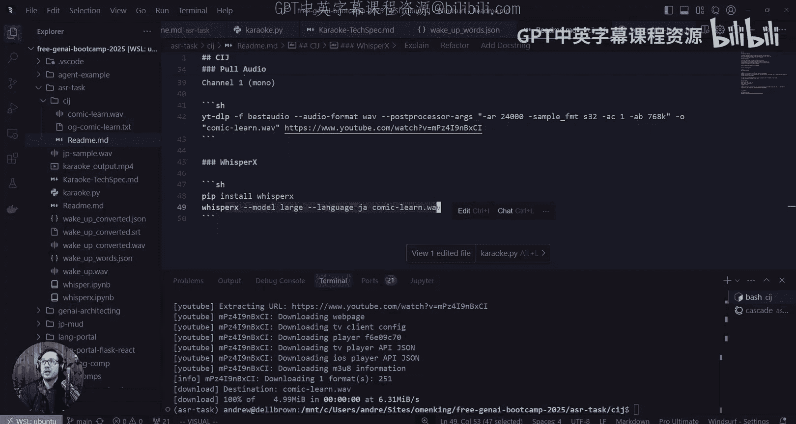

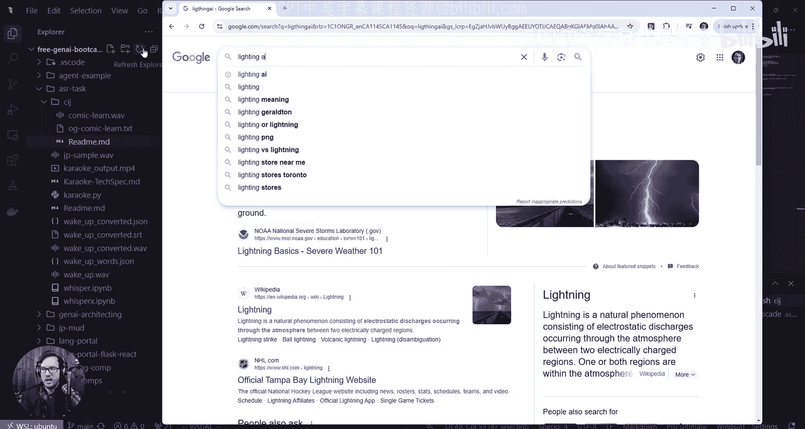

They have free compute or free GPs。 And we could have ran that in here， which I'm not。

 I'm using my local machine。 So I want to tell people if you can't， you don't have the compute。

 you don't have a new graphics card go use like A。 It's really easy to do that。

 But you need the GPus in order to do this。 So anyway， this should launch up whisper X。

 remember like this is using the large model。 So the large model is about 5，7 GB。

 you need at least 7，5 GB to download this model。 You need to have enough memory in there in order to run it。

 But I'm going open up my task manager。Okay， so here it is。 I'm recording right now。

 So you can see I have 64 GB of memory， but I'm at half here。

 But even if I have to use the 7 or 5 what loads it into here。 It's not using the GPU memory。

 I believe it's using this one。 but if it is， we do have。😊。

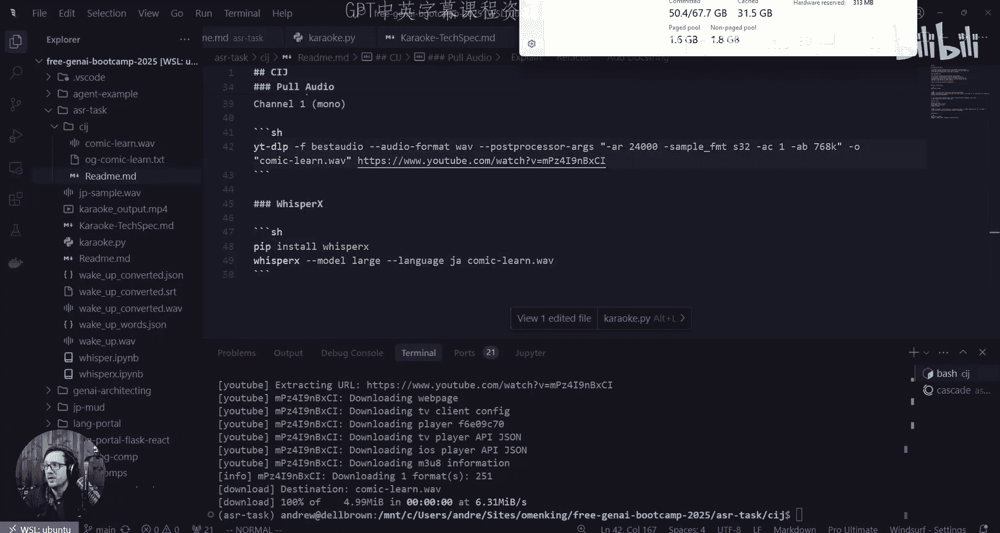

Dediccate GPU memory here as well。 But my graphics card is being utilized because I'm recording right now。

 And so this would perform much faster and better if I wasn't recording。

 but it still will work totally fine。 So this is going to dump out。😊。

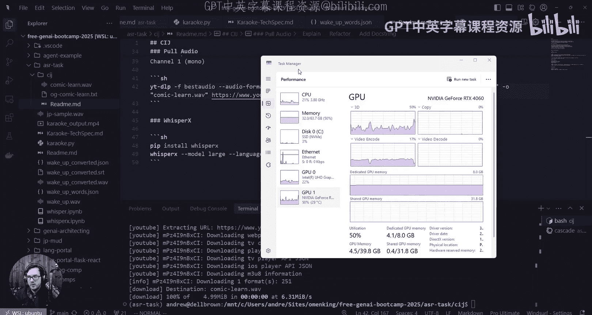

The transcription。It doesn't say where， but it's going to dump it out。 So we'll go ahead。I think。

 I think， yeah， it doesn't say where。 but we'll go ahead and run this。

And so I've already ran this before， but I had to wait like 20 minutes。

15 minutes to download this model。 But once I had， it wasn't， it was less of an issue。

 So this model should already be， obviously， you have to have Docker installed to do this。ButWe will。

Give this a go。 It's complain about that Lib Q Lib Qd 8， but at least we don't have to deal with it。

 right， These errors don't matter， right， these I was getting these even locally。

 but if the Docker containers getting it and it still works and who cares。

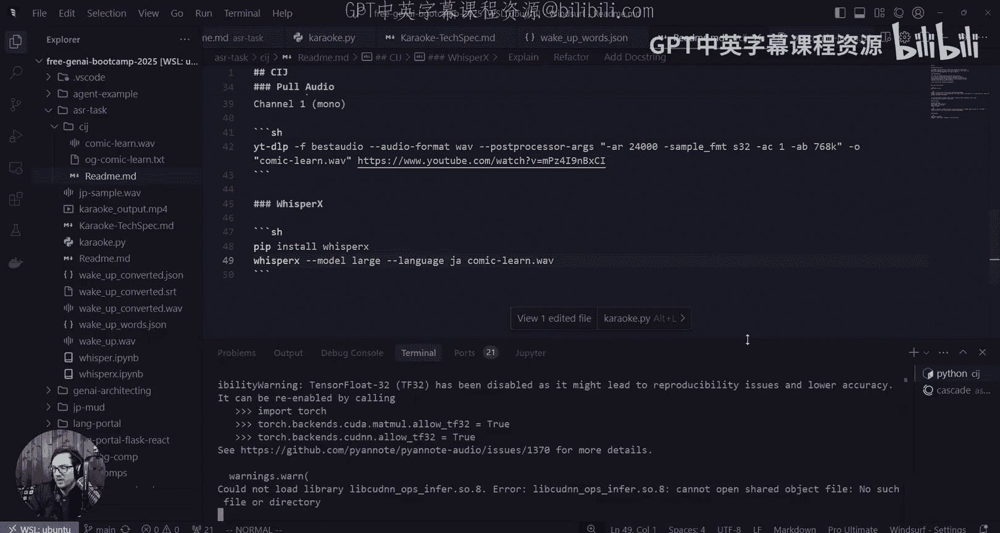

So we are waiting here。 by the way， look at our dedicated。 So it is using the dedicated GPU memory。

And then when it runs out， then it starts using this memory over here。 That's really interesting。

Not a lot of it， but some of it。 You could see we have that GPS spy here， and it's finished。

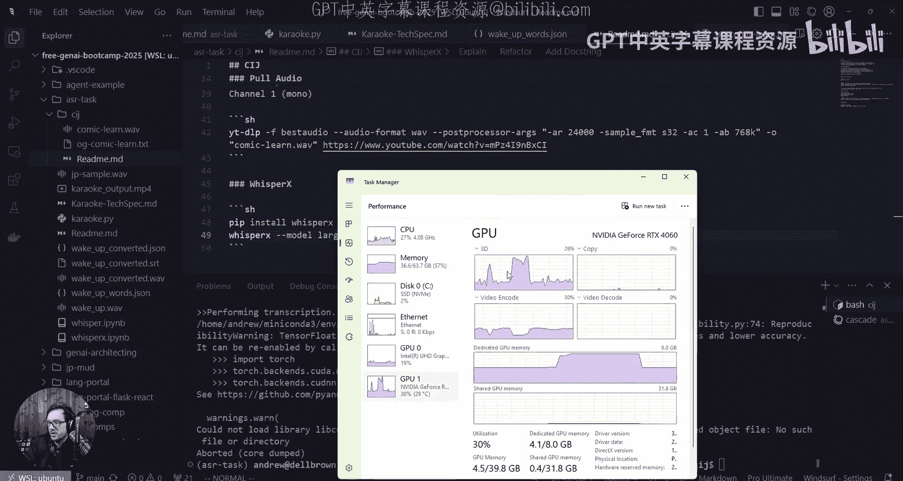

And we have this errors。 It says abored cord dump。 I don't know if that means it didn't work or not。

So did it work， Did it not work， Was the file too large。We've never ran a file this large。

 How large is this file。 This is what，5 minutes。It is a。

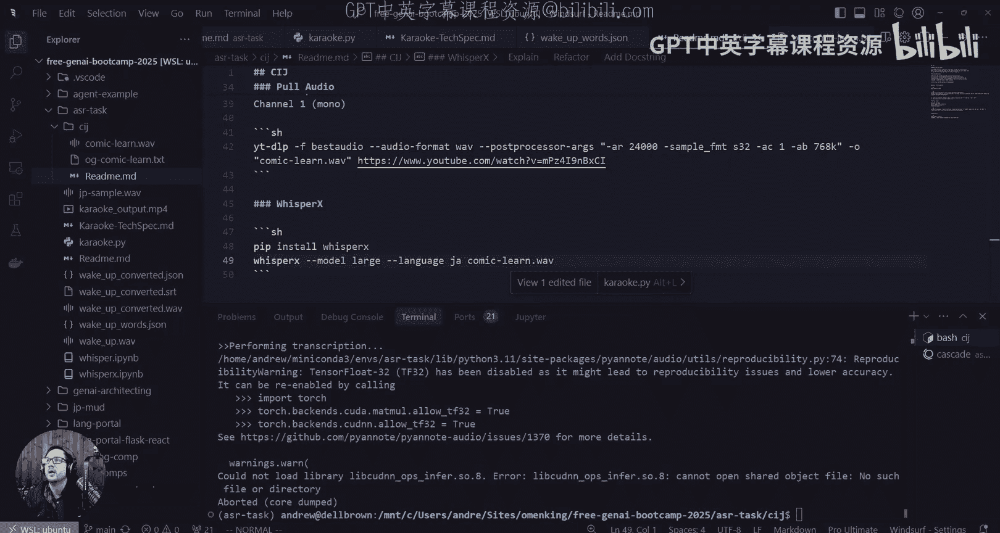

呃。🎼How large is this file。 We got a Fricking ad。 You know what， everyone's like， Andrew。

 why don't you get the ad blocker， I don't know， I really should。I'm so tired of these ads。

 we'll go here。And this video is 7 minutes。 So when you are working with whisperhis。

 I don't think it likes large audio files。

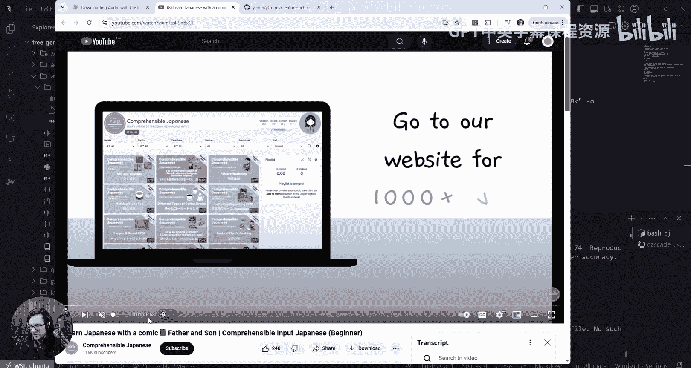

Right， so we might need to chunk this into multiple files。 So what I'm going to do is not hard。

 but we'll say。Chunk。Chunk audio into。30 second chunks。 There we go。 That's what we'll do。 And yeah。

 we'll use FF MPg for that。 And so that can do it。Normally you make a， like a placeholder file。

Place them in a folder called chunks， I guess。Right。

 I'm going to go ahead and make a new folder here called chunks。And I gonna make a new folder here。

Called output。And I'm going to grab。All everything in here。🎼。I don't want to because this is not my。

 my resources。 So I'm gonna just go here and do do get ignored。 So if you want to do this。

 you're gonna have to。I actually read this stuff here。

 but I'm going to say none of this and none of that。None of this and none of that。

 So when I commit it later on， I don have to worry about it， we'll go back over to here。

Called output。Chugs。Okay， let's see if it changes for me。 Thank you。

 And so it should chunk out the audio into 30 second segments。 The shorter the segments。

 the better it's going to do。 I'm not sure how we could load up whisper X with a series of files。

 There's probably。Like， I'd probably have to open it up and take a look。 but it'd be nice if I could。

 We just want run one after another。 But the nice thing， though。

 is that if we wanted to do parallellyization， we could actually run multiple containers on this machine。

 But if we had multiple GPUs and we spun them up all in the cloud。

 then we could get this transcription done extremely quickly。 The same cost。

 It wouldn't cost this anymore。 I don't think we'll go ahead and we will chunk up our stuff here。

 We'll see if it actually works。😊，It says this here， so it says。Arir opening file Com wave。Oh。

 because we moved where it is。 That's why。 So this is now actually in。Output here like this。

And we'll try this again。I don't think it produced anything。Okay， and we'll type in clear。

 and we'll try this again。And so。Well， we have one。And we have an error。

So says output files function not implemented。 So I don't think it。

Ope is not supported in way formats。 So let's go over。

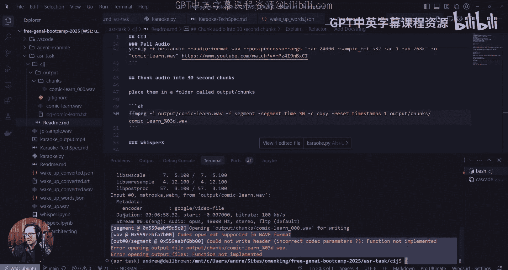

And ask Claude， it the autocompr didn't do a very good job here。 But I'm gonna go here and。

Just provided the information here， and hopefully it will just provide me the fix。

I don't want to read the FF M peg docs。 I do know FF M pe pretty well。 So it's not an issue for me。

The related issue is Fbe is depicting Opus codedc， which isn't supported in wave format。

There suggested the input file might not be a standard wave file。

 but an opus encoding inside of a wave container， which isn't standard， oh。

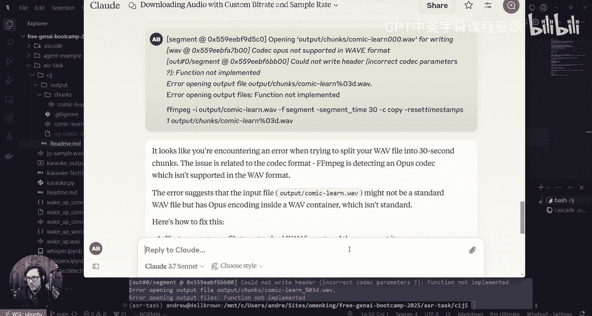

Well， here's a question。

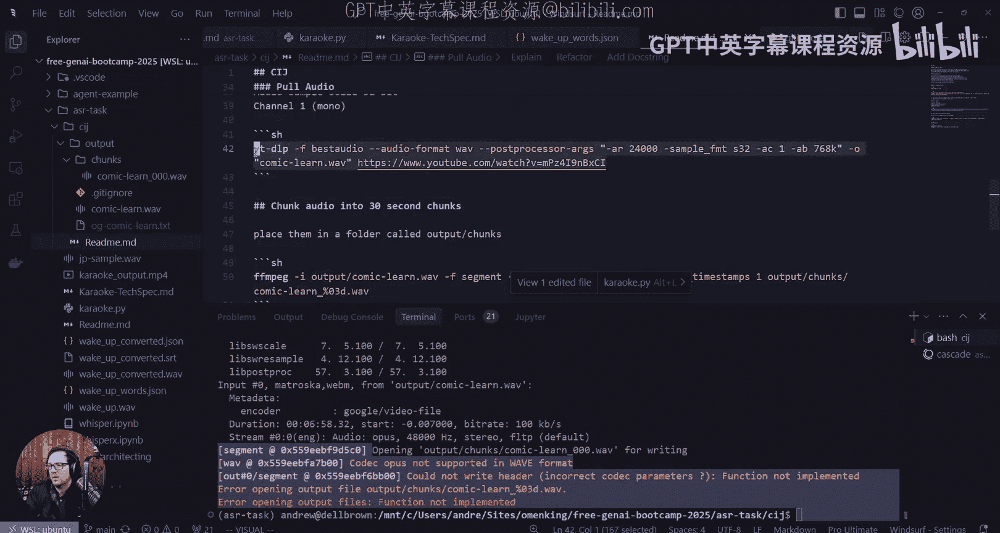

IYou know， I want to ask， I mean， like。Is。Did， did wild T P。Did wild DTP use opus encoding。法律。

That could explain why it didn't work。YouWhen you request best audio without specifying a particular format。

 when you use best audio， will download the the highest quality audio stream。

Which is the Ous encoding to suregate a proper way which with the specifications。

 you should explicitly convert audio during in the download rather than simply relying on the container chunk。

So， here。Try the modified approach。

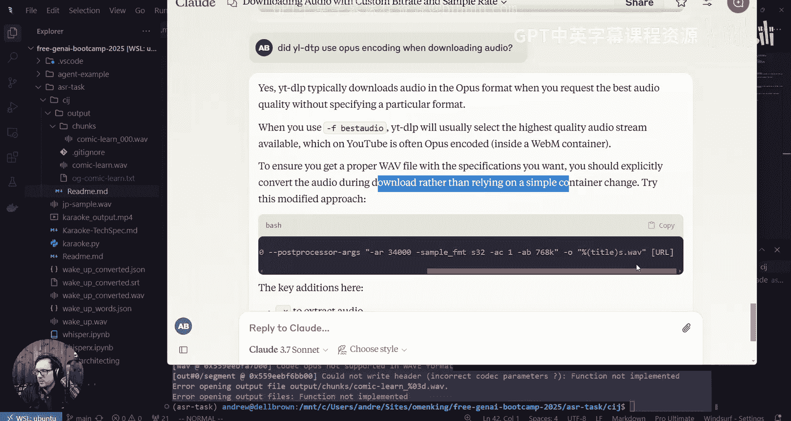

I don't see what's different。 Let's go over here， and take a look。Oh， it says best audio right there。

um。So I'm just trying to see what the differences here。 So we have here。Audio quality is 0。

 Why would we want to do that。

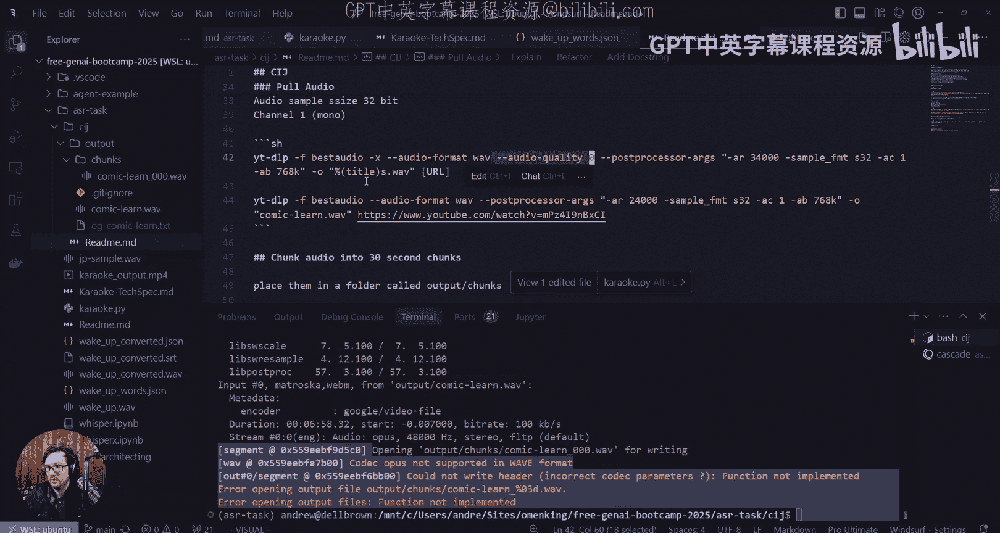

When you use。Okay， so it's saying that this is what I need to do is change it。 Well， we do have this。

 The only thing we don't have is audio quality。 I don't think that's in here。

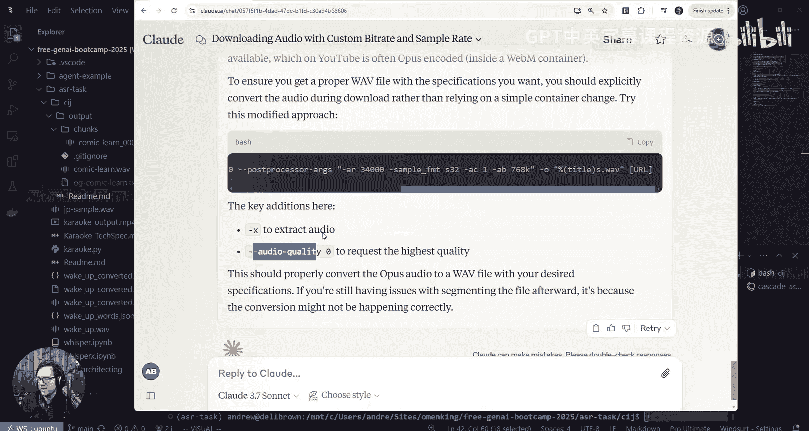

So go back over to here and let's take a look。That sounds really bizarre to set it to audio quality 0。

But that's what it's saying。 So we'll go ahead and we'll put that flag in here。And。

I'm going try this again。we'll run this here， and we'll download the file again。

So now what I'm curious， does it say what format it uses？No， just not really saying it。

 but we'll go over to here for a second。 I want to go back to my folder here。

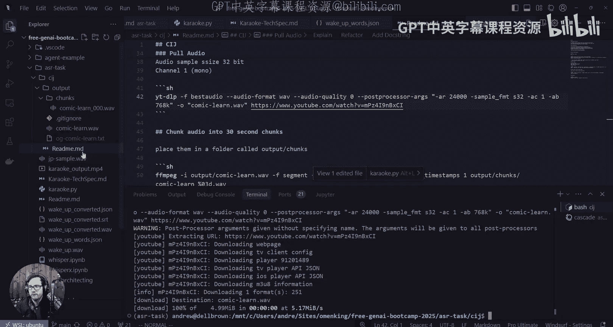

And let's take a look。At the actual。Aio file here， wherever that is。So in here。

 we have this one here。 Let's go show it。 I'm not sure if it shows the encoding here。

 We can probably get it with F ofM peg。And。Why doesn't it show any of that information interesting？

Maybe because that's metadata and doesn't write the metadata onto it， that's probably why。Yeah。

 we can't even see it for you。 well， that's silly that it doesn't do that， but I， I mean。

 that's fine， but we'll go ahead and I'm going to move this back to output。

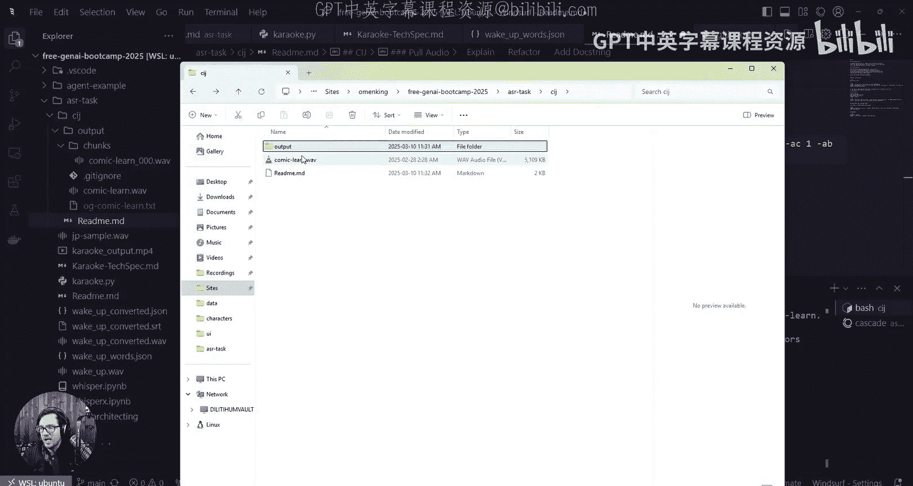

I want to replace it。

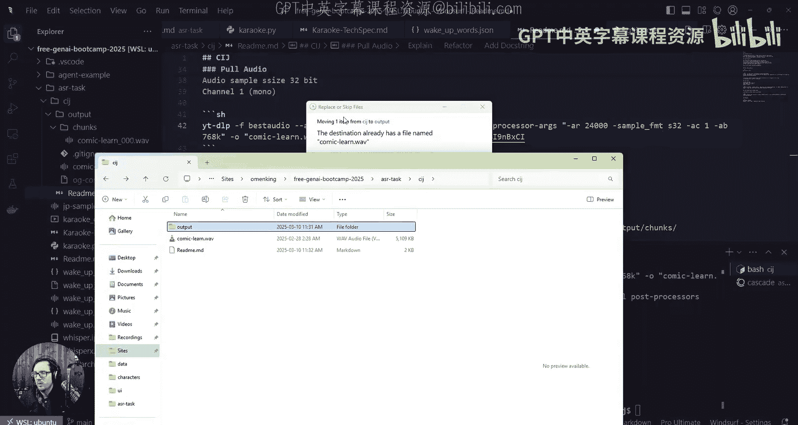

And even though our audio file is too large， I'm still going to try to run it anyway。

 I don't care if error is out。 I just want to see。 I'll update that if the changing the audio file might fix it。

 But to get accurate results， we really shouldn't feed at a large audio file。

And we really should chunk it into into into 30， which we already have up here， right。

 So we're gonna run this again。 We'll go back over and and look at our task manager here。

 We can see that it's using GPUs。 It's going， which is fine。 It's using the memory。😊。

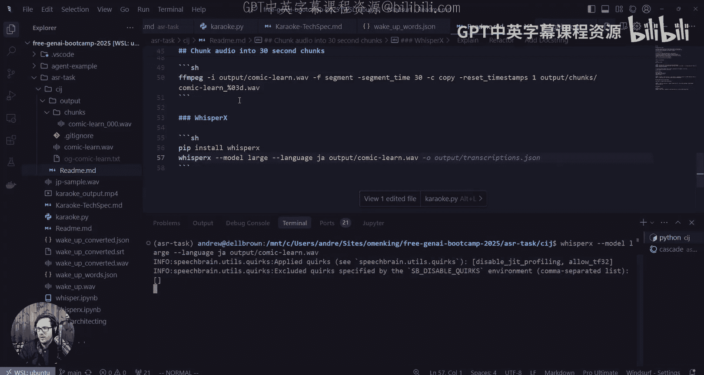

And again， half my GPU is going to screen sharing right now。 So if I， if I needed more memory。

 I could do that， I could kill the stream here。And。Yeah， abboard it。 So again。

 I think the audio clips are too large。 We'll go back and we'll tap the chunk。 We'll delete this one。

 This one's junk。

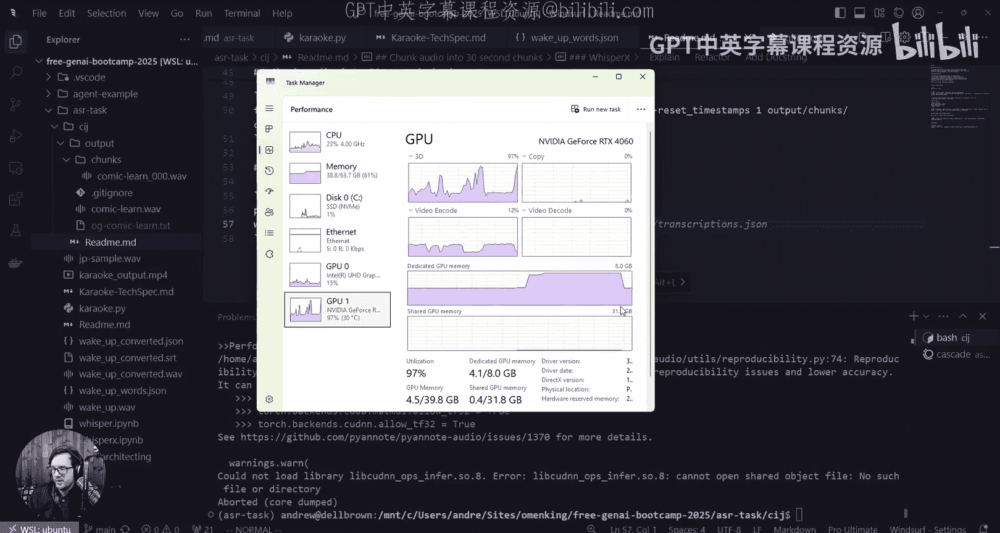

And I will go back over to here。And I will try this again。I'm really stuffed up。

 I just can't wait till my winter cold goes away。 going for a months has's driving me crazy。

It' saying it open for。So despite doing that， it's still ignoring us。

So I'm just going to have to have an extra step where I convert it into the audio format I want。

 which is kind of frustrating here， but we'll go over to here。

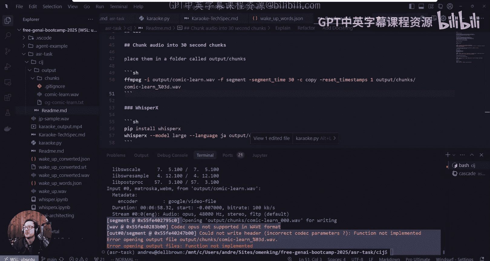

And。Standard wave format and then segment it。 So okay， so we'll go do this。

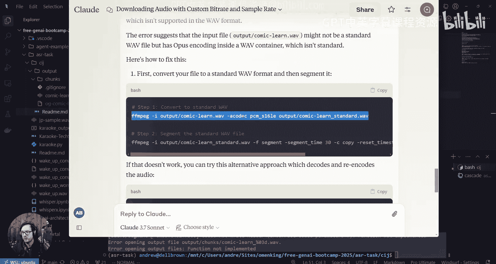

And then we will。哦。Convert。Okay， so we'll go do this。You know， we can't you know， the。Why， L。

 was it while。Y t DLP refuses。To use encoding that we want。

I have a feeling this is using FFMPg underneath， so I'm surprised like maybe we can。

But I almost feel like I could put that there， and I would expect that to come out there。

 And that could be experiment that we could try， but I'm not gonna do it。

So we'll go ahead and we will use this now， I guess。And I'm going to。Convert this over。Okay。

 so now supposedly it is in the other format。Over here。

I wonder if it actually gives us the details now if we go back over to here。

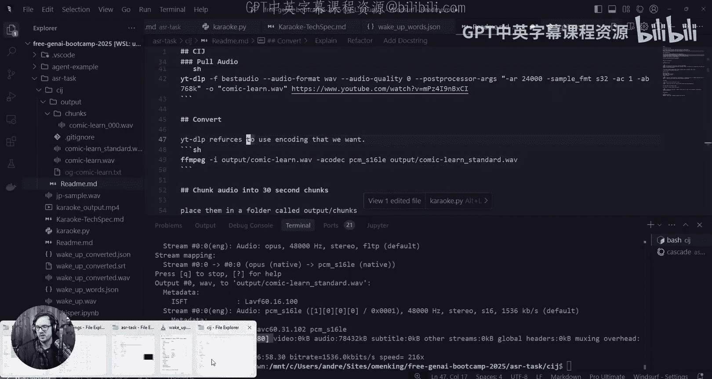

And。Because if that's metadata。 it has to be written there， it's not going to tell us。

So what's really nice is， why the same stereo， I want it to be mono。😊，It's 48 kHz instead of 16。

 Why is it completely different from what I want。

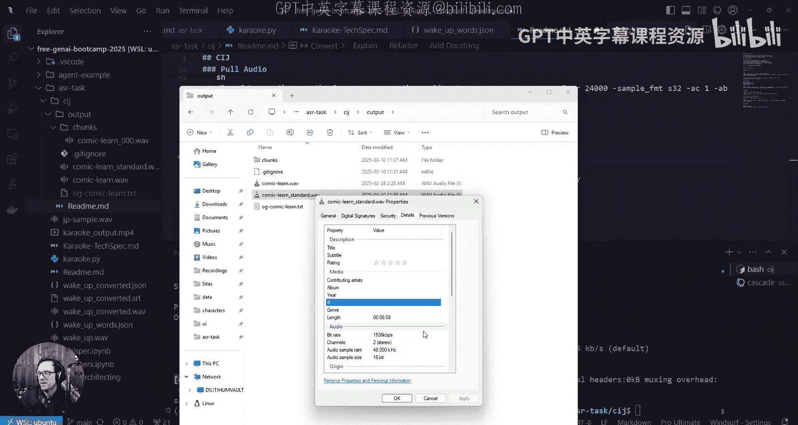

Okay， so。I want this to be 24。Okay， so we'll put this。

 I'm pretty certain that this is FFM peg underneath。 I want the sample format。To be this， right。

I want there to be one channel， there we go。And yeah， the bit rate， I want this to be this。

 So I can be very explicit of what I want。 This is what I want， and I want what I want。

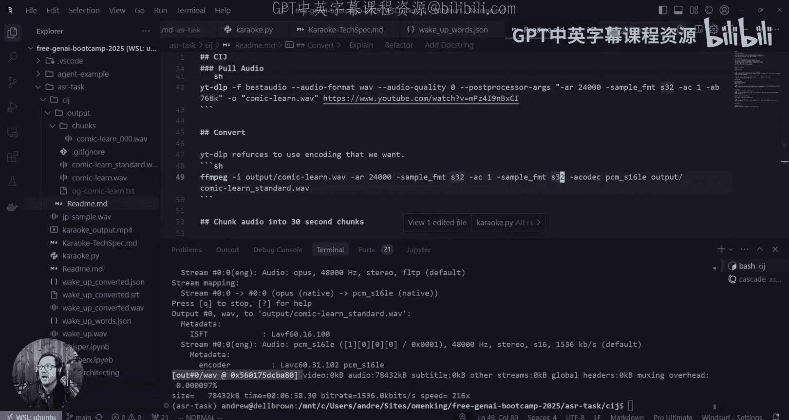

It's interesting that 48 Hz is higher。 so you think that would be a better standard。 and maybe it is。

 and I'm just， I'm dumb， right， but I just know that when I use open whisperhis。

 I have a file format that I know that works。And it would take a little bit more experiment to find out we can always change the stuff later on and run it again。

 But right now， I just wanted to get it to work， right？ So go ahead and well， we'll try this again。

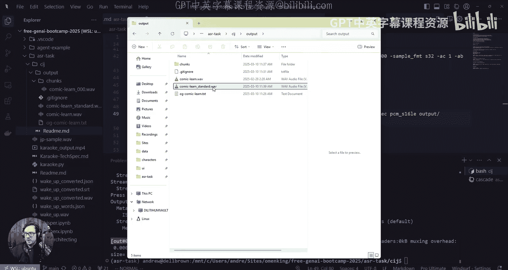

And。I。Conversion failed。Oh， it's not supported， we can't do 32。哦。Is there another format we can do？

This doesn't work。432， is there another standard。Way format。Oh， it's literally 16。 Okay。

 it's right in the name。 That's pretty clear。 So we'll go ahead and we'll switch it out。

I remember like when I was doing this stuff a lot more。 I， I used to know all this。

 it's really hard to keep everything in your head。 but I used to know how this audio stuff worked。

 but it does require a lot of writing out and remembering。So now we have in this other format。

 it seems like， you know， I'm actually not using the highest quality if I'm only using 24 Hz and so 48。

 but whatever， I know it works。 And I'm just gonna make sure I use that format。

So now we should have the format we want。 I don't know if it actually deleted a doubt。

 So I'm gonna run it one one more time。

So go ahead and do this again。Yeah， it didn't。 It didn't overwrite it。

We'll go run this again。 We'll go over to here。 We'll check our。Format here。Okay。And in here。

 we'll go to details。And 76， okay， so now it's everything。

 But I guess the sample rate could be higher。 It could be 48 kherz， but I don't know。

 we can change that after the fact， I suppose。 But right now， I'm gonna stick with 24 with 32 B，32 B。

 obviously larger，24 is。Not the same high the range of data that we want。

 the bit rate is nice and high， so that's really good。

We'll go back over to here， And I don't expect it to work， but we'll run it again。 Okay。

 so run it again and we'll see what happens this time around。

 It probably will have the same results out out。🎼Aboard So aboard it again。

 And I think I keep thinking it's running out of resources。 And that's why it's doing that。

 There's probably some way for us to check。 But I'm going to just focus on doing this chunking now now that we have it in a format that we can actually work with。

 so we'll try this again here。Hit enter。Oh my goodness。 What is it talking about？ Oh， you know what。

 We are not using the newer one here。Stard。There we go， let's try this again。Run it again。

And now it's chunked it into sections here。There we go。 And so now what we can do。

As we could test this on a smaller chunk。So here we're going to do chunks。Yes， right。And。

I'm just going to do 00，0。 Well I don't want to do 00，0， let's go play 04。と。お母さんです。ここはどこですか？

Here's a problem， though。 If we are chunking it this way， how does it know。

To pick up the audio in the correct spot。Right，ca it's not a natural place where it's it cuts off。

 and it's a sentence。So that's where we might run into a challenge， right？

But I'm going to try it anyway because I'm just curious to see what the results are。Because。

We have the Reg transcription。 and if we generally had know the spacing itself。

 we could probably figure it out this way。 Let's go ahead and take a look here。And yeah。

 you know what I， if it， it can do output， I'd like to do that， please。

I don't think it takes a flag like that， but we'll try anyway。And so this one's a lot smaller， right。

 So this one should give us less issues。It's really interesting like the challenges of working with larger files。

 we also have a larger video from Himi Itto， so it'd be nice to in a video following this try to tackle that。

 right？So we're getting a boarded dump core。 I'm not sure why。 So here。Has been disabled。

Maybe I need to read what's going on here。嗯哼嗯哼。That's interesting。 So it's not working。

 These are 30 chunks。 I want to go ahead and just， as a sanity check。

Go back to mind1 that I know that works， right， So we go here and we'll go back a layer。

That's not what I wanted to do。We will go into。Here。Read me。

Does this look the same as by other one or did it just not make it the same？

Let's go back over to hours over here， read me。Yeah， I don't think， oh yeah。

 this is not even running it。 This is running it on my local machine。 That's why I'm having problems。

 We're not even running it in in Docker。Vi a doctorcker， right。Okay， so now。啊哈。

Maybe we don't need to chunk it at all。 And we don't even need to do whisper X and。

 That was completely useless。 So what I want to do here。Is we have output format Jason converted。

Okay， but how does it know what file it's loading， Let's go back to the other one here for a second。

Read me。Where's our docker。Here it is。Oh， it is literally the file specification， okay。

So what we're going to do before we use the chunk data。

 because I we're going to have problems with the chunk data now then to realize that that one issue there。

We'll go here and we'll say output。It's not that we'll just use standard。like would。

 would opus be a problem for it。 I don't know， But we're gonna use the standard one because we know we converted it over comic learn standard。

 So hopefully I， I have the directory correct here。Yeah。

 we don't need that there Now just ignore that。It's being very aggressive。

 making suggestions it doesn't need。 And so now we are spinning up this one here。

 This might require different levels of resources。

Okay。But this one will have less issues with it， I think。That was way too fast。

 Air opening output chunks。 Oh， it's trying to put chunks in there。

Let's take out the chunks part here。It's just this。 So we'll go ahead and we'll do that。

 I'm not sure， like the larger the file is， the more， I don't know。

We'll take a look。Okay， so it's utilizing my GPUs。What the heck I told it。Output chunks。

We'll copy this again。It just， I can't。I would put， okay。

 so this one does not have the chunks in the directory。 Now we'll run it。

And we'll see what happens here。We give it a moment。Nice， okay， so it's outputting it。 Does it。

 is it actually putting it anywhere， though。I mean should， yes， it' is Jason format， right？Okay。

 there we go。Wow。Wow， okay， so I guess the question is like， would chunking still be a benefit。

 Because the more you chunk it， I feel like the model should make less mistakes。

 It's like a guess here。 But now we have our output of all these words， right？

 But the next question is。U。The next question is。You know， we have this audio here， right。

Can we match it up with the original transcription？And this text here is， is it longer than this。

 It must be longer than that， right。I'm not sure why it's not showing all of it。 I can't tell。

If it just only did this amount of text。We production the whole sample。

I guess the way we'd be able to tell is based on the these time codes here。

Is there like a nice way to format prettyt Jason？ Let's go over here。Exions。Pretty， Jason。

Jason formatter。我是呃。Okay， let's try it。Control shift P format document， okay。So go back over to here。

Control shift P。Format。Document。啊hu。Oh， we could have。 Allright。 Well， let's just use pretty format。

 There we go。 That's nice。 Never done that before。 And so we have a lot of stuff that's going on here。

 right， So we go to the top here。 There's no way that's all the text。Wrightden says 0。5 to 29。937。

Okay， so if we go back to the original video。Where is that。ItsNot here。Here， how long is this video。

 This video is 6，58， right。But here。ItSays 0，5，3 to 29， whatever。 What does that mean。

 I that actually translate over to that， And also， this starting text。

 Does this thing actually match up。 Let's go find out really quickly here。

So I'm gonna just put the Japanese sex here， Minsan， Koichia。呃。今日は一緒に。嗯。I you're trying to like。

 put in make corrections。That looks the same to me。Hold on here。

It's hard because I didn't need to get this right on screen here for a second here。Hello。

 that's the same。 Hol on the start again。みさん、こんにちは。If说你。Mouss isn't but the period there， though。

That's fine。It probably might not know that it's saying， and， I think that's。Oh， Minan。

 It's still the same， okay。Ko。Yeah， so it is working。But， you know， the question is like。

How far does this go or does it stop at a certain point， right， So if I go here。

Looking at this audio。How long is the video。30 seconds long。

 That sounds like the segment that I used earlier。 Like。

 that sounds like the first segment of 30 seconds。

Right， so we go back over to here。How long is this one。

6 minutes。Okay。

So let's go over to whispers X。 Maybe you can only do。30 seconds at a time， which is fine， whisper X。

One way that we could fix the problem if like we had to chunk it is we'd have to just give it a little bit more。

 like have some over， overlapping stuff with it， right。How many seconds can it handle。嗯。

Recreased time accuracy at the cost of GPUs use bigger models alignment may be helpful to label the transcript with the speaker IDs。

Okay。They're doing 49 seconds， which is impressive。Segments。So， here。That's what comes back， right？

Reduce batch size。So maybe theys take a way to batch。Batched inference。When I say batch。

 that's not what I mean。 I mean， like， how do you do an entire file。Oh。

 maybe it's like doing multiples at the same time。 batch batch size。

Let's check the white paperper here。

The accurate teach spec text format。For the application to long video。

 long audio video via buffer transcription prohibits batch interface too， so。

Largescale weekly supervised speech recognition models。

 such as W have demonstrated impressive results on speech recognition across whatever。 However。

 the predicted timetamps correspond to each utterance are prone toaccuracies in word level timestamps。

 They're talking about the original whisper。 further to application to long audio via buffer transcription prohibits batch inference due to their sequential nature to overcome the aforementioned challenges we present whisper X。

 a time accurate speech recognition system with word level timestamps utilizing voice activity detection。

In doing so， we demonstrate the state of the art performance。

 I'm going to switch to standing desk here。 Maya。 my butt's killing me here。Let's move to Sandic。

So in theory， it can， it sounds like they're proposing that they can do large files and batch them。

 how they do that， I'm not sure。We could ask。Claude。

 I just don't trust these LMs' giving me the an honest answer of how to configure it。

We are now standing here。So to overcome the aforementioned challenges， we present Whisper X。

 a time accurate speech recognition system。In doing so。

 we demonstrate state of the art performance on long form transcriptions。

 long form transcriptions and word segmentation。 Okay， so specifically。

 they're saying they can do long form。Okay， how do you do log form then。Alright。

 so we'll go say like whisper X。Long video。 Long audio。How do describe a long audio file'll see here。

 Ching is done automatically。 I have a 30 minute MP3 and I would like to transcribe it。

Chunking's done automatically， cool。Then you can loop over the directory。 I still， I。

 wouldn't that mess things up， I guess if it's like like letter。

 But what happens like if here in the middle of an utterance。So， I would think that chunking。

But anyway， they're suggesting that it automatically happens。

And I'm certain that if I could get it working locally。

 But the problem is is that it's really hard to configure my machine because I need to aid in all these specific versions。

 And so we're using that docker container。So I want to see if they have an example。

 becauseuse we have Docker whisperper X。 This is what I'm using。And so。啊。

The image formatted is whisper， okay？Excepts Lang and whisper Port here。 Lang and whisper model。

But my question， my starting to warm up here in a second？It can take off the snowsuit。But like。

 it doesn't say。It's only stoppingpp at 30 seconds。And so。So this is the challenge。 Its like， yes。

 it can do long files。 but how。 So that is what we're trying to figure out next。 Like what。

 how are we gonna get past that 30 second mark。Because that's not going to work for us， right。

 We need all， all six minutes。um。Let's go back over to。windurf here。

So obviously， we have that file。Upput format， Jason。Do we really only get the one file？ Yeah。

 that's all we get。

嗯嗯嗯嗯。😊，What can we do here， Let's go back over to whisperhiperx。And。In here。We have the setup， right。

 We go to setup top high。There's nothing exciting in here。 Let's go into whisper X。Well， we're sorry。

 We're in Whiper ex right now。 I meant to go to Docker Wsper ex， sorry。

Because that's what we're actually utilizing first。Doctor Whisper X。And。Here。We have the Docker file。

 and its entry point is what。The century point is whisperrex， right。So。We'll go back over to here。

 I should be able to take any parameters of the other one says， So like using whisper X。

It says it can do。Long files。 How， how do we do that。Do we have to。In the CI command。

Adjust based on your GPU memory， lower for low memory。So here speces the save， sorry。

If you need word level timestamps， you don't need to add any special flags to enable it by default。

 So， you， you know， I， I gave it a long audio file and all I got back。Was 30 seconds。

But I'm supposed to have。6 minutes of Jason。小how人J。And let's see what suggestions it has。It is。

 I don't need to do that to find out。Try running West explicitly explicitly chunking。

Of 30 seconds with chunks size set to maximum。So yeah， I'm not sure if those are actual options。

 we'll go ahead and we'll grab that。

It's interesting that you can， I'm not sure what the batch does， but you can batch it to。

Make perform a little better。 We'll go back over to our readme here。And。I think that， yeah。

 you put them here after that hyphen hyphen。 We'll go ahead and we'll delete out this one here。Okay。

 and then we'll go ahead and try this。

Let's see if it takes those parameters。Yeah， there you go， unrecognized。Things here。

 So what options do we actually have for whisperx。We have。

The things we're also not specifying that it's Japanese。Which， I mean。

 we are using the Japanese model。 So I think it would already know that。But while we're here。

 we might as well be very explicit。 Where's Japanese。Yeah， we just put that。 So we put here。

 we'll put。Japanese， so that it just knows。 thent have to like guess about it。

Where are other options that we have here， We have a line model。Chunk size。Do you have。

It doesn't have max chunk size。 We'll go ahead。 We'll take that out because it doesn't know what max chunk size is。

Highlight words。 I don't know what highlight words is supposed to do。 We're already kind of。

Figuring out the words are no speech threshold。I wonder if that's a limit that we might have on this。

I'm gonna just to tell， like， here are。Says it has。And I wonder if he'll pick up on anything here。

The set size is 300 seconds，5 minutes， which should be large enough for a six minute file。

 If experiencing that issue， we'll do this。 again， we'll try the the 30 second chunking。First。

It like how it went like back to the other one here。 We'll type in clear here。 We'll run this again。

And we'll see what happens now。

So he is going to like run each of those chunks individually。 If that still doesn't work。

 we should really check the size of the the length of the file。

 Maybe the it only thinks there is 30 seconds， even though there is six minutes。Right。

 so here it is transcribing。The time looks a lot larger here， right？ Yeah，29，58。

 heres it doing its chunks， right。We'll go here。嗯。So I think it's working。Okay， so。You know。

 I can see。That it is chunking。In 30， but it only outputs。The first jason file。

And I'm gonna go back over and just show like， this， this is what I'm using here。

So I think it is actually working， might not even have to chunk it because it might already be chunking at 30 seconds。

But we'll go over back here see。Maybe there's a reason for that。

To ensure the entire file and outputs outputs everything correctly here。I don't think。Oh。

 here has an output directory。Is that even an option we have Open directory。

I don't know why I thinks that's an option， but we'll go ahead and we'll run it。 So that works。

 then who cares， right？ We'll type in clear here。

But maybe originally was chunking at 30 second intervals。 We'll go ahead and give us a moment。

See if it throws an error。No error so far。And。We will wrap this here terminal。Word wrap。We。

We definitely have more。But。It's now just segments， right， So that's not。

 that's not very useful to us。I'm going to go back over to here for a second。

 let's go take a look at the alternate one。What's NoAA line mean。We didn't have that before， right？

And let's go back and take a look at what I pasted into here as are options。Okay。

 but now I'm not getting word by word。

If we go back over to here。I see。 so this actually is what it is doing， okay， but。

I'm not getting word by word。Okay， so it looks like I get。The transcription。

 but it's not Jason word by word。嗯哈。I don't want several files。 I just want。The the Jason。

To get more details， I'm going to go back over to here for secondable type in whisperhis X。

Because if we did said that， we should' get help。Right。There we go。

And so let's carefully look and see if there's anything that we're missing here。 We have batch size。

 We set that already。Compute type verbose。What if we took off batch size？

Because the other thing that we figured out was。Did we figure something out about that？Actually。

 this this one here， the one that we just ran here， this one doesn't have batch size in it。

Or chunk size as， you say chunk size。嗯。So go back over to here。

Which is what we would stop doing that。That I'm just gonna format this one kind of the same。Be one。

P2。Tep 1， and attempt 2。 I just wanted to stop highlight trying to get rid of it。

 It's really knowing when it does that。Lets I go here and here。And here so。

The only difference is like， this one has no a line。 I don't know what a line is。Batch size。

 output formats。 So we have all that is here， but we don't want that。嗯。OP directory。

 we're now specifying that。I don't know what a line is。So I would like to take that out of here。

 because they don't know。What that is doing， probably not doing anything。

Minimum speakers might also want to specify how many speakers there are。Temperature。

I don't know what highlightlight words does。Probably like you'd specify what words you want to be highlighted。

 and then it would find those words， I guess。So。m。I mean， we can go here。

 The only thing we don't have here is chunk。 So let's bring this in again。

 I think it already does that。 I'm gonna run it again。 I know this is， this seems very fu futile。

But I'm going to go ahead and try that again。So these are all our segments， which are。

🎼Junk to us right now。And I'm going to go ahead and try this again。I took out the NoA line。

 and I also put in the output。 Now we have the output director here。Why is it app output。

Is that even going to work if it's says app output。0 to 29 still， it's only。30 seconds。 This is not。

Enough， I need the whole thing， right。嗯。There's no other segments， right。

 It's not like the segments are hidden in here somewhere， segments。Bord segments， segments。嗯。

Let's format this again。 Let's just make sure。That it really isn't contained in here because this iss a pretty darn long file。

 right？Cause when we have this many characters。 So if it really is like， this is the last one。

 this would be like the last character we would see， right。Maybe this head does actually have it all。

 Let's go down here。 It does repeat the segments twice。 I don't know why it does that。

It doesn't know that They're not words。I figured if there's another one。

 you would get both sections here。We'll go here till we pass word segments here。Here。Okay。

 so what I wan to do。Maybe， maybe it isn't here。 Maybe I'm just like not realizing it。

But we'll take this out here because this is a pretty darn line long file， right。And here it says 4。

4，1，8，3，2，8。You know what？ I think we actually are getting the whole thing here。 Oh， there we go。

 Yep， yep， we are getting the whole thing。 Okay， so this entire time， I was just mistaken。 there's。

Multiple sections in here。 Okay， so Dahi does do the whole thing。 coolol。 Okay， well， that's good。

That really saves the trouble。 I was getting really confused here。

 but it showing the first 30 seconds。And then this text here， so if I type in text。Okay。

 so there it's chunking every 30 seconds。 It was already originally doing that。Interesting。

 interesting， interesting。 Does it get the whole video looks like it 4，154 18。

 I don't know because there's a bit of a translation of the math。

So。So we like here this video is 6 minutes long， Right？ So， but if you say 4，18，4，18 divided by 60。

 you get 6。9。 And so this video is 6。58。 And so I believe that this does cover the length of it。

 So now we're getting the output。

Of the audio file。 And so now the next question is， like。

 how do we match up the transcription to the original one。

 The challenge with this is that it's not grouping words in a way that is useful for us， right？

 And also， it can interpret。 We know this from using whisper， that it can output Romaji。

 It can output the wrong kanji or Kataana instead of Hiragana or vice versa。

 But the point is is that we have our source file that we can work with here。

The original one。Which is。Here， so this is our original。One here， right？

So now what I need is I need a way to make sure that the output of this matches the output of the other one。

 right， That's what I want。But I need to create。That end file。

 so I'm going to make a new prompt here。And。You know， maybe I could just tell it what I want。

 I'm just gonna to overla and just have it do it for me。So you can go over here。 I'm all out of。

My windsurf crs。 So I'm s at it。I have a transcription file。Which provides accurate transcription。

Of the words represented。Okay， and then we'll go back over to Windsurf here。Alright， I have。

 and we'll go over to this one。I have a。Transcription。Outputed。By whisperhis X。Which provides。

Character。By character。Time codes。It's transcription。may be incorrect。E G， it gets the sound right。

But produces。The wrong character。Okay。What I need is a final J file that provides us the words。

Provides us time codes word by word。For Japanese。I probably has to say this is chunked in 3 seconds。

 this Jason file。Is chunked。In about 30 seconds。By your prayer， you are soon。1 chunk here。Okay。

 so what I need is a file a file Jason that that provides what I need is a final file。

Why to file that。Has the correct。Transcriptions。With。The correct transcriptions。Sourcing it。

From the original。With word by word。Time codes so that I can。As Jason file， okay。Can I want to。

Use an LLM。Like。Open the eye。Or to do this。Can we implement。The solution。Okay。

 so let's see what it comes up with here。

Parts the Accro transcriptionion。Into words and phrases。O。Stop。The way you should。

Stop the LOM should be， should be doing the parsing。Not sequence matcher。

OkayThe reason they't want to rely like there are a lot of tools for analyzing it is because LMs are way better at figuring it out than these things here。

Okay， so that's what I really wanted to do here。So here it's coming up with a prototype here of what we can work with。

It's using GPT4， which is really freaking old， I don't know why he keeps doing that。

 it's really annoying。But now we have something to start with here。 It's still working。

 So we're going let it run for a bit till it gets to the end。 Alright， so let's produce something。

 Let's enhance our solution with a more robust implementation。You， let's doing something。

 So let's go ahead and we'll grab this code here。 We'll see what it is。

So we're not having windsurf。As I'm out， I'm out for a bit here。

 but we'll go ahead and we will make a new file here。 This will be our agent dot， or。

Formatter dot pi。 I don't know what we wan to call this here。 We'll go ahead and paste it。

 And let's see what kind of junk code we got。 So if we go all the way the top here。 Well。

 there's a lot going on here。 We have。Btch process for alignment W X。

Split accuratecro transcriptions。 So split a current transcription into chunks based on whisper segments。

I don't understand already， doesn't it already do that？

Get all whisper chunk files sorted by the name。There's no。The all the chunks are in a single file。

 So I don't think it understands。 Now， I'm gonna go back to this here。

哦。There's only a single Json file， all the chunks。Are within the same Jason file。可。Do you understand。

 buddy。嗯哈。Okay， we'll let it rewrite it。It's trying。

I， I think they also said， like， if I use。What is it here？

Go to， I don't really use it， but I think deepse。If we switch models。But that doesn't go。

 It says here， we go here。 That one's free， but it goes to V3， Like。

 does V 3 go to So it literally the V3 service。Because that can't be good。I know I have GPT4。

5 access， so I could also utilize that。I'm goinging to hit stop here。

 I'm not sure what it's trying to do over here from last time。 It might not know。

'cause if I do an update， it might not know that I'm out of credits。

 I might actually just kind of work with it still here。 I make a new window。

It's not saying I can't use it。Okay， well， that might be a bug with windsurf。

 but I think I might still have access， even though I shouldn't。I'm so going to go here。Oh man。

 do I really want to work with this big piece of junk code or do I want to just start from scratch。

I'm gonna bring this back over into Winsur。 We're gonna go back into formater。

 I'm gonna go ahead and replace all of the stuff here。

 We need to walk through the code and see what's going on here。 So what do we got， We have。Well。

 let's take a look at the usage first。 So here it says accurate。 so path to accurate transcript file。

Whisper X。Pas to the Whisex J file。Output， save the output， model GP 40。

 That's actually a modern one。 So that looks good。 So we'll go。 I just want a usage example。

 So usage example。Come on。Give me a usage example in the comments。See if it could do that for me。No。

 no， no， no， no， no， no， no， no， look。Look。No， look here here。For mattertter。Daipai。Lock， lock here。

And so here we're getting one that we go to give that copy here。I mean。

 maybe it already has one here， let's take a look。Here we have。But would you learn yeah。

 I is pulling in the stuff that I want， whisperhis X。That's the file there。And then the output。 Now。

 are these outputted in those directories。嗯。I don't think so。Yep， yep。

 so the idea is that this should align it now。I mean， we could just run it and see if it works。

 but we're gonna to be using Cha GT or something。 So I'm just take a look here at its implementation。

 So align transcript with LM。 So open you opening eyes LM to line accurate transcriptions with whisper X time codes。

One thing is that we're not utilizing。Structure Json。 So that might be something we might want。

 but let's go take a look here。 So we have this extract full original text from Whisper X for context。

Okay， goes through grabs the segments。 We have our text。For segment and whisper。

It's going through each ver， which is correct。 If it has char， start and score。 That looks good， too。

 right， I like how it's setting the score to or it doesn't exist。 It'll set the score to one。

So you are a specialized Japanese language alignment system。

 Your task is to match accurate Japanese transcriptions with the corresponding time codes for whisper X。

 Focus on phonetic matching rather than character matching， as whisper X may have correct sounds。

 but wrong characters， always output valid Jason with no additional text。

 I need to align accurate transcriptions with time codes。

With a less accurate transcription generated less accurate transcription with this。

I need to align an accurate Japanese translation without time codes。From a less accurate。

Transcription。With accurate time codes。Genrated by whispers。So this is the correct text。This is。

May contain errors。In character translation。But has。The correct sounds。And time codes。Right。

Character level timing data。 So from whisperhis X， we have the first 100 characters。

The full character data characters will have similar structures。

 So for each line and the accurate transcription， find the corresponding characters in the whisper data。

 create an alignment that preserves the accurate thing output would put in this format。

Match each line in the a transcription to below only output of all adjacent object into segments。

It's not using。 It's doing this， which is we can do that。 That's like a really old way of doing it。

 But there is a beta version that is a lot more accurate， but。We might just try it this way anyway。

 just to see what happens。Here to validate the output， because it could put bad things in here。

 only output valid， whatever， whatever。 And so the code looks fine here。

So all I need to get this to work is I need to， well， I don't know if it'll work。

 but we'll run it right to see what happens。 Take out that line。 We don't need that there。

 but we need to import。Python dot d AndV。Dot E V。And then we'll say。Load。And。

We do need to make a requirements dot T X T。 So we'll go here。

 We'll make a new requirements do T X T requirements do T X T。

 We we used whisper or open AI quite a bit。 We'll go into the mud1。

 which you've never seen the video on because I had so many problems with it Not， not that。

 but me losing the video and me making mistakes here。 And I have an open API key here。

 So I'm going to go ahead。I' have to generate a new key。 I can't use this one。

But I'm going to go over to。Here。And we're gonna make a new one dot D And V here。

We'll paste it just that part there。 We'll get the key in just a moment。 I'm going to go down below。

 and I'm looking for。The requirements are text to here。And so I did these two here。

while I'm here to make sure that it's just using dot EV。Dot E V doesn't even show it here。It fine。

 I know that that's probably how it's supposed to work。 So We'll go ahead and go back over to here。

 We'll go ahead and paste it here。 And I'm gonna do a Pip install hyphen R。Our requirements， do T T。

 I do not like Python， but I'm good at it， so。Well， for this boot camp， I'm good enough。

 So it'll be fine。 So it's gonna go ahead and it's all that stuff While that is installing。

 I'm gonna make my way over。

2。What do you call it？Open AI。And I have by keep， I have apparently have to log in。Log me in。Log man。

 Let's click that Google log and makes my life super easy。We will。Wait for this here。

And I'll go into manage projects。M API keys。I have the this one。

 saw I was using it for oning and just revoked this one。

Sample examples。 I don't remember when I last Tuesday。 So I'm just clearing them out。 Even this。

 so I can clear all at all my keys。 We'll make a new one here。 This is gonna be for C I J。

 just I don't forget what it's for。Read only the access it doesn' it need anything else。Basic create。

Sorry， we'll copy that key。 We'll go back over to Winsurf。We'll go into the dot video here。

我 payed it。We'll save it。And。I don't need that， but now we could actually run it。

We're waiting for the requirements to installed。 I I'm assuming they install。

 we'll go back to our formatter。 And so down here。We should have。The example that we want to run。

 So we go here。Obviously， I can't keep that there。 We're gonna just cut this out of here。

We'll go back into our read me here。And I'll paste it here。Hopefully， that works。I mean。

 I didn't completely read the code。 So if it didn't work， I'm not gonna to get upset。 Like。

 obviously， there's more to it than what we're doing。We'll go ahead and we'll copy this over here。

 We'll paste it in。 we'll hit enter。 We'll see what happens。And right away， Dot V doesn't like it。

 Of course， it does it。Let me find one where we use a do V， maybe not this one。O P A comps。

 not this one。 Maybe this one requirements。No， I mean， I remember used it so many times。Nope。

 that's a Ser API。Come on。Here's a pot Python evening。Where is it。It's just import dot V。

 and it's just low dot E V。 Okay， let's go back over to here。Into our for batteryer。

Maybe I didn't name it right。 Maybe I just called it dot load。Yeah， that's， that's the problem。Oh。

 now you wanna update it。 Okay， we'll go ahead。 We'll try this again。

They saw there was 15 segments。What。No， it didn't work that。

 but you have insufficient supers for this operation missing model request。

 check that you have the correct role in your organization。I mean， to fair。

 I made it a read only don't normally do that。Let me go can I edit the permissions on this， I can。

Okay， we'll try this again。I I don't think there's any output， though。These chunks are。🎼Useless。

 we don't need these charms。 That step was completely useless。We'll go ahead。

 we'll go ahead and hit up。And here it says 401， you have insufficient permissions for this operation。

 missing model request。 Check if you have the correct role in your organization's reader writer。

 If you're using a restricted the API key that that is unne scope。

 I'm going to go regenerate a new key because I don't want to wait around for this key to figure out permissions。

It clearly is junk。 So we'll go ahead and clear it out。 We'll make a new key， say C I J A。

And we'll give it all permissions under basic。I'm going to copy the key。

 We're going to go back over to here。

And。I'm going to go back into my。Do canV here。We have a new key。 so we'll paste that in here。

There we go。 We'll run this again。I also have credits on clo。

 I just keep forgetting me go back there。 It's a pain。Opening， it's just so much easier to use。

 despite it not being as powerful as Cla in all cases。Seems like it's doing something。

 The only thing is we can't see what it's doing because it doesn't provide good logging。

But at least it's processing。So while let's going。 let's take a look at our formatter。

It's just processing。So I'll guess switches over back to 3。7。So this for formatter。Can we add。

More logging， because I can't see。If it's processing， Oh， did just finish。

It might be nice to have a bit more logging here。If it just worked， that'd be great。

 I can't imagine it just works the first try， but we'll go here。And。诶。It's not doing it word by word。

Right， so it definitely did something。嗯嗯。But it's not word by word。 So， and also。

 didn't even get the whole thing。嗯嗯。Processing data with 15 segments， aligned 65 segments so。

There's a few things that don't make sense here。 Like， let's go over to here for a second。

So we'll go to our formater。Okay。So， a few problems。With our formatter。

We said there were 15 segments。But aligned 65， the outputted file。Doesn't seem。To contain the entire。

Transcription。Like， how do we know。It did a good job。It's not doing it word by word。It's doing it's。

As asked。Okay， so we'll go ahead and see what it can change there。

Hopefully it doesn't mess up our code。嗯哼。Over here。

 So to fix this ensure we're getting proper word by。

 we need to modify the prompt explicitly request word by word alignment。 Okay， so。Let's do that。

 first。

Request， I'll focus on prompt sections for 052 to 60。This updated prompt explicitlystruct to do so。

Okay， I don't know what try to say here because we have this。 Oh， maybe it's。

 it broke it up for some reason。嗯。I need align an accurate toaps transcription time codes for a less accurate transcription with accurate time codes by whisperax。

Uhu。Important， a word by word alignment do not combine or split segments arbitrarily。

 Each word or natural phrase and that an accurate transcription should be matched with its corresponding time code from the whisper data。

So we go ahead and we'll copy this。So this is a thing that it put in here。Okay。M that hasn't changed。

The啊。Okay， so now here。Okay， so we'll， we'll copy this。 We'll place this， I guess。Okay。

 and so now we've changed the prompt。And even though we couldn't see what was going on there。

 It's totally fine。 I don't care。We'll just run it again。 Before I do that。

 I want to make sure that I delete the file out here。It's this aligned one？

And what I'm hoping that I'll get is。Something it is a little bit more accurate to what I actually want。

 We'll give this a moment， okay。Alright， let's go take a look and see the output of file。

 I don't know。 It keep saying 65， which is kind of annoying。 It's still， it's still doing that。So。

 and I know this is kind of an issue with Claude is or not Cla， but oh， GT Trbo 4。No。

 let's why we're using that。 Are we using that Liter， Is that what we've been using。

No wonder it's junk。 Let's go up here。Turbo 4。GP4。Can use G。We'll switch it to a smarter model。That。

 that GG， Yeah， I can't， I can't do nothing。 We'll try this again here。Now， we're on a new model。

 so it should use。40。Silly， silly， silly。Over here， it says 40。 So which is it， Is it that or that。

 like I can't tell。It's kind of frustrating。The default is GP 40。 Okay， so it should be using that。

 then。Just give this a moment here。Alright， it's back with segments。 It's probably still wrong。 Yeah。

 it's still wrong。 So it's not like it's， there's no question in my mind that this can be accomplished。

But we'd have to continue to work on this format or to get it to work。

 I find that when you're using open AI specifically。

 like we might still have this up for cloD and it might work just perfectly。But。Is that。

Is that the more you give to open AI， like GP 40， the less likely it will break it down correctly is what I find。

So here's where I'd like to swap it up for Claude。U。So I'm going to go here。呃那个呢。

Give this this whole thing here。

And I'm going to go back over to Claude。So， I do have。

Claudto because I might as we use them and give it a try here。Okay， so I'll go here。

 Can you change this script。To be to use。嗯。Claude， instead of open AI。Because I think cloth 3。7。

Will provide better。Better chunking。If we want G 400 to do it。

 we'd have to just give it smaller chunks。And we could do that， but。The problem is like。Yeah。

 the problem， there's problems。Or the other thing is what we could do is we could tell it like。

I don't know。 There's， there's different ways we can tackle this。

 but I'm gonna just try and convert this over to Claude first and see if that just kind of fix it in in a more brute force way。

But there are， there are definitely ways that we can make this work。

 Another thing that we could do is we could have it so temporarily like as it's fixing words。

 it's removing it from the Json file so that it doesn't have to keep looking at the same file and getting confused。

 And so you're kind of paring it down as you go through it。

Or like stepping through the file each。Here， it supposedly has a new one， but yeah。

 maybe it's just the code's not very good。

And this is where we' would have to write it at ourselves。

And so I want to see to this swap it over clawd down Cla of good， it's using 3。7。

And we need to put in our anthropic key I D。 So I haven't been using it much。

 but let's go ahead and see if a different model performs a lot better。

 And I'm gonna go over to my anthropic account。

So let's say anthropic。

AI。And I should have loaded up credits。 Let's go ahead。

And use some of those credits。Log in here， I believe I just logged in this way。Whole boot camp。

 But first time I'm actually using my cloth keys。But， you know， again。

 open AI is just super easy to use。 And that's， that's kind of the reason why。 I use a local model。

 I suppose that there's no reason we couldn't。But if' used a local LLM， I could probably。

 I could break it as small as I want because then I don't care about performance。Like I started。

 like consumption of credits。Again， just trying to log into the clod interface here。

Come on， let me in。Let me in Claude。Give me my credits clod。 I paid for those credits。

 I want to use those garbage credits。The expensive， expensive， anthropic。

So I'm in here and I should have credits。Where are we， Where are we here， API keys。Building。$5。

 I got $5 on here that I put down for you below。

Let's see if we blow through those $5 here in a second。 I don't expect it to cost $5。

 This is going to be C IJ key。 We'll go ahead and create that。 We'll copy the key over here。

 I'm going to go back over to here。

And we will paste that key in here。And so now we have the anthropic key in here。

Let's go ahead and see if we can run the other one。 I can assume it's the same parameters。

 The only difference here is that。This one's going to be。Claude。Like that。Didn't do anything。

We'll go over to our readme here。And I'm just going to go like this。Yeah， put Cla in here like this。

We'll copy this again。 We'll try this again。Preste it in。 Nothing。 What's going on。

Is this not working？give it a print here。 Print， hello。What's going on here， Why is this not working。

We'll try this again。Oh right， we didn't update a requirement TXT。Oops。Go ahead。

Willll do a Pip install hyphen R requirements。T XT will'll get anthropic installed。

 now we'll go ahead and we'll run this。And we'll see how it goes。

 Not sure how much cost it will cost us here。 I know what it's like to run stuff on。

It was like a way for us to monitor that in here I don't even know how we would do that。No idea。

 How do we monitor it in here。Clss may here。When would we see the cost， That's another question。

We'll wait till this is done， okay？It's now done。

I want to go back over to here。 I want to see what my class was。 Can I see it yet。No。

 I cannot profile。I cannot see when the cost is that is that's silly。

But they want to beat out open AI surprisingly。 Okay， so we'll go over to here。This is。Output。

Comment learned a line。I can't tell if it actually did that or not。 I'm going to delete this。

 I'm going to run it again and we'll see what happens。All right， so we'll go over to here。

 take a look at the aligned output。Still not right。 That's not what I want。 Okay， but you know what。

 Maybe it's matching it per line。 So we go back over to here to our。Original。One second here。

All right， yeah。 so， you know， my thought is maybe what it's trying to do。Right。

 it like it's technically matching them based on the segments。 But if we go back to the original one。

 maybe this isn't a clod issue。 Maybe it's just a prompting issue or not clo an open AI issue。

 But we go over to our original one， which is the O G， right？ And it technically is。Matching this up。

 But this is per sentence， right。So， I mean，' be interesting to see if that matches up。

 it probably does， but。This is not what we want。 We want word by word。

 So it really comes down to that original prompt document。 I think that's our problem。

 could also be the way iterates the rip。 But there's two things。

 It's either the prompt document and or the process to which it parses it， right。

 So let's go back over here。 And we're gonna have to do a really， a really terrible thing。

 I have to actually have to read our code。 So that's， that's our challenge here。

 But we'll go back over to to opening eye because I just， I think I have more credits on that one。

 And I don't want to blaster all my cloed ones。 But we can， we can use both here。 But。You know。

 let's take a look here and see what's going on。Let's just really understand our code。

 There's actually not a lot going on in here。 It just looks very verbose。

So have processed transcripts， so processed the transcript files and align them。

So here it says open the accurate file， open the W file。Allign them then save the outputs。 Okay。

 so that's pretty straightforward。We going create fallback alignment。

 I'm not sure what we have this use a failback alignment method with estimate timings。

So there might be a reason for this， I'm not sure。Oh， the failils。

 return a basic failback with estimated timings。Oh。O。

And then we just basically have our main one here。Alright， so to make this a bit easier。

 I'm gonna make new new folder called prompts。Because I can't see what I'm doing this way here。And。

We'll have our system proed。So some prompt。Dot TXT。So again。

 just making this a little bit easier to manage。Because， you know， if it， if it's this format， like。

 if these are a little bit easier to work with， then I'm gonna have an easier time with this。

And so we'll just say like load。load prompt file。From。Prompts dot system message prompt。There we go。

AndSo now we've loaded it there。And then we have createate the main prompt。U。

And we do have a lot going on in this one here。So。I'd say like。But it also has to do。呃。

Do use a template file so we can inject。Our values into this prompt。Right。Change it for me。

 Change it for me。 Okay， so like。I'm not sure what we need to do for that。

 but we'll go back over to here。 I hoping would just do the code for me here。 We'll just ask go ask。

Arop to say here， like， I need to， I need to。Pass or inter interpolate values into this。

 like a template。Is there a standard。Template file， E G like herb or something。You can do here。

I'm trying to figure out for Python。String templates。啊哼。So here， okay， here we go。

We'll go over to here。And we have this。So we have the template here， user prompt。Or that is。

That looks the same， but just in case it change， they're going to replace it。No， it's the same。

 And then what we do is we can replace it like this。Like this， okay。Okay。And now， what I can do。

So I go over to our user prompt。 I'm not sure if it is the user prompt。

 but we'll call it user prompt anyway。Tt。And。We can now grab all of this。Cut。Paste。Like that。And。

Let's go back over here， I'm not sure if it was like same dollar sign on there。And here。哦。

String template。Yeah， so。We'll bring this over here and it same string template in here。

Where was that？Template， right， So to get this to work， we're gonna have to。This here and this here。

And this here。The only thing is that it should dump it before it goes to here。 So this here is the。

Character data。So， we need to。Cut this out。AndPs here。Character data formatted。Like that。 And then。

 oh， no， it's doing it right here， right， okay。So maybe it means， was that the same thing here？

It's just sampling。 I'm not sure it's only sampling some of it。

 but we'll go ahead and we'll put the sample in here like this。Oops。You already did it。

And there we go length。And so now we have our prompt document。 So this should still work。

But let's go take a look at what it's actually doing because clearly， it's not doing what we want。

 So go over here' read。 I need a。 I'm gonna get word wrap on this thing。

 So now I can really click the linking。 I need alignment on accurate Japanese translation without time codes from a less accurate transcription with accurate time codes gender by whisper。

 I need word by word alignment。 Do not combine or split。I need accurate Japanese transcriptions。Okay。

 so let's go back to this one first。 You are a specialized Japanese language alignment system。

 Your task is to。Match Accro Japanese transcription text。

Focus on phonetic matching rather than exact character matching。Okay。

 so you are a Japanese alignment system。 You have an original。Original transcription。

Without time codes。对。That。You have an accurate， an original and accurate。

Transcription without time codes。You also have。A less accurate transcription with time codes。Right。

It it's。Less accurate in that the。Character。May not be correct。But。The thematic matching is。

Could be correct。Okay。There you are a specialized la。 So you are a specialized。

To match accurate Japanese translation text with corresponding time codes from the W output。Your。

 your task is。 So here is you are a specialized Japanese language system。

 You have an original accurate time transcription without time codes。

 You also have a less accurate time timescript with time codes with， with character by character。

Time codes。Your task is to match。The accurate Japanese transects with the corresponding time codes。

At a word by word level。O。Always output Jason with no additional text， so that's that there。

So now this is a user prompt。 I need to align。 it already knows what it has to do。

I need a word by do not combine and split segments arbitrarily each word or natural phase and the accurate to do this。

 So we need to provide an example， right， I think that's what will help it out here。

 So here's the act the accurate time subscription with the with so correct text。

And we can go back over this one， we can say original and accurate time without type codes。Okay。

 we'll go here and say。It has no time codes。It is accurate and should be the source of truth。

 should be。It is 100% accurate。You also have a less acro description with character。

It's less accurate。So。Maybe incorrect， right， So finiteck matching， matching。Could be correct。

Your task is to match accurate Japanese transcription text with the corresponding time codes at a word by word level。

 so our task。Is to produce。A transcription file。That is accurate based on the original transcription。

With。Word by word time codes。Okay。So we'll go over to here。So we'll say。

 and now we're kind of specifying you have original transcription and you also have。呃。A。Whisper X。

Transcription。Okay， so go back over here。 So this is the original。Transcription。

 we don't to tell it's accurate twice。 It's gonnafuse it。 Then we have the。

 it does like backtics here， but we could just do this。 We could just say original。

I'd rather do that。 I don't know why I prefer that original。And then we'll just say whisper。Whisper。

 because I don't want it to get confused here。I would say whisper transcription， right。We have this。

Character level timing data from that， Why would we only do that amount that makes no sense。Why。

 why do we even need that at all？ The original one would have all of it in here， right。

 So we'll go over here。And we'll take a look。And we'll see what we're passing along here。Into it。

 So we have。Full whisper text。Oh， that's just the text。For each segment， oh， I see。

 And then here is the， it's the character data。Why would we limit the out of character data。

 Why wouldn't we take all of the character data。No， it wouldn't be first 100 characters。

 It has to be all of it。 So we'll go here。 It's kind of silly that they would do that。

 and we'll do this。Right， and so then。We'll go here。Text。Character level timing data from whisper X。

 Okay， and we'll do timings， right。So here， the full character data has characters with similar structure。

I'm not even sure why we need this。 let's just take that out。

Because that doesn't make any sense to me。We don't even need indent that could literally work with it without any indentation。

But that's fine。 if that's what it wants to do。So now as your task。

 use the accurate transcription as a source of truth to the text。start time for each word。

 for each word。Create a J structure that combines the accurate text with the correct time codes。

Preserve the original segment structure from Whisx as much as possible。I'll take the。

 Do not add or remove segments arbitrarily maintained the original segment account。

 I'm not sure why that's there。Return adjacent object as segments array with start date。 So actually。

 I'll just say like example。 So match each line to corresponding whisper data。

 whisper has slightly different captures。 But correct focus on fine matching rather than character matching。

 Japanese characters maybe represent differently， but sound the same。 Only output of valid things。

 So here I want to say examples。 good example。Here is。Here's a good example of Jason output。

So let's go to here and let's give it one。 And that will probably help it a lot by doing that。

 So we need to go into the。First sentence， wherever that is， it is in the O G， right， so。We have。

Maybe we willll do the second sentence because this has a little bit more going on in here， right。

 So we have this。Right， so here。We have original transcript。Original。No， no， no。

 Just give me the original original。With this inputted。Origin with this original transcript。Right。

And then we'll go over into。Comic align。Here， so we can actually see what we're looking at the standard is。

 I think it's the same thing， right， aligned。Oh， no， no。 The line is the wrong one。So， here。

We'll go back over to here。 And so we have standard。 So I need to find those characters。

 So we have this one。Where， ohh， that's like she has a lot in it。I'm looking for。Over just sorry。

 So we have mini on。你。So starting here， so we have this。Right。This， this。一緒に。Over that。Looks like。

Maybe it's a comic book or movie， I don't know。Here， Yoomi Ma， we are reading here。

 and this is the good examples。 we'll copy this。And we'll pace this out。 So this is the。

One that we have here。And we're gonna have to help it out a bit。 So here we have that there。And。

ItNe to ignore， it's trying to do weird things here， segments。And we go here。I'm going to。

Rab this out because we need a full example for this to actually work。

Maybe we don't need such a big example， but that's what I got。And。So here we have。Origal data。

 So just to make this a little bit easier。 just， this is enough for them is for mecause I。

 this is too large。 We'll go over to here， and I'm just gonna go。And。Make this formatted a bit nicer。

I can't tell because I have word rap on。 You just take word wrap off here。

But I think that this is our problem， iss just getting this prompt right。

I'm not sure why it's doing that， but we'll ignore that for now。

And it's just acting funny because you know。You know folks how this thing works。

 I think we just do this。 here， There we go。And then we do this， oops。

Trying to figure out how to do this quickly， still figuring it out。Oh， you know what's。

 causeuse each of them are on their fricking same line。 That's why it keeps messing up。

I could have probably just fed this to Cla and just say， hey， format it for me。

 But I'm not going to do that。 I'm going to do it the manual way'cause I'm insane， okay。

 let's go here。Insane in the membrane。And so。WeGo here。Well go here， whoops。We' go here。

Nothing wrong。 Do things manually。 Let's， let's give you time to think about things。 Okay。

 so we're going here this video is almost two and a half hours。But I wanted it to work。

 So that's why I'm doing。 I should have chunked it。 I should have done that。

 I just didn't wantan to stop the video。 So we'll go here。And so we can see our segments now， right。

 So this is， I don't care if that's valid or not。 We're just trying to show them examples。So， and。

Go here。 And so this is， this is segments， but that's not actually how it's formatted because it's actually in words。

 So we go back over to here for a second。And we open up our standard one here。And so it has here。

Start。And。Here it might be this， right？And then we'll go here， and。And then this one here is。

This here。Right。Like that。 And then we have our text。Yeah， let's fix that there。

 We have our text here。And what's going to happen here is this font here， Right， So we have this。

Becauseuse the power examples are going to help it a lot。 So now that we have。

This sentence here in this segment。We need to now producesa segments。

Which is confusing because this actually is on the interior。

 So this is actually supposed to come down here。And we're supposed to have this。

And this is supposed to be like that。And that's supposed to be curly like this。And these are words。

 words。Like that。And then we have this one here that we go that' better。Yep yep yep。Yeah， okay， so。

The point is， is that we have。The segment， and we don't actually have any other words here。

 So'll just go ahead and do this。And so what we're looking for。Outputed。Final transcription。

Now we want to grab this here。All the whispers。Whisper。X。Like， if this doesn't help it。

 I don't know what else。 But the only problem is like， this is very granular。

 So if I make a mistake here， then it will learn from a bad example， right。

 So I have to be very careful how I do this。 So now we have our segments here。😊。

We need to compile this final example。So it makes sense。 Now we have score。 We don't need score。

It's nice to have it。 So we have a general idea if it's right or wrong。

 but you can see like if it's low or high， it might mess things up。But we need to go。 So we have。

Start and answer。 So this is one。 this is one I show knee。

 depends if you want to put that together Dot。 I would probably put that separate。

And really depends on the example you provide。 That's， that's a word right there。

 So here we have our start。 So we don't need this one。 We don't need this。 We don't need this。

 We do want。One second here， sorry。Alright， so。We'll go here， and。Well， I want the。

 I want the end time， right， I want the end time。 I just don't want the start time here。

 So go here and we'll take out this one here。Okay， and so I don't need this one， this one。

We do want our start time。 We'll go ahead。 And the cut on this computer。

 like on Windows is just awful。So I really don't like editing on Windows， but。We'll do our best here。

AndSo now what we have。Cause it says word， but it's not really a word， is it。

 These is just characters。 So we go here and。Will do this。And we'll do this。Right， so we have。

That there。 So that's one word solved。 This here is a single one。

 We'll leave that alone and take out the score。 I don't need score。Right， this one。

 I think these are two words together。 So I'm gonna to go ahead。Looks like two words together。

If it's not， then whatever， but。I guess I should look it up。 make sure it's a word。

The second one looks like for a movie， right？We'll go here to G show。 G show help me out。

 Is that a word， it is cartoons， okay， Oh， it's manga， okay。

I don't know the kanji for manga。 So I never see it often， but yeah， it makes sense。

I didn't say I was good at Japanese that I know enough。 I know just a little bit to why me heck。

 I'm using the site at the most basic level。 So clearly。 I don't。 I don't know Japanese。

 We'll go here and。I'll just change this one over this。

 This will just make my life a little bit easier。 And then we can bring this on over here like this。

Okay， this one's fine。 Again， we just take the score out Anything we don't need。And we have Iho knee。

I'm going to change this one over to 6，5，6，5，1。And we will take this part out。 Well。

 we don't need that part。 We'll just take this out because we already changed it down below。

 We have I。And。We have this。And we have。6，0。8，9。Okay， we'll do this。Like that。 And so now we have。

What we actually want。 This is what we want is our end result。I'm just trying to fix whoops。

 the indentation here。And I'll put it in， I guess， with this。Yep， that's correct。Okay。

 and I'll just bring this in one more level here。 And so now we have our expected output。

 So this should be what we actually want， right？ So now it has a really solid example。

 So here's a a good example of Jason output where， where we have， where I have example。Transcript。

Whisper X data。Transcript。And the expected。Final transcript。That should be enough to help it out。

 Let's go back over to our actual。File over here， the formater。

And what does it do when it gets the data here。 So we go here and it says。

Extract the full original whisper context。 Extract character level data。So here we have segments。

Words， character start and score。嗯。So the thing is like it's going to get each segment， right？

And I'm not sure what it's providing when it actually does that prompt。

So that's something we might want to see while this is working through this。

 because I don't know if it doesn't have the the same example that I have。

 it's going to have weird results。Character sample data。that's not how I would， I would do it。

 I would just give it to Jason。 That's what I would do。 So I don't really like how it's passing it。

 And then now below here， we have validate the segments of each thing。

If the element didn't include a segment， then do something here。 I'm not really sure about that。

 So I want to go back up to here and let's go back to our example for a second。

Let's make it really clear we know what is we want。 So here we're providing literally the segment。

And so I would say， like， this is a whisper segment。That's really what we want to do。And。嗯。

How would we know if it gave it the right segment， though。

Right so that's something that's another question's like， okay， well。

 sure we're providing this and that， but how does it know to chunk it like that？

When we go back to our original formatting file， right， so we go into here。

 we're taking a look here it says extract the full original text from the whisper context。Okay。

 so we got that with segments。And then。Look how many times does this run？嗯哼嗯。

Extract the character level data segment and whisper X data。

 like wouldn't it need to know the last one to get a right system prompt user prompt。Yeah。

 I feel like it would mess up because。There's some issues there， but I guess the thing is like。

 let's just first get it to be this format。So。We have it says accurate translation。

 but it's more like original translation here。Original。Transcript。You don't need to have， like。

Transcript。So be whisper X。Segment， is it actually giving the whole thing， though。Yeah。

 I don't want to do this。 It seems silly to me。And so I called this。Yeah， I don't want that。 That's。

 that doesn't make sense。 And we'll go up to here。Full whisper text。

 So let's just try to make sense of this。 So we have。Full whisper text。

We really just need each segment。Oh。I know what it was doing。

 it's actually taking all of the text and making it into one big text。

 and then it has the segment data separately。So it is actually feeding everything into it。Okay， well。

ButBut why even do that， Why did we separate it out？When we already have the segment data。

 I don't know why it does that。 Why can't we just provide it to Jason。

 I don't see any benefit for doing that extraction。 So what I'm going to do。Yeah， I don't。

 I don't think any of that is worth our time。We just have whisper data。

So here I'm just gonna to do whisper data。Whisper text。I mean， they call it whisper。

Whisper data here， but we'll call whisper data here。

 because that's actually what they're calling it here。And they pass it in here like this。

 as a dictionary。Why is it a dictionary。We don't even need to do that it's just literally。

 we don't need to do any formatting on it。So it says Jason loads。Not there。We don't need to。

Do anything to it。 It literally is。What it is。 So here， I would probably just say， like。F dot read。

 right， because I don't need to do anything to the structure。 we're not。Do we not here。

 unless we w to read it here， I'm just gonna take this out。See。

 I thought it was iterating over each segment， but it's actually not doing that at all。

 I'm just to make this a little bit more consistent。 I'm just gonna go here and say transcript。

It will say original transcript。And then I can go here and update these。Yeah。

 just so like my text is a lot easier to follow here。 I don't need to have a big mess here。

 and we'll go to the top here， wherever this is。Same thing here。Same thing here。Same thing。 hair。

 good。And then， in here。Okay， keep it simple to start with。 And then if we have issues。

 let's make sure we go back to our system prompt。 Now， obviously， we have the clo variance still。

 but we'd have to do some work to bring that one back here。I'm going to say transcript。Transcript。

Transcript， I'm trying to use consistent language here。 so it understands what I'm saying。From the w。

 from the whisper transcript， there we go。 Okay， and so now we have really weworked it。You know。

 again， I mean， the context window， I think they can handle it depends on the size of the video。

 but like if it was a larger video， you might have to have a chunking strategy and there's a bit more work there。

 But now we've really， really reworked that quite a bit。 Will it still work。 I don't know。 You know。

 when we don't run code for a while。 You know that bad things happen。 We'll go over to here。

And I'll go back to the first one here， we'll type in clear and let's see the results we get。

I'm most looking for this here under Readney， I guess。Or is this here。Over here。Okay， and。

We want to run the formatter， the original formatter， not the clo one。

 and we could even name the other one open AI to make it more clear。We'll go ahead and run that。

 see what happens。 Might break。 Let's find out。And here what do we have we have。

Requests too large for GP 40 in the organization。Request that the input or output tokens must be reduced in order for it successfully run。

 So that's probably why they were truncating the characters。 But if we don't。嗯。I can to save this。

 so I don't have to figure this out here。 But if we don't。It's not supposed to save that。

 make sure it doesn't save the dot E V。 So we'll just get ignored here。Get ignore。Dot E and V。But。

 you know， I guess my thought here is like。In order for this too。Come on， Advvoating nor file。

 Thank you。I don't want to see。Come on。 ignore it。 ignore it， please。I asked very nicely。

 you ignore that file， please。I think maybe I got to remove it first like this。Very we good now。

 vanish。So。You know， my thoughts there are is that。It can't handle such a large file， right？

And so we need to kind of chunk it。 I don't know how large it says limitus 3000 request is 43000。

 so it almost took the whole thing， but it's just a little bit too large for it。嗯。Right， and so。

It explains why I was only doing the first 10 characters， right。

 Maybe there's a way that we can reduce the amount of stuff that's being passed in。I mean， obviously。

 there's a bunch of scores in there that we don't need。So if we go back to the original。Oput here。

Where is it。This is the wrong aligned one。Standard Jason。Yeah， and so， I mean， obviously。

 we don't need the other word segments。 If we do we get like an outline if we bring this up， we do。

 Oh， nice。Oh， nice， nice， nice， nice， nice。ItClaps at all。Expand it。

 so we have these 14 sections here。I said， these are all the words。We have a lot of this。Right。

 we don't need all this score stuff in here。 So that's going to cut down the。

Character length quite a bit。I'm not sure how much， but maybe it'll be enough to get rid of it。

 The other thing is like we have word start and all the stuff can be abbreviated so that we can fit this in the context as much as we can。

So I'm going go ahead。 I'm gonna copy this。 I'm gonna find in this file here。

 we're gonna put it on regular expressions here。 And I want to get rid of anything that has like this here。

 So we say like D。Plus。第。Like that。嗯。Period， I'm gonna put a backslash there。

 And so that should get rid of。That we also need to get rid of the comma So have this here。

 and then we have a new line。And then anything till this。Hopefully that's not too greedy。

 It looks like it's selecting it correctly。 That's good。

 And so that's going to get rid of all the scores。 Now。

 you might want the scores to know how accurate it is。 but for this example。

 I'm not worried about it。And we'll go here。 I want to replace that with nothing。Okay。

 so that's going to greatly reduce the size of file right there alone。嗯。

There's also hidden characters in here。 So a lot of the hidden characters are taking up space。 Now。

 we've formatted this， so that's。It is。It's larger。

 And like all those little hidden characters add up， right， all them add up so。We can swap that out。

 Another thing we do is change word start and end out of this if we really wanted to to save more space。

 because it's just repeating the same things。 It's very consistent。So I might go here。And。Replace。

Favorite place。We'll take word。Like this。And I'm going to replace it with just word like that。Okay。

 and so we'll go here。I'mll replace all。All， please all。 thank you。 Sam thing with start。

Let' make this S。Replace all same thing with end。We'll make this E。Replace all。Okay。

 and so now we're getting a huge reduction here。The next thing is。

 I want to get rid of the new line for a lot of these things。 So here。

 I might just get rid of all the new lines to be honest new line。

 And we'll just replace that with nothing。 And that will bring it all into a single file。

 like single line here。 So now。I'uch sure about that。Let's un do that for a second。 We need to。

 if there's spaces behind it， let's go and get those。And theres spaces in front of it。

 Let's go ahead and get those。 And so that's going to。Look at how many characters ispatching 4000。

All， so now we're really cutting down。Replacease， replace all。

 Now we we're really cutting down the size of this file here。Okay， cause now it's just。

That I still think it's valid。嗯。And so we'll go back over to our example， right？And this is I like。

 if we had the output。 we could easily write a script to format this。 So it's。

 it's not that big of a deal。 But we can go back to our original。Formatter， our prompt doc。

 or prompt doc， because right now， our， our data is not accurate based on， on the thing。

 So here we have this。And so we have， we left words alone。

 but we'll go here and we'll just change word to word to W。Just make sure this aligns here。

 So this is now just going to be W。Right， this here， this start here is going to be just start。

Anywhere we can save。Let's start saving。And。嗯。Do that。We'll get rid of this here。

And we actually got rid of。The score。So we don't even need that anymore。Is there a faster way， Yes。

 you saw I could do regular expressions。 I just not doing it。Not going to do it。

 Sometimes I don't want to think here too hard。It's got put commas on this。 There we go。

Can I get more comments， please， there we go。And so。Now we have a huge reduction。

So now it knows exactly what we're talking about when we say S。

 And and I think it changed those ones as well。 So we need to swap those out， I believe。

 And so then the final one here。We could just go ahead and change this。I didn't change it。Here we go。

That's an end。Change out word here， Word for that。There we go。 And so now。We have a greatly reduced。

Examples， so this is just one way that we are trying to， again， reduce it。

 Let's go ahead and we'll run that again。Let's see if we still can do it now that with our great reductions。

If we can't， then we need a strategy to kind of fix it。 But that， to me， like。

 that's kind of the prompt that we want。 We could also just test this on a smaller set。

 Like we're trying to do the whole file， but we could delete out half the content so that we can have a better idea if it can work。

嗯。But now we're just trying to tackle it at the size of the video that it is。

It seems like it's workingca it's not airing out， but we'll just wait a moment here。All right。

 that took quite a while， but it looks like it did output something。

 It says segment missing required fields。Not sure what that's all about。

 Let's give it a refresh here。 I really should have ran this on something smaller because this took freaking forever。

 I think it's still running。A and alignment segment， missing required fields。

I'm not sure what it means segment。 How can I miss anything。Oh。

 maybe it' says the output of what it's doing here。 Let's go back over to here。

I got to test this on a smaller sample set because this is this is too long。

 It's gonna stop this here because it's not going anywhere。 Let's go over back to our forer。And。Yeah。

 I was saying that。 So it actually did do something。And I really don't care about this。

I'd rather just output the results。 Can we close this out here。Right， so really。

 all I wanted to do was to output the results I don't care what I was doing here。 And so。

Hold on here。 did it actually say it save the files here。No results。

I think it would just saved it here。 but the example we're running is just too large and st us forever to get something back。

So let's go back over here。And I'm gonna to make a copy。A couple these files。

So what's the original one， The original one is。嗯。Where is it。I don't remember what it's called。

I don't remember what this one is either。 I don't remember anything。

 But what I'm looking for is those original files。😊，So the Ogs here， right， So this one's fine。嗯。

There is the other one， which is the output from。This is the one that we want。 Okay。

 so I'm gonna copy this。Copy。Paste。I'm gonna make a much shorter one here。

 becauseuse I think that our thing probably works now， but we'll just say short。

And same thing with our。Our comic。Text fear will copy this。And paste it。And will go here。

 and will say short。There we go。And so now what I'm going to do here。As I don't want to do all of it。

 I want to go up to a certain point， maybe up to here。Right， so this is where。So cut that out there。

 I， I don't want that last line， but I'm just gonna go here and what we get。

 So I'm gonna go back over now to。 this is our short one， right， Yeah。

 now I'm gonna go to our other one that's short here。 And I'm looking to where this ends。So。嗯。

So a little trick here。Because we have the text up here， right。

 So I'm going to look for text at a time text。But actually， this one here goes up to this。

So me what I should do。It's wherever that text ends， I should end it there as well。

 So this one here goes up to。1930。Here。Well， maybe we can include another segment because it's only one segment'。

 that's not enough text for our test here。And so this one goes up to here。What's the next one。

So this one goes 1930， and then。We're looking for this here。That one ends here， right over here。

And then our next text starts here， knee， Cy， whatever， whatever 1930 here。 Okay， good。1930 there。

Chi chio chi Chito here， right。There。So no。Li really stops here。Right， so this。

It is exactly that right here。Okay， so let's look for the next text。

 And so everything after that needs to go。Okay， so go here。Oops。

What does it need to finish It needs helps。Square， and then a curly。 Is that it。There we go。

 So now we have a much more manageable example that we can run。 Let's go back over to our， read me。😊。

And we'll do short。And we'll do short。Okay。And so， in theory。Was it， oh， that's the， the I， okay。

 okay。And then we'll do short。 So now we should have。A way of running it in a much smaller example。

 We are not validating the format。 Really， what we should use is pedantic because pedantic would allow us to force that output。

 We'd have to use something like G4 mini， which I'm not sure how well it would perform on this task。

 It might be fine。 but I don't want to do that here right now。

 So I'm just gonna do this and see what result we get。 And so this should run a lot faster。

 And I'm gonna pause here to let it go along here， okay。Allright， so we have some output here。

 which is the output comic Learn alignment short。 We'll take a look here and see what we have。Okay。

And。I guess it's matching the segments。 I'd ever told it that it had。

 I don't really want the segments。 Did I tell it to put segments in there In the example。

 Let's go back and take a look here。 Did I not save this file。Don't even save the short。

 It just run it on the largest 1。 I mean， that's fine。 If it still worked。

 it looks like it didn't save that file。 But if we go back over to the system user prompt。😊。

Whisper X。Oh， yeah。 we still showed segments。This is kind of pointless。That's not really what I want。

 I actually want it all in one thing so。Here， what I'd rather have is I'd actually rather have。

Like full text。Like this。Right， but let's take a look at this。 We have。みなさん、こんにちは。

It's not really doing it， is it。No wait， is it is。 Yeah， machine goodithia， that's a fixed phrase。

 That's not accurate。あ、今日は一緒に漫画をよ読みます。オッケー皆さんこの漫画を。嗯。😊，I mean， the cost should be its own thing。

 I guess， but it's not that bad。見てことありますか？これは。诶。同時同時の古い漫画出す。

So it looks like it's doing a good job here。We do have to crawl to figure it out。 But the only guys。

 I don't want these segments like this。 I don't really want that Is the timing correct。 I don't know。

 We'd have to do a little bit more work here。 But like， at least it's doing it。 So I。

 this is all I have time for， Billy。But you could see just by making that this change here。

 I would get it out in this format， which is what I would kind of prefer。

 There is some prompting that we have to do here。 just give it more examples and say， like， hey。

 if you have this where do this and do that， like not necessarily those words。

 but if it's a fixed expression。You know， still chunk it based on words。

 So it just needs a few more examples， but clearly， it can be done。The final。

 the final test would be to， to run it through our， our thing where we have。

What do you call it the。In that karaoke script this thing here。

 But this has to match whatever that other format is to get the result for those that don't know in the last videoあなたは新しいアパートにより。

And I could do that with the video， but I would have to segment the exact part of the video that we want to replicate that on。

 I'd have to make sure that the whatever this script wants is formatted in expectation because I I made a different one here。

 But the point is that we have technically， technically solved this And there's no question in my mind that this is doable and at scale。

 but。

Anyway， there we go。 And that's the， that's that。 And so I'll see the next one。 Okay， Co。

