# ExamPro《生成式AI训练营｜Free GenAI Bootcamp》中英字幕（deepseek - P78：-78-OmniGen Local Failed Attempt.zh_en - GPT中英字幕课程资源 - BV1SFEWzLEab

Hey， folks， it's Andrew， and we are back with our Japanese language learning visual novel game。

 I made significant improvements just in a single day， to be honest。

 you can go check the commits there， but I'm not showing all that code because。😊。

While it'd be fun to record it all。 that would have literally added。 I du't know，8 hours。

 I don't know。 I really do sit down and I， I crank out code。 And so my point is。

 is that there's improvements。 I now， when I click into here， You know。

 you see like as a cool opening of bacteria。 I'm in the way here， I've， I don't know。

 I've done quite a bit。 But it's nothing that is like specific to，😊，I go here。 that playing back。

 Again， I don't remember what you saw last but you hear when you hit the play button and you stop it。

 it does that。 So the point is is that there's been integrations of that audio into here。

 I have that nice shader that opens。 Ioryworked some of the systems so that it's just easier to code and do things with。

 So just a lot of housekeeping on this application。

 But what I realize is that we can do really fun stuff with these images。

 where before I was just gonna have these single images here。 But then I realize， oh yeah。

 there's omnigen。 And I've heard of Omnigen。 I mean， I've used it a little bit。

 but I haven't ran it locally。 And so this is something that I would love to run where instead of setting up cofy Ui。

 we can literally just run the single model feed stuff and it can produce outputs for us。

 I'd like to see if we could run that。 I'd also like to explore a few other options。

 So I going to just close or get this out of the way for a second。😊。

But there's another out there called like poker phase。And so even if we， you know， didn't use this。

 we use hugging face pokerface。 I'll show you this thing。I faceace poker， maybe？

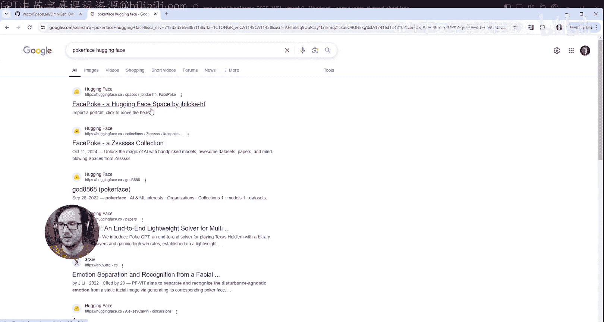

What this thing can do， we can upload an image here。You。

 you'll see the power of this immediately when we use it。But oh， yeah， we got me。

 Let's just use me as an example。 Sure。 So I have some I was making some thumbnails the other time。

 So this is me， obviously， right。And so now my face looks a little bit weird。 But if you go here。

That's where blurred me a bit。 I can actually click here， watch。Id moved my head around。 Now。

 it does something a little bit strange of my face， because obviously， it's not exactly me。😀。😊。

Right but we can go here and I think we can change。The markerers back here。

Like we could open the mouth more。 sort bit tricky。I just I click in the move。 There we go。

I'm not really the best at this。You see like here。It's not really clear like how to do the clicking。

 But the point is， is that you can clearly do some things。 Oh， that was kind of cool。Go I get here。

And so there's definitely ways that we can move the mouth around。

 And so that would be one way that we can take our characters and kind of bring them alive and have different things。

 But these are not expressions。Right， so that's kind of interesting。 I like that。

 But I would also like to try out。

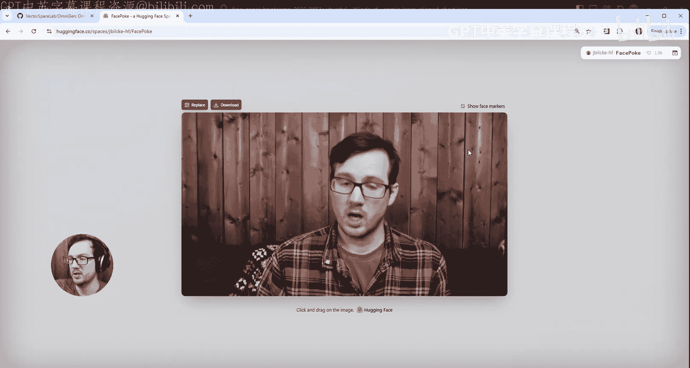

This model here never ran it locally。So the trick with ready these models is like， was it trained on。

 right， That's always the problem here。 But I'm gonna go ahead and clone this。

 And I wan to see if I can get it working locally。

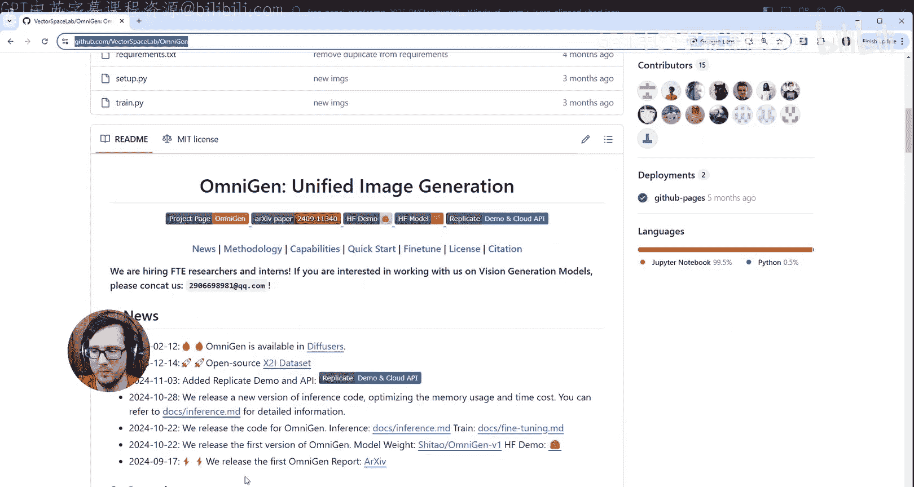

So I'm not cloning this into any particular。 I'm not cloning the free Gennyi boot camp here。

 We're just gonna clone it outside here。 So let's go back here。 and we'll do get clone。

 And we'll see， we can try to get this running because I think this would be really exciting to utilize。

 Now there are services that do serve it up with costs。

 But because I have GPSus I want to try to utilize those GP because if cofy U I can generate me on images。

 Why can't I utilize that。 Now， if you used cof Ui， you have more control。

 That's just a workflow thing that allows you to download models and use them。

 But that would give you a lot more control about like the exact pipeline of what you can do with it where this saying you just give it an image。

 a couple images and tax and that it should work。 So now I have that download it here。

 I'm gonna go open that up in windsurf。 So we're in sights， I'm gonna go back a directory here。😊。

Here， and we're gonna go into。A pokeky agent。 But that's not actually the same thing that we just looked at that or something else。

But we go into our omnigen here。 We'll say， okay。

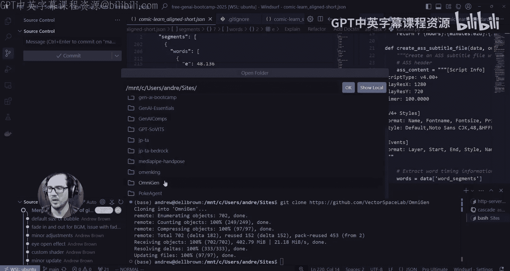

Right， we'll give that a moment。

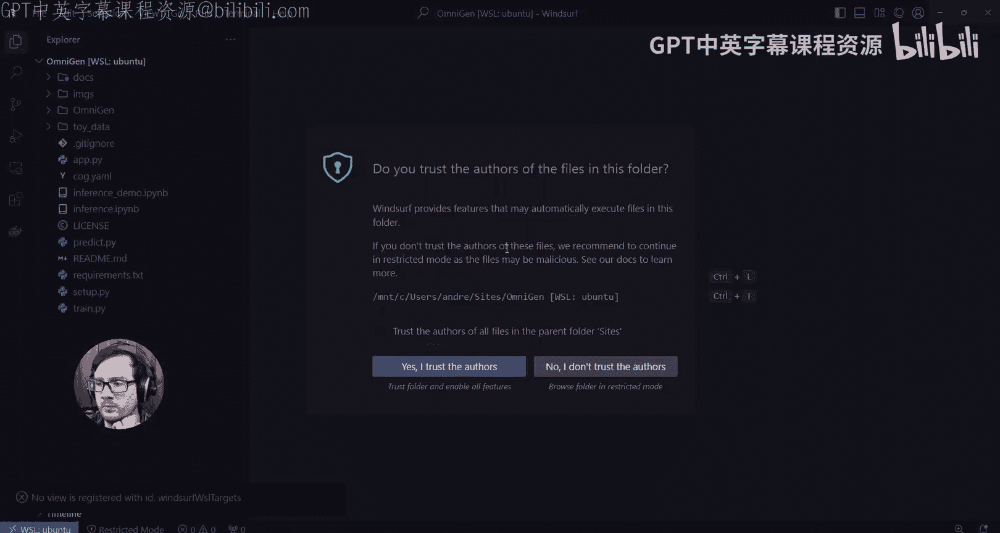

See I trust。 And in here， there's some way to run this。 So we have。Over here， yeah， I'm out。

 I get it。 I'm out。First time I' out of stuff。But here we have this。 And then we have the demo。

I'm not sure why this one's so darn large， but we'll open it up。For out of memory or time cost。

 you can use offload model Tru。Right， so here。We have a demo。What's it doing？

 It's changing the drink， What it is。 It's changing the cup。 So this。

 maybe I'll try to run this one first and just see if I can utilize it。

 I should have a separate environment for this because， you know。

 if you don't have separate environments， we're gonna have problems and I need to go make one。

I'm gonna go to my Github here causeuse I never， I can remember what the instructions are。

Let's go over to our read me here。 Does it have how to create the environment。 No。

 it's not gonna give us that。 That's， that's too basic。

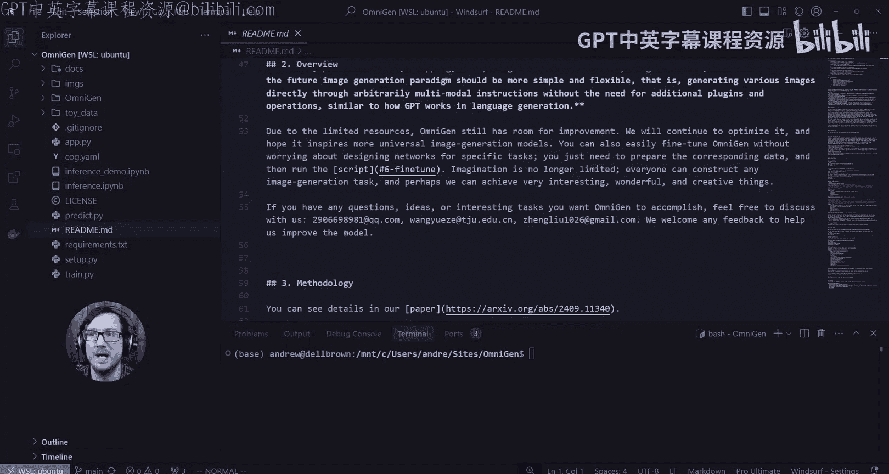

I'm gonna go over to my Jenning essentials。So go back here into example pro code。Jenny essentials。

And in here， we'll have how to set up our local dev environment， right。

 So we'll go into here and we'll go into Conda。 and in here， we'll go to set dot M D。

And what I want is something like this。 Now， I'm gonna choose， I keep going 11。

 I'm gonna go a little bit newer than that。 We'll do 11 here。 And so in here， I want to bring this。

 This is for omnigen。

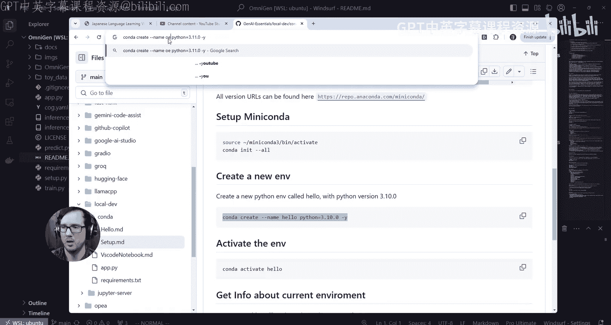

Omni gen like that。 Okay， so go ahead。I'll put that I don't know。 I don't install the the the I。

 the IP， whatever you call it。When I do that， but that's fine， we'll fix that in two seconds。

 So I've created that， we're gonna activate it。We need to。Do that install。 So we have Conda install。

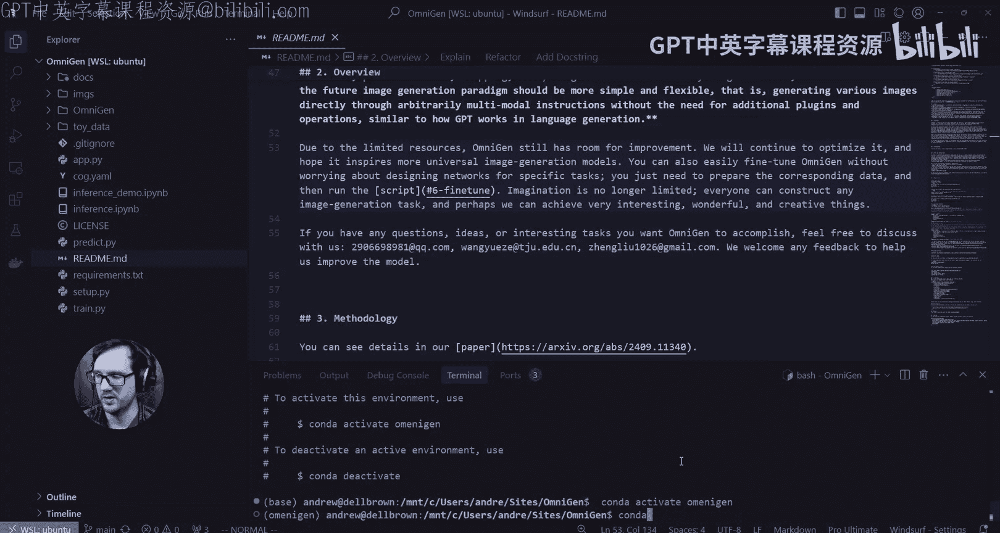

It's like IPY kernel。I PY kernel， I that what it is。 I always spell it wrong。

 So we'll go ahead and grab it this way。

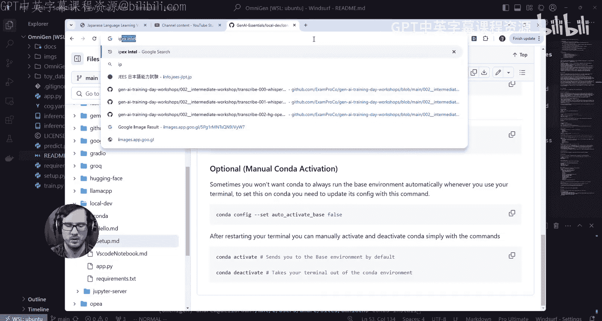

I will say， was it hyphen C condeforge。I think this。

And so that's going to use condoda forge in order to grab that there。

 that's going to go ahead and install that。 And we'll give it a moment here。To get going。

It wants yes。 We'll give it a yes。AndSo now we are good and we're gonna go back over here。 again。

 I'm in windur ifm， I'm not really utilizing it too much。

 I could definitely go back to V S code here。But I'm gonna go over to the demo。

 and I'm gonna say open anyway， I don't care that it's a large one。 We'll select the kernel。

 We'll select Python environments。 I'm looking for。Omnigen， here it is。 Okay， so we have omnigen。

So for out of memory time or cost， you can use offload model true。So the only thing is like。

 because I'm， I'm sharing my GPU with this video。 I almost think I should stop the video。

 but we'll see what happens here。So we'll go ahead and we'll hit this。

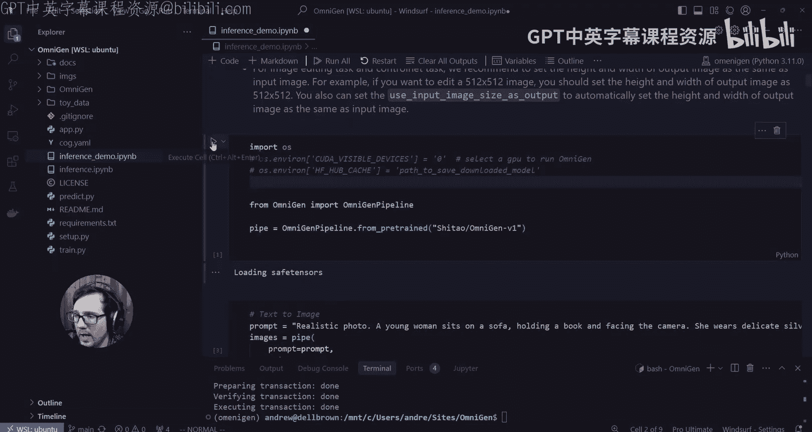

You know， I want to see what happens。 I'm gonna see if my GPU actually goes down if I pause the video。

 I'm gonna be back in just a moment。 Im can just hit pause。

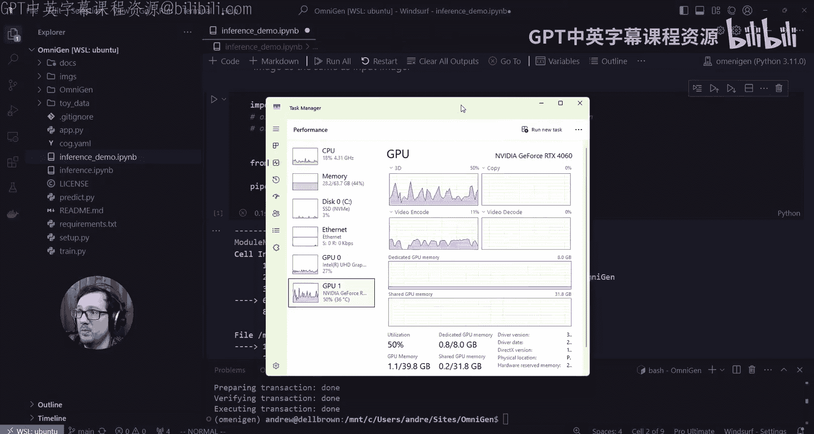

Well， you know， what definitely happens is that video encoding。Drops here。

 And this kind of comes down here for a bit， but not not enough to help。

 right We'll go back over to here。 We see。

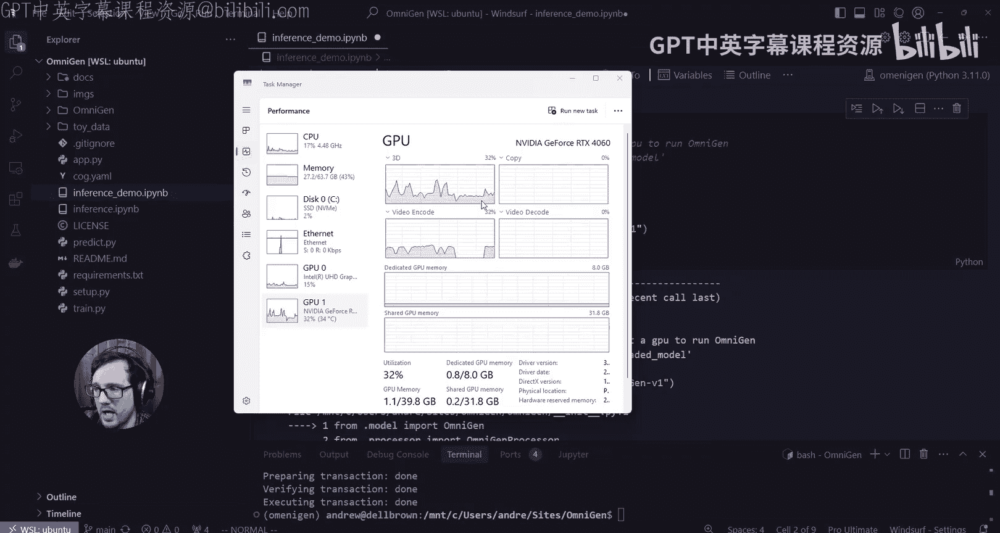

Rning the first line。 it's already messing up here。 What's the problem we have。跟 Port。Inport torch。

 no torch。 So it would have been nice if they gave us full instructions on how to run this。😊。

We have set up。What's this。Okay。So there is a setup。Why does it do this。All right。

 well let's take a look at the re， maybe it'll tell some a quick start。Do this。 Oh。

 Pi install hypheny。 Okay， so we'll do this。And so that's going to install。Whatever， hypheny。

 I guess is just like the current environment locally。

And it seems like I saying you can also create a new environment。 That's what I did。Oh。

 and it could have just done that。 he's using 3，1013。 I'm using 3，11s。 Hopefully that's fine。

Itstall pieytorch with coudaversion。A lot of been good to know before I did that， so we do this one。

Pi torch with kuda version。 We might want to do that。

 This is using a very specific version of of kuda。So we'll see what happens here in a moment。

 Maybe this this is going to fail。 and we'll just delete this environment。 But if we have to。

 it's not a big deal。 So we'll wait for this to install， okay。

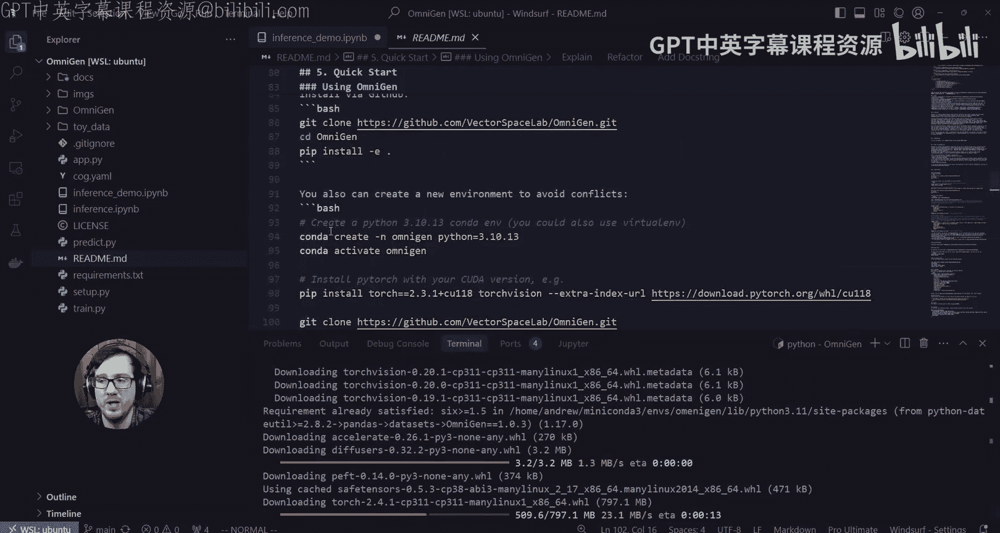

Alright， so it says that those requirements are installed。

 We might again have to use the very specific version， and。

Its solve the very specific version of Pytorch to make sure everything works。

 And even here they're doing it prior to this， which maybe we'll have to do that。

 I like how that shows us the implementation here。 Let's go back up to here。

 We're going to we're actually already selected on this one using 311。

 Let's go ahead and try this again， Select a GPU to run on open Gen AI。

 that's our open Gen or Omni Gen， I think we would actually want to do that。So。I mean。

 maybe it would do that automatically。 We can go over here and take a look at what's going on。

No changes so far。But all this would do， I think， is。 Yeah， it's downloadling the model。

 So it's going to download the model。Right， and then once that's downloaded。

We have other things going on here。 So here， we'll just read up ahead while it's still downloading realistic photo。

 a young woman sitting on a sofa holding a book， whatever。

 And so they're sourcing the image and they're describing what it is。

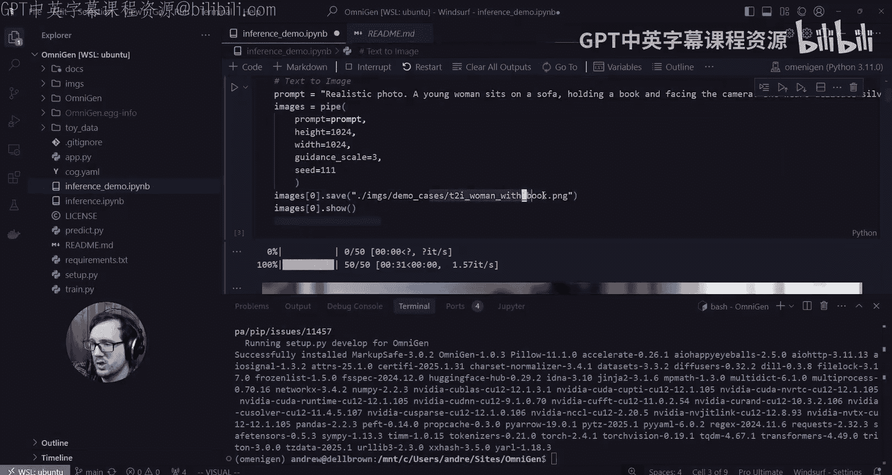

Right， so here。She wears a delicate hoop with whatever almost looks like they're creating the image。

 right， but they're they're describing what the image is。Oh， no， this actually generates an image。

 Okay， so this actually generated out this image。

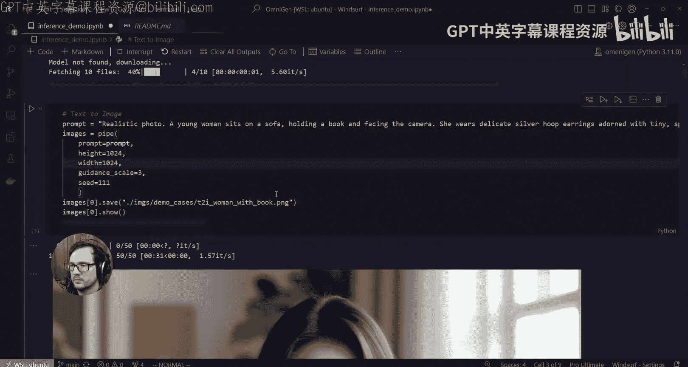

I mean， it's a little bit smooth， but I mean， still good， like。Even for our game， if we had it。

 it'd be fine。 We'll go down here。 And so now， what they're saying。

 our model can perform multiple editing command simultaneously。 So here， remove the women's earrings。

Replace the mug with a clear glass filled with sparkling ice cola。Do do that。

Replace the mug with a clear glass of sparkling ice cola。 So here we prompt it。

 If you want the image generated by omnigen text image。

 you must use the seed if a different one's there。 Okay， so we go here。And then， oh。

 that's the input。 And then this is the output。 Okay， a little bit weird looking。

 but looks like it's hovering on the table， even though it， it casts a shadow。So。

 so if the woman is thirsty， what should she take， find it in the image and highlight in blue。

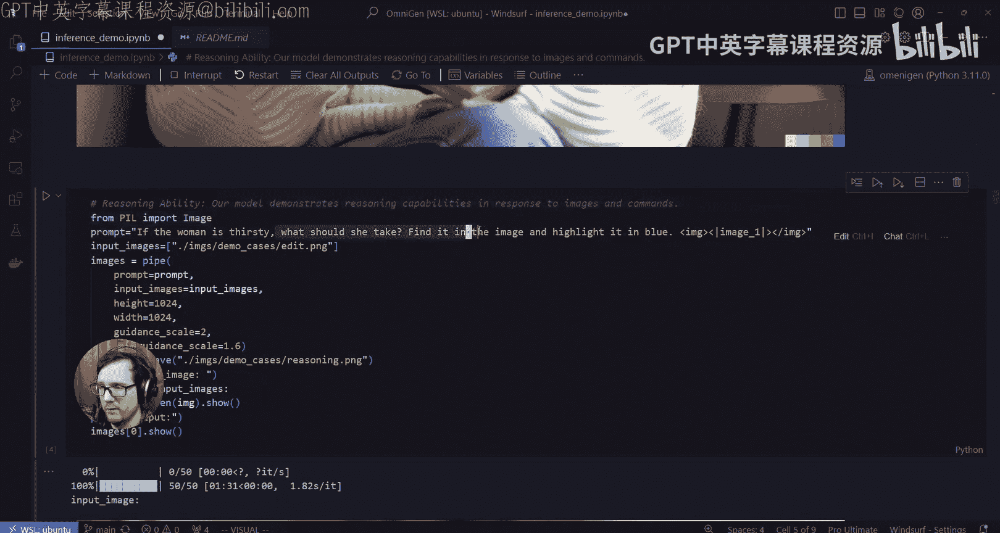

哦。What happened there， Oh， maybe that's the original source image。 Okay。

 maybe they're using a different one。Yes， it's not consistently the same wine。

 That one's a bit distorted， but it still is there。 And it highlighted it in blue， okay。

Then what do we have next， De Deect this human skeleton here。 So we got this skeleton here。

 and we get that skeleton。 generate a new photo using the the following picture as the condition。

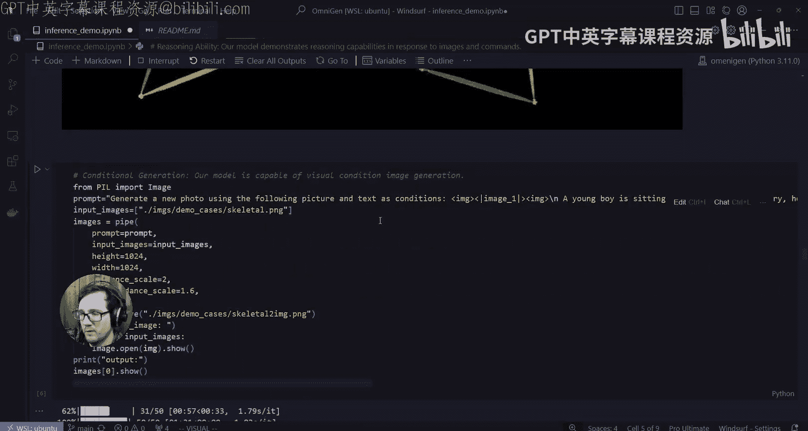

A boy sitting in， whatever， whatever。 And so here。

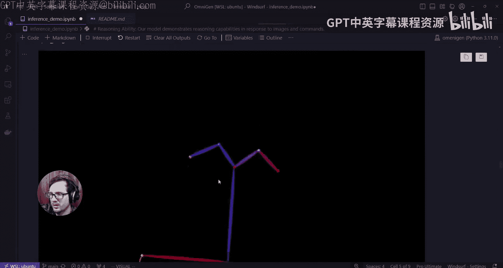

We input the skeleton， and we get this， which I think is pretty cool。 Going over to here。

 it looks like our GPU is， I don't know。 It's pretty consistent here。

 It's probably still downloading the model。😊，So here following the pose of this image。

 Jerry new photo of a young boy sitting on a sofa。

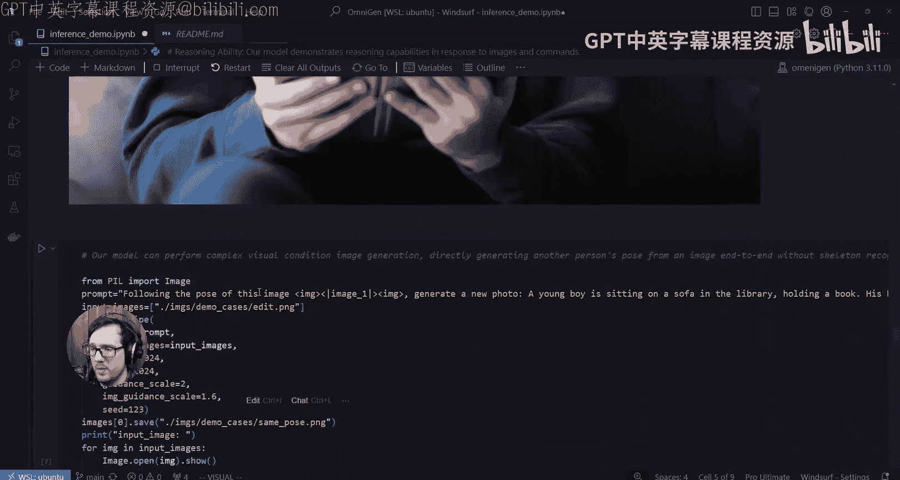

Okay， so it matched the pose， which is nice。

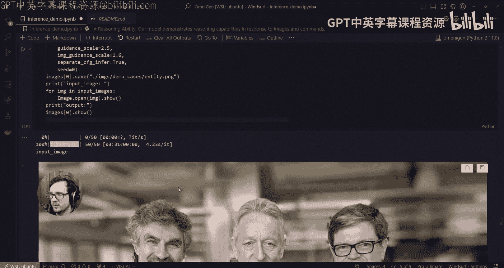

A professor and a boy reading a book together。So here's the ability for us to identify。

 describe subjects in multiple persons and generate them out。

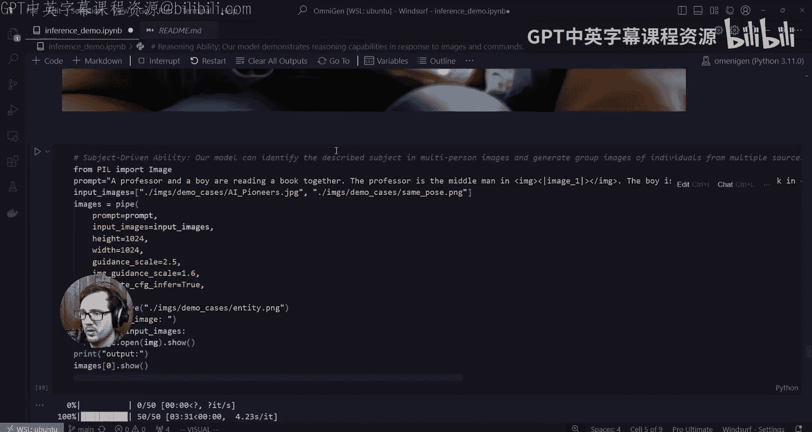

Okay， so， I mean， these look like all the same examples that we saw there。

 But I want to see if we can get this to run。

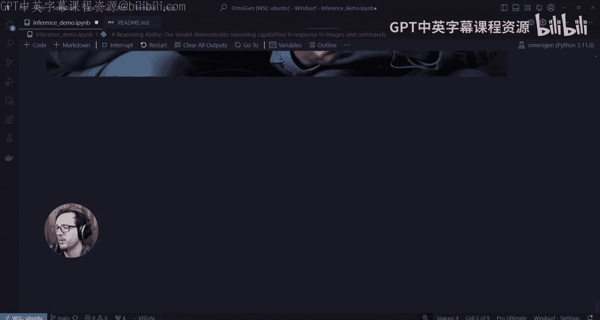

Cause if we get this run， then the next step will be good。

 It's really take a long time to download this。 I'm not sure how much it is downloading model I found downloading。

I don't know。 but you have to wait。Quite a bit of time。

 So I'm gonna pause it here until it's 100% downloaded， okay。

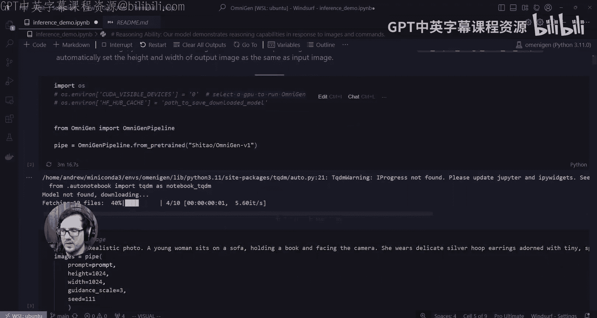

It is downloaded。 Let's go take a look and see what we can do next。 So let's see if we can run it。

 What I'm curious is， what is it utilizing CPU or GPUs。

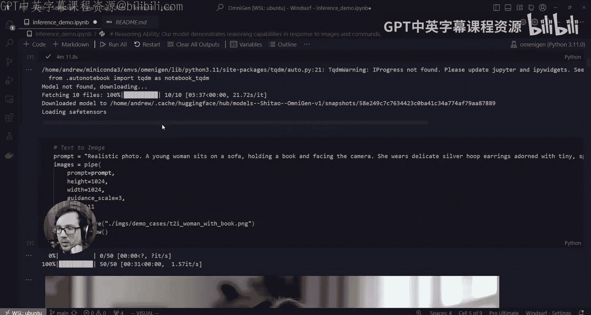

It is using R。CPU initially。 But now we're seeing it utilizing GPs。

 It's using all the dedicated memory。 It's going， going， going。 It looks like。

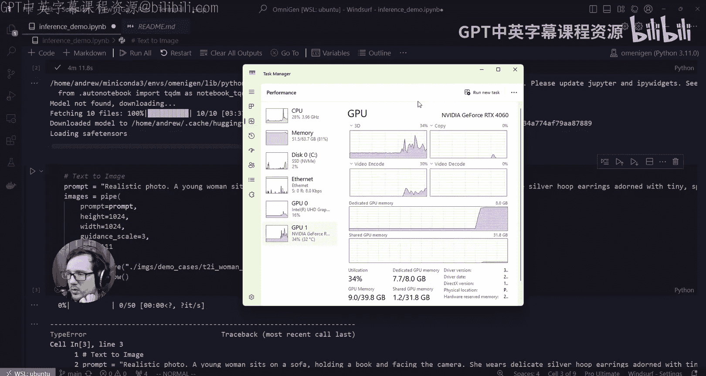

It kept out。On our dedicated memory， let's go down here， take a look here。

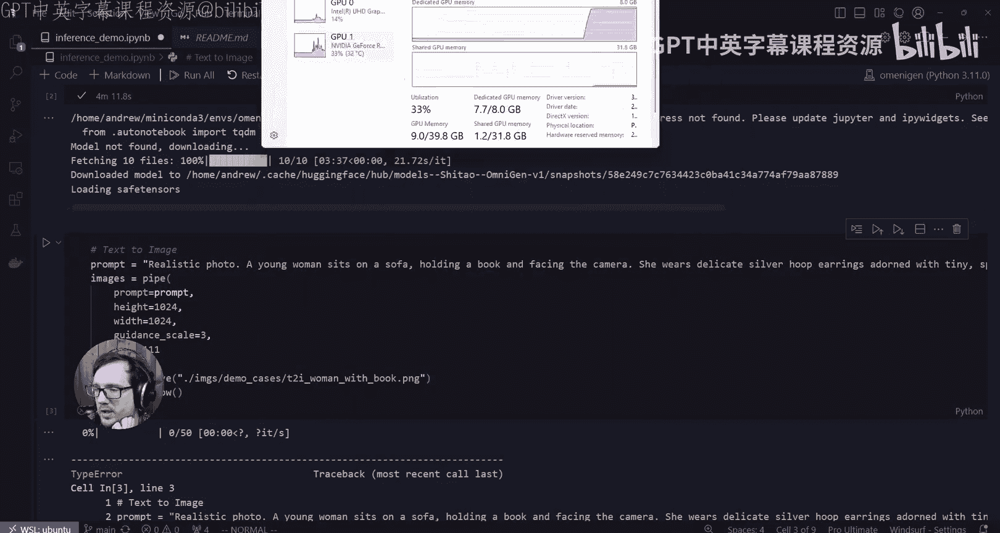

So， here it says。Cannot unpack non iterable non object。 What does that mean。

I don't know what's trying to say here， cannot unpack non iterable non type object。On images here。

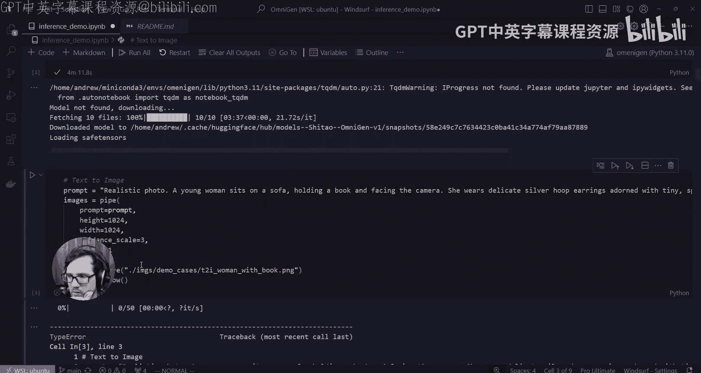

Did we forget to run something？I don't think so。It is a type error， that's for sure。

So I'm not exactly sure what's wrong， but we'll go take a look。 We'll just go ask Claude。

 maybe I'm all out of credits， folks。

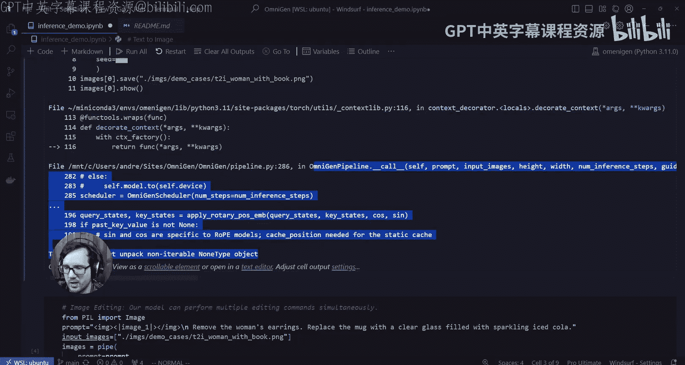

I bet you never thought I'd up running out of credits， but I have ran out of credits。

We go ahead and run this。嗯。Could this be related to Python。Or ka。

I definitely is out of memory when when GPU is exhausted， operations can sometimes return none。

And so I would say that that's our issue we're seeing here is that we see。

 look dedicated memories at the max right now。

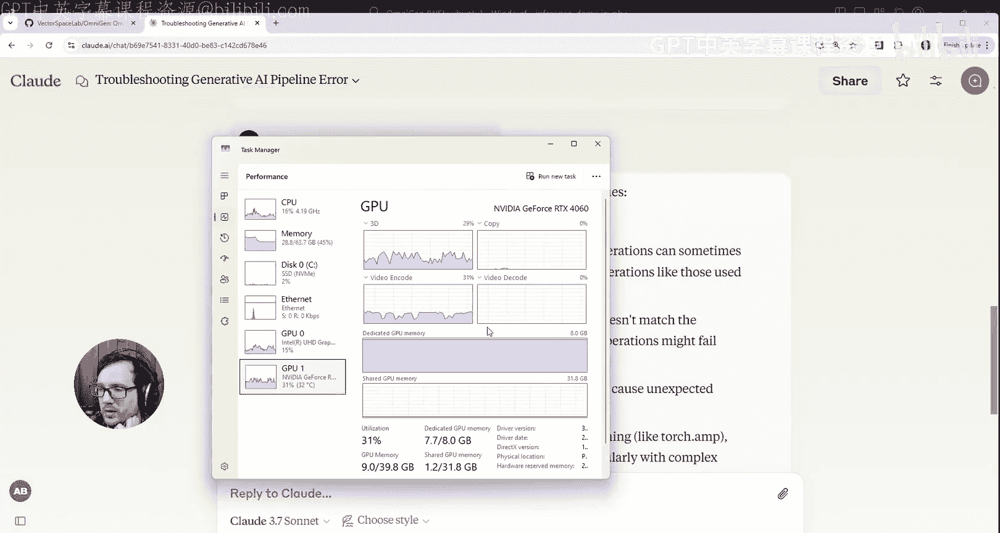

There's no memory available here。I'm not even sure how we get the memory back at this point， so。

See here what spiked up and went down。But yeah， I guess I'm just gonna have to stop this videoca I can't really run it。

 but at least you saw that we could do it。 Maybe I can do a follow up video if I can try to solve it here。

 But I guess that's all we can do here locally。

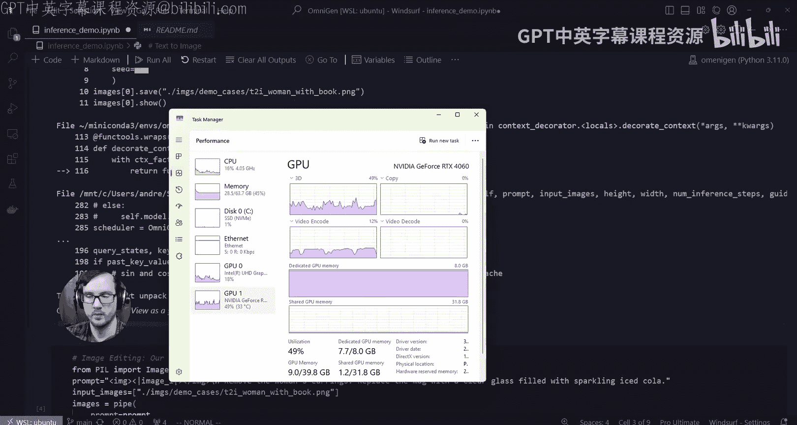

I'm going to stop this and then see if I can get my memory back， okay。

