# ExamPro《生成式AI训练营｜Free GenAI Bootcamp》中英字幕（deepseek - P79：-79-OmniGen Replicate and LightingAI.zh_en - GPT中英字幕课程资源 - BV1SFEWzLEab

All right， I am back。 I did try to restart my computer， did clear all all the V Ram。

 but I found out actually， if I closed a visual studio code or windsurf。

 that was what was holding the memory in place。 So I looked up omni jam about its requirements。

 And I think it said like 40， I don't know why I just thought this is something I could run locally。

 But then they started comparing it with putting Omen King in there。 but omni omni Gen。 But when I。

 but when I was in here， it was talking about like flex。

 I don't know if it really needs it like flex1， but it was something about like 40。😊，40 GB of V Ram。

 I'm not sure where I saw that specification。 But the point is is that I don't got enough Ram to run this thing locally。

 I think it's some a dedicated GP Ram。 I' never really certain， or maybe overflowed the other one。

 And it filled up。 But the point was， is I can't run it locally。 I don't。

 I don't have enough beefv computer。 We might be able to run it on lightning AI actually didn't try that。

 Wors case， we can go and use omnigen。Right， so this is a possible option。

 but now that I'm talking a loud， why don't we try lightning AI because I've been talking about using lightning AI forever。

 and I haven't touched it this entire boot camp。

And let's go ahead and we'll log in and we'll get to it。

 So I'm going to go ahead and use Google here。 And it doesn't really matter which way you get in here。

 I'm gonna get in this way here。

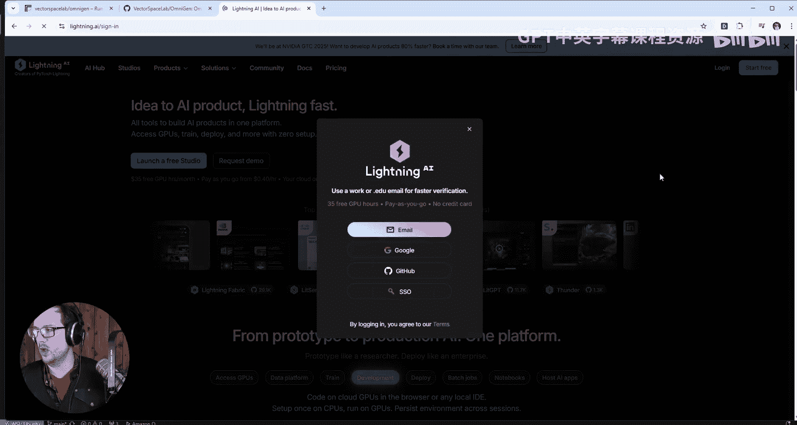

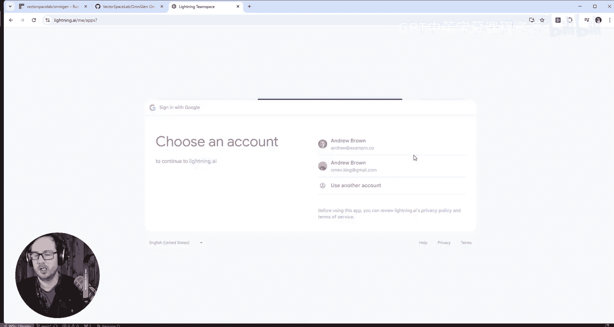

So now I'm getting inside of。Omnigen。 And so I wonder if they already have a a template for this。

 So sometimes they already have templates， they type in omnigen。

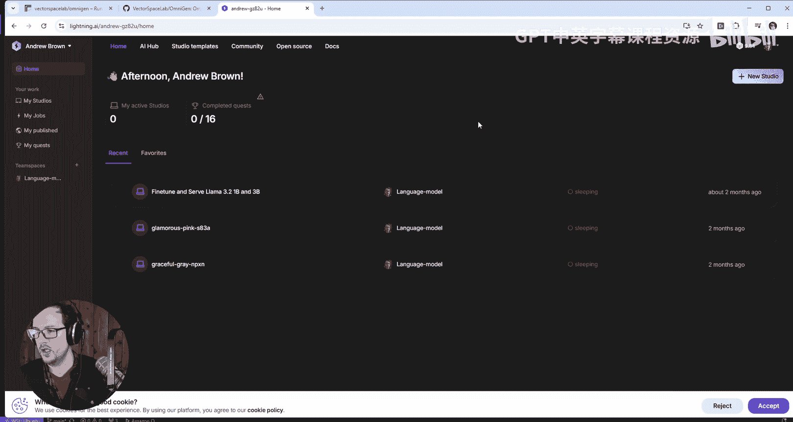

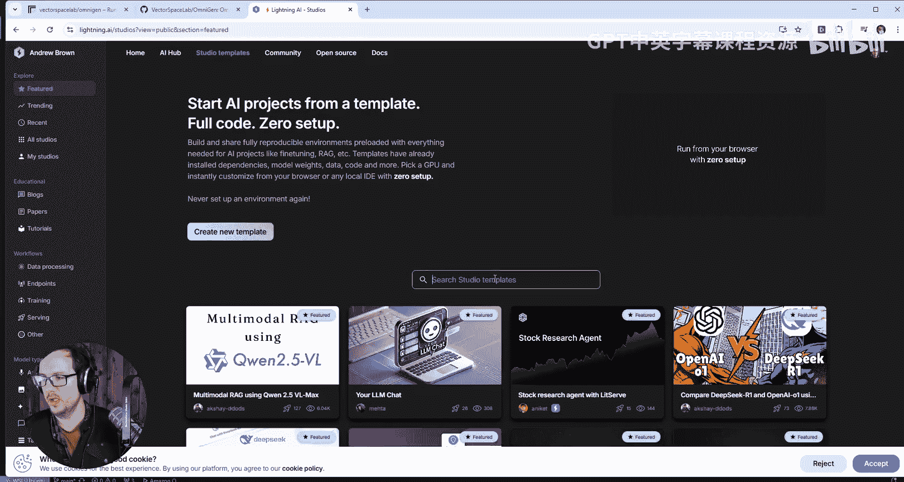

Okay， and there is one here。 So somebody definitely attempted omnigen。

 I don't think it's going be that hard for us to get running。

 So I'm gonna to go ahead and make a new studio。 I'm gonna call this 1。 I want to use GPUus。

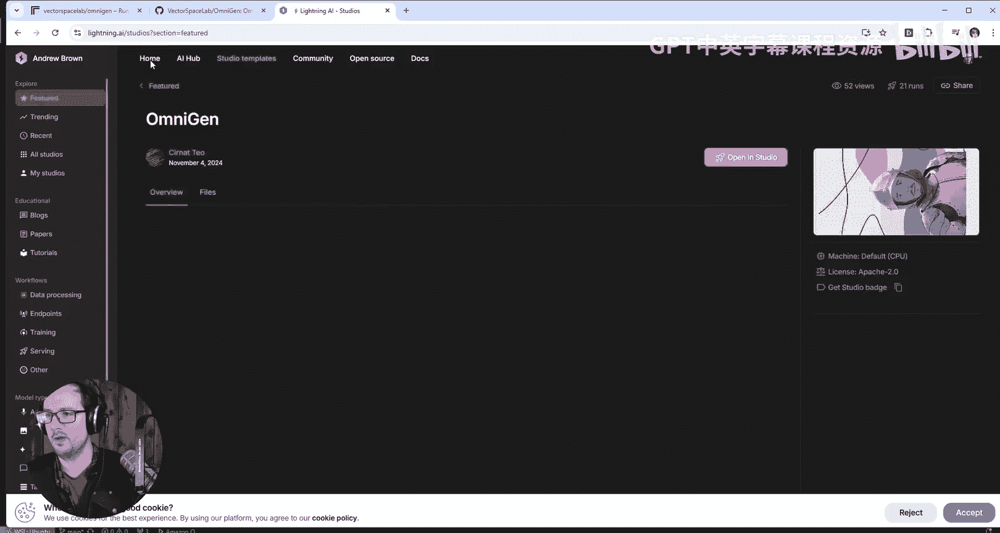

GP is GPs and。Even the lowest level is going to be here。

 I like how actually tells us the cost per hour over here。 So if we had to run it ourselves。

 we could absolutely do that。 I only need one T 4 sounds quite generous here。

 We'll go ahead and confirm。 And I'm going to go ahead and。This is code data prep。

 we're just going to start up， and so I'm launching 1 T4 on lightning eye。First time we used it。

 So 9。84 credits remaining。 That's totally fine。 No， I'll just。

 I'll just add credits when I need it or do whatever I have to do。

 I'll go ahead and accept that down below。 Let's go ahead and get this environment started up。

 So it takes a little bit of time。

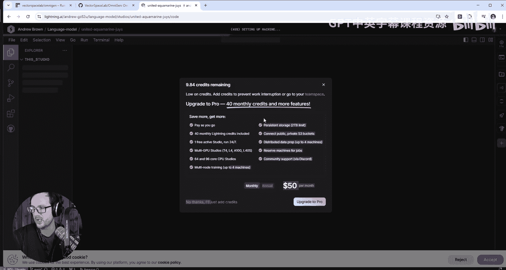

But we know the process now because we have a failed attempt at Omnigem。

But we're going to want to specify。

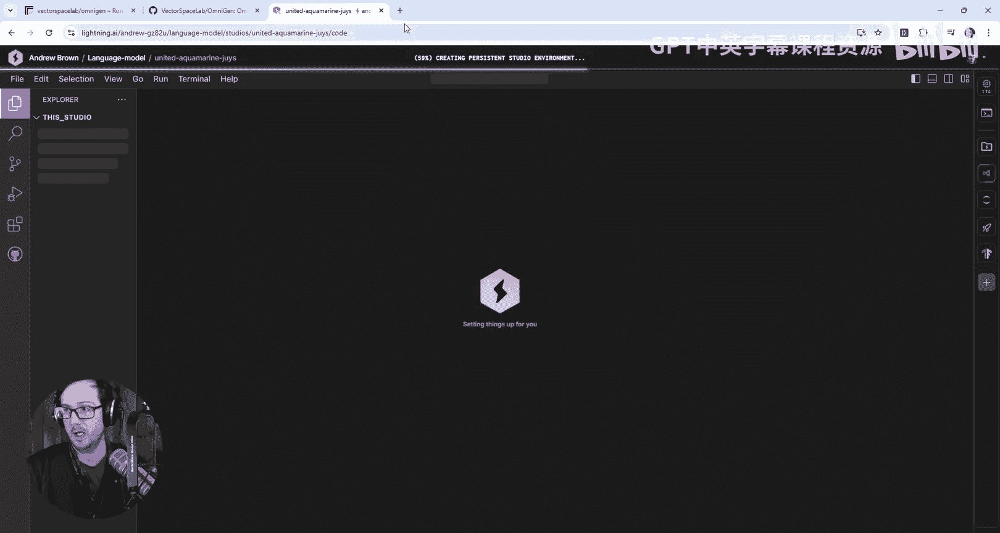

One thing I keep forgetting this， but if you want to get pie torch in the specific version you need。

And you go here or is it like installed， should say somewhere here。

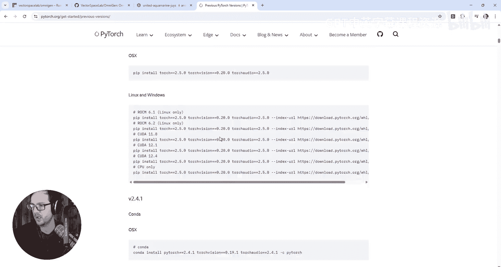

It has a thing， like to get it installed。

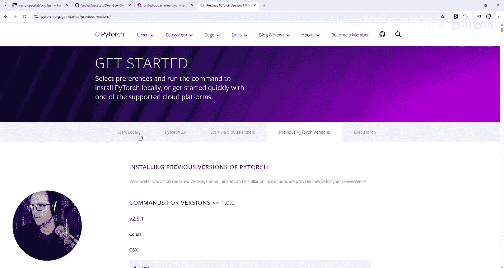

If we go to Py toch， start locally， start locally， you can。Go here and be like， I'm using Conda。

 I'm using Pps。 apparently Conda doesn't do that anymore。I don't know what Libtorr。 Well。

 I guess I kind of do。 I do know what Lib torchches。 Sorry， but it depending on what we want to do。

 We can kind of change our options here。 So Linux Windows。

 whatever and figure out what kuda version we have doesn't show all of them。

 but shows enough of them that we should be able to get this working here。 I wonder what， like。

 what version of T 4。

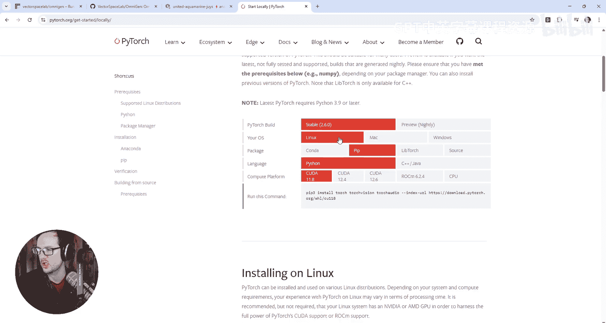

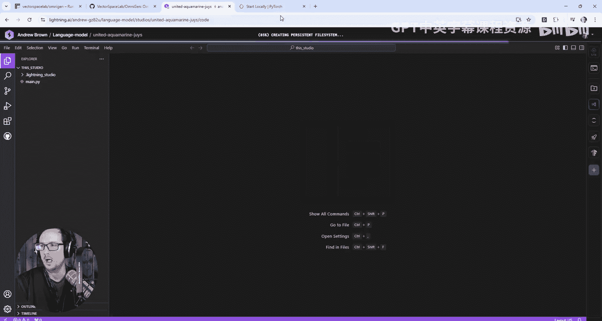

呃。And video T4。And then we'll talk about， was it Kuda。What does it support？ And， I mean。

 we can actually just ask when we're in there and check the kuda version that's installed in the machine。

 Now that this is up。 Let's go ahead and make ourselves a terminal。

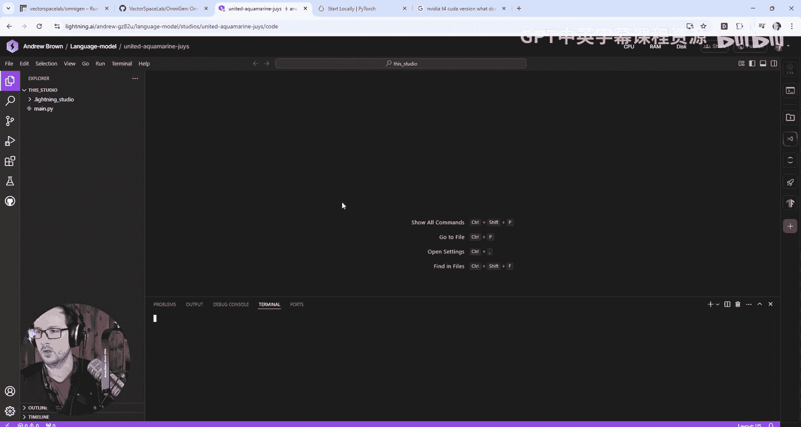

Okay， and I'm gonna go ahead and， well， while this is， while this is going in a Colus repo。

 I w to get this going here。

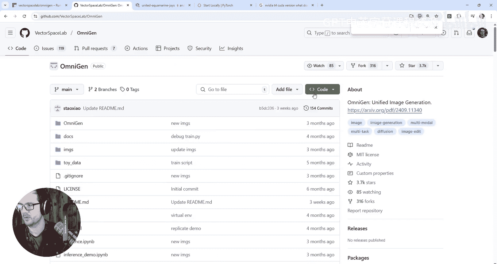

Soll go over to here and I'll say get to clone， whatever。We'll just dump it in here， y allow it。

Enter， So that is now cloning the repo。 I're gonna make a new tabs。 I don't have to wait around。

 And so if， if it does have M video， should be able to do Mvi SMI and we can and it's running 12。2。

 So that's the version is's running。 We'll go back over to here what options do we have。 We have 12。

2。 We have 12。4。

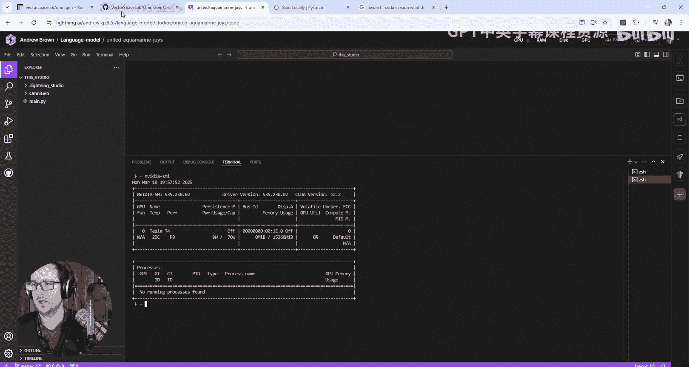

Well， what if we want 12。2 here is showing this。how do we get to 12。2 previous pieytorrch versions？

Okay， how do we get，re is the only number we need they don't have。So say。

Let's can sort of download Pi toch， whatever this is。1241 so why can't we just change this to 1，2，2？

We might just try that out。 So coming back over to here， we'll go over here as a clone。 It is。

 We'll go back over to here。 Do we have Conda on this environment。We do。 That's excellent。

 So we'll use condoda。

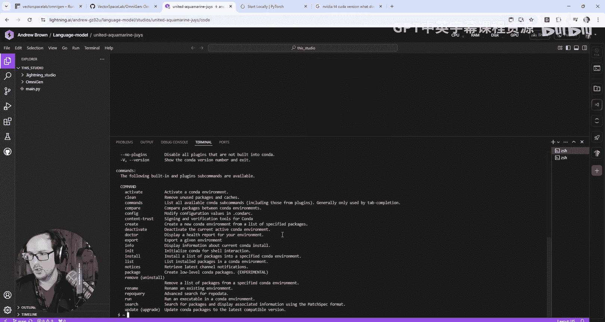

And follow the instructions they have here。Not that we need it， but we're going to do it anyway。

 So here it wants a very specific version。 I just want to follow it to the T exactly what it says we need。

 We'll go ahead and do that。 So I'm going to use 3。10 here。

And。Yeah， we'll go ahead and hit enter。Kna C is not allowed as studio has a default environment。

 That's fine。 We can work in the default。 I don't care。 But what Python version do we have， Python。

 hyphen hyphen version 3，10。 Oh， you know what， we're on the version we need。

 So while pretty close to it anyway。 So we're fine doing it that way。

 So I need a very specific version of Kuda or Python Pytorch。 So I'll go up here。

 and I'm gonna just change this over to 1，2，2。 I'm going to try to cheat and see if I can get that exact version I need。

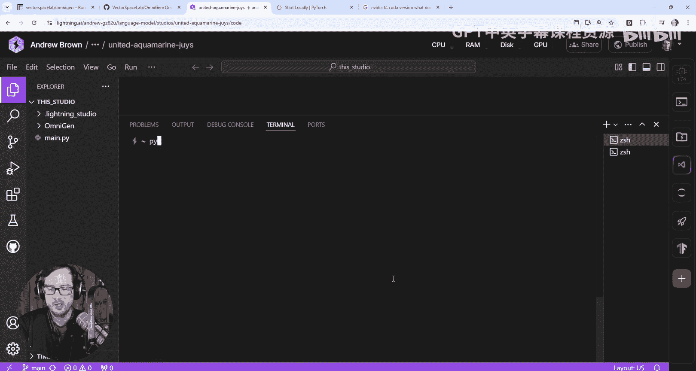

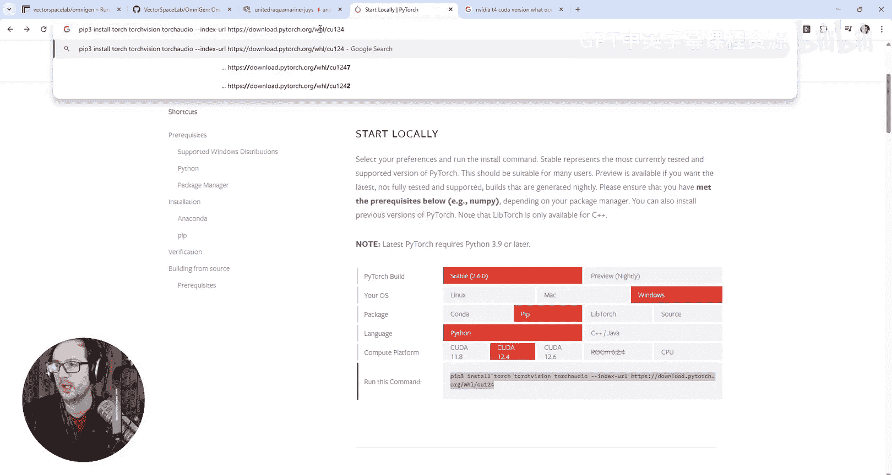

Okay， we'll also install the other three here。Once it already has that stuff installed。

 am I having conflicts here。Requirement already satisfied。

 So it's already saying that it's installed on this environment， meaning that I can't。

 I can't go in and install specific one， but maybe it already has what we need。 And that's fine。

 If it works， I don't care。 let's just get it to work。 So we're gonna see you knowmnija。

 And I'm gonna go ahead and run of this command here。

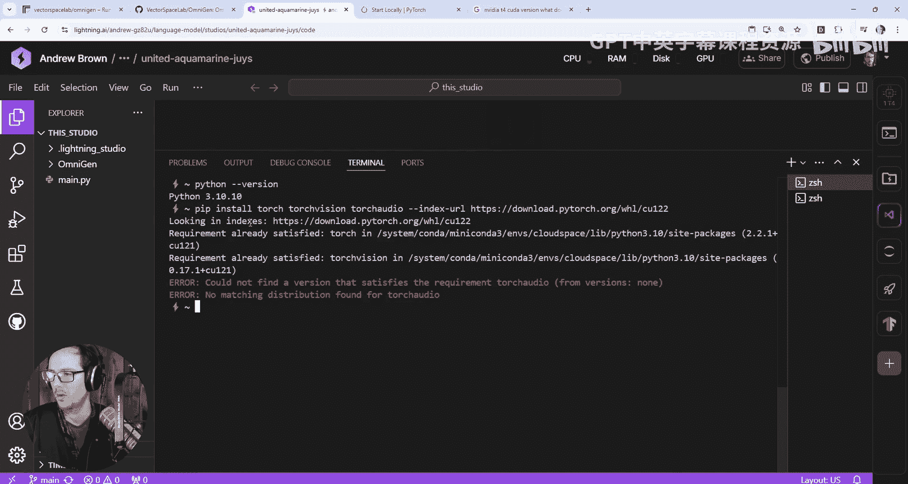

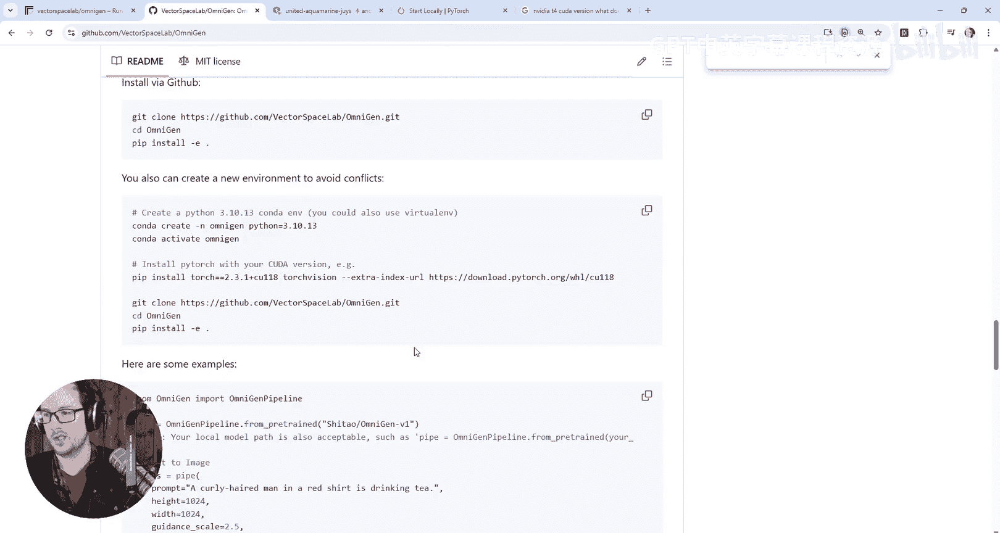

So I'm hoping that the T4 already here is optimized。Like。

 has the optimal pi torch version installed and that we can just start utilizing it。

 That'd be really， really nice。 So we'll go ahead and let that install me back here when that is completed here。

 okay。😊。

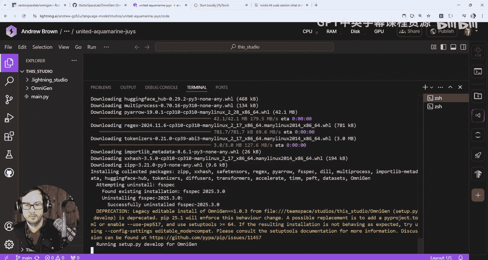

Okay， yeah， well， that was fast。 So that was now done。 We'll move on to the next step。

 So now we've done this。 I want to open up this thing here。 So this one here， we do have Jupiters。

 we can use that directly。

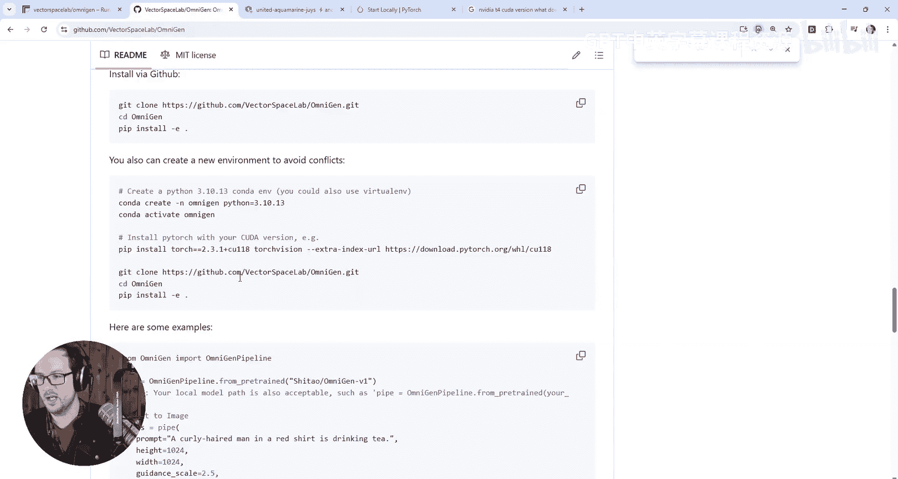

嗯。Yeah， we'll open it anyway， and I'll just open it here。

Whatever kind of environment you want to work in。 It doesn't really matter。

 But I guess we'll open it up in V S code So this is right in front of us。

It is a bit large because it has those images there， which is kind of annoying。Here we go。

 And so I'm hoping that we can just run it。 So let's just run this。 Is there a version  to。

 I didn't even know if there was a version 2， I assume it's just version 1。

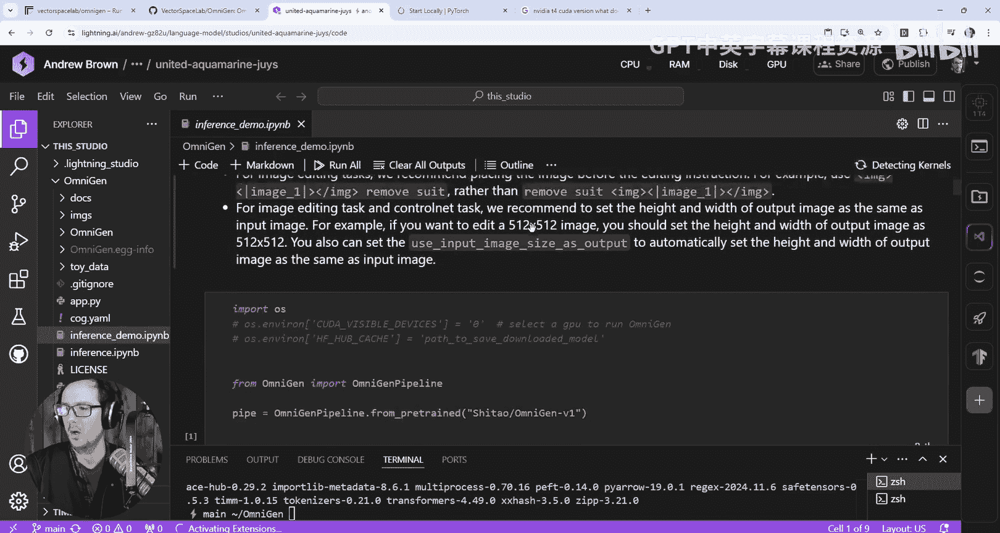

Let's go all the way to the top here。Not just version 1。 And so now we're gonna go ahead and。

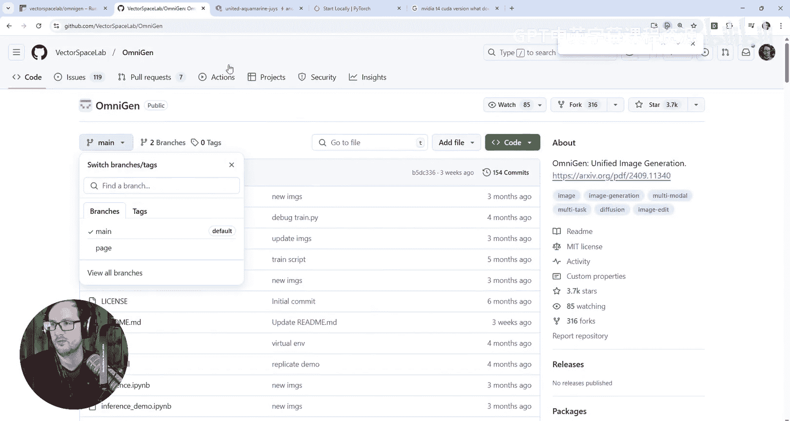

Download the model。 So this takes quite a bit of time。

 It's unfortunate because right now we're using compute。

 What I could have done is launch this in compute mode and then switch over the GPU。

 So we're not fully reckoned stuff here。 But we'll go ahead and download and find out what goes on here。

 okay。

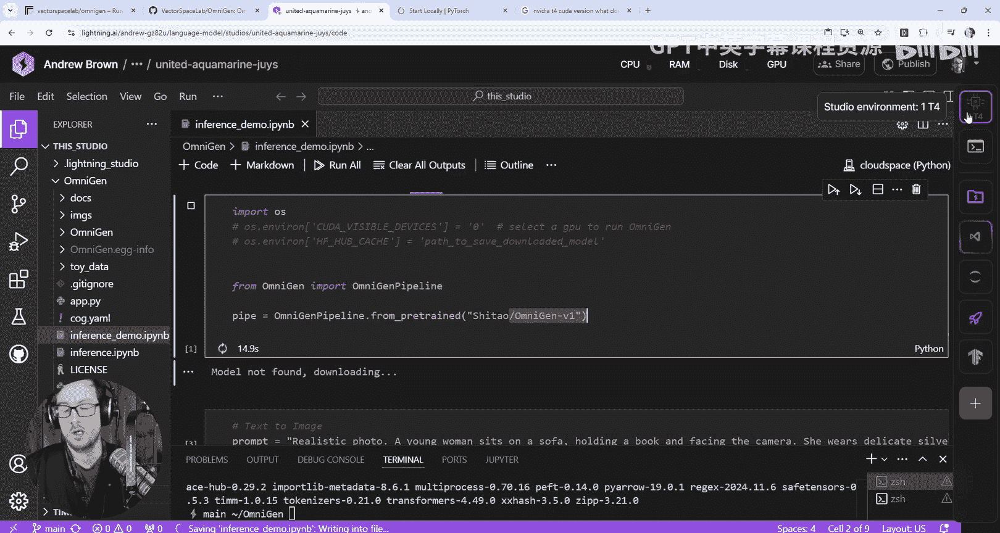

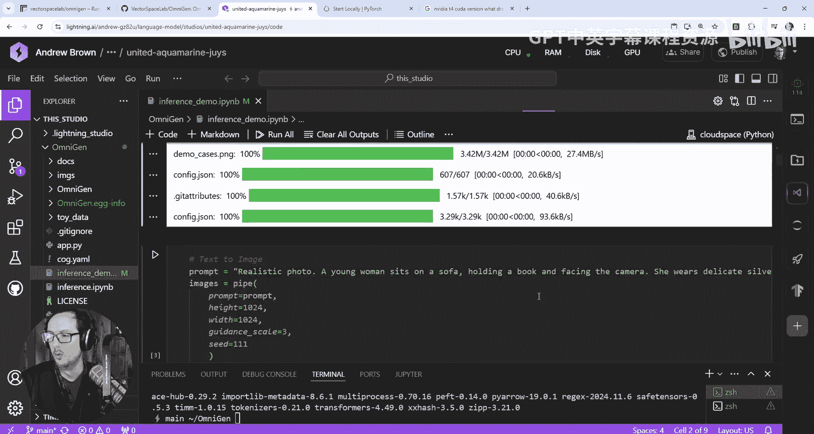

Alright， so here。

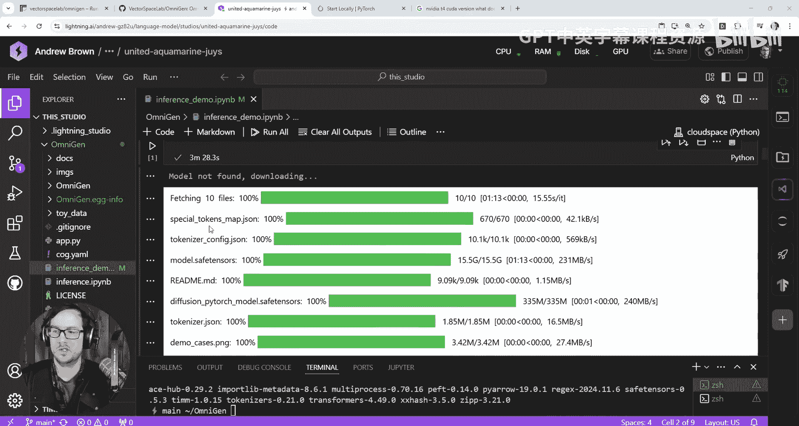

The model is downloaded。And we're going to go ahead and run it。 this just works。

 I' can be really excited because I don't know we should've been using lightning AI for a few of these other things。

But anyway， the point is's going to save the image to a very specific location。

 So we have a thing called demo cases。 Hopefully there's no nothing there already。 I don't think so。

And I think， it finished。Okay， we'll give us a refresh here。Where is our image。And we have an error。

What is there error unpacked non itable non type， the same problem that I had prior， right。

 So I'm not sure。We'll go over here。Like， how could we check。System resources。 Oh， it's up here。

 See up here， CPU。Right， Ram。Disk。GepU interesting， so。There's nothing here that's indicating。

V Ramm about V Ram。Here we have a lot。 So it says 8 and max is 16。 So this is。

 this says double the Ram that I have。 temperature power， Everything's fine here。 What is going on。

 So that makes me think that maybe there's nothing wrong my。 I mean， obviously， my。

 my virtual Ram got used up quite a bit。 But， you know， what could be causing this。

Let's go back and read the instructions at the top。 It's so hard to get this working。

 So for out of memory time or cost you can set the offload to true to select appropriate setting。

The inver time is too long， oversaturated， low quality。

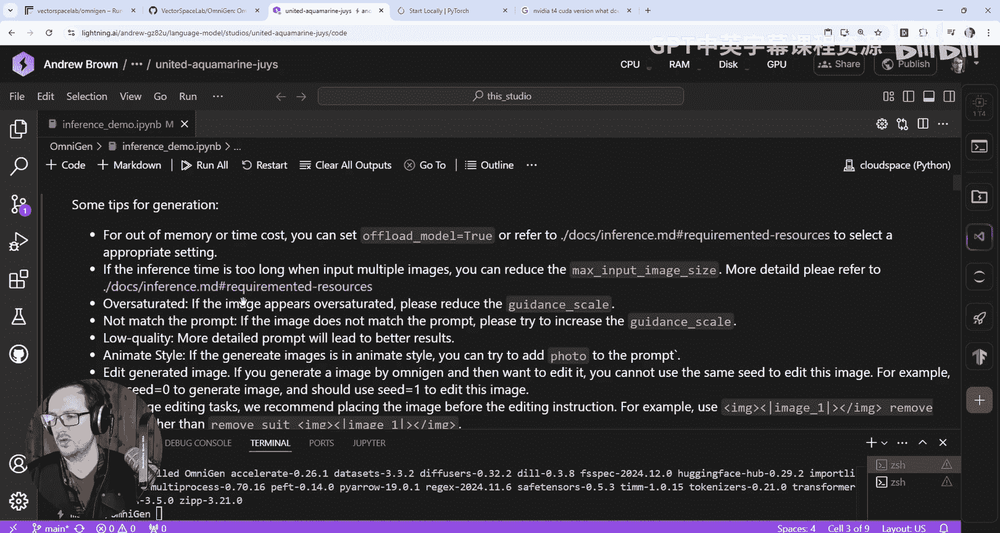

So I'm not really sure。Let's go over to here。

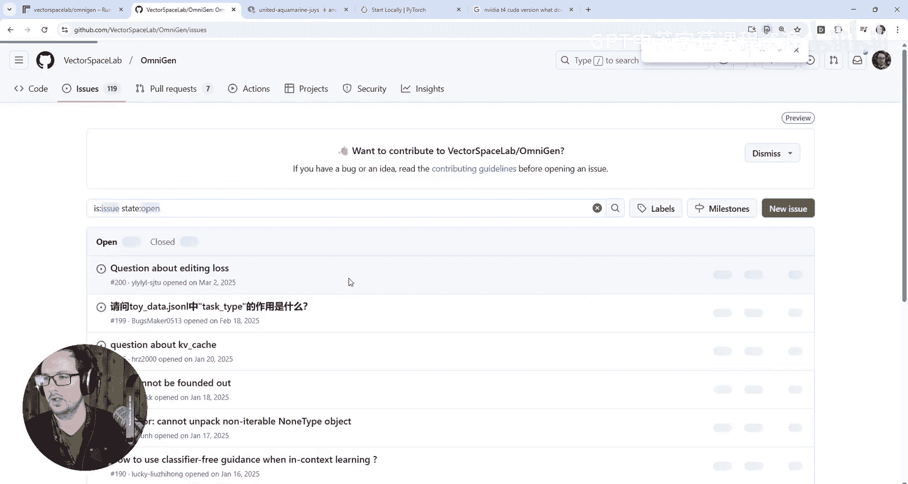

WeGo down below。

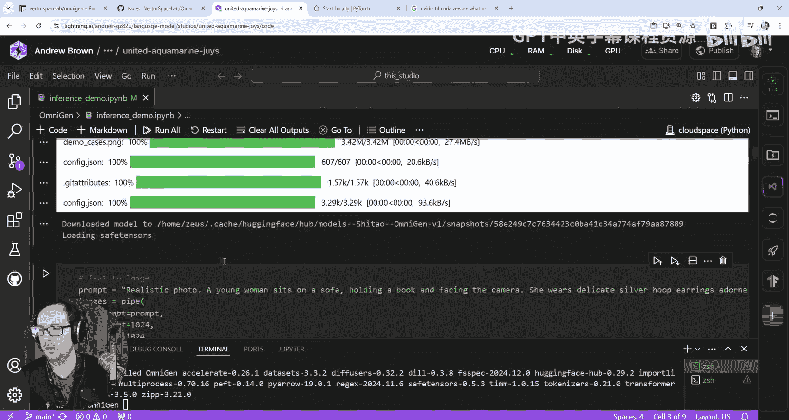

Can not pack。

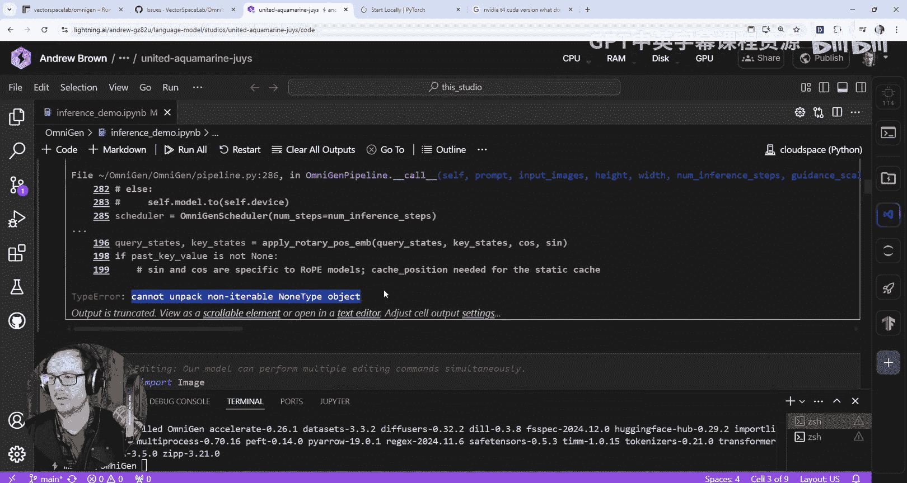

This this seems to keep happening。Okay， a couple people with this problem。So they have an RTx 4070。

 not too far off from what I have， I have a 4060， right？Oh they have logs， you can get the logs， too。

 eh？You can try to update the transformers with PP install。 It doesn't work。 Everything is updated。

You can try。 Thanks now。 works for me。 So here they're suggesting maybe there's an issue with transformers。

I guess the question is like， is this fixed to a very specific version。

 Maybe it will work on my local computer， I'm excited if it can。

 but I don't think I have enough memory for it。 This one doesn't obviously have more than 16 V Rams。

 So I'm not exactly sure why I thought it needed for it。 Maybe flux needed 40。

 And this one doesn't require the same amount。

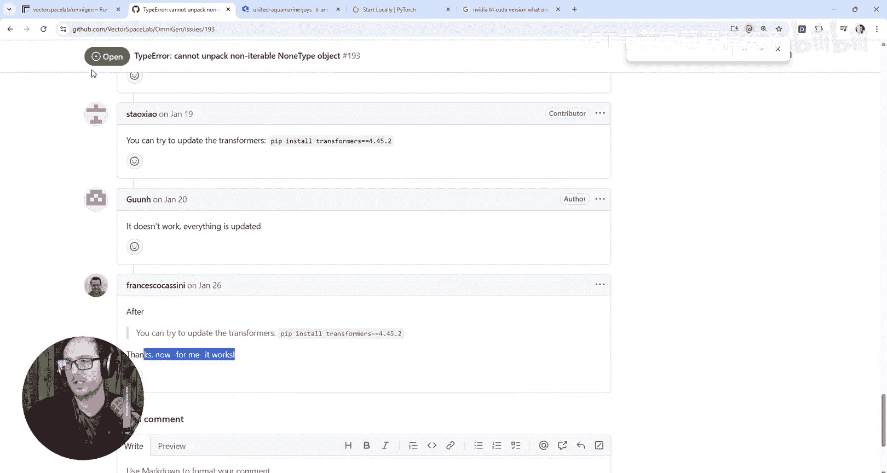

We're going to go over to requirements stt here。This is 4。452。

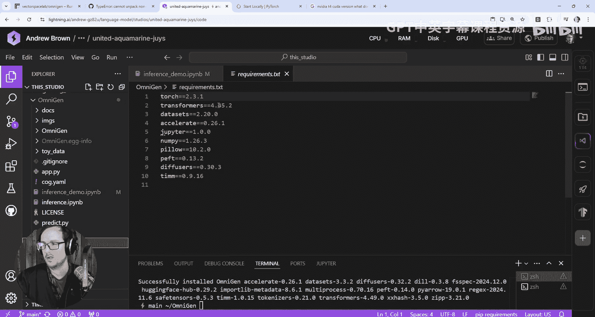

There says here。4。 4。2。 So that's already been updated to that specific version。

 So I don't think that is going to fix our problem。

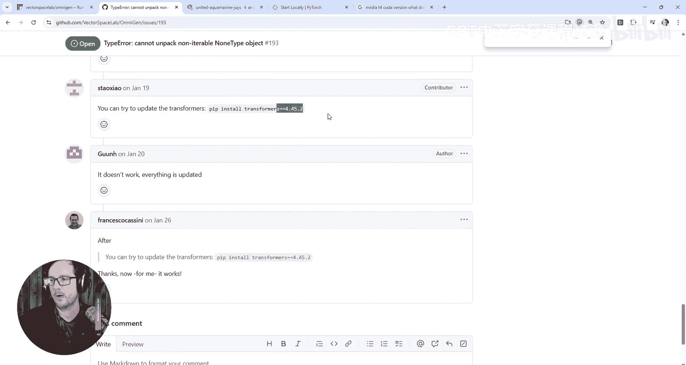

Well， we could take a look here， let's do PP show transformers。

 What version of transformers are we using？And this says 4。490。 This one's 4。45，2。

 So we are using a newer version。Then what's here？

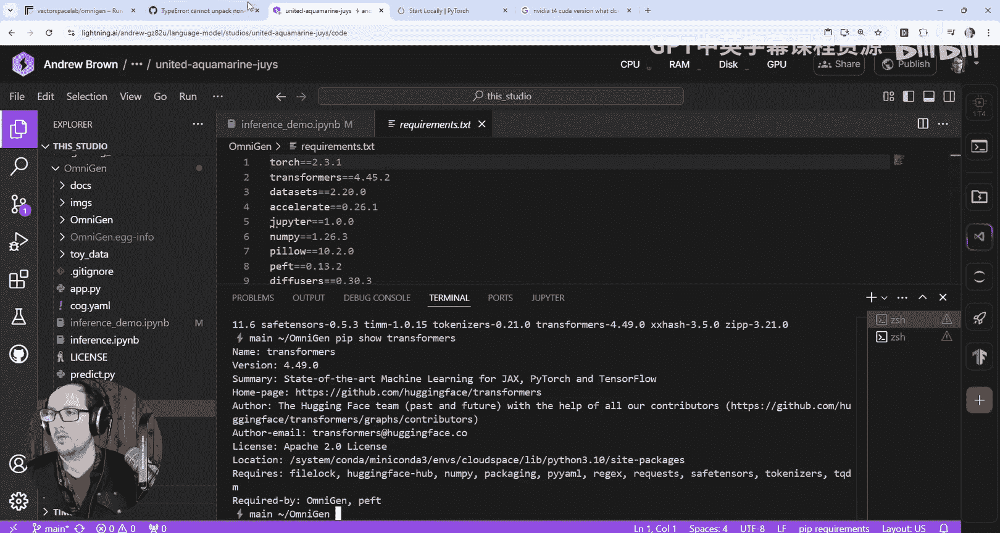

If there' a talking about updating and going to a later version， let's go back here for a second。

Here's another one。Not in English， but having the same issue。

Maybe the version transformers caused this issue， I tried and didn't change anything。

The problem is that the setup do pi requirements don't match the requirements do Txc value。

 So if you do a Pip install omnigen， it's installing the incorrect versions of various packages。 Oh。

 this is likely you can likely fix this by installing the requirements first。And then。

 packages without dependencies。ok。I'm not expert in codingd。 Well， then what are you doing here。

 I solved it by with the solution by with the above with 4。452。

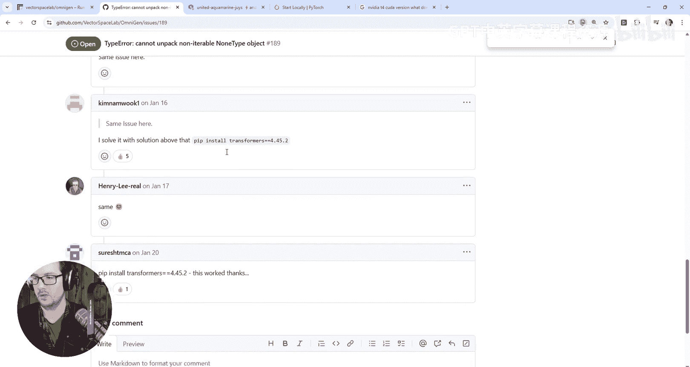

And here they're al time about 4。45 4。2。 but that's the version。 I mean。

 maybe we could fix it to that specific version。Here they're fixing it to this very specific version。

 what if we go ahead and do that？Let's try this。This is forcing a very specific version， 4。452。

And so now we're exactly matching。 see here it shows that it's this one， but it took a newer one。

Becauseuse this one has a was a triple。 It's just a double。Okay， let's try this again。

And else that we get。啊。I can't tell because the outputs here。S executing。

I need to clear this output because I can't tell what's going on here， clear， so I'll help it。

S this again。No， so we got this error still。Non iterable type。

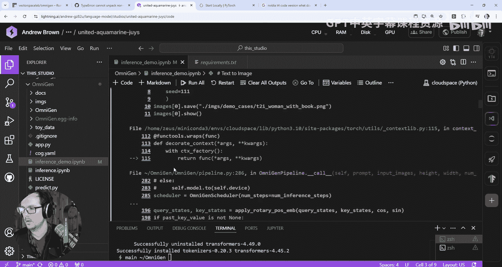

For this， okay， let's go back over to here。Does't doesn't match the requirement such exceed value。

 So if you use a Pip install E。As installing the incorrect versions of the various packages。

 you can likely fix this by doing this。Here。I mean， they're showing the requirements at TXTD。

 so I'm not sure what they're talking about。This one's completely different。 This is a gi。Its a gist。

 I believe。This is the forked version and then over here。

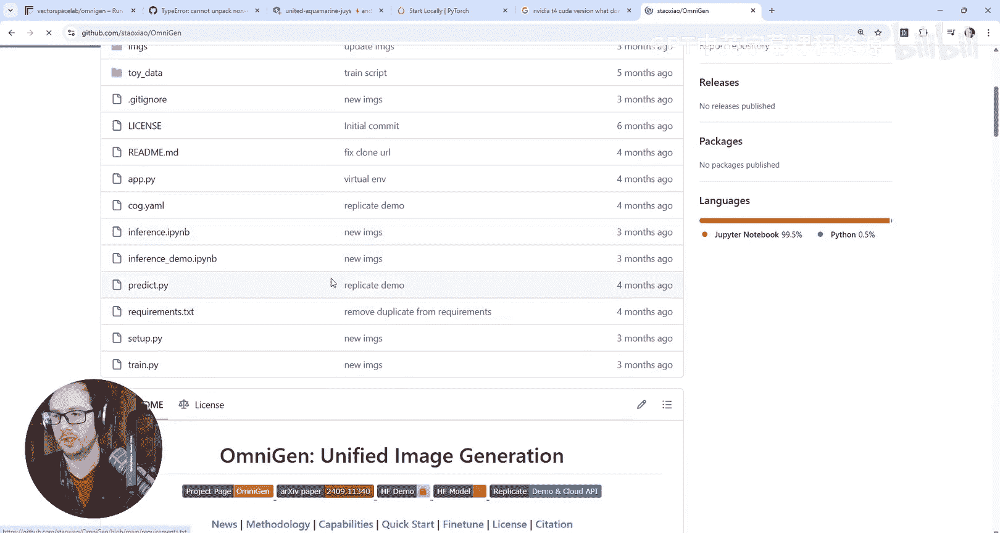

They have this。 So theirs is a little bit different。 I'm not sure if it is the same or different。

 We'll go take a look here。

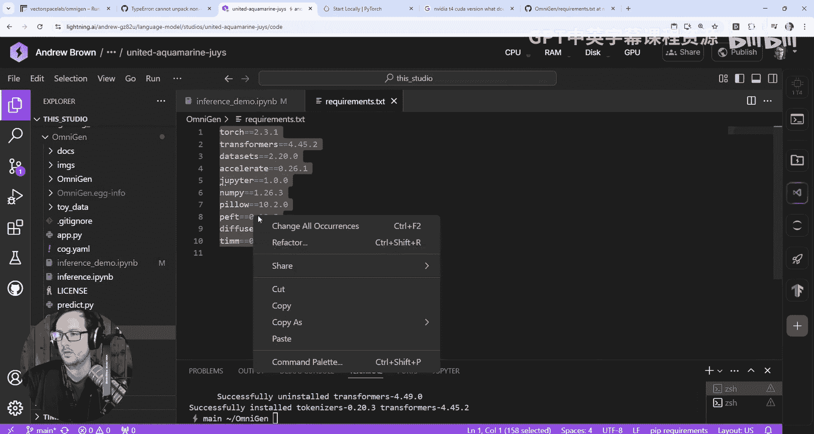

There's no difference。 It's the same thing。Yeah， I don't see why that would make a difference。

 It's the same thing that doesn't make any sense。So。Maybe there's why there's none that are closed。

So I don't think I'm going to be able to get this to work because if I can't。Work through this。

 I mean it's a copy U I， but it still fails。 Let's go here。 This is in a different area。

I it like omnigen run run by virtual environment。As Saoshi said， Satoy。

And I see people using Arch text 4090， things that aren't too far off of mine。So。

I was able to do that， using Pkyio。嗯m。😊，A lot of people suggesting this Pip。Transformers 4。52。

 we already did that though。It works now。 I could not make it run with40， so they're saying here。

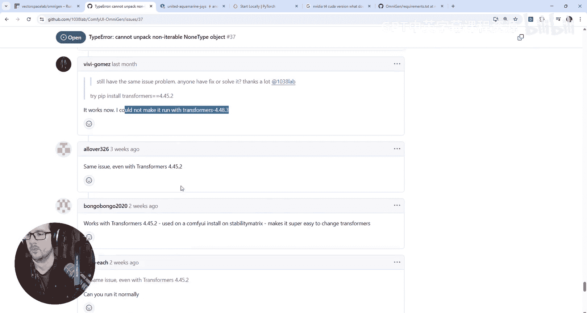

Even with same issue with that， yeah， same with it be works with 4。452。

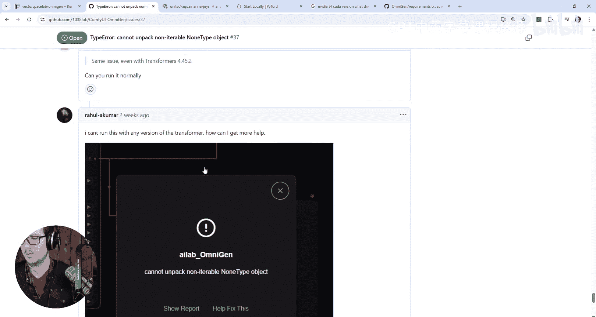

I can run this with any version of transformers how can I get more help。

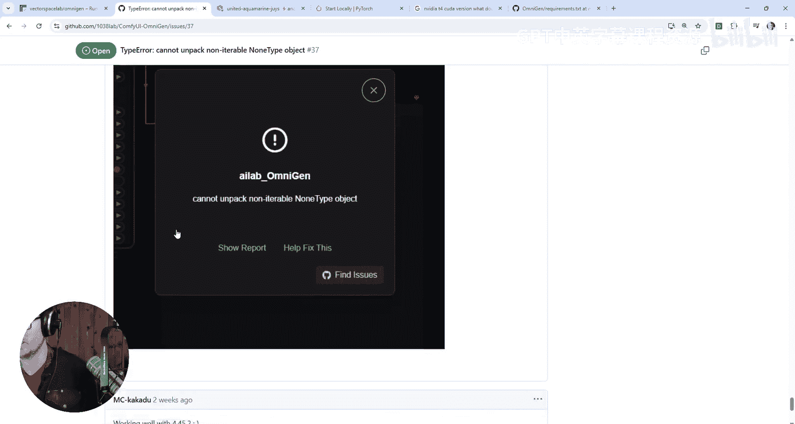

Well the camera with any single version works for 4，5，4，2。

 So I think like what the issue might be here is like， really what version is going on here。

 Let's go back here for a second。 We'll do Pip install。

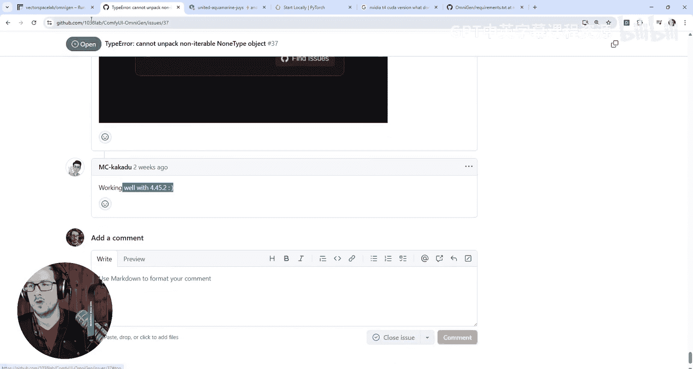

Pip update。Hyhen our requirements。And now it's now it's installing very specific versions here here it's even been doing 2。

3。1， right。嗯。I don't know。 I don't know if it'll pick up the rakuuda version。

 but now we're doing that。 So let's go back to instructions for a second。

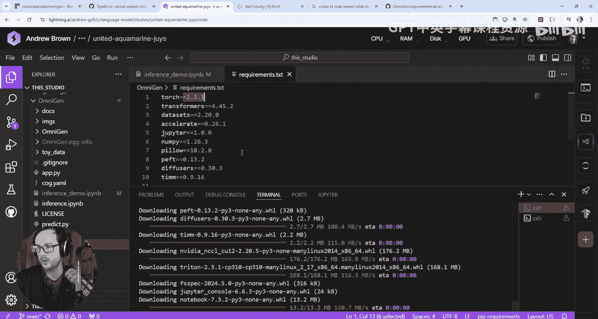

Maybe there's something we didn't understand about the instructions。So if we go back to Omnigen here。

 omnigen。Ani。Chahan Github。Okay， we go here。We're running this。

Would that not pick up hyp like requirements， like what is， I always forget what the hyphen what。

Let's' to take a look here what does this do？I don't know the hypheny flags for environment。

Development or edible mode。And a director contain a Python package。

One with a setup top high and a project， okay， so it's doing that， that's how it's doing it。嗯。

So we'll go back over to here。So that's what this setup is here。And then， here。I mean。

 it's specifying very specific things like things like newer or older。But another person to saying。

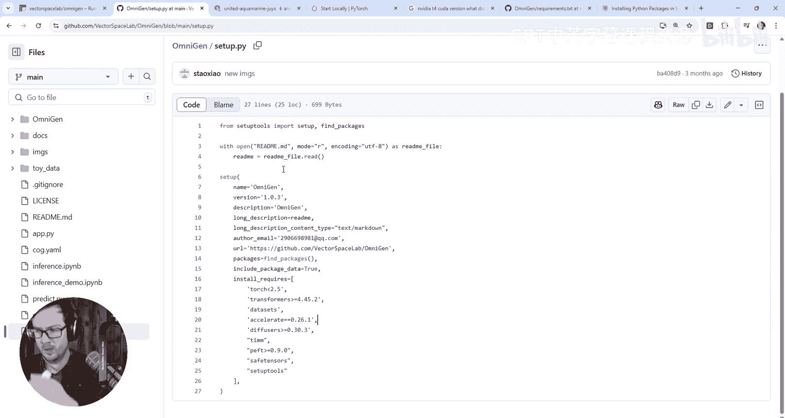

Well， you both the these here。But another person saying just run it directly， right？So， I mean。

 I'm running directly right now。 I'm not sure that's gonna fix our problem as it's a bit of an unusual way that Im。

 I'm working through this here。 Let's give this clear all outputs。 We'll restart。 Okay， yeah。

 we'll restart。 It's fine。

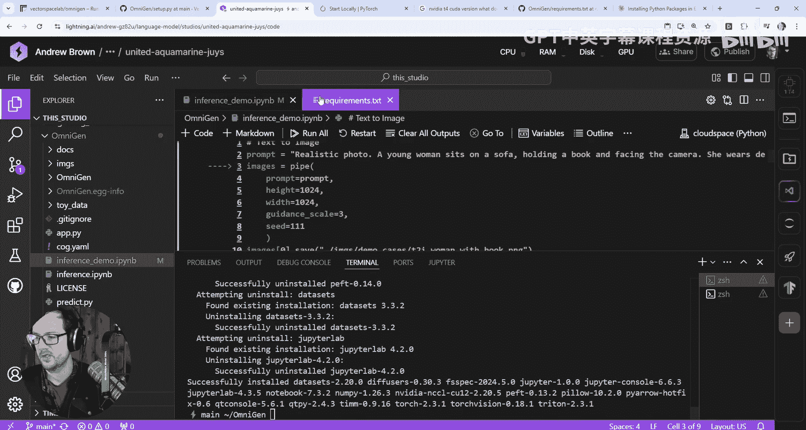

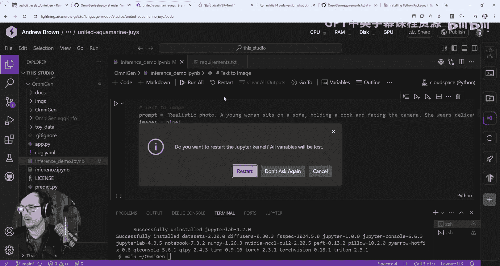

And。We'll try this again。 so I'm going to go ahead and run this line here。

We already have it downloaded， so it should run very quickly。Or relatively quickly。Okay， but yeah。

 maybe the instructions were not accurate。And the other person。

 if they didn't clear out their environment， like they didn't make it in a virtual environment。

 maybe that was the issue as well。But you know， worst case， we can use this one over here。

 It's going to cost me money。 says 14 cents per or on replicate or 7 runs is a dollar。

 So I can utilize that。 But if I can use it for free。

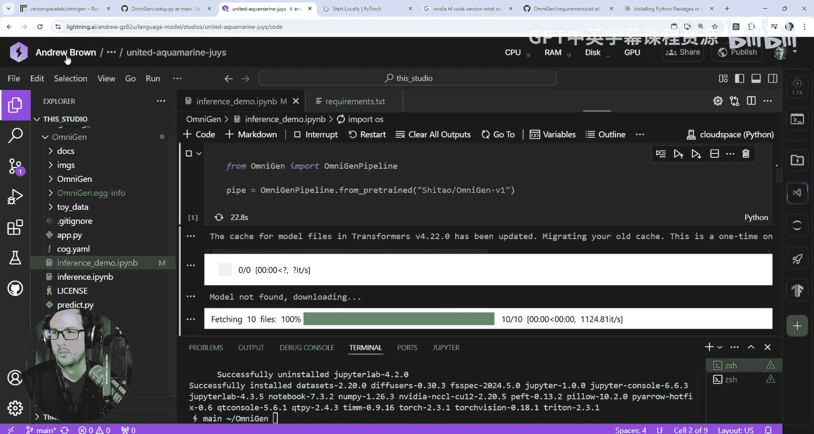

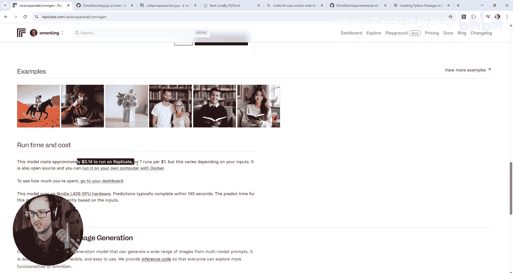

Free as in， you know， stuff I paid expensive compute for， not on this， but on my local compute。

 then that would be really nice。 We'll give us some element here。To load。

 I'm not sure why it's taken forever， but it takes time。Either took two minutes to load here。

 That's totally fine。 We're going to go over to here。 and let's see if it works now。

It might still not work， but at least we're kind of getting to the root of it。But now it makes me。

 it gives me hope that I might be able to run this on my， my local machine。

 See people using 4080s'cause I'm not far off。 I mean， I think 480 might have double the memory。

 which I wanted。 But， you know， I got what I got。But it's not airing out here， as you can see。

So the other time it would likearrow out instantly。Oh， it's moving。 It's moving。 Yes。

 now this is a T 4。 So I'm not sure how a T 4 compares。 So we go here。 T 4 versus R T X。

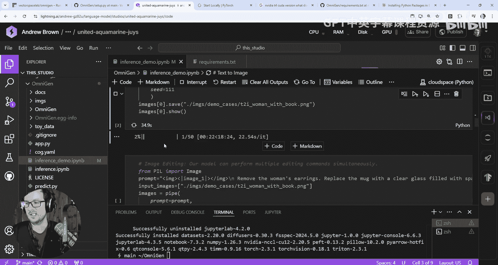

4060， that's what I have。I thought I had something better， but。Okay， so this is more money。

 obviously。嗯。I'm trying to figure out。The performance， that's all it is。 is's only $783 to get that。

 That's interesting。Sa this is the winner in comparison， though。So， here。Okay。

 but what about performance。Well， that doesn't tell me much。So here it's saying， like， maybe the。

460 does better overall， how。

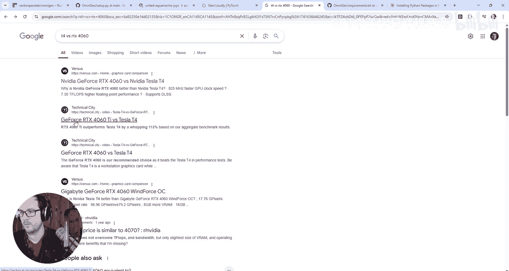

Really， why I don't have a TI。 I just have a 40，60。And。Even at 30。 So I'm over here， right。

 So this Tesla R 4 is not as efficient， but this one has more， more memory， right。

 which kind of matters。 But this also has a smaller footprint in terms of wattage。

 you see this one has double So there's more than one factor to go in there。 So if that's the case。

 and this should run even better on my own machine locally。 Let's go back over to here。

 look at the GPUus there at Max the memory usage here is。

11。Right， so again， I， I don't feel like I have enough resources on my computer to run that。

We going a CPU here。 It's's using CPU。Like， does the overflow go to the other one， though， right。

 So like if you run out of VRA。

So if you run a model。And you are out of dedicated。V RAM， does it use the shared RA？

For running bottles against GPs。So that I wanted， I I always think that it can't。

What happens is X depends on the specific framework。 So Pytorch， if you run out of dedicated eraRA。

 the system will typically try to use Ram as the fallback memory called memory paging。So。

With K to GPUs， when you exceed the RA， you may attempt to use system RA in unified memory。Okay。

 and so。

In that sense， it's supposed to do that。 We'll go back over to here。But it is runnings。

 It is really slow。But we will wait for this to complete。 I。

 we're not gonna to be able to do all of these things here。

 but I might go back and try my local machine again and delete the environment。 I mean。

 while we're waiting， I might as well just go delete that environment。 So if I go here。

 Con to E And V list。

I'll do kinda。Remove。Conda， what is it， Conda remove。

Remove hyphen N omnigen all。Yes。And so we're gonna just reset that。 I might as well。

 because I have time while I'm waiting to reset that up。 And so now I can remake this environment。

Ising the exact version they said to use。So that would be 3。10。3 y。

So we'll go ahead and just redo that Well， because that the other one's gonna take forever。

I don't care if it's even fast on my computers， I just want to see if it can work。

So we'll go ahead into this。We will need to get IPY kernel。

 We always need that thing so that it will show up。嗯。Continstall condoda force。Conniforge。

Now what's really interesting is that they didn't use that very specific version of Kuda。

 they just used whatever it was。 and I feel like a T4 is older。

But maybe the default version works better。 I don't know， but。I don't know。 Shouldn I。

 Shouldnt I use the latest version， I'm not sure， because I over here。This is using torch 2。3。1。Well。

 I don't think it's gonna hurt。 So we're just gonna try it。

 even though I'm not installing this specific version of torch。

 I'm gonna go ahead and just do Pip install hyphen R requirements do T XT。

Okay， we're going to make our way back over。to啊。To the Internet wherever that was， oh。

 we're already in the internet here， okay？

I was running that locally， right， I am。 And so now it's installing this version of torch 2。3。1。

I'm hoping that it just knows to pick up the right version and this is CP。

So it makes me think that it's not installing。The GPU version of what I need， right？I mean。

 I'll let it go， but this is not， I think， what I want。

And we're going to go back over to here。And I guess we'll just wait till this is done， okay。I mean。

 another thing is that we don't have to really like these are running。

 but I figured why not make use of this time and use this omni Genman because I was gonna use it anyway。

 So in here， I have a， this is a paid service。 If you don't have money， don't do this。

 And if it's too expensive for you don't do this。 U this is 14 cents。 That's 14 cents American。

 So we go like here we say 14 USD to USD to cat。 And for me， it's really 20 cents。 Whoa。

 that's expensive。 But we'll go back over to here。 And so we see that we have this thing and they have the drink over here。

 says remove the women's earrings。

So they have a source image here。And we remember what the original image looks like。

 let's go take a look at it。All right， so we'll go over to here。

Well， it's not showing to us， but we know what it looks like because of the original one here。

 So I'm gonna just change it here a bit。 And so。I guess say， change the。

The women change the women as little as that change。Change the woman's。嗯。White sweater。To be a black。

T shirt。嗯。Change the。T shirt。Ban T shirt。 I can try band T shirt。 Andll， we'll say remove earrings。

Add nose， piercing。And I'm going with something here。Had neck tattoo。I'm really giving it a lot。

 a lot。 I'm not sure if I can do this change book。呃。Change book。Out for。Nintendo switch。

Or like video game for video for game boy。

For game boy。 I don't know if I can do that。 So we've changed some things here。

 We'll go ahead and run it。I think that it usually says like 6 to 5， 12，5，12。

 but this one's already said these defaults， I'm going to leave it alone。

And I'm not sure how long I took to run， I think it's just told us there a moment ago。

 it takes like two minutes。So this one's not much faster either。

 but at least I know I'm not wasting compute while I'm waiting around here。

And this one is at 32%， So it's still going。 And it's doing on the rural board。 Well。

 this one's actually generating out the image， right。

And so this one is going as well。And now we're just waiting on two different fronts here， so。

Yeah， we're just going to wait， and I'm going to wait to run my local one here in a little bit， okay。

Oh，ca it's setting up the model。 Okay， maybe once the model set up or people running it more often。

 it's less of an issue。 But yeah， you see， this one is going to take a considerable amount of time。

I am so waiting for this。 And notice over here， it says booting。 And over here， it says cold。

 So this model is cold。 You get a fast response If the model is warm already running and a slow response。

 if it's there。 Also over here， we see the model costs approximately whatever。

 but it's running on an L 4 L 40 L 4，0 S。 This one here is still going。

 It seems like it's going to go faster than the other one。 If the other one ever warms up here。😊。

So I want to take a like what is an L4 L law。 So versus let's say an R T X 40，60。

 if that's what I have。 I thought I had a 48 A T I or something， but I don't。 I don't。

 I just had junk。 And so here we have an L 40 S knows that it has 48 GB。

It is more， more Rams。 So it has。 it's an older one。

 but it has more Ram available compared to my 8 GB1。 So again， it depends on what you need to do。

 not just processing power， but also how much you can hold a memory。

But I guess the performance isn't going to be much faster。

 The R T X is going to perform a lot better。 So I'm starting to understand。

You know why this stuff kind of matters， but。

It is really taking us time here to start。But at some point， it will。 sir。 I mean。

 I've started the job。 I'm going to get it at some point。 And this one's going。

 it's been going for 17 minutes。 It's like I'm going to go through all my creditors generating one image。

 but we'll see what happens here。 At least this is kind of a good benchmark of how long it might take on my local machine。

 So if I have this locally and it takes this something like。

Here it says。Like if this comes up to 20， this is like70% there。 So if this takes like 20。

2030 minutes， that's how long it's going to take locally。 And so maybe omnigen is good。

But if you don't have the compute to back it up， then it's kind of a pain to utilize。Yeah， so anyway。

 we will just continue waiting here until。 well， here's a question。 How does an H1 compare with this。

 So if we go like H1， AWS。

Pricing。You know， like what is， well， first of all， like H 100 versus R T R T X 4060。

 This's a little， it's a little bit silly comparisoning， but we'll do it anyway。

 And we'll go to the technical city here。

And the show， was this the one we're looking at？

I thought it was。

I'm trying to understand。 I'm not what we're getting at。 I'm trying to understand。

It H1 PCI， I'm not sure if that's the same thing。No rating。Okay， but what is the。

 what's the performance difference。 That's what I wantan to know here is how like how much， Yeah。

ca it's like $70000， right， Its something ridiculous or for that thing。So， here。5，4，300， whatever。

It has more terra flos， good。Let's get that added here。Way more tensor cores。80， right？

And so， you know， let's go to Kude and just say， like， how much。How much faster？Is a H 100。

Versus A and R T X。4060 causeuse I w to know， like， how long would it take to run this fing thing。

20 to 30 times faster， right， So if I go like， you know， H 100 AWS， like。

 what's the trick to running that on AW S。

We're not going to do run poted and find run pod that very easy to use。

I don't want free to。 I just want to know。嗯。B two instance。

Usually these are tied to very specific ones。

P5 is that what it is。

I mean， that's high performance computing。H100 H200。 so we'll go up to here。

High performance GP instances for deep learning and H applications。

 I just want to see it performance wise like how it does。 The other question is， like。

 if we were over here。

Could we have gone and chosen that？And our GPU options。We could have just chose it here。Right。

 so here wait time is current。m wait time is subject to the cloud provider demand。

So how long you have to wait till you could utilize it。 So even if we wanted H 100。

 it might take forever。And look apparently， you can only choose in quantities of8。So， you know。

 the question really is。

Even if we wanted to use an H 100， could we even use it and how long would it taken。

 And that might be kind of a bit of a pain to figure out。

 But definitely it would run substantially faster。 Maybe even a 100 would run a lot better here。

 So we'll go back over to。

Well this we'll just leave it，'ll leave it open here。

Right， but I wonder， like once we get this running up。

How's this going to go here。 So it's still cold。 So we're going to be waiting a long time。

Alright， so this one's still cold。 I'm not sure whether it's ever going to finish there。

 We'll go over to here。 This one's at 100%。 So now， in theory。In theory。

 we should have an image here。And there we go。 It's generated an image。Looks like the other one。

 so I was hoping maybe might be a bit different， but it did say it completed。

It does output it to images， case demos， T I G image here。 And we didn't have that before。

 Let's give this a refresh and see if we have that。 So images。Images， this is new。Demo cases。

here it is。 Now， exactly like the other one。 So not that exciting。 But at the very least。

 it did generate that。 I kind of wish that when I entered that prompt。

 I would have done something different here。 But I would say that what we have learned。

It's， oh， it's warm。 There we go。 It's warm。 Well， so we're going to close out this environment as obviously it's going to take way too long。

 too long to run this on here。

Sign out unless we can use the age 10， but even that will take forever to get access to。

 So I'm hoping when I signed out that it spun down that environment。 I don't know if it did。

We'll go over here。 So forbidden URL。All that work。 And it can't run it。

 But that's fine because we can bring in our own image。 Remember that I said that。Here。

Remember I have my own images， right， remember？So I'll go over to here becauseuse we actually had one that I was showing earlier。

Or was it in recordings。Documents。Oh， no， But you know what。 We could。

 These are the images we generated out earlier。 Remember those。Right。

 so we could use those from our characters。 I was gonna just use me。

 But I guess what I'll do since I kinda ended up over there anyway。 I'm gonna go into that and keep。

 well， this is， oh， it's already cold。Prick。What a pain。I want to see its capabilities， though。

 So I'm going to go into the folder here。Little like way two seconds。 It's already cold。

 and somem looking for。I don't feel like it'll do well if the photo is not square， though。Pictures。

Screenshots。T downloads。Documents。Recordings。Alright， I have one of me here。

 So we'll go just do that。 There we go。 And so。What can we change？We have image， image one。

Itll change wrong here， too。So we'll say here。Remove the man's glasses。Change the。Jacket。To a black。

Sweater。And change。The setting。这笔。Outside。In the forest。Okay， so we got that， we'll go run it。

It says it's cold。And we'll see that took a long time for this to get warm， it took a long。

 long time。So it's very unfortunate that we did not catch that in time for when that actually got warm。

And even if it did that。Whatever， but this will generate out some point in time。

I'm not that interested in even trying this locally because of the time it'll take to generate。

 And so it seems like if we want to have any kind of feasible image generation。

 we'll really need to set up cofy U I use things like control net and things like that。

 But if I could get this to run on some kind of GPU compute， it could be really， really good。嗯。But。

 I can't。I know for hugging face， we had some it was more reliable on hugging face。

 surprisingly omnigen than anywhere else。So remember I was using it here right here。And。

I know in here it would actually run。But。I'm just going to。Give up here。For now。

 we'll see what what generates out here。 But I'm gonna give up because if I don't have the fast enough compute。

 Like it's not even just cost。 it's just like having access to the compute。

And being able to run it is just too hard， so。

We will try a different way， okay？