# ExamPro《生成式AI训练营｜Free GenAI Bootcamp》中英字幕（deepseek - P80：-80-GenAI Final Submissions Form.zh_en - GPT中英字幕课程资源 - BV1SFEWzLEab

Hey folks， it's Andrew Brown and we are taking a look at the final submissions form。

 I want to give you extra instruction here just so that you have the best opportunity to get the OM that you want for your final submissions。

 this forum is open for a period of time that is specified on the Jennyi bootcamp website could you submit outside the timeframe that it really depends if we do another cohort or if we have post bootc support the time this video I not making any of those promises if it's open。

 it's open if it's not it's not but make sure you check those dates because if you're outside that date you cannot submit and get the grade level that you might want to get there are some of the badges that you can get no matter what if you don't submit I'll just issue them out but for those top badges。

 golden red squadqua， you have to fill in this final submissions form the best you can on time so what I' going to do is shrink my head on down here and you'll notice here we have final submissions form this appears in its own group It own chapter and so here I just want to make a point here once you submit this。

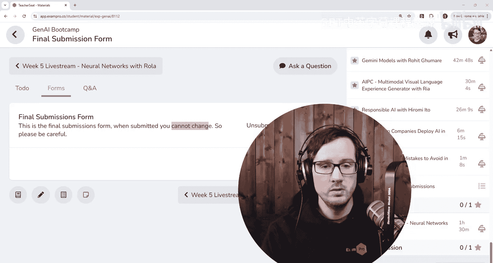

You cannot change it。 So if you need to put it in a draft， put it as a draft。

 but don't forget to leave it a draft。 Some people do that。

 they'll forget to go back and submit it and think it's submitted。 So here it says unsubmitted。

 right， and you can go back here， give it a hard refresh， make sure it is submitted。

 We'll go ahead and fill in the form。 I'm not actually gonna fill in the form。

 but I'm going talk around these points so that you know exactly what I'm looking for。

 So first thing is Github URL。 So that will be something here。

 You know what I might also put in here is just your Discord handle one moment。

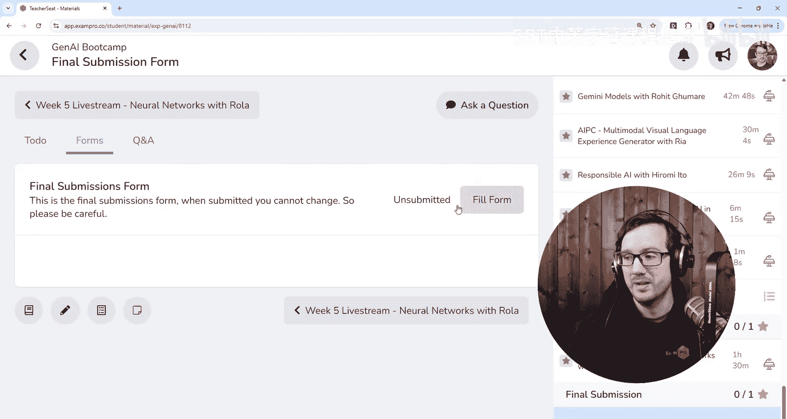

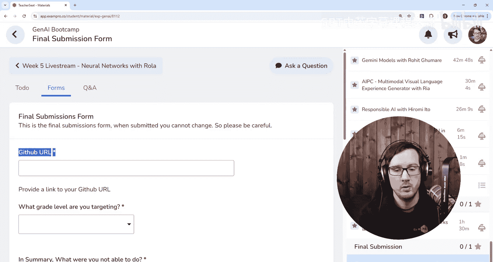

All right， I'm back。 I'm just gonna give this a nice hard refresh here because I do take an account if you have didn't put the field in one second here。

 there we go。 So yeah， if you have an active on the Discd， if you're not， that's fine。

 but if you have been I would like to you place it into here。

 we already have it somewhere else in the system， but these forms don't carry everything over we have to improve our system So it's easy to gather information one place but if you can put in your discord handle there because I will go cross reference。

 see if you have any activity there， that might give you a bonus points。

 that might push you into red squadqua So if you do have a discord handle。

 put it in there so that I can easily find and maps up when I'm doing grading your Github URL I ask every week for you to put this in I'm explicitly asking for this week again just because the way our system built。

 I only see what's in the current form， I have to do a lot of digging to find that other information So I'm putting it here you have another opportunity to make sure that I can quickly and easily find your repository select what grade level you're going forward these are mapped on the market。

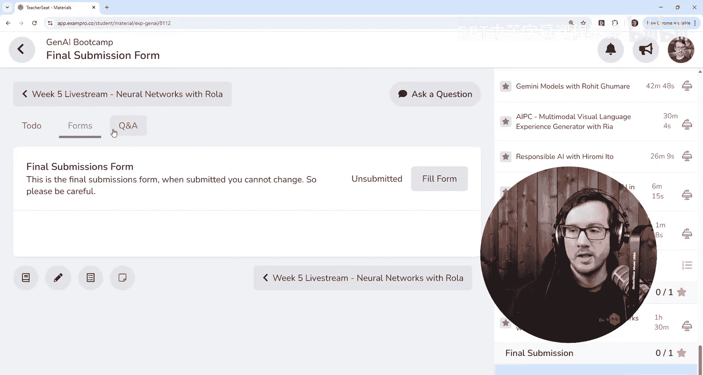

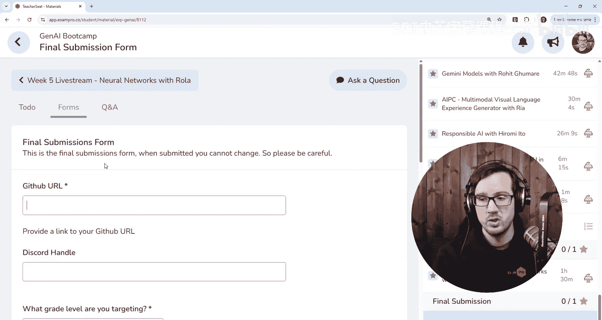

Website we didn't do like a complex rubric like we did for prior boot camps。

 The reason I didn't do that was just because we are treading new ground with Gene technology and I couldn't really create a cohesive baseline and so I'm going to do everything marketing everything on a curve and so I'm going to get through enough grading which I have not for file submissions but I have for last week like the week five or week four。

We probably didn't have a submission but for week four submissions。

 I've done enough to have an idea of where to kind of play thingss。

 but tell me what you're targeting for because if you're going for Goldqua and you're not over redquad。

 then that's going to make my grading go a lot faster and I'm not going to deliberate so much I'm just gonna to make it easy for me really it So just tell me what level you're going for you really can't get gold to Redqua if you do not submit this form know so just make it clear as to what you are targeting for tell me in summary what you were not able to do So what technical things that you set out to achieve that you are not able to achieve it doesn't matter if you weren't able to do things if you have good documentation and and you've shown what you have learned through that process And when I say what you have learned I don't just mean generic things so a lot of folks think like oh I learned what a database was or whatever or like what an LM is that's not valuable from a company perspective that's just you learning those complete elements。

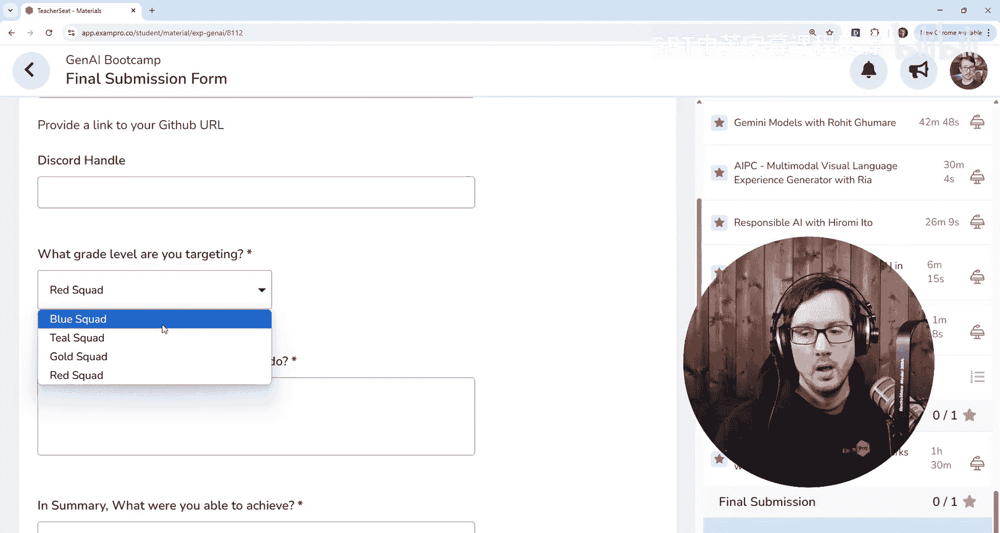

What's valuable is the technical uncertainty of not even anyone what the company knows or something you can't find online so like again。

 if you're using an ancient Greek model and you download it and nobody's using that model and you go out and you find maybe like a fine1 that that has poor documentation。

 things like that that is something that is worth putting in in terms of technical uncertainty but if it's something that other people can figure out and you can't figure out it's not technical uncertainty it's technical uncertainty that you have because you don't have the skills yet but a lot of other people do so if it' very common things that's just a lot of noise for me that I have to kind of cut through when you're writing these things in just make sure it's very to the point and dry just make it as concise and easy for me to read as possible so that I can go and evalu projects I will clone your repos I will try to run them。

 if I have the technology， the keys and things like that and I have been running projects if folks have yet to see。

That in the the grad the grading experience there。 but to so you know， I do run these things。

 I do crawl through the code， I look at your commits I look at everything It summary what were you able to achieve So these are the things that you had technical uncertainty of and that you did achieve again if these are things that I was able to do and everyone else is able to do and they're very straightforward things Those aren't things worth reporting right report things that are things that were very unique to to what you did right if you just。

😊。

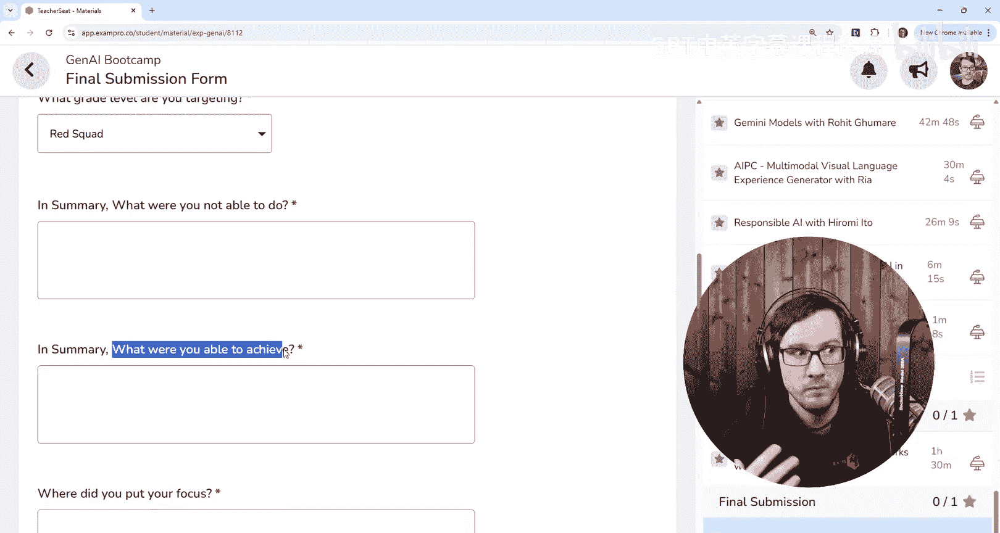

We're more focused on something else。 This is your opportunity to put it here。 So， you know。

 some folks， you know， they might not have been trying to seek out into very very technically uncertain tasks they might have just been trying to fall along and build a cohesive project and ship it and more think about like the business use case。

 that's good too So just tell me like what was your focus， because some folks again， you know。

 we had one student or bootcaer that use ancient Greek right。

 And so it'd be very hard for them to make a cohesive application if they could， that's great。

 But it'd be very hard for them to deliver that because of the technologies that they chose because it's more like research and development and stretching it。

 So some folks might say， well， I'm still trying to learn this stuff。

 I'm just trying to figure out how to build a cohesive application and understand the business use case。

 And if it's applicable right， So that could be like would this work at scale， you know。

 would this actually work for this real use case， things like that。

 So if if you can't lean heavily into the research development part of it。

 you can lean heavy into the business side of it and things like that， right。

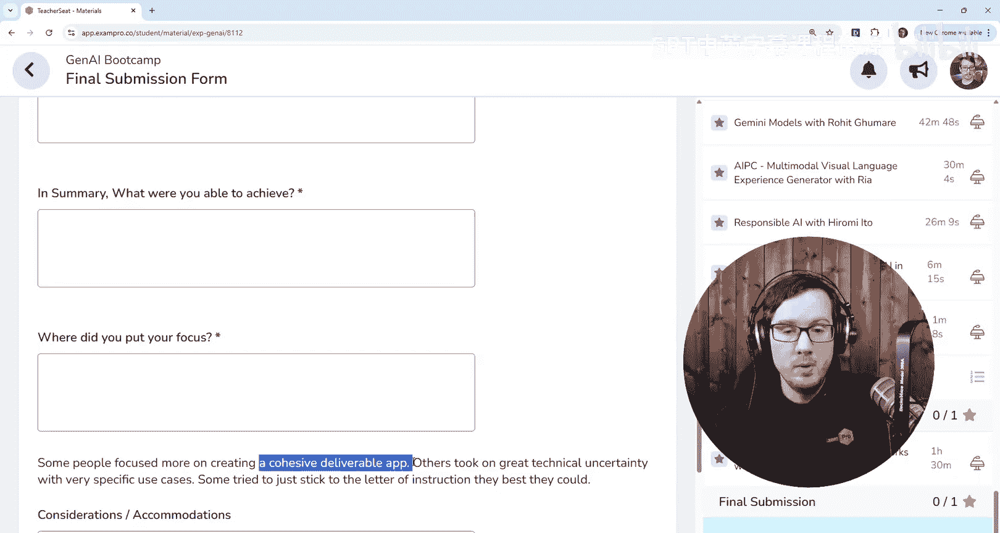

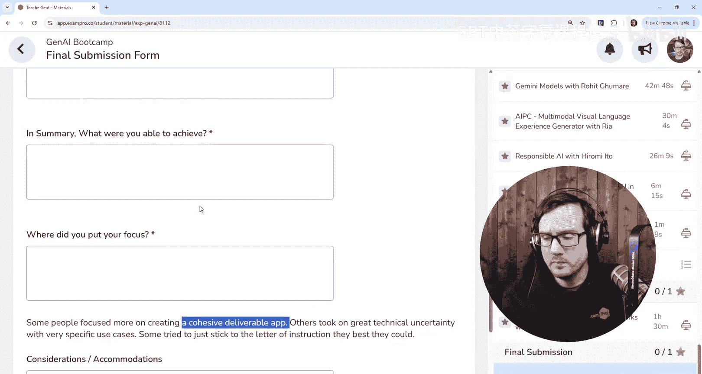

Considers， accommodations if there's something you want to tell me that that you want me to consider。

 put it in this box。 if there's accommodations like， you know you know。

 there is gaps and stuff or there is specific challenges that you had。

 this is your opportunity to put it in that box。 And yeah， just do your best here。

 try not to write too much。 you know the size of the boxes is the size of information。

 maybe you can go beyond the size of the box， of course。

 but you know if you go more than twice the size of the lines here。

 then you you might be writing a little bit too much right if you want to expand and have more information within your your。

Your Github， you could have to do that。 Remember， this is for me in summary， right， in summary。

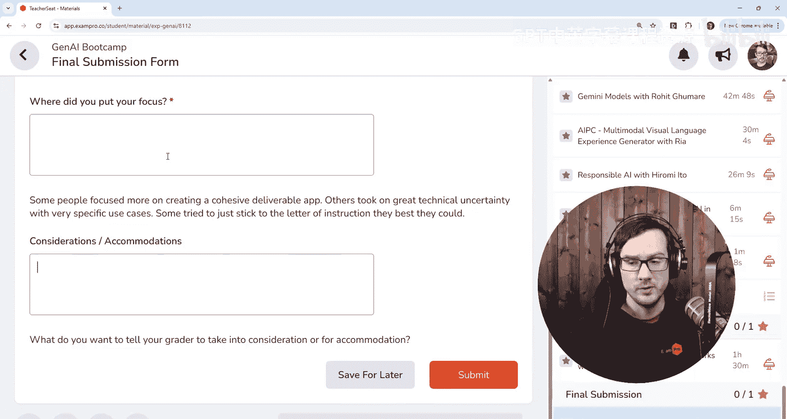

And any additional information is going to be found on your repo it should be easily easy for me to find And yeah。

 should you submit this form if you have yet to receive grading at all。

 it really is up to you I've shared in the Discord I've shared a few places that I'm grading thousands of people for some weeks and then in later weeks。

 the later weeks is only hundreds right so if you get to later weeks in time。

 then you should get a grade if you are very behind are you are at risk and so know closer to that date。

 know make sure you get submitted no matter what， but if you want to wait a little bit and see if you get feedback from me。

 it's just up to you this bootc is extremely difficult。

 it's very hard for me to pull in Ts whereas in the big As cloudpro boot camp were able to bring in Ts but this one it's mostly me and then the other Andrew。

 if I have to bring them in。 but we're doing our best to try to get feedback for everybody but。

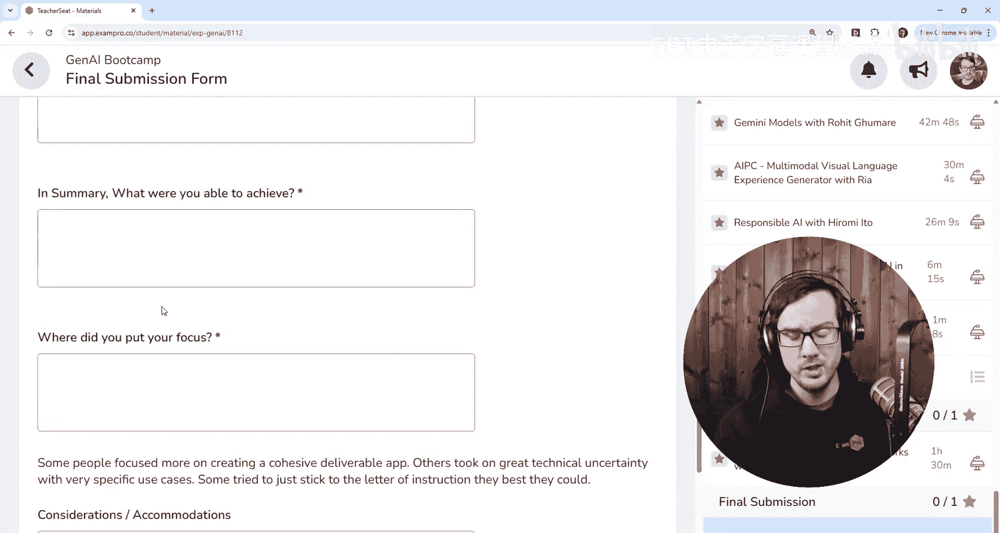

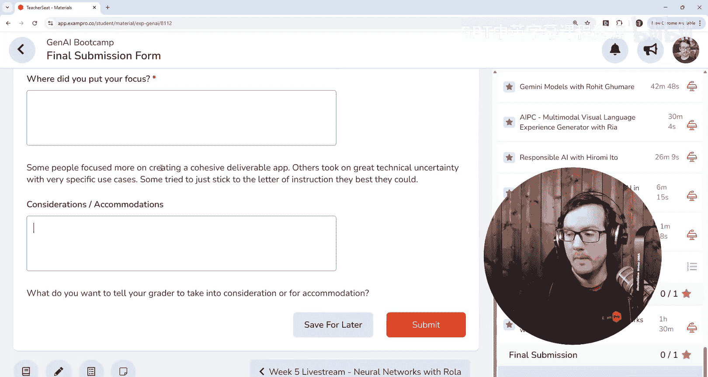

Anyone that does submit for final submission and has all their weeks filled out will get feedback video feedback specifically。

 right， not just written text， but yeah， there you go and and good luck and hopefully had a really fun time。

 And I'm not trying to stress you out too much with this form。 But you know。

 that's what I'm looking for in this thing。 And and looking forward to seeing everyone's final product。

 shut out。😊。

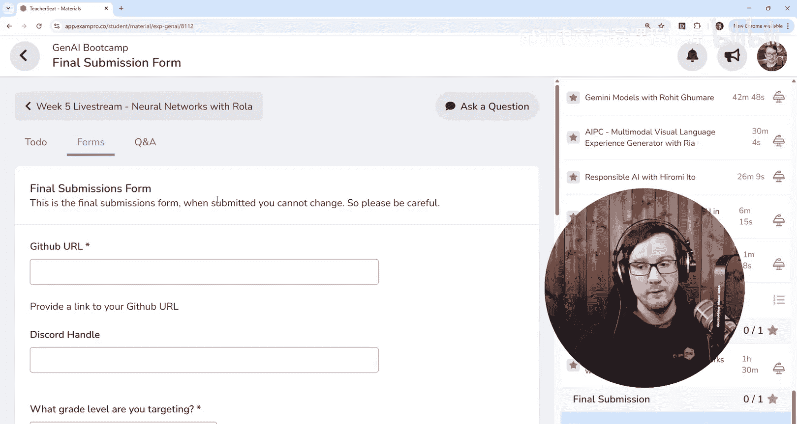

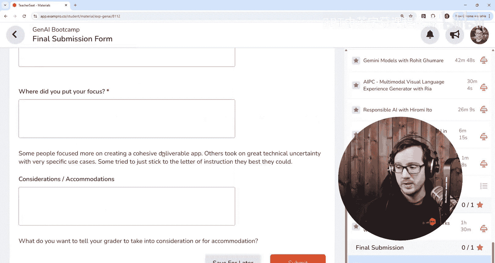

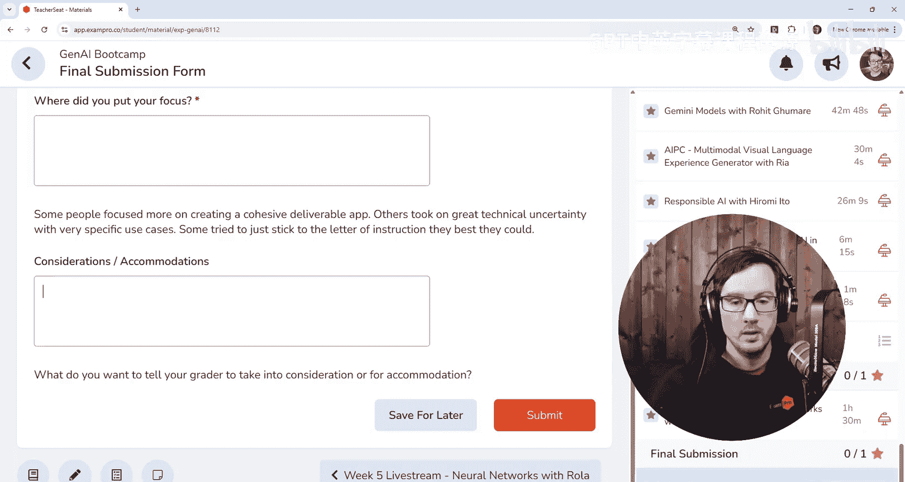