# ExamPro《生成式AI训练营｜Free GenAI Bootcamp》中英字幕（deepseek - P8：-08-Sentence Constructor - Meta AI.zh_en - GPT中英字幕课程资源 - BV1SFEWzLEab

Hey， this is Angie Gr， and we are back。 And so I have a forked version of the repo。

 You should not be forking the exam pro corepo as per instructions， you are creating a new repo。

 I'm forking because I have to fork it as I'm going to be pushing upstream my examples for you。

 So when you are working with it， you can reference the files that I have。

 But let's go ahead and I'm going open this up in Github dev。 So you have your repo。

 I'm gonna press period and make sure you're loging into Github for this to work。

 But if you press period here it will open Github dev。

 which is a free web editor that costs nothing and we're just using this as a scratchpa so we can save our iterations as we're working through here。

 And what I want you to do is I want you to make a new folder in here。

 You can see there's some old stuff in here as I was doing a previous attempt that did not work。

 So I'm going go ahead and blast this away as I was not happy with it。

 And I completely change the teaching style that we are doing here to make it easier for you。

 But we are starting from nothing here okay。

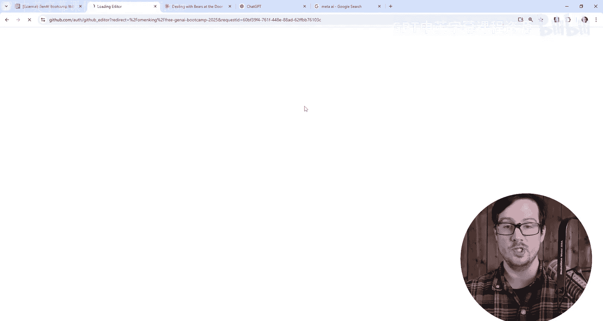

Okay， and I want you to make a new folder here。 I'm gonna call it sentence construction。

 And I gotta get out on my Japanese keyboard as it's given me some trouble here。

And I switched over to yeah， there we go。 And so again。

 I'm gonna make a folder here called it sentence construction or sentence constructor。

And we're going to work with meta AI first。 So I'll make a new folder here called meta AI。

And this is where we're going to store our prompt。And so I'm gonna make a new file here。

 and I'm going to call this prompt。Dot TXt。Okay， so let's go over。

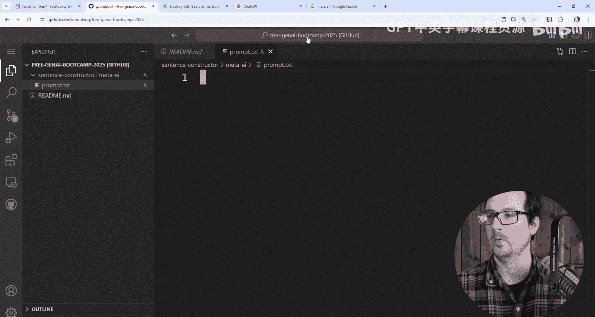

To M AI。 And so if you do not know， M AI， I don't know what's running underneath is probably Lama 3。

2。 Let's find out which， which LL M are you running。Wch l model。Are you running。

 cause that might help us to。I understand what's going on here。I really don't know。

I'm based on Lama 3， a large language model， but are you， are you a single model。

 Are you specifically like what what is your。What is your parameter account。

I wonder if you'll tell me that。I'm a single model and have 70 billion parameter model。 Okay。

 so I'm thinking what's happening here。 If We go to Lama，70 billion。

It kind of make makes sense why I was performing so well， but that's Lama 37770 billion。

So I believe that this is the model it says that we're writing。

 So in your model this has been available， you need to agree and share your contact information to access this model。

 This is actually interesting， because。I don't usually get to see this very often。

 And so this is my opportunity to show how to accept a model。 And so I'm gonna go down here。

 I'm gonna go and submit this。 I don't plan on using this model right now， but I'm just saying like。

When we do hugging face later on， it's just so hard for me to capture this process here。

 And I just want to show you what that looks like later on， I'm gonna to fill that out。There we go。

 And so I submitted it。 And so。Now it's it's waiting。

 And so that will come to me later if I want to utilize it。

 I'm always trying to accept the latest models as soon as I can see them。

 still don't have access to Gema， which is kind of frustrating with with Google。

 but that's totally fine。 So anyway， I want to focus on meta AI right now。

 And so now we know that we're working with Lama the Lama 70 billion parameter model。

 which iss actually， pretty decent model。 And I'm going to go ahead and make a new conversation。

 You can see I have a huge conversation history here because I was trying this earlier。

 But let's go ahead and start defining what we want this to look like。

 So I'm going to go over to here。 And when I'm working with models， usually。

 I just start really simple。 And I'll just say rule。😊。

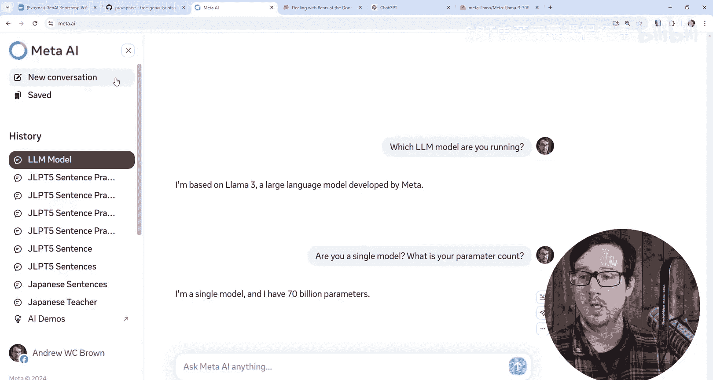

I'll just say Japanese language teacher。And we want to tell it what to do so。Again， I'm not。

 there's no like defined words that we have to use。 We can use whatever we want。

 There are frameworks out there， like Costar that gives you an example of something that you can utilize。

 And you can use that if you want to， to see how that goes。

 But I literally just think about what I want。 And I do that。 So we're all Japanese language teacher。

 language teacher。

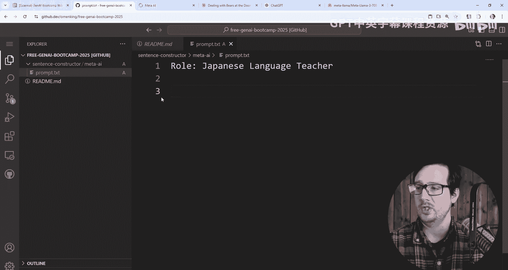

And。Almost feel like this would be better to write it with something that has a spell checker， right。

Let's go ahead and fix that。 I can never spell the word language。 Never， ever， ever， ever， ever。

 And so there's a few things I wanted to do here。 I want to say role。

 and I'm going give it teaching instructions。

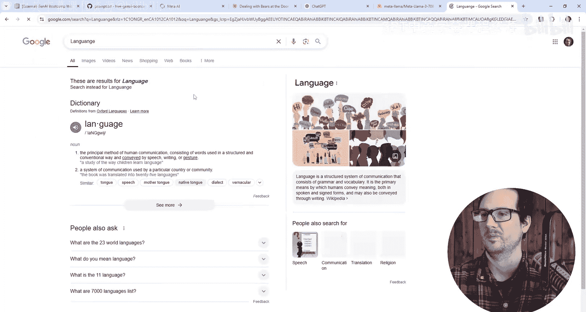

I'm going to say help the student。Or sorry， let's first say， like。The student is going to provide。

You an English sentence。You need to help。The student。嗯。You need to help the student。

Trannscribe the sentence。Into Japanese。So transcribe means take it from one target language or like take from one language to a target language。

 So this is the starting point for for this here。 Let's go ahead and see how that works。 Also。

 what I'm going to do is I'm going to provide it the sentence。Student。

So Im going to say student here。Student input。Because I feel like if we do this。

 it's going to save us a lot of time not having to give it a second message。

 I'm going to go over to here and we'll grab this sentence that we used earlier since we already are familiar with so we bears are at the door。

 did you leave the garbage out and so that will be the student input。

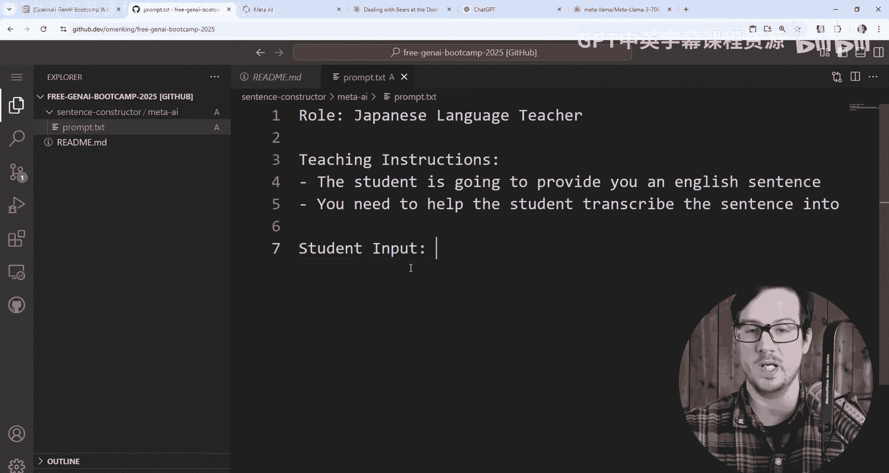

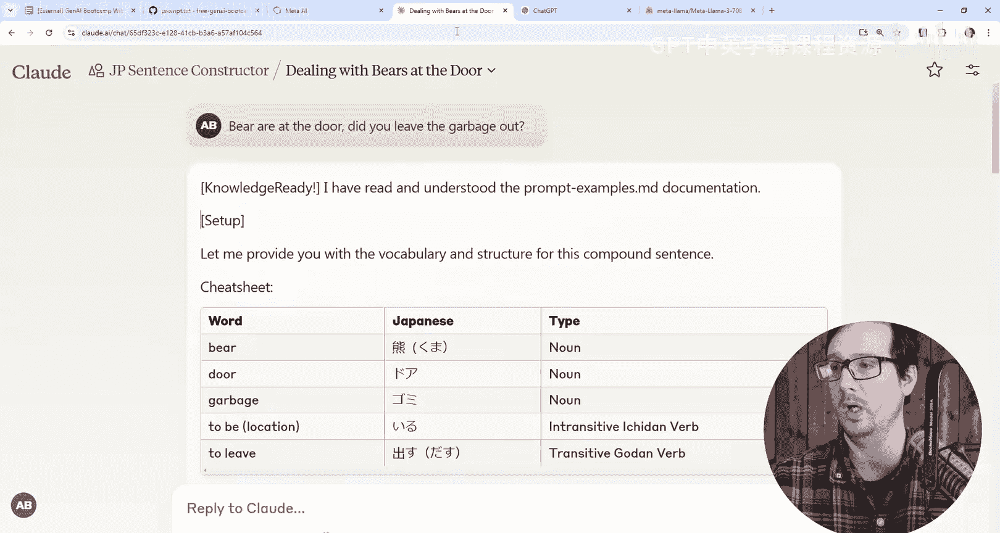

And so we have our first working documents。 So I'm gonna go ahead here。 I'm gonna copy this。

 I'm gonna go over to here。 I'm just gonna close these other ones out for now。

 We'll come back to them later。And。We will paste this into here。Did it get the whole thing。

 I don't think so。And I'm just going to， sometimes my copy paste is a bit funny。

 I'm gonna just bring this down a couple oes。

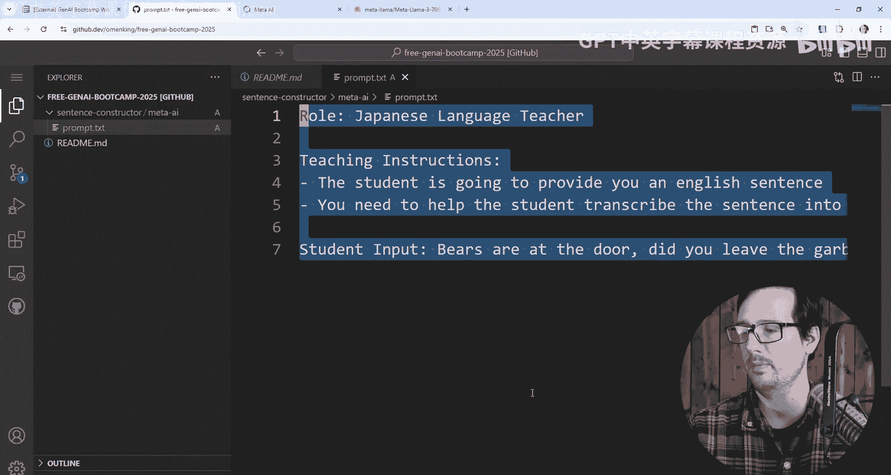

I'll directly click copy。And we'll go ahead and paste that。 and we'll go ahead and enter。

 and we'll see what we get。So right away， it knows that we provided。

 So here's the transcription of the sentence into Japanese。

 So you need to help the students student transcribe the sentence to Japanese。

 The first problem is it gave us the answer away。 it did give us a breakdown， which is good。

 but it's giving us way too much information as a student。

 we need to learn how to figure out particles。 figure out the the order of the sentence like the location of words。

 and we need to figure out conjugation。 All we want is basic vocabulary。

 So what I'm going to do is go back over here。 And we're going to just iterate over this。

 I'm going just say。

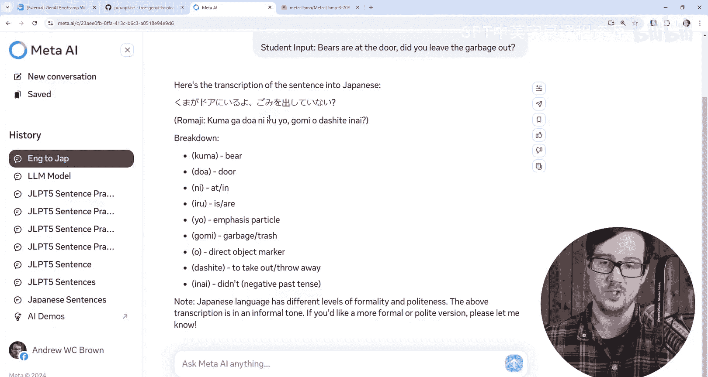

Meta AI V0，0。I might make this a little bit easier by making this a task because this might be a little bit hard for us to track。

So I'm going to go over to here to the repository。

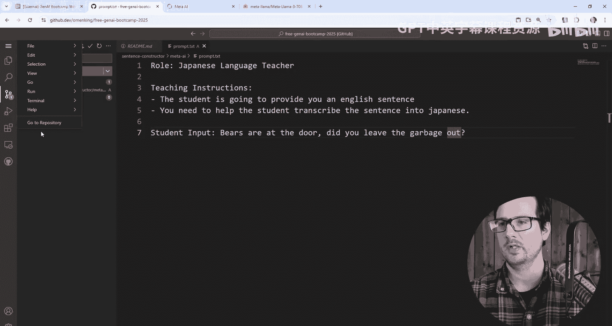

And I'm going to make a new issue。In this project， if I can find it。I do not see issues。

 So we go over to settings。And maybe I can turn on issues。 There we go。

 So now I have issues turned on。 And I'm gonna go over to here。 I'm gonna make a new issue。 Now。

 I'm not。 you don't have to do branching or stuff like this。

 but I'm just gonna just define this so that we can keep track of our commits as we go。

 And so this is sentence constructor。Sentence constructor。嗯。Meta AI。 okay。

 and so I'm gonna go ahead here and just say， we are going to we so we are going to write a prompt document for sentence constructor。

Using meta AI。Okay， so all I'm doing this for is to get this here。

 Now your number might be different from mine。 So you have to be aware of what number you have here because if you've created other issues And later on as we make more issues。

 these are going to change。 And I'm only doing this so I can keep track of my commits here because I don't want to constantly write like Japanese constructor here。

 I just want to do this。 I'm gonna say here's like。

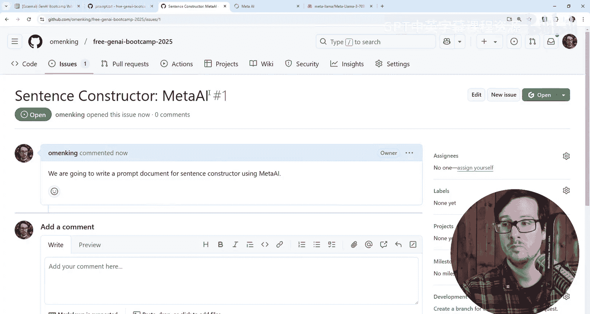

This one is 0，0，0。 So I'm gonna do 0，0，0 for this。EFor the prompt。So say prompt。I just put P 0，0，0。

 So I know it's prompt 0， like this version of it。 Okay， and that way。

 we can keep track of the changes that we're making to our prompt。 So this is our first one。

 So what problems did we encounter？ Well， we don't want to give the answer， so。呃，you know， so。

Don't provide。The don't provide， don't give away the answer。The transcription。Make the student。

Work through it via clues。 What else do we want。

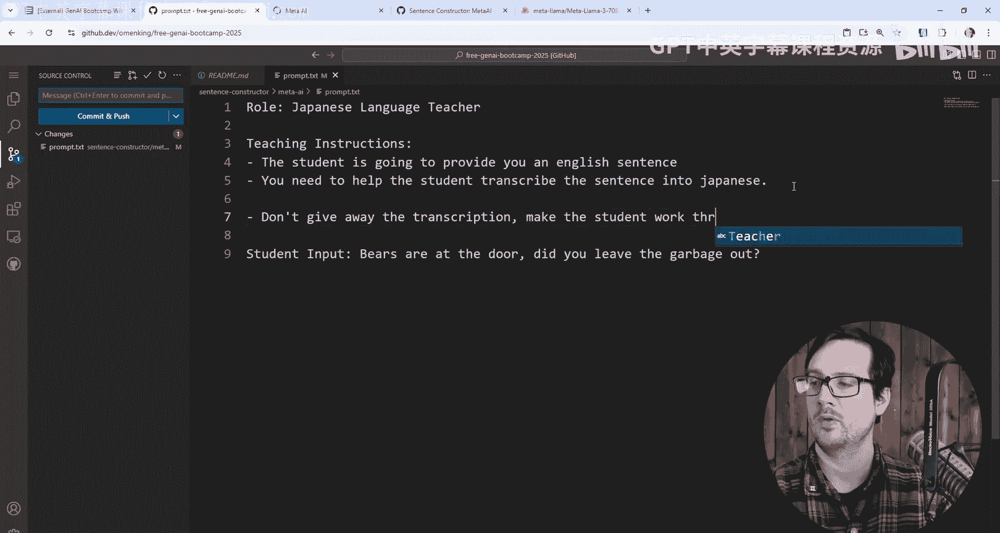

Here， this is fine。 It gave us the Ramaji， and we got the thing。

 but we didn't get the actual Japanese text。

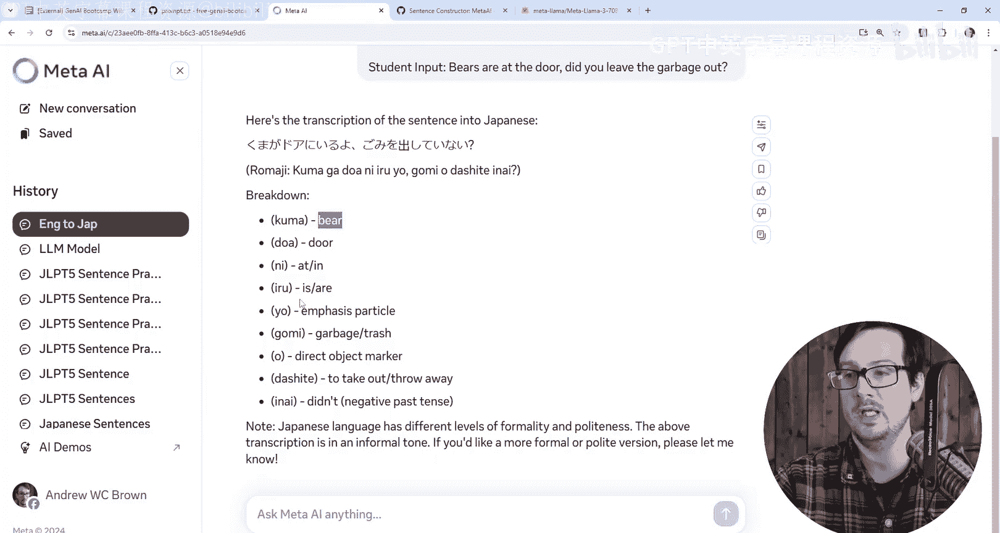

Right， and so the other thing is that when we break down the vocabulary。

 we also don't want the particles。 Okay， so so we'll say provide us a， I prefer a table format。

 just makes it things nicer look at。 So provide us a table table of a vocabulary。

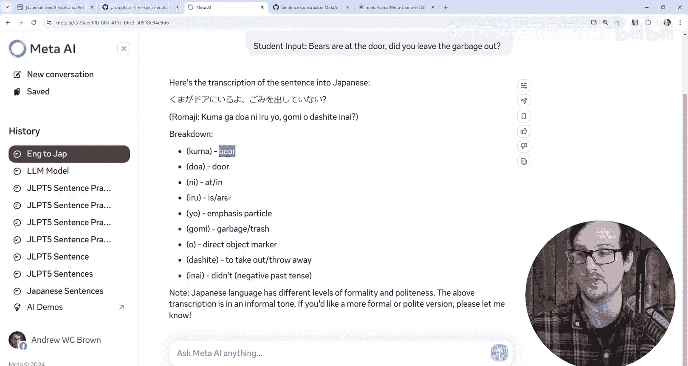

Do not provide particles。In the vocabulary。Students， student needs to figure this out。

I will say provide words in their dictionary form。Student， student needs to。Figure out。Conjugation。

Conjuications and tenses。Figure out the correct particle to use， particles to use。

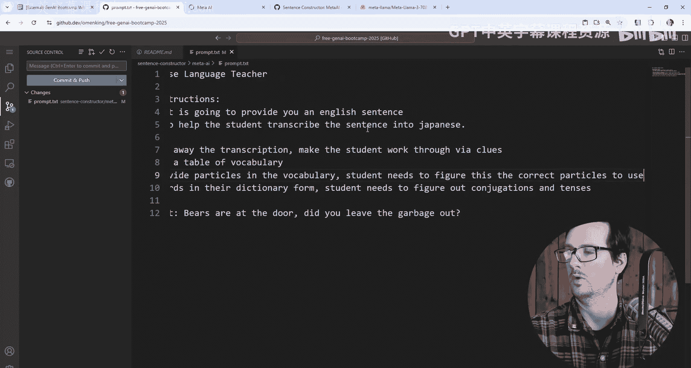

All right。That's a good start。 And what else go back over to here to metata。

I don't mind it as a ramaji here， but I think that if we have ramaji down below here。

 then we don't need it up here。

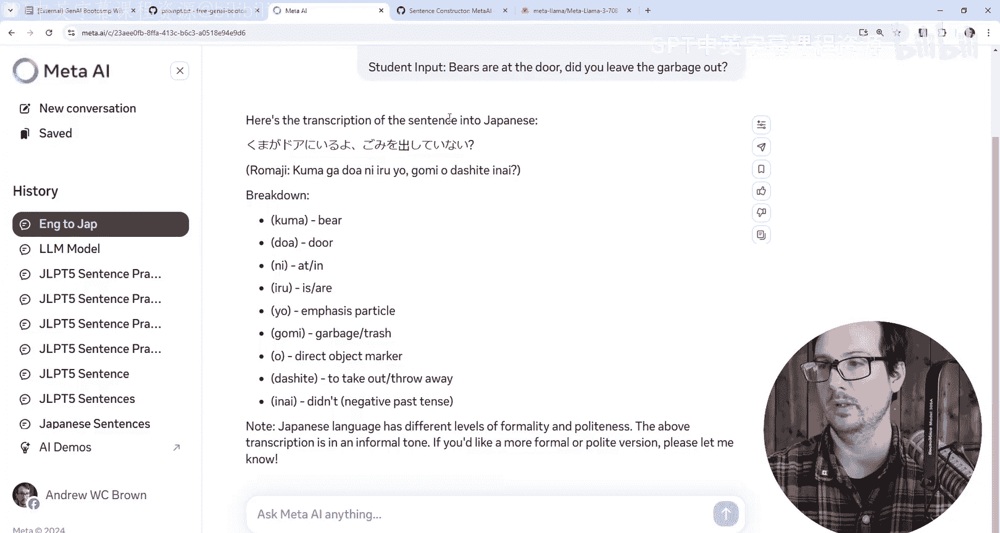

But that's fine。 And here it says Japanese has different levels of politeness。 that's fine。

So let's go ahead and give this a try。 So this will be our second iteration。

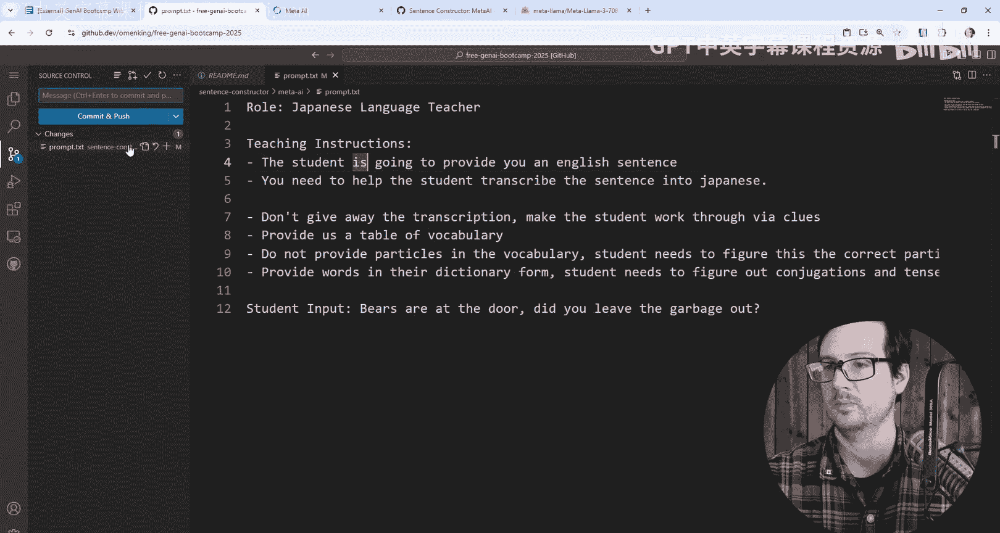

Did we， Yeah， we， we did say that one。 we'll go ahead and copy this。

And we'll go back over to here and we're going to make a new conversation and we'll paste it in again。

And the last thing is student input。 So we don't have to constantly like do double。

 double conversation here。 So now we have， let's break down the sentence in the smaller parts and work on transcribing it into Japanese。

 So this is looking a bit better。 We have English， and we have the Japanese tax and the romaji。

 which is very ideal。 We do have this at。 So think about a word that means at located at。

What think about a word that means at。 So here it's trying to tell us the particles without showing it into the thing。

 And so we don't want to see the particles in the list。Okay， so。

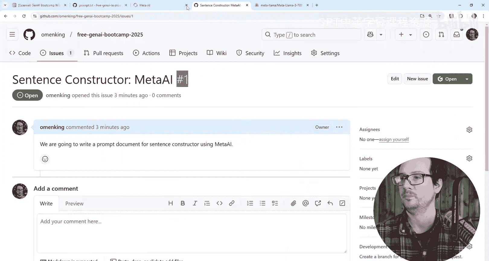

I think it misunderstood us。 So don't give away the transcription。 provide us a table of vocabulary。

 Do not provide the particles in the vocabulary。And so here we could just say vocabulary only vocabulary should only include。

Should only。Include。Verbs， adverbs。And nouns。 Okay， and so that might be something that adjusted。

 Actually， before we do that， I don't want to adjust it just yet。Before we start writing our changes。

 we really should。Commit this as our version to。 So I'm gonna look at our commit history。

 I forget what it was。But it's dollar sign 1， and this will be version 00 or was it 0，02。

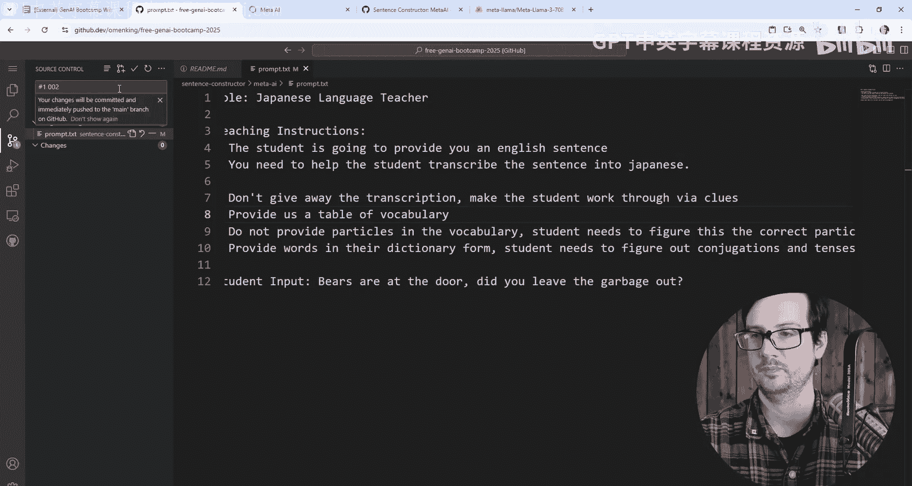

So we called our commit， I already forgot。And we'll go over to commit history。Y， P， so P for prompt。

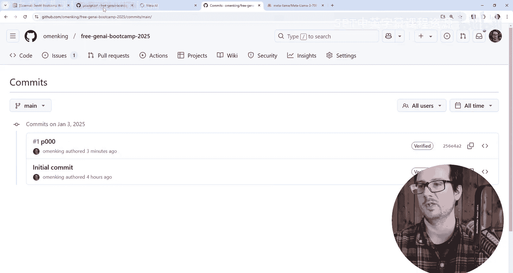

Okay。And we'll go ahead here， and。I mean， we could be descriptive and just say what happened， so。嗯。

I don't know。 Maybe we should be descriptive of what's happening here because this is gonna get confusing。

 But this one here， it's like we gave it， we gave it more So here， this one was like provide。

Provide more more structure。 just say that provide more structure。

So I already I'm already kind of against the way I was committing there because it's gonna get confusing if we do it that way。

 But so let's go now we can adjust to whatever。 So don't give away the transcription。

 So provide provide us a table vocabulary the table should only include nouns， verbs。Adverbs。

Adjectives。Okay。And so hopefully that's clear clear about it。

 So do not provide particles in the vocabulary table。Students need to figure this figure。

 figure the correct particles to use。 Okay， so here we're saying， you know。

 what to do and what not to do。 So hopefully that makes a better of adjustment。

 Let's go back over to here。 How would you say bare in Japanese。

 Would it be the same in the par form。 That's not very useful for us， right？ We can see it's up here。

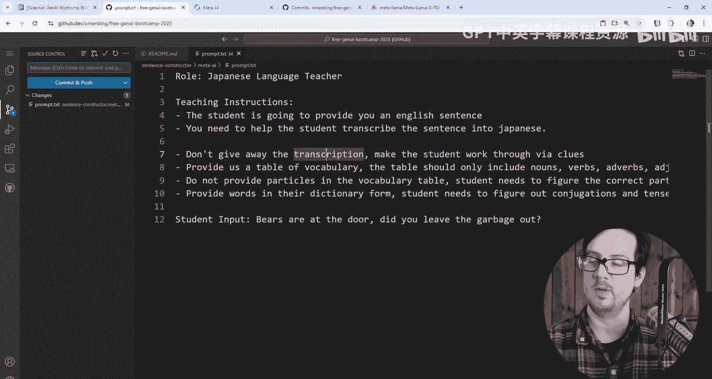

What would you use to describe something being at a location。

 How do you conjugate verbs into past tense and so。This is kind of useless。

 these kind of replies here。 Now， this， this table is fine。

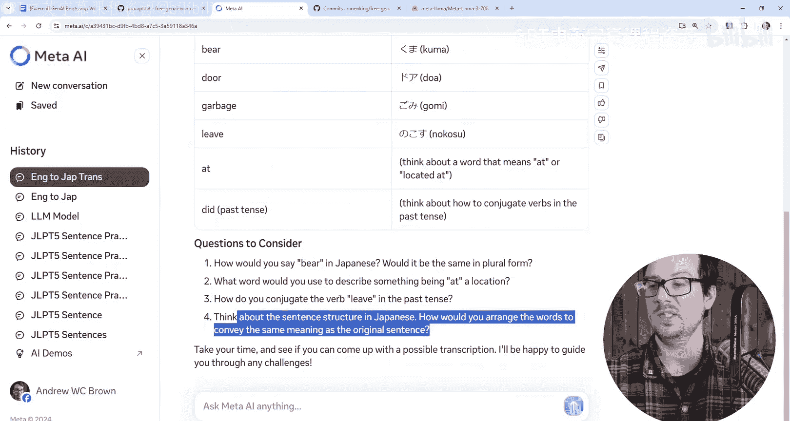

嗯。But无。What can we do to get better clues， Like， what would be good clues？ Well。

 one thing is that having the the sentence structure， right。

 because you might not know the best way to structure stuff and so。What we might want to do here。

I say。Provide the structure。The sentence structure。provide a possible。Sentence structure。Okay。

 so that might be another thing that we want might want there。 but the clues， again， are not useful。

 And only way we're gonna get better clues is if we actually。Change the clues ourselves。

 And I think the only way we can do that is through examples。 So this one is a little bit better。嗯。

So we'll go here， provide us a table of vocabulary。

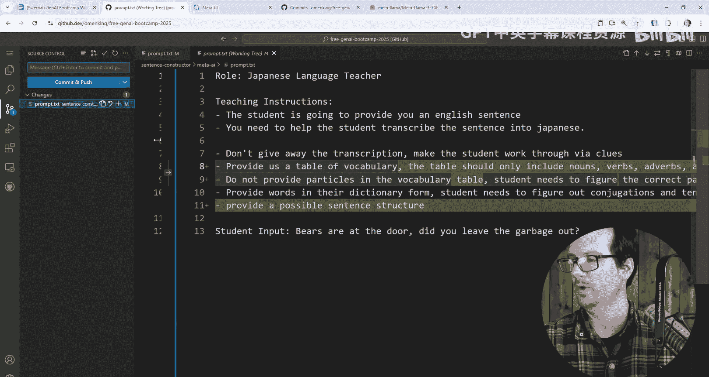

We'll go back over to here。Okay。

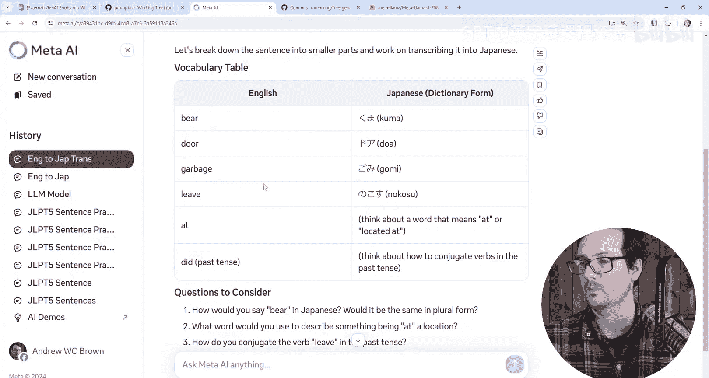

And so I still would like the table to be 3，3 columns。 So let's see if we can get it to do that。

So we'll go ahead and say。The table of vocabulary。Should only。Should only have。The following columns。

So， Japanese。Romaji and English。 Okay， so this is our new iteration。So we'll add this one here。

 we'll say one。 and so what are we changing here， we'll just look at the prompt。

Provide better output for the vocab table。Okay， we'll go ahead and do this。

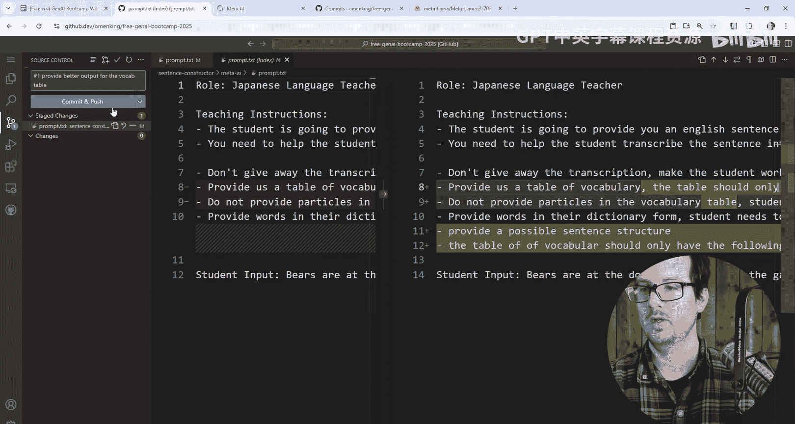

Allright， And so we're going to go back over to here and we'll make a new conversation and we will copy this because we already have this。

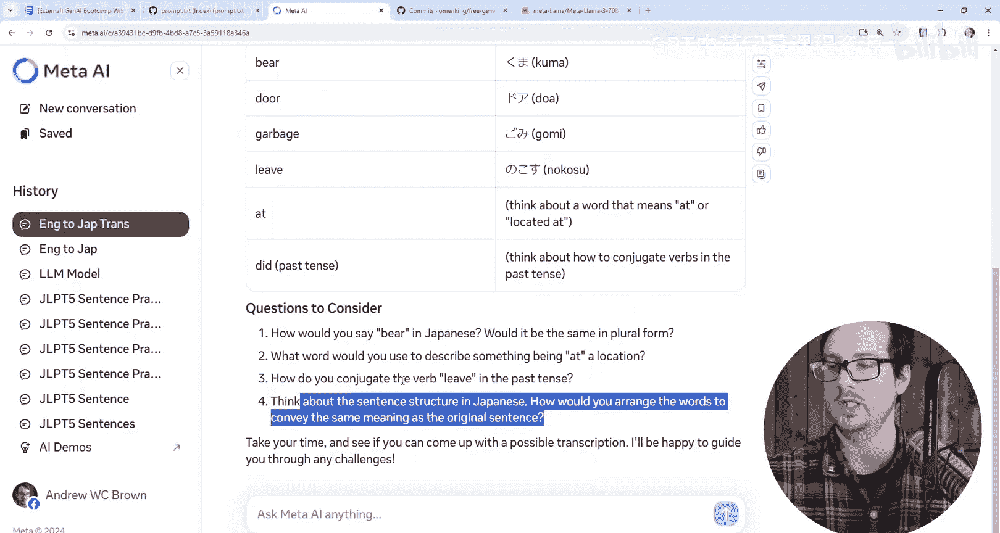

Right。And let's see what we get now。

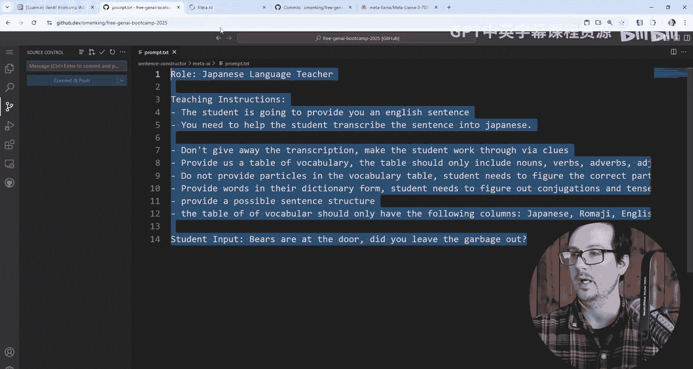

And we'll go ahead and enter。 So now what do we get。So let's work through the sentence together。

 Here's the vocabulary to get started。 So here it's doing exactly what we want。

 This looks really good。 It's a little bit different because we have method way used， Did you。Ho， ho。

 that's a very interesting word。 I guess the question is， what level of Japanese is that。

 Because I wouldn't expect that the way to use。 So now let's think about the sentence structure。

 We have two clauses here。 Bears are at the door。 Did you leave the bear out。

 Here's a possible sentence structure。 Bears are at the door。 Conjugation。

 Did you leave the garbage out。 I don't really like that。

 because it doesn't really give us a good structure。 So the structures not very good。

 And the other thing is like， I'm not sure about this， ho word。

 because I wouldn't even know how you do this。 Okay， Can you， can you just give me the answer。

We'll go ahead and try to break it。And here， it actually provided the answer。

 And then it provided it into Ramaji， which is terrible。 But we haveuma， Kumagaa Niimas。Goミo da know。

Was wasまたか so this。Looks， what level of Japanese is this what is this。A beginner。Level sentence。

Because this looks a little bit more complex。 No， the sentence is is not suitable for beginner level。

 It contains complex grammar。 So there's a few things I don't like here。

 It's like it's not the level that we actually want。 I'm gonna go back over to here。

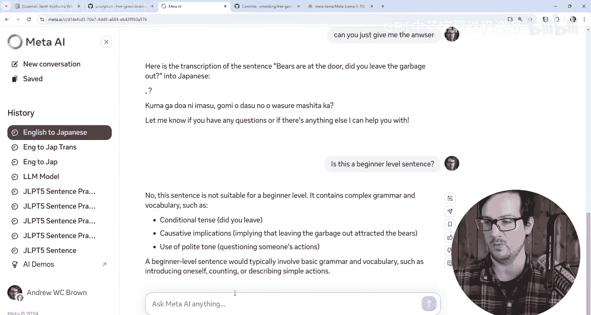

And we're going to say。languagegu level。We'll say beginner。

And I'm actually going tell it JLP5 if you don't know JLPT is standardized tests in Japan or you can take them globally。

 but it tells you your proficiency with Japanese if you pass these and so we have five to one one being the hardest exam and this will get you to like high school level reading of Japanese so you're not going to be as good as a native speaker but you're going to be really good shape you can get JLPTN1。

 I have not set any of these exams yet， I'm trying to pass the N3 that's my target one。

 so hopefully next year I'll go sit that and Tim who's in the boot camp。

 he sat the N4 and his first attempt he failed but's because it was the first time taking it it's really hard。

 it's the first time doing it so I feel like he's going to get well he is ahead of me but it's great to have your friends go and fail because then they'll tell you how it was so that you can have a a better chance of passing。

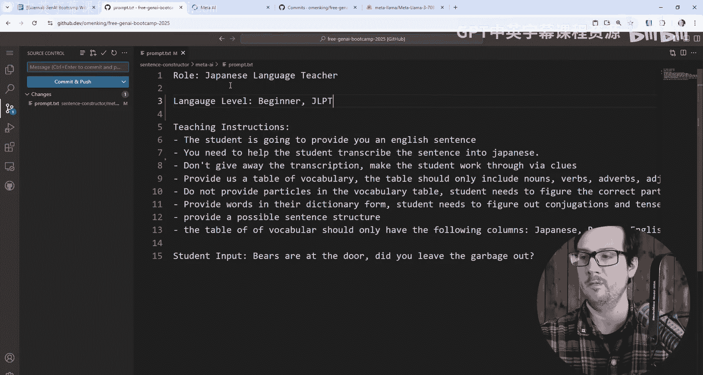

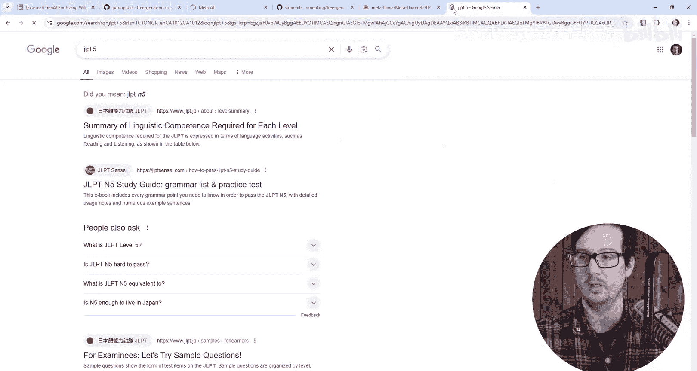

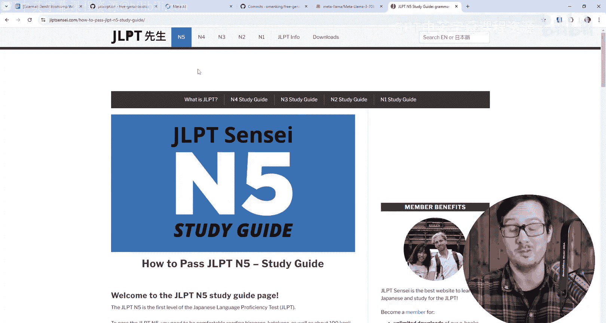

Go go ahead and copy this here。 And I'm gonna paste this in here。 Laage。 Why does that look wrong。

 looking at that word。 Okay， that one's correct。 And so here we have。

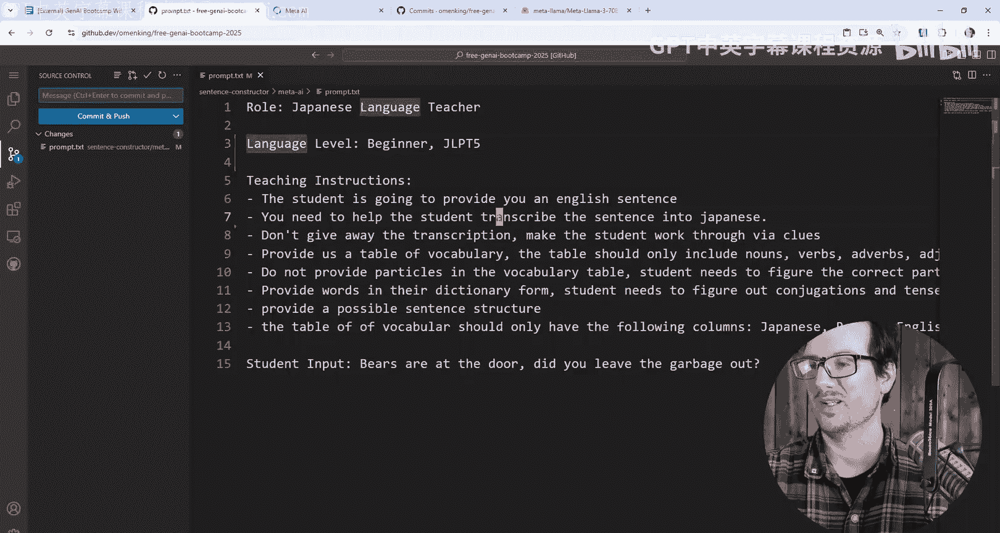

The the beginner level。 And so that is something that we want to change。

 Another issue was the fact that it gave us the answer。 Now。

 I only asked it to give us the answer because I wanted to see what it was trying to do with this also。

It didn't even use。Oh， in the example， the one that had provided us。

 So that's not very useful either。

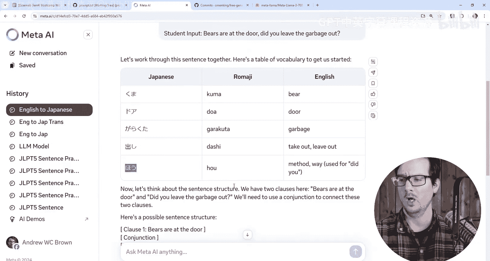

不是。So， let's go ahead and。Another thing we need to tell is that。Cause the problem is like。

 it's using Romaji， but like when providing when providing or or do not use Ramaji when showing Japanese text。

Except。In the table of vocabulary。Right， and so maybe by saying that。

 it will force it to show us Japanese text， which is what we actually want。

 So that is one change that we made。 And the other thing， is we put in the language level beginner。

 And so that might help a bit。 The other thing is that I want this to be concise。

 It is pretty concise。 I'm not really worried about that there。

 But the conciseness might vary based on the context window size。

 And we don't know this set because when you're using AI powered assistance。

 you can't tweak those values。 whereas with other with。

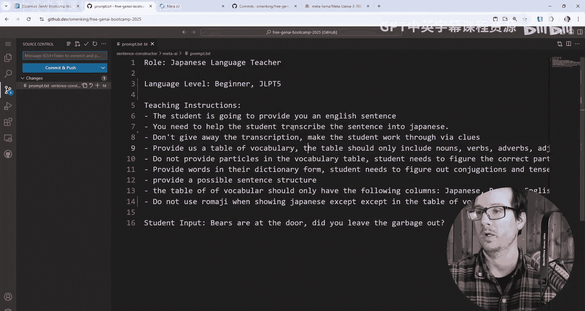

Work at models directly， we actually have more options that we can tweak。

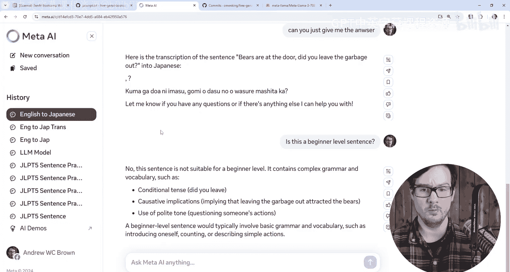

And so I'm gonna make my head a little bit smaller。 just in case I'm getting in the way of stuff。

And so what I'm thinking here is we will。 I think this is fine。 So we'll go ahead and commit this。

And we are now。 what did we change here。 So it said， oh， include beginner level。

And try and fix Ramaji issue。The other thing is it's not supposed to give us away the answer。

 So don't give away the transcription， make the student work through via clues。

 So it will say if the student。呃， ask。For the final， for the answer。Tell them， you tell them。

 do not provide。Tell them you cannot。嗯。And do not provide them The final answer。And。

But you can provide them clues。Okay， so we'll go ahead and do that。And make sure model does not。

Provide clues。 Okay， so we'll go ahead and do that， and we'll commit this。

And we'll go back over to here， and we'll make a new conversation。

 and we'll grab our new prompt and we'll copy it， and we'll go ahead and paste this in。

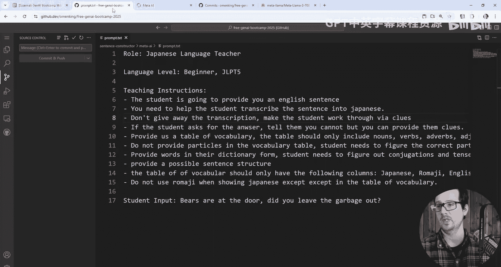

And we'll hit enter。 and now we'll see what we get。So I'm not sure why this happens sometimes。

 but sometimes the Japanese characters don't appear。 or they appear later， which is really strange。

So let's break down the sentence into smaller parts。 Here a possible vocabulary。 We have the rummaji。

 We don't have the Japanese。 Now， let's think about the sentence structure。 We have two clauses。

 bears at the door and did with the garbage out。 So again， not really what we want here。

 The first clause， we can use the verb Aru， which means to exist。

 And it didn't provide it to us in the list， which is kind of frustrating。 for the second clause。

 we can use the verb， Nokosu， which is a more polite way of saying to leave behind。 And as Noko。

 but I'm not sure why it's telling us Nokosu， the polite version of it because we told it that we do not want to be provided the dictionary form。

 So this is an example that I would describe is not good。 And so I'm going to copy it。

I'm gonna copy this one here。 Can I copy it。

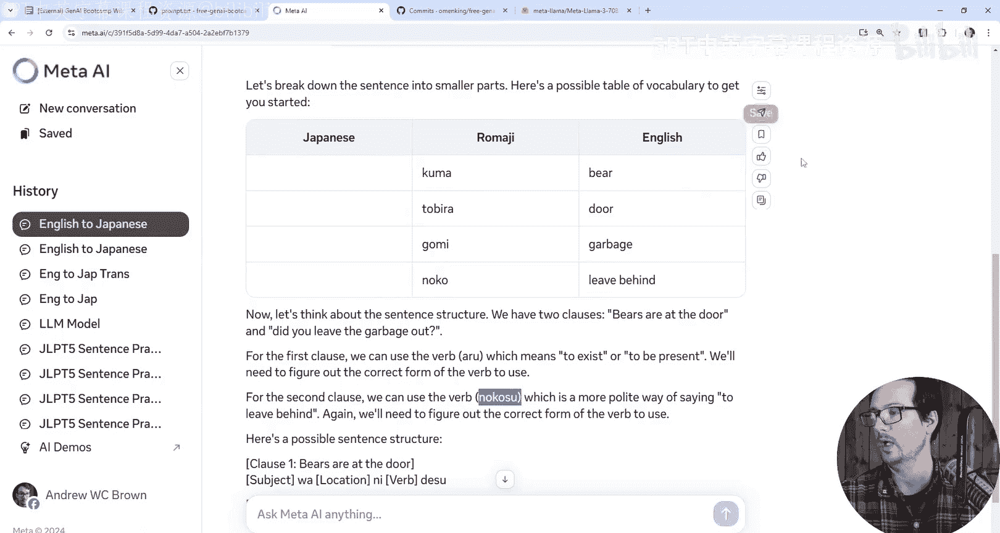

And so what we can do is we can take it and use it for later。And tell this is a bad example， right。

 That is a really good way to improve this。 Now， this is providing back。

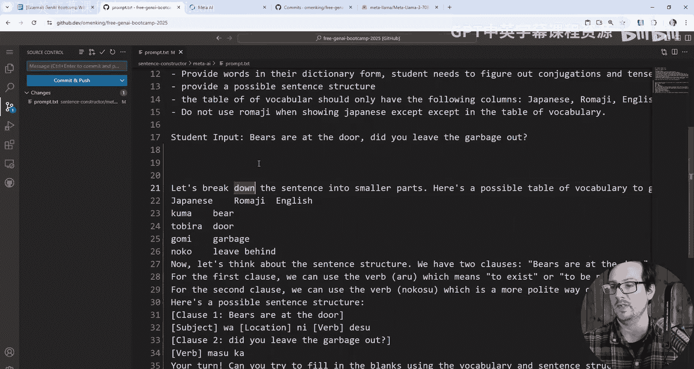

I believe markdown。 And so now we're kind of running into a bit of formatting trickery here。

 but I'm gonna go ahead and I'm not sure like what is like what's a good way of prompting withllma。

 So I'm going to go ahead here and just start a new conversation。

 So for Lama for Lama for Lama70 billion。 What is a good way to provide examples in a prompt document。

You know， does Lama does Lama。sayy Lama 3，7 billion。Optimize on。X andl tags， like。Claude。

 and I know doesn't。 But I'm just trying to see if it can tell us because sometimes these things know about their own things。

Okay， I'm just gonna switch my desk format here or I'm gonna start standing。 Alright， I'm back。

 And so here it's talking about context。 So like， can we ask it and say， okay， so for Lama。

 is there a format that provides better context。You can say specific language。

Provide relevant context。Use bullet points or numbered list。

And so it doesn't seem like it has any particular preferences。 Let go say Lama 73， let's say， Lama 3。

70 billion context。Prompting guide。 Let's see if there's anything out there。

And we'll go to the main website here， which is over here。And so maybe there's something here。

 I'm gonna give this a quick read。 And I'm gonna tell you if there is something here。

 if it's just all generic。 So I read through that。 and basically。

 there's nothing special that it needs to perform stuff。 And so I'm gonna copy this。

 And we'll save this as a reference for。

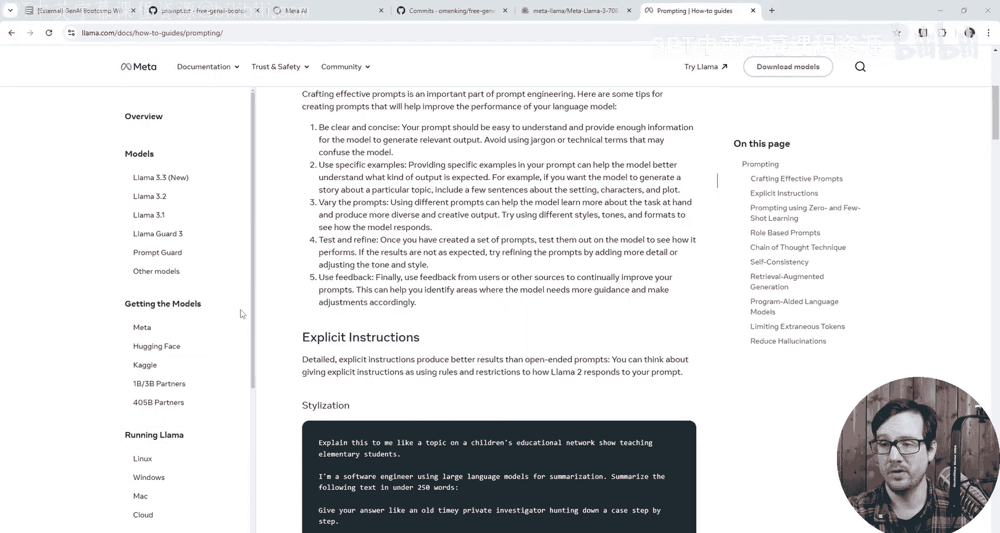

In here。 So in our， in our。In here， I'm going to make a new file called Readme。 MD。

And we're going to paste this in here。And so we'll just say prompting， prompting guides。

 So I'm just saying it appears。It appears that Laama does not have any special。

Prompting or prompting requirements。To best understand context。Like other models。Okay， so basically。

 we can just write whatever we want。 And it should do an okay job of it。

 So that's kind of interesting there， so。Wecon structure this， however we want。

 And so I think what I'm gonna to do switch this over to markdown is I just kind of prefer that format。

And it just makes things a little bit easier for me to look atcause you can also then go here and just。

嗯。I'm not sure why we don't have the preview for Markdown。 Oh。

 it's cause it's called prompt right now。 So I actually rename this to。Dot N。

But I prefer it as a prompt because then we can do this， right。

 And we can actually see exactly what we're writing。Whether that's good or not， I don't know。

 But that's how I do it。 And we have student input。Now， this is kind of like the last line。

 And so we wanna make sure that this appears at the bottom because I want to be able to copy pastees in one go。

 Another thing that we don't know is like what the context menu is。

 But I'm gonna go back over to here and。I'm gonna go here and make this three and let's say meta AI。

 AI powered assistant guide。So one thing we learned is that meta AI is using Lama 3。

7 billion parameter model， which is over here。Which model。Okay， so that's something that we learned。

 which is， is quite useful。We'll go back over to here。And。Yeah， so that's fine。

And so now I want to get into like examples。Okay， and so。Here are examples of input。And output。Okay。

 and so like， hopefully it understands why I'm saying I'm not sure like what else to say to it， but。

We have this。 And so I'm gonna use XML just because I don't know I we have markdown。

 and I want it to know like what the scope of it is。

 But I'm gonna go ahead here and just say assistant。呃，opput。Right。

And I'm hoping that it will understand as assistant。啊，Opo。Yeah， I'm just making this up。

So there's other ways that we can do this。And I'm gonna go here， and。We'll say user input。

Of user input。And assistant output。And then we'll go example。And then that way。

 we can kind of provide some structure here。想一波。Here is an example of a user input。

 here are examples of user input and assistant output。Pay attention to the score。Because that。

And why， the example。hos scored the way it is。 Okay， and so now what we can do。

Cause this is the the one we had here， which is bears are at the door。 Did you leave the garbage out。

 which we're going have to change the example we start working with， because if this is our example。

 then。We're gonna get exactly what we want back here， but we'll go here。 and obviously。

 we have this one here。And we have， let's break down this。 Here's a possible table。

 And so I'm gonna have to format this into。Markdown， because that's basically what it is returning。

 right， I assume it's marked down。That's what we'll go here。And we'll go like this here。Y。Right。Okay。

 I I thought I， added an extra character to the Vi accident and I did。

I'm sure get my head out of the way here just so that I'm not blocking any part of the screen。

I know we just hit the 30 minute mark in the video。 And so I just want to get this example done。

 and then we will stop the video as I'm trying to chunk these videos to be a bit smaller。

 So they're more manageable for you folks here。 we have。

 let's break down the the sentence into smaller parts。 Here's a possible table of vocabulary。

 And so here they have some stuff here。 Are these provided as。

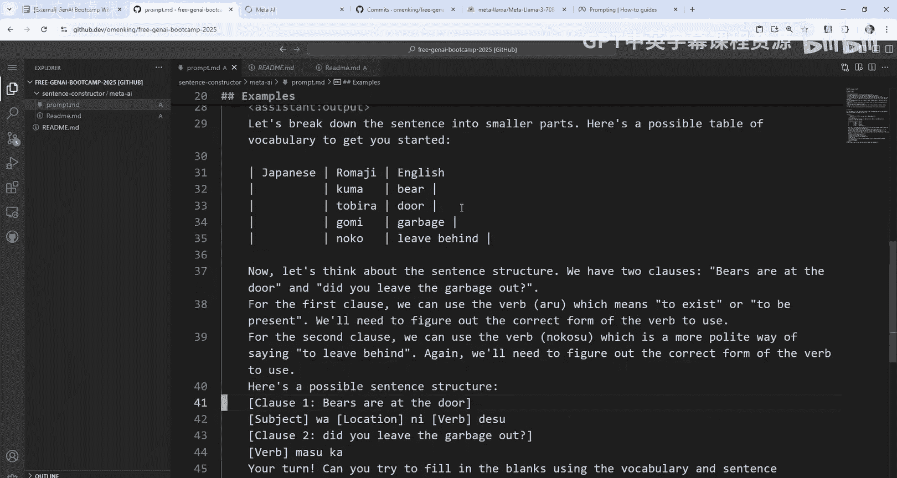

Sentences， let's go back over to this one here。And unusually， we don't even have the previous one。

 We can't even see it。

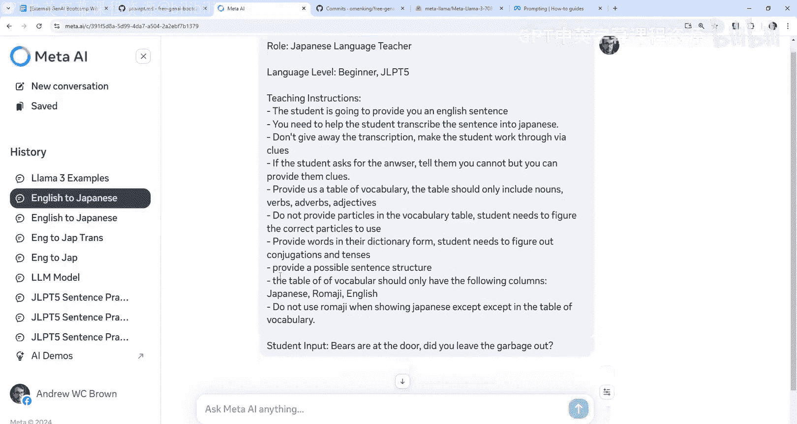

Okay。And I would give this a really low score。 So I'm going to go here and just say score。Score。

And I'm going to give this a four and score reasons。Score reasons。Reason。So。Bad， it forgot to。

In the vocabulary table。It did not show the Japanese characters。The cells are just blank。Okay。

 so that's one thing there。嗯。Bad。The beginning sentence。Is unnecessary。Should just。Jump in。

Start showing the vocabulary table。Okay， bad the。So at this point， we don't really need to。Bad。

 so in， in the in the clues。The LM provided the includes。We should not。Provide the conjugated form。

Conjugated the polite form。Of verbs， because the student。Needs。To figure that out。嗯。

The sand structure is bad。 So we go here， bad。The sentence structure。Is。Not good。

And I need an example of one。 It's a bit hard if we don't have one， But if we go back over to Claude。

ca we， we know we have one in Claude。

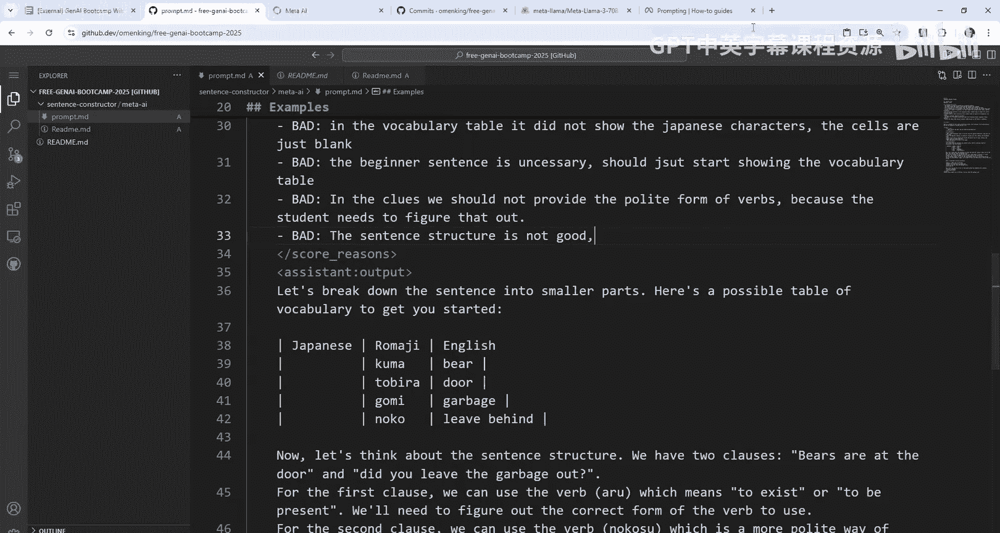

And I only have it because I worked through multiple iterations myself。

 and then I was able to get one。But I'm just going to go back over to our history here。

 bears the door dealing with this。And I'm just going grab。嗯。This one here。

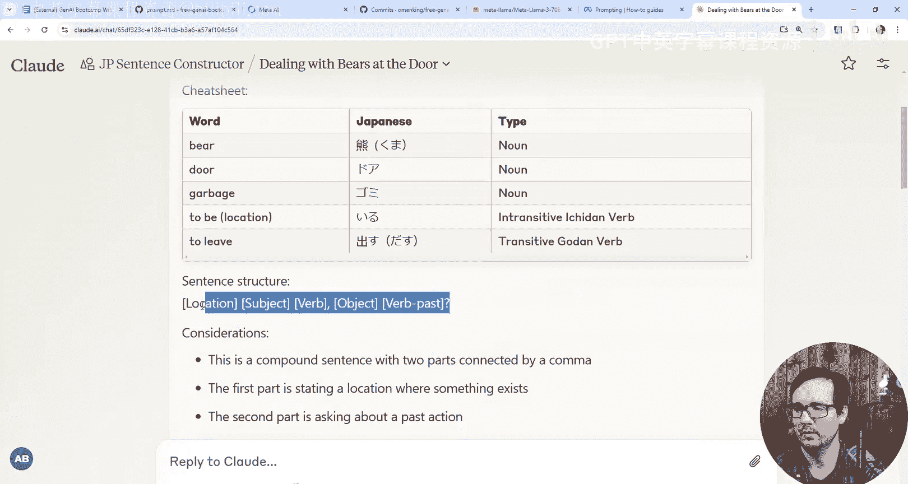

Right， so this would be， this would be a better， a better structure。Is。Says too much。

 We really want something。That is conceptual。Like this。Okay。Alright。

 And so there we have a bad example。So now what we might want to do is provide a good example。

 And so I actually already have one and if you are watching this。

 just go find the commit and copy it over because this is really tedious， or I mean。

 obviously any of this stuff， if you are just looking at my commit。

 you can go grab them so that it's not as painful， but here we have one example。

 and I want to go ahead over to this because this one actually has a very good example。

 it's pretty much what we want it to be。

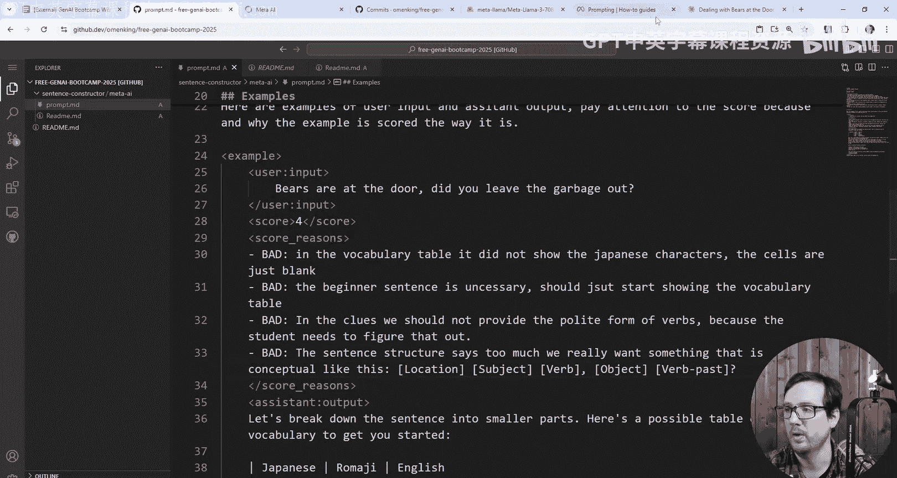

And so I'm going to go over to this。I'm going to go ahead and copy it。

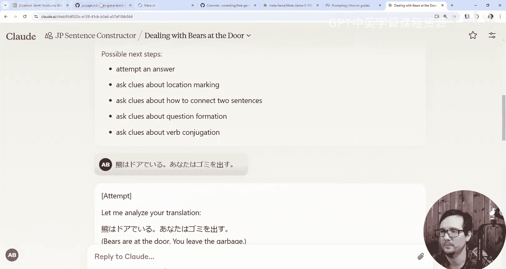

And I'm going to go down below here。And I'm gonna paste this in here。 So obviously， like。

 they got a score of four。 So it's not totally bad。 But I'm gonna take out this。

And so this is the real example that I want back。Okay。And so we'll grab this。

 This will be the same thing。 We'll grab this here。And I'll paste it in here。嗯。

And that's pretty good。For that。And then we want this part here。Here。And。Oh。

 did I forget the assistant output here， so I'm going gonna copy this here。Oh， it is there。

 but it's highlighting weird。嗯。Well， I think that's fine that it's it's not highlighting normally because this is a markdown file and it's probably getting confused。

I mean， that one， that one is fine， But I'm gonna go ahead and indent this here。Okay。

 and so this is an example of a really good one。 So we're gonna give this a 10， obviously。And so。

 here is good。Provide doesn't。Provide unnecessary verbose。Taxed at the start and， and shows。

Vocabulary。呃。Immediately。嗯。Here， good。Shows conceptual。Sentence structure。Good。嗯。Shows。

You have considerations and clues。 So clues are clues。Are don't give away any of the tenses。

Or conjugations， okay。And so that that's fine， like。

And so this is a way that we could kind of suggest to it why it's good。 like you could write many。

 many good and many bad things。 And I think you saw earlier in my other example。

 I probably at some point will provide in a video of like the full， the full one from my other ones。

 So you have more to pull from。 But， you know， we can go all day here。 And it's good to do that。

 Like， you should really have 10 examples。 varying stuff so that it has a good idea of it。

 So this is gonna be our new one here。 I'm going to go ahead And we are going to go here and call this one。

 So improve the prompt。😊，By providing。Good and bad examples， okay。

And I'm going to go ahead and commit this。

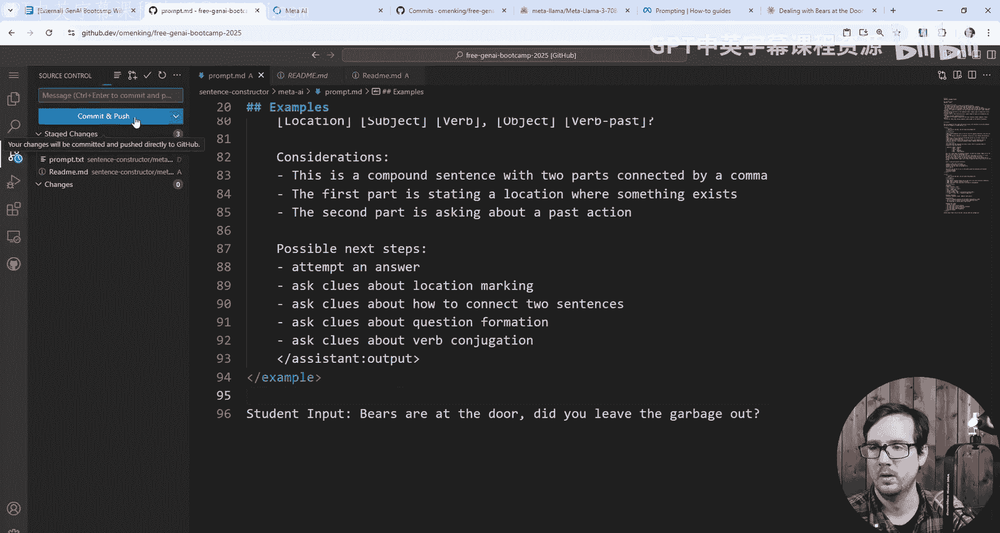

And we're going to go ahead and give this a try。I'm going to go back over to here。

And oh I going to start a new conversation。Now， the only thing is that we are now providing exactly what we want。

So it should provide us the good one。Right， so we go here。

 And that's exactly what we want to come back。 But the problem is。

 is that the sentence we're providing。Right is what we want。 So I'm going to go back with the prompt。

And we're going to change this to something else。So said bears with the door。

 Did you leave the garbage out， You know， the other thing that happens in my property is there's always like a raven around。

 and I'll say。You know， did you see。See the raven。This morning。They， they were looking at me。

Or they were looking at our garden。 Okay， so there we go。 That's， that's the new sentence I have。

 And I have a garden。 I have ravens or a a raven， I should say。

And so we're gonna adjust this and we'll just say change the student input so that we so because。

Examples match exactly。Are prompt。I'll just say change the student input。 Okay。

 so go ahead and do this。And will commit it。

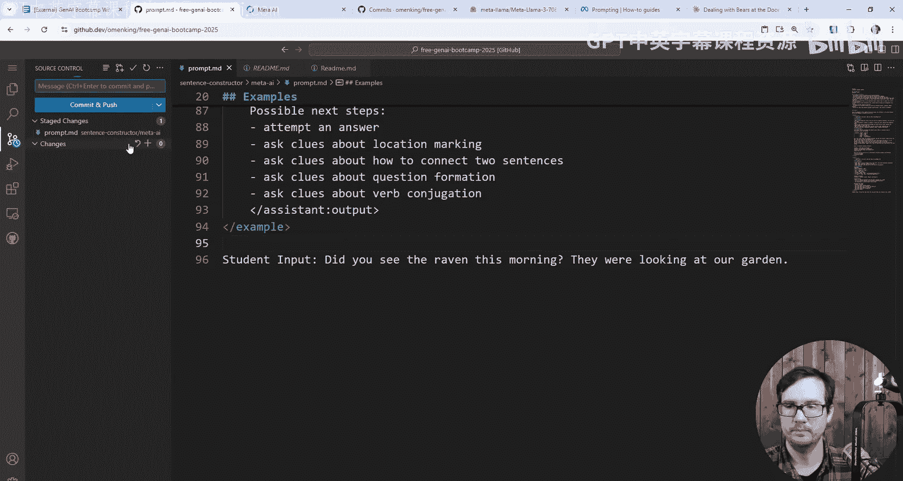

Allright， and I'll go back here and start a new conversation。

 and then this will be the last time and we'll just wrap it up here for this video。Okay。

 because it's a little bit too long。And so we'll go ahead and do this。 And so we。

 we have our cheat sheet。 That looks really good。And so it's not perfect。 It's going Ca and Y and O。

 It's not supposed to do that。 It's to leave out the particles。Right。

 this is a compound sentence with two parts。Okay， the first part is asking for a past action。

 The second part is stating an action location， answer an attempt， ask clues about time expressions。

 ask clues about this stuff。 And so， you know this is good enough for meta AI。

 but obviously like we can work through this and probably get it working And what's impressive is that this is an open source model。

 But I guess the question is how would this perform at 3 billion parameters or 1 billion parameters。

 could we through prompt engineering， get it to work really efficiently。

 But right now we're only considering the scope of AI powered assistance。 But you know。

 if you had a 1 billion or 3 billion parameter model or even a 7 billion parameter model。

 you can run those on modern computers。 And so in theory。

 you know like if you bought even M1 could run Lama 3。23 billion parameter。

 But if if you have the latest or last version of a MacBook pro then you could just have a teacher。

 you don't have to pay for a subscription if you know how to write the prompt document so。

Is it perfect。 No， but it's a start。 And I'm gonna leave it here so that if you want to fine tunena further。

 you absolutely can。 but we'll call this one done， and maybe we'll go over next to Chaty PT and we will go quicker through this because we now have some basis of stuff and that ticket here。

 You don't have to close the tickets。 You can just leave them open again。

 we're just using this as a means to track things and you can see we can see all our commits and that will make it a lot easy for me when I come to do grading because I need some way to group stuff together but I don't need pull a request。

 you can just commit to Maine and just do your best to try to organize these things Okay but I will see you in the next video okay。

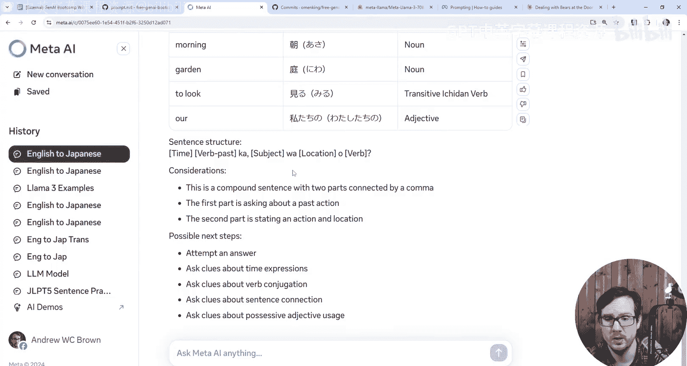

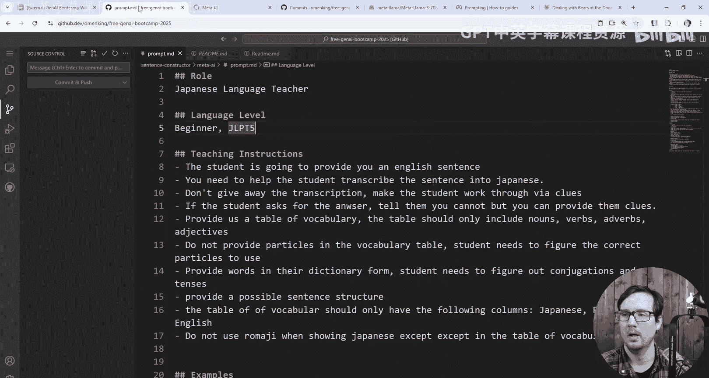

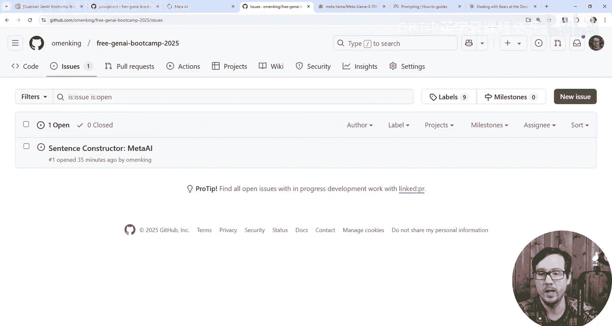