# ExamPro《生成式AI训练营｜Free GenAI Bootcamp》中英字幕（deepseek - P9：-09-Sentence Constructor - ChatGPT.zh_en - GPT中英字幕课程资源 - BV1SFEWzLEab

Hey， this is Angel Brown， and we are over on chat G。 I have a paid version of it。

 I don't remember what's available in the free tier。

 But the thing is if you don't have the paid tier， just use whatever you can utilize here because at the end of the day。

 you have to just work with what you got And sometimes there's just stuff that you are gonna use that works for you and doesn work for someone else。

 whether that's paid or free。 I'll give you an example。 I want to use the open source model Gema。

 I can't use it because in hugging face every time I go over here and I look at my models。

 it's just not giving me access right having pending since November 4 right And so you got to make work with whatever you got Okay And so you know just do your best and that's your opportunity to document something that's really interesting and come back back here。

 I'm going be using G40 if you want to use1 mini or even an older model you absolutely can but let's go ahead and get started。

 So I'm gonna go ahead and create a new issue。And this is gonna to be sentence constructor and this time we're going to be using chat GT so I'm just saying chat GT and I'm going leave this open to whatever you want to call it 40440 mini or whatever。

 or if you can' even do this just document the best you can of what you have here and so we are going to create a prompt document。

For chat G G G40。 Okay， And so the first thing that we probably want to do is figure out how to best prompt it because。

 you know， we looked at。Lma's guy， but G must have their own G 4，0 prompting。

What they call this prompting guide。Do we have that here。GP 40。And here it is， prompting engineering。

So here it is。 I'm gonna go ahead。 I'm gonna copy this。 I'm gonna go back into this。

 I still have it open from before。 I'm gonna make a new folder。 This is gonna be chat， G。

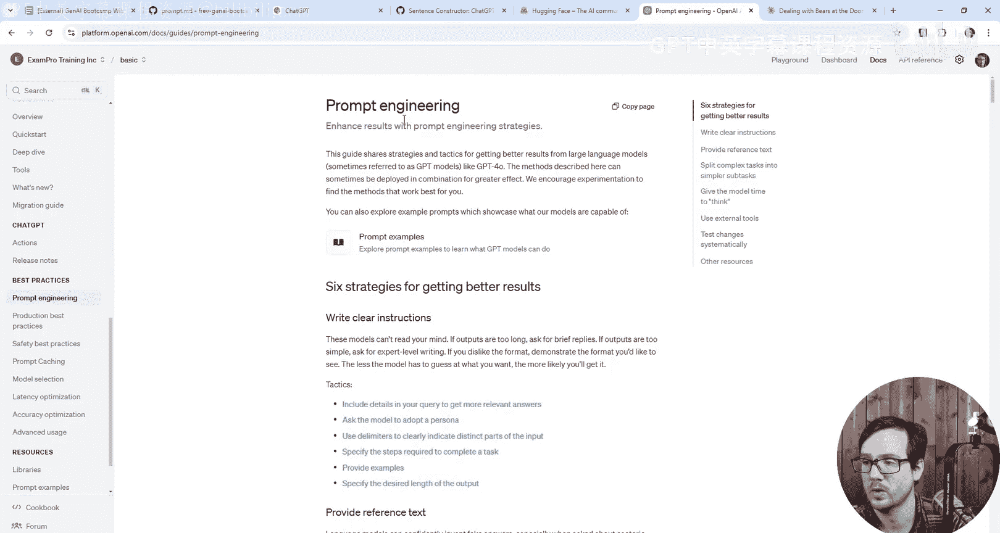

And I'm going to make a new readme file。And I'm going to paste in this link。Okay。

 I'm gonna follow the other pattern here just to make my life a little bit easier。

 We'll say chat GT powered assistant guide。Whatever we learn， we should write it down。

 assistant guide。So which model I'm using G 40。啊。So I'm just going to say I have the paid version of chat GT。

And。I want to use a model that。Like， I could use 40，1 reasoning。 Im， I don't want use 4，0。

1 reason because it's slow， right？ So if there's reasons as to why you're doing it。

 you may shows I have a paver in chapter G。 G 40 is fast enough。

 And I don't want to use the01 reasoning models。Because they have limited。Limited use。

 limited use per day。 Okay， so， and we don't want to have super intelligent reasoning here。

 But we can play around with it if you do。 I'm gonna go here and say ahead here and say prompt prompting guides。

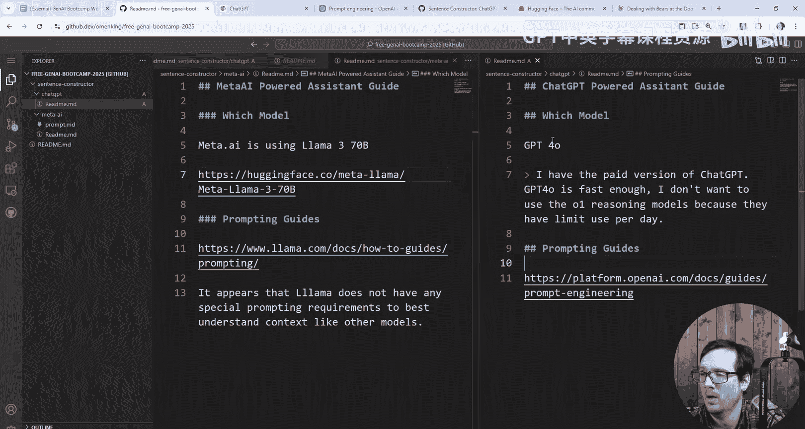

For this in particular。And let's see if there's anything that we can learn。Through here， so。

6 strategies for better results include details in your query to get more relevant answers。

Ask them all to adopt a persona。That's something we didn't。 We didn't tell to do before。

 Use delimiters to clearly indicate distinct parts of the input。

 Spec the steps required to complete a task， provide examples， specify the desired length of output。

 Instruct the model to answer using reference text。

 Instruct the model to answer with citations from a reference text。 I don't think we need citation。

 And we don't really need reference text either。 split complex text into smaller subtask。

 So just as a good practice， decompose a complex system。

 using10 classification to identify the thing。 And so through state management。

 we can kind of tell it to do that， right， Give the model time to think。

So that's another thing use external tools。So there's nothing in here in particular。 that science。

 right clear instruction。 So words， how do I add numbers Excel， How do I add a row and stuff？

 So they're being very。Lngy， explicit use the limitss to clearly indicate distinct parts。

 So quotation marks， XML tag， section tags。 So they're not saying there's anything in particular that we have to use。

Right， so I'm going to go back over to here。

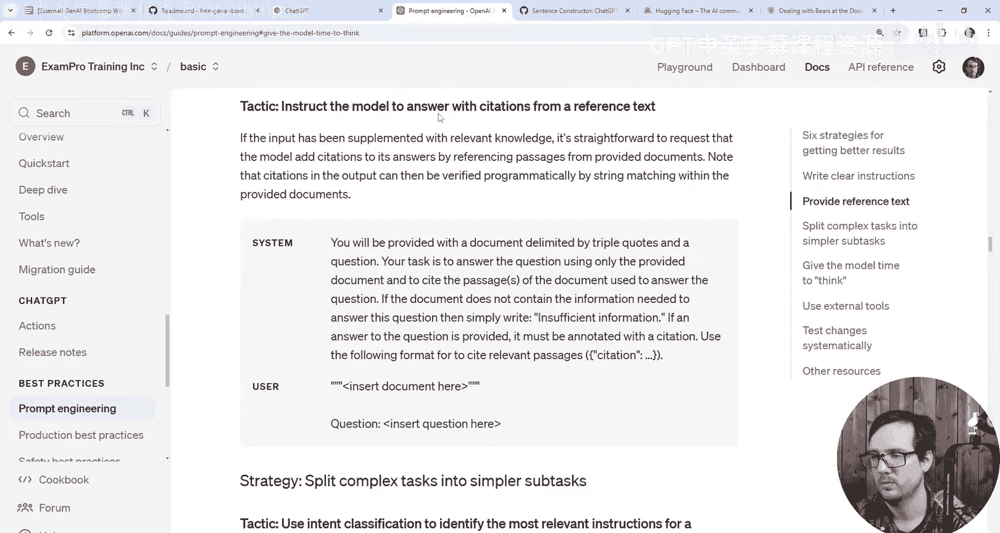

那个 say。Just like meta AI， there are no specific formatting。To best provide。Context。Okay。

And so we're going to go ahead here and make our prompt。 I'm just gonna start with a markdown file。

I'm going to bring over some of these things。 So the first thing I'm going to bring over is our Japanese language teacher。

The next thing we can bring over is our language level， because I think that was working pretty well。

We're gonna bring over our instructions。 Now， I'm not super happy with the way I wrote my instructions。

 but it's the best that I could do。 But maybe we can use Che B T to improve them。

 And then we have an example。 And the example is fine。 It's exactly what we wanted to do。

 So I'm gonna go ahead and grab this here。

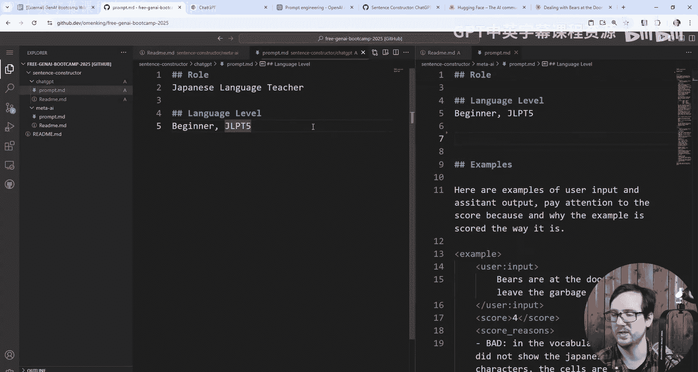

嗯。And maybe what we should do first。I we should just use it as is and see how it does。

So I'm going to go ahead here and copy this。And we're gonna go over to Cha U PT T。

 I'm gonna go ahead and paste it in。And one thing we should consider is the size of our document。

 Now， we can also attach documents and have them reference separately。But anyway。

 this is fine for now。 And you can see it doesn't like some of my capitalization。

 but I don't think it matters。Also， I didn't write things perfectly。

 You can see other spelling mistakes。 but I'm gonna go ahead and feed it in。

 I never noticed them right I'm dyslexic。 so I never see this stuff。But let's see how performs。

 And so far， it's looking pretty good。 So did you see the raven this morning。

 They were looking at our garden。嗯。Do we even test this in the last video。

 I think I said we were going to test and we never ran it。But that's okay。 Like if。

 if I didn't do it， then you go run and and you take a look。 But here we have Miu to see。

Wri Waarirau。 Oh okay， that's， that's for raven。 Warirau。 interesting， We have morning， Kesa。Oh。

 this morning， Caa。 And so here， I guess it's fine， like， because morning。Morning would be Asa。

 But here it's giving us this morning。 So that's fine。 We have Nwa， which is garden。 That's correct。

 Nwa， And we have Miri to look。 So we have Miri to C and Miri to look。 It actually repeated it twice。

😊，Okay， so maybe that's one thing we'll have to make an adjustment here。

 Did you see the rave in this morning， Okay， time object verb past tense。

 they were looking at our garden subject and notice that it's giving us the particles。 I told it。

 I don't want the。 Well we' told meta AI。 we didn't want the particles。

 But this is a problem we have that's carrying over。 And then down below， we have sentence。

 So focus on the conjugation of this。Into the past tense of the questions。

 So's giving away the answer。 We need to figure out the tenses。

 Try constructing the sentence step by step。 So the first thing I want to do is I just want to tell it a few things。

 like not to give away。And we could， again， copy this and provide this as our example。

 or we could go back and tweak the other one。 But I'm gonna go over here。And before we continue on。

 I just want to see if there's a way we can rewrite this。So。And we'll go back over to here。

Is there a better way to write this for chat GT。40。4 our prompt， okay。And we'll paste this in here。

We'll go ahead and hit enter。 This is where we might want to use a more intelligent model for this。

 but here's an improved version refined clarity and tailored for chat TPT's clarity。

 So the student will provide sentence。 your task is to guide the student through into transcribing into Japanese。

Do not provide the full transcription directly instead of offer step by step instructions。

 create a table containing only this。 ensure the table includes the following columns。

 use a dictionary form， encourage independent thinking。 So this is fine。 But okay， how do you know。

That your changes are better。Like， how would it actually know？Bullet point， mixed goals。

 specific actions， guidelines without clear prioritization， focus on student centric learning。嗯。

Instructions don't give away the transcription lacks actionable detail。

 So add how to guide step by steps provide。 But the problem is if you don't do that。

 it will still do it。 So I like I don't trust that it says that when it says that。

The revised instructions explicitly restricts emji to vocabulary， reducing the risk of it。

 revised version uses a consistent structure。 And so， you know。

 I just honestly don't trust what it's saying here。 I don't think that this is correct。

 but I have seen folks do that， But the problem is like， if we utilize this。

This is more this is more verbose。 and I have to maintain this file right and so I want this to be a maintainable file。

 obviously don't want to have spelling mistakes in here， and that's something we should correct。

 but I would probably rather just do iterations of this with another human and try to make it more compact and concise。

 but yeah there were a few issues here。 which is we don't want the examples of the So like one thing we can do is we could try to provide instructions about output。

Right， so we， we're starting to define a structure here。 And if you look here。

A bit all over the place， sorry。But we go， sorry down here。 We have the vocabulary table。

 We have sentence structure。 We have considerations。 And so we basically have those three sections。

 right， And we can kind of hone in on those and help them out。 Like， obviously， there's also this。

 the sentence， Yeah， the sentence structure。 So we'll go back over to here。

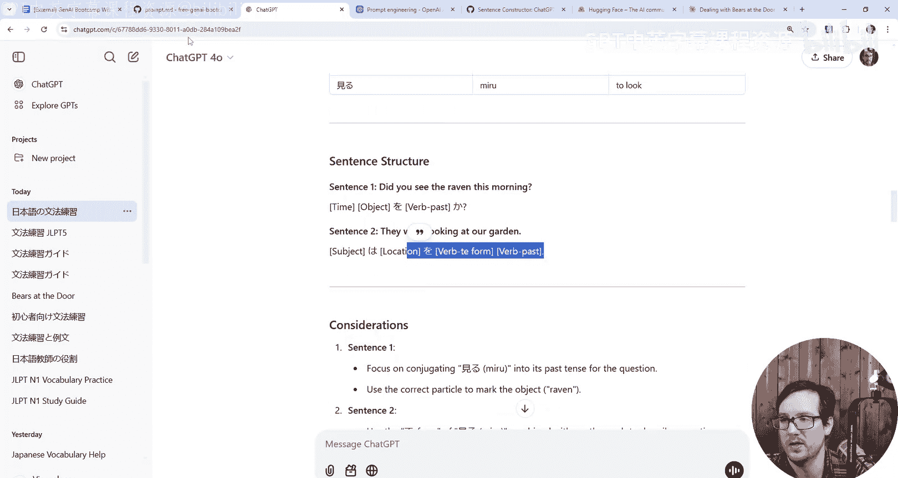

And we have teaching instructions。And we're going to say formatting instructions。

And so we'll take some of this stuff over here。 So we know that we have a table。

 provide a vocabulary。 The table should only， this table should only include this。

 So I go here and say。What do we use as our example？We don't say， yeah， here we have。

 we have cheat sheet。Send in structure considerations。So I'm going to say vocabulary。Table。

We have sentence。Structure。Cls。Cls and considerations， right。So the formatted output。

Will generally contain。Three parts。Vocabulary table。Sentence structure， example， sentence structure。

Cues and considerations。 Okay， and so now what we can do is then bring that structure down here。

 So don't give the transcription away。Provide a table。 so I'll take this part out here。

We'll paste it in here， instead。嗯。Make the student。Yep， if the student asks for the answer， no no no。

 don't provide the particles in the vocabulary table。 So this is， again， all table specific。

So got that out here。嗯哼。😊，The table of vocabulary should only have the following fields。Okay。

 so there's also this as well。Pse it down here。Do not use aji， except。

 except in the table of vocabulary。And so， here。We have。This for the vocabulary table。

And we want to say here， do not provide particles。For the two particles in the sentence structure。

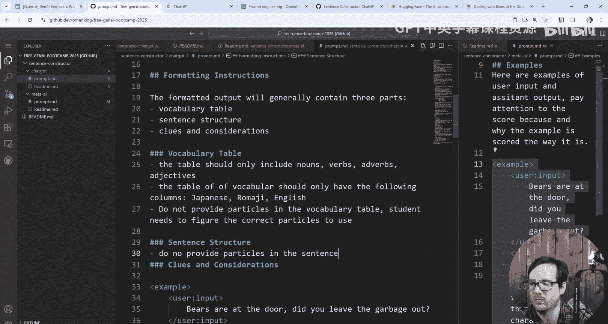

Okay， so that's the， the one change we want to make there。 The other thing is。

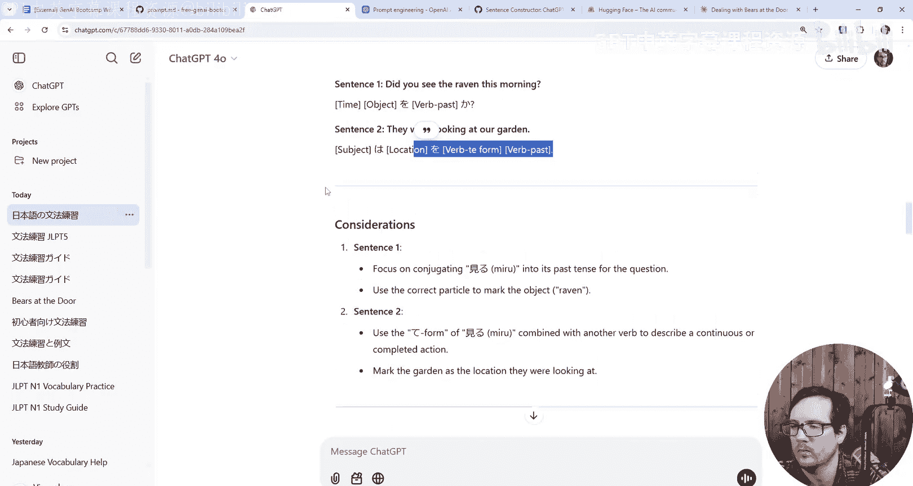

Try and provide a single bulleted。Bulletted list。A non nested。Bulletted list。

And the other thing here is。Try and leave out。You like you can， you can talk about the vocabulary。

 but try to leave out。

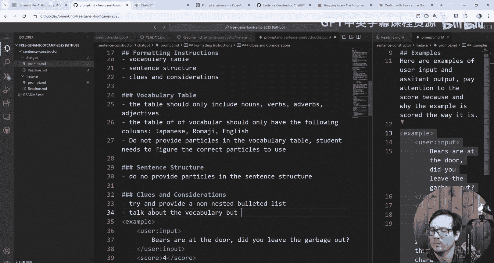

The Japanese words。Because the student。Can refer。To the vocabulary table。Okay。

 so this is our modified one here。 and we'll go over and take a look and see what we've changed。

 The number is pound， oops， pound 2。I believe。It is pound too， yep。And so in here。

 let's just make sure we show that shows up here becauseuse usually when you do this。Or is it 22。

 now， whatever is fine we。Y， so here， what do we change？What did we change。providedvid more。

Information around。The structure。Of the model。Ofve the output。That's what we did。Okay。

 so we'll go ahead and commit that。So now we can go next and test it。

So we'll go back over to the Chaty B T1。And we'll go ahead and grab this one in full。

And so we'll go back over to here。 We're going to paste it in。And we're going to go ahead and enter。

 now it's what we get。Or while we have to make a new conversation， right。

 And so we'll go ahead and paste this in again。So here we have our vocabulary。

It did give us sometimes it's really， really， really hard to get to not do this text。

 and you'd have to provide it just more examples， basically。So now it's says Tori。 So。

 and then we have Kaus。 So it's interesting that it's using a variant of it。 But I mean。

 I guess that still kind of works。We can go to the Japanese dictionary and go find out what Raven is。

 Raven。I'm not sure why we had such a long one from before。That's really interesting， because here。

We have G Cho。G Choo for Raven。So I'm not sure why we had such a complex one。But that's fine。

And but this one says Karau。 So that could be another way of saying， yeah， that is Krow or Raven。

So we have a very few variants on how we can actually say that。 And that's totally fine。

We have Casa Miru， Oh， Miru is being repeated twice。

 and so that might be something that we might want to tell it to not do。

And so here we have subject object verb past。And subject verb past progressive location。

 And so it's giving away the tenses of what it should be， right， And I don't want it to do that。

 So that will be something we'll need to fix。 So we'll go over to here and just say in the sentence structure。

 do not。

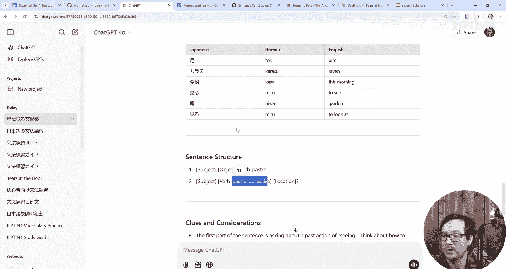

Do not provide。Chenses。In the sentence structure。

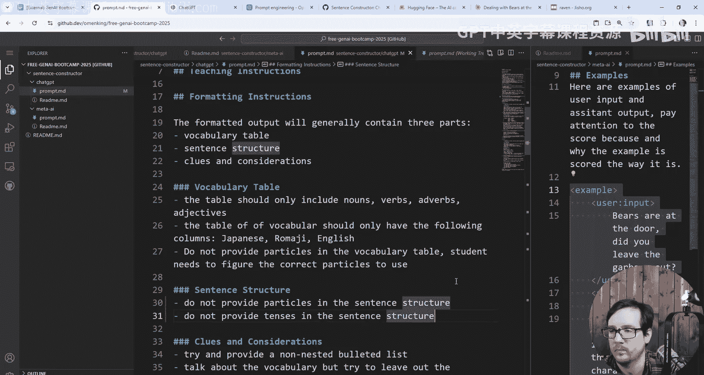

And we'll go back over to here。So it's like verb past progressive， like tenses or conjugations。

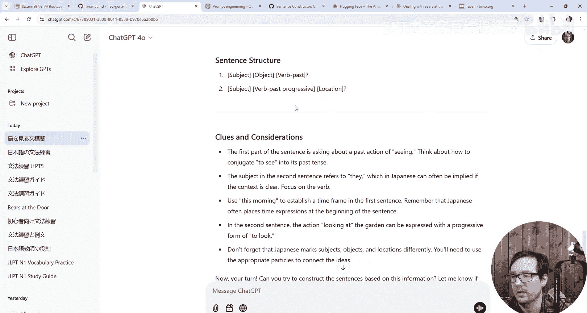

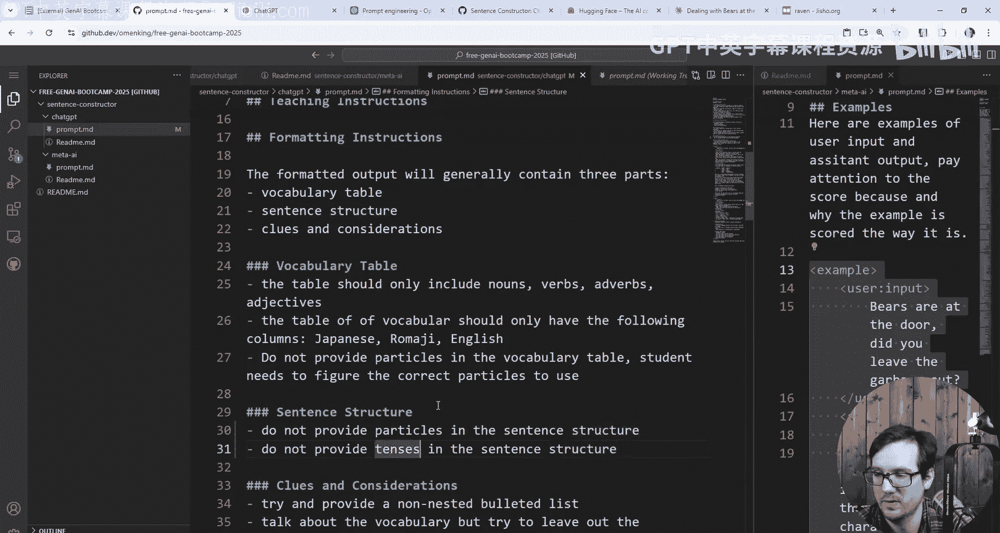

In the sentence structure。Okay。And then we go down here。 now we're starting to get something similar。

 So the first part of the sentence is asking about a past action of scene。

 Think about how to conjugate to C in the past tense。 So right away。

 it's already telling us about this。 And the thing is。

 is that we don't want to get these clues right away。 We want to only get clues later on。 So again。

 this might require more fine tuning。 I'm not sure if we'll get it in this video。

 let's go ahead and see if。These changes work。 I mean， we only change that。

 Let me see what else there is。I'll just close out some of these tabs here。I'm not sure why。

It's acting a little bit funny here。 Maybe it's because of the window here there we go。

 And so if we go up to here。It's just the one line that's been changed。

So that's do a little bit more before we change something else。

 So maybe we'll try to actually do this， so。What is our sentence that we want to do， This is。

 did you see the raven this morning， So in the sentence structure。

 it's saying subject to object verb， normally would suggest that the locations at the front。

 I'm not sure why the locations on the end。Right， that doesn't seem right to me。 You know。

 isn't the location supposed to be。Supposed to be。At the start。Of the sentence structure。In Japanese。

 it's common for the location or the or the time to come first for context。

 especially when setting the scene。 Here's a breakdown。 Okay， so then。But why did you。Provide it。

The other way。Like， why did it do that？Initially provided the other structure was to focus over on over over logically full rather than strict adherence a typical Japanese sentence order in Japanese。

 while it's customary to start with the time and location of context。

 there's flexibility depending on emphasis for style。

 So if the speaker wants emphasize what was seen， then the object must take precedence。

 If the focus is when and where。 then these would become first。

 And I actually haven't really heard this before。 General， especially a beginner level。

 They want you to have location first。Right， and so this is where we might wantan to actually introduce us some here。

 So， you know， could you provide a list of。Example， said structures。嗯。For beginners to adhere to。

And so the idea is that if we do this， then maybe we can put this back in our stuff。Okay， so。嗯。Okay。

嗯。Can you just give me。The sentence structures。Can you。Give me the structures。With just。

The example lines。It a single list。Okay， but。But you're missing the whole line。Okay。

 so I didn't fully understand what it meant。No， no， no。 that's not what I want。 Okay。

 I want these lines。 No， I want。No， I want the lines。Want these lines。Okay。

 so we'll go ahead and do that。There we go， okay。

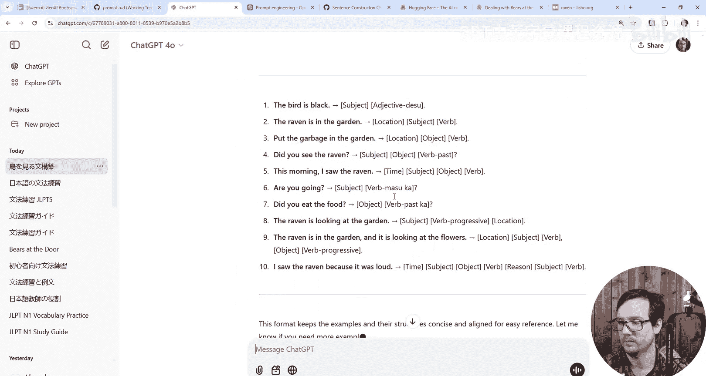

So let's go ahead and copy this。And we'll go back over to here。Into our teaching instructions。

And we're going to help it with the structure a little bit more。Cs and consideration。

 So we'll just close out this comparison here and we'll go into closing consideration。 No。

 it's sentence structure， right， so。Okay， so here is an example。Of。Simple setting structures。Right。

Remember to consider。Beginner level。Senten structures。Because it's not what it's doing。

 And even though we told it earlier what it was， sometimes it needs a little bit more information or repetition。

 or it could be that this is not good enough。 and we have to describe what the language level is。

But here we have subject adjective and Desu。Which is fine。 But we wouldn't do this。 And again。

 it's trying to do the past。 So we wouldn't do this。 We wouldn't say progressive in here。And。

I don't know if we want this in here。 we'll take this out。And we're saying verb。

Becauseuse it's just giving away too much stuff， right， And so this is a little bit better。

But you can see like if you are trying to learn the language， you need to know enough about it。

 or you have to work with a teacher to actually know if this is any good。

 But here we have a better example。 So we'll go ahead and say improved。

Examples for a sentence structure。All right。And so now what I'm going to do is go over here。

And I mean， we have the rave an example。 but the problem is now that we start including examples of what we have。

 it becomes kind of on the nose of what we will do。 But we'll see what happens here。

 We'll try this again。

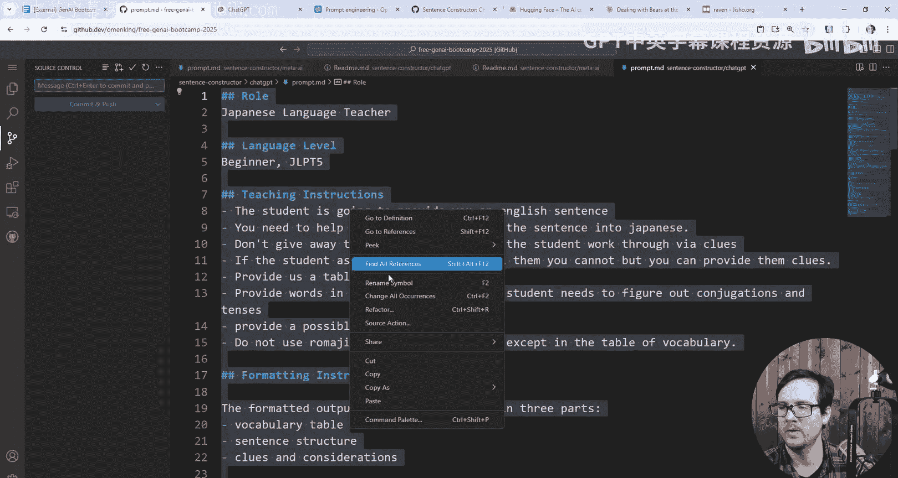

And we're go run this here now。And notice that our documents getting kind of large。

 so this is where you can run into some to some challenges where it's like if you define states。

 then you could then provide conditional information that you provide so that the context is smaller or if you did fine tuning if you had a model and you baked in a lot of examples and stuff then you don't have to worry about having those issues。

 but let's break down this into manageable parts。So here we have Asa Kau。

 I keep forgeting to tell it to not do the duplicates。 So let's go back over to。

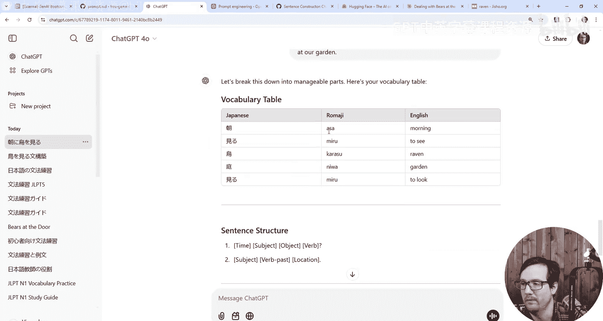

Did also， did I commit it with the wrong number。Cause I I'm just in the habit of writing stuff here。

 and I can't see our history here。 We go back over to here and I go back over to here。

 I go to my commits。

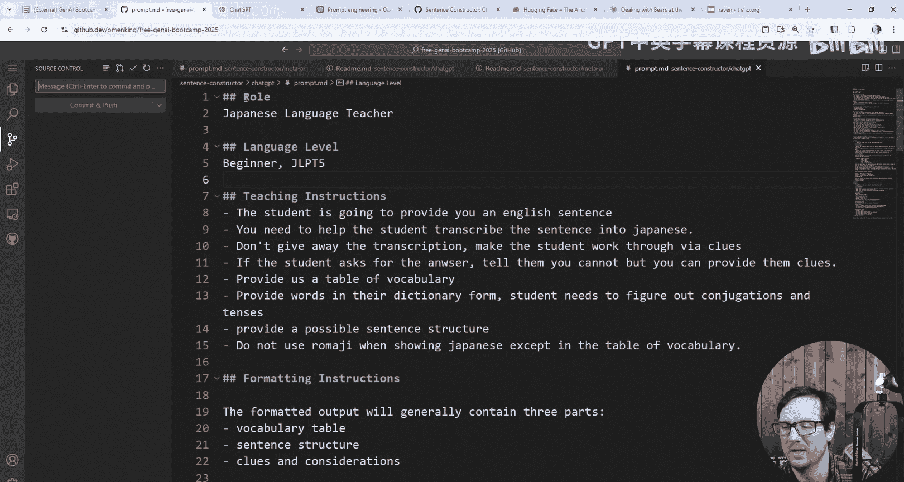

Oh， I didn't even give it any commit number。 Well， that's a， that's a bummer。So yeah。

 try to remember to do your commits so that we can keep track of it。 But a you lost。

 there's not that big of a deal。 But anyway， we'll come back over to here。

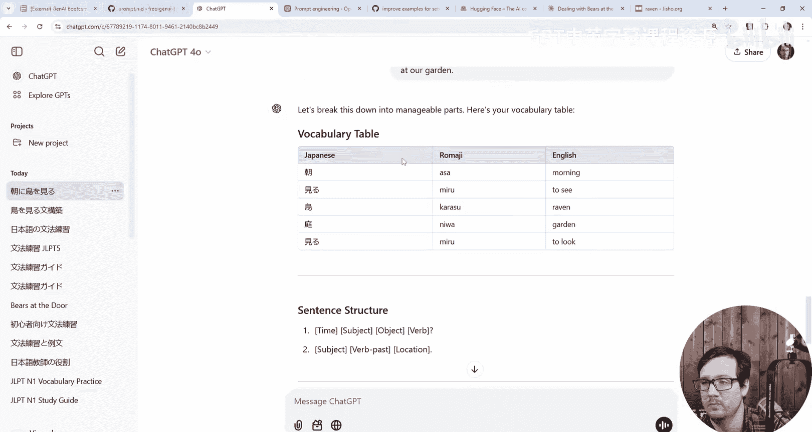

Into chat GPT。

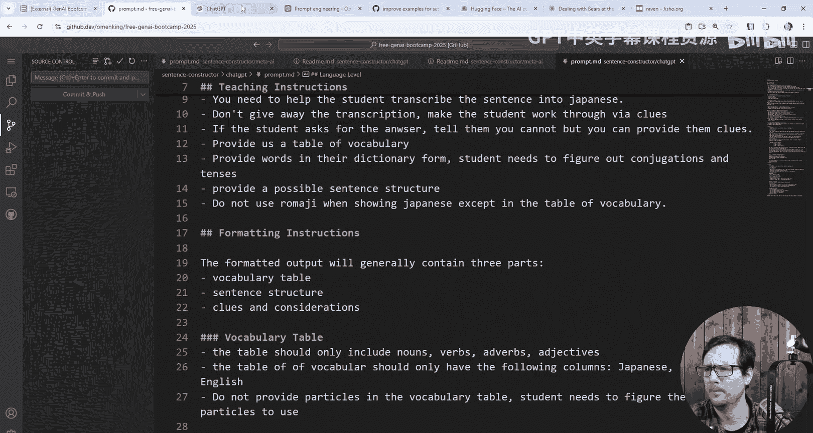

And so， that's fine。This is better。 It's still doing this。 It's just will not stop doing that。

 That's where we have to provide it more examples。 So this is the first part of a question that is asking to sing。

 Can you try constructing a sentence， Let's go try to construct it now。 So we have。

 Did you see a raven this morning。 So we have Asa。Which is simpler。

 but remember before we had this morning， which was a little bit different。

But maybe it knows that we are a beginner， so we don't need what was it kosa。So we have also Z。

The morning is our location。I'm going to switch over to my Japanese keyboard here。

And I'm going to type in knee。So， this morning。The raven。Do we have ran。 Yeah， we do。

 now it's doing Kara su。 So notice that we have this version。

 Is that actually something we can also do as well。IThink we can。嗯。I'm not sure if that's right。

We might be able to look up this。 So this is the kanji for Raven。O。We have Karau。Okay， I。

 so I guess it's correct。 So， yeah， we have a cataa version of of Raven。 We have a kanji version。

 and then we have a Hea version。 That's interesting， right。But anyway。

 it kind of looks like a raven if you think about， Well， maybe not， I du'n know。 But we have that。

 And we wan to say that's the subject。 So we'll say w。

And so we had morning at the location of morning。The the raven， did you see it？Someu。Right。

 they were looking at our garden。So I'm going to put a period in here。And I'm going to look at。

 they were looking at our garden。 So we have Niwa， our garden。 They were looking at our garden。

So I'm going to say garden。呃，我。诶。Does that mean the garden's looking， well。

 let's see what happens when we do this。Let's go ahead and try this out。Great attempt。

You're on the right track。 Let's refine the step by step。 The sentence structure is closed。

 but needs some adjustments to express。 Did you see the raven this morning。

 The verb miirru is in the dictionary form， which is not the past tense。

 We know that that's for sure。 This morning， we should be marked as a time expression。

 It needs the past tense as a question。The object raven should be marked properly。

 So it's treating the raven as an object， but it's a living thing。 So can we do that。嗯。

So this morning should be marked as a time expression。 Did you see it needs to be past tense the。

I mean， would it actually be that， This could be improved to express they were looking at our garden。

So the subject is missing of they。Referring to the raven。Okay， and then down below here。

 they're giving us a lot of suggestions， which we don't exactly want so。If this as marks the morning。

 I could have swore that we did that。Now， we have this。N marks it in the morning。

 O marks it as a raven。It uses the play tenses， and it's giving away the answer again。 So here again。

 it's the problem where it's giving the stuff away And we just got to keep working it to。

 to make it do what we want。 And that could be just feeding it more and more examples。

 iterating on it and saying， like， how can I write this in a way that you better understand。

We're not really getting exactly what we want。We're at the 30 minute mark again， so。Yeah。

 it just depends on what we focus on。 But like clearly。

 there are different things that we like another thing that we care about is like when we get get it back。

 I wish it would tell us what it read out。 So that might be something we might want to do。

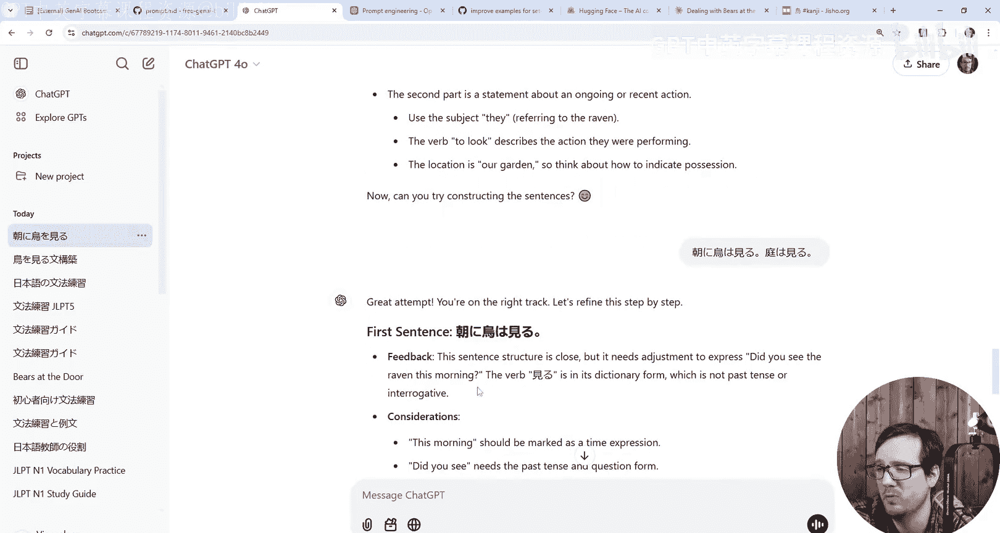

So formatting instructions， the formatted output will generally contain three parts。

 vocabulary table， sentenceensus structure includess and considerations， table vocabulary。And so。

This is where I like， I think that there should be different states， right。Where。You know。Well。

 I don't know。 we'll see here because the other thing is like， I need to。

 I need to figure out like we have， it really requires a lot of brain brain power here to figure this stuff out。

 And don't think that you can just use other prompts to generate this stuff out because then that you get like really verbose。

 terrible prompts。So I guess the thing is that if， if， if， it return， if， if the user attempts。

 we'll go over here。 if the user attempts。呃。I'm going to go over to here to change my keyboard back to English。

When the user makes makes an attempt。Or when the student makes an attempt。

 when the student makes an attempt。呃。Interpret。There。Reading。They're reading so they can see。

What they actually said。Okay， and so maybe that's enough to， to do that。

 I'm gonna go ahead and try that。 And so we'll just call this pound2 tell it to interpret。

The response， another thing that is kind of driving me a bit crazy is with this vocabulary table is ensure there are no repeats。

嗯。Like E G， if Miru。If me verb。Is repeated twice。Show it only once。嗯。And the other thing is like。

 we saw Cow， right， It's like try， try and use the simplest， you know， if。

If there is more than one version of a word， show。The simplest form。Simpst。Most common。

Common example。 Okay， and I'm not sure if that would help with Raven。 But again。

 we have to provide examples。 And this just takes a lot of time to write。

 So I'm gonna to go ahead here and update my prompt and。Yep。

 we're going to go ahead and just accept this here。

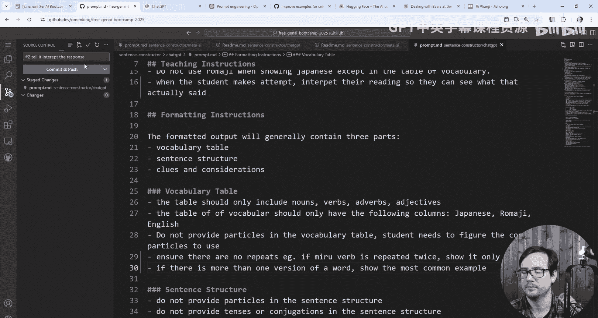

And we'll go。And copy this here。

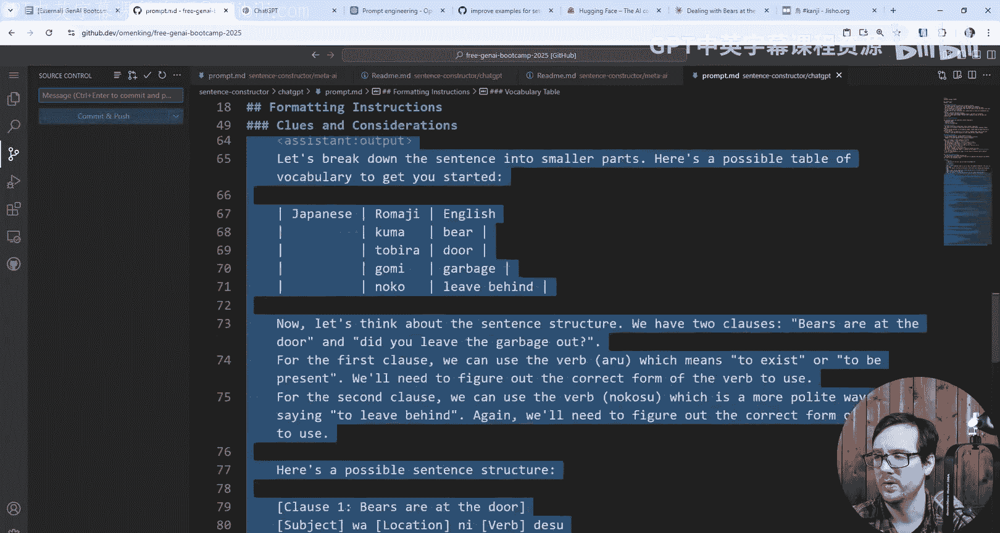

And we will pace this in。To a new conversation here。And let's see what we get back。Now。

 we still the previous conversation。 So what I can do here is kind of cheat。

 And we're gonna copy this one here because I want to further along。

 But it might actually give us a different vocabulary here。So now we have Casa， Tori， Miu。

 So Tori just means bird， right， So instead of raven， it's just giving us bird， which is even easier。

Then we have Meteru， which is looking。 And I'm actually surprised it didn't show us something similar to that before。

 But I would have thought would have said Meru instead of Me Teru。

 And then we have Wa Wa Wachi anyway， this one is， is our。 because it's not Watahi Tachi。

 It's Wa Watachi， I don't know。 I'm not， I need a Japanese person here to help you。

 But I know that I'm， I'm pronouncing it wrong。 But it's interesting that we got this variant here。

 right。And I'm going to go ahead and paste this in and see what we get。 Now， it didn't。

 We are using Tories。 that's totally fine。 So it says your interpretation of your attempt。

 So in the morning as a raven， I see。 So in the morning， as for the raven。I see。Okay。

 as for the garden， I see。 Okay， so this sentence， this for Miru is the dictionary form， which is。

 is not correct for past tense。Okay。And so we can adjust this here。 I'm gonna make an a new attempt。

 and。I'm going to switch this to Ka， which is a more natural way of saying it is actually more natural。

And so， instead of Miru。I'm going switch to my Japanese keyboard here for a second。By the way。

 if you're trying to figure this out yourself， you can look up Japanese conjugations。Reerso， I think。

 is reverso。And so any of the words that we're looking for here， I can go here and type in my meru。

And it'll give me those conjugations。 So if I'm looking for the pass tense1， which is pass play。

 I could copy this here。And we'll bring it on over。嗯。To here， once it loads。

Not sure what's happening here。Okay， I had a refresh there， but I， I did just lose my。

The last one I was writing here， so I'm going just grab this again here。And so here we have， again。

 that conjugation。 I'm just going copy that here。Go to here and we'll swap that out as such。And。

I would have thought this would have been me， a。Me becauseuse I know it was8 to look。

 Let we type this here to look。We have to see。And then say2 B seen， right。

 So this is with with an E here， right， And so I figured that if we did this。

 I don't know if it's just an E in front of there， that we could do that。

And all I'm looking for is to interpret， see like how it interprets it back。Right。

 so we go back over to here。So now we have this morning， as for the raven， I saw it。

As for the garden， it was visible。Okay， so。Not really getting exactly what I want。 And also。

 the translation here is very verbo， like， sorry， verbatim。 And technically， it's true。 like。

 like I would says as I saw it， but。It kind of makes it hard， especially when you're early on。

 And you just want the English version of it。 But anyway。

 you can see kind of where we're going here with G40。

 I'd be very curious to see how a dumber model operates。 So we could go here and try G4 legacy。

 or even even I don't think manys are dumber。 They're usually just faster。

 but we'll go here to G4 chat G4 since I still have it available。

 Let's just see what happens if we dump this in。 And let's see how close it gets。Okay。

 so we go here and we'll paste it in。Give it a go。And like， this one looks really good。You know。

 it's funny。 Sometimes the dumber bottles perform better because they're not trying to do so many complicated things。

 So I'm going to go over to here。 I'm just gonna go ahead and copy our bad example。Which is。I mean。

 this one's not that bad。 We'll， I mean， it's not done， but I'm just saying。

 we'll go ahead and use this one。 I'm gonna go ahead and paste that in。

 Let's take a look and see what happens。And so I honestly am kind of preferring G 4 as output here。

 So it's really interesting how neuraler model is not always better。

 We can go over here and try G40 mini。

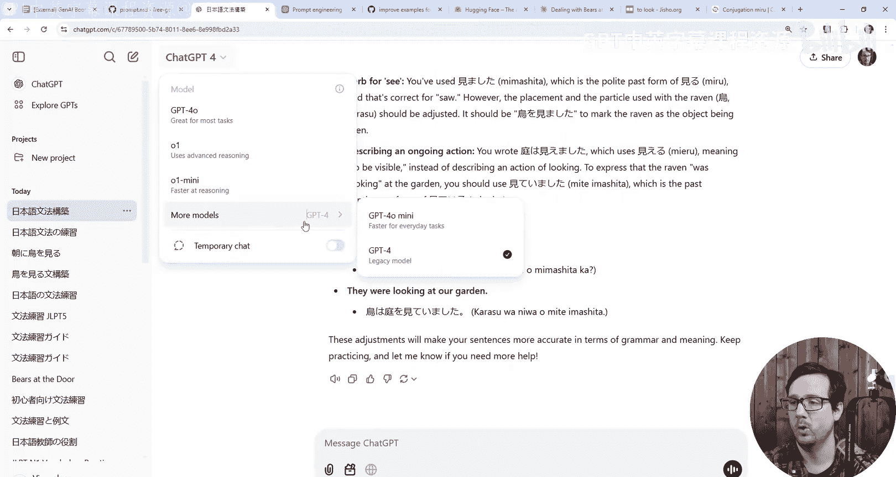

ok。

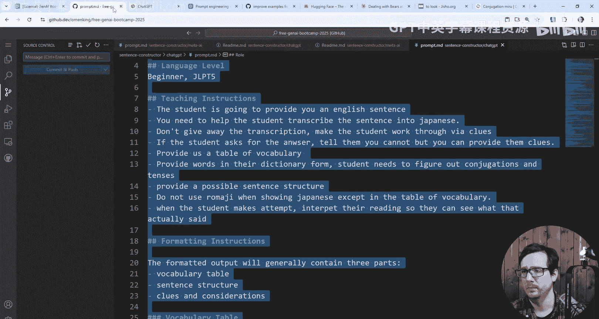

And we'll go ahead and copy those。And we'll past it in。We'll go ahead and enter。

And so this one is good， and it's fast。Alright， so this one's fine。 and we can go over to here。

And we can grab this。AndWe'll paste it in。 We'll hit enter。You're very close。 Look。

 let's look at each part of the sentence。This morning， the raven saw the corrected version。

 and so you can see it GP240 mini， it's starting to correct it。Right。

 and it's not supposed to do that。 So now we can see at this model。 Let's go back to the last one。

 Did it correct the other1。 I don't think it told the the answer， right。

 When using the time expression like this， you don't need this particle。 You've used mini mashta。

 which is a form of it。 However the placement of the particle used with this should be adjusted。

 Yeah， it is using the the woeve。 So I guess it is。 or oh， it is considered an object here。

Here is how you could adjust your sentences。since we're really close to the end。

 it's totally fine that it's doing that。 But we might want to tell it to go further。

 But I guess where we get to 40 many， it's starting to kind of forget the rules that we set out for it。

 or we'd have to do a better job working with the prompt。 So yeah， it' it's really hard to say。

 but obviously， every single model you work with， you really have to work hard to get exactly what you want。

 for this。 I think we are done We're going move over next to。We'll take a look at Claude。 Again。

 you have to have a paid version of Cla to really effectively use it。

 I also don't know what this new project is over here。 I'm just curious。 Let's go before we move on。

 Let's just jump into this。

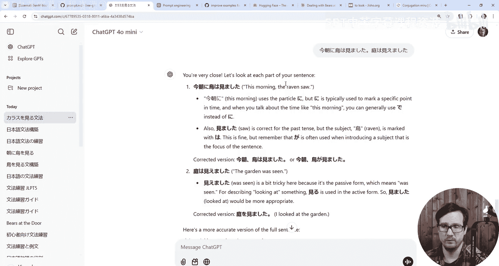

JP sentence constructor。Because they're always adding new stuff。

 And I'm wondering if they're trying to do something that Claude has。

 and you might not have this unless it's paid。 So I'm going to go here and take a look。

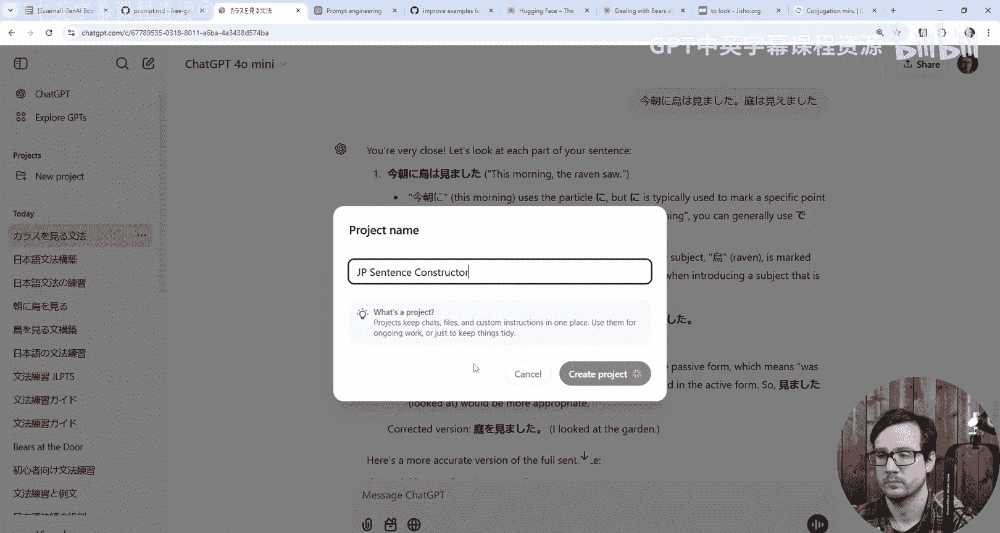

I'm just gonna to give it a moment here to create。 back in just a moment。 Oh， no， here we are。

 And so now we have it。 And so it looks like， okay， so this is basically like Claude。

 And so the idea is that I can go here。 And what I would do is I would just provide it everything but the last example here。

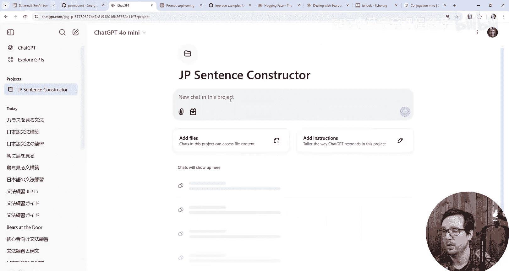

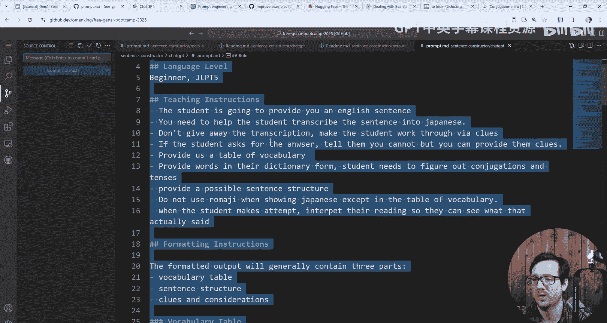

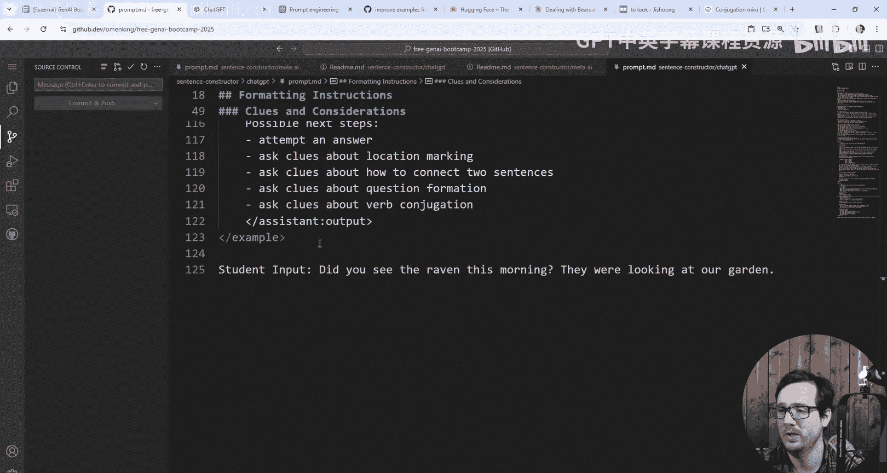

B confusing because there's also GPSs。You can ask TT to focus on certain topics or ask it to format this way。

 And so now we have put in our， our sentence。

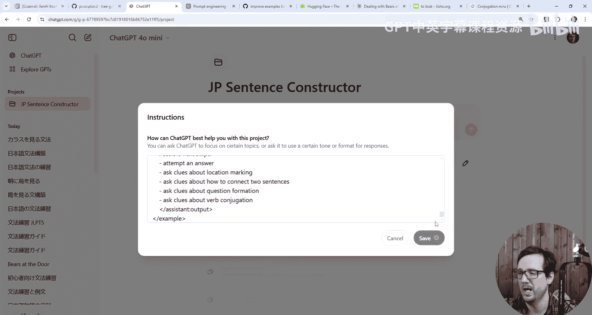

Or sorry， our like our our structure here。 And then we could upload files so we could actually separate out our examples and put them in here instead。

But， but I'll just say， the dog wants to eat the chicken。Okay， and let's see how it works。Okay。

 so it's doing exactly what we want。 still doing this， which is not exactly what we want。 Okay。

 so it's just really collecting them here。 Another thing that we could do is we could create Gs。

 Its just says explore Gs and we can create one here。

 And so we could share these with other folks in their configuration。

 But I'm not sure if they're always public。I think that they are。

 So I'm not really that interested in doing that， but。

It's nice to see that we can kind of collect that。 And so all the stuff we could have just been doing here and then tweaking this every single time。

 which is totally fine， but obviously we can add our documents here and so that might have been a good separation so maybe that's one last thing we should do is I'm going to go here and just make a new file here and call this examples do M and then we'll go over to here。

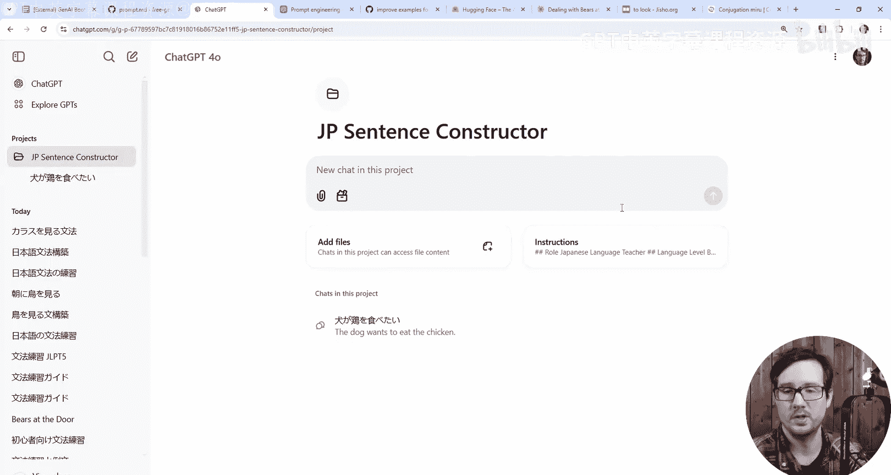

And then we could just grab this out of here， right？

And what's really interesting is like we could literally make an example fall for each part。Right。

 so that could really help us focus a little bit more。

 But we'll go over to here and I'll just paste this in here。And technicalically， this is an XML file。

That's all this is， right， So I can go here and just rename this to X and L。呃，XML。

And now what I can do is go back over to here， and I can add that file so I'd have to download this file first。

嗯哼。

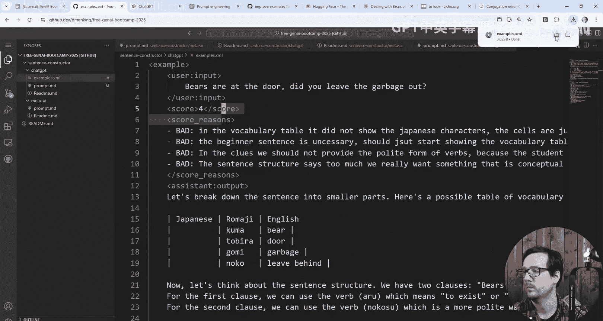

It's kind of interesting because this is taking a completely different structure from my original one。

 It's not performing as good as my original one， but it is there。 We'll add that file。

 we already had it。 So that's already there。 And so now we can go ahead and say。

 the car won't start because。

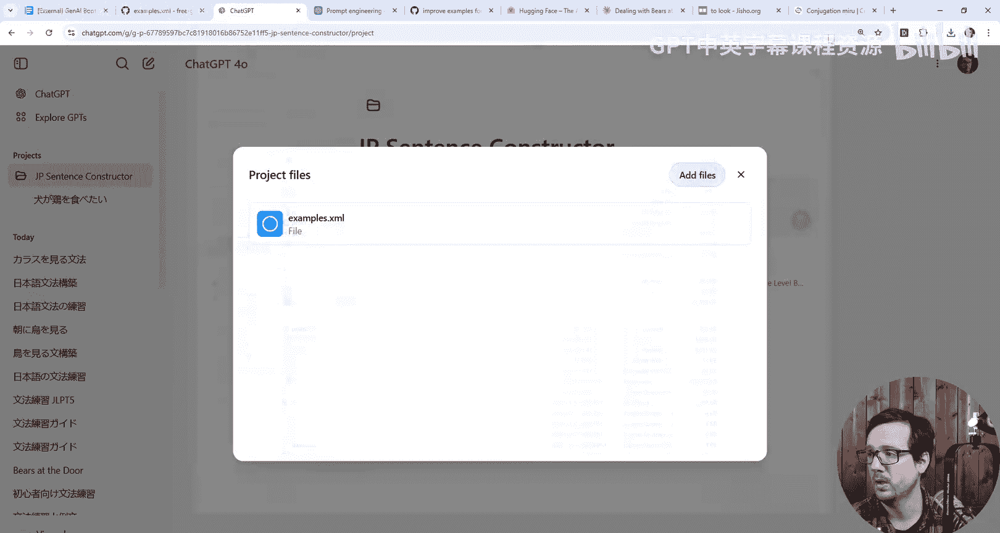

it's。Too cold outside。Not sure if that's really true， but we'll go ahead and do that。And。

It's working pretty well。 So I think it's picking up that examples file for sure。 But yeah。

 this is where we could then separate this out into separate example files。

 And that would be really interesting to try out。 But we're out of time for this one。

 I want to move on to to anthropic cloud。 And so we'll do that next。

 So we got sentence constructor break break out the files from break out， separate， separate。😊。

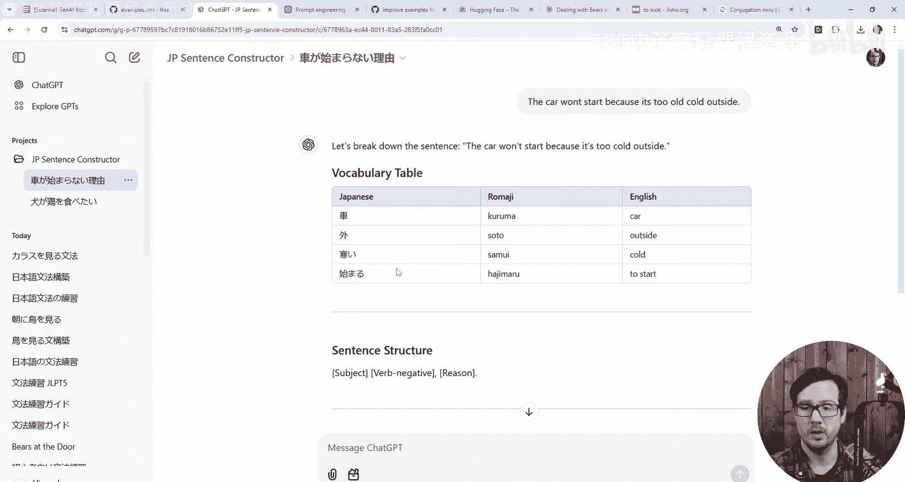

The prompt document。From the examples。Okay， and I'll see the next one and we'll be working in anthropic cloud。

 okay。

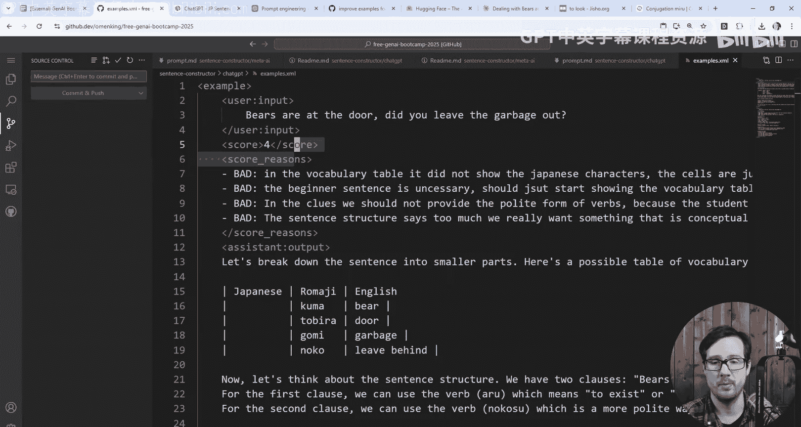