# Freecodecamp《微调导论｜Intro to Fine-Tuning Large Language Models》中英字幕（claude-4-S翻译 - P1 - GPT中英字幕课程资源 - BV1YapUzNEKj

This course takes you from the basics to the advanced practical applications of fine tuning large language models。

 Todev teaches this course。 She is an industry leader and CEO of lunar tech。

 You'll start a understand what fine tu tuning is and how it differs from pretraining and prompt engineering。

 Then you will learn about handson methodologies including supervised fine tuning and reinforcement learning with human feedback。

 The course also includes a deep dive into parameter efficient fine tuning techniques。

 specifically Q Lauraura。 A revolutionary method that allows you to finet massive models like Lama 70 B on a home workstation。

 through practical and end case studies using Python Pytorch and hugging face。

 You will move from theory to implementation。 Hi there。 In this course。

 we going to take you from the basics to advanced practical applications。

 You will discover what fine tuning is。 Why it。😊。

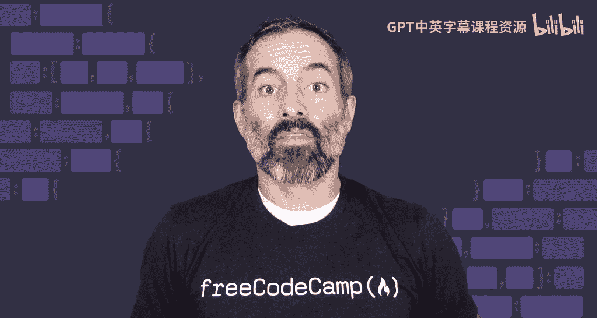

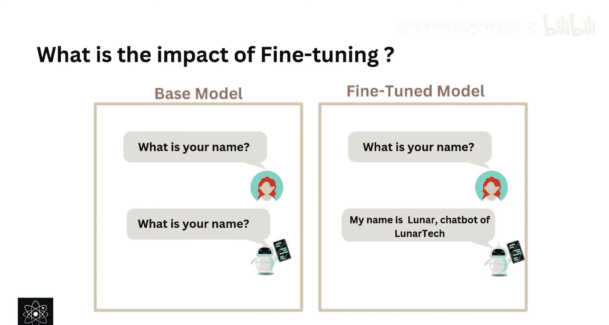

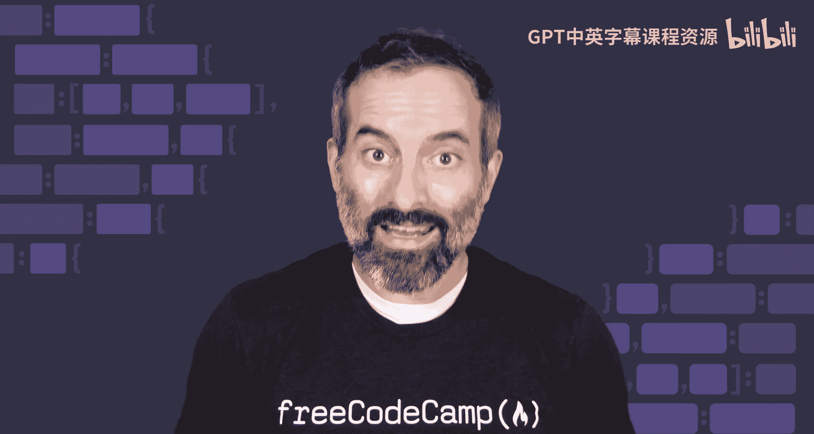

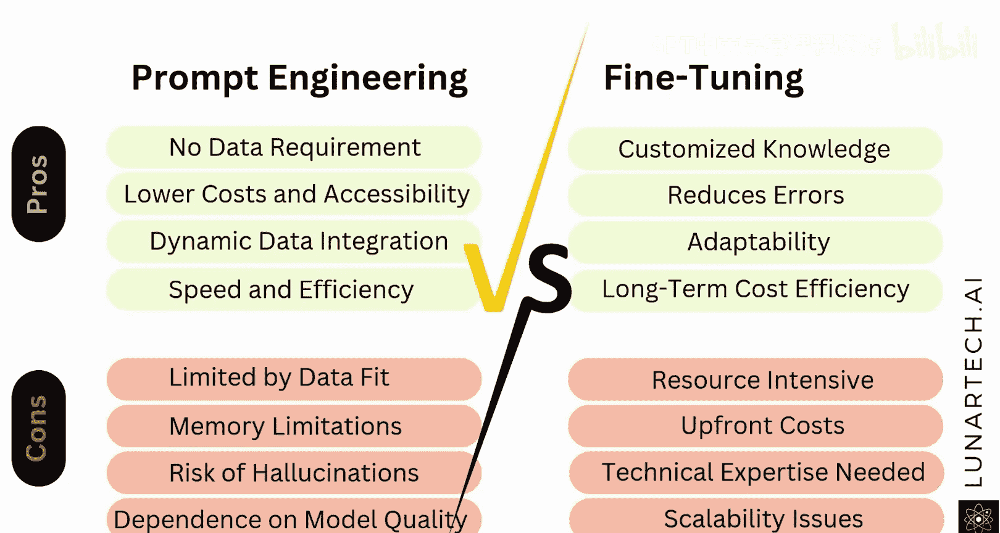

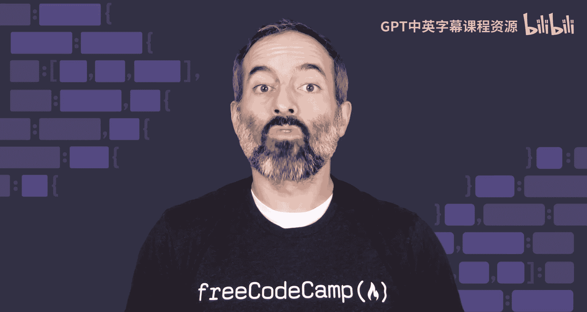

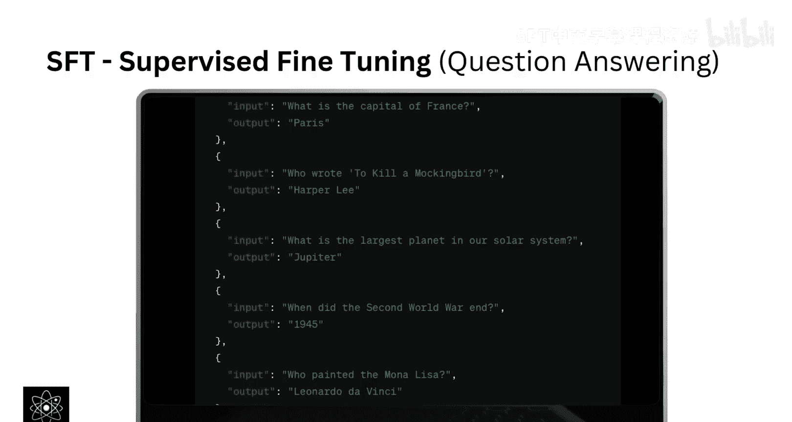

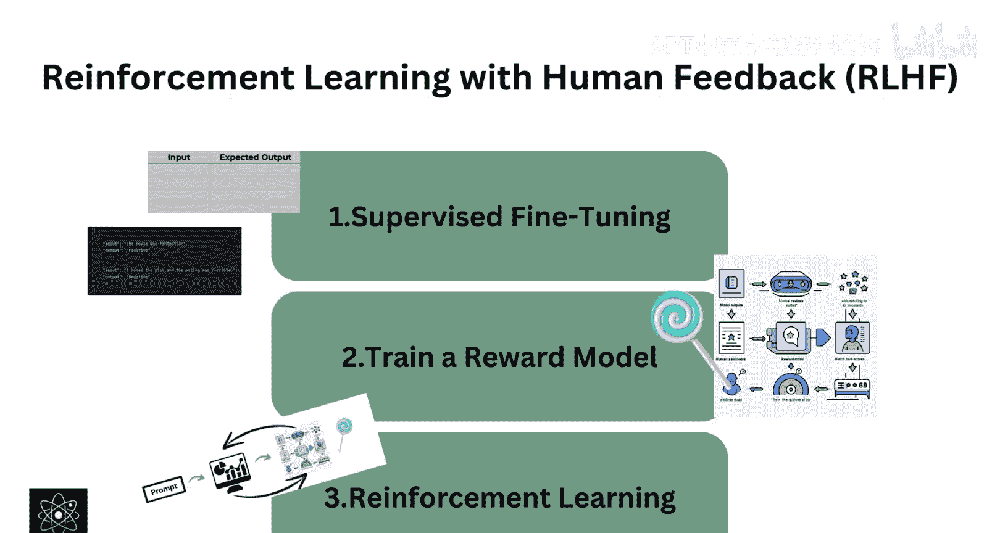

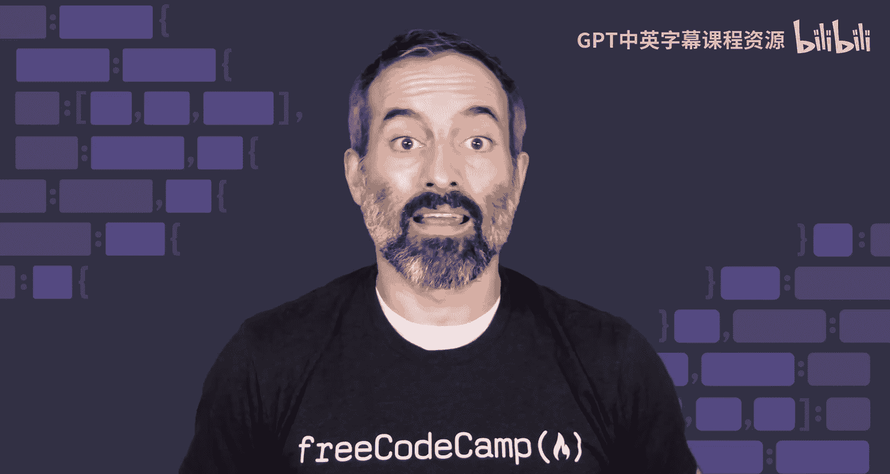

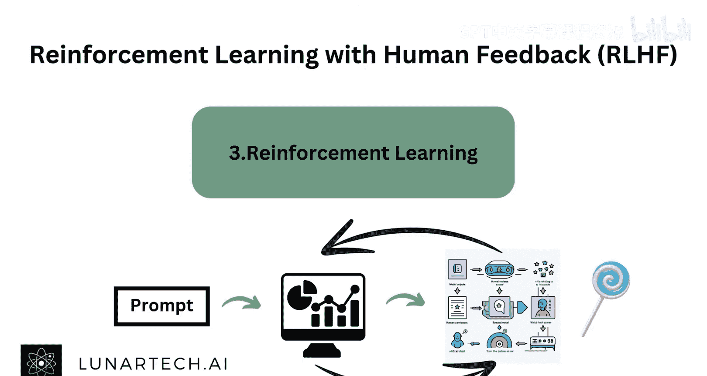

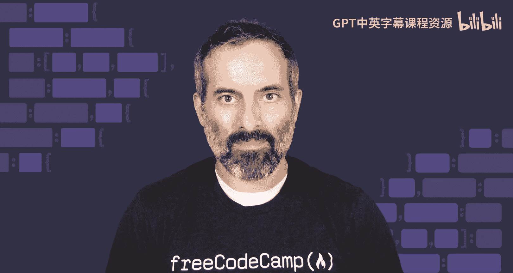

And how it differs from pretraining， prompt engineering， virtual augment， a generation or directs。

Who will break this concept into clear， digestible lessons that set the stage for handsone experimentation。

On thatvaan， cofounder and CEO of Lunar Techch， with bachelor's and master's degree in Econometrics and operations research so advanced mathematically statistical degree from Erasmus University Rotter Dame I bring more than seven and a half years of real world experience with Fortune 500 companies from data science data engineering and AI engineering and I've led multiple tech organizations in Italy。

 the Netherlands in San Francisco and more I've worked on high impact projects as a leader in as an handson developer and AI engineering worked on groundbreaking research public scientific papers in NLPA AI and data science to make AI accessible to everyone over the next few hours we will talk about step by step through the fine tuning process First you will learn the underlying methodologies。

 supervise fine tuning， semisupervised fine tuning and reinforcement learning with human feedback。

Next， we will dive into the specifics of fine tuning。We will look into the Lama models。

 fine tuning of such models， how to prepare your instruments。

 curate your data and set up your hardware and code environment。

 The highlight of the course is our deep dive into the parameter efficient fine tuning techniques We will explore Chra which is basically a combination of quantization and Laurara a method that lets you find you powerful models like Lama 70b on home workstation。

 no billion dollar setup required。 If you are ready to elevate your text skills and dive into one of the most transformative areas of artificial intelligence and generative AI join us。

 This course is more than a theory。 It's your ticket to mastering the tools that are reshaping our work for those aiming to become a master and professional in AI engineering。

 Our newly launched AI engineering bootche is now open for applications in the six months。

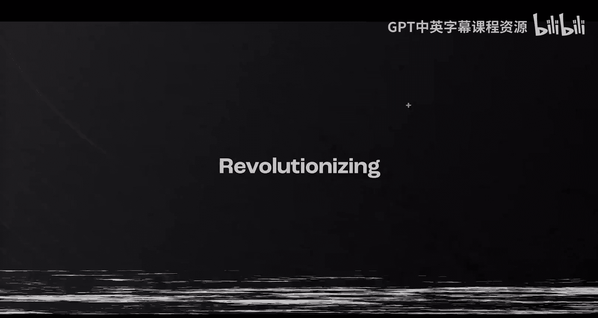

You will master the machine learning and deep learning advanced topics as well as the one of generative AI。

 like large language models， you will build your own large language model from ground up。

 pre-training and fine tuning complete real worldor projects using state of the art tools wherever you feel comfortable learning。

 use the link below to apply and ignite your future as an AI leader。

 so without further ado let's begin your journey to fine tuning excellence。

Welcome to the course on fine tuning larger language models。

 so this is the module as part of our comprehensive large language models course and in this module we are going to dive deep into the fascinating world of fine tuning。

 a very important technique for tailoring large language models to specific tasks and improving their performance。

🎼So this is going to be an involved module as part of our comprehensive LLM course and we are going to explore all bunch of topics to form a clear and picture perfect idea of what fine tuning is and how we can do it so we are going to combine the theory with practical implementation and at the end of this module we are going to conduct an end to endK studies where we will use the pitor and then also Tensorflow and many of the shelf pre-train large language which models from hugging phase in order to fine tune them。

🎼So in this module we are going to discuss what is the fine tuning we are going to formally define it where it is allocated in our foot chain of LM development we're going to talk about the pre-training versus fine tuning so we'll compare the two processes and then we will talk about prompt engineering versus fine tuning what is the difference between those two then we will talk about the fine tuning as a test so what does fine tuning actually do to the large language models and then we will talk about the benefits of fine tuning a large language models then we will talk about the step by step guide so we will give clear step by step process for you how you can fine tu a large language model then we will talk about different methods for fine tuning large language models because there are varieties of techniques and approaches you can use when fine tuning a large language model so we' will clarify that all then we will talk about this distinction and differences between supervised fine tuning semiupervised。

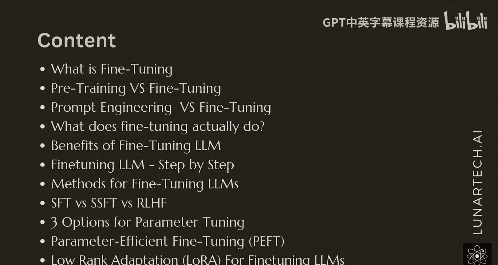

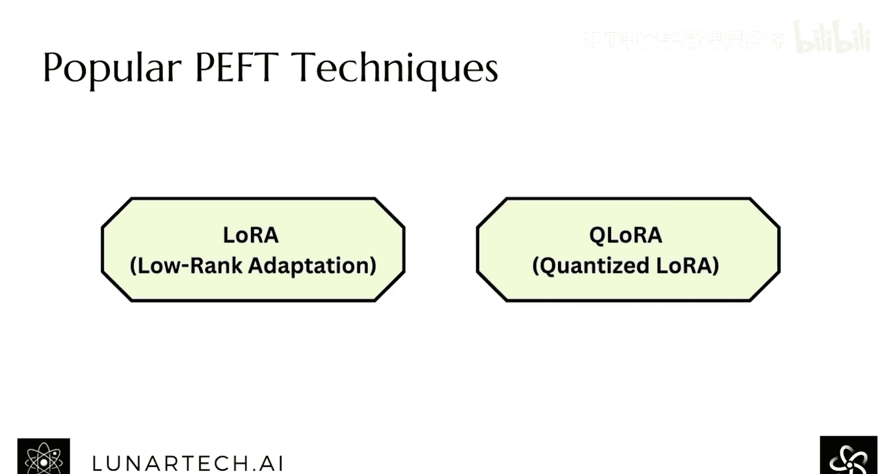

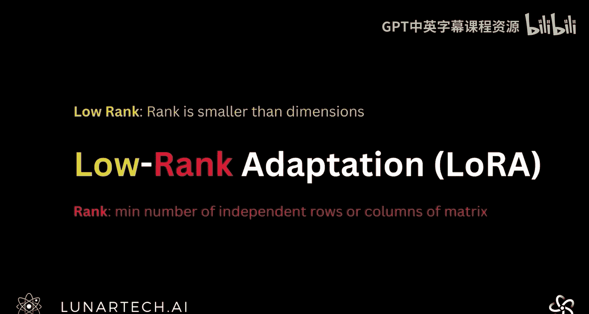

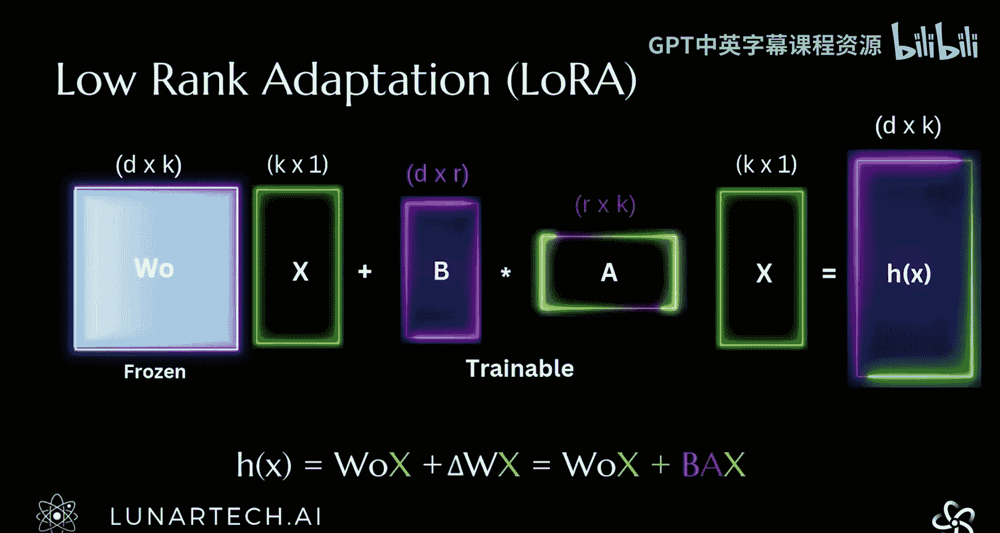

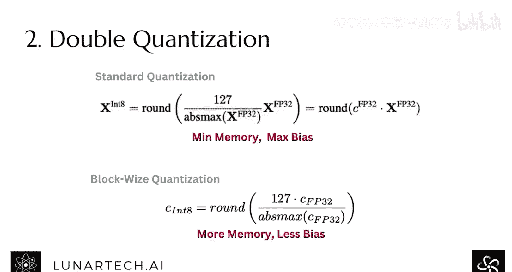

🎼fineine tuning versus the reinforcement learning with human feedback so those different sorts of fine tuning techniques then we will talk about three options for specifically parameter fine tuning and then we will talk about parameter efficient fine tuning PEFT。

 very popular technique for fine tuning large language models。

And finally we will talk about one of the most infamous fine tuning techniques that you must know if you are preparing for a career in AI engineering and specifically in generative A and large language models。

 which is the Laurara， so low rank adaptation for fine tuning large language models。

🎼So in this part of the course， we won't yet dive into the chlorra。

 which is the quantized version of Laurara， but we will lay the ground for that too because for once you understand the Laurara and in the next module。

 once you also understand the quantization， then we can combine the two quantization in Laurara in order to understand chlorra2。

🎼So in this module this is what we are going to cover this is going to be an involved module but at the end of this you will know entirely this process of fine tuning large language models as a pro and you will also do it by yourself by implementing the learn theory into practice in Python so without further ado let's get started so welcome to the first part as part of our fine tuning LMs module we are going to explore this interesting world of fine tuning large language models like the ones of GT4 Lama3。

 Gema etc so our journey today will help us to understand why fine tuning is important and not just beneficial but very important for specialized applications。

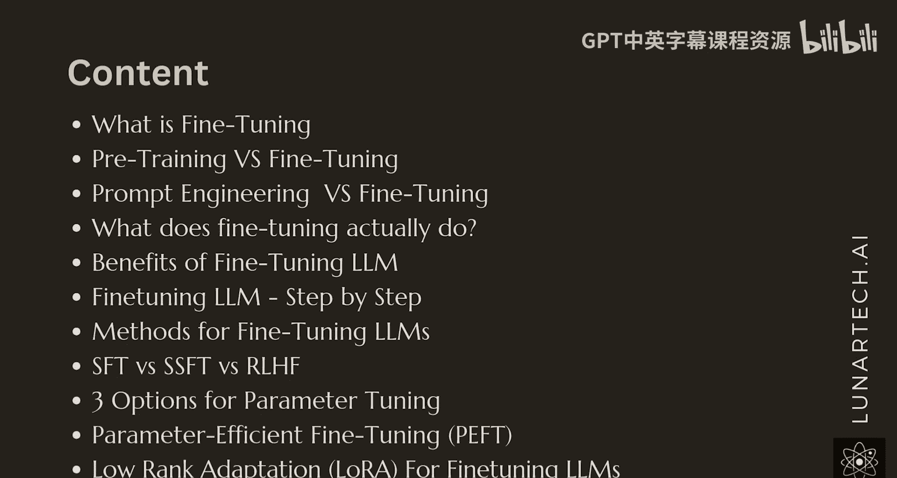

🎼So by the end of the session， you will not only learn the theory behind fine tuning。

 but also experience the hands on by comparing the fine tune model to your non fine tuned modelss。

So let's talk about defined tuning and where it is allocated。

🎼So fine tuning is the step that comes right after the pretrain it is an optional step but highly recommended because it is not just beneficial but crucial for specialized applications。

🎼So fine tuning is really important for adopting a generalized model to perform specific tasks with higher accuracy and efficiency whether you are a developer that is creating a chatbo a code completion tool or a sophisticated AI for interpreting medical data or low data。

 fine tuning allows your model to Excel in niche that it serves So it's powerful technique to enhance the performance of this general purpose language models like GT train G4 which are pretrained model So within the visualization before when were looking into the livecycl of large language models we saw the pretraining then the second stage the fine tuning then we saw the prompt engineering and directX So in this lifecycl of this advanced language models the large language models。

 there are the several key stages like the pretraining fine tuning prompt engineering and regularization where the fine。

🎼Tning comes right after pre training。🎼So we learned that pretraining involved the training of the model on this very large super large data to learn the general language patterns。

 we even compare this to this idea that the child goes to the basic school and then to the high school and learns whole bunch of fundamentals。

 a large amount of information。Then the fine tunic is basically this process of helping the child to specialize in a certain area。

 let's say the child or the student graduates from high school and then they need to choose a university or let's say bachelor's degree in mathematics or bachelor's degree in arts and then specialize in that area of expertise。

 meaning that then they will be exposed to more specific sort of information。

🎼Similar thing is happening with a fine tuning， think of this stage like the taking this very basic model and then specializing it in a specific area of expertise。

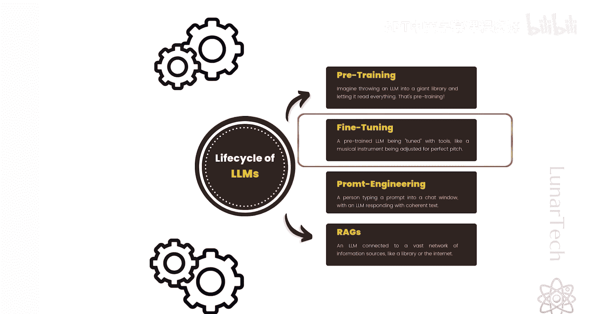

🎼Think of this stage of going from pretraining to the fine tuning as in the very beginning having this rough diamond。

 it's valuable but not yet tailored for a specific task that's the pretrained model and then the fine tuning is this process where we take this rough diamond we polish it a lot and then we are enhancing its capabilities for specialized applications so it becomes much more beautiful。

 it more shiny more fancy and that's basically when we go from pretraining to fine tuning we are trying to address this shortcomings and we are trying to specialize the pre-trained model into the specific tasks and then the model is tailored for performing this specific tasks that's basically the fine tuning。

🎼So for example to illustrate the impact of fine tuning， let's compare a base model。

 let's say this pretrained model it can be any model like GT GT3 GT4 or Jma anything in a pretrained stage not yet fine tune and then this is the left- hand side what we are referring a base model and in the right-hand side we have the fine tuneed version of that model Imagine we have this chatbo that is powered by this base model in the lefthand side and we are asking to the model what's your name then the base model might respond the same what's your name essentially perroting the input This happens because the model has not been yet trained on a specific task for understanding and then responding appropriately to such questions So the model is not yet able to understand that when someone is asking what's your name instead of repeating they need to understand that this is a question and then they need to perform this task of answering a question and then come back。

🎼with the answer like this is my name， for example。

 that have and this is the answer to your question so essentially in the base model the model is not yet sophisticated enough to perform the task that specific task of understanding and then responding to such question。

Now consider the right hand side model which is fine tuned to a specific task。

🎼So when we are asking to this chatbo that is based on a fine tune model whilst your name。

 then the fine tune chatbo will respond。 Well my name is Lunar and I'm the chatbo of Lunar tech So this significant improvement that you can see the base model versus fine tune model is the result of fine tuning a base pretde model where the model has been trained on a smaller specific data to better understand and generate responses that fit to context so it understands that there is a question that is being asked and also it understands what kind of questions is being asked and also understands how it should answer。

 my name is Lunar so provides its name and then the chatbo of lunar tech So that's the idea behind the fine tuning at least at high level with this example Let us now formally define what the fine tuning is So fine tuning is about adjusting a pretrained language model to exc at a specific task。

So this means that we take an existing pretrained model， for example， GPT3。

 or it can be also GPT4 GM Lama3， anything that you want as a pretrained model。

And then further train it by tweaking its internal parameters。

 these parameters are like the model's brain connections and by adjusting them we can change how the model behaves and what kind of output it produces。

🎼So let us unpack this definition so what do we mean by tweaking the internal parameters Well we know from deep learning but also from the pretraining process that we discussed as part of this course that the way large language models are pretrained is that we are using this transformer based architecture depending on what kind of model we are dealing with。

 whether it's decor only encoder only or the main encoder and decor sections or specific LLM and then we are continuously training this model to optimize the moral performance we are using all sorts of techniques with the one goal to end up with a set of weight parameters and bias parameters that will result in the lowest lowest for our model。

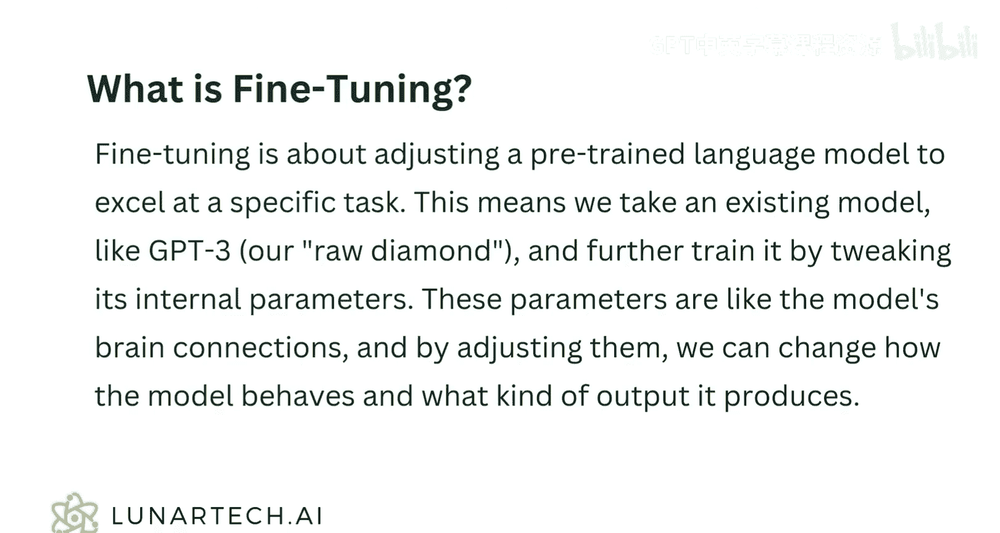

🎼Because this means that our model has high accuracy and is able to understand the language and also process the language in a meaningful and accurate way。

🎼So this end result， when we are getting this whole bunch of billions of weight parameters and vast parameters。

 they are the internal parameters of our large language model。

🎼And when we are performing defined fine tuning， it means that we are taking this base model where base model is basically a file that contains different parameter values。

 the weight values and then bias values， and we are adjusting them。

🎼So we are adjusting these weight parameters and bias parameters slightly such that we can change how the model behaves because in the pretrained stage the values that we are getting after pre-training the LLM this values they represent this so-called brain connections is like in our human brain so we know exactly how we need to do things thanks to our brain connections in our neurons if we tweak them and adjust them artificially then the way well respond will be different so once we start to get more information more specific information and we'll learn a bit more we start to also respond to questions differently right in the same way we need to also adjust these parameters that control the way LM works such that we can change how the model behaves how the model understands the tasks and how it answers those questions for example and that's exactly what we do as part of this fine tuning process we take the fine tune we take the pretrained model。

🎼The weights and em bias parameters that is provided from this pretraining stage。

 and then we need to perform once again a training process to adjust this weight and bias parameters a bit。

 such that the model will start to behave like we want it to be on a specific data and for specific tasks。

🎼So edit its qua fine tuning involves continuing the training of a pretrained model on a new often smaller data set with specific characteristics this process adjusts the model ways to better reflect nuances and this different ideal syncraes of the target domain or task。

🎼So what do I mean in here so it means that we basically have the pretrained process when we are training our large language model on a very large general data。

 it doesn't contain specific data， but it does contain general information about different sorts of areas of expertise。

🎼But when we introduce this specific data， then we need to once again train our pretrained model。

Such that the model will learn to excel in that particular area of expertise。

🎼And once we are done with the second stage of training of our LLM then the model is called a fine tuning model So when we talk about these weights in the context of fine tuning we are referring to this internal parameters of the model once again so these are the weights that determine how the model processes the input data and generates the output in exactly the same way as we do in the pre-training so in both cases the internal parameters and the ways we are referring to this weight parameters that we have both in the pre-training process and in the fine tuning process So during the fine tuning we just need to adjust these weights that we got from the pre-training final stage to change them a bit to improve this performance of the model on a specific type of tasks and in a specific area of expertise making it more accurate and more efficient。

🎼So that's the idea behind this fine tuning and the idea is that if we illustrated with this figure is that we take the base model that's our pretrained model we add more data in a specific area of expertise and when we add this more data to it then we are able to once again train our pretrained model in this specific niche and obtain a fine tuneed model a fine tune model that is now able to better perform those specific tasks in that specific area of expertise let us actually look into a couple of examples to make this entirely clear so think about the process of person becoming a doctor consider this medical professional who begins with their general medical training I'm sure you know that it takes many years for a person to learn all sorts of things that helps them to become doctor starting from biology to anatomy genetics。

🎼But also to understand these different diseases， because a doctor independent what kind of specialization they will have。

 they need to have this fundamental general training and knowledge。So once they decide to specialize。

 they can decide from these different specializations like we do with our fine tuning。

 we want the model to specialize。So once the doctor has gone through this general training。

 medical training， and they learn all the fundamentals in place， then they are ready to specialize。

 they can decide to go into the cardiology， specialize into neurology。

 oncology related to the treatment of cancer and diagnosis of cancer to become a pediatrician。

 orthopeds， dermatology， andocrinology to specialize in the hormones and then endocrine glands， etc。

 or gastroentology， hematology， all sorts of specializations in medicine。

🎼So if they for example decide to specialize in oncology。

 their training will narrow down to focus intensely on cancer treatment。

 the latest research in oncology to look all sorts of papers that have been published about these different cancers。

 etc， how they can be diagnosed how they can be treatment and treated these different specialized treatment protocols they need to know and be aware of or the experimentations。

 etc。This focused expertise will allow them to provide more specific and better care and specific treatment plan than general practitioner might offer for instance。

 when we have two different models， one is the base model the other one is a fine tune model that we have fine tune using the base model but then combining this with the specific oncology related data。

🎼When we ask this first base model， what should I do about this unusual mo？🎼Then the answer would be。

 well keep an eye on it and if you change a color or the size consider visiting a doctor。

 so it kind of provides you this general answer， not specific and it's not also very helpful， right？

And then we have the fine tune model， so-called oncologist assistant or chatbot and it says。

 well it's important to monitor for the ABcDE science asymmetry border irregity non-uniform color diameter larger than 6 mm6 millime and then evolving shape and size I recommend scheduling a dermatology appointment immediately for potential biopsy to rule out melanoma so you can see this difference between general practitioner versus oncs and the same also holds for our chatbots。

 one is kind of the general practitioner， our general base model that is just pretrained on the general amount of text。

 large amount of text for general tasks versus the fine tune model that has been fine tuned using a large amount of specialized on co related and dermatology related data。

🎼So you can see the answer's difference you can see how helpful the answer from fine tune model is versus how unhelpful the answer from the base model is and that's the power of the fine tuning so let us actually look into tune another example imagine that you have a law student who has been trained broadlyly in various areas of law from criminal to corporate law suppose the student decides to specialize in intellectual property law then what they will be doing is that they will dive deep into this different cases the statutes and a legal debates they are really relevant only for intellectual property。

😊，🎼So through this specialized practice and training。

 they will be exposed to large amount of data specific for IPs。

 including adopting and navigating complex IP issues， IP cases， lawsuits。

 and then they will be able to offer more precise legal advice。

 and then develop effective litigation strategies that will be tailored to this specific niche of IP。

🎼So， for example， while a general legal model in this case。

 a pretrain model is like this student that has learned all sorts of laws from criminal to corporate but hasn't yet specialized。

 then this general legal practitioner in our case general legal model will provide basic legal advice when asked about patent law。

 whereas the fine tune model， the specialized student that has seen a lot of IP related data。

We'll be able to provide and deliver detailed guidance on patent filing process， infringement NAs。

 specific case load references， etc， so to be even more specific if we look at this two different chatbos。

 one is based on the pretrained model that has seen general data like our general student that has seen a lot of different sort of lows and then the other one is a fine tune model a chatbo that is based on this fine tune model and has seen specialized IP related data。

🎼The base model when we are asking can I patent my new software algorithm would then answer if your software is unique you might be able to patent it it's best to consult with a patent lawyer Now we have the fine tune model and then the answer to exactly the same question is to patent the software algorithm it must offer a novel technological solution to technological problem detail the specific ways。

🎼In which your algorithm improves performance or efficiency you should file a utility patent application including claims that highlight the technical benefits and innovative steps Let's prepare detailed documentation to support your claim You can see how different the answers from this base model versus F model are also in this case。

So these examples， this one and also the previous one。

 it show how fine tuning enhances this model's responses。

 making them more precise and practical for specialized tasks。

🎼The medical example showed the model giving a specific diagnostic advice that is really important for potential cancer symptoms instead of just asking a person to keep an eye on it。

 which is not super professionalfession either and then in case of the legal professional specializing IPPO you can see that the base model was just saying。

 well， it needs to be unique， something that you might have already know when asking that question versus defined model that provides you specific directions and is able to better answer your questions related to the complexities of the intellectual property。

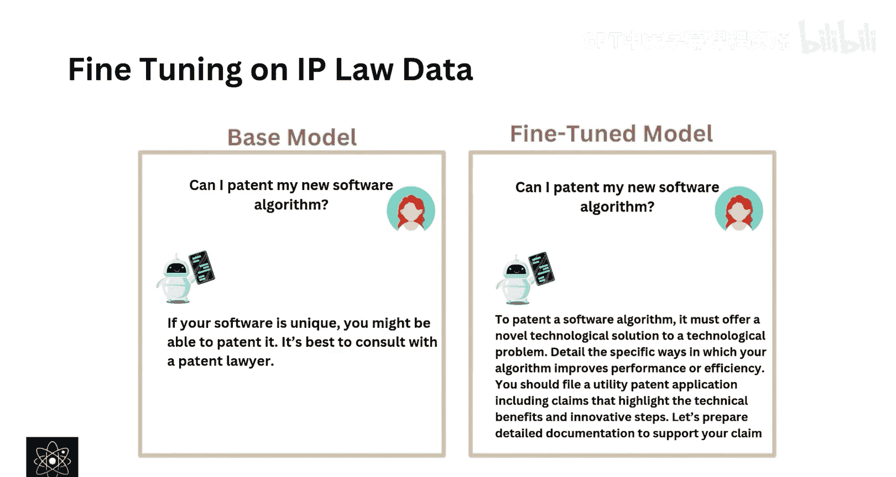

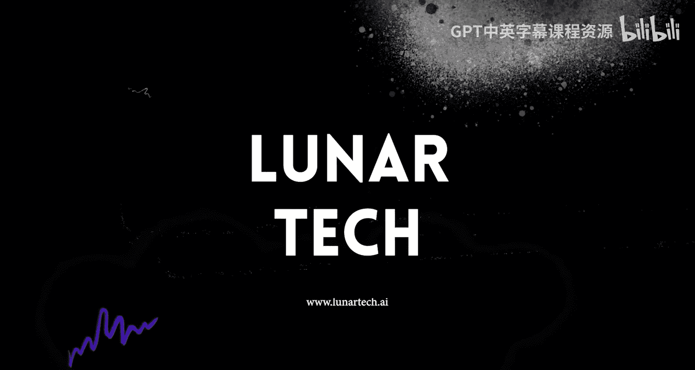

🎼Hi there and welcome back so now we're going to compare the pretrain to the fine tuning when it comes you larger which models。

So language models like GT3， GT4， Gema， Lamare， Falcon， all of them。

 they are incredibly powerful tools that can understand and generate human like text。

These models are initially created through the process that we are referring as pre training。

🎼Now this is a really important step when it comes to language models and it's mandatory。

Unlike the pre training defined fine tu is not mandatory。

🎼But it is actually essential when it comes to building a proper language model so it's like going to the high school and going to the university。

 going to the university is not mandatory， but it's actually recommendable or at least if you don't go to university that you instead do it homeschooling or you specialize in somewhere such that you can earn well you can build a career so even if you don't go to university you still need to read some sort of books。

 you need to choose a career for you you need to whether become better in finance or in economics or hairdresser then you need to practice more on this different haircuts etc you get the idea so there is part about learning everything in one place and become a generalist usually this comes with high school with basic school and then after that you need to learn something new something specific to perform a specific task inappropriately。

🎼And that's what we do as part of the fine tuning Now as part of pretraining in more technical terms。

 the pretraining involves training a language model on a massive amount of text data an examples of pretrain large language models are the GT4 the birds from Google Roberta from Google and then G40 the recent version of G4 series from Open AI Lamatry also recently released by Me AI this list is just a very small portion of them so think about the Falcon the Pi tree and all those language models there are originally pretrained so when it comes to pretraining a large language model。

 the pretraining involves training this language model on a massive amount of text data and the criterias of those data sets that we are using for pretraining at them is that they should be a very large B very varied and verat so they are from different。

🎼Sos of topic areas from biology to literature， English literature and then different specific data。

 but not too specific so genetics， biology， textbook data。

 news data even like conversational data that is stored somewhere across websites so to be more specific an example of such data that you can look into to get an understanding highle understanding what kind of data is provided to the modern LNs including the GT series or Lama is to look at the data that is called the pile so this pile data it is a large varied collection of text that contains all sorts of data so this is an example of data that is very large it's like over 800abytes of data and this type of data it usually contains ton of book data so ton of books collected in one place not just。

🎼Sentific books or schoolbook but also the books like fiction， etc， so literature。

 and then all sorts of scientific journals， research papers that have been published across many years and a lot of tons of scrape data so from different websites。

 not just thekiPD but ton of different websites so this is just a very small portion of the data that they are using they combine this weighted ton of conversational data。

 the language that on the street paper would use dialect and this ensures that they are using a large amount of so the quantities there a large amount of data but also they are trying to make sure that the qualities there so they are not trying to provide a garbage data as input for an ALM and as we learned as part of the previous section when we were discussing this in- detail this pre-training process including the data pipeline for LLMs that the quality is really important for this data usually this。

🎼During the pretraining stage the data is being cleaned all the outliers are remove the extra text on important text is removed and ensure that data is of high quality and the quantities there because otherwise if you provide garbage and you will get a garbage out so that's a really important part for the model to learn to predict the next word in a sentence now this is also not an aspect for the language models。

🎼So this is the example of the pile data as of the moment that we are recording this video。

 unfortunately this data has just been made unavailable。

 but you can check it out now whether it is available and as an example of a dataset that is being used by the companies like Open AI etc。

 this dataset contains over 825 gigtes of diverse open source language modeling data。😊。

🎼That is consisting of 22 smaller high quality data sets combined together。

 so it's really important that they mention here high quality。

🎼And this comes back to the idea that if you do not provide high quality data to the pretraining model。

 then you won't be able to create language model that is able to perform general tasks all right so that's about the data then let's quickly refresh our memory on the pretraining process that we have learned also as part of previous module in detail。

🎼So during the pretraining， a large language model。

 let's say the one based on transformer architecture and this one comes from the attentions all you need paper then the model takes in the input embeddings which are these secret codes that describe the semantic representation of the words and then sub wordss and this this is really important and of the essence for the model to learn the semantic representation of the words and the text then we are adding the positional encoding such that the model will know where the words are coming from then we are adding the two to each other to create the final input and then this final input will be decomposed intoqueries keys and volume matrices here you can also see the weights matrices corresponding to each of those matrices which are really important and then we are decomposing this sets ofqueies keys and values as part of our multi head self-attention mechanism into multiple heads such that the submods。

🎼'llSee different sides of the words， so different features of the words every time in each of these heads and we'll learn the context behind the words from different perspective so different characteristics of these words and in this way we will be able to learn the context behind the words better。

🎼So this is the idea behind multidi had self attention in a very high level。

 so if you want to learn more about this transformer architecture， the pre tradinging process。

 the multidi had attention and these different parts。

🎼Please make sure to check the previous module as part of this course because in here we are just refreshing the memory very quickly to compare this back to the fine tuning process when it comes to the pretraining process the idea behind the pre-training process is to follow the structured approach which we also did as part of our N2 andK study where we pretrain our own large language model and we call it a baby GPT so make sure that to check the one out to and here what we are doing is that we are simply following this architecture of a large language model assuming that our large language model is based on this transformer architecture then what we are basically doing is that we are generating the input andbeddings from our large text we are adding the positional encodings we are fitting this into the multied attention mechanism and then we are adding residual connections。

 performing layer normalization to stabilize the network putting this into the forward network so fully connected fit forward network adding residual connection layer。

🎼ization doinging this in the blocks to add more complexity to our neural network。

 then taking the keys and then values， providing this as an input to the multiia attention in our decoder combined with the queries from our decoder and then here。

🎼We have this next part where you can see the output embedding。

 the positional encoding similar to the encoder part and then here with the difference that we have mass multi add attention in the decoder part to ensure that the model is not picking into the future words when predicting this next word and then we are doing a similar thing like I just mentioned taking the keys and the values from the encoder combining with thequeries from this mass multi add attention from the decoder part and then fitting it into the multi add attention then adding residual connections。

 their normalization， straightforward network etc， up to the point of reaching the output of the model。

 the raw probabilities， the abnormal normalizedized scores。

 then we are performing this step of computing the logicits and then performing the softm transformation this is in the the architectural transformer model and most of the modern LMs in the pre-training stage they look like to this transform model in one way or the other or maybe adjusting it a bit。

ちょっと？🎼The coder only or encoder only or both of them are specialized and then the essence of this is basically going back to the fundamentals of deep learning。

 which is performing this forward passes， computing the output so predicting the next word and then comparing it to the actual words so the actual value of y and then computing the loss that we are obtaining。

 taking the loss performing outback propagation computing out gradients first or derivative of the loss function with respect to our moral parameters。

 so the weights and mass parameters。🎼Taking this and providing us an input to our optimization algorithm in G GD or the atom WRMS Pro doesn't matter so you can pick it for yourself and then taking this gradients using them to update the model parameters and performing our backwardcast and the cycle goes on and on until our transformer model reaches to the maximum number of epochs or any other stopping criteria and we end up with bunch of values for our weight parameters in our bias parameters which form the final model so when we are saying that the model is pretrained we mean that we finish the training of transformer model at some point and we end up with a file that contains this different values for our weights and for our bias parameters and given that we are dealing with large and which models this is usually a file that contains billions of those values so billions of parameters which we are also referring as internal parameters for our large。

And which was？🎼So that's basically the idea behind pre training process and the goal in the pre training model is to generate these probabilities for the next word。

🎼And an example of this is for example， if we have the CAset on the and then we want to predict the next word then the model will generate probabilities for each of the words that are a candidate words in our corpus and many of them will have a zero probability so when the next word cannot be for example cafe or restaurant etc but when the word is for example met。

 then there is a 70% chance that does's the next word the word table has a 50% chance to be the next word and then the floor the 10% probability the chair 5% probability and the sum should be 100%。

🎼So based on this， then the moral decides that the next word would most likely be the word met。

 such that the sentence becomes the cat set on the met。

So this is the idea behind the pretraining process if you want to learn more about the fundamentals of language modelss。

 this idea generating the next word， please make sure to check the previous modules as we are discussing this in detail。

 but this is just for a quick refreshment of the pretraining process。

🎼When it comes to the resources， the pretrain is highly resource intensive。

 so pretrain requires significant computational resources， often using powerful GPUs。

🎼So this way we can then create models like GT4 that are very powerful but this also means that you cannot just do that at home。

 it's not visible to train such large language models at home because it requires a specialized hardware it requires a significant amount of computation so pretraining is one of the most resource intensive parts of the entire ALM lifecycle that's why you can hear that people like Sam Altman。

 CEO of OpenaiI or many other CEOs from this big tech companies that are running the AI race that they will continuously talk about Nvidia。

 the different chips and processors， GPUs and then millions if not billions of investments when training their large language models because the pre-training requires significant computational resources often using this powerful GPUs This is why creating models like GP4 it's just not visible at home it requires specialized。

🎼Hardware too and a considerable time to invest when training at models。

🎼Alright so now when we're clear on the pretraining we have refreshed our memory we are ready to move on to the fine tuning stage If any of those parts seem unclear the architecture of the model the self-attention mechanism multied attention the different mattressrices or predicting the next word idea please make sure to check the previous modules and the previous part of this bootcamp because we here to have just refreshed our memory on the pretraining stage so it's truly understand the fine tuning you also need to understand in the proper way the pretraining process and the previous modules as part of this course will help you to do so Allright so let's now talk about fine tuning the specializing all the large language model。

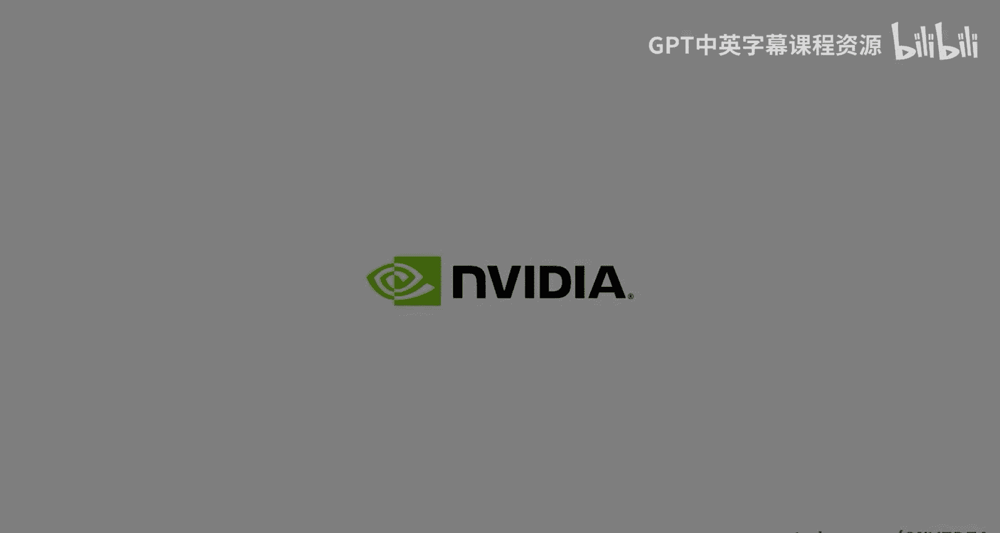

🎼So after pretraining the model can perform general language tasks。

 but it might not excel in specific domains and this is where the fine tuning comes in fine tuning involves taking this pretrain model and further train it on a smaller domain specific sometimes your own dataset to specialize it for a particular task。

🎼So examples of such a process is CheGBT so ChetGBT is a fine tune version of GBT4 model at the moment optimize for generating conversational responses Now this is really important the pret model GBT4 is for example not optimized for generating conversational responses unlike the CheGBT which is the fine tune version of the GT4。

🎼At the moment， also GT 4。0 that is able to generate conversational responses at a high quality。

🎼For example， if we compare the base pretrain model one from GT3 with retail customer support expert that is a fine tuned version of the GT3 so someone took load off customer support data。

🎼And use that to fine tune this GT3 model then here are the responses that the two model will provide The GT tree will take the question the prompt will be I haven't received my order yet can you help and then the answer from the plain pretrained GT3 model would be sure I can help you with that so here is an example of a pretrained GT3 model from open AI versus the fine tune version so taking the pretrained GT3 model and then specializing it in a customer support and making a retail customer support chatbot。

🎼So this is the fine tune model that is based on a ton of customer support related data。

 so you can see in the left hand side that the prompt is I haven't received my order yet。

 can you help and we are providing the same prompt to the fine tune model。

 the customer support chatbot。🎼So the base GT3 model will then provide us the answer Sure。

 I can help with that， please provide your order number and I will look into it。

🎼While the Fin model will say I apologize for delay in your order to check its status。

 please provide your order number and email address You can also check your package using the link in your shopping confirmation email if you need further assistance。

 please let me know so you can see what a difference it makes when we have the retail customer support expert。

 the chatbot Fin model providing the answer versus the plain GT3 model。🎼You can see the detail。

 the quality of the answer， and how from the customer point of view it would be satisfactory to see the completion so the answer that comes from the retail customer support expert versus the plain GT3 model and there's the power of fine tuning a large language model。

🎼So let's now quickly talk about some technical details before getting into the specific comparison between the fine tuning and the pretrain。

🎼So when it comes to the fine tuning and the technical details behind it。

 it's really important to understand the difference between the weights and the buzz idea when looking into the fine tuning process and pretrainning process so let us quickly talk about the technical details behind the fine tuning before diving deeper into it。

🎼So during the pre training， we are generating these different weights and we end up with this optimal weight parameters。

 billions of those parameters for the internal model。

When it comes to the fine tuning similar to the pretrain。

 the fine tuning involves updating the model weights and bias parameters。

 but with a focus on a specific task。So we're using a smaller data that is specialized data using this idea that it should be specific。

 it should be smaller， and this data is relevant for our specific task score domain if we want in a legal area。

 thespecialization then we need to provide more legal data and more specific data if we want the model to be specialized in a IP load so intellectual property load then we need to provide more of this type of data。

 or if we want the model to answer a customer support related questions then we need to provide this type of question answers set to the model。

🎼Well dive into the specifics in detail later on but for now let's keep the focus on the technical side so when it comes to the weight updates the pretrained weights serve as the starting point so during the fine tuning this weights that we got from the pretraining process are then adjusted one more time so they are further adjusted to minimize the errors on a new task specific data so during the fine tuning we are taking the weight and bias parameters and all these billions of parameters from the pretraining stage。

 the final model that we got from the pretrained stage and then we need to continue the update of this weights in the fine tuning we are updating the model weights and biases but with the focus on a specific task so if we have a specific data so we are changing the data the optimization process changes so every time we need to predict the next word we。

🎼The model to perform a specific task that means that the error associated to these weights will also be different and now this time the goal is is to ensure that the model continuously updates this weights that was provided from pre-trained model such that it will minimize the errors on a new task specific data so the data will be smaller more specialized but this process still stays the same continuously updating and adjusting the weight parameters to minimize the load that the model has on this new task specific data。

🎼So this is the process of further tuning of these parameters。

 hence the name fine tuning and this fine tuned model will then result in a set of ways and mass parameters that results in a smaller error。

 smaller loss for this specific new data that we have provided to it a couple of things you keep in mind is that we are calculating this loss so calculating the。

🎼Eror that the model has on this test specific data which indicates how well the model is performing on this new data then using the techniques like gradient and descent atMV RMS Pro we want to minimize this loss further refining the model's weights and biases There are a couple of things that we will discuss in detail once we go through process step by step which involves the amount of change that we need to apply to our weights because the idea is that that we don't want to change the weights a lot。

🎼As the pretrained model provides us a lot of important information that we don't want to lose and at the same time we also want to change them at some degree。

🎼And this can be controlled by the learning grade from the optimization algorithm。

 but we will talk about these details when we will discuss the technical stages of conducting a fine tuning step by step。

🎼For now just keep in mind that we are changing the weights that we take a starting point from the pretraining process and we will change them until we minimize the loss of the model for that specific data that we use for the fine tuning Now this is in the nutshell the difference between fine tuning and pretraining。

🎼So we will dive into these different parts how you can fine tuneit what are the technical details behind them once we approach the fine tuning step by step process。

 but for now those are at high level the differences between fine tuning and the pretraining let's now compare the prompt engineering to the fine tuning let's compare fine tuning with prompt engineering。

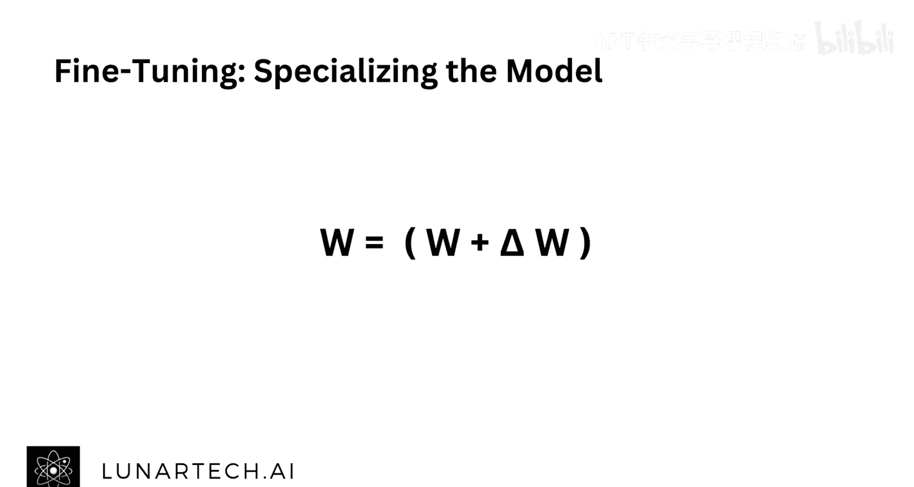

🎼So prompt engineering involves creating specific inputs to get the best responses from the model without changing its core structure when it comes to prompt engineering。

 this is something that I'm 100% sure that all of you have already experienced in one way or the other if you have used chatGPT then you have definitely done prompt engineering you have provided the prompts to the chatGPT and then it created back announcer for you while the fine tuning on the other hand it most likely if you are in dis course that you haven't yet done a fine tuning fine tuning is the changing of the model itself making it more specialized and improve it so that it can understand and respond better based on a specialized training so prompt engineering involves crafting the specific prompts or instructions or inputs to elicit this desired responses from a pre-trained models without additional training you just go to the application you provided a prompt and then you are getting a feedback。

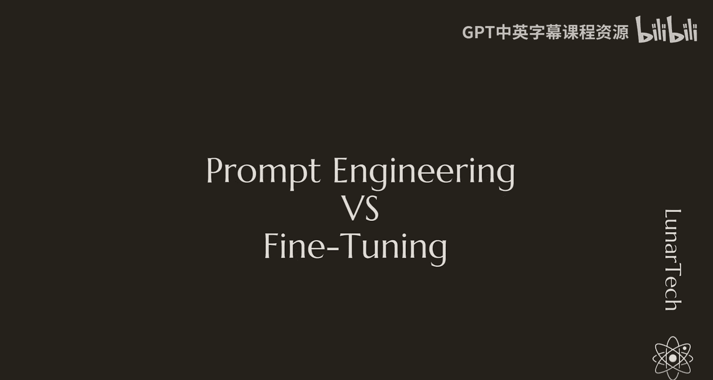

🎼It leverages the model's existing knowledge base and capabilities you are not adding any extra data。

 no specialization， no extra tuning extra resources。

 just plain improving your quality of the questions。

🎼While the fine tuning is not like that it does involve resources。

 some knowledge that you need to apply in order to perform the fine tuning you know when you go to Google or YouTube and type something into the search box youre trying to get exactly the information or the video that you are looking for you want to phrase your question in a certain way such that you can get the best answers right So that's essentially the prompt engineering it's all about how you ask a question to get the best answers out of the system like a search engine or a chatbo or in our case an AI application。

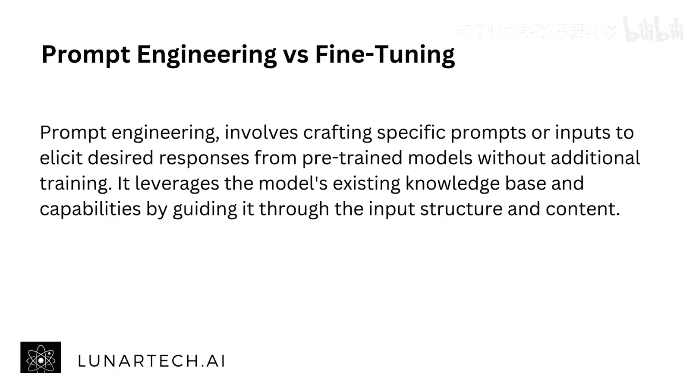

🎼So whether you are typing something into Google asking Si question or even deciding what to type into a chatbo on a website。

 you are engineering the prompt hence the name prompt engineering a great example is when you interact with chatGT So you might have noticed that the way you phrase your question or prompts。

🎼This can significantly influence the hypo responsess you will get so many people are even saying that if you use the GT4 but combine this with bad prompt engineering practices so you just provide poor prompts then you might get worse response then if you were to use GPT2 but with the high quality prompts so it's really important what kind of questions you are asking and how you formulated in here you can see that when I'm asking what is the weather like in Amsterdam that the quality of the answer is really different。

🎼Let us actually here two example so you can see that when what I'm asking what is the weather like then the answer is。

 could you let me know which specific location you are asking about for the weather update while when I'm specifying the location as well and also the date so I'm saying what is the weather like in Amsterdam today you can see that I'm getting a direct answer I'm getting that today in Amsterdam the weather is characterized by scattered showers with passing and clouds the current temperature is around 64 Fahrenheit with a high expectation to reach about 73 Fahrenheit it provides me humidity level it provides me information about the wind in which direction it's blowing the speed of it and what I can expect from the evening which will be mild and cloudy atmosphere so you can see that dependent on the question quality the prompt quality。

 the answer from the AI application will be different。

🎼So the same in here you can see when I'm saying translate this sentence into French Hello how are you today then the French translation for hello how are you today is Ponjo etca。

 etc ce， but when I'm saying translate the sentence into formal French and then I'm saying the sentence then you can see that the answer is slightly different because in the first one although I might my intention my intention might have been to get the sentence in a formal French but the prompt that I formulate it didn't convey the motivation that I had so you need to specify those details you need to also provide examples like in here when I'm saying try to translate this dialogue into formal French suitable for business setting so I'm specifying the setting what kind of language should it be used and also providing an example like if the person a says this then the person be expected to say that。

🎼So in this way I'm teaching the model without doing training， etc， etc。

 without spending resources just by using the quality of my prompts and improving the quality。

 reaching better results and that's the idea behind prompt engineering So in this way by shaping the questions to guide the AI towards the kind of answers I want I can get high quality answers without spending resources and without requiring knowledge so it's simple it's something you are already familiar with。

 I'm sure you have used it and it doesn't need any special data。

 specific data or text skills It's about being clever with words and instructing the model to do exactly what you wanted to do by providing examples by providing all the details spellling out all the minor characteristics that you want the answer to satisfy It's a simple adjustment in how you formulate your questions and how you ask something but makes a big difference in what you will get。

🎼So let us now quickly lay down all the pros and cons of prompt engineering versus fine so let's start with the pros of the prompt engineering。

🎼So when it comes to the first benefit of prompt engineering is that that it doesn't require data so you get to work with what the AI already knows so what the underlying model already knows so there is no scramble for new data you don't need data engineering skills data science skills is super handy especially when gathering fresh data is tough or privacy issues are concerned even if you have the knowledge to gather the data so the next benefit is the lower cost it's pretty cost effective as you are not spending on retraining。

 finetning the AI model just use what's already there you just need to tweak the inputs a bit formulated a bit at some more text and examples so be a bit more creative with your words to fine tune the outputs without breaking the bank and without actual fine tuning process Next up is the accessibility This one is a huge advantage for a prompt engineering side because anyone can do it you don't need to be a tech it。

🎼T savvy person， a data scientist， a researcher or a programmer if you can ask just a clever questions。

 you can use the chatbo effectively and go a long way Another advantage is the accessibility so anyone can do it you don't need to be a tech savvy person or the scientist。

 a researcher specialize in AI in order to improve the quality of your questions so if you can just ask a clever questions you can just use that model effectively。

🎼Next advantage is the dynamic data integration by using a smart techniques like the retrieval augmented generation of the ReGs the model can pull into the latest info on the file。

 keeping the conversation fresh and relevant so if you can combine this idea of base model with a Re or Regbased model then this would be ideal because sometimes we want our answers to not just be relevant but also be up to date。

 because it can be that the answer is still correct。

 the answer that is provided by the model but it's based on the time and relevant for the time being when the model was pretrained but not up to date。

 because if the model was pretrained for example last year and you're using it now then the answers will be correct for the previous year but it can be that there was a change in the answer and you want to get the most up to date information and that's where the systems like Re are very useful。

🎼We will be dedicating an entire section for this part and for this technique to dive deep into the Re and tend to practice it。

 but for now just keep in mind that this is a huge benefit from prompt engineering by trying to ask the questions in a clever way you can get the most up to date information if the underlying model is supported by Re keeping the conversation fresh and relevant。

🎼So next up let's talk about another advantage of prompt engineering which is the speed and efficiency so if you need a quick answer the prompt engineering doesn't make you to wait for it likely do it with fine tuning so it's like asking a friend a quick question and if you formulate in a good way then you can get an instant response which is perfect for realtime customer service or lively chatbot。

🎼So if you want to every time specialize your model， then you need to perform fine tuning。

 but this is just not possible if you want to get the answer instantly。

 if you want to get the results instantly because fine tuning takes time。

 you need to gather your data， you need to understand what you need to do。

 and you need to pick the technology， obtain the resources then perform fine tuning。

 put the data into its place whether it's batching or streamlining。

 then finally get an answer so after productionizing the model so an entire headache that can be avoided if you can ask the questions in a clever way and that's still a possibility so you don't need to implement the fine tuning right off the bat。

Now let's talk about the kindss of prompt engineering that might motivate you to go on the bit more difficult friend of it。

 which is a fine tunic。🎼So the first limitation of prompt engineering is the limitation by data fit so what do I mean by that so you are stuck with what the model already knows if it hasn't learned for example the latest TikTok trends then it might not keep up with the conversation about the viral content so if you go ahead and ask what are the latest trending hashtags on X then unless the model was trained very recently then it will just provide you old trending hashtags and there's something that you don't want so for those cases then the prompt engineering might not be very handy so next up we have the memory limitation。

🎼So there are only so much that the model can handle at once asking for too much information in one go might overwhelm the model and it will limit how deep your answers will get there is also a higher risk of hasation so if you formulate your prompts wrongly or inaccurately then the model might start making step up It's like playing a game of telephone the end result can sometimes be way off than the initial input because it goes through all the different stages and then combined with the wrong prompts then you are getting the wrong response。

🎼Next up we have the dependence on a moral quality so everything hangs on how good the underlying AI model is when it comes to prompt engineering the dependence on the moral quality is a big disadvantage when it comes to the prompt engineering。

🎼So if the quality of the underlying model is bad then the output that you will get will be also bad quality So a poorly pretrained and fineted AI model won't do the wonders that you can expect So no matter how clever your prompts will get if the underlying model is bad then you won't be able to get good answers the idea is that prompt engineering will be improving the quality of the responses that you will get as you formulate right questions assuming that the underlying model is a good one but if the underlying model is a bad one then independent how much you will improve the quality of your prompts the answer is that you will get1 B of high quality So let's now discuss the benefits and deems of fine-tuned models and why we need to do fine- tuning in the first place So first up we have the specialized knowledge So fine tuning allows the AI to become highly proficient in a specific area such as interpreting legal text or diagnosing medical images。

🎼Specializing in customer a question answering， etc。

 so customized knowledge is the number one benefit of fine tuning a model。

🎼Next up we have the reduction in errors so fine tuning significantly reduces the amount of errors that the model will make It enhances the reliability of the model for critical tasks that require high accuracy so you can expect that the fine tune model at least if the fine tuning has been done properly that those model will provide much more accurate responses than the auto models would do so next up we have the enhanced adaptability so a fine- tuned large language model it acts as this expert in its domain in the specific tasks that it has been fine-td to do so it provides more accurate responses without the need for the constant adjustments so you don't need to apply too many of these prompt engineering steps and too much info to the model to provide you a good responses。

🎼So next up we have the long-term cost efficiency so while there are initial investments with fine tuning fine tuning makes the AI much more efficient。

 reduces the computational resources that is knitted over time and saves the money in the long run so the initial investment might seem large but in the long term you will see that it just pays off so let's now talk about the des of fine tuning so what are the count of fine tuning。

🎼So first up we have the resource intensive nature of it。

 so fine tuning requires substantial computational power and extensive data sets which can be costly and difficult to obtain because it costs you money to hire a data engineer to collect data and prepare for it or data scientist to do that job in this highly competitive market when professionals like this cost a lot of money。

🎼Also it requires a lot of GPUs to fine tuning model not as much as the pretraining but still some money to do fine tuning unlike prompt engineering that doesn't require any of those it also requires knowledge which sometimes cost a lot of money and requires other sources of investment including the investment in the programming languages and many licenses for libraries that you need to use or environments you need to use etc。

 so this all can be costly and very difficult to obtain。

🎼And then next up we have the high upfront costs so kind of related back to the idea of resource intensity。

 so the initial setup including the data collection， the web scraping， model tuning。

 it involves significant financial investment that not everyone has， unfortunately。

🎼So next up we have the need for technical expertise fine tuning it requires advanced technical skills for the setup and for the optimization of large language model that often requires specialized people like specialized data scientists AI engineers machine learning engineers data engineers such that they can in a proper way finet model finding this type of experts is really difficult not just that it costs a lot of money to find them and pay them。

 but also very difficult to obtain them fine tuning requires a lot of knowledge like the idea of this different strategies you can use choose the right fine tuning topic and fine tuning model to apply the fine tuning process in a proper way starting from the data collection。

 cleaning the data putting it into the right format up to the point of fine tuning and then productionizing the fine tuning model it always based on a large amount of technical expertise and finding them it is cost。

🎼Sleep but also very difficult Next up we have the scalability challenges。

🎼So finetd AI models they excel within their specific niche but may struggle when applied to new areas。

 often requiring this retraining of the model and repeating everything once again for this new specific task or new type of domain of expertise。

 which adds time and then costs of course。🎼So unless you are a startup that is funded or you have your own parel funds for fine tuning every time for these different sort of tasks。

 it will be quite challenging for you to afford this different fine tuning processes for different tasks so choosing between prompt engineering and fine tuning depends really on your specific AI needs but also resources that you got if you have funding and you know that prompt engineering won't solve your problems and you really need to specialize in specific area of expertise and you want your model to perform specific tasks then the fine tuning will be your choice and when it comes to the underlying model being already good enough and you don't have the resources so you need to work on your prompt quality then prompt engineering will be your friend depending on your specific case and your resources you can choose which one would be more appropriate for you。

🎼Alright so we are done with comparing the prompt engineering and fine tuning we are ready to move on to your next topic which is the actual fine tuning process and to start to get a bit more involved into the technical details behind fine tuning a large language model so bye for now and I' will see you in the next session Hi there and we back to another session about fine tuning a large language model In this session we are going to talk about a step by step process behind fine tuning La fine tuning is a powerful technique to transform a general purpose language model LLM into a specialized tool。

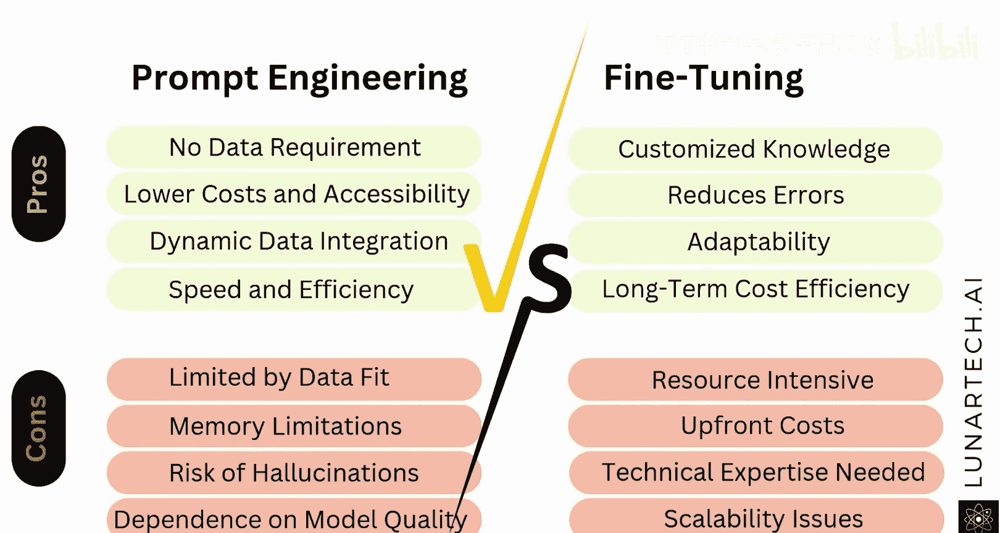

🎼Much like the doctors who specialize in oncology or dermatology after learning the fundamentals in medicine。

 it leverages the knowledge gained during the pretraining step on a massive text corpora and adapts it two specific tasks。

 so let's now dive deeper into each of those steps that form this entire process of fine tuning a large language model。

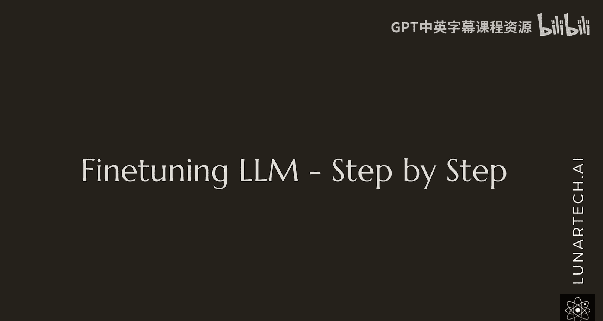

🎼First up we have the objective， so we need to clearly define our objective for fine tuning。

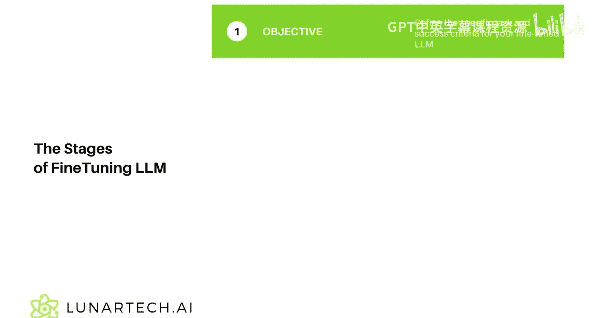

🎼So clarity is really the key here be extremely specific about your goals for example do you want your LM to accurately classify customer reviews as positive or negatives or to perform sentiment analysis analysis or you want to generate creative marketing copy in a particular brand voice or you wanted to answer complex questions about medical diagnosis like domain specific knowledge。

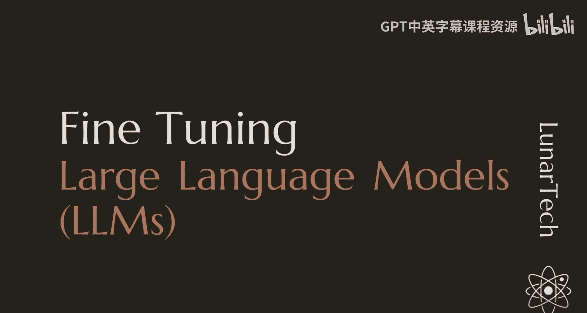

🎼Another one is measurable goals， so you need to set the goals measurable。

🎼So establish a metrics to guide the success for your fine tuning process。

 examples include accuracy in and analysis tasks or human evaluation scores for generated text or performance on relevant benchmark datasets。

🎼So we are going to dive deeper into this different task that you can perform this downstream task as well as the metrics that you can use depending on the task that you want to achieve with your fine tuning at the later stage in a separate section as part of evaluation of large language model but for now keep in mind that independent what kind of task you want to do for that task you need to get the clear objective and you need to find metrics to measure the performance of the model so have you achieved your goal with fine tuning of your model or not for that you need a specific measurable goal and metrics to guide that process so next up we have the gathering and preparing the data。

So first up is the quality over quantity， focus on acquiring high quality data that mirrors the real world scenarios our model will encounter。

🎼Especially when it comes to fine tuning the quality of the data is of utter importance if during this pretraining given that you have a ton of data。

 some bed quality data might just squeeze in and not affect the performance of the overall model during the fine tuning even the small portion of low quality data might affect the performance of the model。

🎼So be very careful with the quality of the data ensure that it's collected properly， it is reliable。

 it doesn't contain outliers etc so pretty much following the process of the data pipeline for LMs that we have learned as part of previous module so clean the data data cleaning is really important remove the errors remove the inconsistencies。

 the irrelevant information， any outliers that you have identified as part of the quality check from the previous step。

 for instance if the fine tuning for the sentiment as it needs to be done then correct the misspellings or grammatical errors filter out the natural reviews that do not contribute to learning and leave the positive reviews and the negative reviews it's really important to remove the errors inconsistencies outliers and irrelevant information。

So if in the previous step you have performed your quality check。

 this step should be quite straightforward。🎼And then dependent on the task， for example。

 if you are doing fine tuning for sentiment analysis， meaning that you want to， for example。

 classify a text being positive or negative review。

 then you need to correct the misspellings you need to remove the grammatical errors。

 you need to filter out the natural reviews that do not contribute to learning。

🎼So if needed you also need to do annotation so for certain task like in sentiment analysis。

 you might need to label or unnotate your data for example。

 in the case of figuring out whether the review is positive or negative so in sentiment analysis we might need to label each review as positive and negative or natural if needed such that we can guide the model what is correct and what is not such that once we do the fine tuning the model understands this review should be considered as positive meaning if you have specific text。

 so for example a review that says I absolutely love this product it exited my expectation then the annotator should put there a positive if the product is okay nothing special so the review is that then the label should be natural otherwise if it says I'm very disappointed with this product it broke after one。

 I suppose usage， then the label should be negative and if you're wondering who should do this。

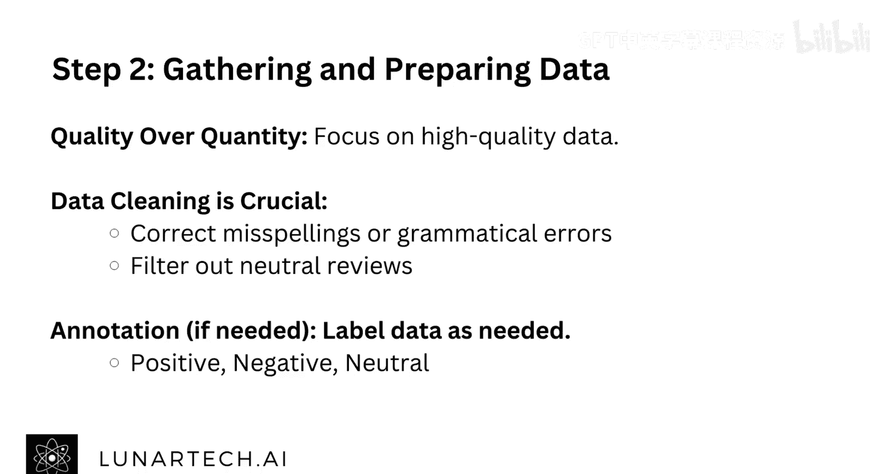

🎼Annot Well this depends Some people have highly accurate models that can perform this labeling for them in the first place like a classification models and some people when they have resources then they can ask the humans to do the annotation unless the data is so large that they don't have that that option is not visible so next up you need to choose the pretde model Consider your specific needs what kind of problem you are trying to solve what kind of applications you are trying to build。

🎼For general language tasks， models like GPT3 GPT4 GPT4。

0 Lama 3 words they are all excellent choices Of course this really depends on what kind of problem you are trying to solve so specific to your problem you might go for decoder only architectures or encoder only architectures or encoder decoder architectures。

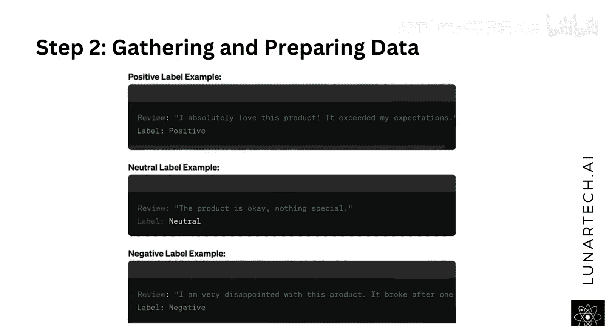

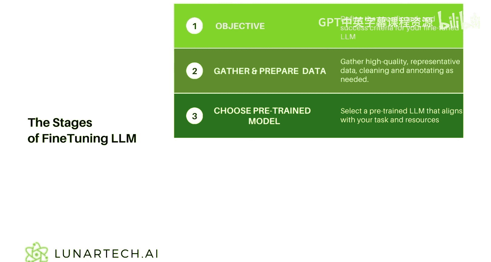

🎼And then depending on that， you will then go with different pretrained LLs and when it comes to the specialized domain so let's say you are trying to build a medical chatbo or a legal chatbo。

 then you might want to explore models that are pretrained on that specific relevant data。

 because the model pretrain model that is pretrained on relevant data。

 let's say legal data then this will definitely result in much better fine tuneuned legal model and legal chatbo than the general GT3 or B。

🎼So next you also need to decide on the architecture and that is what I was just referring when I set the decoder only encodeder only or decoder encodeder or specialize。

🎼So most large language models they are based on the transformer model。

 so that's something that we have seen before， we learned about these architectures。

 the different sort， but also we saw these transformer architecture consisting of these different layer starting from the selfat。

 so multied self attention， then adding the residual connections， the layer normalizations。

 the fit forward network， and then providing these keys and then values onto the multi-ed attention from the decoder part where it is combined with thequeries coming from the mask multied attention and so on。

🎼These layers enable the models to capture the complex patterns and the relationships within text data。

 so it's really important to go for the LLM that you know that is most likely is of high quality and that is usually the transformer based LLMs。

So also the size matters large lightweightwi models often have greater capacity but require more computational resources。

 so try to balance your requirements with available resources。

🎼A fast repository of pretrain models is the hugging phase so if you are looking for an open source model try to check the hugging phase because there they have so many options in their intuitive UX there you can choose for metas LMs you can choose for the 80 billion version or the 80 billion option and then you can choose for the Gema LM you can also go for the。

🎼Open AI open source large models so this sky is the limit here there are so many options that you can choose from as long as you know how you can choose the right language model that would be a great way to start your fine tuning process。

🎼If you are looking for a guide on how to choose the right large language model。

 then make sure to check the section where we are talking about choosing the right LM we have an entire session dedicated to this。

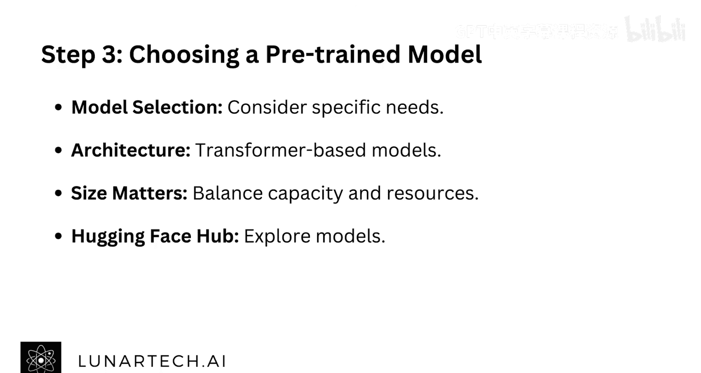

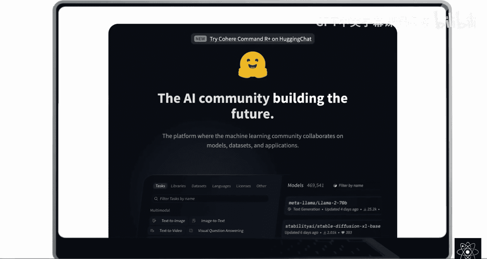

🎼So in here you can see that I'm looking at the documentation provided by Matt specifically for Lama tree that has been recently released。

 so on April 18， 2024 to be more specific， so a couple of months back and you can see that they are provided a bunch of information including the code that you can use to implement it in Pytor and lot of supporting documentation。

 how you can update the ways， the vast parameters and how you can implement the model。

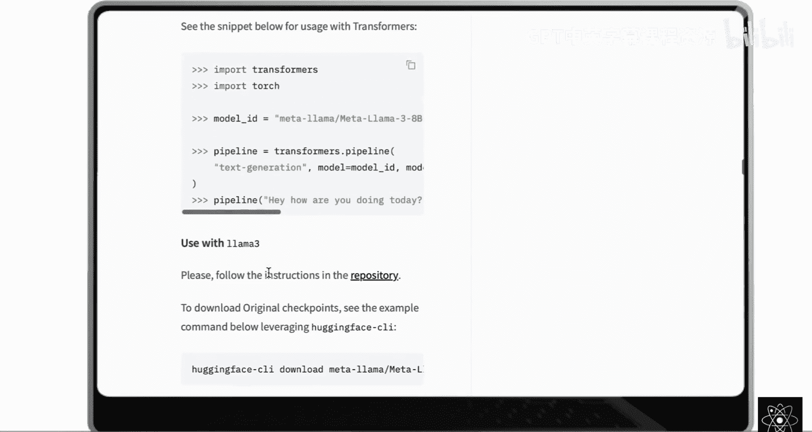

Next up， we have the actual fine tuning setup。🎼So depending on it has that you want to perform using this fine tuning。

 you might add test specific layers to the pretrained large language model。

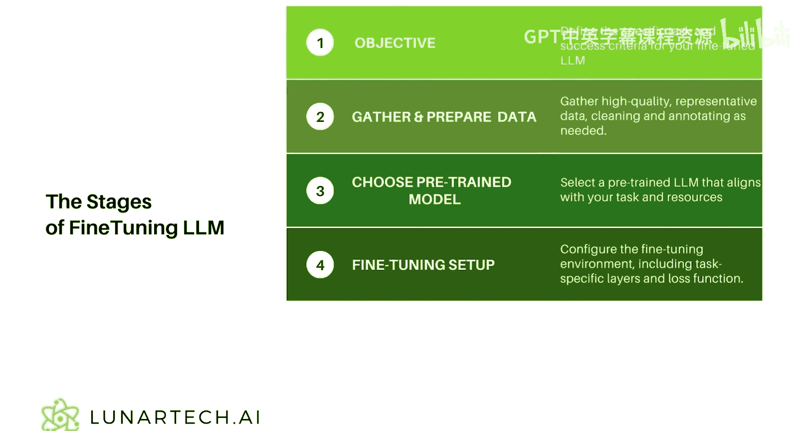

🎼For example， in the text classification you might want to add a linear layer on the top of the transformer layers to produce these class probabilities。

 such that once you generate these logics and then perform yourex transformation you can generate probabilities that' say for this class the probabilities that for this class the probabilities that and then based on that you can then select the answer with the highest pro in terms of the classification so depending on the specific task you might need to add extra layers to pretrain the model to adapt it to the network's needs so depending on the specific task you might need to add extra layers this neural network fully connected neural network layers to the pretrained model to adapt it to your needs for example。

 for text classification task you might want to add a linear layer on the top of the transformer layers to produce this class probabilities。

🎼Like in here you can see that we are trying to add this dense layer and for example if we want to perform sentiment analysis then this would be highly appropriate。

 we might need to add this dense layer on the top of our base transformer model to create this newer architecture for our specific case and then when it comes to the calculation of loss function so to measure how good our model is for our specific sentiment analysis or classification or any other task we need to measure this using the matrix and the loss function will then measure this discrepancy between the model's predictions and the ground through labels so the labels that we know they are true。

🎼And then we can calculate this， we can calculate this most。

 and the common loss functions for fine tuning include cross entropy loads for classification。

 or means square there for regression tasks or the mean absurd error。

 the root mean squared error and many others。🎼So the loss function is really important we will talk about this one when discussing the evaluation of large language models。

 but for now what is relevant is to keep in mind that when it comes to the fine tuning process like in case of the pretraining we still need to perform this evaluation understand how well the model is doing but this time we want to know specific for our case if it is classification then we need to use classification matrix in order to understand how well the model is performing the classification task so when it comes to the computational power you need to ensure you have access to sufficient computational resources so GPUs or TPUs for efficient training。

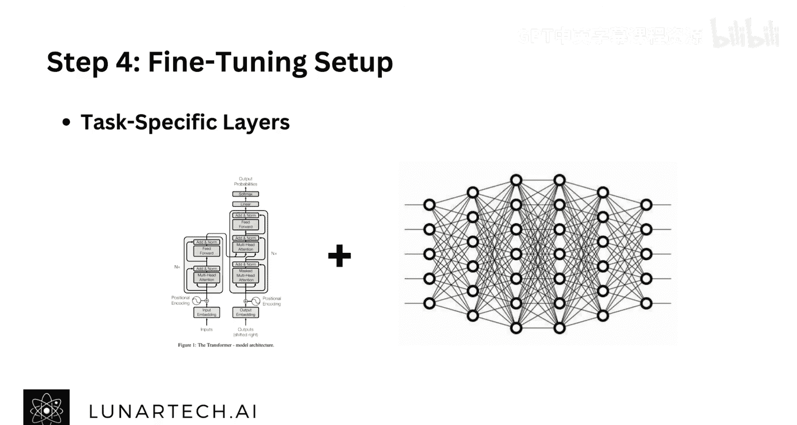

🎼Now this one is really really important， ensure that you have access to powerful computational resources。

 so graphic processing units or the tenor processing units。

 which is really important for efficient fine tuning。

 especially when dealing with large models like the ones coming from Meag。

 the ones coming from open AI， those models even though there are different sizes available there。

 so 8 billion or 80 billion or others， even for the smallest one you need quite some computational power。

 at least some des。

🎼So examples of GPUs are the Navidias Art 3090 or the one of the 800 that is also highly popular across the industry for the commercial use and those GPUs or the GPUs coming from Google Tenor processing units or the GPUs。

 the Google Tenor processing units available on the Google's Cloud。

 those will be essential for you to finetune your large language model。

🎼So experiment with different values for your learning grade like when you are performing your optimization process like in case of pretraining so next up you need to perform hyperparameter optimization Exp with different values for your learning grade so how quickly the model is learning the bed size is another parameter that you need to keep in mind so the number of samples process at once so next up we have the training process this is a really important part when it comes to fine tuning process and is the improvement of the model weights and bias parameters the internal parameters of our large language model such that we can optimize it for our specific use case for our new data。

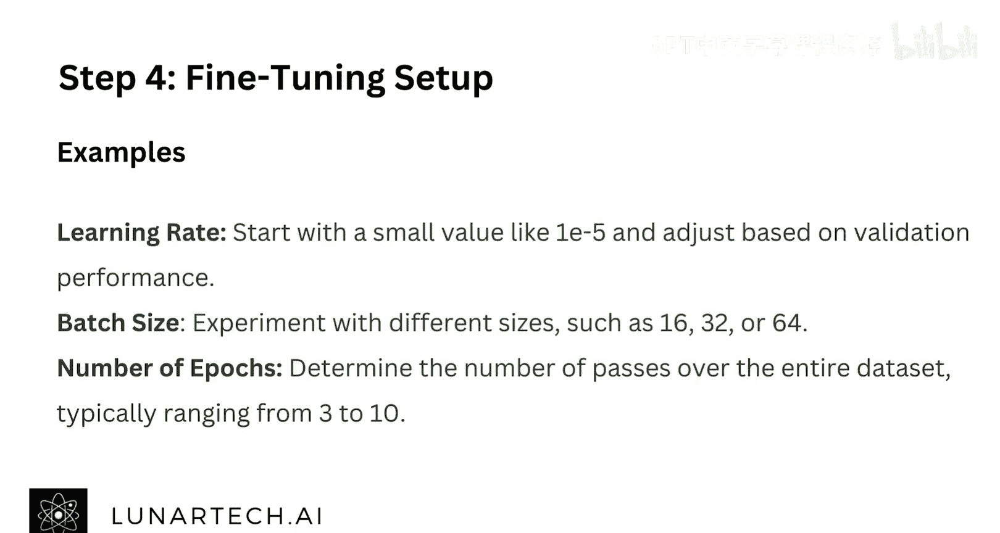

🎼So imagine you have your pretrain model， you have selected it， you have set up everything in place。

 and now you have this final ways and bias parameters and this new data。

🎼So you will then start with these parameters that you have as your starting point from pretrained model。

 you will then train your model with this parameters on your new data and what the model will then need to do is to gradually adjust this weights and the bias parameters to minimize the loss function。

🎼So use algorithm like schastic gradient Descent or Adam or AdamW。

 so an optimization algorithm in order to update the model weights and the best parameters using this optimization algorithm to minimize the loss function for this specific new data。

🎼We are pretty much repeating the same process as with any other neural networks。

 forward past spec propagation， computing the gradients。

 using this as an input for our optimizational algorithm and then updating the weights and bias parameters only now during the fine tuning we start from this state where we have the certain values for our weights and bias parameters。

 and we have a new data， small data and specific data and we want to minimize the error that theor is making。

 minimize the loss function， which involves back propagating this error through the network and adjusting the weights accordingly using this learning rate for our fine tuning process and then updating this weights and bias parameters again。

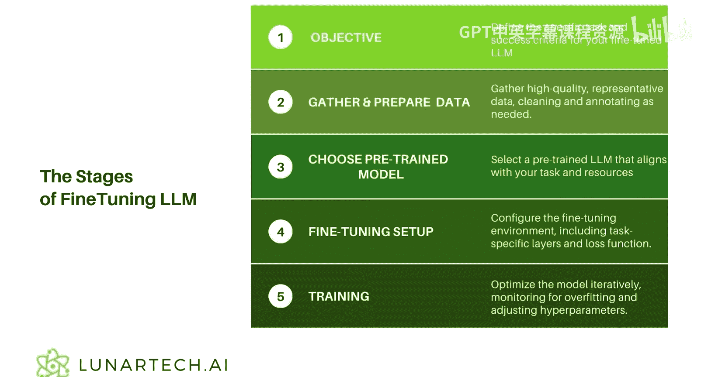

🎼So fine tuning typically involves smaller learning grades and batch sizes compared to the pretraining this one is really important and I cannot express enough how important it is to ensure that you don't mess up with the pretrained model and that you lose all the important information that is in those weights and bias parameters because after all it's not for nothing that we are using the pre-trained model。

🎼So pretrained model， if they have been pretrained properly like the GPT3GPT4 or Lama tree。

 they have been trained on massive data， a large amount of high quality data using a lot of computational power and knowledge things that you most likely won't be able to replicate at home and there is also no need for that you have the pretrained model that is able to perform this general tasks and your goal is to not completely change those parameters and the parameter values that is provided from pre-trained model but instead to slightly change them such that they will be tweaked for your specific use case so you don't want to change the model parameters entirely but instead you want to just small amount that you want to adjust such that the model is performing well on this new task on your specific task and this helps you ensure that you are making use of the pretrained model。

🎼So by using a smaller learning grade you will then ensure that the information in the pretrained model is not being lost。

 this is really important and by controlling the learning grade you can then control how much information you will get from pretraining stage versus how much information you will add from the fine tuning stage。

🎼So fine tuning will then typically involve much much smaller learning grade and the bed sizes。

🎼Also smaller compared to the pre training and this way we are preventing the model from overfitting to the new data and then entirely forgetting what it learned during the pre training this highly costly process。

🎼So fine tuning generally requires smaller learning rates compared to the pretrain to prevent these drastic changes to the pretrain model's parameters。

🎼So also the smaller batch size help in more nuance updates。

 so just to illustrate this difference between the different hyperparameters that we need to apply。

🎼When combining the pretrained models result of these weights and bias parameters that we get and the new updated version。

 so fine tuning process because we are combining the pretraining with fine tuning and the idea is that we want to benefit from the pretrained model and this powerful source of information but yet also improve it a bit by fine tuning it for our specific data and task here is the difference between the two different versions for the pretraining learning rate we can typically take this range as you can see whereas for the fine tuning we take this range for the learning grade much smaller volume and the idea is that this learning grade controls the amount of updates we will make to the weights if the learning grade is well then we are making smaller update so to illustrate this idea between difference。

🎼Of fine tuning versus pretraining we can look at the learning grade ranges that usually we use for pretraining process as well as fine tuning process so the learning rate is the parameter that controls the amount of updates we will make so the change size that we are going to apply to our weights and our bias parameters if the learning rate is large so our step size is large we are then going to make larger updates to our weights。

🎼And this is fine during the pretrain process， but this is not fine during the fine tuning process。

 we want in the fine tuning to update the weights in a small amount， such that we don't lose deep。

 highly accurate and large amount of source of information that comes from pretraining process。

🎼We spend so much resources and so much time in pretraining the model and we don't want to update the weight drastically Instead we want to keep this update amount minimal Therefore we are also using the smaller amount of learning grade this step size and that's something you can see here illustrated by this different ranges for the learning grade for pretraining step versus the fine tuning step during the fine tuning as you can see we are using much much smaller range of this learning rate so another thing is this batch size during the pretraining stage we use larger batch sizes let's say 256512 to speed up the training process but during the fine tuning we want the model to be more precise we want the model to have more accurate updates therefore we are making the batch size smaller let's say 1632 maximum 64 such that we can make a more precise updates to our model parameter。

🎼So fine tuning often involves multiple training grants so we want to monitor the model's performance on our validation sets that we hold it next to the training set and we want to adjust the hyperparameters as needed fine tuning involves multiple training grants when the model is iteratively updated and evaluated so iteratively updated those weight parameters and we are continuously evaluating well how good is the model doing on this specific task and on this specific data。

🎼This iterative process helps to gradually improve the model's performance。

 so when it comes to the steps that involves in here。

 the trained model is need to be set for a specific number of epos so we need to run the model on a specific number of epochs where each epoO is basically running through the entire training set。

🎼Then we want to evaluate the model， the trained model on the validation set that we hold it apart and haven't used during the training。

🎼So we then' want to adjust the hyperparameters based on the validation performance and then repeat the process up to the point that we find this set of hyperparameters。

 let's say learning grade orbit bed size that results in the smallest amount of error during our fine tuning process so let's now talk about the overfitting now overfitting is not just an issue for the transformers or large language models but we are aware about this problem starting from the traditional machine learning so we have overfitting in linear regressions in random forest up to the exbus boosting techniques backging and also in deep learning models and now also in large language models so this is not a new issue so there are different ways that we can mitigate overfitting and techniques that we are using in the traditional machine learning usually also hold for this fine tuning process So overfitting is the process when the model performs well on the training data but poorly on the anceeen data like。

🎼Any other traditional machine learning model or deep learning model the large language models are not exception so they also suffer from overfitting so during the fine tuning we need to be aware about this so overfitting just as a refreshment is this problem when the model performs well on the training data but poorly on an anC data This means that the training error rate might be very low while the validation error rate might be high and this is a problem because we want our model to be general we want it to perform well on a new anC data so just to be cautious of this overfitting where the model performs well on the training data but not poorly on a new data is something just to be aware of。

🎼And like we did traditional machine learning， also in the LLs。

 one way of solving this problem is by early stopping and also regularization just to prevent this problem and continuously monitoring the training area versus theary during this fine tuning might be super helpful。

🎼So let's actually discuss a couple of techniques that we can use to solve this overfitting problem and this is not a new thing this doesn't just hold for the LMs but for the traditional machine learning as well so we have this overfiing problem in linear regression in random forest in logistic regression up to deep learning models like the RNNs or STMs and in the same way we also have this problem in the LLMs therefore first thing that we need to keep in mind is to monitor the performance of the model to compare the training error rate to the validationary rate and continuously check whether the validation error rate is not increasing too much compared to the training error rate because the signals that we are dealing with overfitting and then another thing is to solve this problem so techniques that work with the traditional machine learning and deep learning models will also work in here think about early stopping like ensuring that we stop the model。

🎼We notice that the validationary rate is starting to increase compared to a training gear rate and then another thing is to apply regularization techniques。

🎼So think like the L1 regularization or L2 regularization so for weight decayK or even the dropouts regularization which is perfect for the deep learning and LM type of models so dropout will then randomly drop a couple of neurons certain percentage of neurons in each iteration and in this way you will derelate the neural networks and will then reduce the chance of overfitting next up is evaluation so once you have done all these steps from1 tl5 you are ready to evaluate your V model use a separate test set to assess the model's final performance This set should be unseen during the training and validation so think of dividing your entire data into training validation and test use the training for training the model use the validation set for validating the model and tuning your hyperparameter。

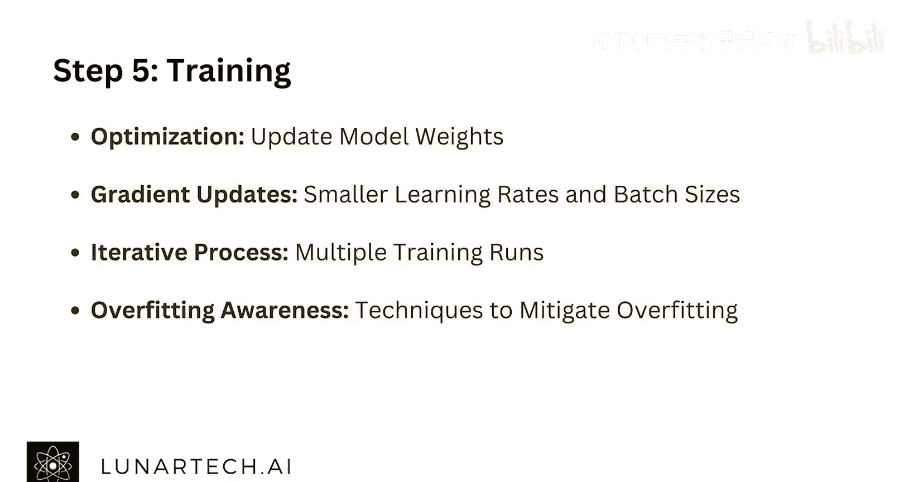

🎼we just discuss and ensuring that the model is not overfitting and only in the very final stage when evaluating the model in this step number six。

 take your test set， this third part of the data set that you haven't used at all in the previous steps and use that to calculate your error that's the most accurate error rate you can use to assess the performance of your large language model that has been fine tune。

🎼So evaluate across various relevant metrics， not just one this will help you to gain a comprehensive understanding of the moral strengths and weaknesses and if you're wondering what kind of metrics you can use and how you can evaluate your large language model then make sure to check the module that is dedicated for evaluating large language models because we go into the depth of these different metrics you need to use not just the common metrics like the classification or test specific metrics but also many other things that you need to be aware like the toxicity of your large language model。

 the truthfulness etc those are metrics that usually you won see in the traditional machine learning because we are used to using a score recall etc just to use as the classification model but in case of large language model the story is different you need to be aware of many other metrics and check your model for those Hi there and welcome back。

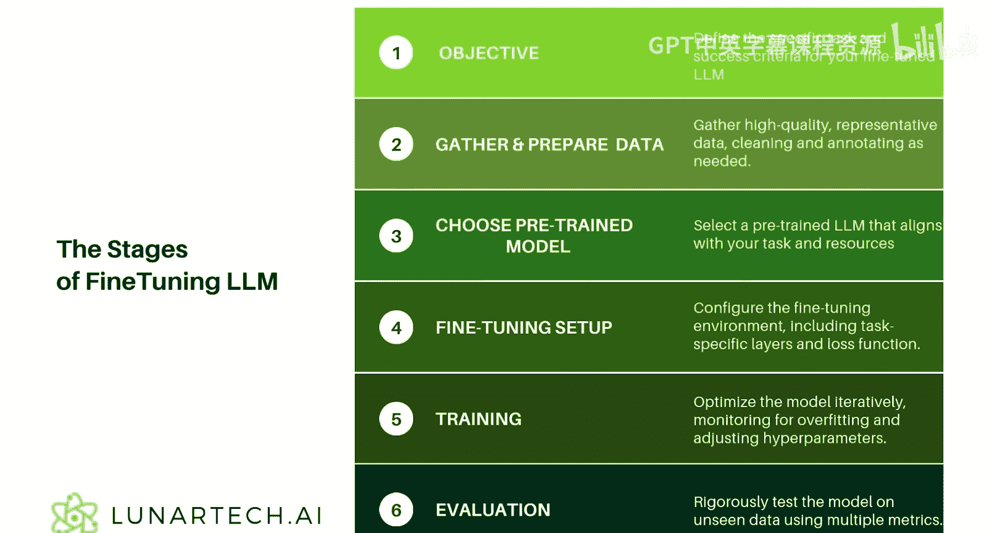

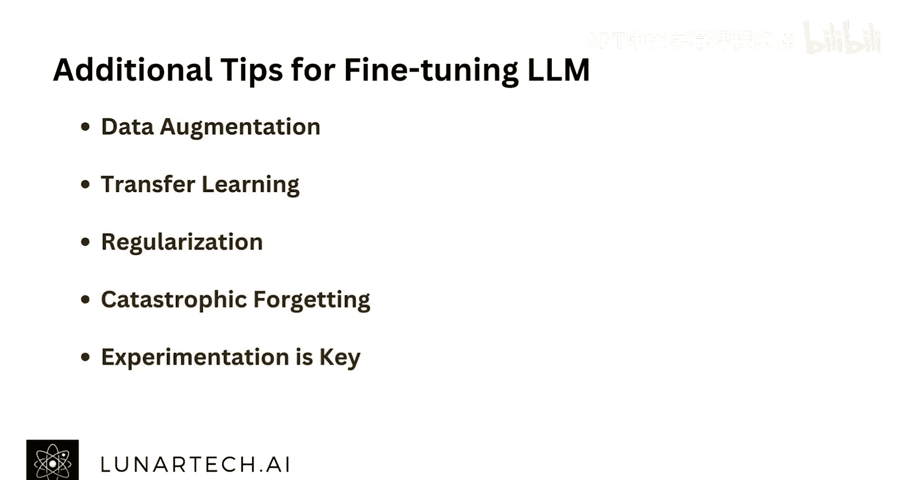

🎼Now talk about ways you can fine tune a large language model There are three ways of fine tuning large language models The first one is the supervised fine tuning here we use label data consisting of input output pairs and we are letting the model to learn to produce the correct outputs when given similar inputs。

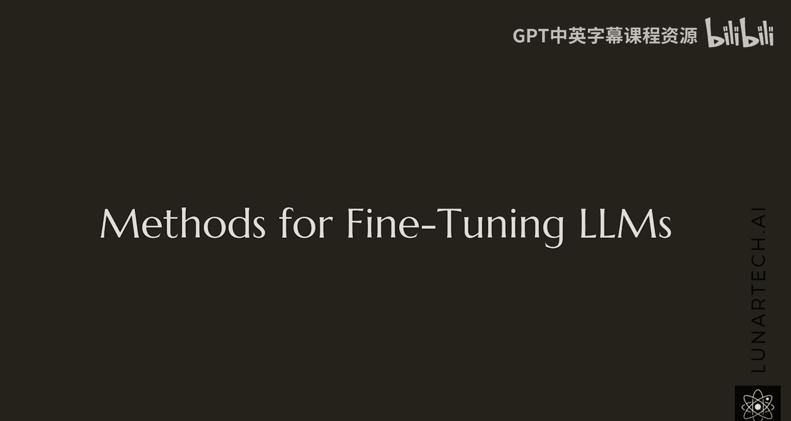

🎼Another way of fine tuning large language model is a self-supervised learning self-supervised fine tuning This method involves training the model on a large corpus of text to predict parts of the data based on other parts it's like taking a sequence of text and having the model to predict what comes next So the idea of generating the next part Third way of fine tuning large language model is the reinforcement learning with human feedback or in short RLHF this method uses a human feedback to finet the modelss responses Let's first talk about supervised fine tuning of large language models This is a technique that helps our model to become smarter by learning from labeled data So what is labeled data it's simply a collection of examples where we know the correct answer We have the input and the expected output。

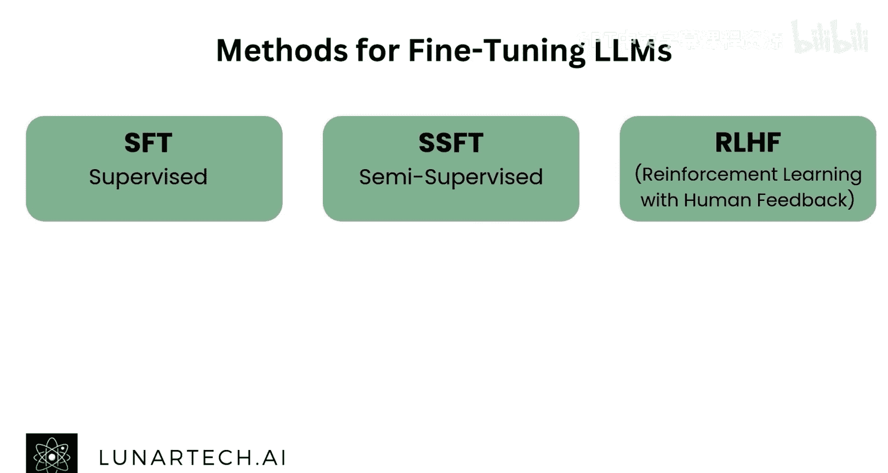

🎼For instance， if we have a piece of text that we want to categorize then the data would be existing from different text and the corresponding correct category or correct label for it the idea behind SFT is pretty straightforward we want our model to learn from the given examples that we provide so it can make accurate predictions when it encounters a new uneen data next time。

🎼Think of it like teaching a child you recognize objects you show them a picture of an apple and tell them this is an apple then you show a picture of a table and you say well this is a table。

🎼After enough examples， the child can recognize apples on their own。

 the child can also recognize the umbrella as an umbrella and newer objects， newer data points。

🎼So let us actually apply the supervised fine tuning in terms of its idea and understand its supervised fine tuning in different sorts of tasks first up we have semantic analysis so let's start with this one。

🎼This is a task where we are trying to figure out if a piece of text expresses a positive， negative。

 or ana sentiment。🎼Imagine we have a data set of movie reviews each review is labeled with the sentiment that it expresses for example。

 a movie was fantastic， is labeled as positive and if we have input that I hated the plot and the acting was terrible。

 then of course the output should be negative。

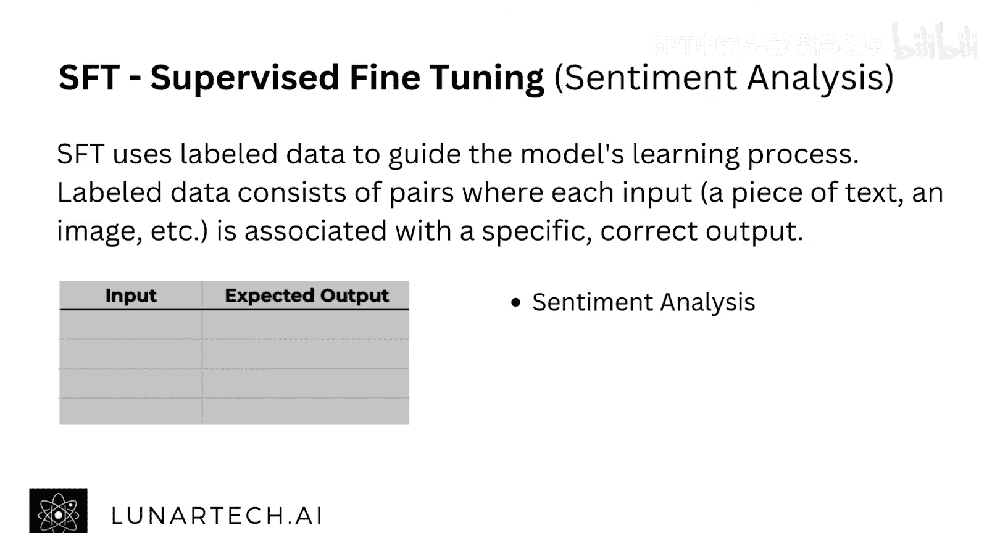

🎼If we have， it was an average for a film and nothing special， then the output， the label is natural。

 If the input is the sound trick was beautiful， but the story was boring， then the output is mixed。

 So this is then our。🎼Lbel。🎼Then we have absolutely loved it。 a must watch。

 So the output here is positive。

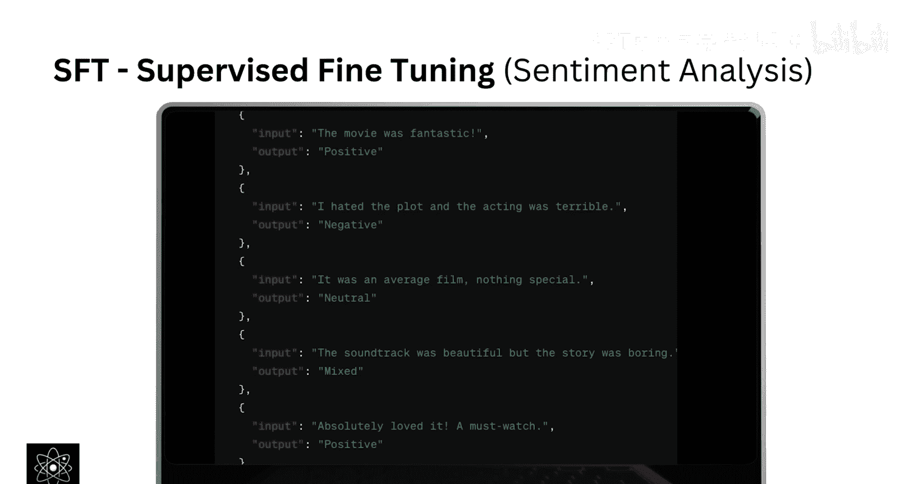

🎼So this is basically the idea behind a type of data that you should provide to your fine tuning model such that it can fine tune the base large language model。

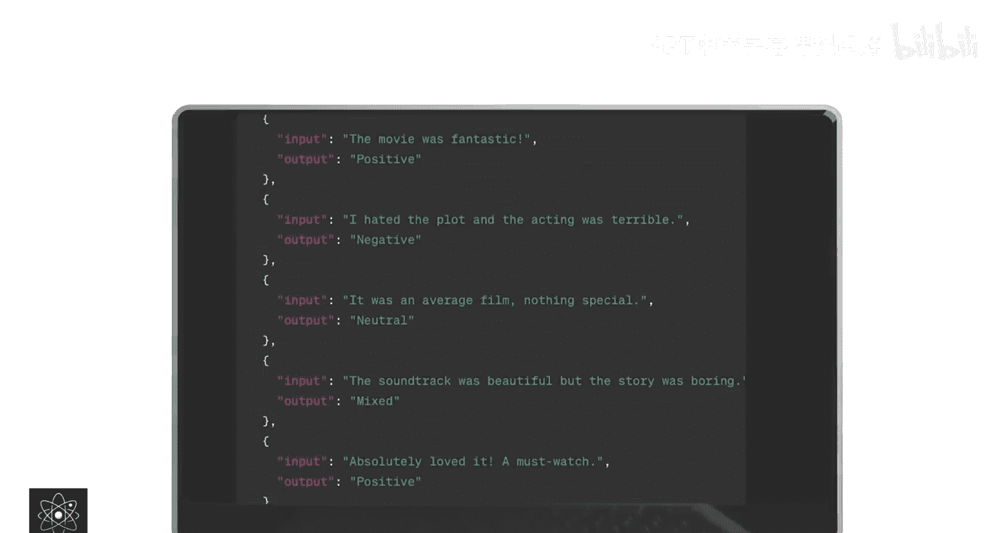

🎼Now in another task， let's say you have text that you want to classify with this SFT the idea is that you will need to categorize this text。

 these documents into predefined categories， so the text classification would then have this type of data ingested into the model that we want to fine tune。

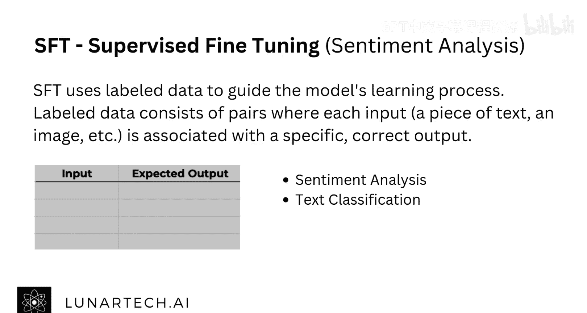

🎼So in here you can see that the input is something like the stock market experienced a significant drop today and then the corresponding class is its finance related topic。

🎼Then we have the football match last night was shing and ended in dat so then the output is sports so we are basically classifying by providing the labels for each of these text in terms of the topic that they represent or the field。

🎼Another one is a new species of bird was discovered in the Amazon Rainforest then the output that the model should provide is science another example that we are providing to the model to learn from is that if the input is the latest smartphone model has several new features then the corresponding output is technology and so on you get the idea so the idea is that we need to put our data for our fine tuning process in this format with the input in the corresponding classes predefined classes and then we will ask the model during the fine tuning process to as accurately as possible classify the newer observations to the corresponding categories another example of tasks that we might want to perform during the fine tuning process is question answering。

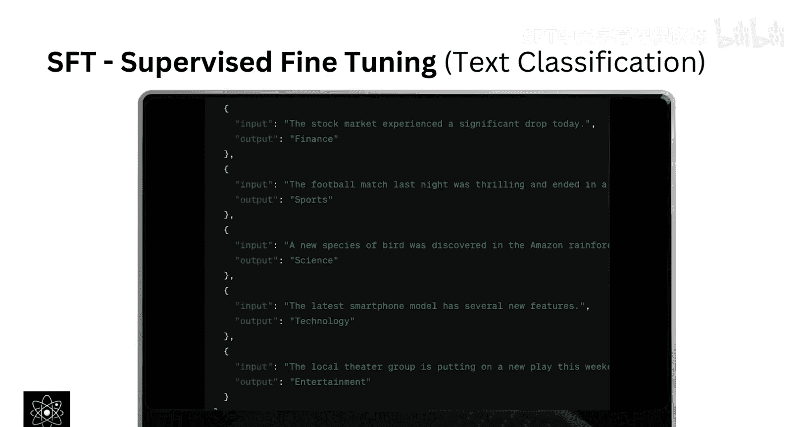

🎼So let's talk about this one as is a very important application of generative AI models and large language models。

🎼This task involves providing this precise answers to the questions based on a given context or knowledge base。

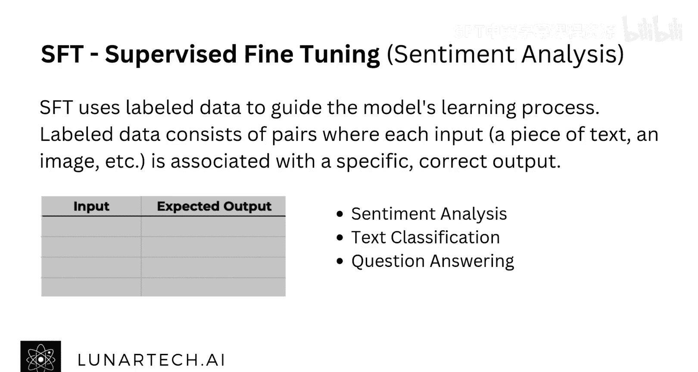

🎼For instance， if we have a data set of this question answer pairs like this one。

 what is the capital friends， then the right answer for this should be Paris what is the largest planet in our solar system then the answer should be Jupiter when did the Second World War end then the answer should be 945 and so on this is the idea behind this specific data that we need to provide with the input and the expected output to our model to our model that we want to fine tune such that it can correctly understand what are these corresponding outputs and then next time we provide a question it will be able to provide the right answer so we are supervising the process by providing this expected outputs that will supervise the model is pretty much like when we have in traditional machine learning features that are representing the X and then the corresponding y which is our dependent variable that correspond。

🎼To each of these observations so we know for a set of features what is the corresponding response variables value in the same way we have this input and the corresponding output and this output will then supervise the training process during this fine tuning stage because fine tuning is nothing but just a second layer of training of the pretrained large language model let's now talk about another type of fine tuning technique which is the selfsvised fine tuning。

🎼So this is an important technique that is in short called SSFT。

🎼And this method is quite powerful and interesting because it doesn't rely on unlabeled data like the supervised fine tuning does Instead it uses unlabeled data to improve aor's language understanding and generation capabilities。

🎼So the SSFT works similarly to how the foundation large language models are trained The key idea here is to leverage the fast amount of unlabeled text data that is available there and contains a lot of good information。

🎼So imagine you are reading a book and you are trying to guess what the next word will be by consistently making this predictions of this next word you will then get a better idea and better understanding of the language this is essentially what the SSFT does。

🎼So the way it works is that it first takes this large corpus of text。

🎼And then the next thing it does is that the model is trained in a self supervised manner。

🎼Meaning it learns to predict the parts of the text based on other parts。

 it doesn't use a labels to supervise a training， it does everything by itself。

 hence the name self supervise， so it's supervising itself by looking at other parts of the text。

🎼For example， if you fit to the model and the sun rises in the。

 then the model will accurately predict that the next word should be the east so then the entire sentence would become the sun rises in the east。

🎼By doing this repeatedly with huge amounts of text。

 the model learns the structure and the patterns of the language。

 so the SSFT or the selfservised fine tuning is incredibly useful because it doesn't require this time consuming and expensive process of labeling data。

🎼So we just so that in case of supervised learning supervised fine tuning we need to put our data into the specific format first we need to collect the data and then set it in this format of input and then output and then validate that the data is accurate。

🎼Especially if we want larger data for defined tuning that task can very quickly become a resource habit taskusk and also expensive one instead what we can do is that we can utilize the existing texts that we have available which contains a lot of useful information and we then don't no longer need to spend our time on labeling the data。

🎼So this process is then much more scalable we don't need to label every time the data instead in a scalable way we can fine tune the model and this also an efficient method for improving this general language understanding and generation of this text this approach allows us to fine tune the model to align with specific applications by curating this training corpus accordingly so just to sum up the self-supvised fine tuning the SSFT is a fantastic approach for enhancing a model's language skills without the need for the label data unlike the supervised fine tuning tasks and by predicting the parts of the data based on other parts the model becomes better at understanding and generating language this technique is invaluable for the tasks like language modeling where the ability to predict and generate coherent text is really。

🎼Hi there and welcome back Now let's dive into another interesting and popular fine tuning approach called reinforcement Learn with human feedback or AL HF。

😊，🎼So this one is used for fine tuning by many cutting E tech companies including Open AI to fine tune their generative AI models including the GT4 and GT4。

0 recently released。🎼So this method uses the human feedback to guide the model's learning process。

 aligning it with human preferences and improving its performance on various tasks so the intuition behind the airLHF so the reinforcement learning with human feedback is the following。

🎼The core idea of this technique， this fine technique。

 is to have human reviewers to evaluate the quality of the model's output。

🎼Their feedback is then used to adjust the model's behavior。

 making it more aligned with what humans consider to be good or useful response this approach is particularly valuable for the task that require a high degree of safety。

 accuracy and user satisfaction。😊。

🎼So when it comes to the reinforcement learning with human feedback。

 this technique is where humans help to improve the AI by giving the feedback on its responses。

 so this feedback guides than the model to generate better， more accurate and safer answers。

🎼First of all， the AirLHF helps you make the conversations engaging and informative。

🎼So here the goal is to make AI responses engaging and highly informative。

🎼The process is that that the human reviews will then rate the AI responses based on how interesting and informative they are。

🎼The feedback then helps the moral to produce better conversations over time。

And the AI becomes excellent at having natural， engaging conversations that user love。

🎼Another benefit of RLHF is that it ensures that the answers are accurate。

 so it ensures that the AI gives accurate and helpful answers The reviewers check the AI's responses for the correctiveness and the relevance their feedback is then being used to fine tune the model so in this way the generative AI model is improving itself by providing more and more precise and useful answers to the user boosting the user trust so next let's discuss very quickly about following the instructions safely and correctly so having the AI following user instructions accurately and safely。

 the human feedback then teaches the AI to follow certain directions precisely assuming that then the humans will provide the save and accurate instructions so reviewers ensure that the model adheres to the instructions and perform the tasks safely。

🎼And the outcome is that the AI model becomes reliable in executing tasks exactly as instructed。

 enhancing the safety and accuracy。🎼There is however drawback here because if the intention of the reviewer is a bad one then the model will also become inherently unsafe。

 therefore it's really important to know the reviewers to select them and to ensure that they are not on the wrong side of the story so another thing that I didn't mention here on the slide specifically but I still wanted to mention is performing the specific tasks。

🎼So this enables the AI to carry out specific tasks as instructed， this specific fine tu approach。

 so reviewers provide feedback on how well the AI performs these tasks and this helps the model to learn the correct way to execute them。

🎼So by using this reinforcement learning with human feedback。

 the AI gets better at understanding and performing these different sorts of tasks。

 making it more versatile and useful， so human feedback is really important because it helps to align the Mor's performance with the user expectations and also company's expectations it ensures that the AI outputs are useful。

 are accurate and safe。🎼By involving human reviewers we make continuous improvements to our models performance This is just a highleve information just to keep in mind that the human feedback is really important when it comes to developing and fine using large language models so human feedback is key to enhancing generative AI models and applications like the chatGBT and instruct GT so here's an example of chat GBT and here the process of the reviewers would be pretty much the same as you can see on the screen so providing the instructions asking what the model should do and then once the reply is provided then the human reviewer can evaluate whether this is good or it needs to improve the prompt or it needs to provide some better instructions and that's the idea behind the reinforcement learning with human feedback so in here you can see that I'm mentioning remove anything that might sound wrong。

🎼orThat might be just too much in the professional setting and be professional so in this way I'm making the model to be more accurate to not provide unprofessional language and to ensure that this is just not too much and you can see that here I'm also providing more improvement points saying improve your tone you are too formal so kind of helping the model to understand this middle ground between too formal and informal。

🎼So the same also holds in the instruct GT this is by the way from the Open AIs official website describing the instruct GT and the Open AI is integrating this idea of reinforcement learning with human feedback heavily both in chatGT and in this instruct GBT and by integrating human insights they ensure that the models that they have can engage in meaningful conversations providing accurate information and also they follow instructions that the company is providing Of course here we are assuming that the company is providing accurate instructions to ensure that everything goes according to the safety guidelines and according to the law so here is a simplified process of how reinforcement learning with human feedback is applied First up we have the supervised fine tuning This process begins with supervised fine tuning something that we just discussed where the model is trained。

🎼C this collected dataset that consists of input output pairs This helps the model to learn from examples The next step is to train a reward model so human reviewers evaluate the outputs that are generated by the model from the previous step and then they are ranking this outputs from worst to best This ranking is then used to train a reward model which then assign scores to the quality of the model's responses obviously the ones with high quality will then get so called candy so they will get a high score versus the ones of bad quality will get a low score so in this way we can then teach to the model what is right and what is wrong Next what we have is the third section third step。

 which is the reinforcement learning so the fineitude model is then further optimized using this reinforcement learning algorithm。

🎼So here we can use things like the proximal policy optimization， the PPO。

 and this is a common policy that is used also across many cutting Getch companies and the idea is that the model will then provide feedback to be fine tuned guiding it to improve its performance continuously so it will continuously improve the model performance。

🎼So reinforcement learning with PPO this proximal policy optimization involves these three to four steps that will go in a bit and the several steps where a model learns from interactions with an environment using this feedback to improve its performance so next up we have the reinforcement learning the fine tuneed model is further optimized using a reinforcement learning algorithm such as the proximal policy optimization or the PPO so PPO is a popular reinforcement algorithm that is also used as the fundamental part of the fine tuning process by cutting edge companies like the OpenAI to optimize the model the reward model provides this feedback to the fine tuneed model guiding it to improve its performance continuously so think about every time when the model is doing something and human evolve。

🎼provides a score so saying this is a good answer， this is a bad answer。

 then this feedback is being used as part of the reinforcement learning to then in the next step improve the accuracy of the model pretty much like the。

🎼In case of the boosting algorithms when the model continuously assess where the model was able to accurately predict the classes and where not。

 and then it would also focus on improving those incorrectly classified observations so in this way the model can continuously improve itself。

🎼The reinforcement learning with PPO or the proximal policy optimization involves several steps where a model learns from the interactions with an environment using this feedback。

 this course to improve its performance so here is how it works in more detail。

🎼First we have the prompt， the process starts with this prompt or an input to the model。

🎼Then we have the model response so the model generates a response based on the prompt。

 then this response is evaluated by a reward model which assigns a score based on the quality of the response。

🎼And then in the final step， we have the PPR algorithm， the proximal policy optimization algorithm。

 which is used to adjust the model based on the feedback from the reward model。

 optimizing its parameters to improve these future responses。

🎼So you can see that with these arrows once we go onto the reinforcement learning algorithm it provides us a feedback and this feedbacks is then going back into the model and then it improves itself every time so this is basically the highleve idea of the reinforcement learning with human feedback as you can imagine this is much more powerful as a fine tuning technique than just the supervised fine tuning which on itself can be used as a separate type of fine tuning technique but when you have the reinforcement learning with human feedback you are adding this extra layer of quality on your fine tuning process because then you are involving human feedback and human reviewers that can help to improve the model's accuracy and ensure that the model outputs are relevant are accurate and they are safe that is actually consider an example where the goal is to fine tune edge headbo to provide help。

🎼Customer support responses。🎼So first up， we have the prompt。🎼And the prompt says。

 how do I reset my password？🎼Next up we need to provide this to the model such that the chatbo can generate a response so next step the chatbo generate a response for example it can be you can reset your password by going to the account settings page。

🎼Then next up we have our reward model， the chatbo that generated this。

 next up the human reviewers evaluate this response， they consider the factors like accuracy。

 helpfulness， clarity， safety， and suppose they score this。

 this answer that was provided by chatbo8 out of 10。🎼So this for being accurate and clear。

 but still missing some steps and some important information。

🎼So next up the scores from the human reviewers this8 out of 10 are used to train this reward model this model learns to predict the quality of the responses based on the feedback it's received so based on the feedback that this response is 8 out of 10 then this reward model will be then understanding what kind of information it needs to provide next time so how it can fix the model then the scores this8 out of 10 that was assigned by the human reviewer is used to train this reward model this model learns to predict the quality of responses based on the feedback it receives。

🎼So next up we have the reinforcement learning with the PPO so the PP algorithm is applied to optimize the chatbots responses and here is how it works in more detail so first up the model generates several possible responses to the same prompt the prompt where we were asking how do I reset my password so next we need to do the evaluation and ranking this responses are ranked by the reward model from the best to worst so once the training of the reward model is done next up we need to perform the reinforcement learning with our PPO for example the PP algorithm is then applied to optimize our customer support chatbot's responses。

🎼And the first thing that it will do is that the model generates the several password responses to the same prompt that we provided。

 so how do I reset my password this was the prompt。

🎼Then what the model needs to do is to evaluate and rank these responses are then ranked by the reward model from the best to worse so basically it generates the multiple responses and then in this step we are evaluating this multiple responses and we are ranking them from the best to the worst then the feedback is used to adjust the model's parameters nudging it towards generating higher quality responses in the next steps in the future for example the model might generate additional responses like you can reset your password by clicking on forgot password or on the login page or another one can be to reset your password visit the account settings click on security and then reset your password。

🎼The reward model will then score these responses and the PPR algorithm updates the model to favor the responses similar to the highest scoring ones。

🎼So。🎼As you might have already guessed， this is much more sophisticated approach to fine tune your large language model。

 and it is almost guaranteed that this one will be much better if your human reviewers are doing their work in a proper way compared to just plain supervised fine tuning。

🎼So you might be wondering but why to use exactly this PPO this proximal policy optimization we won't be diving in too much into this as this is out of the scope of our ALM course but this is an important algorithm reinforcement algorithm just to be aware of and if you are interested also you can check our reinforcement learning content。

🎼So why we use the PPO， the proximal policy optimization PPO is preferred because it strikes this right balance between the exploit and exploitation。

 ensuring that the model strikes new responses while improving based on the past feedback。

🎼It adjusts the model gradually， preventing the drastic changes that might degrade the performance of the model so reinforcement learning with PPI is quite powerful and it is using it as detailed human feedback and it is systematically optimizing the algorithm and the moral performance by it ratings through this different prompt and the corresponding responses。

 the feedback loops and then continuously ranking， evaluating these answers and then re-ranking them in this way the model is continuously improving itself and this feedback loop is very important and this then ensures that the model is becoming more aligned with the human preferences and expectations。

🎼So this one is a really powerful technique and the reinforcement learning with human feedback as a fine tuning approach is also a very powerful technique for aligning the models with human preferences。

😊，🎼It enhances the ability of the model to generate accurate， helpful。

 and safe responses by leveraging human judgment to refine and improve the model's behavior continuously。

