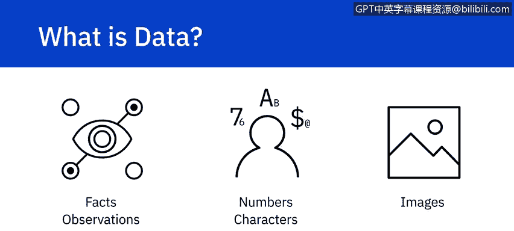
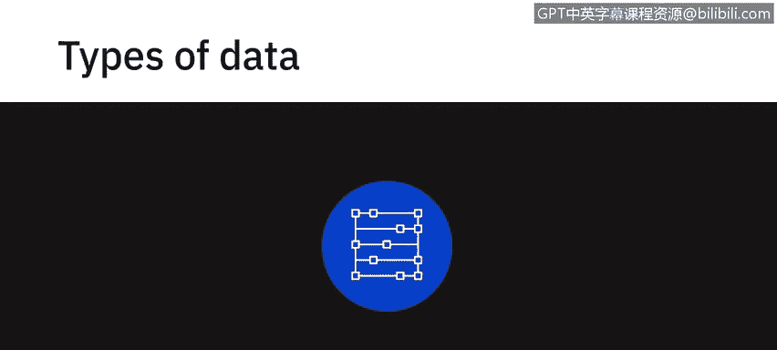
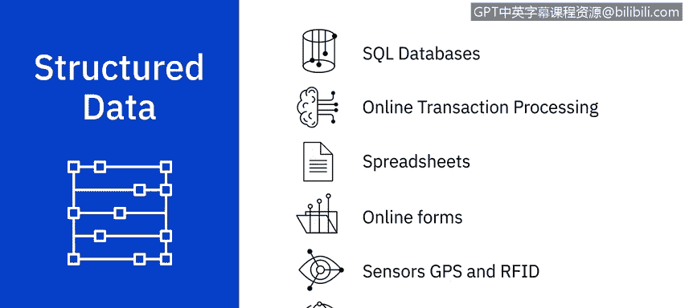
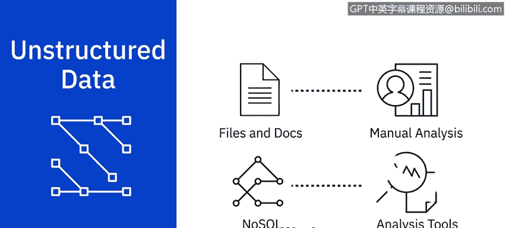
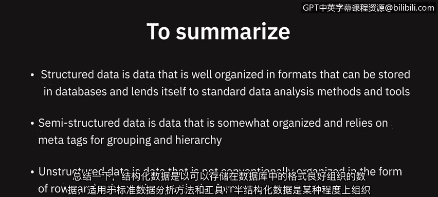
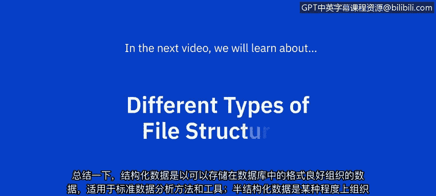

# IBM 数据分析师专业证书课程 1：《数据分析简介》｜introduction-to-data-analytics｜ - P11：10_数据类型.zh - GPT中英字幕课程资源 - BV18P411p7Qj

嗯。Data is unorganized information that is processed to make it meaningful General。

 data comprises of facts， observations， perceptions， numbers， characters。

 symbols and images that can be interpreted to derive meaning one of the ways in which data can be categorized is by its structure data can be structured。

 semistructured or unstructured。

Structured data has a welldefined structure or adheres to a specified data model can be stored in well definedfined schemas such as databases。

 and in many cases can be represented in a tabular manner with rows and columns。

Structured data is objective facts and numbers that can be collected， exported。

 stored and organized in typical databases， some of the sources of structured data could include SQL databases and online transaction processing or OLTP systems that focus on business transaction。

 spreadsheets such as Excel and Google Sheets， online forms。

 sensors such as global positioning systems or GPS and radio frequency identification or RFID tags and network and web server logs。

 you can also easily examine structured data with standard data analysis tools and methods。

Semistructured data is data that has some organizational properties but lacks a fixed or rigid schema semistructured data cannot be stored in the form of rows and columns as in databases。

 it contains tags or elements or metadata which is used to group data and organize it in a hierarchy some of the sources of semistructured data could include emails。

 XML and other markup languages， binary executables， TCP or IP packets。

 zip files and integration of data from different sources XML and J allow users to define tags and attributes to store data in a hierarchical form and are used widely to store and exchange semistructured data。

Unstructured data is data that does not have an easily identifiable structure and therefore cannot be organized in a mainstream relational database in the form of rows and columns；

 it does not have any particular format， sequence， semantics or rules。

Unstructured data can deal with the heterogeneity of sources and has a variety of business intelligence and analytics applications some of the sources of unstructured data could include web pages。

 social media feeds， images and varied file formats such as JPEG， GIF and PNG， video and audio files。

 documents and PDF files， PowerPoint presentations， media logs and surveys。

 unstructured data can be stored in files and documents such as a word document for manual analysis。

 or in no SQL databases that have their own analysis tools for examining this type of data。

To summarize， structured data is data that is well organized in formats that can be stored in databases and lends itself to standard data analysis methods and tools semistructured data is data that is somewhat organized and relies on metatags for grouping and hierarchy。

And unstructured data is data that is not conventionally organized in the form of rows and columns in a particular format。

In the next video， we will learn about the different types of file structures。

