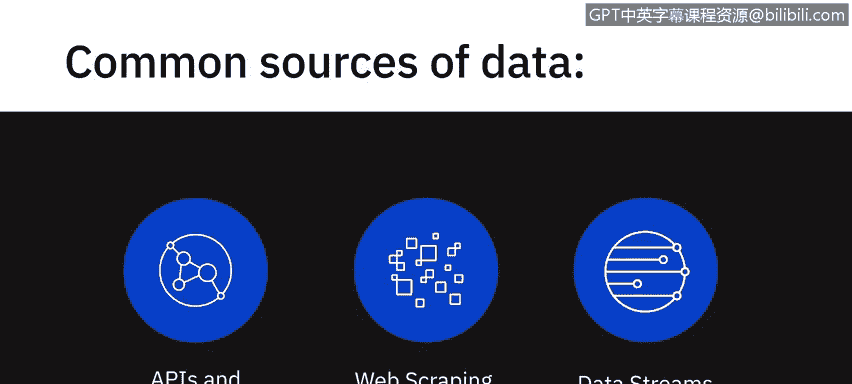
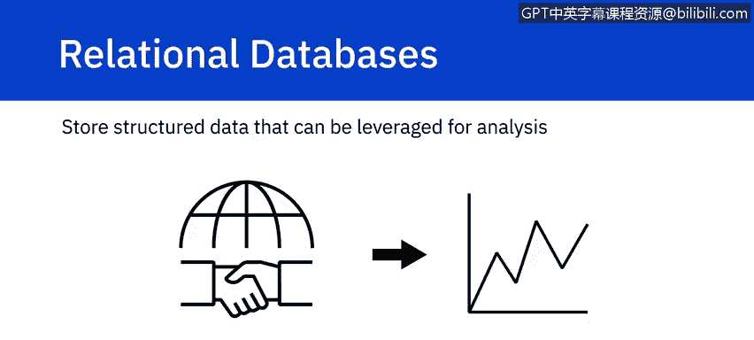
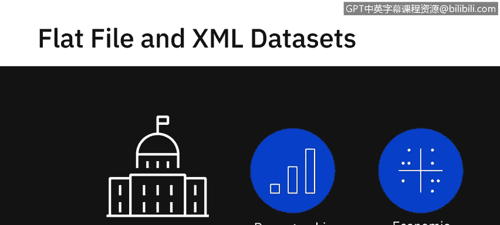
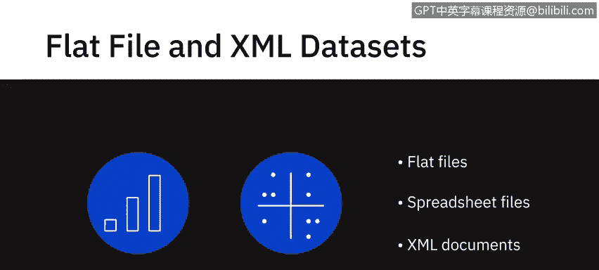
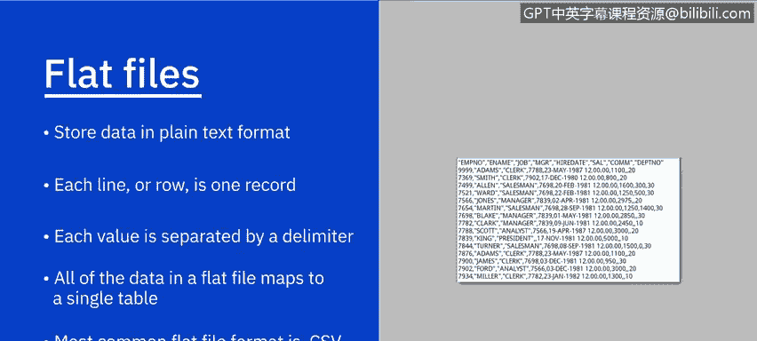
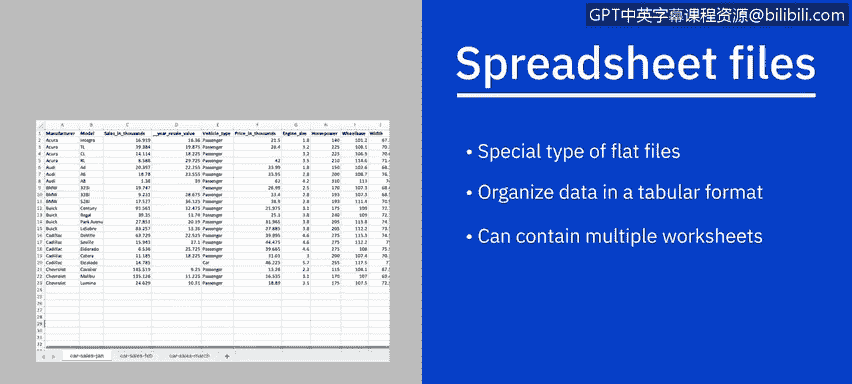
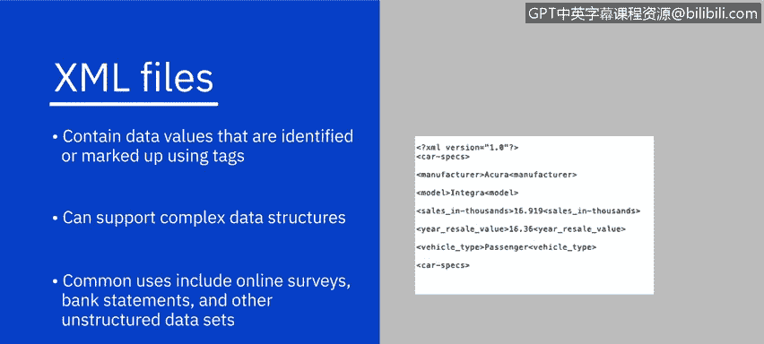
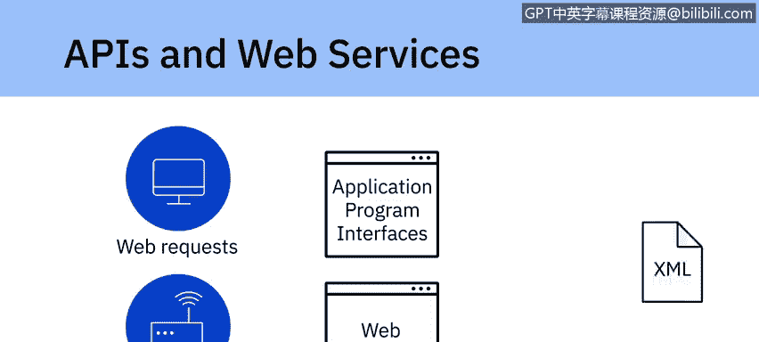
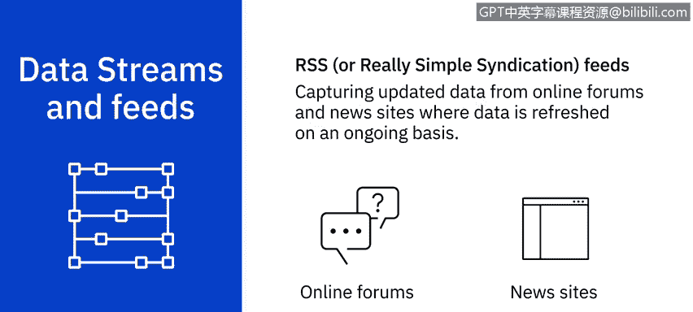

# IBM 数据分析师专业证书课程 1：《数据分析简介》｜introduction-to-data-analytics｜ - P13：12_数据来源.zh - GPT中英字幕课程资源 - BV18P411p7Qj

As we touched upon in one of our previous videos， data sources have never been as dynamic and diverse as they are today In this video we will look at some common sources such as relational databases。

 flat files and XML datas， APIs and web services。Web scraping。Data streams and feeds。

Typically， organizations have internal applications to support them in managing their day to day business activities。

 customer transactions， human resource activities， and their workflows。

These systems use relational databases such as SQL Server， Oracle， MySQL。

 and IBM DB2 to store data in a structured way。Data stored in databases and data warehouses can be used as a source for analysis。

 For example， data from a retail transaction system can be used to analyze sales in different regions and data from a customer relationship management system can be used for making sales projections external to the organization。

 there are other publicly and privately available data sets。 For example。

 government organizations releasing demographic and economic data sets on an ongoing basis Then there are companies that sell specific data。

 For example， point of sales data or financial data or weather data。

Which businesses can use to define strategy， predict demand。

 and make decisions related to distribution or marketing promotions among other things？

Such data sets are typically made available as flat files， spreadsheet files， or XML documents。

Flat files store data in plain text format with one record or row per line。

 and each value separated by delimiters such as commas， semicolonons， or tabs。

Data in a flat file maps to a single table， unlike relational databases that contain multiple tables。

One of the most common flat file formats is CSV in which values are separated by commas。

Spreadsheet files are a special type of flat files that also recognize data in a tabular format。

 rows and columns， but a spreadsheet can contain multiple worksheets。

 and each worksheet can map to a different table。Although data in spreadsheets is in plain text。

 the files can be stored in custom formats and include additional information such as formatting。

 formulas， etc。

Microsoft Excel， which stores data in an XLS or XLSX format， is probably the most common spreadsheet。

Others include Google Sheets， Apple numbers， and Libre Office。

XML files contain data values that are identified or marked up using tags。

 while data in flat files is flat or maped to a single table。

XML files can support more complex data structures such as hierarchical。

Some common uses of XML include data from online surveys， bank statements。

 and other unstructured data sets。

Many data providers and websites provide APIs or application program interfaces and web services which multiple users or applications can interact with and obtain data for processing or analysis。

APpis and web services typically listen for incoming requests。

 which can be in the form of web requests from users or network requests from applications。

 and return data in plain text， XM， HTML， JON or media files。

Let's look at some popular examples of APIs being used as a data source for data analytics。

The use of Twitter and Facebook APIs to source data from tweets and posts for performing tasks such as opinion mining or sentiment analysis。

 which is to summarize the amount of appreciation and criticism on a given subject such as policies of a government。

 product， a service， or customer satisfaction in general。

Stock market APIs used for pulling data such as share and commodity prices， earnings per share。

 and historical prices for trading and analysis。Data lookup and validation APIs。

 which can be very useful for data analysts for cleaning and preparing data。

 as well as for co-re data， for example， to check which city or state a postal or zip code belongs to。

APpis are also used for pulling data from database sources within and external to the organization。

Web scraping is used to extract relevant data from unstructured sources。

 also known as screen scraping， web harvesting and web data extraction。

 web scraping makes it possible to download specific data from web pages based on defined parameters。

Webscrapers can， among other things， extract text， contact information， images， videos。

 product items and much more from a website， some popular uses of webs scraping include collecting product details from retailers。

 manufacturers and e-commerce websites to provide price comparisons。

 generating sales leads through public data sources。

 extracting data from posts and authors on various forms and communities and collecting training and testing data sets from machine learning models。

😊，Some of the popular web scraping tools include beautiful soup， and scrapy， pandas， and selenium。

Data streams are another widely used source for aggregating constant streams of data flowing from sources such as instruments。

 IoT devices and applications， GPS data from cars， computer programs。

 websites and social media posts This data is generally timestamped and also geotagged for geographical identification。

Some of the data streams and ways in which they can be leveraged include stock and market tickers for financial trading。

 retail transaction streams for predicting demand and supply chain management。

 surveillance and video feeds for threat detection。Social media feeds for sentiment analysis。

 sensor data feeds for monitoring industrial or farming machinery。

 webcl feeds for monitoring web performance and improving design and real time flight events for rebooking and rescheduling。

Some popular applications used to process data streams include Apache Kafka， Apache Spar streaming。

 and Apache Storm。RSS or really simple syndication feeds are another popular data source。

 These are typically used for capturing updated data from online forums and new sites where data is refreshed on an ongoing basis。

Using a feed reader， which is an interface that converts RSS text files into a stream of updated data。

 updates are streamed to user devices。

