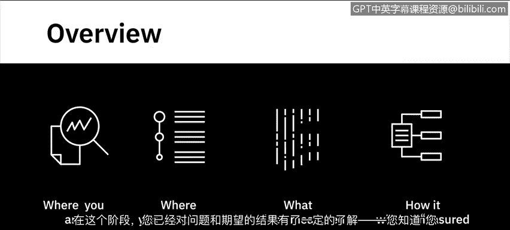
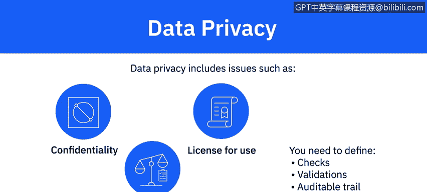
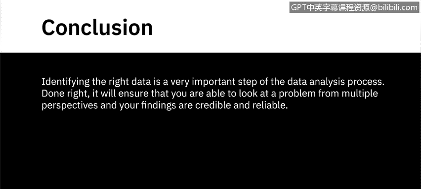

# IBM 数据分析师专业证书课程 1：《数据分析简介》｜introduction-to-data-analytics｜ - P21：20_识别分析数据.zh - GPT中英字幕课程资源 - BV18P411p7Qj

嗯。At this stage， you have an understanding of the problem and the desired outcome。

 you know where you are and where you want to be。 You also have a well defined metric。

 You know what will be measured and how it will be measured。

 The next step is for you to identify the data you need for your use case。

The process of identifying data begins by determining the information you want to collect In this step。

 you make decisions regarding the specific information you need and the possible sources for this data。

 Your goals determine the answers to these questions。

 Let's take the example of a product company that wants to create targeted marketing campaigns based on the age group that binds their products the most。

 Their goal is to design reach outs that appeal most to this segment and encourages them to further influence their friends and peers into bind these products based on this use case。

 Some of the obvious information that you will identify includes the customer profile。

 purchase history， location， age， education， profession， income and marital status。 For example。

 to ensure you gain even greater insights into this segment。

 You may also decide to collect the customer complaint data for this segment to understand the kind of issues they。

Because this could discourage them from recommending your products to know how satisfied they were with the resolution of their issues。

 you could collect the ratings from their customer service surveys， taking this step forward。

 you may want to understand how these customers talk about your products on social media and how many of their connections engage with them in these discussions。

 for example， the likes， shares and comments their posts receive。

The next step in the process is to define a plan for collecting data。

 You need to establish a timeframe for collecting the data you have identified Some of the data you need may be required on an ongoing basis and some over a defined period of time for collecting website visitor data。

 for example， you may need to have the numbers refreshed in real time。

 but if you're tracking data for a specific event。 you have a definitive beginning and end date for collecting the data In this step。

 you can also define how much data would be sufficient for you to reach a credible analysis Is the volume defined by the segment。

 for example， all customers within the age range of 21 to 30 years or a data set of 100000 customers within the age range of 21 to 30。

You can also use this step to define the dependencies， risks。

 mitigation plan and several other factors that are relevant to your initiative the purpose of the plan should be to establish the clarity you need for execution。

The third step in the process is for you to determine your data collection methods In this step。

 you will identify the methods for collecting the data you need。

 You will define how you will collect the data from your data sources you have identified such as internal systems。

 social media sites or thirdparty data providers。 your methods will depend on the type of data。

 the timeframe over which you need the data and the volume of data。

 Once your plan and data collection methods are finalized。

 you can implement your data collection strategy and start collecting data。

 you will be making updates to your plan as you go along because conditions evolve as you implement the plan on the ground。

The data you identify， the source of that data and the practices you employ for gathering the data have implications for quality。

 security and privacy， none of these are one time considerations but are relevant through the life cycle of the data analysis process。

Working with data from disparate sources without considering how it measures against the quality metric can lead to failure in order to be reliable。

 data needs to be free of errors， accurate， complete， relevant and accessible。

 you need to define the quality traits， the metric and the checkpoints in order to ensure that your analysis is going to be based on quality data。

You also need to watch out for issues pertaining to data governance such as security。

 regulation and compliances， data governance policies and procedures relate to the usability。

 integrity and availability of data penalties for noncompliance can run into millions of dollars and can hurt the credibility of not just your findings。

 but also your organization。Another important consideration is data privacy data you collect needs to check the boxes for confidentiality。

 license for use and compliance to mandated regulations， checks。

 validations and an audible trail needs to be planned loss of trust in the data used for analysis can compromise the process result in suspect findings and invite penalties。

Identifying the right data is a very important step of the data analysis process。 done right。

 It will ensure that you are able to look at a problem from multiple perspectives and your findings are credible and reliable。

