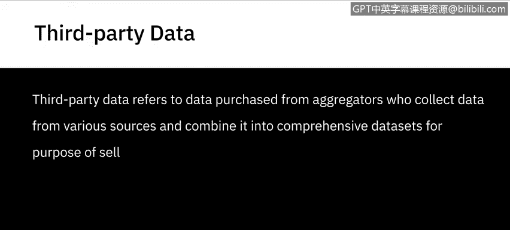
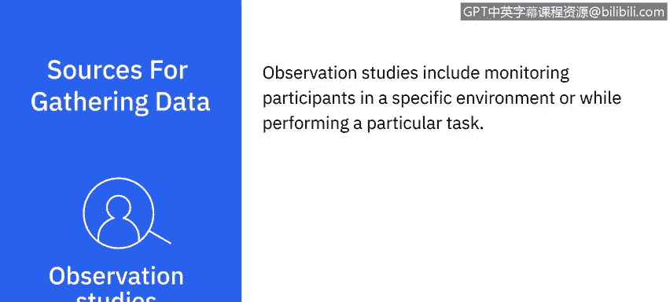
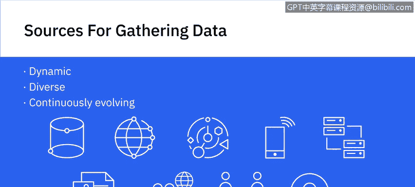

# IBM 数据分析师专业证书课程 1：《数据分析简介》｜introduction-to-data-analytics｜ - P22：21_数据来源.zh - GPT中英字幕课程资源 - BV18P411p7Qj

嗯。Data sources can be internal or external to the organization， and they can be primary。

 secondary or third party sources of data。 Let's look at a couple of examples to understand what we mean by primary secondary and third party sources of data。

 The term primary data refers to information obtained directly by you from the source。

This could be from internal sources such as data from the organization's CRM。

 HR or workflow applications。 It could also include data you gather directly through surveys。

 interviews， discussions， observations and focus groups。

Secondary data refers to information retrieved from existing sources such as external databases。

 research articles， publications， training material and internet searches or financial records available as public data。

 This could also include data collected through externally conducted surveys， interviews， Disc。

 observations and focus groups。Third party data is data you purchase from aggregators who collect data from various sources and combine it into comprehensive data sets purely for the purpose of selling the data。

 Now， we'll look at some of the different sources from which you could be gathering data。

Databases can be a source of primary， secondary and third party data。

 Most organizations have internal applications for managing their processes， workflows and customers。

External databases are available on a subscription basis or for purchase。

 A significant number of businesses have or are currently moving to the cloud。

 which is increasingly becoming a source for accessing realtime information and on demand insights。

 The web is a source of publicly available data that is available to companies and individuals for free or commercial use。

 The web is a rich source of data available in the public domain。 These could include textbooks。

 government records， Pa and articles that are for public consumption。

 Social media sites and interactive platforms， such as Facebook， Twitter， Google。

 YouTube and Instagram are increasingly being used to source user data and opinions。

 Businesses are using these data sources for quantitative and qualitative insights on existing and potential customers。

😊，Censor data produced by wearable devices， smart buildings， smart cities， smart phones。

 medical devices， even household appliances is a widely used source of data。

Data exchange is a source of third party data that involves the voluntary sharing of data between data providers and data consumers。

 Individuals， organizations and governments could be both data providers and data consumers。

 The data that is exchanged could include data coming from business applications。 sensoror devices。

 social media activity， location data or consumer behavior data。

Surveys gather information through questionnaires distributed to a select group of people。

 For example， gauging the interest of existing customers and spending on an updated version of a product。

 Surveys can be web or paper based。 Census data is also a commonly used source for gathering household data。

 such as wealth and income or population data， for example。

Interviews are a source for gathering qualitative data。

 such as the participants's opinions and experiences。 For example。

 an interview conducted to understand the day to day challenges faced by a customer service executive。

Interviews could be telephonic over the web or face to face。

 observation studies include monitoring participants in a specific environment or while performing a particular task。

 For example， Observing users navigate an e-commerce site to assess the ease with which they are able to find products and make a purchase Data from surveys。

 interviews and observation studies could be available as primary， secondary and third party data。

 Data sources have never been as dynamic and diverse as they are today。

 Theyre also evolving continuously。 Smenting your primary data with secondary and third party data sources can help you explore problems and solutions in new and meaningful ways。

😊。

