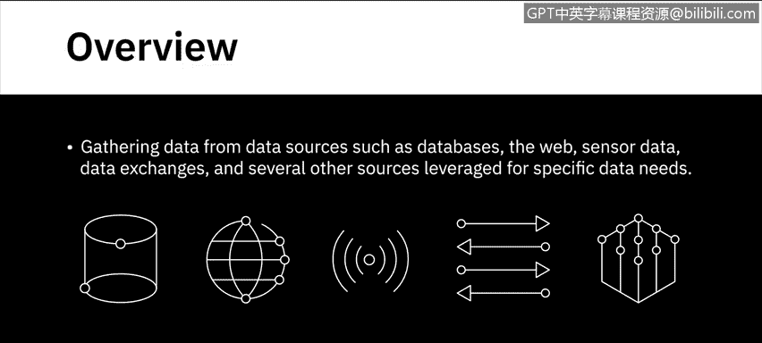
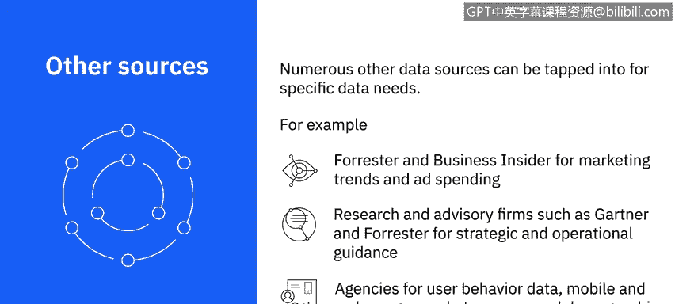
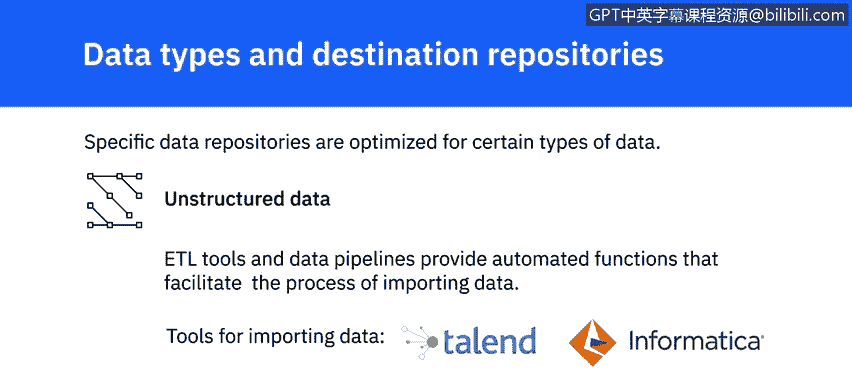

# IBM 数据分析师专业证书课程 1：《数据分析简介》｜introduction-to-data-analytics｜ - P23：22_如何收集和导入数据.zh - GPT中英字幕课程资源 - BV18P411p7Qj

嗯。In this video we will learn about the different methods and tools available for gathering data from the data sources discussed earlier in the course。

 such as databases， the web， sensor data， data exchanges。

 and several other sources leveraged for specific data needs。

We will also learn about importing data into different types of data repositories。

SQL or structured query language is a querying language used for extracting information from relationlational databases。

 SQL offers simple commands to specify what is to be retrieved from the database。

 the table from which it needs to be extracted， grouping records with matching values dictating the sequence in which the query results are displayed and limitminating the number of results that can be returned by the query amongst a host of other features and functionalities。

Non relational databases can be queried using SQL or SQL like query tools。

 some nonreal databases come with their own querying tools such as CQL for Cassandra and GraphQL for Neo4j。

Application programming interfaces or APIs are also popularly used for extracting data from a variety of data sources。

APpiIs are invoked from applications that require the data and access an endpoint containing the data。

 endpoints can include databases， web services， and data marketplaces。

APpis are also used for data validation， for example。

 a data analyst may use an API to validate postal addresses and zip codes。Web scraping。

 also known as screen scraping or web harvesting， is used for downloading specific data from web pages based on defined parameters。

 among other things， web scraping is used to extract data such as text， contact information， images。

 videos， podcasts and product items from a web property。

RSS feeds are another source typically used for capturing updated data from online forums and news sites where data is refreshed on an ongoing basis。

Data streams are a popular source for aggregating constant streams of data flowing from sources such as instruments。

 IoT devices and applications and GPS data from cars Data streams and feeds are also used for extracting data from social media sites and interactive platforms。

Data exchange platforms allow the exchange of data between data providers and data consumers。

 Data exchanges have a set of well defined exchange standards。

 protocols and formats relevant for exchanging data。

 These platforms not only facilitate the exchange of data。

 but they also ensure that security and governance are maintained。

 They provide data licensing workflows， deid and protection of personal information。

 legal frameworks and a quarantined analytics environment。

Examples of popular data exchange platforms include AWS Data exchange， CrurunchSpase， Loomy。

 and Snowflake。Numerous other data sources can be tapped into for specific data needs for marketing trends and ad spending。

 for example， research firms like Forester and business Insider are known to provide reliable data。

 research and advisory firms such as Gartner and Forester are widely trusted sources for strategic and operational guidance。

 Similarlyly， there are many trusted names in the areas of user behavior data， mobile and web usage。

 market surveys and demographic studies。

Data that has been identified and gathered from various data sources now needs to be loaded or imported into a data repository before it can be wrangled。

 mindd and analyzed， the importing process involves combining data from different sources to provide a combined view and a single interface using which you can query and manipulate the data。

 depending on the data type， the volume of data， and the type of destination repository。

 you may need varying tools and methods。Specific data repositories are optimized for certain types of data relational databases store structured data with a well definedfin schema。

 If you're using a relational database as the destination system。

 you will only be able to store structured data， such as data from OLTP systems， spreadsheets。

 online forms， sensors， network and web logs， structured data can also be stored in no SQL。

Semistructured data is data that has some organizational properties， but not a rigid schema。

 such as data from emails， XML， zip files， binary executables， and TCP or IP protocols。

Semistructured can be stored in no SQL clusters。 XML and J are commonly used for storing and exchanging semi structured data。

 Jason is also the preferred data type for web services。

Unstructured data is data that does not have a structure and cannot be organized into a schema。

 such as data from web pages， social media feeds， images， videos， documents， media logs and surveys。

 No SQL databases and data lakes provide a good option to store and manipulate large volumes of unstructured data。

 Data lakes can accommodate all data types and schema ETL tools and data pipelines provide automated functions that facilitate the process of importing data Tos such as talent and informatica and programming languages such as Python and R and their libraries are widely used for importing data。

