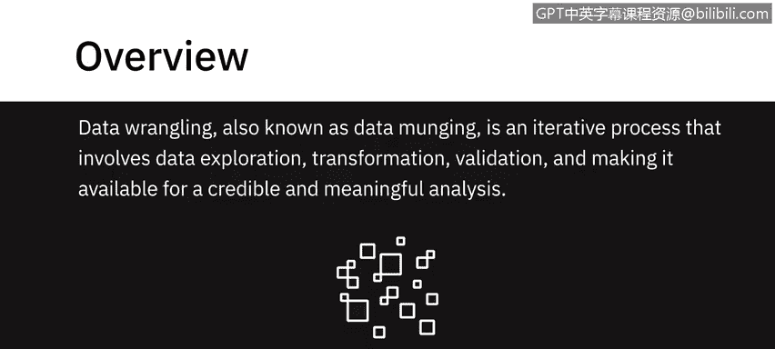
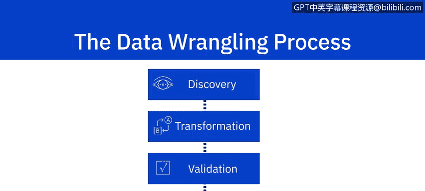
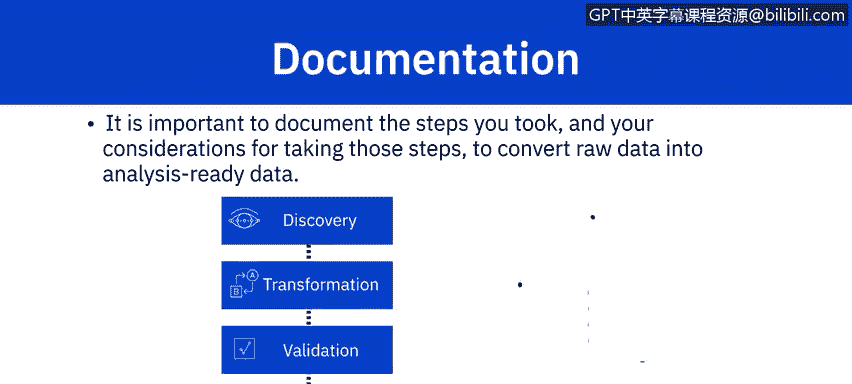

# IBM 数据分析师专业证书课程 1：《数据分析简介》｜introduction-to-data-analytics｜ - P24：23_什么是数据整理.zh - GPT中英字幕课程资源 - BV18P411p7Qj

Data wrangling， also known as data muing， is an iterative process that involves data exploration。

 transformation， validation， and making it available for a credible and meaningful analysis。

It includes a range of tasks involved in preparing raw data for a clearly defined purpose。

 where raw data at this stage is data that has been collected through various data sources in a data repository。

Data wrangling captures a range of tasks involved in preparing data for analysis。 Typically。

 it is a four step process that involves discovery， transformation， validation， and publishing。

The discovery phase， also known as the exploration phase。

 is about understanding your data better with respect to your use case。

 The objective is to figure out specifically how best you can clean， structure。

 organize and map the data you have for your use case。The next phase。

 which is the transformation phase， forms the bulk of the data wrangling process。

 it involves the tasks you undertake to transform the data such as structuring， normalizing。

 deormalizing， cleaning， and enriching the data。Let's begin with the first transformation task structuring This task includes actions that change the form and schema of your data。

 The incoming data can be in varied formats。 You might， for example。

 have some data coming from a relational database and some data from web APIpis。

 in order to merge them。 you will need to change the form or schema of your data。

 This change may be as simple as changing the order of fields within a record or data or as complex as combining fields into complex structures。

Joints and unions are the most common structural transformations used to combine data from one or more tables。

 How they combine the data is different。 Joins combine columns When two tables are joined together。

 columns from the first source table are combined with columns from the second source table in the same row。

 So each row in the resultant table contains columns from both tables。Unions combine rows。

 rows of data from the first source table are combined with rows of data from the second source table into a single table。

 Each row in the resultant table is from one source table or another。

Transformation can also include normalization and denormalization of data。

 normalmalization focuses on cleaning the database of unused data and reducing redundancy and inconsistency。

Data coming from transactional systems， for example， where a number of insert。

 update and delete operations are performed on an ongoing basis are highly normalized。

Deormalization is used to combine data from multiple tables into a single table so that it can be queried faster。

For example， normalized data coming from transactional systems is typically denormalized before running queries for reporting and analysis。

Another transformation type is cleaning。 Cleaning tasks are actions that fix irregularities in data in order to produce a credible and accurate analysis。

 Data that is inaccurate， missing or incomplete， can skew the results of your analysis and need to be considered。

It could also be that the data is biased or has null values in relevant fields or have outliers。

 For example， you may want to find out the demographic information on the sale of a certain product。

 but the data you have received does not capture the gender。

 You either need to source this data point and merge it with your existing data set。

 or you may need to remove and not consider the records with this missing field。

 We will explore many more examples of data cleaning further on in this course。

Enriing the data is the fourth type of transformation When you consider the data you have to look at additional data points that could make your analysis more meaningful。

 you are looking at enriching your data。 For example。

 in a large organization with information fragmented across systems。

 you may need to enrich the data set provided by one system with information available in other systems or even public data sets。

Consider a scenario where you sell I peripherals to businesses and want to analyze the buying patterns of your customers over the last five years。

You have the customer master and transaction tables from where you've captured the customer information and purchase history。

 supplementing your data set with the performance data of these businesses possibly available as a public dataset set could be valuable for you to understand factors influencing their purchase decisions。

Inserting metadata also enriches data。For example， computing a sentiment score from a customer feedback log。

 collecting geo based weather data from a resort's location to analyze occupancy trends or capturing published time and tags for a blog post。

After transformation， the next phase in data wrangling is validation。

This is where you check the quality of the data post structuring， normalizing。

 cleaning and enriching Validation rules refer to repetitive programming steps used to verify the consistency。

 quality and security of the data you have。This brings us to publishing the fourth phase of the data wrangling process Publishing involves delivering the output of the wrangled data for downstream project needs。

What is published is the transformed and validated version of the input data set。

 along with the metadata about the data。Lastly， it is important to note the criticality of documenting the steps and considerations you have taken to convert the raw data to analysis ready data。

 All phases of data wrangling are iterative in nature。

 in order to replicate the steps and to revisit your considerations for performing these steps。

 it is vital that you document all considerations and actions。

