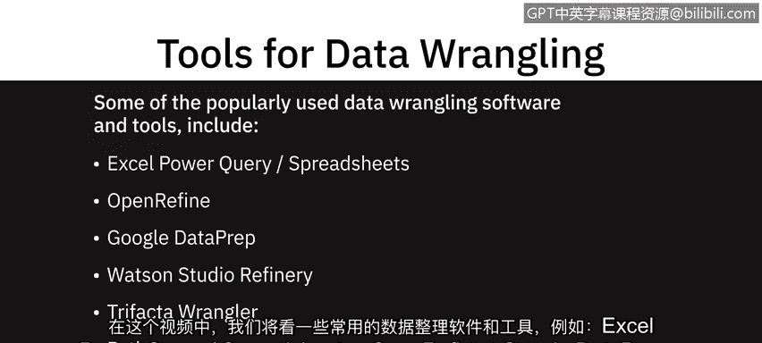
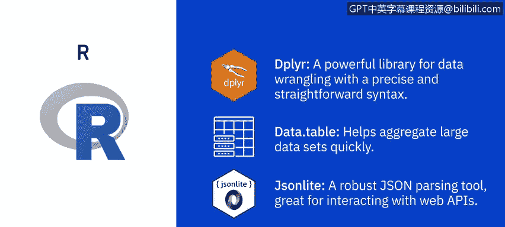
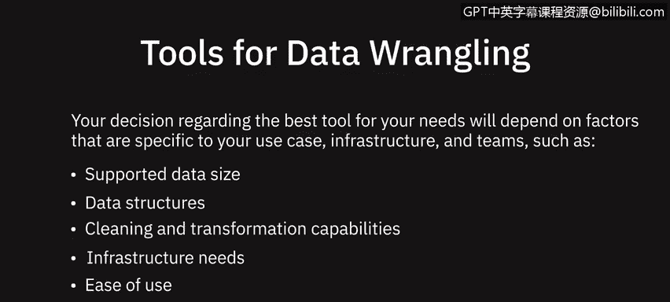

# IBM 数据分析师专业证书课程 1：《数据分析简介》｜introduction-to-data-analytics｜ - P25：24_数据整理工具.zh - GPT中英字幕课程资源 - BV18P411p7Qj

In this video， we will look at some of the popularly used data wrangling software and tools such as Excel Power Queery or spreadsheets。

 OpenRefine， Google Data Prep， Watson Studio Refinery， trifecta wrangler， Python and R。

Let's begin with the most basic software used for manual wrangling spreadsheets。

Spreadsheets such as Microsoft Excel and Google Sheets have a host of features and inbuilt formula that can help you identify issues clean and transform data。

Addds are available that allow you to import data from several different types of sources and clean and transform data as needed。

 such as Microsoft Power Que for Excel and Google Shes query function for Google Sheets。

Open Reffine is an open source tool that allows you to import and export data in a wide variety of formats such as TSV。

 CSV， XLS， XML， and JN。Using Open Refe， you can clean data， transform it from one format to another。

 and extend data with web services and external data。OpenRee is easy to learn and easy to use。

It offers menu based operations， which means you don't need to memorize commands or syntax。

Google Data prep is an intelligent cloud data service that allows you to visually explore。

 clean and prepare both structured and unstructured data for analysis。It is a fully managed service。

 which means you don't need to install or manage the software or the infrastructure。

Data prep is extremely easy to use with every edition that you take。

 you get suggestions on what your ideal next step should be。

 Data prep can automatically detect schemas， data types and anomalies。😊，Watson Studio Refry。

 available via IBM Watson Studio， allows you to discover。

 cleanse and transform data with built in operations。

It transforms large amounts of raw data into consumable quality information that's ready for analytics。

Data Refry offers the flexibility of exporting data resigning in a spectrum of data sources。

It detects data types and classifications automatically and also enforces applicable data governance policies automatically。

Trifacta wrangler is an interactive cloud based service for cleaning and transforming data。

 It takes messy real world data and cleans and rearranges it into data tables。

 which can then be exported to Excel， Tableau and R。😊，It is known for its collaboration features。

 allowing multiple team members to work simultaneously。

Python has a huge library and set of packages that offer powerful data manipulation capabilities。

Let's look at a few of these libraries and packages。

Jupiter Notebook is an open source web application widely used for data cleaning and transformation。

 statistical modeling， also data visualization。Numpy or numerical Python is the most basic package that Python offers。

 It is fast， Ver， Interoperable and easy to use。 It provides support for large multidimensional arrays and matrices and high level mathematical functions to operate on these arrays。

😊，Pands is designed for fast and easy data analysis operations。

 It allows complex operations such as merging， joining and transforming huge chunks of data performed using simple。

 single line commands。 U pandas， you can prevent common errors that result from misaligned data coming in from different sources。

R also offers a series of libraries and packages that are explicitly created for wrangling messy data。

 such as D plier， Data Table and Jason Light。Using these libraries， you can investigate。

 manipulate and analyze data。D plier is a powerful library for data wrangling。

 It has a precise and straightforward syntax。Data table helps you aggregate large data sets quickly。

Jason Light is a robust J parsing tool， great for interacting with Web APIs。😊。

Tools for data wrangling come with varying capabilities and dimensions。

 Your decision regarding the best tool for your needs will depend on factors that are specific to your use case。

 infrastructure and teams， such as supported data size， data structures。

 cleaning and transformation capabilities， infrastructure needs， ease of use and learnability。

