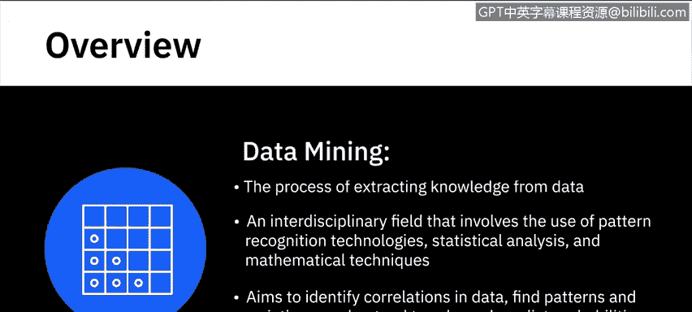
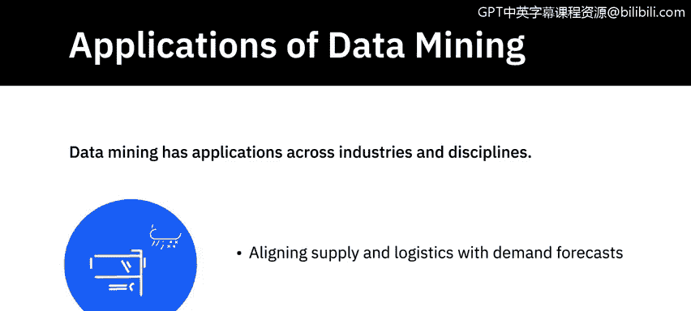
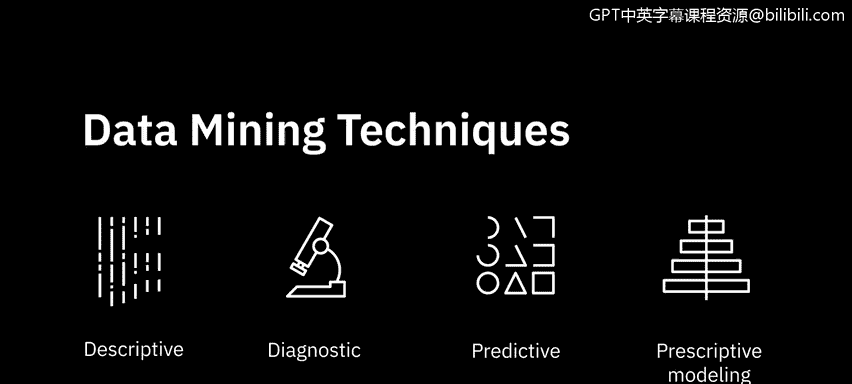
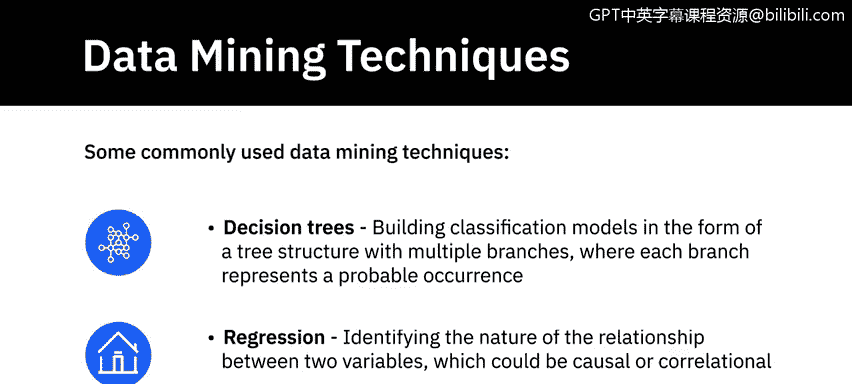
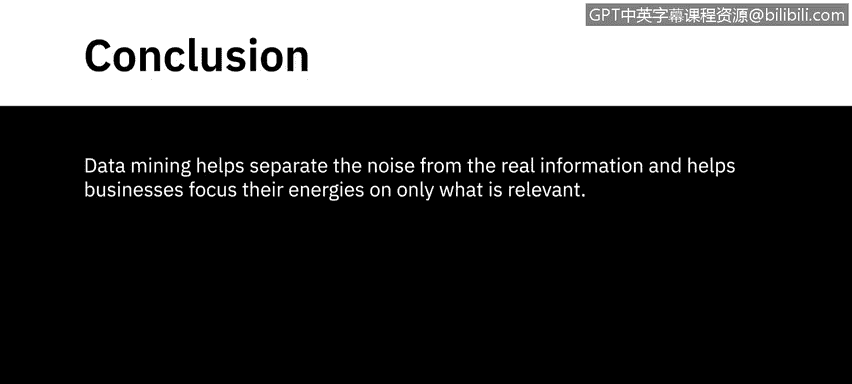

# IBM 数据分析师专业证书课程 1：《数据分析简介》｜introduction-to-data-analytics｜ - P29：28_什么是数据挖掘.zh - GPT中英字幕课程资源 - BV18P411p7Qj

嗯。Data mining or the process of extracting knowledge from data is the heart of the data analysis process。

 It is an interdisciplinary field that involves the use of pattern recognition technologies。

 statistical analysis and mathematical techniques Its goal is to identify correlations in data。

 find patterns and variations， understand trends and predict probabilities。

You'll hear about patterns and trends frequently in the context of data analysis。

 so let's first understand these concepts。Pattern recognition is the discovery of regularities or commonalities in data。

Consider the log data for logins to an application in an organization。

 It contains information such as the username， login time stampamp。

 time spent in each login session and activities performed。

When we analyze this data to gain insights into the habits or behaviors of users， for example。

 the time of the day when maximum users tend to log in or user roles that typically spend the maximum hours logged in the application or modules in the workflow application that are being used。

 we're examining the data manually or through tools to uncover patterns hidden in the data。A trend。

 on the other hand， is the general tendency of a set of data to change over time。For example。

 global warming。In the short term， like a year on year basis。

 temperatures may remain the same or go up or down by a few degrees。

 but the overall global temperatures continue to increase over time， making global warming a trend。

Data mining has applications across industries and disciplines， for example。

 profiling customer behaviors， needs and disposable income in order to offer targeted campaigns。

 financial institutions， tracking customer transactions for unusual behaviors。

 and flagging fraudulent transactions using data mining models。

The use of statistical models to predict a patient's likelihood for specific health conditions and prioritizing treatment。

Accessing performance data of students to predict achievement levels and make a focused effort to provide support where required。

Helping investigation agencies deploy police force where the likelihood of crime is higher and aligning supply and logistics with demand forecasts。

There are several techniques you can use to detect patterns and build accurate models for discovery。

 be it descriptive， diagnostic， predictive or prescriptive modeling。

Let's understand some of the most commonly used techniques。

Classification is a technique that classifies attributes into target categories， for example。

 classifying customers into low， medium or high spenders based on how much they earn。

Clustering is similar to classification but involves grouping data into clusters so they can be treated as groups。

 for example， clustering customers based on geographic regions。

Anomaly or outlier detection is a technique that helps find patterns in data that are not normal or unexpected。

 for example， spikes in the usage of a credit card that can flag possible misuse。

Association rule mining is a technique that helps establish a relationship between two data events。

 for example， the purchase of a laptop being frequently accompanied by the purchase of a cooling pad。

Sequential patterns is the technique that traces a series of events that take place in a sequence。

 for example， tracing a customer shopping trail from the time they log into an online store to the time they log out。

Affinity grouping is a technique used to discover co occurrence in relationships。

 This technique is widely used in online stores for cross selling and upsel their products by recommending products to people based on the purchase history of other people who purchased the same item。

Decision trees help build classification models in the form of a tree structure with multiple branches where each branch represents a probable occurrence。

 This technique helps to build a clear understanding of the relationship between input and output。

Regression is a technique that helps identify the nature of the relationship between two variables。

 which could be causal or correlational。 For example。

 based on factors such as location and covered area。

 a regression model could be used to predict the value of a house。

Data mining essentially helps separate the noise from the real information and helps businesses focus their energies on only what is relevant。

