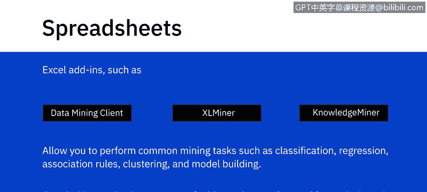
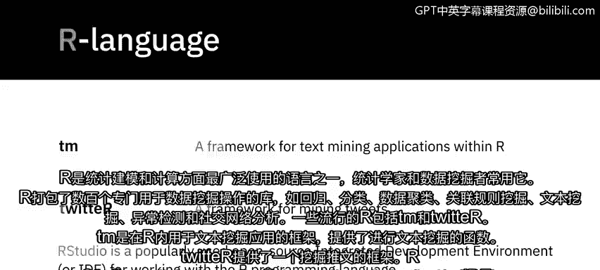
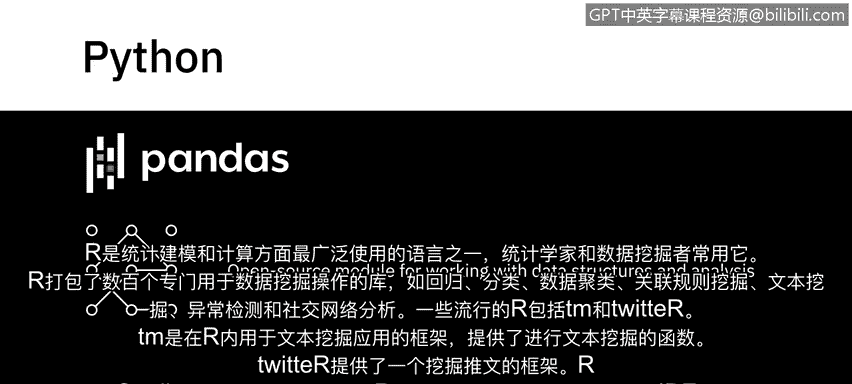
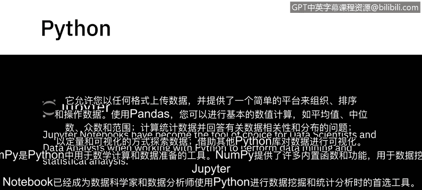
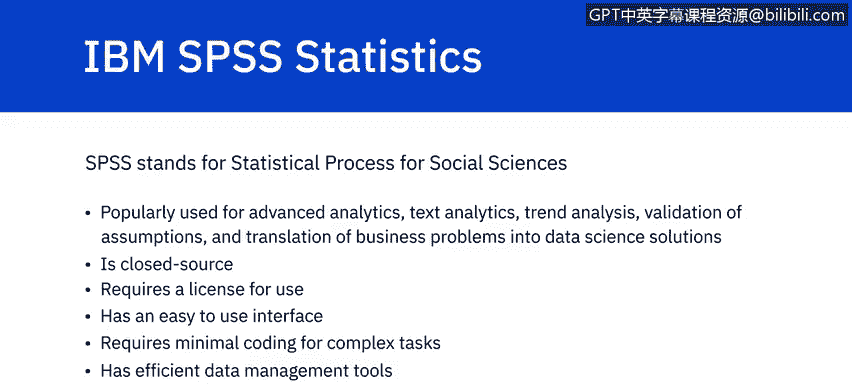
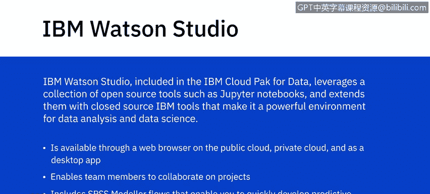
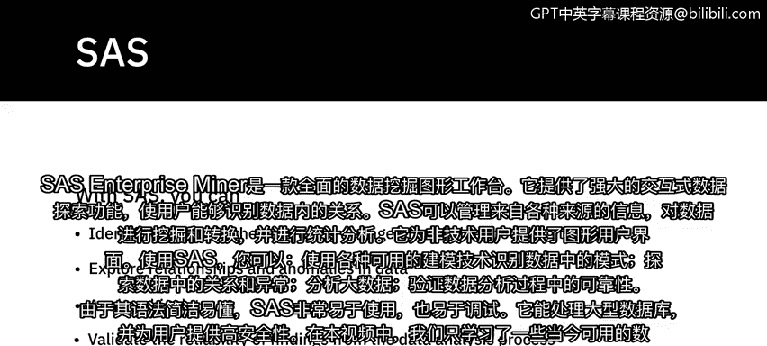
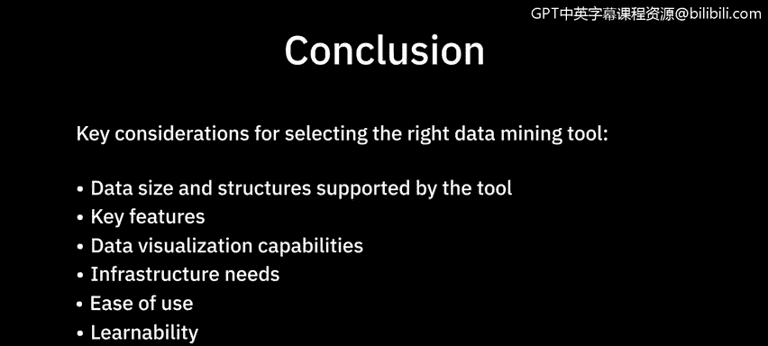

# IBM 数据分析师专业证书课程 1：《数据分析简介》｜introduction-to-data-analytics｜ - P30：29_数据挖掘工具.zh - GPT中英字幕课程资源 - BV18P411p7Qj

嗯。In this video， we will learn about some of the commonly used software and tools for data mining。

 such as spreadsheets， R language， Python， IBM， SPSS Staistics， IBM Watson Studio and SAS。

Spreadsheets such as Microsoft Excel and Google Sheets are commonly used for performing basic data mining tasks Spsheets can be used to host data that has been exported from other systems in an easily accessible and easy to read format。

You can pivot tables to showcase specific aspects of your data。

 which is vital when you have huge amounts of data to sort through and analyze。

 They also make it relatively easier to make comparisons between different sets of data。

Adddents available for Excel， such as the data mining client for Excel。

 Excel Min and Knowledge Minor for Excel allow you to perform common mining tasks such as classification。

 regression， association rules， clustering and model building。

Google Sheets also has an array of addons that can be used for analysis and mining。

 such as text analysis， text mining， and Google Analytics。

R is one of the most widely used languages for performing statistical modeling and computations by statisticians and data miners。

 R is packaged with hundreds of libraries explicitly built for data mining operations。

 such as regression， classification， data clustering， association rule mining， text mining。

 outlier detection and social network analysis。 Some of the popular R packages include TM and Twitter。

😊，TM， a framework for text mining applications within R provides functions for text mining Twitter provides a framework for mining tweets。

 Our studio is a popularly used open source integrated development environment or IDE for working with the R programming language。

Python libraries like Padas and Nmpy are commonly used for data mining。

 Padas is an open source module for working with data structures and analysis。

 It is possibly one of the most popular libraries for data analysis in Python。

 It allows you to upload data in any format。 and provides a simple platform to organize sort and manipulate that data。

 U pandas， you can perform basic numerical computations， such as mean， median， mode and range。

 calculateulate statistics and answer questions regarding correlation between data and distribution of data。

 Expre data visually and quantitatively。 Viize data with help from other Python libraries。

 Numpy is a tool for mathematical computing and data preparation in Python。

 Ny offers a host of built in functions and capabilities for data mining。

Jupiter notebooks have become the tool of choice for data scientists and data analysts when working with Python to perform data mining and statistical analysis。

SPSS stands for Statistical Pros for Social Sciences。

 while the name suggests its original usage in the field of social sciences。

 it is popularly used for advanced analytics， text analytics， trend analysis。

 validation of assumptions， and translation of business problems into data science solutions。

SPSS is closed source and requires a license for use。

 SPSSS has an easy to use interface that requires minimal coding for complex tasks。

 It comprises of efficient data management tools and is popular because of its in- depthepth analysis capabilities and accurate data results。

IBM Watson Studio included in the IBM Cloudpack for data。

 leverages a collection of open source tools such as Jupiter notebooks and extends them with closed source IBM tools that make it a powerful environment for data analysis and data science。

 It is available through a web browser on the public cloud。

 private cloud and as a desktop app Watson Studio enables team members to collaborate on projects that can range from simple exploratory analysis to building machine learning and AI models。

 It also includes SS modeler flows that enable you to quickly develop predictive models for your business data。

😊。

SAS enterprise Min is a comprehensive graphical workbench for data mining。

 It provides powerful capabilities for interactive data exploration。

 which enables users to identify relationships within data。

 SAS can manage information from various sources。 Min and transform data and analyze statistics。

 It offers a graphical user interface for non-technical users With SAS。

 you can identify patterns in the data using a range of available modeling techniques。

 Exp relationships and anomalies in data。 analyzelyze big data validateate the reliability of findings from the data analysis process。

 SAS is very easy to use because of its syntax and is also easy to debug It has the ability to handle large databases and offers high security to its users。

😊。

In this video， we have learned about just a few of the data mining tools available today。

 your decision regarding the best tool for your needs will be driven by the data size and structure the tool supports the features it offers its data visualization capabilities。

 infrastructure needs， ease of use and learnability。

 It's fairly common to use a combination of data mining tools to meet all your needs。

