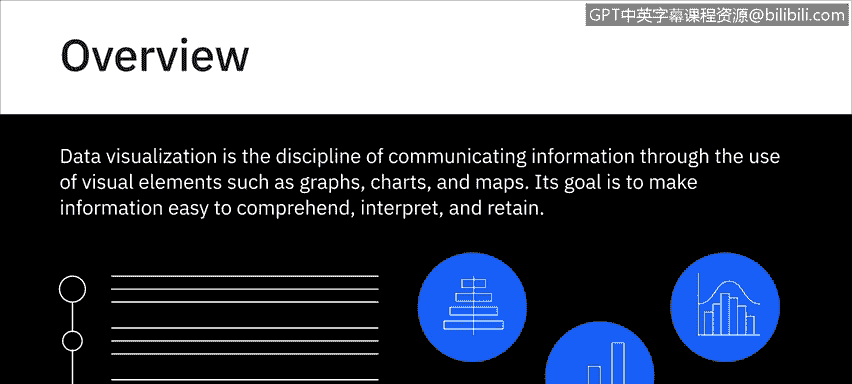
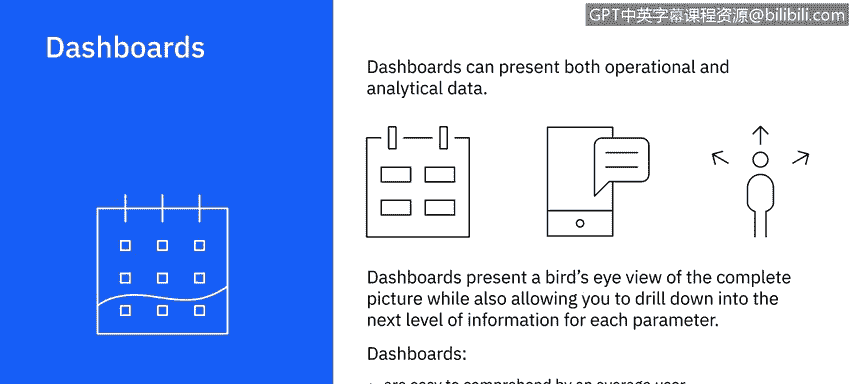

# IBM 数据分析师专业证书课程 1：《数据分析简介》｜introduction-to-data-analytics｜ - P33：32_数据可视化介绍.zh - GPT中英字幕课程资源 - BV18P411p7Qj

嗯。Data visualization is the discipline of communicating information through the use of visual elements such as graphs。

 charts and maps。 Its goal is to make information easy to comprehend， interpret and retain。

 Imagine having to look through thousands of rows of data to draw interpretations and compare that to a visual representation of that same data summarizing the findings。

 using data visualization， you can provide a summary of the relationships。

 trends and patterns hidden in the data， which， if not impossible。

 would be very hard to decipher from a data dump。😊。

For data visualization to be of value。 you have to choose the visualization that most effectively delivers your findings to your audience。

 And for that， you need to begin by asking yourself some questions。

 What is the relationship that I am trying to establish。

 Do I want to compare the relative proportion of the subparts of a whole。 For example。

 the contribution of different product lines in the total revenue of the company。

 Do I want to compare multiple values， such as the number of products sold and revenues generated over the last three years。

 or do I want to analyze a single value over time， which in this example could mean how the sale of one specific product has changed over the last three years。

 Do I need my audience to see the correlation between two variables。

 The correlation between weather conditions and booking in a ski resort， for example。

 Do I want to detect anomalies in data， For example。

 finding values and data that could potentially skew the findings。

What is the question I'm trying to answer is not just an overarching question in the data visualization。

 design and process。 You need to be able to answer this question for your audience with every data set and information that you visualize。

 You also need to consider whether the visualization needs to be static or interactive and interactive visualization。

 for example， can allow you to change values and see the effects on a related variable in real time。

 So think about the key takeaway for your audience。

 An their information needs and the questions they might have。

 and then plan the visualization that delivers your message clearly and impactfully。

Let's look at some basic examples of the types of graphs you can create for visualizing your data。

 Bar charts are great for comparing related dataset sets or parts of a whole。 For example。

 in this bar chart， you can see the population numbers of 10 different countries and how they compare to one another。

 column charts compare values side by side， you can use them quite effectively to show change over time。

 For example， showing how page views and user sessions time on your website is changing on a month to month basis。

 Although alike， except for the orientation， bar charts and column charts cannot always be used interchangeably。

 For example， a column chart may be better suited for showing negative and positive values。

 pie charts show the breakdown of an entity into its subparts。

 and the proportion of the subparts in relation to one another。

 Each portion of the pie chart represents a static value or category。 and the sum of。😊。

Categories is equal to 100% in this example， in a marketing campaign with four marketing channels。

 social sites， native advertising， paid influencers and live events。

 You can see the total number of leads generated per channel。 line charts display trends。

 They're great for showing how a data value is changing in relation to a continuous variable。

 For example， how has the sale of your product or multiple products changed over time。

 where time is the continuous variable。 Line charts can be used for understanding trends。

 patterns and variations in data。 Also for comparing different but related data sets with multiple series。

😊，Data visualization can also be used to build dashboards。

 Dboards organize and display reports and visualizations coming from multiple data sources into a single graphical interface。

 You can use dashboards to monitor daily progress or the overall health of a business function or even a specific process。

 Dashboards can present both operational and analytical data。 For example。

 you could have a marketing dashboard from which you monitor your current marketing campaign for reach outs。

 queries generated and sales conversions in real time。 as part of the same dashboard。

 you could also be seen how the conversion rate for this campaign compares to the conversion rate of some of the successfully run campaigns in the past。

😊，Dashboards are a great tool to present a bird's eye view of the complete picture while also allowing you to drill down into the next level of information for each parameter。

 Dashboards are easy to comprehend by an average user。

 make collaboration easy between teams and allow you to generate reports on the go using dashboards。

 You can see the result of variations in data and metrics almost instantly。

 And this can help you evaluate a situation from multiple perspectives on the go without having to go back to the drawing board。

😊。

