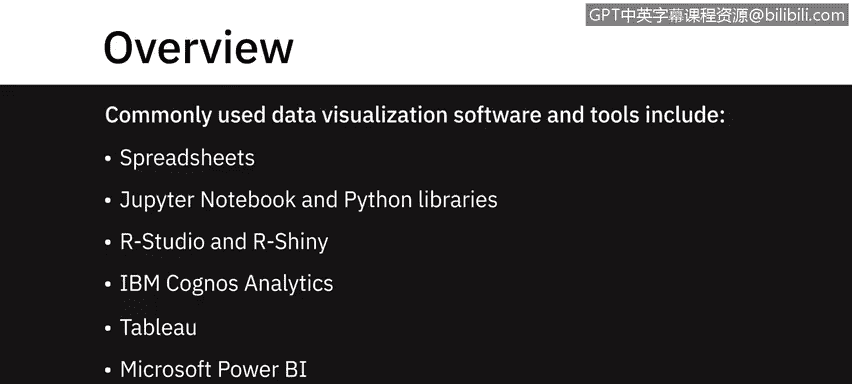
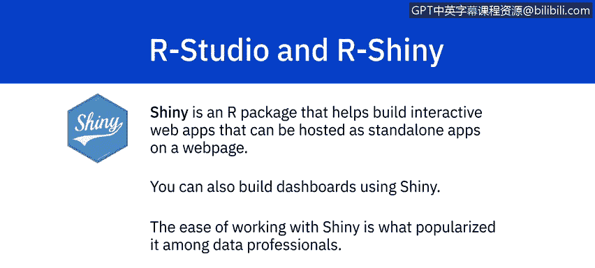
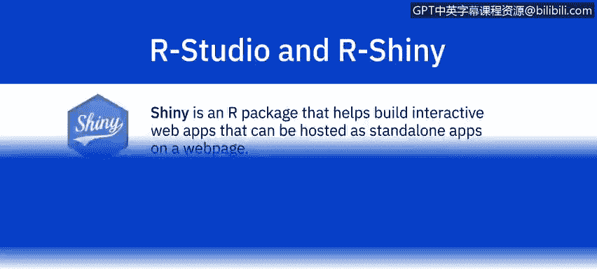
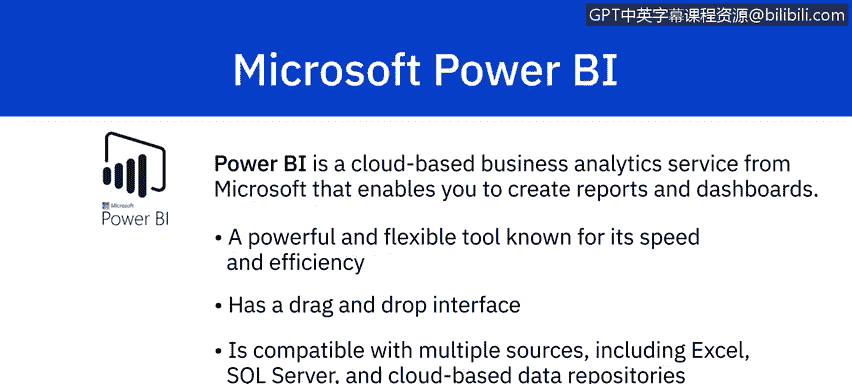
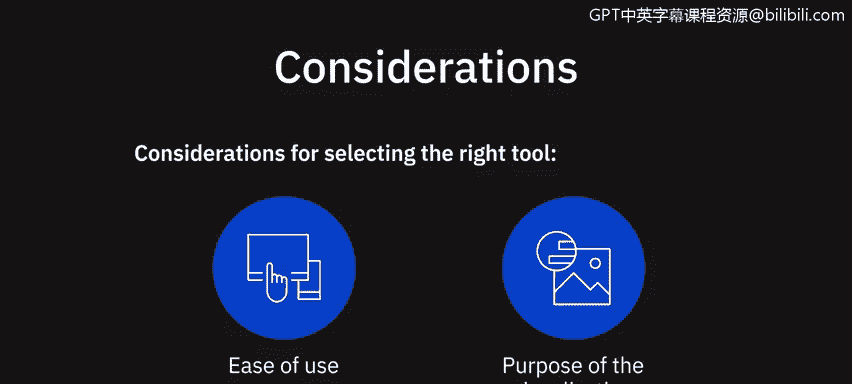

# IBM 数据分析师专业证书课程 1：《数据分析简介》｜introduction-to-data-analytics｜ - P34：33_可视化和仪表板软件介绍.zh - GPT中英字幕课程资源 - BV18P411p7Qj

嗯。In this video we will look at some of the most commonly used data visualization software and tools These include spreadsheets。

 Jupiter notebook and Python libraries， RSt and R shinyny IBM Cgnos Analytics。

 Tableau and Microsoft Power BI。Some of these are end to end data analyticstic solutions。

 while others are specifically for data visualization。

 ranging from free open source tools to commercially available solutions。

Spreadsheets such as Microsoft Excel and Google Sheets are possibly the most commonly used software to make graphical representations of datasets。

Spreadsheets are easy to learn and have a ton of documentation and video tutorials available online for ready reference。

Excel provides several chart types ranging from the basic bar， line。

 pie and pivot charts to the more advanced options such as scatter charts， trend lines， Gant charts。

 waterfall charts， and combination charts， using which you can combine more than one type of charts。

Excel also provides recommendations on the best visual representation for your data set。

To make the charts more presentable， you can add a chart title， change colors of the elements。

 and add labels to data。Google Sheets also offer similar chart types for visualization。

 though Excel does have more inbuilt formula based options than Google Sheets。Like Excel。

 Google Sheets can help you choose the right visualization。

 All you have to do is highlight the data you wish to visualize and click the chart button。

 and you get a list of suggested charts best suited for your data。😊。

Charts and reports automatically update in Excel， as well as in Google Sheets。

 as the underlying data is changed。Google Sheets is preferred over Excel where multiple users need to collaborate。

Jupiter Note is an open sourced web application that provides a great way to explore data and create visualizations。

 You don't have to be a Python expert to use Jupiter notebook。😊。

Python provides a host of libraries that are used for data visualization。

 Let's look at a few of those libraries。Matpllootlibb is a widely used Python data visualization library。

 It provides different kinds of 2D and 3D plots and the flexibility to create plots in several different ways。

 using Matplotlib， you can create high quality interactive graphs and plots with just a few lines of code It has a large community support and crosspl support as it is an open source tool。

Boquet provides interactive charts and plots and is known for delivering high performance interactivity over large or streaming dataset sets。

 Boquet offers flexibility for applying interaction。

 layouts and different styling options to visualize。

 It can also transform visualizations written in some of the other Python libraries。

 such as Matplotlib， Seaborn and Gplot。😊，Dash is a Python framework for creating interactive web based visualizations using dashash。

 you can build highly interactive web applications using Python code while knowledge of HTML and JavaScript is useful。

 it is not a requirement。Dash is easily maintainable， cross platform and mobile ready。

Using our studio， you can create basic visualizations such as histograms， bar charts， line charts。

 box plots， and scatter plots， and advanced visualizations such as heat maps， mosaic maps， 3D graphs。

 and correloograms。Shiny is an R package that helps build interactive web apps that you can host as standalone apps on a web page。

These web apps seamlessly display our objects， such as plots and tables and can be made live to allow access to anyone。

 You can also build dashboards using Shiny。 The ease of working with Shihiny is what popularized it among data professionals。

IBM Cgnos Analytics is an end to end analyticstic solution。

 Some of the visualization features provided by Cgnos include importing custom visualizations。

 a forecasting feature that provides time series data modeling and forecasts based on data presented in corresponding visualizations。

Recommendation for visualizations based on your data。Conditional formatting。

 which allows you to see the distribution of your data and highlight exceptional data points。

 For example， highlighting high and low sales numbers over a certain threshold。

Cgnos is known for its superior visualizations and overlaying data on the physical world using its geospatial capabilities。

Tableau is a software company that produces interactive data visualization products using Tableau products。

 you can create interactive graphs and charts in the form of dashboards and worksheets with drag and drop gestures。

Tableau also offers the option to publish results in the form of stories。

 You can import R and Python scripts in Tableau and take advantage of its visualization features that are far more superior to that of other languages。

Tableau's visualization capabilities are easy and intuitive to use。

 Tableau is compatible with Excel files， text files。

 relational databases and cloud database sources such as Google Analytics and Amazon Redshift。

Power BI is a cloudbased business and analyticstic service for Microsoft that enables you to create reports and dashboards。

 It is a powerful and flexible tool known for its speed and efficiency。

 and an easy to use drag and drop interface。 Power B is compatible with multiple sources。

 including Excel SQL server and cloudbased data repositories。

 which makes it an excellent choice for data professionals。😊。

Power B provides the ability to collaborate and share customized dashboards and interactive reports securely。

 even on mobiles。 Power B's dashboard consists of many visualizations on a single page that help you tell your story。

 These visualizations called tiles are pinned to the dashboard。 The dashboard is interactive。

 which means a change in one tile affects the other。😊。

When deciding which tools to use， you need to consider the ease of use and purpose of the visualization in terms of the tools that are available and the visualization capabilities they offer。

 if you can visualize it， you can create it。

