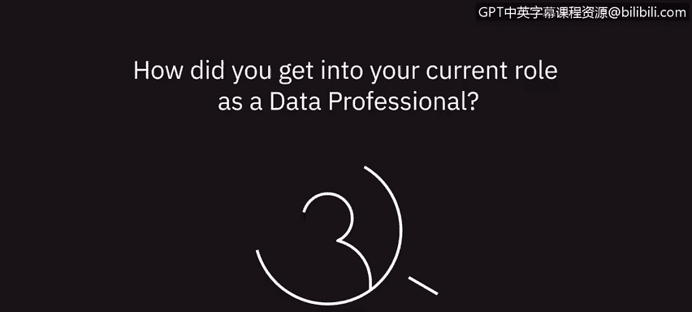

# IBM 数据分析师专业证书课程 1：《数据分析简介》｜introduction-to-data-analytics｜ - P37：36_观点：进入数据专业.zh - GPT中英字幕课程资源 - BV18P411p7Qj

嗯。In this video we will listen to data professionals talk about how they got into this profession My current role as a data professional did not exist before I took the position。

I realized that there was a need in our company to provide data in a faster。

 more efficient manner than going to the IS department who would have a meeting to discuss the meeting to have requirements and then they would have an in- product that people weren't satisfied with。

 but you had to get at the end of the line and go through the whole process again to get what you were looking for。

 so through filling a need at the company to provide reports in two weeks。

 I put together a company database that has access to more information。

 we have analysts that are now able to meet that unmet need in the company。

I got into the data professional role by chance， I was actually working on my PhD in economics at University of Illinois Urbana Champaign when a colleague of mine suggested that a master's in statistics would also be an excellent value add。

So that's how I got into the statistics program as well in Illinois， but once I started that。

 I was pretty hooked and there was no going back so to speak。So in other words。

 my original goal of becoming an economist actually evolved into a career filled with data， modeling。

 analytics， inside gathering， communication。Visualization and of course。

 underlying all of that data driven problem solving。

I got into the data analyst role in a financial data company actually by accident。 back then。

 my company started to hire equity data analysts in Maland China。

 and I was very lucky to join the team because they are looking for someone with financial analysis skill sets。

 which I can bring to the table， And after that， my team started to hire someone with the technical skill sets like Python R and Seco。

😊，I've always had a love of them。And one of the things that happens is when you work with numbers so much。

 they start to tell a story and the ability to look at those numbers and tell that story and what speaks to me and so having always had thatlala number。

I have just been always attracted to data analytics and whether it's Excel spreadsheets or whether it is QuickBooks or any sort of data sets that can help drive the information that we're looking for。

 especially in the financial industry when we're looking at profit and loss and balance sheet and what happens when one company buys another company。

We're always looking at that data to talk to and speak about the company's history and their future。

I got my current role as a data scientist straight out of my grad program。

 which was a master's in data science， and before my grad program I worked as both a data analyst and an analytics manager。

