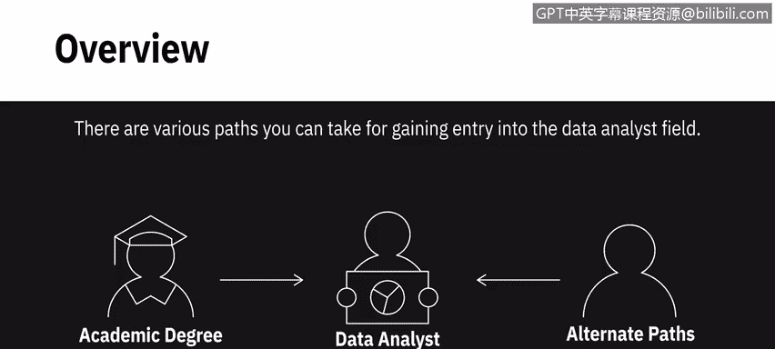
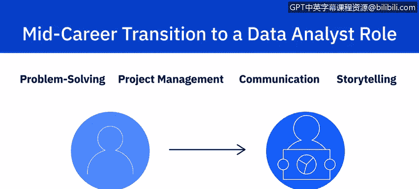
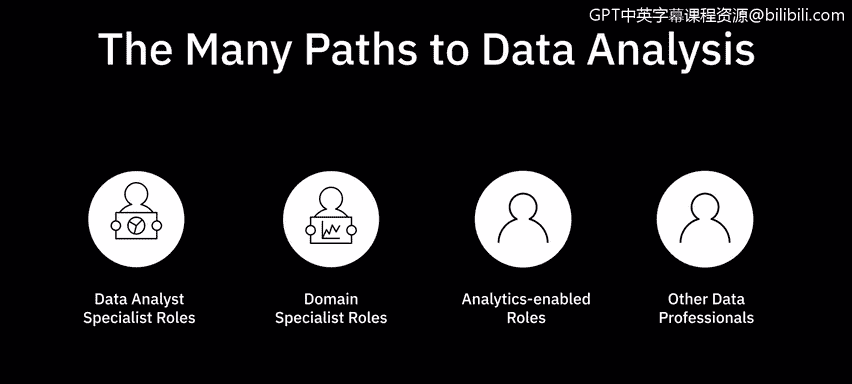

# IBM 数据分析师专业证书课程 1：《数据分析简介》｜introduction-to-data-analytics｜ - P39：38_数据分析的多条路径.zh - GPT中英字幕课程资源 - BV18P411p7Qj

嗯。There are various paths you can take to gaining entry into the data analyst field。

 while some employers may ask for an academic degree as a prerequisite。

 even if you don't have a degree， you still have several options available to you that can help you gain an entry or even make a lateral move into the field of data analysis。

 Let's start with a most obvious path。

An academic degree in data analytics， statistics， computer science。

 management information systems or information technology management can start you off with a strong advantage。

 You could alternately enroll in online training programs that can equip you with a required knowledge。

Comprehensive online programs for data analysis are multi course specializations offered by learning platforms。

 such as Coursera，edx and Uacity。 These courses are designed and delivered by some of the world's best domain experts。

 Since you have a fair idea by now of the technical。

 functional and soft skills you need in order to be a data analyst。

 choosinging the right learning path should be fairly straightforward as you gather more work experience。

 you can keep advancing your knowledge and skills in specific areas。 For example， statistics。

 spreadsheets， SQL， Python data visualization， problem solving storytel。

 or making impactful presentations。 These courses also give you handson assignments and projects。

 which give you a feel for the real worldor application of your knowledge and skills。

 you can even add these projects to your portfolio。😊，So if you don't have an academic qualification。

 these courses can help you gain opportunities at an entry level and work your way up as your experience grows。

Now， let's look at a scenario where you have a couple of years of experience in a different line of work and want to make a switch into the data analysis field。

 There's a very good chance that you can do that successfully if you plan well。

 Since data analysis is a vast field。 It would be useful for you to first research。

 the knowledge and skills you need， the various job opportunities that are available。

 and the growth opportunities available on the path you may be considering。

 you can tap into online resources， forums and your network of friends and colleagues to connect with people in this field and gain insights into real world scenarios。

😊，If you're currently working in a non technical role。

 you may consider exploring the domain specialist or functional analyst path。If youre in sales。

 you could consider starting your journey by positioning and skilling yourself for a sales analyst position。

 You begin with the advantage of industry experience and skill yourself in other areas such as statistics and programming。

 for example。If you're currently working in a technical role。

 you have the ability to quickly pick up the tools and software you need for the data analyst role。

 You're also probably stepping in with the advantage of having a good understanding of the domain or industry you're from for some of the other skills such as problem solving。

 project management， communication and storytel。 You may already be using these in some capacity in your existing job。

 You can always enhance these skills through trainings， online courses。

 communities of practice and forums。

🎼Data analysis is a fast moving field。 If you're curious。

 open to learning new things and excited about the field， you will be able to forge a path forward。

 regardless of the formal qualifications you think you may be missing。

