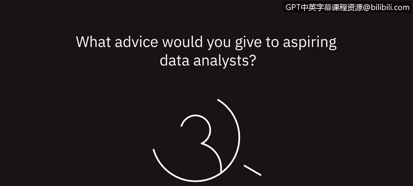

# IBM 数据分析师专业证书课程 1：《数据分析简介》｜introduction-to-data-analytics｜ - P41：40_观点：对有志成为数据分析师的建议.zh - GPT中英字幕课程资源 - BV18P411p7Qj

In this video we will listen to data professionals giving advice to aspiring data analysts One piece of advice I'd give to aspiring data analysts is keep learning and don't get discouraged there is more that's been written about analytics than you could ever learn in a lifetime so don't try to learn everything at once but take your time and make sure every week。

 every month every year you're constantly learning something new and I think that'll serve you well one piece of advice I've been given in my career that I found to be really really helpful is to consider your career like an uppercase T。

And。You should have broad knowledge。 The top of the T represents kind of that you should have broad knowledge in a number of different areas。

 although it doesn't have to be deep。 You should know a little bit at least about A B testing。

 about machine learning， about data visualization， about SQL， about Python， about R。

And then the bottom part of the tea is you should go really deep on at least one area。

 so there should be one area among the ones I just mentioned where you have a really deep rigorous understanding of it it is use every job that you have to your advantage meaning something can be found from everything so whether it is。

Looking at your parents budget or asking your parents if you can see the checkbooks or if you work at a fast food restaurant looking at the numbers。

 how many people are coming in， how many dollars are being turned over talk to the manager about what's next what the numbers actually mean when you're talking to potential employers have your examples ready so it doesn't have to necessarily be just work experience but your life experience how did you how have analytics。

 how have you used analytics even in your personal life so if you can tell me and talk to me about what you've done personally or professionally and how it relates to what we're doing that will take you a very very long way one piece of advice I'd give to asing data scientists is to build out a professional portfolio that showcases your data science or data analytics skills and you can do this by looking up fun data sets online。

Alyzing those data sets， you can also do that within your job。

 even if your current job isn't to be a data analyst。

 look for opportunities where you can crunch numbers and then that'll just kind of naturally lead you to a nice portfolio or nice wins in terms of data analyst projects。

My advice to an aspiring data analyst is to follow your passion。

 find a job that meets your needs and gives you joy during doing it。

There's nothing worse than waking up every morning and hating to go to your place of employment。

 there are so many data analyst jobs in various industries， departments。

 there's just so many options that there's no need to take a job just to have a job。

 find something that really fuels your passion and gives you something to get up every morning for。

