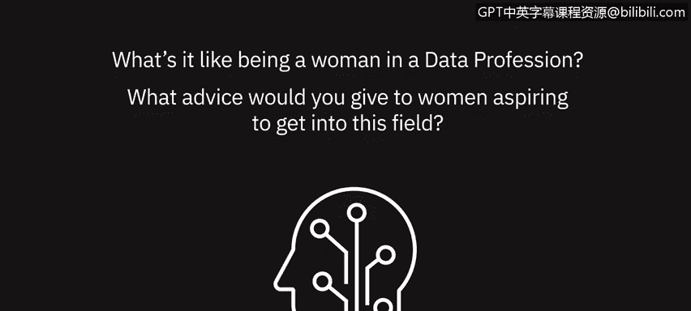

# IBM 数据分析师专业证书课程 1：《数据分析简介》｜introduction-to-data-analytics｜ - P42：41_观点：数据专业中的女性.zh - GPT中英字幕课程资源 - BV18P411p7Qj

嗯。In this video， we will listen to women， share their experience of being a data professional and their advice to women aspiring to enter this field。

😊。

As a woman in data science， I still run up against the stereotype that this is a man's job。

 I've walked into meetings and had people look disappointed or confused。

I take that as an opportunity to prove them wrong。 This isn't a job just for men。

 It's for a person who has the insight， the ability and the drive to get the job done。

 And as long as you possess those skills， then there's no reason why anyone one can't do anything that they put their mind to。

 whether you're male or a female， whether you're white or black。

 you have the opportunity to prove people wrong by the work that you produce。

I would say its it can be tough but you have to find your voice and don't be afraid to use it a lot of times as women were not able to find our voice or speak up or we're afraid of how people are going to treat us if we speak up but you know it's more important that you be heard and seen not just being loud or wrong but if you have the data to back it up if you have good content and things you want to say don't be afraid to raise your hand and let people know that you are a thinker and that you can get this done because that's gonna to be important as you progress and the only real way to get ahead is drive and people don't know you have drive if you're too quiet and so if you're just quietly working away in the corner a lot of times people can't see it so speak up make sure your voice is being heard make sure you are being seen as a woman who knows how to how to grow and how to help in the data science field When I started。

 it was mostly been in my class， especially back in grad school。But now I'm seeing that data teams。

 both data science and data engineering teams are filled with a lot of women as well。

 so I would advise women to continue upskilling， you know。

 so that they're able if they are formed and if they like，You know， a career filled with programming。

 data and problem solving， then they should continue building their technical skill set。

So that they can。呃。Represent themselves in the landscape of a data professional as strongly as is possible Don't allow your gender to be a crutch。

 Still go hard， put in the work and show the world your amazing talents There are no roles that are set aside for specific genders If you're fortunate enough to work in a profession that you thoroughly enjoy。

 then go for it。