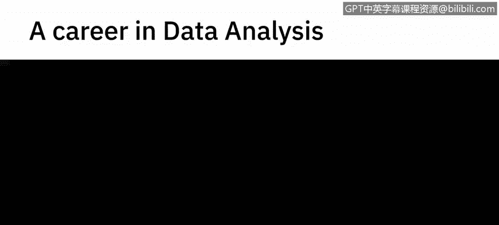
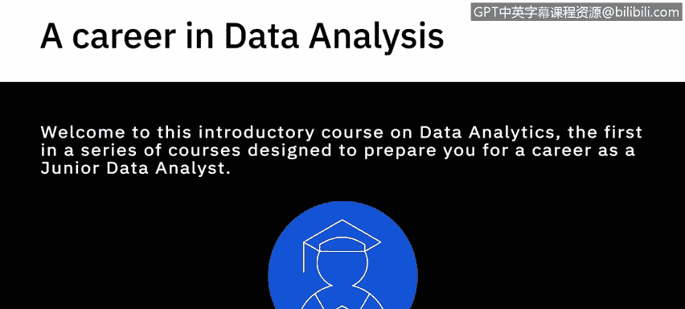
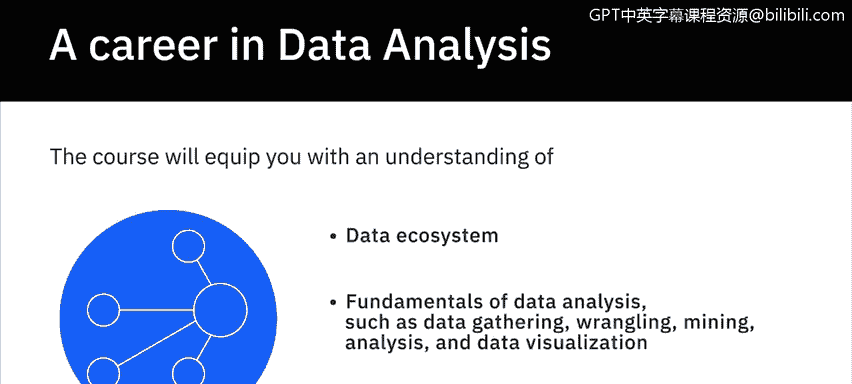
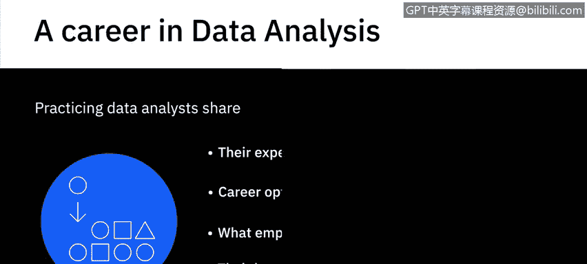
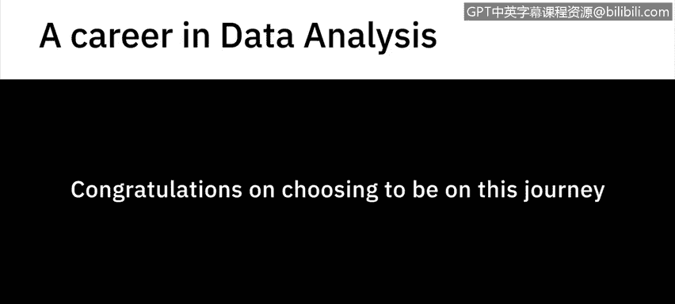

# IBM 数据分析师专业证书课程 1：《数据分析简介》｜introduction-to-data-analytics｜ - P43：0_01_course-introduction.en_subtitled - GPT中英字幕课程资源 - BV18P411p7Qj

嗯。

Welcome to this introductory course on data analyticstic。

 the first in a series of courses designed to prepare you for a career as a junior data analyst。

To quote a forester consulting report on the power of data to transform business。

Businesses today recognize the untapped value in data and data analytics as a crucial factor for business competitiveness。

To drive their data and analytics initiatives， companies are hiring and upskilling people。

They're expanding their teams and creating centers of excellence to set up a multipronged data and analytics practice in their organizations。

Combined to this is the significant supply and demand mismatch in skilled data analysts。

 making it a highly sought after and well paid profession。

You can choose to master data analytics as a career path or leverage it as a stepping stone to branch out into other data professions such as data science。

 data engineering， business analytics， and business intelligence analytics。

This course is for you if you are a fresh graduate from any stream。

 a working professional considering a mid career transition。

 a data driven decision maker or in any analytics enabled role。

The course introduces you to the core concepts， processes。

 and tools you need to gain entry into data analytics。

 or even to strengthen your current role as a data driven decision maker。

It will equip you with an understanding of the data ecosystem and the fundamentals of data analysis。

 such as data gathering， wrangling， mining， analysis and data visualization。

 You'll also get the feel of a day in the life of a data analyst。

Practicing data analysts share their experience in gaining entry into this field。

 career options and learning paths you can consider。 And what employers look for in a data analyst。

 They also share their knowledge and best practices about some of the aspects of the data analysis process。

😊。

What lies ahead is truly exciting， both for the field and for you as a data analyst。

 So congratulations on choosing to be on this journey and good luck。😊。

