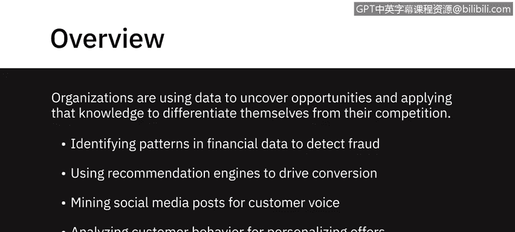
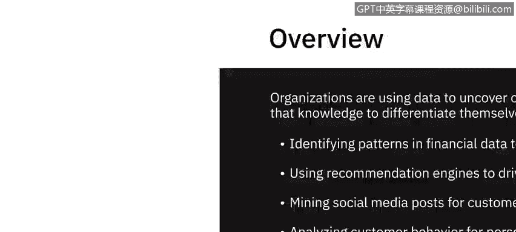
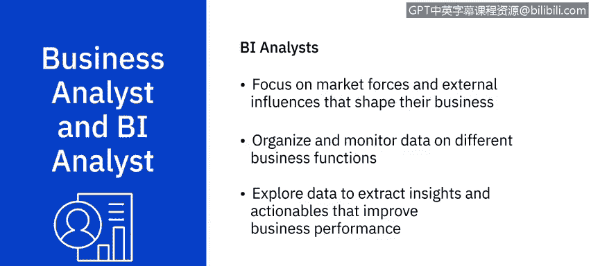
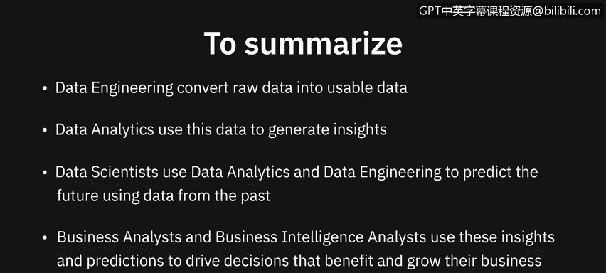

# IBM 数据分析师专业证书课程 1：《数据分析简介》｜introduction-to-data-analytics｜ - P45：2_03_key-players-in-the-data-ecosystem.en_subtitled - GPT中英字幕课程资源 - BV18P411p7Qj

Today， organizations that are using data to uncover opportunities and are applying that knowledge to differentiate themselves are the ones leading into the future。

Whether looking for patterns in financial transactions to detect fraud。

 using recommendation engines to drive conversion， mining social media posts for customer voice。

 or brands personalizing their offers based on customer behavior analysis。

 business leaders realize that data holds the key to competitive advantage。

To get value from data， you need a vast number of skill sets and people playing different roles。

In this video， we're going to look at the role data engineers， data analysts， data scientists。

 business analysts， and business intelligence or BI analysts play in helping organizations tap into vast amounts of data and turn them into actionable insights。

It all starts with a data engineer Data engineers are people who develop and maintain data architectures and make data available for business operations and analysis。

Data engineers work within the data ecosystem to extract。

 integrate and organize data from disparate sources， clean， transform and prepare data， design。

 store， and manage data in data repositories。They enable data to be accessible in formats and systems that the various business applications。

 as well as stakeholders like data analysts and data scientists can utilize。

A data engineer must have good knowledge of programming。

 sound knowledge of systems and technology architectures。

 and in depth understanding of relational databases and non relational data stores。

Now let's look at the role of a data analyst in short。

 a data analyst translates data and numbers into plain language so organizations can make decisions。

Data analysts inspect and clean data for deriving insights， identify correlations， find patterns。

 and apply statistical methods to analyze and mine data and visualize data to interpret and present the findings of data analysis。

Analysts are the people who answer questions， such as are the user search experiences generally good or bad with the search functionality on our site。

 or what is the popular perception of people regarding our rebranding initiatives。

 or is there a correlationrelation between sales of one product and another？

Data analysts require good knowledge of spreadsheets， writing queries。

 and using statistical tools to create charts and dashboards。

Modern data analysts also need to have some programming skills。

They also need strong analytical and storytelling skills。

And now let's look at the role data scientists play in this ecosystem。

Data scientists analyze data for actionable insights and build machine learning or deep learning models that train on past data to create predictive models。

Data scientists are people who answer questions such as how many new social media followers am I likely to get next month。

 or what percentage of my customers am I likely to lose to competition in the next quarter。

 or is this financial transaction unusual for this customer？

Data scientists require knowledge of mathematics， statistics。

 and a fair understanding of programming languages， databases， and building data models。

 they also need to have domain knowledge。Then we also have business analysts and BI analysts Business analysts leverage the work of data analysts and data scientists to look at possible implications for their business and the actions they need to take or recommend B analysts do the same。

 except their focus is on the market forces and external influences that shape their business。

 They provide business intelligence solutions by organizing and monitoring data on different business functions and exploring that data to extract insights and actionables that improve business performance。

😊。

To summarize in simple terms， data engineering converts raw data into usable data。

 Data analytics uses this data to generate insights。

Data scientists use data analytics and data engineering to predict the future using data from the past。

Business analysts and business intelligence analysts use these insights and predictions to drive decisions that benefit and grow their business。

Interestingly， it's not uncommon for data professionals to start their career in one of the data roles and transition to another role within the data ecosystem by supplementing their skills。

