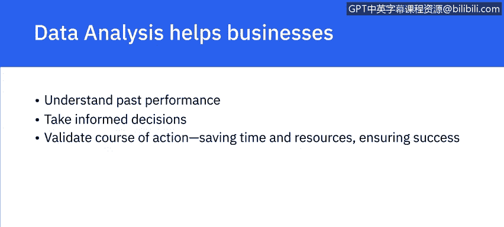
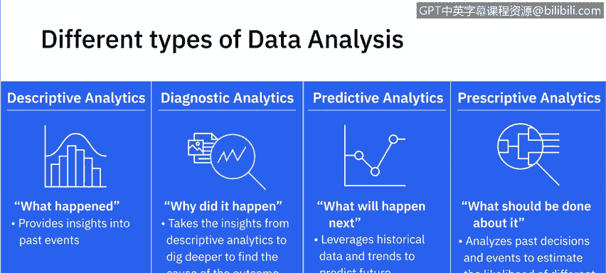
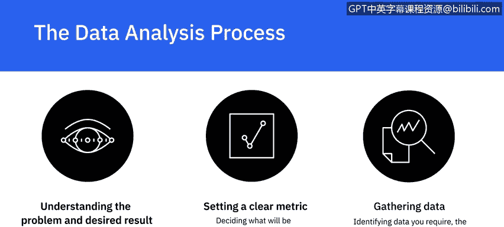
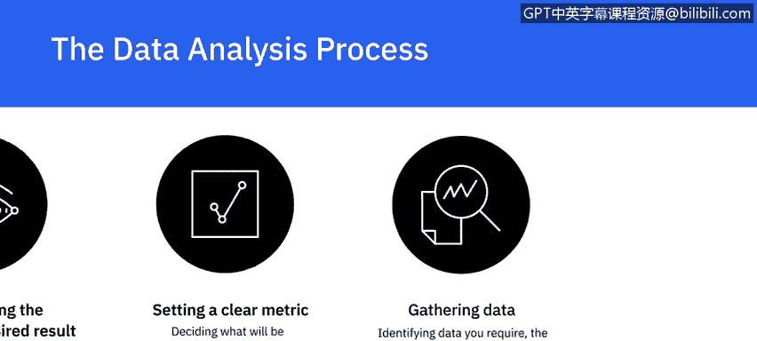
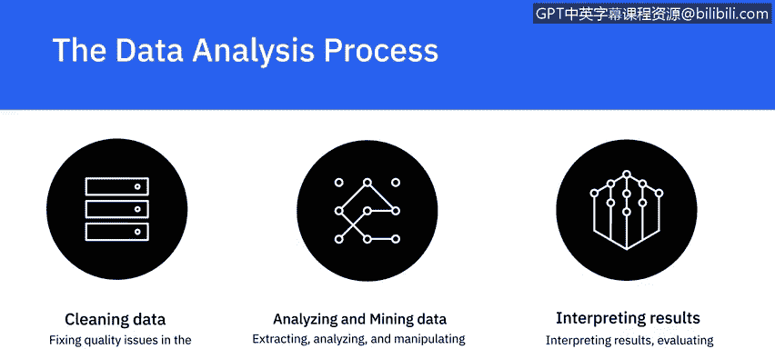
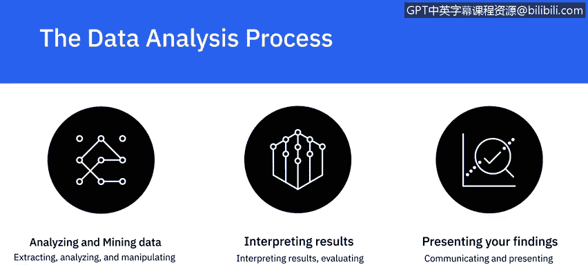

# IBM 数据分析师专业证书课程 1：《数据分析简介》｜introduction-to-data-analytics｜ - P46：3_04_defining-data-analysis.en_subtitled - GPT中英字幕课程资源 - BV18P411p7Qj

嗯。Data analysis is the process of gathering， cleaning， analyzing， and mining data。

 interpreting results， and reporting the findings with data analysis。

 we find patterns within data and correlations between different data points。

 and it is through these patterns and correlations that insights are generated and conclusions are drawn。

Data analysis helps businesses understand their past performance and informs their decision making for future actions。

Using data analysis， businesses can validate a course of action before committing to it。

 saving valuable time and resources， and also ensuring greater success。

 We'll explore four primary types of data analysis。

 each with a different goal and place in the data analysis process。

 descriptive analysis helps answer questions about what happened over a given period of time by summarizing past data and presenting the findings to stakeholders。

 It helps provide essential insights into past events。 For example。

 tracking past performance based on the organization's key performance indicators or cash flow analysis。

😊。

Diagnostic analytics helps answer the question。 Why did it happen。

 It takes the insights from descriptive analytics to dig deeper to find the cause of the outcome。

 For example， a sudden change in traffic to a website without an obvious cause or an increase in sales in a region where there has been no change in marketing。

 predictive analytics helps answer the question， what will happen next。

 historical data and trends are used to predict future outcomes。

 Some of the areas in which businesses apply predictive analysis。

 are risk assessment and sales forecasts。 It's important to note that the purpose of predictive analytics is not to say what will happen in future。

 Its objective is to forecast what might happen in the future。

 All predictions are probabilistic in nature。Preersscriptive analytics helps answer the question what should be done about it by analyzing past decisions and events。

 the likelihood of different outcomes is estimated on the basis of which a course of action is decided。

Self driving cars are a good example of prescriptive analytics。

 They analyze the environment to make decisions regarding speed， changing lanes， which route to take。

 et cetera， or airlines automatically adjusting ticket prices based on customer demand， gas prices。

 the weather or traffic on connecting routes。 Now， let's look at some of the key steps in any data analysis process。

😊。

Understanding the problem and desired result data analysis begins with understanding the problem that needs to be solved and the desired outcome that needs to be achieved。

 Where you are and where you want to be needs to be clearly defined before the analysis process can begin。

Setting a clear metric， this stage of the process includes deciding what will be measured。

 For example， number of product X sold in a region and how it will be measured。 For example。

 in a quarter or during a festival season。 Gaing data once you know what you're going to measure and how you're going to measure it。

 you identify the data you require the data sources you need to pull this data from。

 and the best tools for the job。 cleaning data， Having gathered the data。

 The next step is to fix quality issues in the data that could affect the accuracy of the analysis。

 This is a critical step because the accuracy of the analysis can only be ensured if the data is clean。

 You will clean the data for missing or incomplete values and outliers。 For example。

 a customer demographics data in which the age field has a value of 150 is an outlier。

 you will also standardized。

Data coming in from multiple sources。Analyzing and mining data。 once the data is clean。

 you will extract and analyze the data from different perspectives。

 You may need to manipulate your data in several different ways to understand the trends。

 identify correlations and find patterns and variations。

Interpreting results after analyzing your data and possibly conducting further research。

 which can be an iterative loop， it's time to interpret your results。As you interpret your results。

 you need to evaluate if your analysis is defendable against objections and if there are any limitations or circumstances under which your analysis may not hold true。

Presenting your findings， ultimately， the goal of any analysis is to impact decision making。

 The ability to communicate and present your findings in clear and impactful ways is as important a part of the data analysis process。

 as is the analysis itself。 Reports， dashboards， charts， graphs， maps。

 case studies are just some of the ways in which you can present your data。

