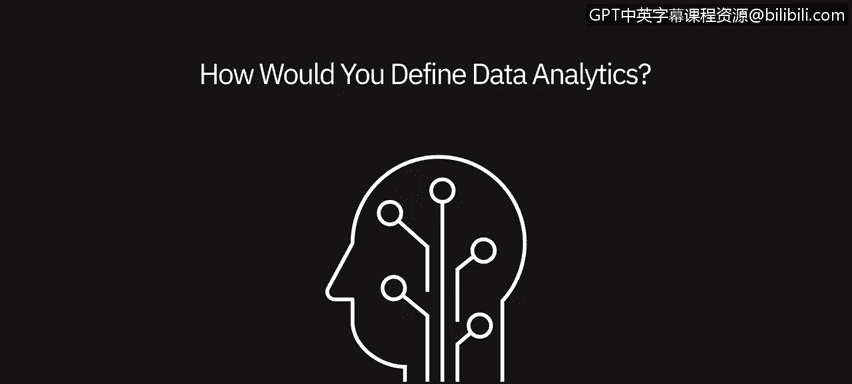
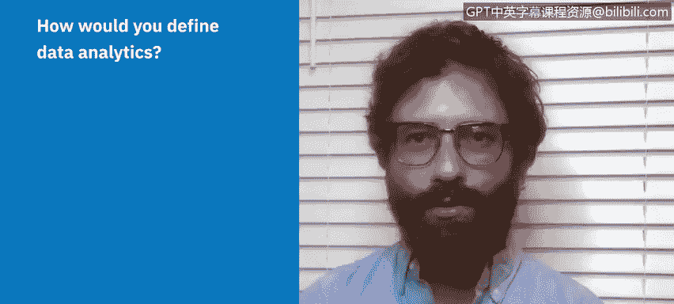
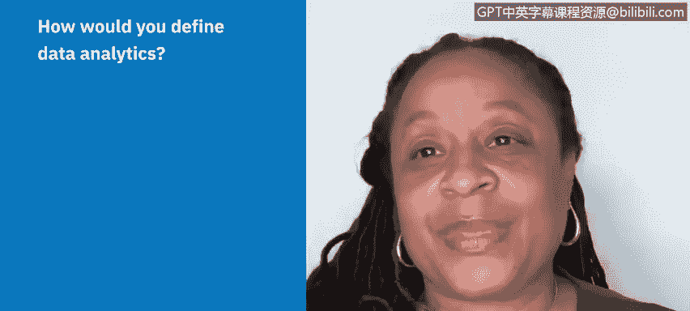
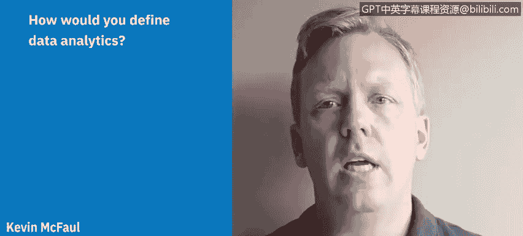

# IBM 数据分析师专业证书课程 1：《数据分析简介》｜introduction-to-data-analytics｜ - P47：4_05_viewpoints-what-is-data-analytics.en_subtitled - GPT中英字幕课程资源 - BV18P411p7Qj

嗯。

In this video， we will listen to several data professionals。

 talk about how they define data analytics and what this term means to them。

I define data analytics as the process of collecting information and then analyzing that information to confirm various hypotheses To me。

 data analytics also means storytelling with data using data to clearly and concisely convey the state of the world to the people around you data analysis is the use of information around you to make decisions just like you get up every morning。

 you watch the news， the weather report will tell you the temperature for the day。

 whether it's going to rain that may dictate what you're going to wear or what activities you can do so data analysis isn't an abstract concept it's something that we do naturally but it has a technical name and now people are being paid to do it in a much larger larger or grander experience but really it's not that complicated it。

The way I put it is that you've got a problem and you need to use facts to test a hypothesis。

 That's where data analysis comes into play。 The process starts from defining the problem。

 and then you need to create your own hypothesis and to test that。 You need to collect data。

 clean data， analyze data and then present it to the key stakeholders。

 Data analytics is really any sets of data that you can use to。

Review information anything that's going to help you to understand what is going on in my case as a CPA I am always looking at financial statements and i'm always analyzing data to predict where someone's been where they are right now and where they're headed and so that data helps me to see further and almost predict the future of any company that i'm working with so data analytics is neglecting cleansing analyzing presenting and ultimately sharing of data and your analysis to be able to help communicate。

Exactly what's going on with your business， what's going on in the data so that you can help make better decisions I would define data analytics as a process or better get a phenomenon of taking information gathered from a relevant population maybe your customers or your social audience and breaking that information down into subsets and using that data to make decisions about products or services that you want to offer or in cases of the digital environment that were in making decisions about certain pieces of content that you want to publish so that it appeals to your target audience。

