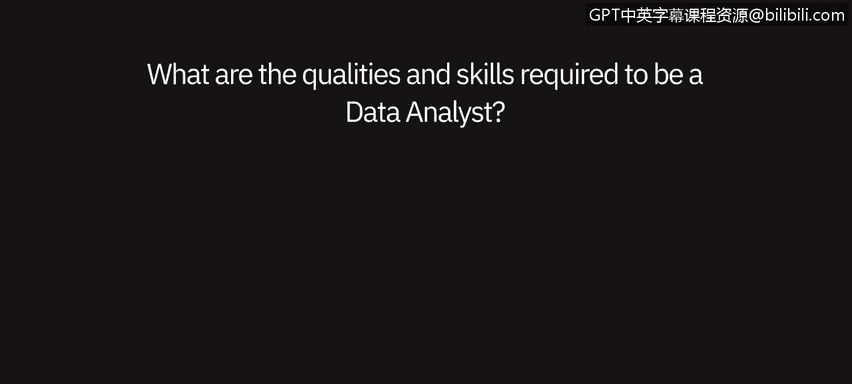
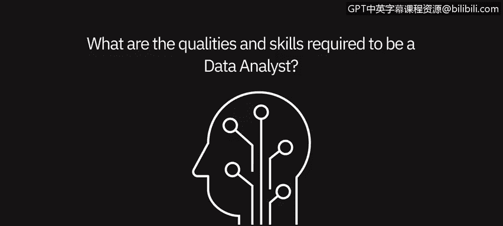

# IBM 数据分析师专业证书课程 1：《数据分析简介》｜introduction-to-data-analytics｜ - P49：6_02_viewpoints-qualities-and-skills-to-be-a-data-analyst.en_subtitled - GPT中英字幕课程资源 - BV18P411p7Qj

嗯。In this video， we will listen to practicing data professionals。

 talk about the qualities and skills required to become a data analyst。

The qualities and skills of a data analyst， a person who's curious naturally。

 someone who has attention to detail and enjoys working with computers。

A curious person will look to find answers even sometimes when there isn't a question。

 or they don't mind researching and looking in areas that may not have been thought of before。

Attention to detail or looking for patterns， do you walk into a room and just count naturally people。

 how the room is set up。Paying attention to close details and then enjoying computers because technology is moving so fast。

Something or skill that you learn today in two to three years may not be applicable。

 so you need to be able to develop new skills and learn new software depending on how the market or the industry has changed。

Definitely， both the technical skills and soft skills are required。Technnic skills include Python。

 CQL R， tableableau and power B and the soft skills or interpersonal skills mean whether you know what's the right data to utilize and what's the right tool to use and how to present the data to the case stakeholders and these skills have require the business acumen and presentation skills you have to be very detailoriented。

 you have to love numbers， you have to love information and be willing to look at that information and not just look at it on the surface but dive deeper so for example。

 and what we do I can't just take a bank statement at face value。

 I have to actually look at it and compare it does the seal look right especially in today's world there's a lot of fraud and miscommunications So to be and people that are trying to take your information and fraudulently use it So a good data analyst should be able to compare last year's information to this year's information to see if it looks right you have to have that eye。

And that mindset and not just take things at face value。

 There are many qualities and skills required to be a data analyst。

 and I break them down into two buckets， basically soft skills and technical skills。

 I think the most important soft skills for a data analyst is to be really curious to ask a lot of good questions to be really thoughtful and to listen carefully and understand both user perspective and your coworkerer's perspective and what they most need from the data and always be willing to learn because analytics is a fast movingov field So you have to constantly be learning and reading to stay on top of it。

 There are many technical skills required to be a data analyst。

 The most important and technical skill for any new data analyst to learn is SQL It's by far the most widely used and any time you're extracting data from a database you're gonna to need to know SQL。

 and there is nothing quite like a data analyst with really， really。

Goodod SQL skills I think sometimes people get ahead of themselves and try a bunch of very complicated technologies before getting the basics of SQL down and I think that's a really big mistake I think it's always nice to know Python and R which are the two main programming languages used to do data analysis I think as a new data analyst you don't need to be proficient in both or really either but starting to get good at one or the other is going to be really useful for your career Another important technical skill to have for a data analyst is to be really good at at least one data visualization tool and to understand general principles of data visualization today the end to end skill set of a data analyst is far more dynamic than what it used to be。

So a data analyst needs to know what problem they're trying to solve with the data。

Pullold that data as they need it in， the structure they need it in using SQL from the data lake that it's sitting in。

You know， there'll be many different tables and they'll need to figure out how to join them and then pull the data。

 clean it up， wrangle， manipulate it， mine it。So that they're able to kind of glean insights out of it。

Present those insights concisely clearly using good visualizations and dashboards。And in other words。

 be able to tell a good story with that data。