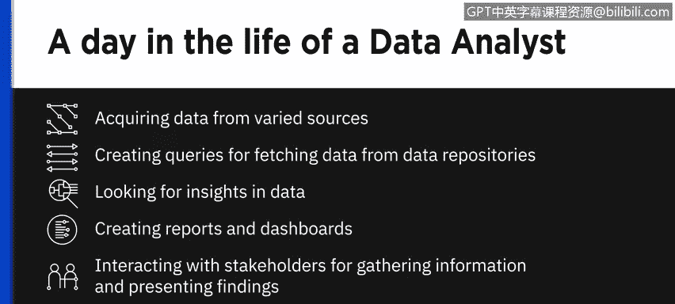
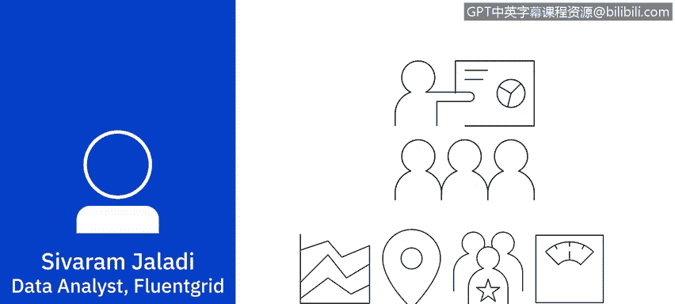

# IBM 数据分析师专业证书课程 1：《数据分析简介》｜introduction-to-data-analytics｜ - P50：7_03_a-day-in-the-life-of-a-data-analyst.en_subtitled - GPT中英字幕课程资源 - BV18P411p7Qj

嗯。A day in the life of a data analyst can include a number of possibilities。

From acquiring data from varied data sources to creating queries for pulling data from data repositories。

 foraging through rows of data to look for insights， creating reports and dashboards。

 and interacting with stakeholders for gathering information and presenting the findings。

 it's a spectrum。And yes， the big one。Cleaning and preparing the data so that the findings have a credible basis which by the way。

 is a large part of what any data analyst may find themselves doing in their jobs but if I had to walk you through any one type of day I'm going to pick one which has me foraging through data looking for insights This is the part of my job that I am totally in awe of Hi I am Sieveramjaladi I work as a data analyst with fluent gridd。

 a smart gridd technology solutions company based in Viishshaka Putnam in India Fent grid is an IBM partner and the recipient of IBM Beaacon Awards for its solutions in the areas of smart energy and smart city industry segments we offer integrated operations center solutions for power utilities and smart cities leveraging our actionable intelligence platform known as。

Fluent grid act diligence our client， our power utility company in South India。

 has been noticing a spike in complaints regarding overbiling and the frequency of these complaints seems to suggest there is something more to it than random occurrences so I'm asked to look at the complaints and the billing data and see if I can spot something。

I start by taking stock of what I have some of the obvious places that I know I am going to be looking into is the complain data。

 the subscriber information data and the billing data。That's going to be my starting point。

Before I dive into the specifics of the data， I'm going to make a list of questions。

Initial hypotheses that I'm going to start with。Such as。玩。

The usage pattern of subscribers reporting this issue。

Is there a consumption range for which overbiling is occurring more than others？2。

 area wise concentration of complaints。Are the complaints concentrated in specific localities within the city？

😊，3。Frequency and occurrence of complaints based on individual subscribers。

Are the same subscribers reporting overbiling repetitively， if yes。

 what is the frequency of occurrence in repeat cases？If a subscriber is overbuilt once。

 does the overbuing occur every month from the first occurrence or are repeat occurrences sporadic。

 or not at all， as I get clear on my initial hypotheses and the set of questions I'm going to start with。

 I identify the data sets that Im going to isolate and analyze to validate or refute my hypotheses。

I pull out the average annual， quarterly and monthly billing amounts of the complainants and look for a range in which the complaints are falling more than others。

I then pull up the location data of the complainants to see if there is a connection between overbiling and zip codes here I see what seems to be a concentration of complaints in certain areas。

 this looked like it could add up to something so instead of moving to the third hypothesisthesesis。

 I decided to get a little deeper into this data Next I pull out the date of connection data more than 95% of the complainants had been our subscribers for more than seven years though not all subscribers over the seven year mark were facing this complaint。

So now we see some area wise concentration and we see a significant concentration of complaints based on the date of connection Next I pull out the make and the serial number of the meters。

 and there it is， the serial numbers belonged to the same batch of meters provided by the same supplier。

 the concentration of these meters and therefore the complaints was coming from areas in which these meters were installed。

At this stage， I feel confident in presenting these findings to the stakeholders。

I'm also going to share the data sources and my process of arriving at this analysis that always goes a long way in lending credibility to the findings。

 this could be the end of this project， or it may very well come back。

 maybe the same complaints with different commonalities。

 or a completely different set of complaints for which we need to find answers。

