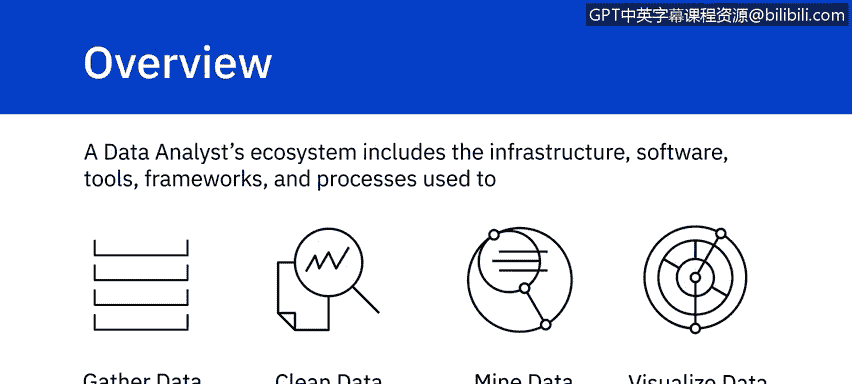
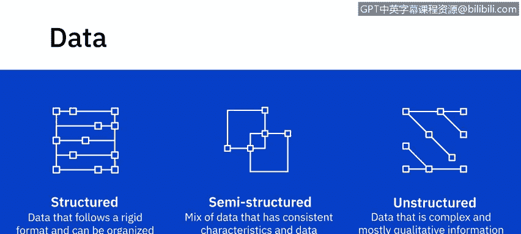
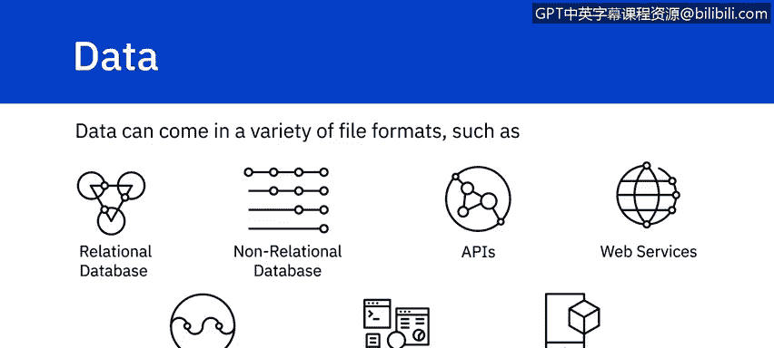
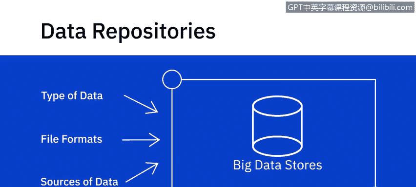
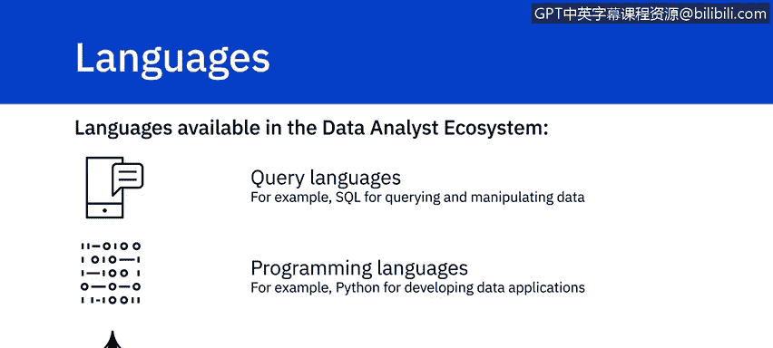
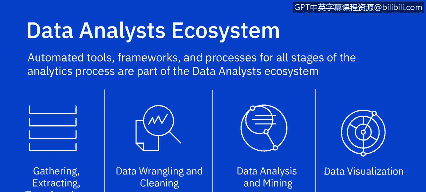

# IBM 数据分析师专业证书课程 1：《数据分析简介》｜introduction-to-data-analytics｜ - P52：9_01_overview-of-the-data-analyst-ecosystem.en_subtitled - GPT中英字幕课程资源 - BV18P411p7Qj

嗯。A data analyst's ecosystem includes the infrastructure， software， tools， frameworks。

 and processes used to gather， clean， analyze， mine and visualize data。In this video。

 we will go over a quick overview of the ecosystem before going into the details of each of these topics and subsequent videos。

 Let's first talk about data。

Based on how well defined the structure of the data is， data can be categorized as structured。

 semistructured or unstructured data that follows a rigid format and can be organized neatly into rows and columns is structured data。

 This is the data that you see typically in databases and spreadsheets。 for example。

 semistructured data is a mix of data that has consistent characteristics and data that doesn't conform to a rigid structure。

 For example， emails an email has a mix of structured data such as the name of the sender and recipient。

 but also has the contents of the email， which is unstructured data。

 and then there is unstructured data， data that is complex and mostly qualitative information that is impossible to reduce to rows and columns。

 For example， photos， videos， text files， Pdfs and social media content。

 The type of data drives the kind of data。That the data can be collected and stored in and also the tools that can be used to query or process the data data also comes in a wide ranging variety of file formats being collected from a variety of data sources。

 ranging from relational and non-relational databases to APIs， web services， data streams。

 social platforms and sensor devices。

This brings us to data repositories， a term that includes datas， data warehouses， data mars。

 data lakes and big data stores， the type format and sources of data influence the type of data repositories that you can use to collect。

 store， clean， analyze and mine the data for analysis if you're working with big data， for example。

 you will need big data warehouses that allow you to store and process large volume high velocity data and also frameworks that allow you to perform complex analytics in real time on big data。

The ecosystem also includes languages that can be classified as query languages。

 programming languages and shell and scripting languages。

 querying and manipulating data with SQL to developing data applications with Python and writing shell scripts for repetitive operational task。

 These are important components in a data analyst's workbench。

Automated tools， frameworks and processes for all stages of the analytics process are part of the data analyst's ecosystem from tools used for gathering。

 extracting， transforming and loading data into data repositories to tools for data wrangling data cleaning。

 analysis， data mining and data visualization， it's a very diverse and rich ecosystem， spreadsheets。

 Jupiter notebooks and IBM cgnos are just a few examples。

We will cover some of the data analytics tools in greater detail in subsequent sections of the course。

