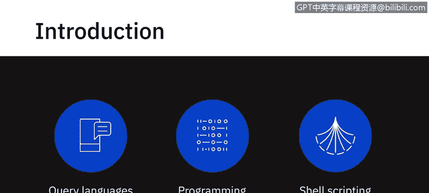
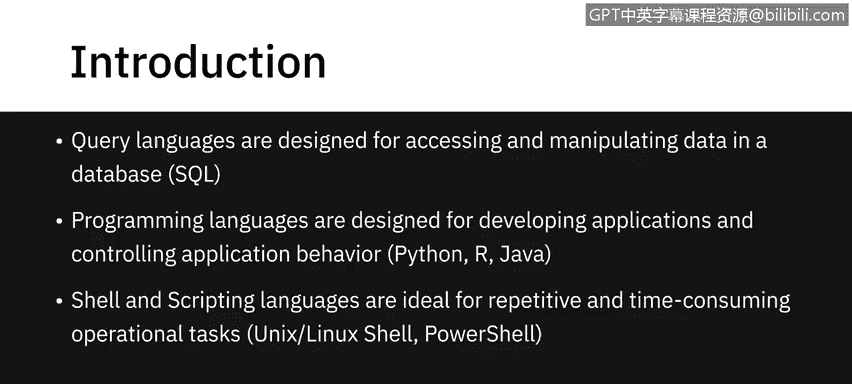
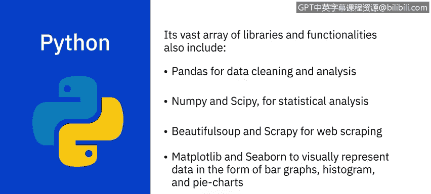
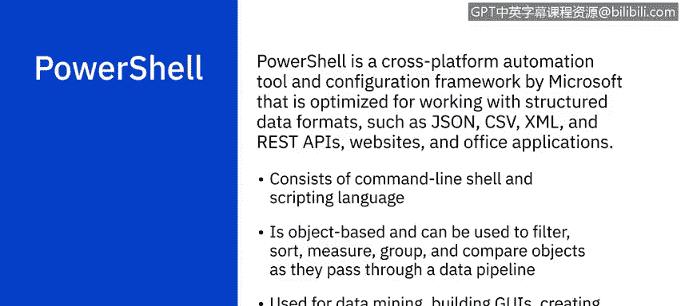

# IBM 数据分析师专业证书课程 1：《数据分析简介》｜introduction-to-data-analytics｜ - P56：13_05_languages-for-data-professionals.en_subtitled - GPT中英字幕课程资源 - BV18P411p7Qj

In this video we will learn about some of the languages relevant to the work of data professionals。

 These can be categorized as query languages， programming languages and shell scripting。

 having proficiency in at least one language in each category is essential for any data professional。

 simply stated， query languages are designed for accessing and manipulating data in a database。

 for example， SQL programming languages are designed for developing applications and controlling application behavior。

 for example， Python R and Java and Shell and scripting languages such as Unix or Linux shellll and Powerhell are ideal for repetitive and time consuming operational tasks。

In the remaining video， we will examine these languages in greater depth。

SQL or Strd query language is a querying language designed for accessing and manipulating information from。

 mostly though not exclusively relational databases。

 using SQL we can write a set of instructions to perform operations such as insert。

 update and delete records in a database， create new databases， tables and views。

 and write stored procedures。Which means you can write a set of instructions and call them for later use。

Here are some advantages of using SQL。 SQL is portable and can be used independent of the platform。

 It can be used for querying data in a wide variety of databases and data repositories。

 although each vendor may have some variations and special extensions。

It has a simple syntax that is similar to the English language。

 Its syntax allows developers to write programs with fewer lines than some of the other programming languages。

 using basic keywords， such as select， insert into an update。

 It can retrieve large amounts of data quickly and efficiently。 It runs on an interpreter system。

 which means code can be executed as soon as it is written， making prototyping quick and easy。

 SQL is one of the most popular querying languages。

 due to its large user community and the sheer volume of documentation accumulated over the years。

 It continues to provide a uniform platform worldwidewide to all its users。

Python is a widely used open source general purposese high level programming language。

 Its syntax allows programmers to express their concepts in fewer lines of code。

 as compared to some of the older languages。 Python is perceived as one of the easiest languages to learn and has a large developer community。

 because of its focus on simplicity and readability and a low learning curve。

 It's an ideal tool for beginning programmers。😊，It is great for performing high computational tasks in vast amounts of data。

 which can otherwise be extremely time consuming and cumbersome。

 Python provides libraries like nuumpy and pandas， which eases the task by the use of parallel processing。

😊，It has inbuil functions for almost all of the frequently used concepts。

Python supports multiple programming paradigms， such as object oriented， imperative。

 functional and procedural， making it suitable for a wide variety of use cases。 Now。

 let's look at some of the reasons that make Python one of the fastest growing programming languages in the world today。

 It is easy to learn with Python。 you have the advantage of using fewer lines of code to accomplish tasks compared to other languages。

 It is open source。 Python is free and uses a community based model for development。😊。

It runs on Windows and Linux environments and can be ported to multiple platforms。

 It has widespread community support， with plenty of useful analytics libraries available。😊。

It has several open source libraries for data manipulation， data visualization。

 statistics and mathematics， to name just a few its vast array of libraries and functionalities also include pandas for data cleaning and analysis。

 nuumpy and side pie for statistical analysis， Bea soup and scrappy for web scraping。

 matteplot Lib and seaborn to visually represent data in the form of bar graphs。

 histogram and pie charts。😊。

Open sea for image processing。R is an open source programming language and environment for data analysis。

 data visualization， machine learning and statistics。

 widely used for developing statistical software and performing data analytics。

 It is especially known for its ability to create compelling visualizations。

 giving it an edge over some of the other languages in this space。

 Some of the key benefits of R include the following。

 It is an open source platform independent programming language。

 It can be paired with many programming languages， including Python。😊，It is highly extensible。

 which means developers can continue to add functionalities by defining new functions。

 It facilitates the handling of structured， as well as unstructured data。

 which means it has more comprehensible data capability。

It has libraries such as GG Ploot2 and Ply that offer aesthetic graphical plots to its users。

You can make reports with the data and scripts embedded in them。

 also interactive web apps that allow users to play with the results and the data。

 it is dominant among other programming languages for developing statistical tools。

Java is an object oriented class based and platform independent programming language originally developed by Sun Microsystems。

It is among the top ranked programming languages used today。

 Java is used in a number of processes all through data analytics， including cleaning data。

 importing and exporting data， Sta analysis and data visualization。 In fact。

 most of the popular framework and tools used for big data are typically written in Java。

 such as Hadoop， Hve and Spark。It is perfectly suited for speed critical projects。

A Uni or Linux shell is a computer program written for the Unix shell。

 It is a series of Unix commands written in a plain text file to accomplish a specific task。

Writing a shell script is fast and easy。 It is most useful for repetitive tasks that may be time consuming to execute by typing one line at a time。

Typical operations performed by She scripts include file manipulation， program execution。

 system administration tasks such as disk backups and evaluating system logs。

 installation scripts for complex programs， executing routine backups， and running batches。

PowerShell is a cross platform automation tool and configuration framework by Microsoft that is optimized for working with structured data formats such as Jason。

 CSV， XmL and RE APIs， websites and office applications。

 It consists of a command line shell and scripting language。PowerShell is object based。

 which makes it possible to filter， sort， measure， group， compare。

 and many more actions on objects as they pass through a data pipeline。

It is also a good tool for data mining， building GUIs， and creating charts， dashboards。

 and interactive reports。

